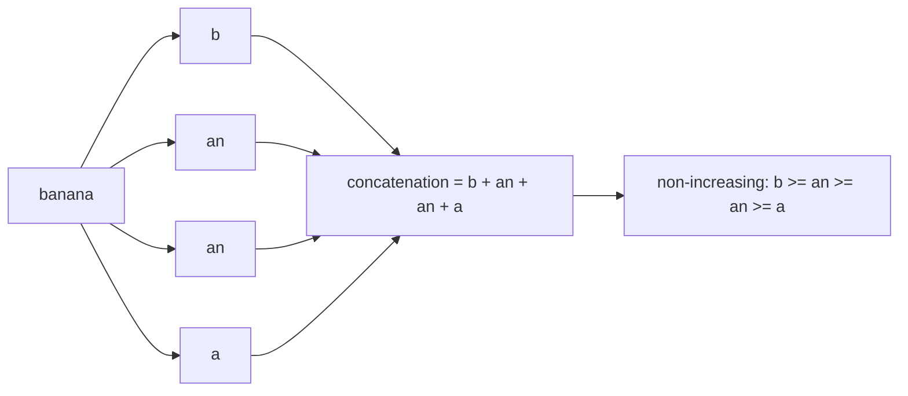
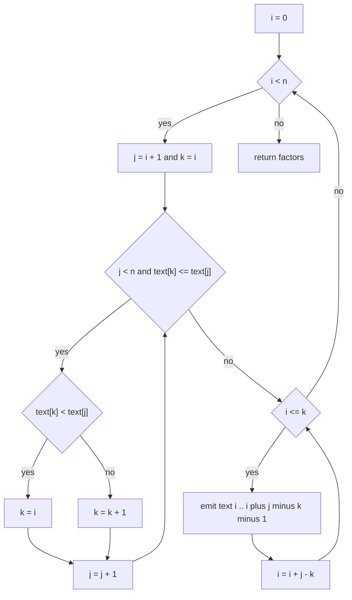
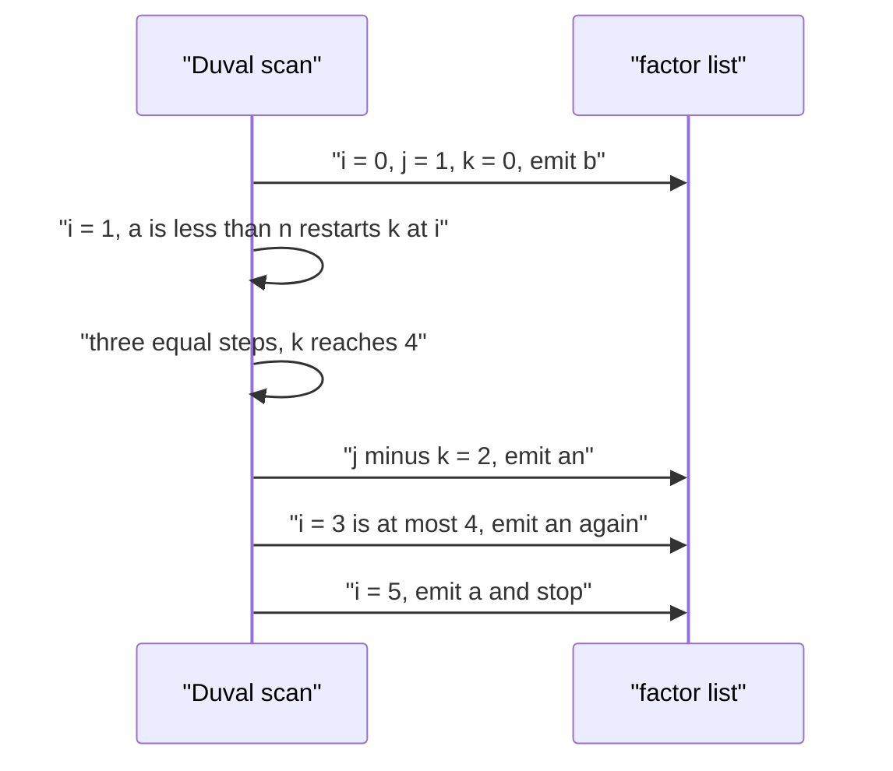

# 529 — Implement advanced string factoring (Lyndon factorization Duval).

> **Tier:** Advanced · **CTCI chapter:** Beyond — Advanced Data Structures & Algorithms
> **Task spec:** [529-implement-advanced-string-factoring-lyndon-factorization-duval.md](../../../tasks/advanced/529-implement-advanced-string-factoring-lyndon-factorization-duval.md)
> **Solutions:** [Python](../../../solutions/python/advanced/529-implement-advanced-string-factoring-lyndon-factorization-duval/solution.py) ·
> [Java](../../../solutions/java/advanced/529-implement-advanced-string-factoring-lyndon-factorization-duval/Solution.java) ·
> [JavaScript](../../../solutions/javascript/advanced/529-implement-advanced-string-factoring-lyndon-factorization-duval/solution.js) ·
> [C#](../../../solutions/csharp/advanced/529-implement-advanced-string-factoring-lyndon-factorization-duval/Solution.cs)

## 1. Problem restatement

**Input:** a string `text` of length `n` over any ordered alphabet. The string may be empty.

**Output:** the Chen-Fox-Lyndon factorization of `text` — the unique sequence of Lyndon words
`f1 >= f2 >= ... >= fk` whose concatenation is exactly `text`. Each factor is returned as a
string; the empty input yields an empty list of factors.

A **Lyndon word** is a non-empty word that is strictly smaller than every one of its proper
non-empty suffixes (equivalently: strictly smaller than every proper rotation). All four solution
files define it with that suffix formulation and test it with a direct comparison loop.

| Call | Result | Why |
| --- | --- | --- |
| `lyndon_factorization("")` | `[]` | nothing to factor |
| `lyndon_factorization("abcd")` | `["abcd"]` | strictly ascending, so the whole string is Lyndon |
| `lyndon_factorization("dcba")` | `["d", "c", "b", "a"]` | strictly descending: single letters, already non-increasing |
| `lyndon_factorization("abab")` | `["ab", "ab"]` | `ab` is Lyndon, `abab` is not (suffix `ab` equals it) |
| `lyndon_factorization("banana")` | `["b", "an", "an", "a"]` | `b` then the `an` period twice, then `a` |
| `lyndon_factorization("aaaaa")` | `["a", "a", "a", "a", "a"]` | no factor may repeat itself, so each `a` stands alone |

Those rows are exactly the hand-verified assertions at the top of `main()` in the Python file,
and the same hand-verified cases appear in the Java, JavaScript and C# files, which then add
large randomized sweeps of the same invariants.

## 2. Intuition

The obvious idea is to factor greedily: at each position take the *longest* Lyndon prefix of the
remaining suffix, cut it off, and continue. That is correct — the longest-Lyndon-prefix choice is
forced, because any other Lyndon prefix would leave a remainder that is not smaller than it — but
testing Lyndon-ness costs a suffix comparison per candidate end, and trying every end costs
`O(n^2)` comparisons, so the whole greedy factorizer is `O(n^3)` in the worst case. The Python
file keeps this routine as `greedy_factorization` precisely because it is the independent
reference the fast algorithm is checked against, not because it is fast.

The insight that makes linear time possible is that a **repetition of a Lyndon word is
prefix-comparable in one scan**. If the current candidate block `s[i..j-1]` has period
`p = j - k`, then compare the character at `k` (the position just after the assumed period
start) with the character at `j` (the look-ahead):

- `s[k] < s[j]` — the period just proved itself too small, so the block restarts as a repetition
  of the *longer* Lyndon word beginning at `i`: set `k = i`.
- `s[k] == s[j]` — the period continues: `k = k + 1`.
- `s[k] > s[j]` — the block can no longer be extended, so `s[i .. i + (j - k) - 1]` is a Lyndon
  word and is emitted, and the scan restarts at `i + (j - k)`.

Because `j - k` stays constant while a factor is repeated, the same factor is emitted several
times in one go — that is the trick that turns the quadratic greedy loop into a single left-to-
right pass with three indices.



The factor sequence is not just any decomposition: it is the unique one that is non-increasing.

## 3. Algorithm

Duval's algorithm as written in all four solution files:

1. Set `i = 0`, the start of the next factor, and `factors = []`.
2. While `i < n`: set `j = i + 1` (look-ahead) and `k = i` (end of the shortest period found so far).
3. While `j < n` and `s[k] <= s[j]`: if `s[k] < s[j]` then `k = i` (restart the period), otherwise
   `k = k + 1` (extend the period); always `j = j + 1`.
4. The block `s[i .. i + (j - k) - 1]` repeats: emit it `while i <= k`, each time advancing
   `i` by `j - k`.
5. Return `factors`.

```text
procedure lyndon_factorization(text)
    n ← length(text)
    factors ← empty list
    i ← 0
    while i < n do
        j ← i + 1
        k ← i
        while j < n and text[k] <= text[j] do
            if text[k] < text[j] then
                k ← i
            else
                k ← k + 1
            end
            j ← j + 1
        end
        while i <= k do
            factors.append(text[i .. i + (j - k) - 1])
            i ← i + (j - k)
        end
    end
    return factors
end
```

The inner `while i <= k` loop is the "emit the repeat" step: the same factor length `j - k` is
cut off as many times as the scan proved it repeats. Note that `k` is never reset between the two
loops, and `j` is left where the scan stopped — the outer pass resumes from the new `i` with a
fresh `j = i + 1`, so no character is ever compared twice as a *start* of a factor.



## 4. Worked example

Trace `lyndon_factorization("banana")`, `n = 6`, with `text = b a n a n a` at indices 0..5.

| Round | `i` | `j` | `k` | comparison | action |
| --- | --- | --- | --- | --- | --- |
| 1 | 0 | 1 | 0 | `text[0] = b <= text[1] = a` is false | scan stops immediately |
| 1 | 0 | 1 | 0 | `i <= k` holds once | emit `text[0..0] = b`, `i = 1` |
| 2 | 1 | 2 | 1 | `a <= n` true, `a < n` | `k = i = 1`, `j = 3` |
| 2 | 1 | 3 | 1 | `a <= a` true, equal | `k = 2`, `j = 4` |
| 2 | 1 | 4 | 2 | `n <= n` true, equal | `k = 3`, `j = 5` |
| 2 | 1 | 5 | 3 | `a <= a` true, equal | `k = 4`, `j = 6 = n` |
| 2 | 1 | 6 | 4 | loop exits, `j - k = 2` | emit `text[1..2] = an`, `i = 3` |
| 2 | 3 | 6 | 4 | `i = 3 <= k = 4` still holds | emit `text[3..4] = an`, `i = 5` |
| 2 | 5 | 6 | 4 | `i = 5 > k = 4` | leave the repeat loop |
| 3 | 5 | 6 | 5 | `j = n`, scan stops | emit `text[5..5] = a`, `i = 6` |

The state before the second round is `factors = ["b"]`; after it, `factors = ["b", "an", "an"]`;
after the third round, `factors = ["b", "an", "an", "a"]` and `i = n`, so the algorithm stops.
Every factor is Lyndon and the sequence `b >= an >= an >= a` is non-increasing.



The two `an` factors come from a single scan: the emit loop hands out the same length twice, which
is the linearity trick in action.

## 5. Complexity

Let `n` be the length of `text`.

| Measure | Bound | Why it holds |
| --- | --- | --- |
| Time, best | O(n) | `"abcd"` still walks every character once; even a string that stops the scan immediately takes one comparison per position |
| Time, average | O(n) | each round of the inner scan advances `j`, and `j - k` advances `i` by exactly the amount the scan moved `j` past `k`, so the total movement is bounded by `n` |
| Time, worst | O(n) | Duval's classic amortization: `i` advances by `j - k` and never revisits a position, so at most `2n` comparisons |
| Space, output | O(n) | the factors concatenate to the input |
| Space, extra | O(1) | three indices (`i`, `j`, `k`) and the factor list; the Python, JavaScript and C# versions slice substrings out of the input, the Java version uses `substring`, none of them copies the whole input |
| Time of the greedy reference | O(n^3) | every candidate end needs a `O(n)` Lyndon test, and the test itself compares suffixes |
| Time with a naive Lyndon test per factor | O(n^2) | comparing every factor against all of its suffixes |

The auxiliary `greedy_factorization` in the Python file is the `O(n^3)` reference and is only run
on the exhaustive sweeps up to length 10 over `{a, b}` and length 8 over `{a, b, c}`.

## 6. Pitfalls and edge cases

- **Empty string.** `lyndon_factorization("")` must return `[]`, not `[""]`; `""` is not a Lyndon
  word because Lyndon words are non-empty. The Python, Java, JavaScript and C# files all assert
  the empty case (the JavaScript and C# files explicitly assert `[]`).
- **Single character.** `"a"` is a Lyndon word, so the answer is `["a"]`. The reference Lyndon
  test returns `false` for the empty word but `true` for a one-character word, since the
  "for every proper suffix" condition is vacuous.
- **Repeated characters.** `"aaaaa"` splits into five single letters, never into `"aa"`, because a
  power `w^k` of a Lyndon word `w` is not Lyndon — it is not strictly smaller than its own suffix.
  The Python file additionally checks the identity `w^k -> [w] * k` for `k = 1..5` on the Lyndon
  words `a, ab, aab, abac, abc, abb, aabab, aaab`.
- **Squares and higher powers.** `"abab"` gives `["ab", "ab"]`; the general rule is that a string
  factors into identical pieces exactly when it is a power of a Lyndon word, which the Python file
  asserts as a control for `abab`, `abcabcabc` and `aabaab`.
- **Strictly descending input.** `"dcba"` factors into four single letters, and the 26-character
  descending alphabet gives `[1] * 26` single-character factors — an easy off-by-one trap when the
  emit loop is written as `while i < k`.
- **Strictly ascending input.** `"abcd"` is a single factor; the ascending 26-letter alphabet
  factors as one word, which the file asserts as `factorization_from_array(ascending, ...) == [ascending]`.
- **Comparison order.** `<=` versus `<` in `while j < n and text[k] <= text[j]` is not
  interchangeable: the `==` branch extends the period (`k = k + 1`) while the `<` branch restarts
  it (`k = i`). Swapping them silently produces factors that are not Lyndon words.
- **Unique factorization is a theorem, not an accident.** For `"banana"` both the fast algorithm
  and the greedy longest-Lyndon-prefix reference produce `["b", "an", "an", "a"]`; the file checks
  the equality exhaustively for all `2^1 + ... + 2^10` binary strings and all ternary strings up
  to length 8 (the assert on `checked` pins the count at `(2^11 - 2) + (3^9 - 3) / 2`).
- **Alphabet breadth.** The files run on `{a, b}` and `{a, b, c}` plus LCG-generated strings up to
  length 2000, so the implementation must not assume a two-letter alphabet or ASCII only; the
  comparison must be the language's ordinal/lexicographic comparison, which is what all four
  solutions use.
- **`k` must not be reused as a factor length.** The emitted factor length is `j - k`, computed
  once per round; recomputing it after `i` advanced is a classic transcription bug that makes the
  repeat loop emit short factors.

## 7. Variants and follow-ups

- **The Lyndon array.** Instead of the factor sequence, compute `Lyn[i]`, the length of the
  longest Lyndon word starting at `i`; the first Duval factor of `s[i:]` gives it for free. See
  [530-implement-lyndon-array-and-uses.md](../../../tasks/advanced/530-implement-lyndon-array-and-uses.md).
- **Suffix-order tooling.** The last factor of the factorization begins at the lexicographically
  minimal suffix of the string (asserted in the Java file), which ties the factorization to suffix
  sorting — [402-build-lcp-array-from-suffix-array-kasai.md](../../../tasks/advanced/402-build-lcp-array-from-suffix-array-kasai.md)
  builds the LCP array on the same suffix ordering.
- **Counting Lyndon words.** The number of Lyndon words of length `L` over a `sigma`-letter
  alphabet is `(1/L) * sum over d dividing L of mu(d) * sigma^(L/d)`; the Java and C# files check
  that formula with a trial-division Möbius function.
- **String hashing for Lyndon tests.** When only equality of factors matters, rolling hashes can
  replace direct comparisons — [411-implement-advanced-rolling-hash-with-modular-and-base-tuning.md](../../../tasks/advanced/411-implement-advanced-rolling-hash-with-modular-and-base-tuning.md).
- **Necklaces and de Bruijn sequences.** Duval's factorization is the standard linear-time
  necklace generator (emit the factors, compare rotations by their factors), which is why the
  same three indices reappear in `O(n)`-per-necklace enumeration code.

## 8. Check yourself

1. Why does `lyndon_factorization("aaaaa")` return five factors instead of one?

<details><summary>Show answer</summary>

Because a Lyndon word must be *strictly* smaller than each of its proper suffixes, and `"aaaa"`
has the suffix `"aaaa"` … more precisely the suffix `"aaa"` equals the corresponding prefix, and
`"aaaa" < "aaaa"` is false. Any repetition `w^2` fails the test, so every factor of `"aaaaa"` is a
single `a`, and the sequence is non-increasing as required.

</details>

2. What are `j` and `k` doing at the moment the first factor of `"banana"` is emitted?

<details><summary>Show answer</summary>

The inner scan stopped instantly (`b <= a` is false), so `j = 1` and `k = i = 0`. The factor
length is `j - k = 1`, which yields `text[0..0] = "b"`, and the emit loop runs once because
`i = 0 <= k = 0` and `i` becomes `1 > 0`.

</details>

3. Why can the same factor be emitted more than once in the same round?

<details><summary>Show answer</summary>

Because the scan proved that the block from `i` to `j - 1` is a repetition of the period of length
`j - k`. Emitting `s[i .. i + (j - k) - 1]` repeatedly reproduces that whole block, and the emit
loop stops as soon as the start index passes `k`. This is what keeps the algorithm linear: the
work of proving `m` copies is shared by all `m` of them.

</details>

4. What is the cost of the greedy longest-Lyndon-prefix factorizer, and why is it still shipped?

<details><summary>Show answer</summary>

Its inner candidate loop, the Lyndon test and the per-factor scan make it `O(n^3)` in the worst
case (the Python file describes it as the slow `O(n^2)` greedy on top of the `O(n)` Lyndon test).
It ships because it is an independent implementation of the *definition*, so agreement between it
and Duval's algorithm on exhaustive small inputs is real evidence, not a tautology.

</details>

5. Which property of the factorization makes the answer unique?

<details><summary>Show answer</summary>

The Chen-Fox-Lyndon theorem: every string has exactly one decomposition into Lyndon words that is
non-increasing in lexicographic order (`f1 >= f2 >= ... >= fk`). Duval's algorithm constructs that
decomposition directly, so it never has to choose — the greedy rule "take the longest Lyndon
prefix" and the linear scan agree by the theorem.

</details>
