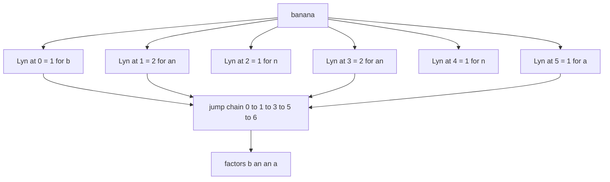
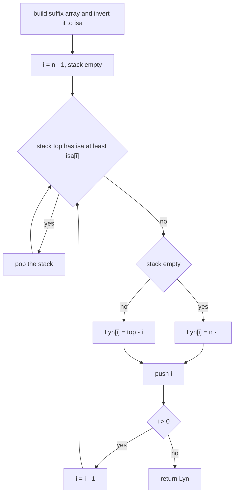
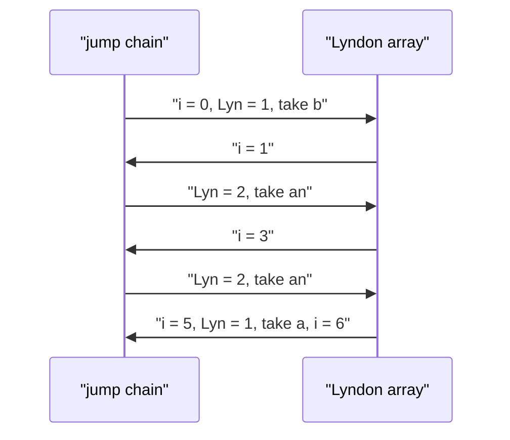

# 530 — Implement Lyndon array and uses.

> **Tier:** Advanced · **CTCI chapter:** Beyond — Advanced Data Structures & Algorithms
> **Task spec:** [530-implement-lyndon-array-and-uses.md](../../../tasks/advanced/530-implement-lyndon-array-and-uses.md)
> **Solutions:** [Python](../../../solutions/python/advanced/530-implement-lyndon-array-and-uses/solution.py) ·
> [Java](../../../solutions/java/advanced/530-implement-lyndon-array-and-uses/Solution.java) ·
> [JavaScript](../../../solutions/javascript/advanced/530-implement-lyndon-array-and-uses/solution.js) ·
> [C#](../../../solutions/csharp/advanced/530-implement-lyndon-array-and-uses/Solution.cs)

## 1. Problem restatement

**Input:** a string `text` of length `n` over an ordered alphabet. The string may be empty.

**Output:** the **Lyndon array** `Lyn` of length `n`, where `Lyn[i]` is the length of the longest
Lyndon word that starts at position `i` — that is, the largest `L >= 1` such that the substring
`text[i .. i + L - 1]` is strictly smaller than every one of its own proper non-empty suffixes.
For the empty input the answer is the empty array.

The tutorial then covers the **uses** the solution files assert, because those are what make the
array interesting:

| Use | Statement |
| --- | --- |
| Duval factorization | jumping `i -> i + Lyn[i]` from 0 reproduces the Chen-Fox-Lyndon factorization; jumping from any `i` factors the suffix `text[i:]` |
| longest Lyndon substring | `max(Lyn)` is its length |
| Lyndon suffixes | `Lyn[i] = n - i` exactly when the suffix `text[i:]` is a Lyndon word (and `Lyn[0] = n` exactly when `text` is) |
| rank certificate | for every `i < j < i + Lyn[i]`, the suffix at `j` is lexicographically larger than the suffix at `i` |

| Call | Result | Why |
| --- | --- | --- |
| `lyndon_array("abc")` | `[3, 2, 1]` | `abc`, `bc`, `c` are all Lyndon (strictly ascending) |
| `lyndon_array("cba")` | `[1, 1, 1]` | every longer prefix contains `b` or `a` after a bigger letter |
| `lyndon_array("banana")` | `[1, 2, 1, 2, 1, 1]` | `b`, `an`, `n`, `an`, `n`, `a` — the sum is 8 |
| `lyndon_array("zz")` | `[1, 1]` | equal letters are never *strictly* smaller than their suffix |
| `lyndon_array("")` | `[]` | nothing to report |

Those rows are the hand-verified assertions at the top of `main()` in the Python file, and the
Java, JavaScript and C# files assert the same values before running their exhaustive sweeps.

## 2. Intuition

The definition gives an immediate `O(n^2)`-per-position routine: for each `i`, try every length
`L = 1, 2, ...` and keep the largest one whose window passes the Lyndon test
("`w < w[k:]` for every `k >= 1`"). That test walks the window, so the whole computation is
`O(n^3)` — fine for `"banana"`, hopeless for a 2000-character LCG string. The Python file keeps it
as `lyndon_array_by_definition` and uses it as the reference for small inputs only.

Two better ideas exist, and the solution files implement both:

1. **Reuse Duval.** The first factor of the Chen-Fox-Lyndon factorization of the suffix `text[i:]`
   is precisely the longest Lyndon prefix of that suffix. So `Lyn[i] = len(duval(text[i:])[0])`.
   Running Duval once per suffix is `O(n)` per suffix, `O(n^2)` overall — a big step up from
   `O(n^3)`, and exactly what the Python file's `lyndon_array_by_duval` does.
2. **Reuse suffix order.** The longest Lyndon word starting at `i` ends immediately before the
   first suffix to the right that is *strictly smaller* than the suffix at `i`. In suffix-array
   terms, with `isa[j]` the rank of suffix `j`:

   `Lyn[i] = NSV[i] - i`, where `NSV[i]` is the smallest `j > i` with `isa[j] < isa[i]`
   (`NSV[i] = n` when no such `j` exists, so `Lyn[i] = n - i`).

   The next-smaller-value search is a monotonic stack pass, so after an `O(n log^2 n)` suffix
   array the array itself costs `O(n)`. That is the route taken by the Java, JavaScript and C#
   files, and it is also why the rank certificate below is a theorem rather than a coincidence.



The jump chain in the picture is the whole payoff: the array alone, walked greedily, rebuilds
Duval's factorization.

## 3. Algorithm

**A. Definitional (reference, small inputs).** For each `i`, scan `L` from 1 to `n - i`, keep the
last `L` for which `text[i .. i + L - 1]` is Lyndon. `O(n^3)`.

**B. Duval per suffix (what the Python and JavaScript files compute at scale).** For each `i`, run
Duval on `text[i:]` and take the length of its first factor. `O(n^2)`.

**C. Suffix-array route (Java, C# and the fast JavaScript variant).**

1. Build the suffix array by doubling (`O(n log^2 n)`), then invert it to get `isa[j]`.
2. Scan `i` from `n - 1` down to `0`, maintaining a stack of indices with increasing `isa` values.
3. Pop every index whose `isa` is `>= isa[i]`; the top of the stack after popping is `NSV[i]`
   (or `n` when the stack is empty); push `i`.
4. Set `Lyn[i] = NSV[i] - i`.

```text
procedure lyndon_array_by_duval(text)
    n ← length(text)
    array ← empty array of length n
    for i ← 0 to n - 1 do
        array[i] ← length(first factor of duval(text[i .. n - 1]))
    end
    return array
end

procedure lyndon_array_by_next_smaller(text)
    n ← length(text)
    isa ← inverse suffix array of text
    array ← empty array of length n
    stack ← empty stack
    for i ← n - 1 down to 0 do
        while stack is not empty and isa[top of stack] >= isa[i] do
            pop stack
        end
        if stack is empty then
            array[i] ← n - i
        else
            array[i] ← (top of stack) - i
        end
        push i onto stack
    end
    return array
end
```

Note that both procedures agree — the Python file asserts
`lyndon_array_by_definition(text) == lyndon_array_by_duval(text)` for every binary string up to
length 11 and every ternary string up to length 7, and the C# file cross-checks its three
implementations the same way.

The jump-chain use is a five-line loop:

```text
procedure factorization_from_array(text, array)
    factors ← empty list
    i ← 0
    while i < length(text) do
        factors.append(text[i .. i + array[i] - 1])
        i ← i + array[i]
    end
    return factors
end
```



The stack invariant is that `isa` strictly increases from bottom to top; popping everything
`>= isa[i]` therefore leaves exactly the nearest smaller suffix to the right.

## 4. Worked example

Take `text = "banana"` (`n = 6`) and compute `Lyn` with the Duval route.

| `i` | suffix `text[i:]` | first Duval factor | `Lyn[i]` |
| --- | --- | --- | --- |
| 0 | `banana` | `b` | 1 |
| 1 | `anana` | `an` | 2 |
| 2 | `nana` | `n` | 1 |
| 3 | `ana` | `an` | 2 |
| 4 | `na` | `n` | 1 |
| 5 | `a` | `a` | 1 |

`Lyn = [1, 2, 1, 2, 1, 1]`, and its sum is 8, exactly as the Python file asserts. Note `Lyn[1] = 2`
while `text[1:5] = "anan"` is *not* Lyndon — the `anan` suffix `an` equals its prefix, which is why
the assert `array[1] != 4` is in the file.

Now walk the jump chain from 0 on the same array:

| Step | `i` | `Lyn[i]` | factor taken | `i` after |
| --- | --- | --- | --- | --- |
| 1 | 0 | 1 | `b` | 1 |
| 2 | 1 | 2 | `an` | 3 |
| 3 | 3 | 2 | `an` | 5 |
| 4 | 5 | 1 | `a` | 6 = `n` |

The chain produced `["b", "an", "an", "a"]`, which is exactly Duval's factorization of `"banana"`
from task 529. The rank certificate also holds: the suffix ranks of `"banana"` are
`rank(0) = 3, rank(1) = 2, rank(2) = 5, rank(3) = 1, rank(4) = 4, rank(5) = 0`, so for `i = 1` the
only interior position is `j = 2` and indeed `rank(1) = 2 < rank(2) = 5`.



Periodic strings make the same point about the fast route: `"ababababab"` gives `[2, 1] * 5` and
factors into `["ab"] * 5`, `"abcabcabc"` gives `[3, 2, 1] * 3` and factors into `["abc"] * 3`, and
`"aabbaabb"` gives `[4, 3, 1, 1] * 2` and factors into `["aabb", "aabb"]`.

## 5. Complexity

| Measure | Bound | Why it holds |
| --- | --- | --- |
| Time, definitional route | O(n^3) | `O(n)` window lengths, each needing an `O(n)` suffix comparison, per start index |
| Time, Duval-per-suffix route | O(n^2) | one linear Duval run per suffix |
| Time, suffix-array route | O(n log^2 n) for the suffix array plus O(n) for the stack | doubling sorts `O(log n)` rounds of `O(n)`-sized rank strings; the next-smaller-suffix pass pushes and pops each index once |
| Time, jump chain | O(n) | `i` strictly increases by `Lyn[i] >= 1` |
| Space, array | O(n) | one integer per position |
| Space, extra | O(n) for the suffix array and the stack; O(1) beyond the stack if a suffix array is already available | the stack holds at most `n` indices |

The solution files use the definitional route only for the exhaustive small sweeps and switch to
Duval for the LCG strings of length 1, 17, 60, 150 and 400; the Java and C# files additionally
build the suffix array so they can compute the array in `O(n)` after `O(n log^2 n)`.

## 6. Pitfalls and edge cases

- **Empty string.** `Lyn` is `[]` and `factorization_from_array("", [])` is `[]`. The Python file
  asserts both; a loop written as `while i <= n` would emit a phantom factor here.
- **Single character.** `"a"` gives `[1]` because the Lyndon test is vacuously true for a word
  with no proper suffix.
- **Equal adjacent characters.** `"zz"` gives `[1, 1]`: `"zz"` is not Lyndon since it is not
  *strictly* smaller than its suffix `"z"`. The same rule produces `[1] * 26` for the 26-character
  descending alphabet.
- **Strictly ascending input.** `"abc"` gives `[3, 2, 1]` and the 26-character ascending alphabet
  gives `26, 25, ..., 1`; the jump chain then produces the whole string as a single factor.
- **`Lyn[i] = n - i` is not "the suffix is long".** It is an equivalence: `Lyn[i] = n - i` if and
  only if `text[i:]` is a Lyndon word. The Python file asserts the equivalence in both directions
  for every position of every exhaustive string and every LCG string.
- **The rank certificate is strict.** Interior positions must satisfy `rank(i) < rank(j)`; the
  assert is `<`, not `<=`, and it is what forces the factor to end just before the next smaller
  suffix. An implementation that stops at a suffix that is *equal* would break equality of strings
  with repeated suffixes.
- **`max(Lyn)` is the longest Lyndon substring, not the longest Lyndon factor.** For `"banana"`
  the maximum is 2, reached by `"an"` at positions 1 and 3; no window of length 3 is Lyndon.
- **Negative or zero entries are impossible.** `Lyn[i] >= 1` for every `i < n` because the single
  character at `i` is always Lyndon; the exhaustive sweep asserts `all(value >= 1 ...)`.
- **Suffix-array dependency.** The Java, JavaScript and C# fast routes are only as correct as the
  suffix array they build — the C# file builds it by doubling and re-sorts rank pairs each round,
  so ties must be broken by the pair order, not by index, or `isa` is not the inverse permutation.
- **Big strings.** `lcg_text(400, 53, 3)` is the largest LCG instance in the Python file and the
  definitional route is *not* run on it (the file notes the `O(n^3)` definition is replaced by the
  Duval computation at scale), so the tests still finish quickly.

## 7. Variants and follow-ups

- **The factorization itself.** Task 529 is the direct consumer:
  [529-implement-advanced-string-factoring-lyndon-factorization-duval.md](../../../tasks/advanced/529-implement-advanced-string-factoring-lyndon-factorization-duval.md)
  computes the factors in `O(n)` with three indices instead of the array.
- **Suffix arrays and LCP.** The `O(n)` next-smaller-suffix route needs suffix ranks and pairs well
  with an LCP array; see
  [402-build-lcp-array-from-suffix-array-kasai.md](../../../tasks/advanced/402-build-lcp-array-from-suffix-array-kasai.md)
  and [401-implement-suffix-array-sa-is-or-doubling-for-medium-n.md](../../../tasks/advanced/401-implement-suffix-array-sa-is-or-doubling-for-medium-n.md).
- **Longest repeated substring.** `max(Lyn)` is a cheap lower bound on the longest repeated
  substring; the LCP-based answer is exact and is covered by
  [403-use-suffix-array-lcp-for-longest-repeated-substring.md](../../../tasks/advanced/403-use-suffix-array-lcp-for-longest-repeated-substring.md).
- **Next-smaller-value stacks.** The monotonic stack in step 3 is the same device used for
  "nearest smaller element to the right" in array problems and for histogram-style problems; only
  the comparison key changes from values to suffix ranks.
- **Online variants.** Both the Duval route and the stack route are incremental in `i`, so a
  streaming version can maintain `Lyn` for a growing prefix by recomputing Duval only from the last
  factor boundary.

## 8. Check yourself

1. Why is `Lyn[1] = 2` for `"banana"` although `"anan"` (length 4) starts at the same position?

<details><summary>Show answer</summary>

Because `"anan"` is not Lyndon: its proper suffix `"an"` is equal to its prefix, and a Lyndon word
must be *strictly* smaller than every proper suffix. `"an"` is Lyndon (`"an" < "n"`), and `"ana"`
is not, because `"ana" < "a"` is false. Hence the longest Lyndon prefix is `"an"`, length 2.

</details>

2. Which theorem lets the Java and C# files compute `Lyn` with a monotonic stack?

<details><summary>Show answer</summary>

`Lyn[i]` equals the distance from `i` to the next suffix to the right that is strictly smaller, i.e.
`NSV[i] - i` with `NSV[i]` the smallest `j > i` such that `isa[j] < isa[i]` (`n - i` if none). Once
suffix ranks exist, finding "next strictly smaller value to the right" is a single stack pass.

</details>

3. What does the jump chain `i -> i + Lyn[i]` produce, and why?

<details><summary>Show answer</summary>

The Chen-Fox-Lyndon factorization. `Lyn[i]` is the longest Lyndon prefix of the suffix `text[i:]`,
which is exactly the first factor Duval would emit from `i`; repeating the jump consumes the flags
in the same order and reproduces the same factors. The Python file asserts the equality against
`duval(text)` for every start position of every exhaustive string.

</details>

4. For `"banana"`, which interior position does the rank certificate constrain at `i = 3`, and what
are the two ranks?

<details><summary>Show answer</summary>

`Lyn[3] = 2`, so the only interior position is `j = 4`. The suffix ranks are `rank(3) = 1` for
`"ana"` and `rank(4) = 4` for `"na"`, and `1 < 4`, so the interior suffix really is larger. The
smallest suffix overall is `"a"` at position 5, which is where the factor from 3 stops.

</details>

5. Why does `"zz"` give `[1, 1]` and not `[2, 1]`?

<details><summary>Show answer</summary>

`"zz"` has the proper suffix `"z"`, and `"zz" < "z"` is false (they differ in length and share a
prefix, so the shorter one is smaller). No window of length 2 is Lyndon, so both entries are 1 —
the same reasoning that turns any run of equal characters into single-letter entries.

</details>
