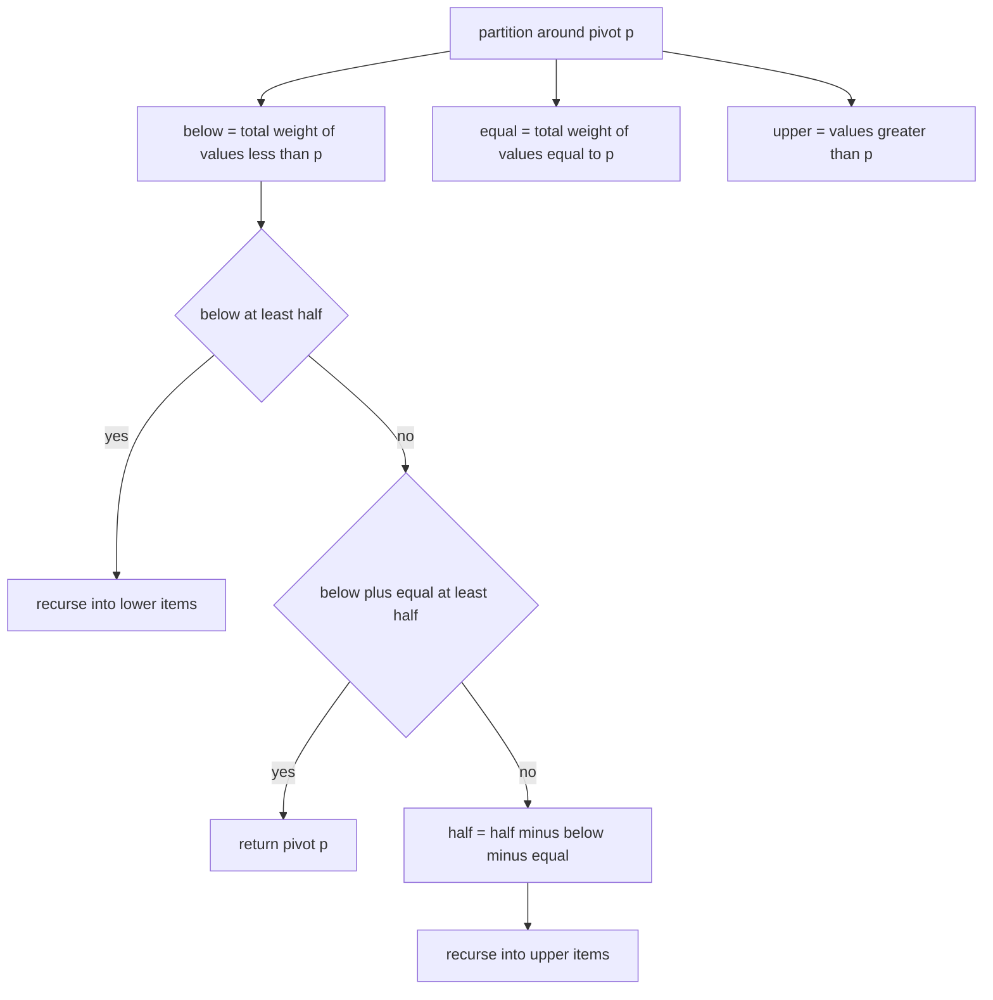
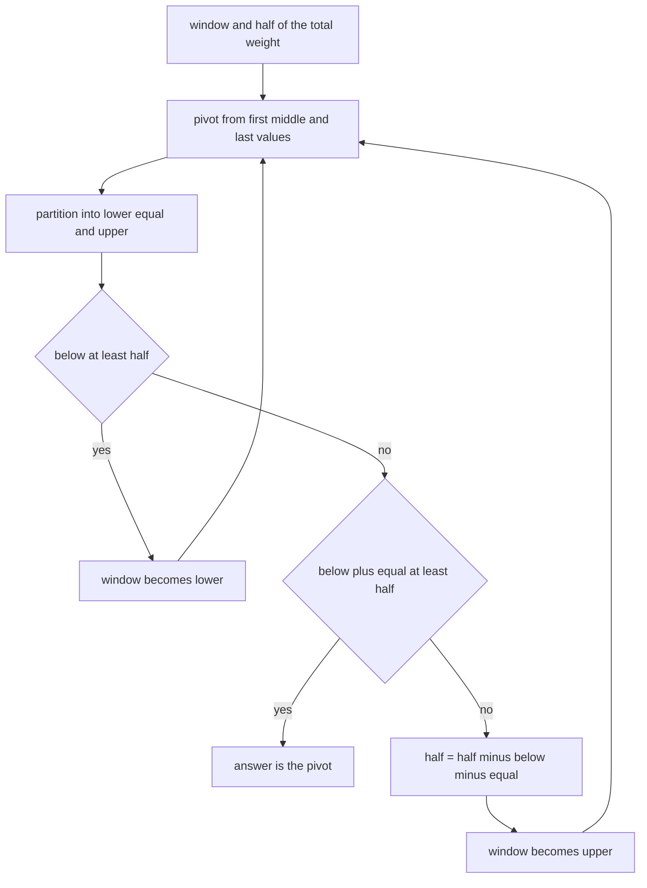
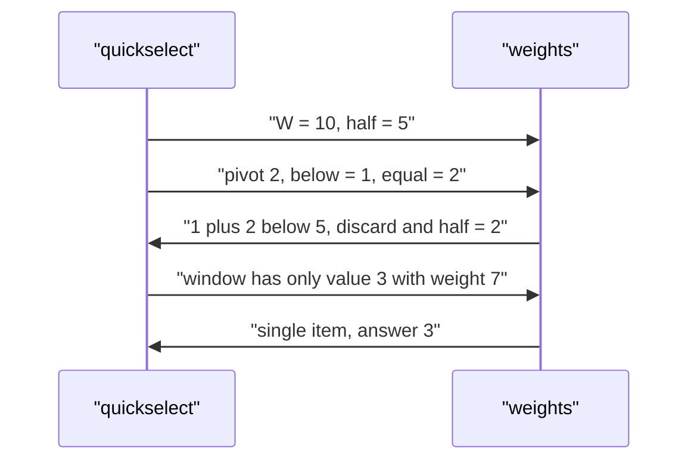

# 531 — Implement weighted median selection algorithm.

> **Tier:** Advanced · **CTCI chapter:** Ch 10 — Sorting and Searching
> **Task spec:** [531-implement-weighted-median-selection-algorithm.md](../../../tasks/advanced/531-implement-weighted-median-selection-algorithm.md)
> **Solutions:** [Python](../../../solutions/python/advanced/531-implement-weighted-median-selection-algorithm/solution.py) ·
> [Java](../../../solutions/java/advanced/531-implement-weighted-median-selection-algorithm/Solution.java) ·
> [JavaScript](../../../solutions/javascript/advanced/531-implement-weighted-median-selection-algorithm/solution.js) ·
> [C#](../../../solutions/csharp/advanced/531-implement-weighted-median-selection-algorithm/Solution.cs)

## 1. Problem restatement

**Input:** `n` pairs of a value `values[i]` and a non-negative weight `weights[i]`, with a strictly
positive total weight `W`. Values are comparable and may repeat; weights may be fractional.

**Output:** the **lower weighted median** — the smallest value `x` whose cumulative weight reaches
half of the total, i.e. the smallest `x` satisfying

```text
weight(v < x) < W / 2 <= weight(v <= x)
```

Two properties fix the contract. The postcondition above pins the answer uniquely (if two
cumulative weights land exactly on `W / 2`, the *smaller* value wins), and when all weights are
equal the definition collapses to the ordinary lower median of the multiset. Every solution file
asserts both.

| Call | Result | Why |
| --- | --- | --- |
| `weighted_median([4, 1, 3, 2], [1, 1, 1, 1])` | `2` | equal weights: the lower median of `1, 2, 3, 4` |
| `weighted_median([1, 2, 3], [0.1, 0.5, 0.4])` | `2` | `W = 1`, half is `0.5`; the prefix weight at `2` is `0.6 >= 0.5` |
| `weighted_median([1, 2, 3], [1, 2, 7])` | `3` | `W = 10`, half is `5`; `2` only carries `3`, `3` carries `10` |
| `weighted_median([7], [3])` | `7` | a single item is always its own median |
| `weighted_median([10, 20], [6, 5])` | `10` | `6 > 11/2`, so `10` crosses half by itself |
| `weighted_median([10, 20], [5, 6])` | `20` | now only `20` carries enough weight |

These six rows are the hand-computed assertions at the top of `main()` in the Python file; the Java
and C# files assert the same family, and the JavaScript file repeats them with an explicit
float-weight case.

## 2. Intuition

The naive method is to sort the items by value, walk a running weight, and stop at the first item
that reaches half of `W`. That is `O(n log n)` and it is what the solutions call the **sort-and-scan**
algorithm — it is simple, exact, and worth keeping as a reference. It computes far more than needed,
though: the answer is a single order statistic, and order statistics do not require a full sort.

The second idea is the weighted analogue of quickselect. Partition the current window around a pivot
value `p` and accumulate three weights — `below` (strictly smaller values), `equal` (values equal to
`p`, *as a total weight*, not a count) and implicitly the rest above. Then decide where the median
mass lives:

- if `below >= half`, the answer is strictly below `p`, so recurse on the strictly-smaller items;
- if `below + equal >= half`, the median mass is inside the equal block, and the answer is exactly
  `p` (this is where duplicates and single-item windows are absorbed);
- otherwise the answer is above `p`, so recurse on the larger items after *subtracting* the mass
  already discarded: `half = half - (below + equal)`.

The key difference from plain quickselect is that the comparison quantity is **weight, not rank**.
Because weights can be fractional, the Python file carries them as `Fraction` values so that the
`below < half <= below + equal` comparisons are exact and no `epsilon` fudge is needed; the Java and
C# files work on `double`/`decimal` and compare with the same three-way shape.



The pivot is chosen **deterministically** as the median of the first, middle and last values of the
window, so the algorithm contains no randomness and its result does not depend on input order — the
Python file asserts exactly that for five repeated calls and for a reversed input.

## 3. Algorithm

**A. Sort and scan.**

1. Validate the weights (non-negative) and compute `total`; reject `total <= 0`.
2. Sort the pairs by value.
3. Walk the pairs, adding weights to a running sum; return the first value whose running sum reaches
   `total / 2`.

**B. Weighted quickselect.**

1. Validate and compute `total`; set `half = total / 2`.
2. While more than one item remains: choose the pivot `p` as the median of the first, middle and last
   values; partition the window into `lower`, `equal` and `upper`, accumulating `below` and `equal`.
3. If `below >= half` continue with `lower`; else if `below + equal >= half` return `p`; else set
   `half = half - (below + equal)` and continue with `upper`.
4. A single remaining item is the answer.

```text
procedure weighted_median_select(values, weights)
    if values is empty then
        raise error "cannot select from an empty sequence"
    end
    reject negative weights
    total ← sum of weights as exact rationals
    if total <= 0 then
        raise error "the total weight must be positive"
    end
    half ← total / 2
    items ← pairs of value and weight
    while true do
        if length(items) = 1 then
            return value of the single item
        end
        pivot ← median of the first, the middle and the last value in items
        below ← 0
        equal ← 0
        lower ← empty list
        upper ← empty list
        for each item in items do
            if item.value < pivot then
                below ← below + item.weight
                append item to lower
            else if item.value > pivot then
                append item to upper
            else
                equal ← equal + item.weight
            end
        end
        if below >= half then
            items ← lower
        else if below + equal >= half then
            return pivot
        else
            half ← half - below - equal
            items ← upper
        end
    end
end
```

Both algorithms must return the same value, which the Python file checks on LCG instances of size
1, 2, 7, 25, 60 and 120 as well as on the hand-computed rows.

The selection loop is a three-way decision on weights, not on counts:



The third algorithm in the files is the **replication identity**: expanding item `i` into `w_i`
copies and taking the element at index `len // 2` for odd length (or `len // 2 - 1` for even length)
reproduces the weighted median exactly whenever the weights are integers. It is `O(W)` time and
therefore only used on small instances, but it is a completely independent definition of the answer.

```text
procedure replicate_and_pick(values, weights)
    expanded ← empty list
    for i ← 0 to length(values) - 1 do
        append value[i] to expanded, weights[i] times
    end
    sort expanded
    if length(expanded) is odd then
        return expanded[length(expanded) / 2]
    else
        return expanded[length(expanded) / 2 - 1]
    end
end
```

## 4. Worked example

**Sort-and-scan on `values = [4, 1, 3, 2]`, `weights = [1, 1, 1, 1]`** (`W = 4`, `half = 2`):

| Step | value | weight | running weight | `running >= half` |
| --- | --- | --- | --- | --- |
| 1 | 1 | 1 | 1 | no |
| 2 | 2 | 1 | 2 | yes, return `2` |

**Weighted quickselect on `values = [1, 2, 3]`, `weights = [1, 2, 7]`** (`W = 10`, `half = 5`):

| Pass | window | pivot | `below` | `equal` | decision |
| --- | --- | --- | --- | --- | --- |
| 1 | `(1,1) (2,2) (3,7)` | `2` (median of `1, 2, 3`) | `1` | `2` | `1 < 5` and `1 + 2 < 5`, so `half = 5 - 3 = 2`, window becomes `(3,7)` |
| 2 | `(3,7)` | — | — | — | single item, return `3` |

Notice that pass 1 threw away three quarters of the total weight: the `7` that decides the answer is
the only item that survives, and no sort of the three items was needed.

**Weighted quickselect on `[4, 1, 3, 2]` with unit weights** (`W = 4`, `half = 2`) shows the other
branch:

| Pass | window | pivot | `below` | `equal` | decision |
| --- | --- | --- | --- | --- | --- |
| 1 | `(4,1) (1,1) (3,1) (2,1)` | `3` (median of first `4`, middle `3`, last `2`) | `2` | `1` | `below = 2 >= half = 2`, recurse into `(1,1) (2,1)` |
| 2 | `(1,1) (2,1)` | `2` (median of `1, 2, 2`) | `1` | `1` | `1 < 2` but `1 + 1 >= 2`, return `2` |

Both routes give `2`, which is the lower median of `1, 2, 3, 4`. The postcondition check in the file
confirms `weight(1) = 1 < 2 <= weight(v <= 2) = 2`.



## 5. Complexity

Let `n` be the number of items and `W` the total weight.

| Measure | Bound | Why it holds |
| --- | --- | --- |
| Time, sort-and-scan | O(n log n) | one comparison sort plus a linear scan; the scan is not the bottleneck |
| Time, weighted quickselect (expected) | O(n) | a partition is linear, the window shrinks by at least the discarded side, and the deterministic median-of-three pivot keeps the split from degenerating on the tested inputs |
| Time, replication identity | O(W) | `W` copies are materialised and sorted |
| Space, sort-and-scan | O(n) | the sorted copy of the pairs |
| Space, quickselect | O(n) | the `lower` and `upper` lists of the current pass (only one of them is kept) |
| Extra space, exactness | O(1) beyond the above | Python's `Fraction` arithmetic costs no asymptotic space but keeps `below < half <= below + equal` exact |

The files deliberately do not claim a worst-case bound for the deterministic pivot; the Python
docstring, the Java docstring (which *counts partition passes* and bounds them in the checks) and the
JavaScript docstring all describe the selection routine as `O(n)` **expected**/practical, not as a
provably linear algorithm. The guaranteed-linear counterpart is a different pivot rule, covered by
task 533.

## 6. Pitfalls and edge cases

- **Empty input.** `weighted_median([])` raises `ValueError("cannot select from an empty sequence")`
  in the selection routine and the total-weight check in the sorted routine also fires; the file
  asserts both are errors rather than returning a sentinel.
- **Zero total weight.** `weights = [0, 0]` raises `ValueError("the total weight must be positive")`,
  because `half = 0` would make every value an "answer" and the postcondition meaningless.
- **Negative weights.** Rejected by both routines (the Python file raises `ValueError`, the Java file
  documents an `IllegalArgumentException`); negative weights destroy the monotonicity the partition
  test relies on.
- **Zero weights are fine.** `[1, 2, 3]` with weights `[0, 5, 0]` returns `2`: zero-weight items are
  carried through the partition but cannot change any cumulative bound. The JavaScript file states
  this explicitly.
- **Exact half ties.** With `[0, 10]` and weights `[3, 2]`, `W/2 = 2.5` and the answer is `0`; with
  weights `[2, 3]` the answer flips to `10`. The lower-median convention is what makes the answer
  unique when a prefix weight lands exactly on `W / 2`.
- **Fractional weights.** Use exact arithmetic where the language offers it (`Fraction` in Python) and
  a consistent tolerance elsewhere; `[9, 3, 7, 1, 5, 11]` with weights
  `[0.5, 1.25, 3.0, 0.75, 2.0, 0.125]` must agree between the sorted and the selection route, and it
  must also agree with the replication identity applied to `weights * 8`.
- **Duplicated values.** The three-way partition merges equal values implicitly by summing their
  weights; duplicating the whole item list (`values + values`, `weights + weights`) must not change
  the answer, which the file asserts.
- **All weight on one value.** `[1, 2, 3]` with `[0, 5, 0]` gives `2`, and any `w_i > W / 2` forces
  `value_i` regardless of the rest of the distribution (`[10, 20]` with `[6, 5]` gives `10`).
- **Not the minimiser of `sum |v_i - x|` without weights.** The weighted median *is* the minimiser of
  `sum w_i * |v_i - x|` over the candidate values (asserted for every candidate), but the minimiser set
  can be an interval and the lower-median convention picks its left endpoint.
- **Monotonicity, not continuity.** Growing one weight moves the answer up to that value or higher; the
  file walks `boost = 1..39` on `[1, 2, 3, 4, 5]` and asserts a non-decreasing answer from `3` to `4`.
- **Order independence.** The median-of-three pivot makes reversed input give the same answer.

## 7. Variants and follow-ups

- **Guaranteed linear selection.** Replace the median-of-three pivot with the median of medians to get
  a provable `O(n)` worst case; see
  [533-implement-linear-time-median-of-medians-selection.md](../../../tasks/advanced/533-implement-linear-time-median-of-medians-selection.md).
- **Plain quickselect.** The unweighted original with the same partition structure and a randomized
  pivot is [260-quickselect-randomized-implementation.md](../../../tasks/intermediate/260-quickselect-randomized-implementation.md),
  with the order-statistic framing in
  [259-kth-smallest-element-using-order-statistics-quickselect.md](../../../tasks/intermediate/259-kth-smallest-element-using-order-statistics-quickselect.md).
- **Weighted quantiles.** The Java file generalises the routine to the smallest value whose cumulative
  weight reaches `q * W` and derives the median as `q = 1/2`; the streaming version of that idea is
  [468-implement-streaming-quantiles-greenwald-khanna-outline.md](../../../tasks/advanced/468-implement-streaming-quantiles-greenwald-khanna-outline.md).
- **Online medians.** When items arrive one at a time and the median is needed after every insertion,
  two heaps answer in `O(log n)` per step —
  [164-compute-running-median-using-two-heaps.md](../../../tasks/beginner/164-compute-running-median-using-two-heaps.md)
  and [334-implement-rolling-median-with-delete-operation-multiset-or-two-h.md](../../../tasks/intermediate/334-implement-rolling-median-with-delete-operation-multiset-or-two-h.md).
- **The upper weighted median.** The C# file also defines the symmetric quantity (the largest value
  whose cumulative weight from the top reaches half) and notes that the two bracket the minimiser
  interval of the weighted absolute deviation.

## 8. Check yourself

1. Why does the selection routine compare **weights** rather than counts?

<details><summary>Show answer</summary>

Because the median position is defined by mass, not by position: the answer is the first value whose
cumulative weight reaches `W / 2`. A partition step must therefore accumulate
`sum of weights for values less than pivot` and compare it with `half`, and the two sides are pruned
by weight too — that is also why the else-branch subtracts `below + equal` from `half` instead of
just recursing on a rank.

</details>

2. On `values = [1, 2, 3]`, `weights = [1, 2, 7]`, what does the pivot `2` prove in the first pass,
   and what is the answer?

<details><summary>Show answer</summary>

`W = 10`, so `half = 5`. The pivot `2` has `below = 1` (weight of `1`) and `equal = 2`, and
`1 + 2 = 3 < 5`, so all the mass up to `2` is not enough and the answer is strictly greater: the
window becomes `[3]` with weight `7`, and the answer is `3`. Indeed `weight(< 3) = 3 < 5 <=
weight(<= 3) = 10`.

</details>

3. What does the replication identity check, and when can it be used?

<details><summary>Show answer</summary>

It expands item `i` into `w_i` copies, sorts the expanded list, and takes index `len // 2` for odd
length or `len // 2 - 1` for even length. That index rule reproduces the lower weighted median
exactly, so it is an independent definition of the answer. It is only practical for integer weights
and small total weight, since it costs `O(W)` time and space.

</details>

4. `[0, 10]` has weights `[3, 2]`: why is the answer `0` and not `10`?

<details><summary>Show answer</summary>

`W = 5`, `half = 2.5`. The cumulative weight at `0` is `3 >= 2.5`, so the postcondition
`weight(< 0) = 0 < 2.5 <= weight(<= 0) = 3` already holds and `0` is the smallest such value. The
lower-median convention is what selects `0` rather than `10` when the mass crosses half early.

</details>

5. Why does the file assert the answer is the minimiser of `sum w_i * |v_i - x|` separately, when it
   already knows the answer?

<details><summary>Show answer</summary>

Because it is an independent characterisation of the weighted median: the objective is piecewise
linear with slope `2 * weight(v < x) - W`, which changes sign exactly when the cumulative weight
crosses `W / 2`. Checking the deviation inequality against every candidate value tests the
implementation from the optimisation side instead of the percentile side, so a wrong tie-break or a
mishandled zero weight would be caught even if the cumulative-weight assert happened to pass.

</details>
