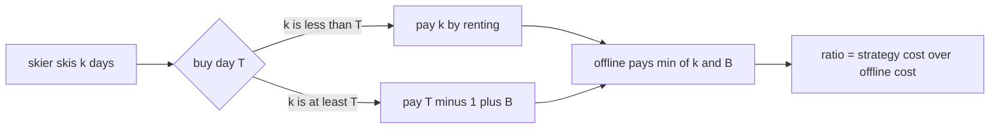
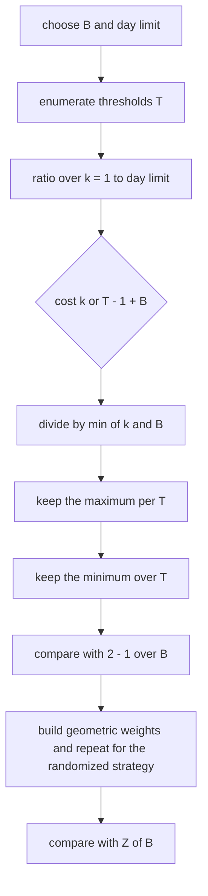
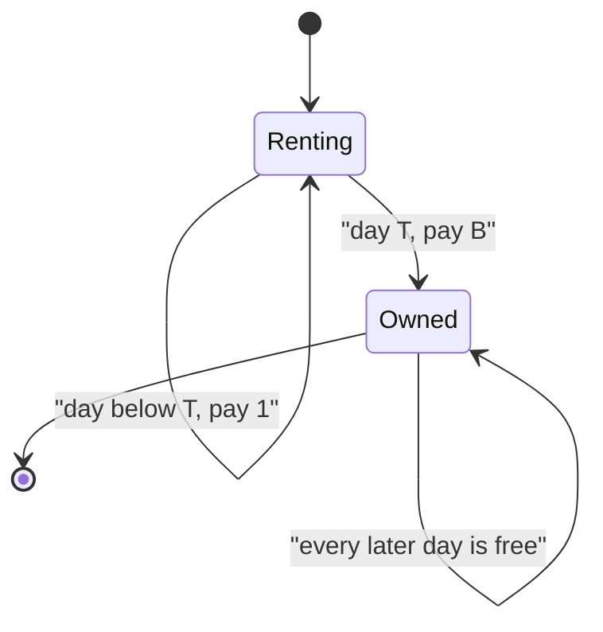

# 532 — Implement online algorithm competitive analysis example (ski rental).

> **Tier:** Advanced · **CTCI chapter:** Ch 9 — System Design and Scalability
> **Task spec:** [532-implement-online-algorithm-competitive-analysis-example-ski-rent.md](../../../tasks/advanced/532-implement-online-algorithm-competitive-analysis-example-ski-rent.md)
> **Solutions:** [Python](../../../solutions/python/advanced/532-implement-online-algorithm-competitive-analysis-example-ski-rent/solution.py) ·
> [Java](../../../solutions/java/advanced/532-implement-online-algorithm-competitive-analysis-example-ski-rent/Solution.java) ·
> [JavaScript](../../../solutions/javascript/advanced/532-implement-online-algorithm-competitive-analysis-example-ski-rent/solution.js) ·
> [C#](../../../solutions/csharp/advanced/532-implement-online-algorithm-competitive-analysis-example-ski-rent/Solution.cs)

## 1. Problem restatement

**Input:** a buy price `B` (a positive integer) and a *day horizon* over which to evaluate an online
strategy. A skier who does not know how many days `k` they will ski can rent at cost `1` per day or
buy once for `B`, after which every later day is free. The clairvoyant **offline optimum** is

```text
OPT(k) = min(k, B)
```

**Output:** the competitive analysis of the natural strategies — the cost function, the worst-case
ratio `max_k cost(k) / OPT(k)`, the threshold that minimises it, and the corresponding results for
a randomized strategy. Nothing is assumed: the files enumerate thresholds and days and compare the
exact ratios against the classical closed forms.

| Quantity | Value | Source of the claim |
| --- | --- | --- |
| Best deterministic threshold | `T = B` (rent `B - 1` days, buy on day `B`) | exhaustive enumeration over `T` and `k` |
| Best deterministic ratio | exactly `2 - 1/B` | enumeration equals `2 - Fraction(1, B)` |
| Always buy (`T = 1`) | worst ratio `B`, attained at `k = 1` | `worst_case_ratio(B, 1) == B` |
| Always rent | unbounded: `day_limit / B` over the sampled horizon | `worst_case_ratio(B, day_limit + 1, day_limit)` |
| Randomized (geometric law) | worst expected ratio exactly `Z(B) = 1 / (1 - (1 - 1/B)^B)` | enumeration matches the closed form to `1e-12` |
| Randomized, large `B` | tends to `e / (e - 1) = 1.5819767068693265` | `Z(B)` increasing, `e/(e-1) - Z(10^4) <= 1e-4` |
| `B = 1` | ratio `1`, buy immediately | degenerate case asserted |

## 2. Intuition

Every deterministic online algorithm for ski rental is a **threshold strategy**: there is a day `T`
such that it rents on days `1..T-1` and buys on day `T` (never buying is the limit case `T = ∞`,
which is never better than buying at `B + 1`). Writing `sigma_T` for the strategy that buys on day
`T`:

- if the skier skis `k < T` days, `sigma_T` pays `k`;
- otherwise `sigma_T` pays `(T - 1) + B`.

Two extremes bracket the interesting range. `T = 1` always buys, so a skier who skis one day pays
`B` against `OPT(1) = 1` — a ratio of `B`. Renting forever (`T` beyond the horizon) pays `k` while
`OPT(k) = B` for large `k`, so its ratio grows without bound with the horizon. Somewhere in between
is a threshold that trades the two failure modes; the classical answer is `T = B`, and the files
*prove* it by enumerating rather than quoting it.

The randomized idea is to spread the buy day over a decaying distribution, so no single adversarial
`k` can hit the strategy where it hurts most. Both families appear in the repository's solutions:

- Python and Java use the **geometric** law `p_t` proportional to `(1 - 1/B)^(B - t)` for
  `t = 1..B`, normalised to Fractions that sum to exactly 1;
- the C# file uses the continuous analogue `p_i = (e^(i/B) - e^((i-1)/B)) / (e - 1)`;
- the JavaScript file writes the same geometric law as `p_i = r^(B - i) / (B * (1 - r^B))` with
  `r = (B - 1) / B`.

All three give the same worst-case bound `1 / (1 - r^B)` with `r = (B-1)/B`, which is strictly below
the deterministic `2 - 1/B` for every `B >= 2`.



## 3. Algorithm

The workbench is an exact-rational computation, so every ratio is a `Fraction` and no comparison
depends on floating point.

1. **Cost model.** `deterministic_cost(k, B, T) = k` if `k < T`, else `(T - 1) + B`. Reject
   `k < 1`, `T < 1` or `B < 1` with `ValueError`.
2. **Worst-case ratio.** Enumerate `k = 1..day_limit` (default `4B + 10`), compute
   `cost(k, B, T) / min(k, B)` and keep the maximum.
3. **Best deterministic threshold.** Enumerate `T = 1..day_limit`, keep the minimum worst-case
   ratio and every threshold attaining it.
4. **Randomized weights.** Build `raw[t] = (1 - 1/B)^(B - t)` for `t = 1..B`, normalise by the sum
   (exact rationals), so the weights sum to exactly 1.
5. **Randomized expected cost.** `sum_t p_t * deterministic_cost(k, B, t)`, again exact; the worst
   ratio is then the maximum over the same `k` range with a slightly longer horizon (`4B + 20`).
6. **Closed form and simulation.** Compare the enumerated worst ratio with
   `Z(B) = 1 / (1 - (1 - 1/B)^B)`, and simulate 20 000 sampled buy days with inverse-transform
   sampling from an LCG stream to check that the empirical cost matches the exact expectation.

```text
procedure worst_case_ratio(B, T, day_limit)
    worst ← 0
    for k ← 1 to day_limit do
        if k < T then
            cost ← k
        else
            cost ← (T - 1) + B
        end
        offline ← min(k, B)
        worst ← max(worst, cost / offline)
    end
    return worst
end

procedure best_deterministic(B, day_limit)
    best ← infinity
    argmin ← empty list
    for T ← 1 to day_limit do
        ratio ← worst_case_ratio(B, T, day_limit)
        if ratio < best then
            best ← ratio
            argmin ← [T]
        else if ratio = best then
            append T to argmin
        end
    end
    return best, argmin
end
```

```text
procedure randomized_weights(B)
    if B < 2 then
        return [1]
    end
    decay ← (B - 1) / B
    raw ← empty list
    for t ← 1 to B do
        append decay ^ (B - t) to raw
    end
    total ← sum of raw
    return raw divided elementwise by total
end

procedure randomized_expected_cost(k, B)
    weights ← randomized_weights(B)
    total ← 0
    for t ← 1 to B do
        total ← total + weights[t] * deterministic_cost(k, B, t)
    end
    return total
end
```



## 4. Worked example

Take `B = 5`. Evaluate three thresholds by hand, with exact ratios (`OPT(k) = min(k, 5)`).

`sigma_5` (rent four days, buy on day five; the predicted optimum):

| `k` | cost of `sigma_5` | `OPT(k)` | ratio |
| --- | --- | --- | --- |
| 1 | 1 | 1 | 1 |
| 2 | 2 | 2 | 1 |
| 3 | 3 | 3 | 1 |
| 4 | 4 | 4 | 1 |
| 5 | `4 + 5 = 9` | 5 | `9/5 = 1.8` |
| 6 | 9 | 5 | 1.8 |
| 10 | 9 | 5 | 1.8 |

The maximum is `9/5 = 1.8 = 2 - 1/5`, attained for every `k >= B`, and the enumeration confirms
`argmin = [5]`.

| Threshold | worst ratio | where it is attained |
| --- | --- | --- |
| `T = 1` (always buy) | `5` | `k = 1`, where `5 / 1 = 5` |
| `T = 4` (buy one day early) | `2` | `k = 4`, where `8 / 4 = 2` |
| `T = 5` (optimum) | `1.8` | every `k >= 5` |
| `T = 6` (buy one day late) | `2` | `k = 6`, where `10 / 5 = 2` |
| `T = 51` (essentially always rent) | `50 / 5 = 10` at `k = 50` | grows with the horizon |

The random strategy at `B = 5` uses decay `4/5` and raw weights
`[(4/5)^4, (4/5)^3, (4/5)^2, (4/5), 1] = [0.4096, 0.512, 0.64, 0.8, 1]`, whose total is `3.3616`;
after normalisation the buy day is spread over all five days with the largest weight on day 5. The
exact worst-case expected ratio is `Z(5) = 1 / (1 - (4/5)^5) = 1 / 0.67232 ≈ 1.4874`, comfortably
below the deterministic `1.8`.



The state machine is the whole strategy: the only decision is *when* to take the one-way transition
out of `Renting`, and that is what the threshold enumeration varies.

## 5. Complexity

Let `B` be the buy cost and `D` the day limit (`4B + 10` by default, `6B + 5` in the Java file).

| Measure | Bound | Why it holds |
| --- | --- | --- |
| Time, one ratio | O(D) | one cost and one division per sampled day |
| Time, best threshold | O(D^2) | D thresholds times D days; with `D = 4B + 10` this is `O(B^2)` |
| Time, randomized weights | O(B) | `B` powers of a Fraction, plus a normalisation |
| Time, randomized worst ratio | O(B * D) | expected cost for each of D days, each summing B thresholds |
| Time, simulation | O(trials * B) | 20 000 inverse-transform samples, each walking the B weights |
| Space | O(B) | the weight vector (the enumeration itself is constant space) |
| Precision | exact | the Python file uses `Fraction` throughout, so `worst_case_ratio(B, B) == 2 - Fraction(1, B)` is an exact equality, not a tolerance |

The Java file documents its enumeration range as `T = 1 .. 6B + 5`; the Python file uses `4B + 10`
and re-checks the optimum with a `100 * B` horizon to show the range does not change the answer.
The randomized enumeration uses a slightly longer horizon (`4B + 20`) because the randomized
strategy's worst case can sit further out, but the equality with the closed form is still exact to
`1e-12`.

## 6. Pitfalls and edge cases

- **`B = 1`.** Buying immediately is optimal and the ratio is exactly `1`; the Python file asserts
  `best_deterministic(1)[0] == 1` and `randomized_weights(1) == [1]` instead of dividing by
  `B - 1`.
- **Non-positive inputs.** `deterministic_cost(0, 10, 3)`, `deterministic_cost(5, 10, 0)`,
  `deterministic_cost(5, 0, 3)` and `deterministic_cost(-1, 10, 3)` must all raise `ValueError`
  (the docstring states that days, threshold and buy cost must be positive integers).
- **Floating point in the ratio.** With `double` arithmetic, `worst_case_ratio(5, 5)` is `1.7999...`
  and comparisons against `2 - 1/B` become tolerance games. The Python and Java files avoid this by
  keeping the closed-form comparison in exact rationals (Java documents the exact enumeration).
- **The horizon must cover the worst case.** A too-short `day_limit` can hide the maximum for large
  thresholds, which is why always-rent is measured at `k = day_limit` and the optimum is re-checked
  at a 100× horizon.
- **Buying too early or too late.** `T = B - 1` and `T = B + 1` are both strictly worse than
  `T = B`; the Python file asserts both inequalities for `B in (2, 5, 10)`.
- **`k = B` is the tie point.** `sigma_B` costs `2B - 1` at `k = B` while `OPT(B) = B`, giving
  `(2B - 1)/B = 2 - 1/B`; the file asserts
  `deterministic_cost(B, B, B) == Fraction(2 * B - 1)` explicitly.
- **Offline cost is `min(k, B)`, not `B`.** Using `B` for short horizons inflates the denominator
  and hides a bad ratio; `offline_cost(1, B) = 1` and `offline_cost(100, B) = B` are asserted.
- **The randomized law must sum to 1 exactly.** The Python file asserts `sum(weights) == 1` for
  `B in (2, 3, 5, 10, 20)` and that every weight is strictly positive; an unnormalised geometric
  law silently lowers the reported ratio.
- **Simulation tolerance, not equality.** The LCG simulation of 20 000 buy days reproduces the exact
  expectation within the documented tolerance (the Python file asserts `abs(empirical - exact) <= 0.02`
  for `k = 7`, `B = 10`, and per-threshold frequencies within `0.01`); a strict equality assert
  would fail spuriously.
- **Sampling correctness.** `sample_threshold` uses inverse-transform sampling on the exact
  cumulative Fractions, so each sampled day lands in `1..B` (asserted in the loop), and the same
  seed must reproduce the same draw.
- **Determinism.** No hidden randomness: `best_deterministic(7) == best_deterministic(7)` and
  `sample_threshold(5, 11)` returns the same pair on repeated calls.
- **Integer division.** `(T - 1) + B` and `min(k, B)` are integer expressions; writing
  `k * 1` or dividing before summing turns the exact ratios into rounded ones, which is exactly why
  the files convert to a rational type at the boundary.

## 7. Variants and follow-ups

- **Non-unit rent.** The Java file studies rent `r` and shows the exhaustive optimum is `2 - r/B`
  when `r` divides `B`, and that the classical bound is *not* tight when it does not — the check
  records the strictly larger optimum rather than asserting the text-book value.
- **Other online problems.** The same threshold-plus-randomization analysis applies to the
  secretary problem, paging/caching and online aggregation; the repository's
  [418-implement-online-convex-hull-maintenance-dynamic.md](../../../tasks/advanced/418-implement-online-convex-hull-maintenance-dynamic.md)
  and [561-implement-online-algorithm-for-sliding-window-distinct-count-hyp.md](../../../tasks/advanced/561-implement-online-algorithm-for-sliding-window-distinct-count-hyp.md)
  are the streaming counterparts of "decide without seeing the future".
- **Caching where the adversary is explicit.** LRU/ARC simulations make the competitive ratio
  measurable on real request sequences —
  [485-implement-cache-eviction-policies-lru-lfu-arc-simulate.md](../../../tasks/advanced/485-implement-cache-eviction-policies-lru-lfu-arc-simulate.md).
- **Estimation under a horizon.** Randomized aggregation with progressive error bounds is the
  same "no lookahead" mindset —
  [650-implement-online-aggregation-progressive-estimator.md](../../../tasks/expert/650-implement-online-aggregation-progressive-estimator.md).
- **From `e/(e-1)` to practice.** The continuous and discrete distributions in the solution files
  (geometric vs. exponential) differ in constants but converge to the same `e/(e-1)` bound, which is
  the standard result for *fractional* relaxations of ski rental.

## 8. Check yourself

1. Why is `T = B` optimal, in one sentence, using the cost function?

<details><summary>Show answer</summary>

For `k < T` the ratio is `1`, so only `k >= T` matters, where the cost is `(T - 1) + B` and
`OPT(k) = B`; the ratio `((T - 1) + B) / B = 1 + (T - 1)/B` is smallest at the smallest `T` that
still buys, which is `T = B` (buying earlier, `T < B`, hurts the short horizons because
`OPT(k) = k` is small there). The enumeration in the files confirms the argmin set is exactly
`{B}`.

</details>

2. `B = 5`: what is the worst-case ratio of always buying, and on which `k` is it attained?

<details><summary>Show answer</summary>

`T = 1` pays `(1 - 1) + 5 = 5` for every `k >= 1`, and the offline optimum at `k = 1` is `1`, so the
worst ratio is `5` attained at `k = 1`. The Python file asserts `worst_case_ratio(B, 1) == B`.

</details>

3. Why does the randomized strategy beat every deterministic one?

<details><summary>Show answer</summary>

Because an adversary must fix `k` *before* the coin flip, so the randomized ratio is a *maximum of
expectations*, while for deterministic play the adversary can pick `k` after seeing the threshold
(a maximum of pointwise ratios). The enumerated worst expected ratio equals
`Z(B) = 1 / (1 - (1 - 1/B)^B)`, which is strictly less than `2 - 1/B` for every `B >= 2`; the file
asserts this for `B in (2, 5, 10, 100, 1000, 10000)`.

</details>

4. What would break if the horizon in the ratio enumeration were set to `k <= B`?

<details><summary>Show answer</summary>

The reported worst ratio of a threshold larger than `B` (in particular always-rent) would be
understated, because its cost keeps growing with `k` while `OPT(k)` saturates at `B`. The files
therefore sample `k` up to `4B + 10` (Python), `6B + 5` (Java) and re-check `T = B` over a `100 * B`
horizon; the always-rent check deliberately evaluates at `k = day_limit`.

</details>

5. The Python file performs a 20 000-trial simulation. What exactly is it checking?

<details><summary>Show answer</summary>

That the *sampled* buy days follow the intended distribution and that the resulting average cost
matches the exact expected cost computed with Fractions: each draw comes from inverse-transform
sampling on the exact cumulative weights, the sampled thresholds are asserted to lie in `1..B`, the
empirical frequencies are compared with `randomized_weights(B)` within `0.01`, and the empirical mean
cost at `k = 7` is compared with `randomized_expected_cost(7, B)` within `0.02`. It validates the
sampler and the closed-form expectation together.

</details>
