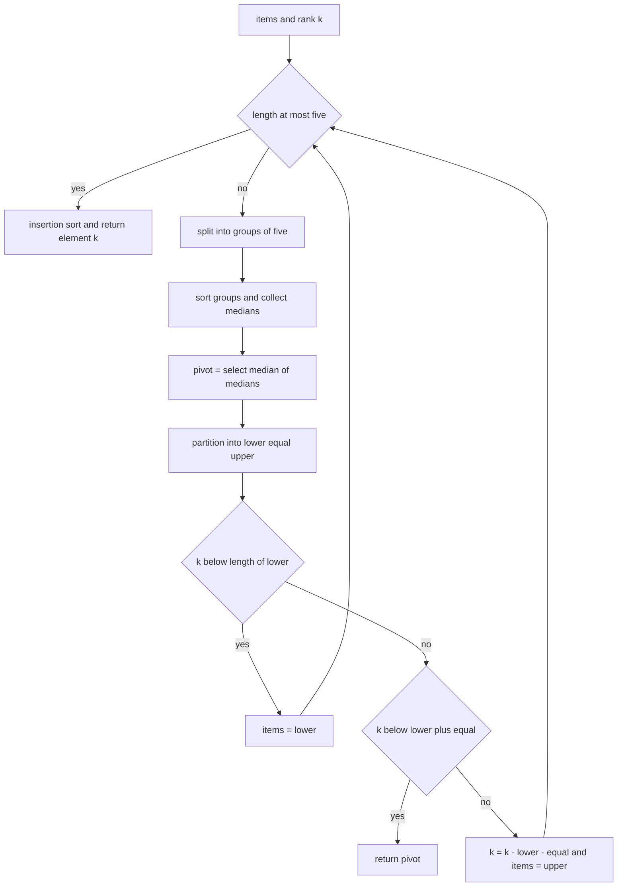
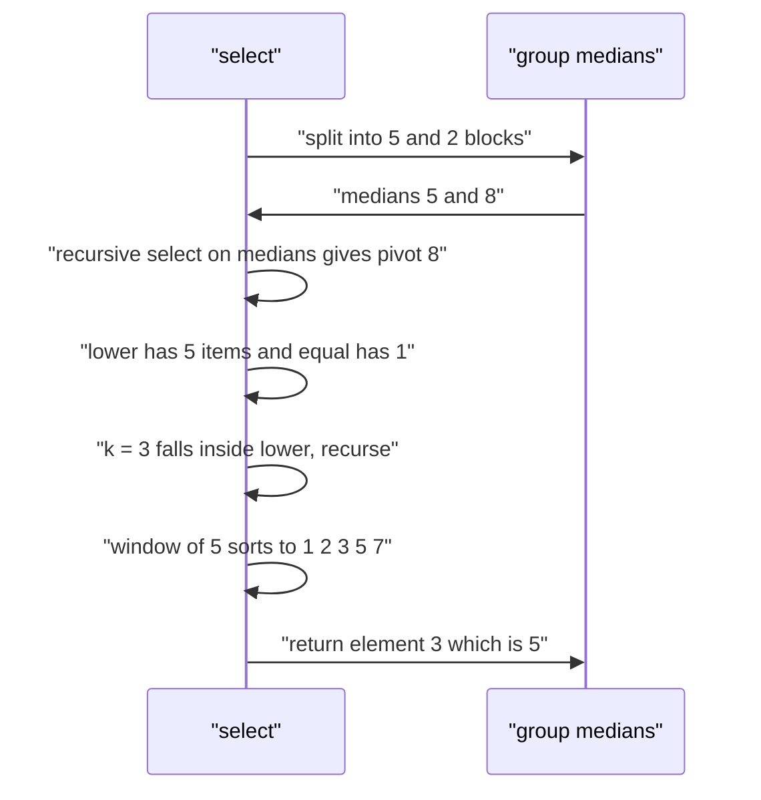

# 533 — Implement linear-time median of medians selection.

> **Tier:** Advanced · **CTCI chapter:** Ch 10 — Sorting and Searching
> **Task spec:** [533-implement-linear-time-median-of-medians-selection.md](../../../tasks/advanced/533-implement-linear-time-median-of-medians-selection.md)
> **Solutions:** [Python](../../../solutions/python/advanced/533-implement-linear-time-median-of-medians-selection/solution.py) ·
> [Java](../../../solutions/java/advanced/533-implement-linear-time-median-of-medians-selection/Solution.java) ·
> [JavaScript](../../../solutions/javascript/advanced/533-implement-linear-time-median-of-medians-selection/solution.js) ·
> [C#](../../../solutions/csharp/advanced/533-implement-linear-time-median-of-medians-selection/Solution.cs)

## 1. Problem restatement

**Input:** an array `values` of `n` comparable values and an integer rank `k` with `0 <= k < n`
(0-based: `k = 0` is the minimum, `k = n - 1` the maximum).

**Output:** the `k`-th smallest value — the element that would sit at index `k` after a full sort —
computed by **BFPRT / median-of-medians selection**, which is deterministic and provably linear in
the worst case, unlike quickselect's expected linear time. The input list must not be modified.

| Call | Result | Why |
| --- | --- | --- |
| `median_of_medians([3, 1, 2], 0)` | `1` | minimum |
| `median_of_medians([3, 1, 2], 1)` | `2` | middle rank |
| `median_of_medians([5], 0)` | `5` | single element |
| `median_of_medians([2, 1], 0)` / `, 1)` | `1` / `2` | two-element window |
| `median_of_medians([4, 4, 4, 4, 4, 4], 3)` | `4` | all equal, duplicates must not degenerate |
| `median_of_medians([9, 8, 7, 6, 5, 4, 3, 2, 1], 4)` | `5` | reversed input |
| `median_of_medians([7, 3, 9, 1, 5, 8, 2], 3)` | `5` | exercises the `5 + 2` group split |

All seven rows are asserted in the Python file, and the Java, JavaScript and C# files assert the
same selection values before running their exhaustive per-rank sweeps.

## 2. Intuition

Quickselect partitions around some pivot and recurses into one side, which is linear *on average*
but quadratic on adversarial input — a bad pivot rule lets each partition discard only a constant
number of elements. Choosing the pivot randomly does not remove the possibility, it only makes it
unlikely; choosing it *badly* deterministically (say, always the first element) fails on sorted
input, which is a perfectly ordinary input.

The median-of-medians rule removes the randomness **and** the failure mode by making the pivot a
provable quantile:

1. split the window into groups of at most five;
2. sort each group (five elements, so a tiny insertion sort) and take its median;
3. recursively select the *median of those medians* and use it as the pivot.

The guarantee comes from counting. Half of the groups contribute at least three elements `<= pivot`
(their own median and the two smaller members), and the pivot is by construction in the middle of the
group-median list, so at least `3 * (n/10) - O(1)` elements are `<= pivot`; symmetrically, the same
number is `>= pivot`. Hence

```text
T(n) <= T(ceil(n / 5)) + T(7n / 10) + O(n)
```

which solves to `O(n)`: the pivot is always between the 30th and the 70th percentile, and every
recursive step keeps at most `7n/10 + O(1)` elements.


The second half of the guarantee is the **three-way partition** (`lower`, `equal`, `upper`). It is
not an optimisation detail: with duplicates, a two-way partition can put all equal elements on one
side and make no progress. The Python file tests `[4] * 6` and `[1, 2] * 100` explicitly, and the
JavaScript docstring notes that the three-way scheme is what makes all-equal and presorted inputs
cheap.

## 3. Algorithm

The Python implementation is iterative on the "which side" step and recursive only for the pivot:

1. Validate: non-empty `values`, `0 <= k < len(values)`; otherwise raise `ValueError`.
2. Work on a private copy so the caller's list is untouched.
3. Loop: if the window has at most five elements, insertion-sort it and return the element at `k`.
4. Otherwise split into groups of five, insertion-sort each group, and collect each group's median.
5. Recursively select the median of the collected medians (`k = len(medians) // 2`) — this is the
   call that keeps the pivot step linear.
6. Partition the window into `lower` (`< pivot`), a count `equal` of `= pivot`, and `upper`
   (`> pivot`).
7. If `k < len(lower)` continue with `lower`; else if `k < len(lower) + equal` return the pivot;
   else set `k = k - len(lower) - equal` and continue with `upper`.

```text
procedure select(items, k)
    while true do
        if length(items) <= 5 then
            return insertion_sort(items)[k]
        end
        medians ← empty list
        for start ← 0 to length(items) - 1 step 5 do
            group ← items[start .. start + 4]
            append median of insertion_sort(group) to medians
        end
        pivot ← select(medians, length(medians) / 2)
        lower ← empty list
        equal ← 0
        upper ← empty list
        for each value in items do
            if value < pivot then
                append value to lower
            else if value > pivot then
                append value to upper
            else
                equal ← equal + 1
            end
        end
        if k < length(lower) then
            items ← lower
        else if k < length(lower) + equal then
            return pivot
        else
            k ← k - length(lower) - equal
            items ← upper
        end
    end
end

procedure median_of_medians(values, k)
    if values is empty then
        raise error "cannot select from an empty sequence"
    end
    if k < 0 or k >= length(values) then
        raise error "k out of range"
    end
    return select(copy of values, k)
end
```

The JavaScript and Java files implement the same structure with an in-place **Dutch-national-flag**
partition and a comparison counter; the C# file additionally ships a Hoare quickselect with a
median-of-three pivot as an *expected*-linear reference beside the guaranteed-linear routine.



## 4. Worked example

Select rank `k = 3` from `values = [7, 3, 9, 1, 5, 8, 2]` (`n = 7`), the case the Python file uses to
exercise a `5 + 2` group split.

| Step | Action | Result |
| --- | --- | --- |
| 1 | `n = 7 > 5`, split into `[7, 3, 9, 1, 5]` and `[8, 2]` | two groups |
| 2 | insertion sort group 1 | `[1, 3, 5, 7, 9]`, median index `5 // 2 = 2` gives `5` |
| 3 | insertion sort group 2 | `[2, 8]`, median index `2 // 2 = 1` gives `8` |
| 4 | medians | `[5, 8]` |
| 5 | recursive `select([5, 8], 1)` — window of size 2 | `[5, 8]`, element 1 is `8` |
| 6 | pivot | `8` |
| 7 | partition `[7, 3, 9, 1, 5, 8, 2]` around `8` | `lower = [7, 3, 1, 5, 2]` (5 items), `equal = 1`, `upper = [9]` |
| 8 | `k = 3 < len(lower) = 5` | continue with `lower`, `k` unchanged |
| 9 | `len(lower) = 5 <= 5` | insertion sort gives `[1, 2, 3, 5, 7]` |
| 10 | return element 3 | `5` |

The answer `5` matches `sorted([7, 3, 9, 1, 5, 8, 2])[3] = 5`, and this trace is exactly the
assertion `median_of_medians([7, 3, 9, 1, 5, 8, 2], 3) == 5` in the file.

A second trace shows the three-way branch that returns the pivot directly: rank `k = 3` in
`[4, 4, 4, 4, 4, 4]`. The window is 6 items, so the groups are `[4, 4, 4, 4, 4]` and `[4]`, whose
medians are `4` and `4`; the pivot is `4`; the partition gives `lower = []`, `equal = 6`,
`upper = []`; `k = 3 >= 0` and `k = 3 < 0 + 6`, so the routine returns the pivot `4` without
recursing at all.



## 5. Complexity

Let `n` be the window size.

| Measure | Bound | Why it holds |
| --- | --- | --- |
| Time, worst case | O(n) | `T(n) <= T(ceil(n/5)) + T(7n/10) + O(n)`; the constants are positive but sum to less than 1 per level |
| Time, comparisons | at most `15n + 100`; measured counts are asserted to be at least `n` and below `n * bit_length(n)` | the Python file counts every comparison in a module-level counter and asserts a documented linear bound |
| Time, recursion depth | at most `n / 2` select steps | asserted as `state[0] <= size // 2` for `n = 200 / 1000 / 10000` |
| Time, sort-based reference | O(n log n) | the file compares the selection counts against a comparison sort's `n log2 n` |
| Space | O(n) | the group lists, `lower`/`upper` and the medians array of the current level |
| Space, extra windows | one level at a time | the "which side" step is a loop, so no recursion stack proportional to the number of partitions |

The file's own comparison measurements carry an internal inconsistency worth knowing about — the
docstring quotes one triple of counts and the in-code comment above the measurement loop quotes a
different, smaller triple — so the *asserted* bounds (`comparisons <= 15 * size + 100`,
`comparisons >= size`, `state[0] <= size // 2`) are the reliable statement of what the tests
guarantee, and both reported triples satisfy them.

## 6. Pitfalls and edge cases

- **Empty input.** `median_of_medians([], 0)` raises `ValueError("cannot select from an empty
  sequence")`; the file asserts the error rather than returning a sentinel.
- **Out-of-range rank.** `k = 3` for a 3-element list and `k = -1` both raise `ValueError("k out of
  range")`. The boundary is inclusive on both ends: `k = n - 1` is valid and must return the maximum.
- **Single element and pairs.** `[5]` with `k = 0` returns `5`, and `[5, 3]` answers `3` for `k = 0`
  and `5` for `k = 1`; both are handled by the `length <= 5` shortcut, so no group logic runs.
- **The `<= 5` shortcut is load-bearing.** A window of size `5` must be sorted directly, not split
  into a group of five plus an empty group; the file measures the shortest path with
  `median_of_medians([9, 8, 7, 6, 5, 4, 3, 2, 1], 4) == 5`.
- **Group boundaries.** With `n = 7` the last group holds two elements and its median is the *upper*
  of the two (`[8, 2] -> [2, 8]`, index `len // 2 = 1`). Using `(len - 1) // 2` instead still yields
  a valid algorithm but changes which elements the checks exercise, so the index rule is worth
  pinning down.
- **Duplicates must not degenerate.** All-equal input returns by the `lower + equal` branch with no
  recursion; `[4, 4, 4, 4, 4, 4]` with `k = 3` is asserted, and the exhaustive sweep over
  `lcg_values(200, 11, 5)` uses only five distinct values to force heavy duplication.
- **The input must not be mutated.** The Python file copies the list once at the entry point and
  asserts `values == copy` after the call; the JavaScript and Java files partition in place but only
  inside their private working copy.
- **Permutation invariance.** Rotating the input by one position must not change the value of rank
  `k`; the file asserts this for the minimum, the middle and the maximum ranks on every suite.
- **Postcondition, not just agreement.** The file asserts `count(< answer) <= k < count(<= answer)`
  in addition to equality with the sorted reference: that inequality is the defining property of the
  answer and would catch a routine that happens to be right on unique values but wrong on ties.
- **Presorted and reversed input.** `sorted(range(200))` and `range(199, -1, -1)` are part of the
  sweep; a first-element pivot rule would be quadratic there, which is the failure mode the
  median-of-medians rule exists to avoid.
- **`k` must be adjusted on the right branch only.** After discarding `len(lower) + equal` elements
  the rank becomes `k - len(lower) - equal`; applying the subtraction when recursing into `lower`
  (or forgetting it on `upper`) silently returns the wrong element on duplicated values.
- **No randomness anywhere.** The pivot is fully determined by the input, so repeated calls return
  identical results and the file asserts both the repeat and agreement with the sorted reference for
  the first 20 ranks.

## 7. Variants and follow-ups

- **Expected-linear selection.** Randomised quickselect (or Hoare's median-of-three version, which
  the C# file ships as a reference) is simpler and usually faster in practice, but has no worst-case
  guarantee —
  [260-quickselect-randomized-implementation.md](../../../tasks/intermediate/260-quickselect-randomized-implementation.md)
  and [259-kth-smallest-element-using-order-statistics-quickselect.md](../../../tasks/intermediate/259-kth-smallest-element-using-order-statistics-quickselect.md).
- **Weighted selection.** The same partition-by-mass idea with an exact postcondition on weights is
  [531-implement-weighted-median-selection-algorithm.md](../../../tasks/advanced/531-implement-weighted-median-selection-algorithm.md).
- **Two sorted arrays.** Selection on the *order* of two sorted arrays without merging is the
  logarithmic classic of
  [261-median-of-two-sorted-arrays-log-min-n-m-algorithm.md](../../../tasks/intermediate/261-median-of-two-sorted-arrays-log-min-n-m-algorithm.md).
- **Dynamic order statistics.** When the array changes between selections, a balanced BST or a
  Fenwick/segment tree answers rank queries in `O(log n)` —
  [433-implement-order-statistics-tree-using-balanced-bst-rank-select.md](../../../tasks/advanced/433-implement-order-statistics-tree-using-balanced-bst-rank-select.md)
  and [429-implement-range-kth-order-statistic-using-persistent-segtree.md](../../../tasks/advanced/429-implement-range-kth-order-statistic-using-persistent-segtree.md).
- **Streaming medians.** Two heaps keep an exact running median under insertions —
  [164-compute-running-median-using-two-heaps.md](../../../tasks/beginner/164-compute-running-median-using-two-heaps.md).

## 8. Check yourself

1. Which counting fact makes the pivot a guaranteed 30/70 split?

<details><summary>Show answer</summary>

Each group of five contributes at least three values `<= its own median`, and the chosen pivot is
the median of the group-median list, so at least half of the `ceil(n/5)` groups lie below it: at
least `3 * (n/10) - O(1)` elements are `<= pivot`, and the same count is `>= pivot`. The pivot is
therefore at least the 30th and at most the 70th percentile, leaving at most `7n/10 + O(1)` elements
on the larger side.

</details>

2. Trace `median_of_medians([7, 3, 9, 1, 5, 8, 2], 3)`: what is the pivot and why is `5` returned?

<details><summary>Show answer</summary>

The groups are `[7, 3, 9, 1, 5]` and `[8, 2]`, whose medians are `5` and `8`; the median of the
medians is `8`, which becomes the pivot. Partitioning around `8` gives `lower = [7, 3, 1, 5, 2]`
(five items), `equal = 1` and `upper = [9]`. Since `k = 3 < 5`, the search continues in `lower`,
which has exactly five elements, so it is sorted directly to `[1, 2, 3, 5, 7]` and element `3` is
`5`.

</details>

3. Why is the partition three-way rather than two-way?

<details><summary>Show answer</summary>

So that equal elements are removed in one shot instead of being pushed to one side. With a two-way
partition, an input like `[4] * n` can send all elements to the same side and the window shrinks by
one per step — quadratic behaviour. The three-way partition also gives a direct early exit: when
`k` falls inside the equal block, the answer *is* the pivot.

</details>

4. What does the file's comparison counter add beyond correctness checks, and what bound does it
   assert?

<details><summary>Show answer</summary>

It measures the linearity claim instead of asserting it from theory: the counter is checked against
`comparisons <= 15 * size + 100`, against `comparisons >= size` and against the `n log2 n` cost of a
comparison sort, and the number of select steps is checked against `size // 2`. That is how the file
verifies "linear in practice" rather than only "linear asymptotically".

</details>

5. The routine never mutates the caller's list in Python, yet the Java and JavaScript versions
   partition in place. How can both be correct?

<details><summary>Show answer</summary>

The in-place versions partition inside a private working copy of the input, taken at the entry point
of the public function, so the caller's array is never touched. The Python version makes the same
copy (`_select_prepared(list(values), k, state)`) because its partition step builds new `lower` and
`upper` lists anyway. The file asserts `values == copy` after the call on every suite.

</details>
