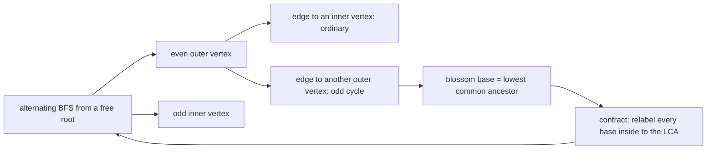
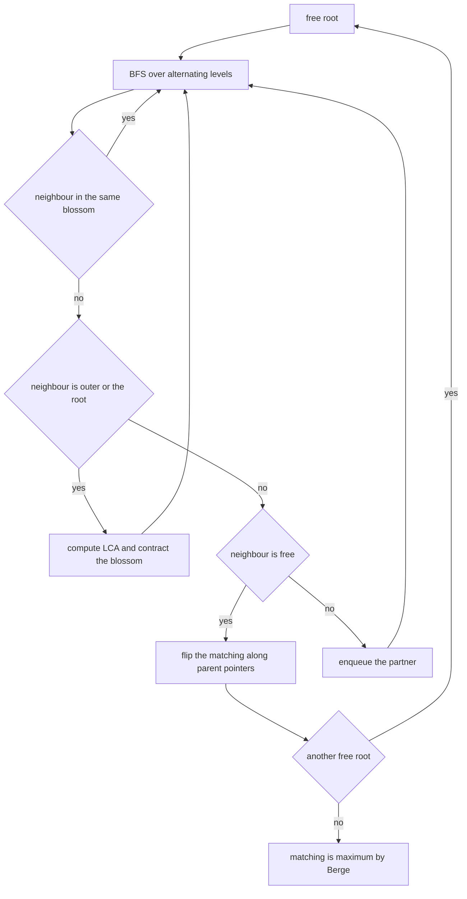
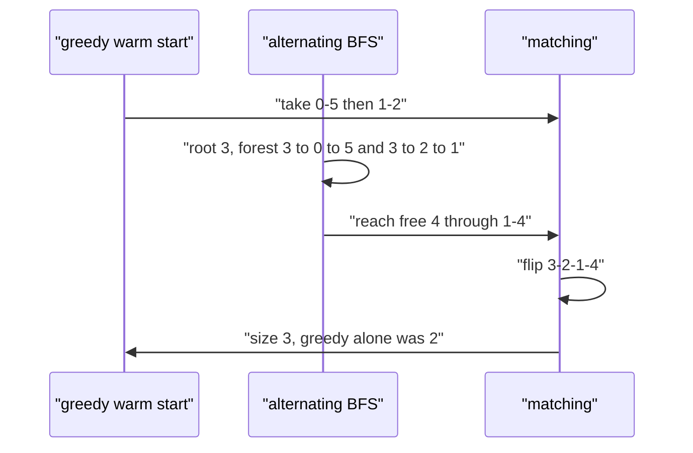

# 534 — Implement matching in general graphs improved heuristics (Edmonds practical).

> **Tier:** Advanced · **CTCI chapter:** Ch 4 — Trees and Graphs
> **Task spec:** [534-implement-matching-in-general-graphs-improved-heuristics-edmonds.md](../../../tasks/advanced/534-implement-matching-in-general-graphs-improved-heuristics-edmonds.md)
> **Solutions:** [Python](../../../solutions/python/advanced/534-implement-matching-in-general-graphs-improved-heuristics-edmonds/solution.py) ·
> [Java](../../../solutions/java/advanced/534-implement-matching-in-general-graphs-improved-heuristics-edmonds/Solution.java) ·
> [JavaScript](../../../solutions/javascript/advanced/534-implement-matching-in-general-graphs-improved-heuristics-edmonds/solution.js) ·
> [C#](../../../solutions/csharp/advanced/534-implement-matching-in-general-graphs-improved-heuristics-edmonds/Solution.cs)

## 1. Problem restatement

**Input:** a graph on `n` vertices given as a list of edges `(a, b)`. The graph is general — it may
contain odd cycles, so the bipartite augmenting-path recipe does not apply. Duplicate edges,
self-loops and out-of-range endpoints are ignored by the preprocessing step.

**Output:** a **maximum cardinality matching** — a set of vertex-disjoint edges — as an array
`match` with `match[v] = partner` or `-1`, together with statistics (`augmentations`, `expansions`,
`contractions`, `greedy_edges`, `size`) that make the effect of the practical heuristics measurable.

| Graph | Maximum | Why |
| --- | --- | --- |
| star `K(1,6)` | `1` | the centre can be used once |
| `C5` (`0-1-2-3-4-0`) | `2` | odd cycle: one vertex must stay free |
| `C5` plus pendant `2-5` | `3` | `{0-1, 3-4, 2-5}` — needs a blossom contraction |
| star `K(1,6)` | `1` | the centre can be used once |
| `K(3,3)` | `3` | three disjoint edges |
| `K4`, `K5` | `2`, `2` | `floor(n/2)` |
| no edges | `0` | nothing to match |
| greedy trap `(0,3) (0,4) (0,5) (1,2) (1,4) (2,3)` | `3` | the greedy warm start finds only `2`; the augmenting search repairs it |

Those are the hand-verified rows in `main()`; the Java, JavaScript and C# files assert the same
family and additionally compare both entry points against brute force.

## 2. Intuition

Berge's theorem says a matching is maximum exactly when no **augmenting path** exists — a path that
starts and ends at free vertices and alternates unmatched, matched, unmatched, ... edges. Flipping
such a path (unmatched edges become matched and vice versa) increases the matching by one. In a
bipartite graph, finding one is a simple BFS over alternating levels.

General graphs break the BFS: an edge can join two vertices **at the same alternating level**, which
cannot happen in a bipartite graph. Such an edge closes an **odd cycle**, called a *blossom*, and the
BFS can no longer decide whether the vertices around it belong to the "even" or "odd" side. Edmonds'
answer is to **contract** the odd cycle: every vertex inside the blossom is relabelled to a single
representative — the blossom *base*, the lowest common ancestor of the two endpoints in the
alternating forest — and the BFS continues as if the whole cycle were one vertex. That is the piece a
bipartite search is missing, and it is what the JavaScript docstring calls out explicitly.

Two practical heuristics wrap the exact core, and the files measure their effect:

1. **Greedy maximal matching warm start.** Scan candidate edges sorted by the sum of endpoint degrees
   (then by endpoints) and match any two free endpoints: `O(m log m)`, a valid matching immediately,
   and far fewer free vertices for the expensive search. The C# file adds the equivalent root ordering
   (unmatched roots in non-increasing degree order).
2. **Union-find style base relabelling.** `base[]` holds the current blossom representative of each
   vertex, so contraction is a relabelling loop instead of a graph rebuild — the Java docstring calls
   this the near-constant-time contraction.



The warm start is emphatically **not** a correct algorithm on its own: the file ships a 6-vertex graph
where the greedy phase blocks itself one edge short of the optimum (see §4).

## 3. Algorithm

1. **Preprocess.** Build adjacency lists, dropping self-loops, duplicates and out-of-range endpoints,
   and sort each list for determinism.
2. **Optional warm start.** Sort the candidate edges by `(degree(a) + degree(b), a, b)` and match any
   edge whose endpoints are both still free.
3. **For every still-free root**, run the alternating BFS:
   - `used[]` marks vertices already in the alternating forest, `parent[]` records the tree parent,
     `base[]` the current blossom representative;
   - pop an outer vertex, increment `expansions`, and scan its neighbours;
   - skip a neighbour in the same blossom or the current match partner;
   - if the neighbour is the root or is an inner vertex already in the forest, a blossom was found:
     compute the lowest common ancestor of the two outer endpoints, mark the two alternating paths to
     it, and relabel every base inside the blossom to the LCA, enqueueing the newly freed vertices;
   - otherwise attach the neighbour to the tree; if it is free, return it as the end of an augmenting
     path;
   - if it is matched, mark its partner as used and enqueue it.
4. **Flip the found path**: walk `end <- parent[end]`, swapping `match` along the way (the loop uses
   `above = match[previous]` to hop over matched edges).
5. Repeat step 3 for every free vertex; when no free root can be augmented, Berge's theorem says the
   matching is maximum.

```text
procedure find_path(root)
    reset used, parent and base for all vertices
    used[root] ← true
    queue ← [root]
    while queue is not empty do
        vertex ← pop front of queue
        expansions ← expansions + 1
        for each partner in neighbours[vertex] do
            if base[vertex] = base[partner] or match[vertex] = partner then
                continue
            end
            if partner = root or (match[partner] ≠ -1 and parent[match[partner]] ≠ -1) then
                common ← lowest_common_ancestor(vertex, partner)
                clear in_blossom
                mark_path(vertex, common, partner)
                mark_path(partner, common, vertex)
                contractions ← contractions + 1
                for each i with in_blossom[base[i]] do
                    base[i] ← common
                    if not used[i] then
                        used[i] ← true
                        append i to queue
                    end
                end
            else if parent[partner] = -1 then
                parent[partner] ← vertex
                if match[partner] = -1 then
                    return partner
                end
                used[match[partner]] ← true
                append match[partner] to queue
            end
        end
    end
    return -1
end
```

```text
procedure mark_path(vertex, root, child)
    while base[vertex] ≠ root do
        in_blossom[base[vertex]] ← true
        in_blossom[base[match[vertex]]] ← true
        parent[vertex] ← child
        child ← match[vertex]
        vertex ← parent[match[vertex]]
    end
end

procedure blossom(n_vertices, edges, greedy_start)
    build adjacency lists
    match ← array of -1
    if greedy_start then
        match ← greedy matching over candidates sorted by degree sum
    end
    for vertex ← 0 to n_vertices - 1 do
        if match[vertex] = -1 then
            end ← find_path(vertex)
            if end ≠ -1 then
                augmentations ← augmentations + 1
                while end ≠ -1 do
                    previous ← parent[end]
                    above ← match[previous]
                    match[end] ← previous
                    match[previous] ← end
                    end ← above
                end
            end
        end
    end
    return match, statistics
end
```



## 4. Worked example

**The greedy trap.** Vertices `0..5`, edges `(0,3) (0,4) (0,5) (1,2) (1,4) (2,3)`. Degrees:
`0 -> 3`, `1 -> 2`, `2 -> 2`, `3 -> 2`, `4 -> 2`, `5 -> 1`.

| Step | Action | State |
| --- | --- | --- |
| 1 | sort candidates by `(degree sum, a, b)` | `(0,5)` sum 4, then `(1,2)`, `(1,4)`, `(2,3)` sum 4 each, then `(0,3)`, `(0,4)` sum 5 |
| 2 | greedy takes `(0,5)` | `match = {0-5}`, `greedy_edges` becomes 1 |
| 3 | greedy takes `(1,2)`, skips `(1,4)`, `(2,3)`, `(0,3)`, `(0,4)` | `match = {0-5, 1-2}`, `greedy_edges = 2` |
| 4 | BFS from free vertex `3`: scans `3-0` (attaches `0`, enqueues its partner `5`), then `3-2` (attaches `2`, enqueues its partner `1`) | tree: `3 -> 0 -> 5`, `3 -> 2 -> 1` |
| 5 | expand `5` (only neighbour `0` is its match partner), expand `1`: `1-2` is its partner, `1-4` attaches free vertex `4` and returns it | augmenting path `3-2-1-4` |
| 6 | flip: `match[4] = 1`, `match[1] = 4`, `match[2] = 3`, `match[3] = 2` | `match = {0-5, 1-4, 2-3}`, size `3` |

The warm start alone was one edge short of optimal, and exactly one augmentation fixed it —
`augmentations = 1`, `greedy_edges = 2`, `size = 3`.



**A blossom contraction.** The hand-verified `C5` plus pendant — vertices `0..5` with edges
`(0,1) (1,2) (2,3) (3,4) (4,0) (2,5)` — is the case that forces the contraction:

| Phase | What happens | Matching after |
| --- | --- | --- |
| augment from `0` | `0-1` is free, so the path `0-1` is flipped | `{0-1}`, size 1 |
| augment from `2` | `2` attaches `1` (inner), enqueues its partner `0`, then `3` is free | `{0-1, 2-3}`, size 2 |
| augment from `4` | BFS reaches `1` and `2` as outer vertices joined by the edge `1-2`, closing the odd cycle `1-2-3-... `; the LCA of `1` and `2` is `4`, so every base inside the blossom is relabelled to `4` (`contractions = 1`), which frees vertex `3` for the queue | unchanged, size 2 |
| same BFS continues | from the contracted blossom the search reaches `5` through `2-5`, giving the augmenting path that ends at free vertex `5` | `{0-1, 2-5, 3-4}`, size 3 |

The maximum is `3`, matching the hand-verified row for the `C5`-with-pendant graph, and the fixed
answer `2` for the bare `C5` shows what happens when the contraction finds no augmenting path at all:
the relabelling happens, the queue empties, and Berge's certificate holds.

## 5. Complexity

Let `n` be the number of vertices and `m` the number of simple edges.

| Measure | Bound | Why it holds |
| --- | --- | --- |
| Time, overall | O(n^3) | `O(n)` augmenting searches, each an `O(n^2)`-style BFS with contractions, as the JavaScript and C# docstrings state |
| Time, warm start | O(m log m) | sorting the candidates by degree sum, then one pass over them |
| Time, one contraction | O(n) | `lowest_common_ancestor`, two `mark_path` walks and the relabelling loop are all linear in `n` |
| Time, one augmentation | O(n + m) | BFS over the alternating forest plus the parent-pointer flip |
| Space | O(n + m) | adjacency lists, `match`, `parent`, `base`, `used`, `in_blossom`, queue |
| Number of augmentations | at most `n / 2` in total | each one increases the matching by exactly one |

The heuristics do not change these bounds, only the constants: over the file's 500 random graphs the
plain run performs 1098 flips, 3016 expansions and 801 contractions against 3, 1818 and 272 for the
warm-started run — asserted as strictly fewer, with the same maximum size.

## 6. Pitfalls and edge cases
- **Odd cycles are the whole point.** Without contraction the BFS on `C5` cannot distinguish outer from
  inner vertices and either loops or returns a wrong answer, so the `C5` (maximum 2) and
  `C5`-with-pendant (maximum 3) rows exist to catch a bipartite-only implementation.
- **The greedy warm start is not optimal.** The warm start commits to `(0,5)` and `(1,2)`, blocking
  `(0,3)` and `(2,3)`, so it reaches only 2 edges while the maximum is 3; the BFS from free vertex `3`
  then finds the augmenting path `3-2-1-4` and flips it.
- **Self-loops, duplicates and degenerate sizes.** `(0,0)` and repeated `(0,1)`/`(1,0)` must be
  dropped: `[(0,1), (0,1), (1,0), (2,2), (3,4), (3,4)]` gives size 2 and `[(0,0), (1,1)]` gives 0.
  `blossom(0, [])`, `blossom(1, [])` and `blossom(1, [(0, 0)])` all return size 0, and
  `blossom(2, [(0, 1)])` returns 1.
- **Parity.** A matching on `n` vertices has at most `floor(n / 2)` edges; the file asserts
  `stats["size"] <= size // 2` on the large LCG graphs, and `K9` — 9 vertices — returns exactly 4.
- **Structural validity, not just the count.** `verify_matching` re-checks that every partner is a real
  neighbour, that `match[match[v]] == v` (symmetry) and that no vertex appears twice.
- **Berge's certificate.** After each run on the random graphs the file re-runs the standalone
  `augmenting_path_end` search from *every* unmatched vertex and asserts it returns `-1`. That is the
  real optimality evidence, independent of the count comparison.
- **Blossom base bookkeeping and `mark_path`.** `base[]` is reset at the start of every BFS, and the
  relabelling loop must test `in_blossom[base[i]]` — testing `in_blossom[i]` leaves stale
  representatives after a second contraction. `mark_path` also re-points tree parents to the blossom
  base; dropping its `parent[vertex] = child` assignments produces a cycle in the parent pointers.
- **The skip condition.** `base[vertex] == base[partner]` and `match[vertex] == partner` must be
  skipped: the first avoids re-exploring a contracted blossom, the second avoids walking the matched
  edge backwards into an inner vertex.
- **Determinism.** The warm start sorts by a total key and adjacency lists are sorted, so repeated runs
  give the same matching and the same statistics.
- **Heuristics must not change the answer.** All four files compare the warm-started and plain runs
  against each other and against brute force — the Python file on 3000 LCG instances over every
  density plus complete graphs, paths, cycles and stars up to 60 vertices.

## 7. Variants and follow-ups
- **Conceptual blossom skeleton.** Tasks 456 and 457 step through the same algorithm from a
  structural angle —
  [456-implement-matchings-in-general-graph-edmonds-blossom-outline.md](../../../tasks/advanced/456-implement-matchings-in-general-graph-edmonds-blossom-outline.md)
  and [457-implement-blossom-algorithm-conceptual-skeleton.md](../../../tasks/advanced/457-implement-blossom-algorithm-conceptual-skeleton.md).
- **Weighted matching and flows.** Minimum-weight perfect matching (Blossom V, Edmonds-Johnson)
  replaces the cardinality search with a primal-dual scheme; the flow-based relatives are
  [453-implement-circulation-with-lower-bounds-flow-transform.md](../../../tasks/advanced/453-implement-circulation-with-lower-bounds-flow-transform.md).
- **Union-find contractions.** The `base[]` relabelling is exactly a union-find structure over
  contracted blossoms; the persistent variant is
  [422-persistent-union-find-partial-persistence-basic.md](../../../tasks/advanced/422-persistent-union-find-partial-persistence-basic.md).
- **Alternative heuristics.** Augmenting from high-degree free vertices first (the C# file's root
  ordering) and the `O(m log m)` edge ordering both reduce augmentation rounds; without odd cycles the
  plain augmenting BFS suffices and Hopcroft-Karp reaches `O(E * sqrt(V))`.

## 8. Check yourself

1. Which edge configuration triggers a blossom, and what vertex becomes the blossom base?

<details><summary>Show answer</summary>

An edge joining two **outer** (even-level) vertices of the alternating forest — an edge that would
connect two vertices of the same parity in the BFS tree. Those two vertices plus the alternating paths
to their lowest common ancestor form an odd cycle, and that ancestor becomes the base: the relabelling
target for every vertex inside the blossom.

</details>

2. In the greedy trap, why does the warm start stop at 2 edges, and how does the exact phase reach 3?

<details><summary>Show answer</summary>

The greedy phase sorts candidates by degree sum, takes `(0,5)` (blocking `(0,3)`) and then `(1,2)`
(blocking `(2,3)`), so it commits to two edges and strands `3` and `4`. The exact phase BFSes from
free vertex `3`, builds the forest `3 -> 0 -> 5` and `3 -> 2 -> 1`, reaches free `4` through `1-4` and
flips `3-2-1-4`, replacing `{0-5, 1-2}` with `{0-5, 1-4, 2-3}`.

</details>

3. Why is Berge's certificate a stronger check than comparing sizes with brute force?

<details><summary>Show answer</summary>

Brute force only verifies the *number*. The certificate re-runs the augmenting search from every
unmatched vertex and asserts none can be augmented, which proves the *specific* matching is maximum —
and it works on the 40-, 60- and 80-vertex graphs where brute force is not run at all.

</details>

4. What is the difference between `expansions`, `contractions` and `augmentations` in the statistics?

<details><summary>Show answer</summary>

`expansions` counts outer vertices dequeued during all BFS searches; `contractions` counts detected
blossoms that were collapsed (one per `mark_path` pair); `augmentations` counts successful flips, each
raising the matching size by exactly one. Over the 500 random graphs the warm start turns 1098 plain
flips into 3.

</details>

5. Which two heuristics does the repository's practical implementation add, and why can they not
   break correctness?

<details><summary>Show answer</summary>

(1) A greedy maximal matching warm start, ordered by endpoint degree sums, and (2) the union-find
`base[]` array that makes blossom contraction a relabelling instead of a graph rebuild (the C# file
additionally processes unmatched roots in non-increasing degree order). Neither changes what a
maximum matching *is*: the warm start only supplies a valid initial matching, and the exact phase
still runs Berge's augmenting searches from every remaining free vertex until none succeeds, which is
the theorem that guarantees maximality.

</details>
