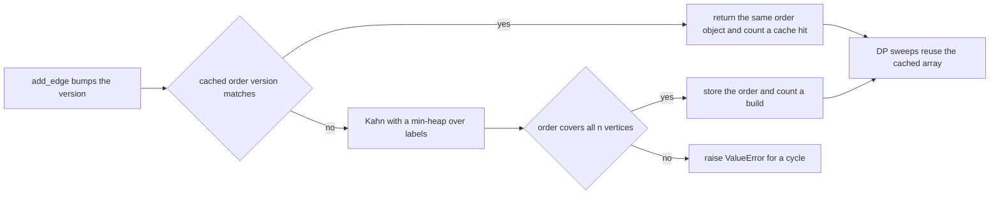
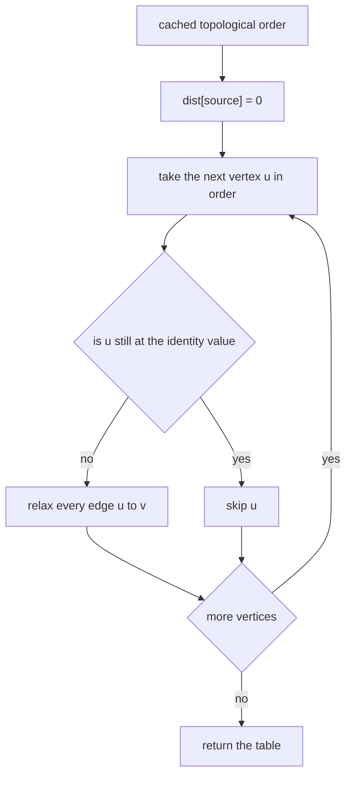
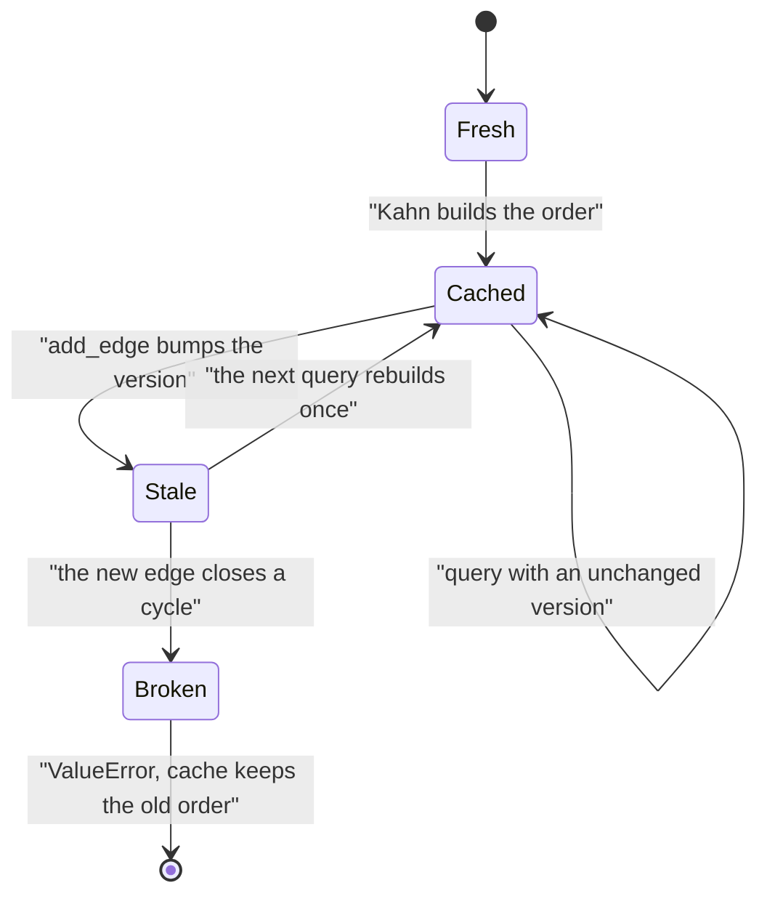

# 535 — Implement dynamic programming on DAG with topological order caching.

> **Tier:** Advanced · **CTCI chapter:** Ch 8 — Recursion and Dynamic Programming
> **Task spec:** [535-implement-dynamic-programming-on-dag-with-topological-order-cach.md](../../../tasks/advanced/535-implement-dynamic-programming-on-dag-with-topological-order-cach.md)
> **Solutions:** [Python](../../../solutions/python/advanced/535-implement-dynamic-programming-on-dag-with-topological-order-cach/solution.py) ·
> [Java](../../../solutions/java/advanced/535-implement-dynamic-programming-on-dag-with-topological-order-cach/Solution.java) ·
> [JavaScript](../../../solutions/javascript/advanced/535-implement-dynamic-programming-on-dag-with-topological-order-cach/solution.js) ·
> [C#](../../../solutions/csharp/advanced/535-implement-dynamic-programming-on-dag-with-topological-order-cach/Solution.cs)

## 1. Problem restatement

**Input:** a weighted directed acyclic graph with `n` vertices and edges `(u, v, w)`, where `u < v`
need not hold (only acyclicity is required), plus a `source` vertex. Weights may be negative.

**Output:** DP tables over the DAG, computed from **one cached topological order**:

| Query | Meaning |
| --- | --- |
| `longest_paths(source)` | `dist[v]` = heaviest weight of a path `source -> ... -> v`, `-inf` if unreachable |
| `shortest_paths(source)` | `dist[v]` = lightest such weight, `+inf` if unreachable (negative edges allowed) |
| `count_paths(source)` | `count[v]` = number of distinct paths `source -> ... -> v` (`count[source] = 1`) |
| `topological_order()` | a cached order, rebuilt only when the graph changes |

| Example | Result | Why |
| --- | --- | --- |
| edges `0->1 (2), 0->2 (5), 1->3 (5), 2->3 (1), 3->4 (3)`, source `0` | longest `[0, 2, 5, 7, 10]`, shortest to `4` is `9` | `0-1-3-4 = 10` beats `0-2-3-4 = 9` |
| the same graph, `count_paths(0)` | `[1, 1, 1, 2, 2]` | two routes into `3`, hence two into `4` |
| `4 x 4` unit grid, vertex `0` to vertex `15` | `count = 20 = C(6, 3)`, longest `= 6` | every monotone lattice path has six unit steps |
| negative-weight DAG `0->1 (1), 0->2 (4), 1->2 (-3), 2->3 (1)` | shortest to `3` is `-1`, longest is `5` | `0-1-2-3 = 1 - 3 + 1` |
| an empty 2-vertex graph, source `0` | longest `[0, -inf]`, count `[1, 0]` | nothing is reachable |

All of these rows are asserted in the Python file, and the Java, JavaScript and C# files assert the
same values in their own formulation.

## 2. Intuition

A recursive DP on a graph without memoisation re-explores shared subgraphs exponentially: in a
diamond ladder sixteen levels deep there are `2^16 - 1` paths but only `O(n)` distinct states, which
is exactly the comparison the JavaScript file measures (an uncached copy of the recursion exists only
so the tests can count calls and show the cache collapses that tree to one compute per useful node).

The two standard fixes are memoisation ("compute a state the first time it is asked for, then store
it") and iterative processing in topological order ("never ask for a state that is not final yet").
The second needs a topological order, and computing one is wasted work if the graph is unchanged —
which is what the caching layer adds:

- the `DAG` object stores the order together with a **version counter** that every `add_edge` bumps;
- `topological_order()` returns the cached order when the version is unchanged and only then counts a
  *cache hit*; otherwise it runs Kahn's algorithm once and counts an *order build*;
- queries call `topological_order()` first, so a second query pays `O(n + m)` for its own DP pass and
  nothing for the order.

The order itself is produced with a **min-heap on vertex labels**, so among the possible orders Kahn's
algorithm returns the lexicographically smallest one. That makes the order a pure function of the edge
*set*: inserting the same edges in a different sequence gives the identical order, which the file
asserts by building two graphs from the same edge list in opposite orders.



The three DP passes share exactly one shape — walk the cached order once and relax edges out of the
current vertex — and differ only in the combine step: `max` for longest paths, `min` for shortest
paths, `+` for path counts.

## 3. Algorithm

**Caching layer.**

1. `DAG(n)` creates adjacency lists and sets `version = 0`, `order = None`, `order_version = -1`.
2. `add_edge(u, v, w)` appends the edge and increments `version`.
3. `topological_order()` returns the cached order if `order_version == version` (counting a cache
   hit); otherwise it runs Kahn's algorithm with a min-heap, stores the order, records the version and
   counts a build. If the order does not contain all vertices, the graph has a cycle: raise
   `ValueError` **without** replacing the cache and without counting a build.

**Query layer** (all single passes over the cached order, skipping vertices whose value is still the
identity element):

4. `longest_paths(source)`: `dist[source] = 0`, everything else `-inf`; for each `u` in order with
   `dist[u] != -inf`, relax `dist[v] = max(dist[v], dist[u] + w)`.
5. `shortest_paths(source)`: the same with `+inf` and `min`. This is correct with negative weights —
   the file demonstrates the case where Dijkstra is simply wrong.
6. `count_paths(source)`: `count[source] = 1`; for each `u` in order with `count[u] != 0`,
   `count[v] += count[u]`.
7. `longest_paths_memo(source)`: the same answer computed on demand over the reverse graph, with a
   memo dictionary and a recursion stack that asserts acyclicity.

```text
procedure topological_order(graph)
    if graph.order is not None and graph.order_version = graph.version then
        graph.cache_hits ← graph.cache_hits + 1
        return graph.order
    end
    indegree ← zeroes for every vertex
    for each edge (u, v, w) do
        indegree[v] ← indegree[v] + 1
    end
    heap ← min-heap of every vertex with indegree 0
    order ← empty list
    while heap is not empty do
        u ← pop the smallest vertex
        append u to order
        for each edge (u, v, w) do
            indegree[v] ← indegree[v] - 1
            if indegree[v] = 0 then
                push v onto heap
            end
        end
    end
    if length(order) ≠ number of vertices then
        raise error "graph contains a cycle - no topological order exists"
    end
    graph.order ← order
    graph.order_version ← graph.version
    graph.order_builds ← graph.order_builds + 1
    return order
end
```

```text
procedure longest_paths(graph, source)
    order ← topological_order(graph)
    dist ← array of -infinity
    dist[source] ← 0
    for each u in order do
        if dist[u] = -infinity then
            continue
        end
        for each edge (u, v, w) do
            if dist[u] + w > dist[v] then
                dist[v] ← dist[u] + w
            end
        end
    end
    return dist
end

procedure count_paths(graph, source)
    order ← topological_order(graph)
    count ← zeroes
    count[source] ← 1
    for each u in order do
        if count[u] = 0 then
            continue
        end
        for each edge (u, v, w) do
            count[v] ← count[v] + count[u]
        end
    end
    return count
end
```

The repository's other three files evaluate the same recurrence in the reverse direction — the Java
file computes `best[v] = max(0, max over edges v->u of w + best[u])` (the heaviest path *starting* at
`v`), the JavaScript file computes `g(u) = max over edges (u->v, w) of (w + g(v))` with `g(target) = 0`,
and the C# file builds `chain[v] = max over in-edges of chain[u] + 1` and
`paths[v] = sum over in-edges of paths[u] + 1` (the latter also modulo `10^9 + 7`). All three sweep the
same cached order, just in the opposite direction, and all three pair the array pass with a memoised
DFS that counts filled entries.



## 4. Worked example

The hand-checked example of the file: `DAG(5)` with edges `0->1 (2)`, `0->2 (5)`, `1->3 (5)`,
`2->3 (1)`, `3->4 (3)`, source `0`.

Kahn's algorithm with a min-heap produces the order `[0, 1, 2, 3, 4]` (indegrees are
`[0, 1, 1, 2, 1]`; after `0` is popped, `1` and `2` become ready and the heap hands out `1` before
`2`, and so on).

`longest_paths(0)`, one pass over that order:

| Step | `u` | `dist[u]` | relaxations | `dist` after |
| --- | --- | --- | --- | --- |
| start | — | — | — | `[0, -inf, -inf, -inf, -inf]` |
| 1 | 0 | 0 | `0->1` gives 2, `0->2` gives 5 | `[0, 2, 5, -inf, -inf]` |
| 2 | 1 | 2 | `1->3` gives `2 + 5 = 7` | `[0, 2, 5, 7, -inf]` |
| 3 | 2 | 5 | `2->3` gives `5 + 1 = 6`, not better than 7 | `[0, 2, 5, 7, -inf]` |
| 4 | 3 | 7 | `3->4` gives `7 + 3 = 10` | `[0, 2, 5, 7, 10]` |
| 5 | 4 | 10 | no outgoing edges | `[0, 2, 5, 7, 10]` |

`dist[4] = 10` via `0-1-3-4`, which beats `0-2-3-4 = 9` — and `shortest_paths(0)` indeed returns
`9.0` for vertex `4`, because it relaxes `dist[3]` down to `6` at step 3 before adding the final
`3->4` edge.

`count_paths(0)` on the same order:

| Step | `u` | `count[u]` | effect | `count` after |
| --- | --- | --- | --- | --- |
| start | — | — | `count[0] = 1` | `[1, 0, 0, 0, 0]` |
| 1 | 0 | 1 | `count[1] += 1`, `count[2] += 1` | `[1, 1, 1, 0, 0]` |
| 2 | 1 | 1 | `count[3] += 1` | `[1, 1, 1, 1, 0]` |
| 3 | 2 | 1 | `count[3] += 1` | `[1, 1, 1, 2, 0]` |
| 4 | 3 | 2 | `count[4] += 2` | `[1, 1, 1, 2, 2]` |

So `count = [1, 1, 1, 2, 2]`, matching the file exactly; brute-force enumeration of the two paths to
vertex `4` returns `(10.0, 9.0, 2)`.

The caching behaviour on the same object, as the file asserts it:

| Action | `order_builds` | `cache_hits` | Note |
| --- | --- | --- | --- |
| `order = topological_order()` | 1 | 0 | first build |
| `topological_order()` again | 1 | 1 | the *same object* is returned |
| `add_edge(0, 4, 100)` | 1 | 1 | version bumped, cache untouched |
| `topological_order()` | 2 | 1 | exactly one rebuild |
| `longest_paths(0)[4]` | 2 | 2 | now `100.0` — the new edge is visible |
| `add_edge(4, 3, 1)` then query | 2 | 2 | `3->4->3` is a cycle: `ValueError`, and the failed build is not counted |



## 5. Complexity

Let `n` be the number of vertices and `m` the number of edges.

| Measure | Bound | Why it holds |
| --- | --- | --- |
| Order build | O(n + m) plus O(n log n) heap work | Kahn touches every edge once; the min-heap keeps the order canonical (the C# file sorts adjacency lists instead, which gives the same guarantee) |
| Order reuse | O(1) | the cached object is returned and only a counter changes |
| Longest / shortest paths | O(n + m) | one pass over the cached order, one relaxation per edge |
| Path count | O(n + m) | the same sweep with addition; the C# file adds a modulo variant at the same cost |
| Space | O(n + m) | adjacency lists, the cached order, one table per query |
| Memoised recursion | O(n + m) | each state is computed once, so the cache removes the exponential blow-up (`2^16 - 1` uncached calls vs one per useful node in the JavaScript diamond ladder) |
| Brute force reference | exponential | it enumerates every path, which is why it is only used on the tiny and 8-vertex instances |
| Dijkstra, for comparison | O(m log n) but **wrong here** | negative edges break the greedy settlement the file demonstrates |

## 6. Pitfalls and edge cases

- **Cycles.** `topological_order()` returns `ValueError("graph contains a cycle - no topological
  order exists")`, and the failed build must not be counted (`order_builds` is asserted unchanged).
  Adding `4->3` to the tiny example creates `3->4->3`, and a 3-cycle `0->1->2->0` is asserted too.
- **Negative weights.** Shortest paths must come from the topological sweep, not Dijkstra: with
  `1->2 = -3`, `shortest_paths(0)[3] = -1` whereas a settled-greedy algorithm locks in the wrong
  distance. Longest paths have the mirror-image property.
- **Unreachable vertices.** `-inf` for longest, `+inf` for shortest, `0` for the count, and
  `-inf` from the memoised version; the file asserts all four on random DAGs and on
  `lonely.longest_paths(0) == [0.0, 1.0, NEG_INF]`.
- **Source conventions.** `dist[source] = 0` and `count[source] = 1` (the empty path), so
  `topo_longest[source] == 0.0` and `topo_counts[source] == 1`; the brute-force comparison must
  therefore subtract one from the source's count, which the file does explicitly.
- **Counter overflow in path counts.** Path counts grow exponentially in a DAG, which is why the C#
  file also computes them modulo `10^9 + 7`; an unmodded `int` overflows on wide lattices.
- **Cache invalidation.** Adding an edge bumps the counter and the next query rebuilds exactly once;
  test the *version*, not whether the edge existed, or a legal duplicate insertion is missed.
- **Insertion-order independence.** Kahn pops the smallest ready label, so the order is canonical:
- **Empty graph.** `DAG(2)` with no edges gives the order `[0, 1]`, `longest_paths(0) == [0.0, -inf]`,
  `count_paths(0) == [1, 0]` and the brute-force triple `(-inf, +inf, 0)` — the sentinels are contract.
- **Lattice closed form.** On the `4 x 4` grid the count at the last vertex is `C(6, 3) = 20` and
  every path has weight exactly `6`, so `longest == shortest == 6`; this pins the sweep against a
  known combinatorial value, not just against another implementation.

## 7. Variants and follow-ups

- **Resource-constrained shortest path.** The same sweep with a resource dimension added is
  [536-implement-constrained-shortest-path-resource-constrained-dp.md](../../../tasks/advanced/536-implement-constrained-shortest-path-resource-constrained-dp.md).
- **Topological order as a schedule.** Producing and reusing an order is also the core of dependency
  scheduling — [509-implement-dependency-graph-scheduling-topo-priorities.md](../../../tasks/advanced/509-implement-dependency-graph-scheduling-topo-priorities.md).
- **DP on a different partial order.** The interval version, where "predecessors" are overlapping
  intervals, is [330-weighted-interval-scheduling-dp.md](../../../tasks/intermediate/330-weighted-interval-scheduling-dp.md);
  the tree version is [458-implement-dynamic-programming-on-trees-with-knapsack-per-node.md](../../../tasks/advanced/458-implement-dynamic-programming-on-trees-with-knapsack-per-node.md).
- **Cache-aware variants.** When the graph changes often, incremental topological ordering (Pearce-
  Kelly) repairs the order locally instead of rebuilding it, the natural next step of the
  version-counter design.
- **Counts modulo a prime.** Once the count table is built, extracting it modulo `1e9 + 7` is a
  separate concern, and the C# file ships the modulo variant alongside the exact one.

## 8. Check yourself

1. Why is the min-heap in Kahn's algorithm worth its `O(log n)` cost here?

<details><summary>Show answer</summary>

Because it makes the order a *pure function of the edge set*: always popping the smallest label yields
the lexicographically smallest topological order, so two graphs built from the same edges in different
insertion orders produce identical orders and identical DP tables.

</details>

2. On `0->1 (2), 0->2 (5), 1->3 (5), 2->3 (1), 3->4 (3)`, why is `longest_paths(0)[4] = 10` while
   `shortest_paths(0)[4] = 9`?

<details><summary>Show answer</summary>

`0-1-3-4` costs `2 + 5 + 3 = 10` and `0-2-3-4` costs `5 + 1 + 3 = 9`: the heaviest path uses the
cheaper first edge (`0->1`) while the lightest uses the expensive one (`0->2`). The two sweeps differ
only in the relax direction, which is why one cached order serves both.

</details>

3. What exactly do `order_builds` and `cache_hits` prove?

<details><summary>Show answer</summary>

That the caching layer works at the level of the *object*: a repeated `topological_order()` returns the
identical list and increments `cache_hits` without touching `order_builds`, an `add_edge` triggers no
rebuild by itself, and a failed cycle build leaves `order_builds` unchanged.

</details>

4. The file asserts `sum(topo_counts[v] for reachable v) - 1 == len(paths)`. What is this identity
   checking?

<details><summary>Show answer</summary>

That the per-vertex path counts are consistent with an explicit enumeration: every enumerated path ends
at exactly one vertex, so the counts of all reachable vertices minus the empty path at the source must
equal the number of enumerated paths. It catches both an over-count and a mis-scoped sweep.

</details>

5. Why does the JavaScript file keep an *uncached* copy of the recursion?

<details><summary>Show answer</summary>

To measure what the cache buys: on the sixteen-level diamond ladder the uncached recursion performs
`2^16 - 1` calls while the memoised version computes each useful node exactly once, so the call counters
turn the caching claim into an assertion instead of an asymptotic argument.

</details>
