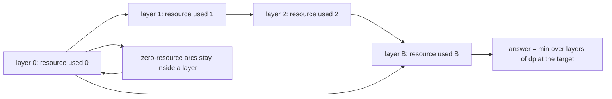
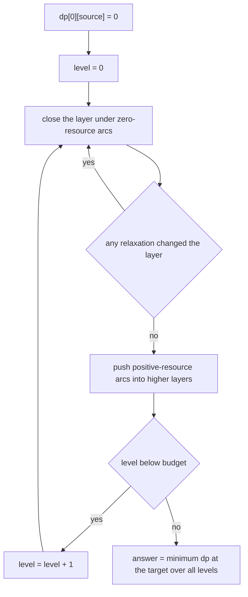
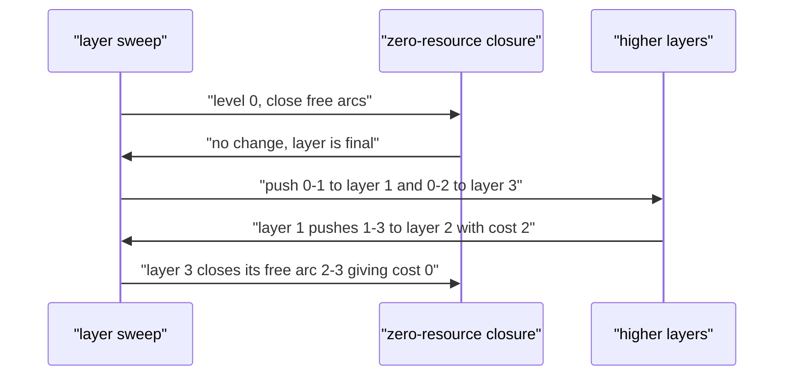

# 536 — Implement constrained shortest path (resource constrained) DP.

> **Tier:** Advanced · **CTCI chapter:** Ch 8 — Recursion and Dynamic Programming
> **Task spec:** [536-implement-constrained-shortest-path-resource-constrained-dp.md](../../../tasks/advanced/536-implement-constrained-shortest-path-resource-constrained-dp.md)
> **Solutions:** [Python](../../../solutions/python/advanced/536-implement-constrained-shortest-path-resource-constrained-dp/solution.py) ·
> [Java](../../../solutions/java/advanced/536-implement-constrained-shortest-path-resource-constrained-dp/Solution.java) ·
> [JavaScript](../../../solutions/javascript/advanced/536-implement-constrained-shortest-path-resource-constrained-dp/solution.js) ·
> [C#](../../../solutions/csharp/advanced/536-implement-constrained-shortest-path-resource-constrained-dp/Solution.cs)

## 1. Problem restatement

**Input:** a directed graph whose every arc `u -> v` carries a non-negative cost `c` and a non-negative
integer resource consumption `r`, a source, a target and an integer budget `B`.

**Output:** the cheapest source-to-target route whose **total consumption is at most `B`**, or `INF`
when no such route exists. Consumption never decreases along a route, so the state space is the layered
product `vertex x {0..B}` and `dp[level][v]` means "cheapest way to reach `v` having consumed *exactly*
`level` units"; the answer is reported as the minimum over the layers `0..B`, which is what turns
"exactly" into "at most".

| Example | Result | Why |
| --- | --- | --- |
| `0->1 (cost 1, res 1)`, `1->3 (1, 1)`, `0->2 (0, 3)`, `2->3 (0, 0)`, budget `2` | `2` | the free route `0-2-3` needs 3 units; `0-1-3` costs 2 and fits |
| the same graph, budget `3` | `0` | now the zero-cost route is feasible |
| the same graph, budget `1` or `0` | `INF` | neither route fits |
| zero-resource cycle `0->1 (1, 0)`, `1->0 (1, 0)`, `1->2 (1, 0)`, budget `0` | `2` | `0-1-2`; the cycle only wastes cost |
| `source == target` | `0` | the empty route for every budget, including `0` |
| an unreachable target | `INF` | reported by the DP, the expanded Dijkstra and brute force alike |

Those rows are asserted in the Python file's `main()`, and the Java, JavaScript and C# files assert
the same family (the Java and JavaScript files additionally reconstruct the optimal route and check
that the reconstruction is a genuine walk).

## 2. Intuition

Plain Dijkstra cannot answer this: the cheapest route to the target may be infeasible, and the
feasible one may be more expensive, so the "cheapest distance per vertex" label is not enough state.
The naive fix — keep, for each vertex, a list of (cost, resource) pairs — is the Pareto-frontier
approach and needs domination pruning; the DP alternative is simpler and exact for small budgets.

The observation is that resource consumption is **monotone**: every arc with `r > 0` moves you into a
strictly higher layer, and an arc with `r == 0` keeps you inside the current layer. So:

- layers can be filled in increasing order of `level`, because no positive-resource arc ever points
  backwards in the layer dimension;
- inside a single layer, zero-resource arcs form an ordinary shortest-path sub-problem over the
  *same* layer, which a few Bellman-Ford rounds close exactly (the JavaScript and Java files instead
  require `r >= 1` on every arc, which removes the inner closure and makes one ascending sweep enough;
  the Python and C# files allow `r == 0` and pay for a mini Bellman-Ford per layer).

The zero-resource closure is not a detail: a cycle of free arcs such as `0->1->0` must be absorbed
rather than followed forever, and the file asserts the tiny instance where `0-1-2` costs 2 while the
free cycle back to `0` never helps.



## 3. Algorithm

1. Build the layer table `dp[level][v] = INF`, and set `dp[0][source] = 0`.
2. For every `level` from `0` to `B`:
   - **close the layer**: repeat up to `n` times, relaxing every zero-resource arc inside the layer,
     until a full round makes no change (this is a mini Bellman-Ford on the layer's free subgraph);
   - **push upwards**: for every arc with `r > 0` and every `u` with `dp[level][u] != INF`, relax
     `dp[level + r][v]` when `level + r <= B`.
3. Return `min over level of dp[level][target]` (or `INF` if every entry is infinite).

```text
procedure rcsp_dp(graph, source, target, budget)
    dp ← table of INF with rows 0 .. budget and columns every vertex
    dp[0][source] ← 0
    free ← arcs with resource 0
    costly ← arcs with resource greater than 0
    for level ← 0 to budget do
        repeat up to n times
            changed ← false
            for each arc (u, v, cost) in free do
                if dp[level][u] + cost < dp[level][v] then
                    dp[level][v] ← dp[level][u] + cost
                    changed ← true
                end
            end
            if not changed then break
        end
        for each arc (u, v, cost, resource) in costly do
            if dp[level][u] = INF then continue
            upper ← level + resource
            if upper <= budget and dp[level][u] + cost < dp[upper][v] then
                dp[upper][v] ← dp[level][u] + cost
            end
        end
    end
    best ← minimum of dp[level][target] over all levels
    return best
end
```

The independent reference used by every file is **Dijkstra on the expanded state graph**: states are
`(vertex, used)`, the heap is keyed by `(cost, vertex, used)` so ties break deterministically, and a
state is settled at most once. Its correctness does not depend on the layer-sweep reasoning — it simply
runs a general shortest-path algorithm on a graph with at most `n * (B + 1)` states — which is why
agreement between the two engines is meaningful evidence.

```text
procedure rcsp_dijkstra(graph, source, target, budget)
    dist ← table of INF with rows 0 .. budget and columns every vertex
    dist[0][source] ← 0
    heap ← [(0, source, 0)]
    while heap is not empty do
        (d, u, used) ← pop the cheapest state
        if d > dist[used][u] then continue
        for each arc (u, v, cost, resource) do
            upper ← used + resource
            if upper > budget then continue
            if d + cost < dist[upper][v] then
                dist[upper][v] ← d + cost
                push (d + cost, v, upper) onto heap
            end
        end
    end
    return the minimum of dist[used][target] over all used
end
```



The third independent engine is **brute force over simple paths**, which is exact here because
dropping a cycle never increases consumption (resources are non-negative) and never increases cost
(costs are non-negative), so the optimum is attained on a simple path. It is exponential, so the file
uses it only on the tiny and small LCG instances, and the dense six-vertex instance exists to show the
DP relaxes far fewer states than enumeration visits.

## 4. Worked example

The hand-built graph `0->1 (1, 1)`, `1->3 (1, 1)`, `0->2 (0, 3)`, `2->3 (0, 0)` with budget `3`. Free
arcs: `(2,3,0)`. Costly arcs: `(0,1,1,1)`, `(1,3,1,1)`, `(0,2,0,3)`.

| Level | closure over free arcs | pushes into higher layers | `dp[level][3]` after the level |
| --- | --- | --- | --- |
| 0 | nothing to close (`dp[0][2] = INF`) | `dp[1][1] = 1` from `0->1`; `dp[3][2] = 0` from `0->2` | `INF` |
| 1 | nothing to close | `dp[2][3] = 2` from `1->3` using `dp[1][1] = 1` | `INF` |
| 2 | nothing to close | nothing (`dp[2][1]` is `INF`) | `2` |
| 3 | `dp[3][3] = 0` via the free arc `2->3` from `dp[3][2] = 0` | nothing | `0` |

The answer is `min(INF, INF, 2, 0) = 0`, matching `rcsp_dp(graph, 0, 3, 3)[0] == 0`, and the file also
asserts the layer contents directly: `wide_dp[3][3] == 0`, `wide_dp[2][3] == 2` and
`wide_dp[1][3] == INF`. Re-running with budget `2` simply drops the `0->2` push (it would need layer 3),
so the answer becomes `2`.

The zero-resource cycle instance, budget `0` (a single layer, so only the closure runs):

| Round | relaxations that changed something | `dp[0][2]` |
| --- | --- | --- |
| 1 | `0->1` sets `dp[0][1] = 1`; `0->2` sets `dp[0][2] = 5`; `1->2` improves it to `2` | `2` |
| 2 | `1->0` finds `1 + 1 > 0`, `0->2` finds `0 + 5 > 2`, `1->2` finds `1 + 1 = 2` | `2` |
| 3 | nothing changes, so the closure stops | `2` |

The answer `2` comes from `0-1-2`; the free cycle `0->1->0` never helps because cost only increases,
which is why the file asserts `relaxations < 50` on this graph — the closure converges instead of
spinning.



## 5. Complexity

Let `n` be the number of vertices, `m` the number of arcs and `B` the budget.

| Measure | Bound | Why it holds |
| --- | --- | --- |
| Time, layered DP | O(B * (n * m_free + m)) | each layer runs at most `n` closure rounds over the free arcs plus one push pass over all arcs; the file asserts `relaxations <= (n + 1) * (m * (n + 1))` on the dense instance |
| Time, expanded Dijkstra | O(n * B * log(n * B) + m * B) | the state graph has at most `n * (B + 1)` states and `m * B` edges; the file asserts `pops <= 7 * 6` on the six-vertex dense instance |
| Time, brute force | exponential (all simple paths) | pruning by budget only; used as a reference, never as the solver |
| Space | O(n * B) | the layer table (and the same size for the state graph in Dijkstra) |
| Layers needed | `B + 1` | consumption never decreases, so no layer is revisited |
| Problem class | weakly NP-hard | the budget is part of the input, so no polynomial algorithm is expected; the DP is pseudo-polynomial in `B` |

## 6. Pitfalls and edge cases

- **Zero-resource arcs need the closure (Python, C#) or must be excluded (Java, JavaScript).** The Java
  docstring says the model "deliberately excludes zero-resource edges, which would otherwise need an
  inner Dijkstra inside each layer"; the Python and C# files allow them and run a mini Bellman-Ford per
  layer, terminating because costs are positive.
- **Zero-resource cycles.** `0->1->0` with free arcs must not loop; the closure stops when a full round
  makes no change, and the tiny instance is asserted with `relaxations < 50`.
- **"Exactly" versus "at most".** `dp` is indexed by *exact* consumption, so the answer must be the
  minimum over all layers `0..B`; taking only `dp[B][target]` is the classic wrong answer on the
  hand-built example (budget 3 would report `INF`).
- **`source == target`.** Must return `0` for every budget including `0` — the empty route needs no
  resource. All three engines are asserted on this case.
- **Budget too small.** The hand-built graph returns `INF` at budgets `0` and `1`; the DP, the expanded
  Dijkstra and brute force agree, so `INF` is the expected answer rather than `0` or `-1`.
- **Unreachable target.** `rcsp_dp(graph, 3, 0, 9) == INF` — the sink has no outgoing arcs, and the
  unreachable vertices stay at `INF` in every layer.
- **Monotonicity in the budget.** A larger budget can only help: the file asserts
  `dp_best <= previous` while sweeping `budget = 0..6` for every source/target pair.
- **Budget-independence check.** When the budget reaches the total consumption of *all* arcs, the
  resource constraint is vacuous and the DP must equal a plain cost-only Dijkstra; that equality is the
  strongest cross-check the file performs.
- **Tie-breaking in the heap.** The expanded Dijkstra pushes `(cost, vertex, used)` triples, so equal
  costs resolve by vertex then by used resource; without a full key the pop order is arbitrary and the
  `pops` counter (and therefore the assertions) becomes unstable.
- **Negative inputs.** Costs and resources are asserted non-negative at `add_edge`; with negative
  consumption the layering argument collapses and the DP would need a different formulation.
- **Path counting versus path cost.** `count_paths`-style reasoning does not apply here: the DP stores
  costs, and `INF` is a sentinel rather than `0`, so "no route" and "free route" cannot be confused.
- **Determinism.** Repeated runs give identical tables (`first == second` for budgets `0..6`), and the
  brute-force enumerator reports how many partial paths it visited so the comparison is auditable.

## 7. Variants and follow-ups

- **DAG version.** Without cycles the layered DP is just a sweep in topological order —
  [535-implement-dynamic-programming-on-dag-with-topological-order-cach.md](../../../tasks/advanced/535-implement-dynamic-programming-on-dag-with-topological-order-cach.md).
- **Knapsack flavour.** The budget dimension is exactly a knapsack capacity, and the tree-shaped
  variant is [458-implement-dynamic-programming-on-trees-with-knapsack-per-node.md](../../../tasks/advanced/458-implement-dynamic-programming-on-trees-with-knapsack-per-node.md);
  the interval variant is [330-weighted-interval-scheduling-dp.md](../../../tasks/intermediate/330-weighted-interval-scheduling-dp.md).
- **Pareto instead of layers.** The label-setting alternative keeps a non-dominated (cost, resource)
  frontier per vertex, which scales better when `B` is huge but the frontier stays small.
- **Heuristic solvers.** When `B` is large, Lagrangian relaxation or `A*` with a resource-aware
  heuristic replaces the exact DP; the approximate route-planning tasks in this tier (for example the
  TSP heuristics of [537-implement-approximate-tsp-heuristics-2-opt-3-opt.md](../../../tasks/advanced/537-implement-approximate-tsp-heuristics-2-opt-3-opt.md))
  follow the same "exact on small instances, heuristic at scale" pattern.
- **Reconstruction.** The Java file packs `(level, vertex)` parents and the JavaScript file keeps a
  predecessor table, then asserts that the rebuilt route is a genuine walk with the reported cost and
  consumption.

## 8. Check yourself

1. Why is one ascending sweep over the layers enough, and when is an inner closure needed?

<details><summary>Show answer</summary>

Because every arc with `r > 0` moves to a strictly higher layer, the layer order is a topological order
of the layer dimension, so layers can be finalised in increasing order. Arcs with `r == 0` stay inside
the layer and can chain arbitrarily, so the Python and C# files close each layer with up to `n`
Bellman-Ford rounds; the Java and JavaScript files exclude `r == 0` arcs precisely to avoid that inner
loop.

</details>

2. On the hand-built graph, why is the answer `2` at budget 2 but `0` at budget 3?

<details><summary>Show answer</summary>

The zero-cost route `0-2-3` consumes `3 + 0 = 3` resource, so its push lands in layer 3, which does not
exist when the budget is 2; the only feasible route then is `0-1-3` with cost 2 and consumption 2.
At budget 3 the layer exists, the free arc `2->3` closes it to `dp[3][3] = 0`, and the minimum over
layers becomes 0.

</details>

3. Why must the answer be `min` over all layers rather than `dp[B][target]`?

<details><summary>Show answer</summary>

Because `dp[level][v]` is the cost of reaching `v` with consumption *exactly* `level`. A route that
stops early (consumption less than `B`) is perfectly legal under an "at most `B`" budget and may be far
cheaper, so every layer from `0` to `B` is a candidate. Reading only the top layer reports `INF` on the
very first asserted example.

</details>

4. What makes brute-force enumeration of simple paths a valid reference here?

<details><summary>Show answer</summary>

Non-negativity. Removing a cycle from a walk never increases consumption and never increases cost when
both are non-negative, so an optimal route can always be taken simple; enumerating simple paths with a
budget prune therefore finds the true optimum. It would be wrong with negative costs, where a cycle can
lower the total.

</details>

5. Why is Dijkstra on the expanded state graph considered an *independent* check?

<details><summary>Show answer</summary>

Because it does not use the layering argument at all: it treats `(vertex, used)` as an ordinary vertex
of a larger graph and runs a general shortest-path algorithm with a heap. Its correctness rests on
non-negative arc costs alone, so agreement with the layer DP validates the layer ordering, the closure
and the "minimum over layers" answer independently.

</details>
