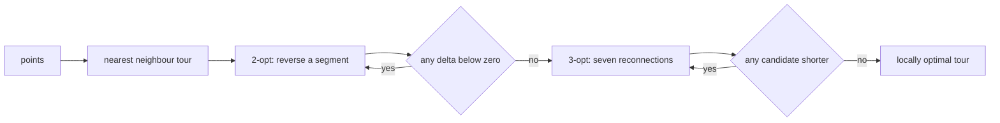
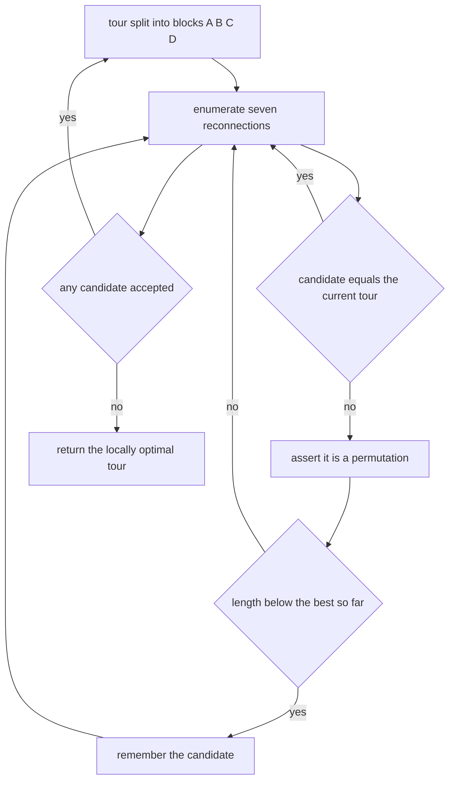
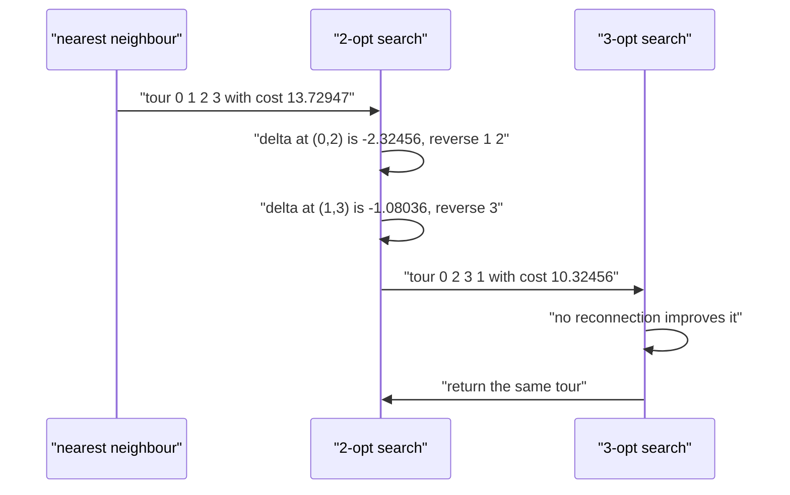

# 537 — Implement approximate TSP heuristics (2-opt / 3-opt).

> **Tier:** Advanced · **CTCI chapter:** Beyond — Graphics, Geometry & Robotics
> **Task spec:** [537-implement-approximate-tsp-heuristics-2-opt-3-opt.md](../../../tasks/advanced/537-implement-approximate-tsp-heuristics-2-opt-3-opt.md)
> **Solutions:** [Python](../../../solutions/python/advanced/537-implement-approximate-tsp-heuristics-2-opt-3-opt/solution.py) ·
> [Java](../../../solutions/java/advanced/537-implement-approximate-tsp-heuristics-2-opt-3-opt/Solution.java) ·
> [JavaScript](../../../solutions/javascript/advanced/537-implement-approximate-tsp-heuristics-2-opt-3-opt/solution.js) ·
> [C#](../../../solutions/csharp/advanced/537-implement-approximate-tsp-heuristics-2-opt-3-opt/Solution.cs)

## 1. Problem restatement

**Input:** `n` points in the plane. A *tour* is a cyclic permutation of the cities; its length is the
sum of the Euclidean distances along the cycle.

**Output:** a good — not necessarily optimal — tour, produced by a three-stage pipeline:

1. `nn_tour(points, start = 0)` — deterministic nearest-neighbour construction, ties broken by the
   smaller city index;
2. `two_opt_tour(points, tour)` — local search that reverses a contiguous segment;
3. `three_opt_tour(points, tour)` — local search over the seven non-trivial reconnections of three cut
   edges.

| Instance | Result | Why |
| --- | --- | --- |
| one city | `tour_cost = 0` | a one-city tour has no edges |
| two cities at distance `d` | `2d` | there and back |
| triangle `(0,0), (3,0), (0,4)` | `12` | the perimeter `3 + 4 + 5` |
| unit square | any heuristic reaches `4` | the perimeter is optimal and nearest neighbour already finds it |
| collinear cities | the optimum is `2 * (max - min)` | the closed tour runs to one end and back |
| random instances, `n = 5..8` | `3-opt <= 2-opt <= nearest neighbour` and all `>= optimum` | compared against all `(n-1)!` tours |
| 40-city LCG instance | 2-opt strictly improves on nearest neighbour, 3-opt strictly improves on 2-opt | the heuristics must find real moves, not just preserve the length |

Every assertion quoted here is in the Python file's `main()`; the Java, JavaScript and C# files assert
the same monotonicity, locality and determinism properties in their own formulation.

## 2. Intuition

A greedy nearest-neighbour walk is fast — `O(n^2)` — and can be catastrophically bad: it commits early
to short local edges and leaves a long edge to close the cycle. Local search repairs exactly that. The
classic move is **2-opt**: remove two edges `(a, b)` and `(c, d)` from the tour and reconnect as
`(a, c)` and `(b, d)`. On a cyclic permutation this is the same as *reversing one contiguous segment*,
and the change in length is a constant-time delta:

```text
delta = d(a, c) + d(b, d) - d(a, b) - d(c, d)
```

If `delta < 0`, the tour shortens and the reversal is applied. Repeating until no improving pair exists
gives a 2-opt local optimum, which is free of the most visible defect — two crossing edges.

**3-opt** removes *three* edges and reconnects the four resulting blocks `A B C D`. Writing `rev X` for
the reversed block, there are eight reconnections and one of them is the identity, leaving seven moves:

| Reconnection | Move |
| --- | --- |
| `A B C D` | identity (skipped) |
| `A rev B C D`, `A B rev C D`, `A rev B rev C D` | 2-opt moves (reverse one middle block) |
| `A C B D`, `A rev C B D`, `A C rev B D` | genuine 3-opt moves |

Because three of the seven cases reproduce 2-opt exactly, a 3-opt local optimum is automatically
**2-opt stable** — no 2-opt move can shorten it. The file verifies that by re-running 2-opt on the
3-opt output and asserting the length is unchanged.



## 3. Algorithm

1. **Construction.** Start at `start`, repeatedly jump to the nearest unvisited city, breaking ties by
   the smaller index, until every city is visited. The result is a cyclic permutation.
2. **2-opt (first improvement).** For every pair `i < j` with `j >= i + 2` (skipping the pair
   `(0, n-1)`, which would reverse the whole cycle and change nothing), compute the delta; on a strict
   improvement — the Python file uses `delta < -1e-12` — reverse `tour[i+1 .. j]` and restart the sweep.
3. **3-opt (best improvement).** For every triple `i < j < k`, split the tour into `A B C D`, build all
   seven reconnections, assert each candidate is a permutation, evaluate its length, and keep the best
   strictly improving candidate; if none exists, stop.
4. **References.** `brute_force_optimal` enumerates every tour fixing city 0 (`(n-1)!` candidates), and
   `mst_weight` builds a Kruskal minimum spanning tree, whose weight lower-bounds every tour because a
   tour contains a spanning tree.

```text
procedure two_opt_tour(points, tour)
    best ← copy of tour
    n ← length(best)
    if n < 4 then return best
    improved ← true
    while improved do
        improved ← false
        for i ← 0 to n - 2 do
            for j ← i + 2 to n - 1 do
                if i = 0 and j = n - 1 then continue
                a ← best[i]
                b ← best[i + 1]
                c ← best[j]
                d ← best[(j + 1) mod n]
                delta ← distance(a, c) + distance(b, d) - distance(a, b) - distance(c, d)
                if delta < 0 then
                    reverse best[i + 1 .. j]
                    improved ← true
                end
            end
        end
    end
    return best
end
```

```text
procedure three_opt_tour(points, tour)
    best ← copy of tour
    n ← length(best)
    if n < 4 then return best
    while true do
        best_cost ← tour_cost(points, best)
        candidate ← none
        for i ← 0 to n - 3 do
            for j ← i + 1 to n - 2 do
                for k ← j + 1 to n - 1 do
                    A ← best[0 .. i]
                    B ← best[i + 1 .. j]
                    C ← best[j + 1 .. k]
                    D ← best[k + 1 .. n - 1]
                    for each reconnection (X, Y) in
                        ((B, C), (reverse B, C), (B, reverse C), (reverse B, reverse C),
                         (C, B), (reverse C, B), (C, reverse B)) do
                        trial ← A + X + Y + D
                        if trial = best then continue
                        assert trial is a permutation of every city
                        if tour_cost(points, trial) < best_cost then
                            best_cost ← tour_cost(points, trial)
                            candidate ← trial
                        end
                    end
                end
            end
        end
        if candidate is none then return best
        best ← candidate
    end
end
```

The other three files phrase the same neighbourhood differently but equivalently: the JavaScript file
cuts the tour into four pieces at linear positions `1 <= p1 < p2 < p3 <= n-1` and enumerates `2`
orderings times `4` reversal flags (1 identity plus 7 real moves), and the C# file uses an `n x n`
distance matrix, scanning all `n` rotations of the cyclic tour so that the wrap edge is covered by the
same triple loop, with every delta cross-validated against `Length(after) - Length(before)`.



## 4. Worked example

Take four cities `0:(0,0)`, `1:(1,3)`, `2:(2,0)`, `3:(3,3)`, all pairwise distances
`d(0,1) = d(1,2) = d(2,3) = sqrt(10) ≈ 3.16228`, `d(0,2) = 2`, `d(1,3) = 2`,
`d(0,3) = sqrt(18) ≈ 4.24264`, and start from the tour `[0, 1, 2, 3]`.

| Sweep | Move `(i, j)` | `a b c d` | delta | Action | Tour after | Cost |
| --- | --- | --- | --- | --- | --- | --- |
| 1 | `(0, 2)` | `0 1 2 3` | `2 + 2 - 3.16228 - 3.16228 = -2.32456` | accept, reverse `[1, 2]` | `[0, 2, 1, 3]` | `11.40492` |
| 1 | `(1, 3)` | `2 1 3 0` | `3.16228 + 3.16228 - 3.16228 - 4.24264 = -1.08036` | accept, reverse `[3]` | `[0, 2, 3, 1]` | `10.32456` |
| 2 | `(0, 2)` | `0 2 3 1` | `4.24264 + 3.16228 - 2 - 2 = +3.40492` | reject | `[0, 2, 3, 1]` | `10.32456` |
| 2 | `(1, 3)` | `2 3 1 0` | `3.16228 + 4.24264 - 3.16228 - 3.16228 = +1.08036` | reject | `[0, 2, 3, 1]` | `10.32456` |
| 3 | none | — | — | sweep ends with no improvement | `[0, 2, 3, 1]` | `10.32456` |

The pair `(0, 3)` is skipped because it would reverse the entire cycle. The final tour has length
`2 + 2 + 2·sqrt(10) ≈ 10.32456`, and the brute-force optimum over the six tours fixing city 0 is
`10.32456` as well (attained by `[0, 1, 3, 2]` and by `[0, 2, 3, 1]`), so 2-opt closed the two crossings
in two moves. Feeding that tour to `three_opt_tour` changes nothing — it is 3-opt stable too.

On the **unit square** `(0,0), (0,1), (1,0), (1,1)`, nearest neighbour starts at city 0, breaks the tie
between the equal distances `1` to cities 1 and 2 by the smaller index, and produces `[0, 1, 3, 2]` with
length exactly `4`; every pairwise delta is `0`, so 2-opt and 3-opt leave it alone. This is the case the
file uses to show that the heuristics never exceed the optimum on a symmetric instance.



## 5. Complexity

Let `n` be the number of cities and `m = n` the cities per sweep.

| Measure | Bound | Why it holds |
| --- | --- | --- |
| Nearest neighbour | O(n^2) | n greedy steps, each scanning the unvisited set |
| One 2-opt sweep | O(n^2) | every pair `(i, j)` with an O(1) delta |
| 2-opt to a local optimum | O(n^2) per accepted move, at most O(n^2) moves | first-improvement restarts the sweep after each acceptance |
| One 3-opt sweep | O(n^3) triples times 7 reconnections | the candidate list is constant size per triple |
| 3-opt local optimum | O(n^3) per improvement round | best-improvement applies one move per round |
| Brute force optimum | O(n!) | `(n-1)!` tours for the file's `n <= 8` checks (5040 for `n = 8`) |
| MST lower bound | O(n^2 log n) | Kruskal over the `n(n-1)/2` pairwise distances |
| Space | O(n) for tours, O(n^2) for the C# distance matrix | the Python file recomputes distances on demand |
| Quality | 2-opt within factor 2 on the tested instances, 3-opt no worse | asserted as `max(ratios_two) <= 2.0` and `max(ratios_three) <= max(ratios_two)` |

## 6. Pitfalls and edge cases

- **Fewer than four cities.** Both local searches return the tour unchanged (`if n < 4`), because no
  pair `(i, j)` with `j >= i + 2` exists. `n = 1` costs `0`, `n = 2` costs `2d`, `n = 3` costs the
  perimeter.
- **The whole-cycle reversal.** The pair `(0, n-1)` reverses the entire cycle, which is the same cycle
  in the opposite orientation; the file skips it explicitly so the sweep cannot churn.
- **Rotation and reversal invariance.** `tour_cost` is unchanged by rotating the array or reversing it,
  which the file asserts; the Java file exploits this by re-anchoring every candidate tour so vertex `0`
  comes first, which makes results comparable and tie-breaking reproducible.
- **Cyclic wrap edge.** A linear triple loop over `[0, n-1]` misses moves that use the edge closing the
  cycle. The Python file covers it by indexing `(j + 1) mod n`, and the C# file by scanning all `n`
  rotations of the tour, which it documents as the way the wrap edge is reached.
- **Floating-point deltas.** Improvements are accepted with an epsilon (`delta < -1e-12`), otherwise
  rounding can admit a move that does not actually shorten the tour and the loop may not terminate.
- **Candidate validity.** Every 3-opt reconnection is asserted to be a permutation of the cities before
  its length is compared; a mis-sliced block would otherwise silently compare a tour with a repeated or
  missing city.
- **Duplicate and collinear cities.** Two identical cities give zero distance and can create many equal
  deltas; the file's rectangle-with-doubles instance has optimum `20` (the perimeter) and all heuristics
  must reach it. Collinear cities make the optimum exactly `2 * (max - min)` and 2-opt must untangle
  every crossing even when nearest neighbour starts in the middle.
- **Interior starts.** `nn_tour(line, start = count // 2)` deliberately starts mid-line so 2-opt has
  real work to do; starting at an end would already be optimal.
- **Heuristics never beat the optimum.** The file asserts `cost >= optimum - 1e-9` for every heuristic,
  which catches an accidentally relaxed cost function or a broken permutation.
- **Monotone quality.** `cost_three <= cost_two <= cost_nn` is asserted on every random instance, and on
  the 40-city instance the inequalities are strict — a "heuristic" that returns its input unchanged
  would fail there.
- **Local optimality is checkable.** Re-running 2-opt on the 2-opt output and 3-opt on the 3-opt output
  must not change anything; those idempotence checks are stronger than comparing lengths with the
  optimum.
- **Determinism.** Ties in `nn_tour` break by index, so repeated runs give identical tours — asserted on
  the 40-city instance.

## 7. Variants and follow-ups

- **Christofides and other guarantees.** MST-doubling and Christofides give provable factors instead of a
  local optimum — [538-implement-christofides-algorithm-outline-for-metric-tsp.md](../../../tasks/advanced/538-implement-christofides-algorithm-outline-for-metric-tsp.md).
- **Exact small instances.** Held-Karp / bitmask DP solves `n <= 20` optimally and is the natural
  reference for very small inputs — [220-implement-bitmask-dp-for-tsp-small-n.md](../../../tasks/intermediate/220-implement-bitmask-dp-for-tsp-small-n.md).
- **MST as a bound and a construction.** Kruskal is both the lower bound used here and the first step of
  the MST-doubling heuristic — [111-kruskal-s-mst-using-union-find.md](../../../tasks/beginner/111-kruskal-s-mst-using-union-find.md).
- **Or-opt and Lin-Kernighan.** Moving one or two cities between buckets (Or-opt) and variable-depth
  exchange (Lin-Kernighan) generalise 2-opt/3-opt and are the usual next step; simulated annealing is
  the stochastic alternative — [800-implement-global-optimization-via-simulated-annealing-with-cooli.md](../../../tasks/expert/800-implement-global-optimization-via-simulated-annealing-with-cooli.md).
- **Better initial tours.** Christofides, savings heuristics or space-filling-curve orderings replace
  nearest neighbour when the instance is large.

## 8. Check yourself

1. Why is reversing a segment the same as the 2-opt reconnection?

<details><summary>Show answer</summary>

A tour visited in order `... a b ... c d ...` has edges `(a, b)` and `(c, d)`. Removing them and adding
`(a, c)` and `(b, d)` is only a valid cycle if the segment `b ... c` is traversed backwards, so the
resulting tour is exactly `... a, c ... b, d ...` — the same cyclic order as reversing that contiguous
segment.

</details>

2. In the worked example, why is the pair `(i, j) = (1, 3)` allowed but `(0, 3)` skipped?

<details><summary>Show answer</summary>

For `n = 4`, `j = 3 = n - 1` and `i = 0`, so the move would reverse the entire cycle, which is the same
cycle in the opposite orientation and never changes the length. Every other pair, such as `(1, 3)`,
reverses a proper sub-segment (`best[2..3]`, a single city here) and can genuinely shorten the tour —
in the trace it cut the cost from `11.40492` to `10.32456`.

</details>

3. Why is a 3-opt local optimum automatically 2-opt stable?

<details><summary>Show answer</summary>

Because three of the seven reconnections are exactly 2-opt moves: reversing one of the two middle blocks
(`A rev B C D`, `A B rev C D`) or both (`A rev B rev C D`) is a 2-opt reversal presented in the 3-opt
notation. If a 3-opt sweep finds no improving reconnection, it has therefore already searched the whole
2-opt neighbourhood. The file verifies this by running `two_opt_tour` on the 3-opt output and asserting
the length is unchanged.

</details>

4. Why can an MST weight be used as a lower bound on the optimal tour?

<details><summary>Show answer</summary>

Removing any one edge from a tour yields a Hamiltonian path, which is a spanning tree; a minimum spanning
tree is no heavier than that path, so `MST <= tour - max edge <= OPT`. The file asserts
`value >= mst_weight(points) - 1e-9` for the nearest-neighbour, 2-opt and 3-opt tours on every random
instance.

</details>

5. What does the 40-city instance check that the small brute-force instances cannot?

<details><summary>Show answer</summary>

That the search actually makes progress at a size where the optimum is unknown: the file asserts
`cost_two < cost_nn` and `cost_three < cost_two` strictly, plus the MST lower bound and byte-identical
repeat runs. On the tiny instances a heuristic could pass by luck; at 40 cities it has to find genuine
improving moves and stay deterministic.

</details>
