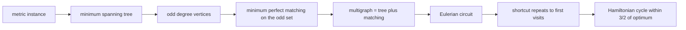
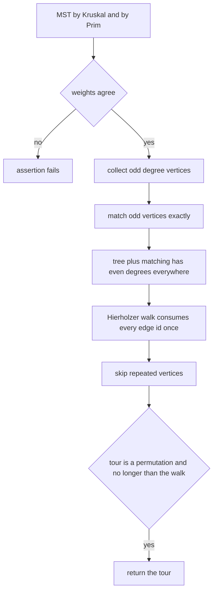
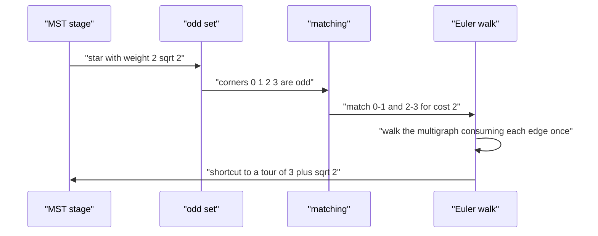

# 538 — Implement Christofides algorithm outline for metric TSP.

> **Tier:** Advanced · **CTCI chapter:** Beyond — Graphics, Geometry & Robotics
> **Task spec:** [538-implement-christofides-algorithm-outline-for-metric-tsp.md](../../../tasks/advanced/538-implement-christofides-algorithm-outline-for-metric-tsp.md)
> **Solutions:** [Python](../../../solutions/python/advanced/538-implement-christofides-algorithm-outline-for-metric-tsp/solution.py) ·
> [Java](../../../solutions/java/advanced/538-implement-christofides-algorithm-outline-for-metric-tsp/Solution.java) ·
> [JavaScript](../../../solutions/javascript/advanced/538-implement-christofides-algorithm-outline-for-metric-tsp/solution.js) ·
> [C#](../../../solutions/csharp/advanced/538-implement-christofides-algorithm-outline-for-metric-tsp/Solution.cs)

## 1. Problem restatement

**Input:** a complete graph on `n` points with Euclidean (hence metric) distances, i.e. the triangle
inequality `d(i, k) <= d(i, j) + d(j, k)` holds for all triples.

**Output:** a Hamiltonian cycle of length at most `3/2` times the optimum, built by the five-stage
Christofides construction. The solution files implement the whole pipeline exactly rather than
sketching it, and each stage has an independent cross-check.

| Stage | Output | Cross-check |
| --- | --- | --- |
| 1. Minimum spanning tree | weight and edge list | Kruskal (sorted edges plus union-find) and Prim (heap keyed by weight) must agree |
| 2. Odd-degree vertices | even-sized set `odd` | handshake lemma: `len(odd) % 2 == 0` |
| 3. Minimum-weight perfect matching on `odd` | matching plus cost | exhaustive recursion and a bitmask DP must agree |
| 4. Eulerian circuit of `tree + matching` | vertex walk | every edge id used once, walk closed, vertex occurs `degree / 2` times |
| 5. Shortcutting | Hamiltonian cycle | a permutation, length at most the walk length |

| Instance | Result | Why |
| --- | --- | --- |
| unit square | MST `3`, odd `[2, 3]`, matching `1`, tour `4` | three sides, then the missing side closes the two leaves |
| square with centre | MST `2·sqrt(2)`, odd `[0, 1, 2, 3]`, matching `2`, tour `3 + sqrt(2) ≈ 4.41421` | the star to the centre is cheapest; the corners pair along two unit sides |
| triangle `(0,0), (4,0), (0,3)` | `12` | the construction is forced to be optimal |
| six collinear cities `0, 3, ..., 15` | `30` | the closed tour goes to one end and back: `2 * 15` |
| `n = 1` / `n = 2` | `[0]` / `2 * d` | degenerate sizes |

Those values are asserted in the Python file's `main()`, and the Java, JavaScript and C# files assert
the same pipeline invariants (with the same triangle-inequality precondition).

## 2. Intuition

Doubling a minimum spanning tree already gives a valid tour: walk each tree edge twice, get an Eulerian
circuit, then skip repeated vertices ("shortcut") to get a Hamiltonian cycle. Metric shortcutting never
lengthens a walk, so the result is at most `2 · MST <= 2 · OPT` — a factor-2 approximation.

Christofides' improvement is to fix the *parity* of the doubled tree instead of doubling it. If a
multigraph has every degree even it is Eulerian, and after shortcutting it yields a tour no longer than
the walk. The MST has even-degree vertices already; only the odd-degree ones (an even-sized set, by the
handshake lemma) are a problem. Adding a **minimum-weight perfect matching on the odd set** toggles the
parity of exactly those vertices:

- tree + matching is connected (it contains the spanning tree) and every degree is even, so an Eulerian
  circuit exists;
- its length is `MST + matching`, and the walk's shortcut tour is no longer than that;
- the matching on the odd set is at most `OPT / 2`, because an optimal tour restricted to the odd
  vertices is a union of two perfect matchings, one of which must cost at most half of it.

Together: tour length `<= MST + OPT/2 <= OPT + OPT/2 = 3/2 · OPT`.



One subtlety the files call out: the `3/2` factor bounds the tour against the **optimum**, not against
the MST. On the square-with-centre instance `1.5 · MST = 4.24264` while the produced tour is
`3 + sqrt(2) = 4.41421`, so the tour genuinely exceeds `1.5 · MST` — and that is fine, because the
optimum there is also `3 + sqrt(2)`.

## 3. Algorithm

1. **Spanning tree.** Run Kruskal over edges sorted by `(weight, u, v)` with a union-find, and Prim
   with a heap keyed by `(weight, vertex, parent)`; assert the two weights agree and that the edge set
   has `n - 1` edges and is connected (hence a tree).
2. **Odd set.** Compute degrees in the tree; collect the vertices of odd degree in sorted order.
3. **Matching.** Solve the minimum-weight perfect matching on the odd set exactly, by plain recursion on
   the sorted list (match the first remaining vertex with each other remaining one, recurse) and by a
   bitmask DP (`best[mask]`, `choice[mask]`); assert the two costs agree. The odd set never exceeds
   twelve vertices here, so exhaustive matching is affordable (at most `10395` matchings).
4. **Eulerian circuit.** Build the multigraph `tree + matching` with explicit edge ids and run
   Hierholzer's algorithm iteratively: follow unused edges, back up when stuck, and reverse the
   vertex stack at the end.
5. **Shortcut.** Walk the circuit and keep the first occurrence of each vertex, then close the cycle by
   repeating the start.

```text
procedure christofides(points)
    w ← distance matrix of points
    kruskal_cost, kruskal_tree ← kruskal(w)
    prim_cost, prim_tree ← prim(w)
    assert kruskal_cost = prim_cost
    tree ← kruskal_tree
    odd ← sorted vertices whose degree in tree is odd
    match_cost, matching ← exact minimum perfect matching on odd
    multigraph ← tree together with matching
    circuit ← hierholzer(n, multigraph)
    tour ← empty list
    seen ← empty set
    for each vertex v in circuit do
        if v is not in seen then
            add v to seen
            append v to tour
        end
    end
    append circuit[0] to tour
    return tour
end
```

```text
procedure hierholzer(n, edge_list)
    adjacency ← for every vertex, the list of (neighbour, edge id)
    sort every adjacency list
    used ← false for every edge id
    pointer ← zero for every vertex
    stack ← [ first endpoint of the first edge ]
    circuit ← empty list
    while stack is not empty do
        v ← top of stack
        while pointer[v] is inside adjacency[v] and used[edge id at pointer[v]] do
            pointer[v] ← pointer[v] + 1
        end
        if pointer[v] reached the end of adjacency[v] then
            append pop(stack) to circuit
        else
            (u, eid) ← adjacency[v][pointer[v]]
            used[eid] ← true
            push u onto stack
        end
    end
    return reverse of circuit
end
```

The matching is where the other three files differ in presentation but not in substance: the Java file
solves the bitmask DP with parent pointers for reconstruction and cross-checks it against exhaustive
enumeration, the JavaScript file stresses that it solves the matching **exactly** "rather than a greedy
blossom shortcut, so the 1.5-approximation argument actually applies", and the C# file verifies the
bitmask DP against brute force over every perfect matching.



## 4. Worked example

The unit square, cities `0:(0,0)`, `1:(0,1)`, `2:(1,0)`, `3:(1,1)`, with `d(0,1) = d(0,2) = 1`,
`d(1,3) = d(2,3) = 1` and the diagonals `sqrt(2)`.

| Stage | Computation | Result |
| --- | --- | --- |
| Kruskal | edges by `(weight, u, v)`: `(1,0,1)`, `(1,0,2)`, `(1,1,3)`, then `(1,2,3)`, then the diagonals; the fourth unit edge `(2,3)` would close a cycle and is skipped | tree `[(0,1), (0,2), (1,3)]` with weight `3` |
| Prim | same weight `3` from the heap keyed by `(weight, vertex, parent)` | asserted equal to Kruskal |
| degrees in the tree | `0 -> 2`, `1 -> 2`, `2 -> 1`, `3 -> 1` | `odd = [2, 3]` |
| matching on `{2, 3}` | only one pair exists | cost `d(2,3) = 1` |
| multigraph | `[(0,1), (0,2), (1,3), (2,3)]` — the square cycle | all degrees `2` |
| Hierholzer from vertex `0` | `0 -> 1 -> 3 -> 2 -> 0` | circuit `[0, 1, 3, 2, 0]`, length `4` edges |
| shortcut | `0, 1, 3, 2` are already distinct | tour `[0, 1, 3, 2]`, cost `4` |

The tour cost `4` equals `brute_force_optimal` on the square, and the walk `MST + matching = 4` bounds
it. The file also checks the counts: the circuit has `len(multigraph) + 1 = 5` vertices, it is closed,
each vertex appears `degree / 2 = 1` times, and the multiset of traversed edges is exactly the
multigraph. Feeding a different minimum spanning tree — `[(0,1), (1,3), (2,3)]`, the other "square minus
one side" — gives the same weight `3`, `odd = [0, 2]` and again a tour of cost `4`.

The **square with centre** `0..3` at the corners and `4` at `(0.5, 0.5)` exercises the interesting
numbers: the centre is at distance `sqrt(2)/2` from each corner, so the cheapest tree is the four-armed
star of weight `2·sqrt(2) ≈ 2.82843`, every corner has degree `1` and the centre degree `4`, giving
`odd = [0, 1, 2, 3]`. The best perfect matching pairs two unit sides (cost `2`, beating the
`2·sqrt(2)` diagonal pairing), so the walk is `2 + 2·sqrt(2) ≈ 4.82843` and the shortcut tour is exactly
`3 + sqrt(2) ≈ 4.41421` — which the file confirms is also the brute-force optimum. Note
`1.5 · MST ≈ 4.24264 < 4.41421`, the documented reminder that the factor is relative to the optimum.



## 5. Complexity

Let `n` be the number of cities and `O` the size of the odd set.

| Measure | Bound | Why it holds |
| --- | --- | --- |
| Kruskal | O(n^2 log n) | sorting the `n(n-1)/2` pairwise distances dominates the union-find pass |
| Prim (heap) | O(n^2 log n) | `n` pops plus `n` pushes per settled vertex |
| Odd-degree scan | O(n) | one pass over the `n - 1` tree edges |
| Matching, recursion | exponential in `O` | both matchers are exhaustive; `O <= 12` here, i.e. at most `10395` matchings |
| Matching, bitmask DP | O(2^O · O^2) | `2^O` masks, each pairing the first free vertex with every other |
| Hierholzer | O(n + E) | every edge id is consumed once, with a pointer per vertex |
| Shortcut | O(E) | one pass over the circuit |
| Space | O(n^2) for the distance matrix, O(2^O) for the DP | the multigraph and walk are O(E) |
| Guarantee | tour `<= 3/2 · OPT` | `MST <= OPT` and `matching <= OPT/2`, with metric shortcutting never lengthening |

## 6. Pitfalls and edge cases

- **The guarantee needs the matching to be exact.** A greedy or heuristic matching invalidates the
  `matching <= OPT/2` step, which is why the JavaScript docstring insists on the exact subset DP
  instead of a blossom shortcut.
- **The 3/2 factor is against the optimum, not the MST.** On the square-with-centre instance the tour
  `3 + sqrt(2)` exceeds `1.5 · MST`; the file asserts that inequality explicitly so the distinction is
  not lost.
- **Metric precondition.** The triangle inequality is verified numerically on every random instance
  before the bound is used; on a non-metric instance shortcutting can lengthen a walk and the factor-3/2
  claim does not hold.
- **Multigraph, not graph.** The tree and the matching may share an edge; the Eulerian walk must treat
  each edge with its own id (`used[eid]`), or the walk silently drops one of the parallel edges. The C#
  docstring calls this out as the reason for the edge-id bookkeeping.
- **Odd set is even and non-empty.** By the handshake lemma the number of odd-degree vertices is even;
  for `n > 1` it is non-empty, and for `n = 1` the whole construction degenerates to the single city.
  The file asserts `len(odd) % 2 == 0` and `len(matching) == len(odd) // 2`.
- **Every vertex has even degree after the matching.** The odd set's parity is exactly what the matching
  toggles; the file asserts `all(d % 2 == 0 for d in degrees(...))` on the multigraph, which is the
  precondition for Hierholzer.
- **Walk closure and visit counts.** A closed Eulerian walk of a multigraph on `E` edges has `E + 1`
  vertices, starts and ends at the same vertex, and visits each vertex `degree / 2` times; all three are
  asserted on the square.
- **Shortcutting must preserve the permutation.** `sorted(tour) == list(range(n))` is checked on every
  instance — a shortcut that skipped a vertex or duplicated one would still satisfy the length bounds
  but would not be a tour.
- **Degenerate sizes.** `n = 1` returns `[0]` with cost `0`; `n = 2` returns both cities and the cost
  `2 * d`, because the tour is the edge traversed in both directions.
- **Tie-breaking.** Kruskal sorts by `(weight, u, v)` and Prim keys the heap by `(weight, vertex,
  parent)`, so ties are resolved deterministically; the file shows the achieved length may depend on
  which minimum spanning tree is chosen while still respecting the `3/2` bound.
- **Labelling independence.** Relabelling the cities rotates the point set and changes tie-breaking but
  not the optimum or the guarantee; the file re-runs with `points[(i + 3) % n]` and re-checks both.
- **Exact arithmetic on small instances.** All the tiny comparisons (`MST = 2·sqrt(2)`,
  `tour = 3 + sqrt(2)`) use an epsilon, because the values are irrational and computed with `hypot`.
- **Determinism.** Repeated runs give identical tours and circuits, which is asserted alongside the
  twelve-city instance where matching dominates.

## 7. Variants and follow-ups

- **Local search on top.** Christofides gives a guaranteed start; 2-opt/3-opt polish it further —
  [537-implement-approximate-tsp-heuristics-2-opt-3-opt.md](../../../tasks/advanced/537-implement-approximate-tsp-heuristics-2-opt-3-opt.md).
- **MST construction details.** Prim with a heap and Kruskal with a union-find are the two engines
  cross-checked here — [112-prim-s-mst-using-heap.md](../../../tasks/beginner/112-prim-s-mst-using-heap.md)
  and [111-kruskal-s-mst-using-union-find.md](../../../tasks/beginner/111-kruskal-s-mst-using-union-find.md).
- **Exact TSP for small `n`.** When `n <= 20` a Held-Karp bitmask DP gives the true optimum, which is
  what the tests compare against — [220-implement-bitmask-dp-for-tsp-small-n.md](../../../tasks/intermediate/220-implement-bitmask-dp-for-tsp-small-n.md).
- **Doubled-tree baseline.** `doubled_tree_cost` walks the doubled MST and shortcuts it, giving the
  classical factor-2 tour; Christofides is never worse once the matching is accounted for.
- **Weighted general matching.** For large odd sets the exhaustive matcher is replaced by a blossom
  algorithm, which is the same object studied in
  [534-implement-matching-in-general-graphs-improved-heuristics-edmonds.md](../../../tasks/advanced/534-implement-matching-in-general-graphs-improved-heuristics-edmonds.md).

## 8. Check yourself

1. Why does adding the matching make the multigraph Eulerian?

<details><summary>Show answer</summary>

The matching is a perfect matching on exactly the vertices of odd degree in the tree, so it toggles the
degree parity of each of them (odd becomes even) and adds `2` to nothing else — matched vertices gain
exactly one incident matching edge each. All vertices therefore have even degree afterwards, and the
multigraph is connected because it still contains the spanning tree, so an Eulerian circuit exists.

</details>

2. Where does the factor `3/2` come from?

<details><summary>Show answer</summary>

`tour <= MST + matching` by metric shortcutting, `MST <= OPT`, and `matching <= OPT / 2`: taking an
optimal tour and looking only at the odd-degree vertices gives a cyclic sequence that decomposes into
two perfect matchings, so the cheaper one costs at most half of `OPT`. Adding the bounds gives
`3/2 · OPT`.

</details>

3. On the unit square, what are the odd vertices and what is the matching?

<details><summary>Show answer</summary>

The tree is `[(0,1), (0,2), (1,3)]` with weight `3`, so vertex `0` has degree `2` and vertices `2` and
`3` have degree `1`; `odd = [2, 3]`. The only perfect matching on two vertices is the pair `(2,3)`,
costing `d(2,3) = 1`. The multigraph is the square's boundary, and its Eulerian circuit
`0 -> 1 -> 3 -> 2 -> 0` shortcuts to the tour `[0, 1, 3, 2]` of cost `4`, the optimum.

</details>

4. Why must the walk use edge ids rather than plain adjacency?

<details><summary>Show answer</summary>

Because `tree + matching` is a *multigraph*: a matching edge can be parallel to a tree edge, so the same
pair of vertices may be joined twice. With a `used[]` flag per edge id, Hierholzer consumes each copy
exactly once; with plain adjacency, one copy would be skipped and the walk would not be Eulerian. The
C# solution documents exactly this.

</details>

5. What is the difference between the doubled-tree 2-approximation and Christofides, in one sentence?

<details><summary>Show answer</summary>

Doubling every tree edge makes all degrees even at the cost of a second copy of the whole tree
(`2 · MST <= 2 · OPT`), whereas Christofides repairs only the odd-degree vertices with a minimum perfect
matching (`MST + matching <= 3/2 · OPT`) — strictly fewer edges added on essentially every instance.

</details>
