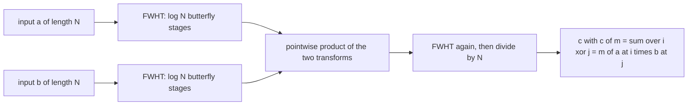
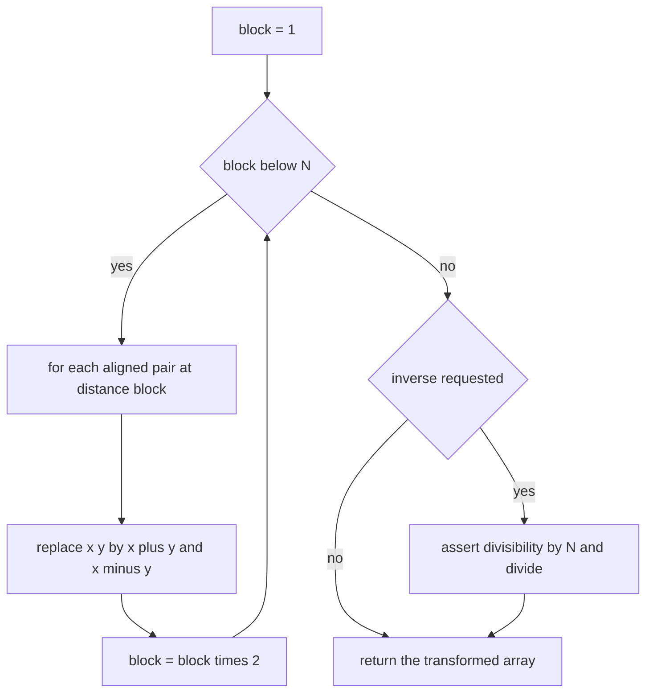
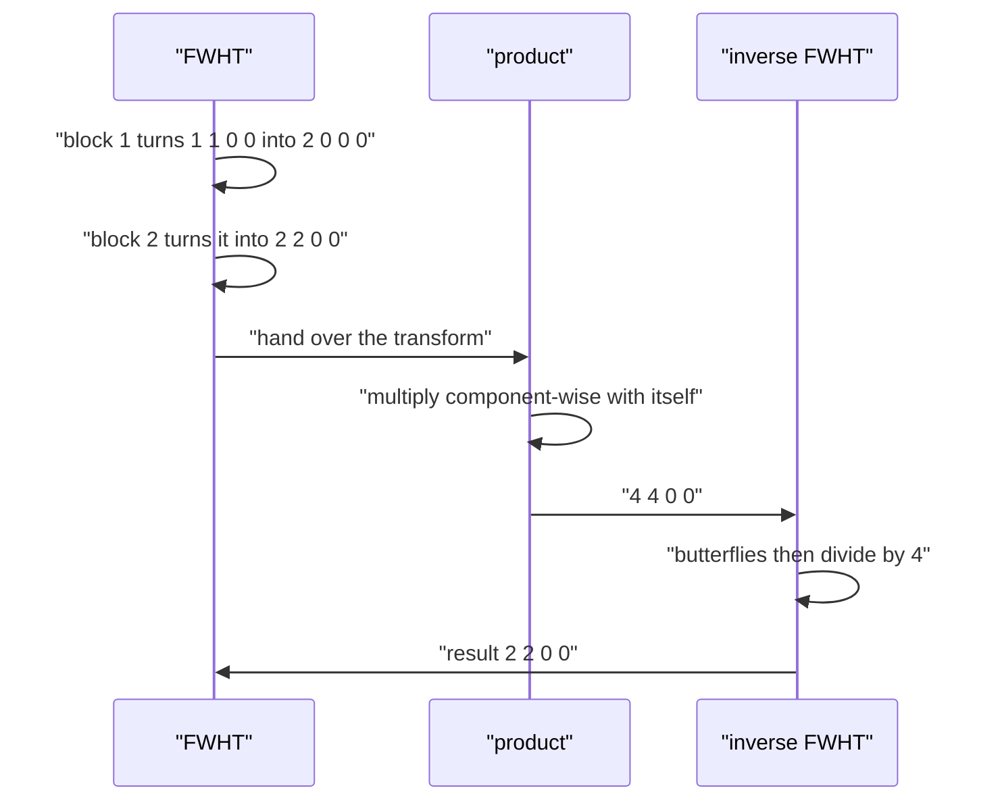

# 539 — Implement bitset convolution using FWHT (XOR convolution) small N.

> **Tier:** Advanced · **CTCI chapter:** Beyond — Numerical & Scientific Computing
> **Task spec:** [539-implement-bitset-convolution-using-fwht-xor-convolution-small-n.md](../../../tasks/advanced/539-implement-bitset-convolution-using-fwht-xor-convolution-small-n.md)
> **Solutions:** [Python](../../../solutions/python/advanced/539-implement-bitset-convolution-using-fwht-xor-convolution-small-n/solution.py) ·
> [Java](../../../solutions/java/advanced/539-implement-bitset-convolution-using-fwht-xor-convolution-small-n/Solution.java) ·
> [JavaScript](../../../solutions/javascript/advanced/539-implement-bitset-convolution-using-fwht-xor-convolution-small-n/solution.js) ·
> [C#](../../../solutions/csharp/advanced/539-implement-bitset-convolution-using-fwht-xor-convolution-small-n/Solution.cs)

## 1. Problem restatement

**Input:** two integer arrays `a` and `b` of the same length `N = 2^k` (a power of two; any other
length is rejected).

**Output:** their **XOR convolution**

```text
c[m] = sum over all pairs (i, j) with i XOR j == m of a[i] * b[j]
```

computed in `O(N log N)` with the Fast Walsh-Hadamard transform (FWHT), instead of the `O(N^2)` of the
direct double loop. For 0/1 indicator arrays — the "bitset" reading of the task — `c[m]` counts the
pairs of set bits whose XOR is `m`.

| Call | Result | Why |
| --- | --- | --- |
| `xor_convolve([1,1,0,0], [1,1,0,0])` | `[2, 2, 0, 0]` | `0^0 = 1^1 = 0` and `0^1 = 1^0 = 1` |
| `xor_convolve(a, delta_k)` | `[a[i XOR k]]` | convolving with a spike permutes the buckets |
| `xor_convolve(indicator([0,1,2,3], 8), indicator([0,4], 8))` | `[1, 1, 1, 1, 1, 1, 1, 1]` | the eight XORs hit every value exactly once |
| `xor_convolve(indicator([0,3], 4), indicator([0,1], 4))` | `[1, 1, 1, 1]` | `0, 1, 2, 3` each hit once |
| `xor_convolve(a, b)` with `n = 1` | `[a[0] * b[0]]` | a one-element convolution is a product |
| `fwht([1, 2, 3])` | assertion error | `3` is not a power of two |

Those rows are asserted in the Python file's `main()`, and the Java, JavaScript and C# files assert the
same identities (`F(F(a)) = N * a`, the delta as the convolution identity, the all-ones case) in their
own formulation.

## 2. Intuition

The direct convolution inspects all `N^2` pairs. The fast route diagonalises XOR the same way the FFT
diagonalises addition: with the **Walsh-Hadamard transform**

```text
F(a)[s] = sum over i of (-1)^(popcount(s AND i)) * a[i]
```

XOR convolution becomes pointwise multiplication in the transform domain:

```text
c = F^(-1)( F(a) * F(b) )
```

Because the kernel entries are `+1`/`-1`, the transform is its own inverse up to the factor `N`, so the
same butterfly loop serves both directions and no complex arithmetic is needed. On top of the classical
recursive definition, the in-place butterfly form is what the code implements: for `block = 1, 2, 4, ...`
and every aligned pair at distance `block`, replace

```text
(x, y) -> (x + y, x - y)
```

That is `log2(N)` stages, each touching every element once, so `O(N log N)` operations in total. The
C# docstring notes that this natural (Hadamard) ordering needs **no bit-reversal** permutation, unlike
a radix-2 FFT.



Two integrality facts make the whole thing exact rather than floating point: the forward transform and
the pointwise product are integers, so the inverse division by `N` is exact, which the Python file
asserts element by element (`a[i] % n == 0`). The JavaScript docstring makes the same point for binary
floating point: because `N` is a power of two, the division is exact there too, so the file can assert
*strict equality* against the naive convolution.

## 3. Algorithm

1. **Validate.** Both inputs must have the same length `N`, and `N >= 1` must be a power of two
   (`n & (n - 1) == 0`); otherwise raise.
2. **Transform.** Run the butterfly in place: `block = 1, 2, 4, ... N/2`; for every aligned pair
   `(j, j + block)` inside a block of size `2 * block`, replace `(x, y)` by `(x + y, x - y)`.
3. **Multiply.** `f[i] = F(a)[i] * F(b)[i]` component-wise.
4. **Invert.** Run the same butterfly again, then divide every entry by `N` exactly.
5. **Return** the resulting array.

```text
procedure fwht(values, inverse)
    a ← copy of values
    n ← length(a)
    assert n >= 1 and n is a power of two
    block ← 1
    while block < n do
        step ← block * 2
        for start ← 0 to n - 1 step step do
            for j ← start to start + block - 1 do
                x ← a[j]
                y ← a[j + block]
                a[j] ← x + y
                a[j + block] ← x - y
            end
        end
        block ← step
    end
    if inverse then
        for i ← 0 to n - 1 do
            assert a[i] is divisible by n
            a[i] ← a[i] / n
        end
    end
    return a
end

procedure xor_convolve(a, b)
    assert length(a) = length(b) and the length is a power of two
    fa ← fwht(a)
    fb ← fwht(b)
    return fwht(pointwise product of fa and fb, inverse)
end
```

```text
procedure xor_convolve_direct(a, b)
    n ← length(a)
    out ← zeroes of length n
    for i ← 0 to n - 1 do
        if a[i] = 0 then continue
        for j ← 0 to n - 1 do
            if b[j] <> 0 then
                out[i xor j] ← out[i xor j] + a[i] * b[j]
            end
        end
    end
    return out
end
```

The third method in the Python file, `xor_convolve_sets`, walks the explicit element pairs of two
indicator sets, which verifies the combinatorial meaning of the result independently of the algebra.



## 4. Worked example

Convolve `a = [1, 1, 0, 0]` (the indicator of the set `{0, 1}`) with itself, `N = 4`.

| Stage | Action | Array |
| --- | --- | --- |
| start | `a` | `[1, 1, 0, 0]` |
| `block = 1` | pairs `(0,1)` and `(2,3)`: `(1,1) -> (2,0)`, `(0,0) -> (0,0)` | `[2, 0, 0, 0]` |
| `block = 2` | pairs `(0,2)` and `(1,3)`: `(2,0) -> (2,2)`, `(0,0) -> (0,0)` | `[2, 2, 0, 0]` |
| product | `F(a) * F(a)` component-wise | `[4, 4, 0, 0]` |
| `block = 1` | `(4,4) -> (8,0)`, `(0,0) -> (0,0)` | `[8, 0, 0, 0]` |
| `block = 2` | `(8,0) -> (8,8)`, `(0,0) -> (0,0)` | `[8, 8, 0, 0]` |
| inverse | exact division by `N = 4` | `[2, 2, 0, 0]` |

The result `[2, 2, 0, 0]` says: two pairs XOR to `0` (namely `(0,0)` and `(1,1)`) and two pairs XOR to
`1` (`(0,1)` and `(1,0)`), while nothing XORs to `2` or `3` — exactly the hand-checked assertion in the
file. The same table demonstrates the identities it asserts on every power of two: `F(a)[0] = sum(a)`
(`2 = 1 + 1`), `sum(F(a)) = N * a[0]` (`4 = 4 * 1`), and `F(F(a)) = N * a` (`[8, 8, 0, 0] = 4 * [2, 2, 0, 0]`).

The eight-element case `{0, 1, 2, 3} *xor* {0, 4} shows the bitset semantics: the XORs
`0^0, 0^4, 1^0, 1^4, 2^0, 2^4, 3^0, 3^4` are `0, 4, 1, 5, 2, 6, 3, 7`, so every bucket receives exactly
one pair and the convolution is `[1] * 8`.

| Input | Support of the convolution | `c[0]` |
| --- | --- | --- |
| `{0, 1}` with itself | `{0, 1}` | `2` |
| `{0, 1, 2, 3}` with `{0, 4}` | all of `{0..7}` | `1` |
| `{0, 3}` with `{0, 1}` | `{0, 1, 2, 3}` | `1` |



## 5. Complexity

Let `N = 2^k` be the array length.

| Measure | Bound | Why it holds |
| --- | --- | --- |
| FWHT | O(N log N) | `log2(N)` stages, each touching all `N` entries once |
| Butterfly count | `(N log2 N) / 2` per transform | one butterfly handles a pair, so half as many butterflies as entries touched; the Java file counts exactly this |
| XOR convolution | `3 (N log2 N) / 2` | two forward transforms plus one inverse |
| Direct convolution | O(N^2) | every pair `(i, j)` is inspected once |
| Space | O(N) | the transform is in place; only a copy per call plus the temporary product array |
| Arithmetic | exact integers | the transform and the product are integral, so the division by `N` is exact; the JavaScript file relies on the power-of-two denominator being exact in binary floating point |
| N = 1 | O(1) | a single element: `c[0] = a[0] * b[0]` |

## 6. Pitfalls and edge cases

- **Non-power-of-two length.** `fwht([1, 2, 3])` must be rejected by the assertion `n & (n - 1) == 0`;
  the transform's block structure has no meaning otherwise. The C# and Python files both assert the
  rejection.
- **Mismatched lengths.** `xor_convolve(a, b)` asserts `len(a) == len(b)`; the XOR indexing `i ^ j`
  only stays inside `0..N-1` when both lengths match.
- **The inverse needs divisibility.** The Python file asserts `a[i] % n == 0` before dividing, which
  catches a transform applied to a non-integral intermediate; there is no floating-point rounding to
  hide behind.
- **`N = 1`.** The butterfly loop never runs, the transform is the identity, and the convolution is the
  single product `a[0] * b[0]` — asserted explicitly.
- **Delta behaviour.** Convolving with `indicator([k])` must produce `out[i] = a[i XOR k]`: a spike acts
  as the XOR analogue of the convolution identity (a spike at `0` is the identity). The file asserts
  this for `k = 0, 1, 5, 15` on `N = 16`, and the identity `fwht(indicator([0], 8)) == [1] * 8`.
- **Signed spikes.** `fwht(indicator([2], 8))` contains only `+1` and `-1`, with exactly four of them
  negative — the sign pattern comes from `popcount(s AND i)` being odd.
- **Odd-length inputs from a set.** Indicator arrays ignore duplicates: `indicator` sets the position to
  `1`, so a multiset loses multiplicity; for multiplicities use the raw counts, which the LCG arrays do.
- **Zeros are skipped but change nothing.** `xor_convolve_direct` skips zero entries for speed only; the
  mathematical result is unchanged, which is why the zero array transforms to the zero array.
- **Mass conservation.** `sum(c) == sum(a) * sum(b)` must hold exactly; it is asserted on every random
  instance and is a cheap way to catch a wrong inverse normalisation.
- **Commutativity.** `xor_convolve(a, b) == xor_convolve(b, a)`, asserted both on random arrays and on
  the delta cases.
- **Bitset semantics.** For indicator arrays, `c[0] = popcount(bits_of(a) AND bits_of(b))` — the count of
  equal pairs, i.e. the intersection size — and `xor_convolve(ia, ia)[0] == len(set_a)`. The file builds
  the support as an explicit integer bitset and compares it with the set of XORs of all element pairs.
- **Ordering convention.** The butterfly in natural order needs no bit-reversal; adding one (as in a
  radix-2 FFT implementation) would permute the output and break the identity `F(F(a)) = N * a`.
- **Exactness in floating point.** The JavaScript file can assert strict equality because `N` is a power
  of two and the intermediate values stay exactly representable for its sizes; large `N` with big counts
  would eventually lose that property, which is why the C# file uses `long` arithmetic instead.

## 7. Variants and follow-ups

- **Subset transforms.** The zeta and Möbius transforms on the subset lattice are the OR/AND analogues of
  this transform and share the butterfly structure —
  [540-implement-m-bius-transform-on-subset-lattice-sos.md](../../../tasks/advanced/540-implement-m-bius-transform-on-subset-lattice-sos.md)
  and [299-dp-over-subsets-sos-dp-simple-task.md](../../../tasks/intermediate/299-dp-over-subsets-sos-dp-simple-task.md).
- **Other convolution kernels.** Integer convolution via the FFT or an NTT replaces XOR by addition —
  [301-fft-outline-and-small-convolution-using-library-conceptual.md](../../../tasks/intermediate/301-fft-outline-and-small-convolution-using-library-conceptual.md)
  and [302-implement-convolution-using-number-theoretic-transform-outline-t.md](../../../tasks/intermediate/302-implement-convolution-using-number-theoretic-transform-outline-t.md),
  with the naive reference in [300-implement-convolution-naive-for-polynomials.md](../../../tasks/intermediate/300-implement-convolution-naive-for-polynomials.md).
- **Non-power-of-two sizes.** Bluestein's chirp-z transform handles arbitrary lengths —
  [586-implement-chirp-z-transform-outline-for-non-power-of-two-convolu.md](../../../tasks/advanced/586-implement-chirp-z-transform-outline-for-non-power-of-two-convolu.md).
- **Bitset DP for subsets.** The same "indicator array as a set" view powers subset DP that packs states
  into machine words — [416-implement-bitset-dp-optimizations-for-subset-problems.md](../../../tasks/advanced/416-implement-bitset-dp-optimizations-for-subset-problems.md).
- **Modular versions.** When counts must be reported modulo a prime, both the transform and the inverse
  division are done modulo `p`, which is the standard competitive-programming variant of this routine.

## 8. Check yourself

1. Why is the same butterfly used for the inverse, and what extra step does the inverse need?

<details><summary>Show answer</summary>

Because the Walsh-Hadamard matrix is symmetric and its own inverse up to a factor: applying the butterfly
twice multiplies every entry by `N` (`F(F(a)) = N * a`). The inverse is therefore the same butterfly
followed by an exact division by `N` — no bit-reversal, no sign changes, no conjugate.

</details>

2. What is `F(a)[0]`, and what is `sum(F(a))`?

<details><summary>Show answer</summary>

`F(a)[0] = sum(a)` because every kernel entry at `s = 0` is `+1`. Symmetrically
`sum(F(a)) = N * a[0]`, since every `i != 0` contributes a `+1` and a `-1` for each `s`. Both identities
are asserted for every power-of-two size in the file, and on the worked example they read `2 = 1 + 1`
and `4 = 4 * 1`.

</details>

3. What does `c[0]` mean for two indicator arrays, and why?

<details><summary>Show answer</summary>

`c[0] = sum over i of a[i] * b[i]` — the number of positions where both indicators are set, i.e.
`popcount(bits_of(a) AND bits_of(b))`. Those are exactly the pairs `(i, i)` with `i XOR i = 0`. When
`a == b` this reduces to the size of the set, which the file asserts as
`xor_convolve(ia, ia)[0] == len(set_a)`.

</details>

4. How does the file verify the "bitset" reading independently of the transform?

<details><summary>Show answer</summary>

By enumerating the element pairs directly (`xor_convolve_sets`): for the two supports it adds one to the
bucket `i XOR j` for every pair, and asserts that this equals the FWHT result, that the support built as
an integer bitset equals the OR of `1 << (i ^ j)` over all pairs, and that `sum(c) = |A| * |B|`. That
path never uses the butterfly at all.

</details>

5. Why can the JavaScript implementation assert strict equality while a generic FFT cannot?

<details><summary>Show answer</summary>

Because the FWHT kernel is `±1` in natural order and the only division is by `N`, a power of two, which
is exact in binary floating point; the intermediate values are integers and stay exactly representable
for the sizes used (up to 128 in the tests). A radix-2 FFT involves irrational twiddle factors and
accumulated rounding, so it can only be compared within a tolerance.

</details>
