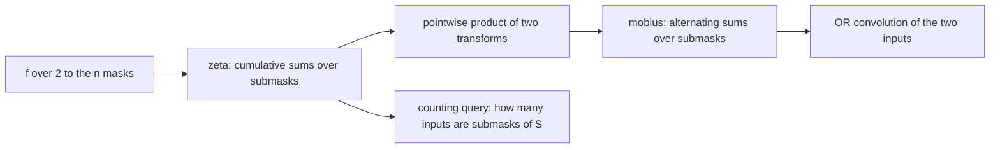
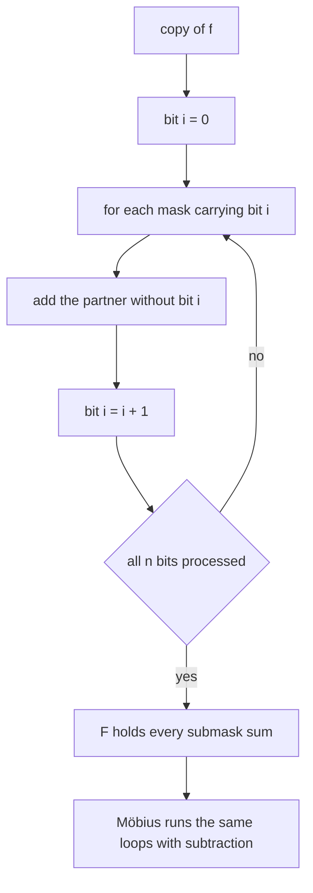
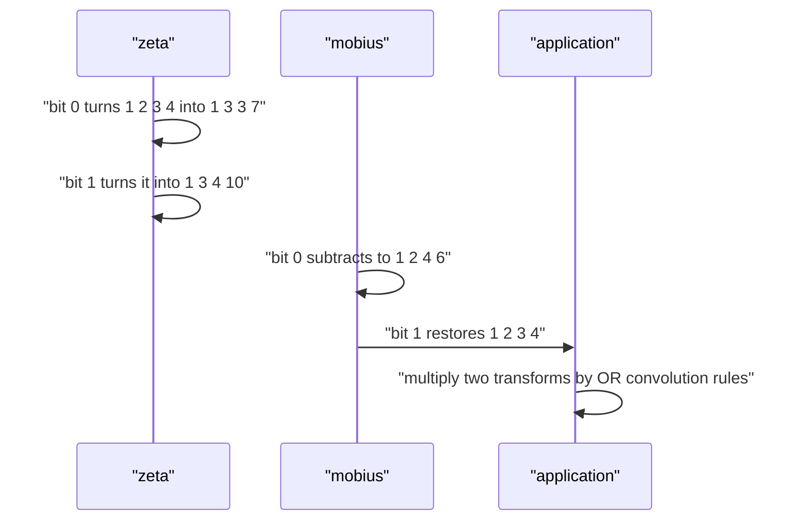

# 540 — Implement Möbius transform on subset lattice (SOS).

> **Tier:** Advanced · **CTCI chapter:** Beyond — Numerical & Scientific Computing
> **Task spec:** [540-implement-m-bius-transform-on-subset-lattice-sos.md](../../../tasks/advanced/540-implement-m-bius-transform-on-subset-lattice-sos.md)
> **Solutions:** [Python](../../../solutions/python/advanced/540-implement-m-bius-transform-on-subset-lattice-sos/solution.py) ·
> [Java](../../../solutions/java/advanced/540-implement-m-bius-transform-on-subset-lattice-sos/Solution.java) ·
> [JavaScript](../../../solutions/javascript/advanced/540-implement-m-bius-transform-on-subset-lattice-sos/solution.js) ·
> [C#](../../../solutions/csharp/advanced/540-implement-m-bius-transform-on-subset-lattice-sos/Solution.cs)

## 1. Problem restatement

**Input:** an integer array `f` of length `2^n`, indexed by the masks of an `n`-element ground set,
where index `S` means "the subset `S` of `{0..n-1}`".

**Output:** the transform toolkit on the subset lattice, each transform in `O(n * 2^n)`:

| Transform | Definition |
| --- | --- |
| `zeta_subset(f, n)` | `F[S] = sum over T subset of S of f[T]` |
| `mobius_subset(f, n)` | `f[S] = sum over T subset of S of (-1)^(|S| - |T|) F[T]` (the exact inverse) |
| `zeta_superset(f, n)` | `F[S] = sum over T superset of S of f[T]` |
| `mobius_superset(f, n)` | `f[S] = sum over T superset of S of (-1)^(|T| - |S|) F[T]` |

Every transform is implemented twice — once by the `O(n 2^n)` SOS recurrence and once by brute force
over all submasks or supermasks — so the fast sweep is validated against its definition rather than
against itself.

| Call | Result | Why |
| --- | --- | --- |
| `zeta_subset([1, 2, 3, 4], 2)` | `[1, 3, 4, 10]` | `F[11] = 1 + 2 + 3 + 4` |
| `zeta_superset([1, 2, 3, 4], 2)` | `[10, 6, 7, 4]` | the dual sums |
| `mobius_subset([1, 3, 4, 10], 2)` | `[1, 2, 3, 4]` | Möbius inverts zeta |
| `zeta_subset(delta at the empty set, n)` | `[1] * 2^n` | the empty set is a subset of everything |
| `zeta_subset([1] * 2^n, n)` | `2^popcount(mask)` | the number of submasks of a mask |
| `mobius_subset([1] * 2^n, n)` | `[1, 0, ..., 0]` | `sum over T subset of S of (-1)^(|S|-|T|)` is `[S is empty]` |
| `zeta_subset([5], 0)` | `[5]` | the `n = 0` lattice has one element |

Those rows are asserted in the Python file's `main()`; the Java, JavaScript and C# files assert the same
identities (`Möbius` inverts `zeta`, agreement with brute force at every mask, the all-ones case).

## 2. Intuition

The definition of the zeta transform is a sum over `2^popcount(S)` submasks, so computing it naively is
`O(3^n)` in total. The SOS recurrence removes the redundancy one **bit at a time**: process the bits
`i = 0..n-1` in order, and at bit `i` let every mask that carries `i` absorb the value of the same mask
without `i`:

```text
for each bit i:
    for each mask with bit i set:
        F[mask] += F[mask without bit i]
```

After bit `i` is processed, `F[S]` holds the sum over all subsets `T` that differ from `S` only in the
first `i + 1` bits. After all `n` bits, it holds the sum over every subset. Every `(S, T)` pair with
`T subset S` is therefore counted exactly once — at the bit where `T` first drops out — which is why
the sweep costs `n * 2^n` rather than `3^n`.

The Möbius transform is the same loop with subtraction (`out[mask] -= out[mask without i]`), because
subtracting after adding undoes it bit by bit. The superset variants swap the branch: at bit `i`, masks
*without* `i` absorb the values of masks *with* `i`.

The two transforms are also a *ring homomorphism* pair for **OR-convolution**: zeta turns
`h[S] = sum over T union U = S of f[T] g[U]` into pointwise multiplication, so
`or_convolve(f, g) = mobius(zeta(f) * zeta(g))`, exactly like the FFT for integer convolution. The
AND-convolution uses the same machinery on complemented masks.



## 3. Algorithm

1. **Zeta (subsets).** Copy `f`; for `i = 0..n-1` and `bit = 1 << i`, scan every mask in increasing
   order and, when `mask & bit`, add `out[mask ^ bit]` to `out[mask]`.
2. **Möbius (subsets).** The same loops with `-=` instead of `+=`.
3. **Superset variants.** Replace the branch by `if not mask & bit` and the partner by `mask | bit`.
4. **OR-convolution.** Apply zeta to both inputs, multiply pointwise, apply Möbius.
5. **AND-convolution.** Complement both inputs (reverse the array: `rf[full ^ mask] = f[mask]`),
   OR-convolve, then complement the result back.
6. **Counting application.** Build the frequency array of the input list and zeta it; the result at mask
   `S` is the number of inputs that are submasks of `S` (or supermasks, with the superset transform).

```text
procedure zeta_subset(f, n)
    out ← copy of f
    for i ← 0 to n - 1 do
        bit ← 1 << i
        for mask ← 0 to (1 << n) - 1 do
            if mask has bit set then
                out[mask] ← out[mask] + out[mask without bit]
            end
        end
    end
    return out
end

procedure mobius_subset(f, n)
    out ← copy of f
    for i ← 0 to n - 1 do
        bit ← 1 << i
        for mask ← 0 to (1 << n) - 1 do
            if mask has bit set then
                out[mask] ← out[mask] - out[mask without bit]
            end
        end
    end
    return out
end
```

```text
procedure zeta_superset(f, n)
    out ← copy of f
    for i ← 0 to n - 1 do
        bit ← 1 << i
        for mask ← 0 to (1 << n) - 1 do
            if mask does not have bit set then
                out[mask] ← out[mask] + out[mask with bit set]
            end
        end
    end
    return out
end

procedure or_convolve_via_zeta(f, g, n)
    zf ← zeta_subset(f, n)
    zg ← zeta_subset(g, n)
    return mobius_subset(pointwise product of zf and zg, n)
end
```

The brute-force references are the definition, spelled out directly:

```text
procedure brute_zeta_subset(f, n)
    for each mask S do
        total ← 0
        for each submask T of S enumerated by T = (T - 1) and S do
            total ← total + f[T]
        end
        out[S] ← total
    end
    return out
end
```

The Java and C# files additionally implement a **ranked-zeta fast subset convolution** in
`O(n^2 2^n)` and cross-check it against the `O(3^n)` subset convolution, using the same primitives.



## 4. Worked example

The hand-checked `n = 2` example `f = [1, 2, 3, 4]`, with masks `00, 01, 10, 11` meaning
`{}, {0}, {1}, {0,1}`.

`zeta_subset`, bit by bit:

| Bit | Masks updated | Array after |
| --- | --- | --- |
| start | — | `[1, 2, 3, 4]` |
| `i = 0` (`bit = 1`) | `mask 1: 2 + 1 = 3`; `mask 3: 4 + 3 = 7` | `[1, 3, 3, 7]` |
| `i = 1` (`bit = 2`) | `mask 2: 3 + 1 = 4`; `mask 3: 7 + 3 = 10` | `[1, 3, 4, 10]` |

`mobius_subset` on `[1, 3, 4, 10]` reverses the two rounds exactly:

| Bit | Masks updated | Array after |
| --- | --- | --- |
| start | — | `[1, 3, 4, 10]` |
| `i = 0` | `mask 1: 3 - 1 = 2`; `mask 3: 10 - 4 = 6` | `[1, 2, 4, 6]` |
| `i = 1` | `mask 2: 4 - 1 = 3`; `mask 3: 6 - 2 = 4` | `[1, 2, 3, 4]` |

and the superset direction sums the other way:

| Bit | Masks updated | Array after |
| --- | --- | --- |
| start | — | `[1, 2, 3, 4]` |
| `i = 0` | `mask 0: 1 + 2 = 3`; `mask 2: 3 + 4 = 7` | `[3, 2, 7, 4]` |
| `i = 1` | `mask 0: 3 + 7 = 10`; `mask 1: 2 + 4 = 6` | `[10, 6, 7, 4]` |

All four assertions of the file are visible in these tables: `zeta_subset([1,2,3,4], 2) == [1,3,4,10]`,
`mobius_subset([1,3,4,10], 2) == [1,2,3,4]`, `zeta_superset(f, 2) == [10,6,7,4]` and
`mobius_superset([10,6,7,4], 2) == f`.

Two structural identities make the same point on any `n`: `zeta_subset` of the delta at the empty set is
`[1] * 2^n`, and `zeta_subset([1] * 2^n, n)[mask] = 2^popcount(mask)` — the number of submasks. Applying
Möbius to the all-ones vector therefore yields the **Boolean-lattice Möbius function**:
`[1, 0, ..., 0]`, because `sum over T subset S of (-1)^(|S| - |T|)` is `1` for `S = {}` and `0`
otherwise.



## 5. Complexity

Let `n` be the number of ground-set elements and `S = 2^n` the array length.

| Measure | Bound | Why it holds |
| --- | --- | --- |
| Zeta / Möbius | O(n * 2^n) | `n` bit rounds, each scanning `2^n` masks with O(1) work |
| Superset variants | O(n * 2^n) | the same loops with the complementary branch |
| Brute-force reference | O(3^n) | every mask is paired with each of its `2^popcount` submasks |
| OR-convolution via zeta | O(n * 2^n) | two zeta transforms, one pointwise product, one Möbius |
| Brute-force OR-convolution | O(2^{2n}) | all pairs `(s, t)` |
| AND-convolution | O(n * 2^n) | complements plus the OR pipeline |
| Counting application | O(n * 2^n) after O(len(values)) hashing | frequencies plus one zeta |
| Space | O(2^n) | one array per transform; the sweep is in place |
| Fast subset convolution (Java, C#) | O(n^2 * 2^n) | ranked transforms; the reference is O(3^n) |

## 6. Pitfalls and edge cases

- **`n = 0`.** The lattice has one element: `zeta_subset([5], 0) == [5]` and the same for every other
  transform, because the bit loop never runs. Asserted for all four.
- **Masks must be scanned in increasing order.** The recurrence reads `out[mask ^ bit]`, which for a
  mask carrying `bit` is a *smaller* index; scanning descending would read values that already include
  later bits and produce a wrong (partially applied) transform.
- **Bit order does not matter, but every bit must be processed exactly once.** Processing bit `i` twice
  double-counts; skipping it leaves the transform incomplete. The round-trip asserts catch either
  mistake at every `n` from `0` to `8`.
- **Subtraction direction.** Möbius uses `-=` with the same partner as zeta's `+=`; using `mask | bit`
  in the subset transform implements the superset transform instead.
- **Signed data.** Möbius has alternating signs, so negative inputs are legitimate; the file runs the
  round trip on arrays shifted into `-6..6` as well as on non-negative ones.
- **Zero vector.** `zeta_subset([0] * 2^n, n)` and its Möbius image are both all zeros — a cheap sanity
  check that the transform is linear and has no hidden constant term.
- **All-ones input.** `mobius_subset([1] * 2^n, n) == [1] + [0] * (2^n - 1)` is the Möbius-function
  identity of the Boolean lattice; the superset counterpart is the mirrored `[0] * (2^n - 1) + [1]`.
- **Delta and counting.** `zeta` of the delta at the empty set is all ones, while `zeta` of the all-ones
  vector counts submasks (`2^popcount`); confusing the two is the classic way to get the empty-mask
  bucket wrong in counting queries.
- **Submask enumeration order.** `submasks(0b1010)` yields `[10, 8, 2, 0]` — decreasing order, ending at
  `0` — and `submasks(0)` yields `[0]`; the enumerator must stop after emitting `0` rather than looping
  forever.
- **Superset enumeration.** `supersets(0b0011, 2)` is just `[3]` (the mask has no free bits) and
  `supersets(0, 2)` is `[0, 1, 2, 3]`. Bounds in the file's examples are easy to get off by one.
- **Counting sanity.** For the frequency-based counter, the full mask must contain every input
  (`count[full] == len(values)`) and the empty mask only the zeros; the file asserts these, plus that
  every input value is counted at its own mask.
- **AND versus OR.** AND-convolution is *not* the same pipeline on uncomplemented data; the file builds
  `rf[full ^ mask]` and `rg[full ^ mask]`, convolves with OR, and complements the result back (the
  in-place swap would corrupt the inputs).
- **Mass conservation.** For indicator inputs `sum(or_convolve(ip, iq, n)) == sum(ip) * sum(iq)`, which
  catches a wrong normalisation or a dropped bucket in the convolution.
- **Overflow.** The transforms sum `2^n` entries, so values grow by a factor of `2^n`; the C# file keeps
  the results in `long` for the sizes tested.

## 7. Variants and follow-ups

- **XOR convolution.** The Walsh-Hadamard transform is the same idea for the group `(Z_2)^n` with XOR in
  place of union — [539-implement-bitset-convolution-using-fwht-xor-convolution-small-n.md](../../../tasks/advanced/539-implement-bitset-convolution-using-fwht-xor-convolution-small-n.md).
- **SOS DP, the simple end.** The same recurrence underlies the textbook "iterate over subsets"
  exercises — [299-dp-over-subsets-sos-dp-simple-task.md](../../../tasks/intermediate/299-dp-over-subsets-sos-dp-simple-task.md)
  and [298-bitmask-iterate-subsets-of-mask.md](../../../tasks/intermediate/298-bitmask-iterate-subsets-of-mask.md).
- **Bitset acceleration.** For boolean or bounded values, packing the arrays into machine words turns
  the sweeps into bit operations —
  [416-implement-bitset-dp-optimizations-for-subset-problems.md](../../../tasks/advanced/416-implement-bitset-dp-optimizations-for-subset-problems.md).
- **Subset convolution.** The `O(n^2 2^n)` ranked transform in the Java and C# files computes
  `h[S] = sum over T subset of S of f[T] g[S \ T]`, which the naive method needs `O(3^n)` for.
- **Fourier-family comparison.** The zeta/Möbius pair is a Möbius inversion on a poset, while the FFT/NTT
  are inversions on a group — [301-fft-outline-and-small-convolution-using-library-conceptual.md](../../../tasks/intermediate/301-fft-outline-and-small-convolution-using-library-conceptual.md).

## 8. Check yourself

1. Why is the SOS recurrence `O(n * 2^n)` instead of `O(3^n)`?

<details><summary>Show answer</summary>

Because each `(S, T)` pair with `T subset S` is accounted for exactly once: at the bit round where `T`
first differs from `S`, `T` is the value already accumulated in the partner mask `S ^ bit`. The naive
definition instead enumerates all `2^popcount(S)` submasks for every `S`, which sums to `3^n`.

</details>

2. What is `zeta_subset([1] * 2^n, n)` at mask `S`, and what does `mobius_subset` of the same input
   give?

<details><summary>Show answer</summary>

`2^popcount(S)` — the number of submasks of `S`. Applying Möbius to the all-ones vector gives
`[1, 0, ..., 0]`, which is the statement that
`sum over T subset of S of (-1)^(|S| - |T|)` equals `1` only for the empty set. Both are asserted for
every `n` in `0..8`.

</details>

3. How does the file verify the transform without trusting it?

<details><summary>Show answer</summary>

Every transform is implemented twice: by the bit-sweep recurrence and by direct enumeration of the
submasks (`submasks`) or supermasks (`supersets`) of each mask. The checks assert mask-for-mask equality
of the two, plus the round trip `mobius(zeta(f)) == f` in both orders, and the applications
(OR/AND convolution, subset/superset counting) against brute force.

</details>

4. Why does the AND-convolution need the complements?

<details><summary>Show answer</summary>

The zeta transform diagonalises *union*, so the pipeline computes OR-convolution directly. De Morgan's
law turns intersection into union of complements: complement the masks of both inputs, OR-convolve, then
complement the result back. The file builds the complemented arrays as `rf[full ^ mask] = f[mask]` and
reverses at the end.

</details>

5. For `n = 3`, `f` with a single non-zero entry `f[0b0101] = 7`, which masks receive the value 7 in
   `zeta_subset`?

<details><summary>Show answer</summary>

Exactly the masks that are supersets of `0b0101`, namely `0b101` and `0b111` — the file asserts this as
`[mask for mask in range(8) if got[mask] == 7] == [5, 7]`, i.e. only the two masks whose submask set
contains `5`. Every other mask is either `0` or `7`, since there is only one non-zero input entry.

</details>
