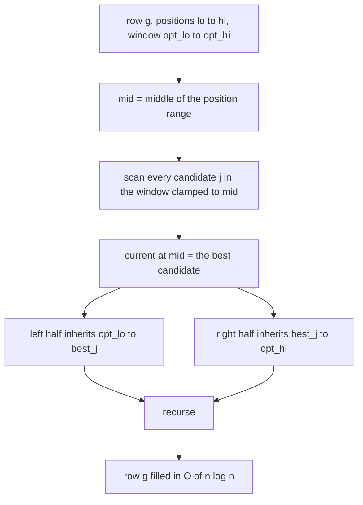
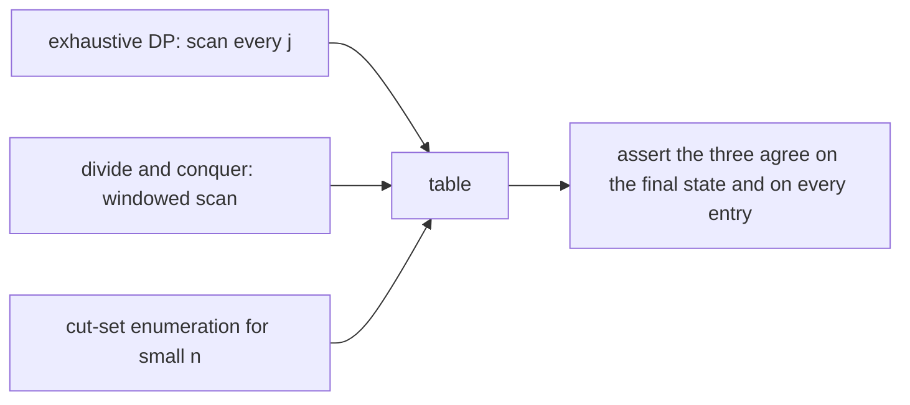
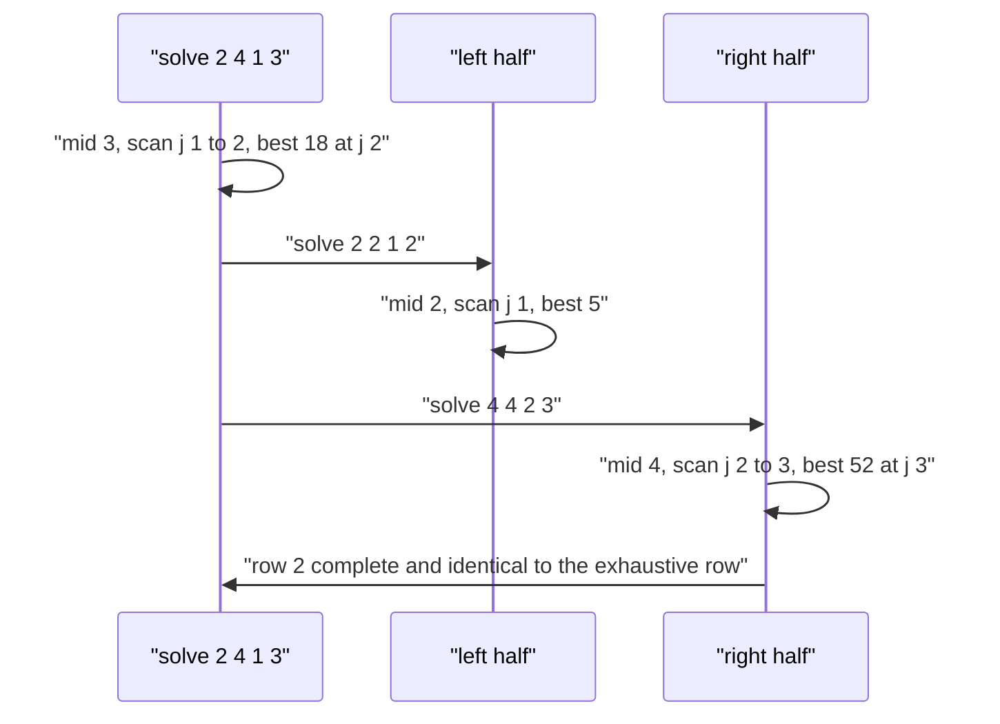

# 541 — Implement dynamic programming with divide-and-conquer monotone optimization.

> **Tier:** Advanced · **CTCI chapter:** Ch 8 — Recursion and Dynamic Programming
> **Task spec:** [541-implement-dynamic-programming-with-divide-and-conquer-monotone-o.md](../../../tasks/advanced/541-implement-dynamic-programming-with-divide-and-conquer-monotone-o.md)
> **Solutions:** [Python](../../../solutions/python/advanced/541-implement-dynamic-programming-with-divide-and-conquer-monotone-o/solution.py) ·
> [Java](../../../solutions/java/advanced/541-implement-dynamic-programming-with-divide-and-conquer-monotone-o/Solution.java) ·
> [JavaScript](../../../solutions/javascript/advanced/541-implement-dynamic-programming-with-divide-and-conquer-monotone-o/solution.js) ·
> [C#](../../../solutions/csharp/advanced/541-implement-dynamic-programming-with-divide-and-conquer-monotone-o/Solution.cs)

## 1. Problem restatement

**Input:** a sequence `values[0..n-1]`, a number of groups `k`, and an optional `shift`. Split the
sequence into `k` contiguous non-empty groups and let

```text
cost(j, i) = (pre[i] - pre[j] - shift)^2
```

be the price of the segment `values[j..i-1]`, where `pre` is the prefix-sum array with `pre[0] = 0`.

**Output:** the minimum total cost,

```text
dp[g][i] = min over j in [g-1, i-1] of ( dp[g-1][j] + cost(j, i) )
```

with `dp[0][0] = 0` and every other state at the sentinel `INF = 10^18` until it is reached. The
solution files return the whole table, computed by the **divide-and-conquer (monotone-optimum)
optimisation** in `O(k n log n)` instead of `O(k n^2)`.

| Call | Result | Why |
| --- | --- | --- |
| `dp_exhaustive([1, 2, 3, 4], 1)[1][4]` | `100` | one group: the whole sum squared, `10^2` |
| `dp_exhaustive([1, 2, 3, 4], 2)[2][4]` | `52` | `6^2 + 4^2` beats `3^2 + 7^2 = 58` and `1^2 + 9^2 = 82` |
| `dp_exhaustive([1, 2, 3, 4], 4)[4][4]` | `30` | four singletons: `1 + 4 + 9 + 16` |
| `dp_exhaustive([1, 2, 3, 4], 5)[5][4]` | `INF` | five non-empty groups cannot fit in four elements |
| `dp_exhaustive([7], 1)[1][1]` | `49` | `7^2` |
| `dp_exhaustive([], 2)[2][0]` | `INF` | no groups can be carved out of an empty sequence |
| `dp_exhaustive([0, 0, 0], 2)[2][3]` | `0` | the all-zero sequence costs nothing however it is cut |
| constant `[4] * 40` with `k = 6` | `4·28^2 + 2·24^2 = 4288` | balanced group lengths `7, 7, 7, 7, 6, 6` minimise the squares |

Those rows are asserted in the Python file's `main()`; the Java, JavaScript and C# files assert the same
table identities plus the quadrangle inequality that justifies the optimisation.

## 2. Intuition

The recurrence examines `i - 1` candidates for every `(g, i)` state, which is `O(k n^2)` work. The
shortcut comes from a property of the cost: `(x - shift)^2` is convex in the segment sum, and with
non-decreasing prefix sums that convexity turns into the **quadrangle (Monge) inequality**

```text
cost(a, c) + cost(b, d) <= cost(a, d) + cost(b, c)     for a <= b <= c <= d
```

which in turn forces the **monotonicity of the optimum**: if `opt(g, i)` denotes the *leftmost*
minimising `j`, then

```text
opt(g, i) <= opt(g, i + 1)
```

So the table row `g` is filled by a recursive *divide and conquer over the positions*: solve the middle
position `mid` by scanning the candidate window allowed by its neighbours, then recurse into the left
half with the upper bound of the window clamped to `opt(mid)` and into the right half with the lower
bound clamped to `opt(mid)`. Each level of recursion scans windows whose total length is `O(n)` and
there are `O(log n)` levels, so a row costs `O(n log n)` instead of `O(n^2)`.



Ties matter: the file resolves them to the **smallest** index, because the leftmost argmin is the
sequence that is provably monotone. Ties are also frequent — the constant array `[4] * 40` is a row of
equal candidates — and the Python file asserts that this heavy-tie case still produces a table
identical to the exhaustive one.

The precondition is explicit rather than glossed over. The window argument needs **non-decreasing prefix
sums** (non-negative values). With negative items the prefix sequence decreases, the quadrangle
inequality can fail and the monotone-argmin property genuinely breaks; the Python file demonstrates
that, restricts the comparison of the recurrence to the independent cut-set enumerator there, and then
re-runs the divide-and-conquer version on the absolute values, where the precondition holds again.

## 3. Algorithm

1. **Prefix sums.** `pre[0] = 0`, `pre[i] = pre[i-1] + values[i-1]`; the cost of a segment is computed in
   `O(1)` from `pre`.
2. **Rows.** Keep `previous = dp[g-1]`; build `current = dp[g]` by the recursive routine below; the
   sentinel `INF` marks unreachable states.
3. **Recursive row fill** `solve(lo, hi, opt_lo, opt_hi)`:
   - if `lo > hi`, return;
   - `mid = (lo + hi) // 2`; scan `j` over `[max(opt_lo, g-1), min(opt_hi, mid-1)]`, keeping the
     *smallest* `j` on ties;
   - set `current[mid]`, then recurse `solve(lo, mid-1, opt_lo, best_j)` and
     `solve(mid+1, hi, best_j, opt_hi)`.
4. **Entry point.** `solve(g, n, g-1, n-1)` fills the reachable part of the row (`i >= g`).
5. **Cross-checks.** An exhaustive DP that scans every `j`, and (for small `n`) an enumeration of all
   `C(n-1, k-1)` cut sets, which is independent of the recurrence entirely.

```text
procedure dp_divide_and_conquer(values, k, shift)
    pre ← prefix sums
    previous ← array of INF with previous[0] ← 0
    table ← [previous]
    for g ← 1 to k do
        current ← array of INF
        solve(g, length(values), g - 1, length(values) - 1)
        append current to table
        previous ← current
    end
    return table

    procedure solve(lo, hi, opt_lo, opt_hi)
        if lo > hi then return
        mid ← (lo + hi) / 2
        lower ← max(opt_lo, g - 1)
        upper ← min(opt_hi, mid - 1)
        best ← none
        best_j ← lower
        for j ← lower to upper do
            candidate ← previous[j] + cost(j, mid)
            if best is none or candidate < best then
                best ← candidate
                best_j ← j
            end
        end
        current[mid] ← best
        solve(lo, mid - 1, opt_lo, best_j)
        solve(mid + 1, hi, best_j, opt_hi)
    end
end
```

```text
procedure dp_cut_enumeration(values, k, shift)
    n ← length(values)
    if k = 0 then return 0 if n = 0 else INF
    if k > n then return INF
    pre ← prefix sums
    best ← INF
    for each subset of k - 1 cut positions from 1 to n - 1 do
        total ← sum over the k segments of cost(boundary, boundary)
        best ← min(best, total)
    end
    return best
end
```



The Java file also verifies the quadrangle inequality numerically (`cost(a,c) + cost(b,d) <=
cost(a,d) + cost(b,c)` over sampled quadruples `a <= b <= c <= d`), and both the Java and C# files count
cost evaluations so that the `O(n log n)` claim is measured rather than asserted.

## 4. Worked example

`values = [1, 2, 3, 4]`, `k = 2`, `shift = 0`, so `pre = [0, 1, 3, 6, 10]`.

Row `g = 1` (one group covering everything up to `i`):

| `i` | 1 | 2 | 3 | 4 |
| --- | --- | --- | --- | --- |
| `dp[1][i]` | `1` | `9` | `36` | `100` |

Row `g = 2`, computed by the exhaustive recurrence (the D&C version must reproduce it exactly):

| `i` | candidates `j` | costs | `dp[2][i]` | `opt(2, i)` |
| --- | --- | --- | --- | --- |
| 2 | `j = 1` | `1 + (3-1)^2 = 5` | `5` | `1` |
| 3 | `j = 1, 2` | `1 + 25 = 26`, `9 + 9 = 18` | `18` | `2` |
| 4 | `j = 1, 2, 3` | `1 + 81 = 82`, `9 + 49 = 58`, `36 + 16 = 52` | `52` | `3` |

The argmin sequence `1, 2, 3` is non-decreasing, which is exactly what the window argument exploits. Run
the D&C routine on this row: `solve(2, 4, 1, 3)` takes `mid = 3` and scans `j = 1..2`, finding `18` at
`j = 2`; the left half `solve(2, 2, 1, 2)` scans only `j = 1` (its window is clamped to `opt <= 2`) and
finds `5`; the right half `solve(4, 4, 2, 3)` scans only `j = 2..3` and finds `52`. Six exhaustive
evaluations become five, and the deeper saving shows up on longer rows where the windows shrink by half
at each level.

| `g` | `i` | 1 | 2 | 3 | 4 |
| --- | --- | --- | --- | --- | --- |
| 1 | | `1` | `9` | `36` | `100` |
| 2 | | `INF` | `5` | `18` | `52` |
| 3 | | `INF` | `INF` | `9` | `27` |
| 4 | | `INF` | `INF` | `INF` | `30` |

The diagonal `dp[g][g]` is `INF` until `i = g`, `dp[4][4] = 30` is the sum of the squares of the four
singletons, and `dp[2][4] = 52` is the hand-checked value the file asserts.



## 5. Complexity

Let `n` be the sequence length and `k` the number of groups.

| Measure | Bound | Why it holds |
| --- | --- | --- |
| Exhaustive DP | O(k n^2) | every state scans up to `i - 1` candidates |
| Divide and conquer | O(k n log n) | each recursion level scans windows of total length `O(n)`, and there are `O(log n)` levels |
| Cut-set enumeration | O(C(n-1, k-1) * k) | every cut set is evaluated independently; used only for tiny `n` |
| Space | O(k n) for the table, O(log n) recursion depth | rows are kept because the tests compare whole tables |
| Cost evaluation | O(1) per candidate | prefix sums give the segment sum, then one square |
| Row fill | O(n log n) per group | the row loop dominates `k` times |
| Measured saving | `evaluations_dnc < evaluations_brute`, with the worst observed ratio below `0.9` | the Python file asserts `worst_ratio < 0.9` over its twelve random instances |

## 6. Pitfalls and edge cases

- **Non-decreasing prefix sums are the precondition.** With negative items the prefix sequence decreases,
  the quadrangle inequality can fail and the leftmost argmin need not be monotone. The Python file
  detects such a sample (`min(negative) < 0`, a decreasing prefix step), *does not* run the D&C version
  on it, and compares the exhaustive recurrence against cut-set enumeration instead.
- **Ties must resolve to the smallest index.** A rightmost tie-break is not provably monotone and can
  make the window argument drop a valid candidate; the file asserts identical tables on the
  heavy-tie LCG instance and on the constant array.
- **Unreachable states.** `dp[g][i]` is `INF` for `i < g` (fewer elements than groups) and for
  `k > n`; the sentinel is `10^18`, large enough not to collide with any real cost and small enough that
  a few additions do not overflow a 64-bit integer.
- **Degenerate sizes.** `dp_exhaustive([], 0)[0][0] == 0` (no items, no groups is feasible with cost 0),
  `dp_exhaustive([], 2)[2][0] == INF`, and `dp_exhaustive(values, 0)[0][4] == INF` for a non-empty
  sequence — all three asserted.
- **`k = 1` and `k = n`.** One group is the whole sum squared (`100` for `[1,2,3,4]`); `n` groups are
  the sum of squares (`30`), and any `k > n` is infeasible.
- **Single element.** `dp_exhaustive([7], 1)[1][1] == 49`.
- **Zeros.** An all-zero sequence costs `0` regardless of the cut; the constant array `[4] * 40` with
  `k = 6` instead has a genuine optimum, `4·28^2 + 2·24^2 = 4288`, because squared sums penalise
  unbalanced lengths — a good check that the optimisation is not accidentally minimising lengths.
- **The `shift` variant.** A non-zero shift changes the cost functional and therefore the tableau; the
  Python file runs some random instances with `shift = 7` and both engines must still agree exactly.
- **Window clamping.** The window is `[max(opt_lo, g-1), min(opt_hi, mid-1)]`: forgetting the `g - 1`
  clamp admits infeasible predecessors (`INF`), and forgetting the `mid - 1` clamp admits empty groups.
- **Bit-identical tables, not just equal answers.** All three files compare whole tables; comparing only
  `dp[k][n]` would miss a row that is wrong only on unreachable or intermediate states.
- **Recursion depth.** The D&C routine recurses `O(log n)` deep per row, which is safe; a median-based
  implementation that scanned the middle naively would still be correct but lose the saving.
- **Determinism.** Repeated runs on `[3, 1, 4, 1, 5, 9, 2, 6, 5, 3, 5]` with `k = 4` produce identical
  tables, and the answer equals the cut-set enumeration.

## 7. Variants and follow-ups

- **Monotone queue and convex hull trick.** Other ways to exploit a monotone optimum in an `O(n^2)` DP
  without a D&C recursion — [417-implement-dp-with-monotone-queue-optimization.md](../../../tasks/advanced/417-implement-dp-with-monotone-queue-optimization.md).
- **DP on a DAG.** When the states form a partial order instead of a chain, a topological sweep replaces
  the row recursion — [535-implement-dynamic-programming-on-dag-with-topological-order-cach.md](../../../tasks/advanced/535-implement-dynamic-programming-on-dag-with-topological-order-cach.md).
- **Interval DP.** The same "which cut" question with overlapping intervals is
  [330-weighted-interval-scheduling-dp.md](../../../tasks/intermediate/330-weighted-interval-scheduling-dp.md).
- **Knuth optimisation.** A related monotonicity (optimum bracketing) speeds up interval DP in
  `O(n^2)` — the tree-shaped cousin is
  [458-implement-dynamic-programming-on-trees-with-knapsack-per-node.md](../../../tasks/advanced/458-implement-dynamic-programming-on-trees-with-knapsack-per-node.md).
- **Lagrangian relaxation.** When `k` is large or unknown, penalising group count instead of fixing it
  (Aliens trick) turns the problem into a single `O(n)` or `O(n log n)` run plus a binary search on the
  penalty.

## 8. Check yourself

1. Why does the quadrangle inequality imply that `opt(g, i)` is non-decreasing in `i`?

<details><summary>Show answer</summary>

If `a <= b <= c <= d` and `cost(a,c) + cost(b,d) <= cost(a,d) + cost(b,c)`, then a cut `a` that is
better than `b` at position `d` cannot be worse at position `c < d` — otherwise rearranging the
inequality would contradict the Monge property. The leftmost argmin therefore cannot move left as `i`
grows, which is the monotonicity the recursion relies on.

</details>

2. On `[1, 2, 3, 4]` with `k = 2`, why is `52` the answer rather than `58`?

<details><summary>Show answer</summary>

The three candidate cuts give `1^2 + 9^2 = 82`, `3^2 + 7^2 = 58` and `6^2 + 4^2 = 52`. Squared sums
punish a large group, so the last cut — a big first group and a small second one — wins. The argmin is
`j = 3`, i.e. the group boundary sits after `3`.

</details>

3. How does the divide-and-conquer routine save work?

<details><summary>Show answer</summary>

It fills a row in position order of the recursion: the midpoint is solved by scanning its candidate
window, and the halves inherit windows `[opt_lo, best_j]` and `[best_j, opt_hi]` because the optimum is
monotone. On any level of the recursion the windows are disjoint intervals of total length `O(n)`, and
there are `O(log n)` levels, so a row costs `O(n log n)` instead of the `O(n^2)` of scanning every
`j` for every `i`.

</details>

4. Why does the file refuse to run the D&C version on the negative sample?

<details><summary>Show answer</summary>

Because the window argument needs non-decreasing prefix sums to convert the convexity of
`(x - shift)^2` into the quadrangle inequality. With negative items the prefix sequence decreases
somewhere, the Monge property can fail and the leftmost argmin can be non-monotone — the file asserts
the violation of the precondition and validates the recurrence against cut-set enumeration instead,
then re-runs D&C on the absolute values where the precondition holds.

</details>

5. What does the constant-array case (`[4] * 40`, `k = 6`, answer `4288`) test?

<details><summary>Show answer</summary>

Heavy ties: every candidate `j` inside the window has a similar cost, so tie-breaking decides which
argmin is recorded. The file asserts that the D&C table is identical to the exhaustive table and that
the optimum is the balanced partition `7, 7, 7, 7, 6, 6` with cost `4·28^2 + 2·24^2 = 4288`, which also
confirms the objective is about squared sums rather than lengths.

</details>
