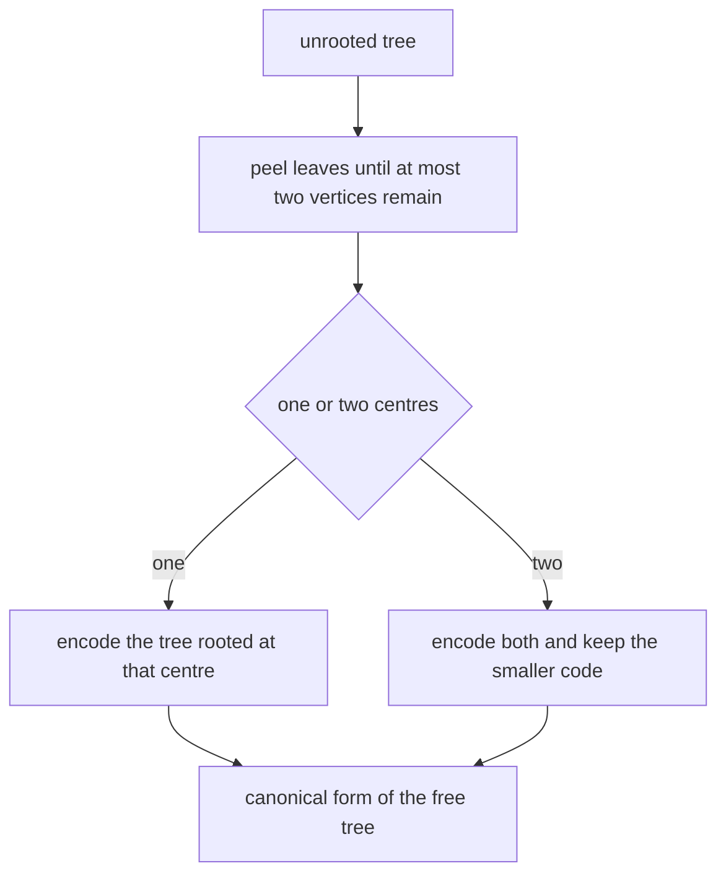
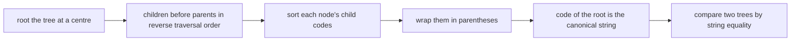
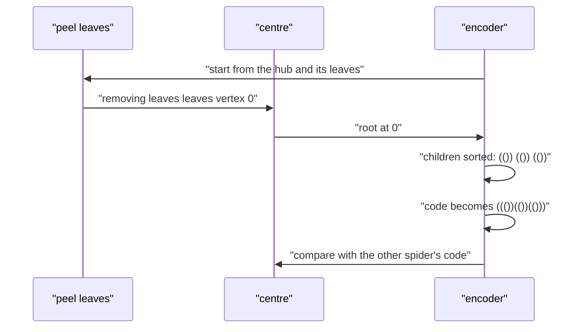

# 542 — Implement tree isomorphism hashing (AHU algorithm).

> **Tier:** Advanced · **CTCI chapter:** Ch 4 — Trees and Graphs
> **Task spec:** [542-implement-tree-isomorphism-hashing-ahu-algorithm.md](../../../tasks/advanced/542-implement-tree-isomorphism-hashing-ahu-algorithm.md)
> **Solutions:** [Python](../../../solutions/python/advanced/542-implement-tree-isomorphism-hashing-ahu-algorithm/solution.py) ·
> [Java](../../../solutions/java/advanced/542-implement-tree-isomorphism-hashing-ahu-algorithm/Solution.java) ·
> [JavaScript](../../../solutions/javascript/advanced/542-implement-tree-isomorphism-hashing-ahu-algorithm/solution.js) ·
> [C#](../../../solutions/csharp/advanced/542-implement-tree-isomorphism-hashing-ahu-algorithm/Solution.cs)

## 1. Problem restatement

**Input:** a tree given as adjacency lists; two trees are asked about at once when deciding
isomorphism.

**Output:** a **canonical form** of the tree, computed by the Aho-Hopcroft-Ullman (AHU) method, such
that two trees get the same string exactly when they are isomorphic. Two versions are needed:

- **rooted** isomorphism: the code of a rooted tree is `"(" + sorted child codes + ")"`, built bottom
  up from the leaves;
- **unrooted** isomorphism: root each tree at its **centre** (one vertex, or two adjacent vertices) and
  take the lexicographically smallest of the resulting codes.

| Pair of trees | Rooted verdict | Unrooted verdict | Why |
| --- | --- | --- | --- |
| `P3` rooted at an end versus at its centre | different (`((()))` vs `(()())`) | same | the centre root is the invariant choice |
| star `K(1,3)` versus `P4` | — | different | different code, and brute force agrees |
| spider with legs `2, 2, 2` versus legs `3, 2, 1` | — | different | both have degree sequence `{3,2,2,2,1,1,1}`, but AHU separates them |
| all `6^4 = 1296` labelled trees on six vertices | — | exactly `6` classes, of sizes `6, 90, 120, 360, 360, 360` | these are the six free trees, and the sizes are `6! / Aut` |
| all `7^5 = 16807` labelled trees on seven vertices | — | exactly `11` classes | the eleven free trees on seven vertices |

The hand-built rows and both exhaustive counts are asserted in the Python file's `main()`; the Java,
JavaScript and C# files assert the same decisions with the same centre reduction.

## 2. Intuition

Two trees are isomorphic when a bijection of their vertices preserves edges. Testing that by search
means trying permutations, which is exponential; the AHU insight is that a canonical *string* can be
computed in linear time and compared instead.

For a **rooted** tree the recursion is immediate: a node is completely described by the multiset of the
codes of its children's subtrees, so sort those codes and wrap them in parentheses. The sorted multiset
is a complete invariant at every node — the same multiset means the same shapes, in any order.

For an **unrooted** tree, the choice of root must itself be canonical, or two isomorphic trees could get
different codes. The fix is the tree's **centre**: one vertex (or two adjacent vertices) found by
repeatedly peeling leaves. Every isomorphism maps centres to centres, so rooting at centres and taking
the smaller code (for the two-centre case) removes the ambiguity completely.



The three files also keep a second representation of the same invariant, which is what makes the tests
meaningful: the Python file builds nested integer tuples (`canonical_ids`) and renders them as text to
compare with the string encoder, the JavaScript file keeps the numeric variant "label = index of the
sorted multiset of child labels" and asserts that both invariants induce the same partition, and the C#
file interns per-depth sorted key lists. The Java file hashes the canonical string with 64-bit FNV-1a
and asserts the fingerprints are collision-free across the classes it builds.

## 3. Algorithm

1. **Parent order.** From the chosen root, walk the tree and record each vertex's parent and a
   traversal order (assuring the input is a single connected tree: the order must contain every vertex).
2. **Bottom-up encoding.** Process the order in reverse: `code[v] = "(" + concat(sorted(code[w] for
   children w)) + ")"`. The children of `v` are its neighbours except its parent.
3. **Centres.** Peel leaves: repeatedly delete every current leaf and decrease the degree of its
   neighbour, stopping when at most two vertices remain; those are the centres. A tree with `n <= 2` has
   all of its vertices as centres.
4. **Unrooted canonical form.** Encode the tree rooted at each centre and take the lexicographically
   smallest code.
5. **Independent references.** A brute-force isomorphism test (rooted: fix the image of the root and
   permute the rest; unrooted: try every pair of roots) decides the same predicate directly, and Prüfer
   sequences enumerate labelled trees and re-encode them to check the class counts.

```text
procedure canonical_rooted(adj, root)
    order, parent ← traversal order and parent pointers from root
    code ← empty map
    for v in reverse of order do
        children ← sorted list of code[w] for every neighbour w of v with w ≠ parent[v]
        code[v] ← "(" + concatenation of children + ")"
    end
    return code[root]
end

procedure tree_centres(adj)
    n ← number of vertices
    if n <= 2 then return all vertices
    degree ← degree of every vertex
    leaves ← vertices with degree at most 1
    remaining ← n
    while remaining > 2 do
        new_leaves ← empty list
        for leaf in leaves do
            remaining ← remaining - 1
            for w in adj[leaf] do
                degree[w] ← degree[w] - 1
                if degree[w] = 1 then append w to new_leaves
            end
        end
        leaves ← new_leaves
    end
    return leaves sorted
end

procedure canonical_unrooted(adj)
    best ← none
    for centre in tree_centres(adj) do
        candidate ← canonical_rooted(adj, centre)
        if best is none or candidate < best then best ← candidate
    end
    return best
end
```



The independent verifier used by all four files is a search over vertex bijections:

```text
procedure isomorphic_brute(adj1, adj2)
    if the vertex counts differ then return false
    for each root pair (root1, root2) do
        if rooted_isomorphic_brute(adj1, root1, adj2, root2) then return true
    end
    return false
end

procedure rooted_isomorphic_brute(adj1, root1, adj2, root2)
    for each permutation that maps the non-root vertices of adj1 to those of adj2 do
        build the mapping with root1 mapped to root2
        if every edge of adj1 maps to an edge of adj2 then return true
    end
    return false
end
```

**Prüfer sequences** provide the test material: encoding removes the smallest leaf, appends its
neighbour and repeats until two vertices remain; decoding rebuilds the tree from the sequence. The Java
file documents an `O(n)` monotone-pointer leaf scan (rewinding the pointer when the newly created leaf
has a smaller index than the current pointer) instead of a heap. The JavaScript file finds the centre by
a double-BFS diameter walk (one centre for an even diameter, two for an odd one) rather than by peeling.

## 4. Worked example

**The path on three vertices**, `P3 = [[1], [0, 2], [1]]`.

| Root | Reverse order | Codes | Root code |
| --- | --- | --- | --- |
| `0` (an end) | `2, 1, 0` | `code[2] = "()"`, `code[1] = "(())"`, `code[0] = "((()))"` | `"((()))"` |
| `1` (the centre) | `2, 0, 1` | `code[0] = "()"`, `code[2] = "()"`, `code[1] = "(()())"` | `"(()())"` |

The two rooted codes differ — `P3` rooted at an end is not rooted-isomorphic to `P3` rooted at its
centre, which the file asserts — while the unrooted code is `min` over the single centre `1`, namely
`"(()())"`. Note that the two *ends* are interchangeable:
`rooted_isomorphic_brute(path3, 0, path3, 2)` is true while `(path3, 0, path3, 1)` is false.

**The star `K(1,3)`**, `[[1, 2, 3], [0], [0], [0]]`:

| Root | Codes | Result |
| --- | --- | --- |
| centre `0` | three leaves give `"()"` each | `"(()()())"` |
| leaf `1` | the centre (children `2, 3`) gives `"(()())"` | `"((()()))"` |

The centre is the single vertex `0`, so `canonical_unrooted(star4) == canonical_rooted(star4, 0)`, and it
differs from the `P4` code — the two trees are not isomorphic, which brute force confirms.

**The spider pair** with the same degree sequence is the sharpest test. `spider([2, 2, 2])` has a hub with
three length-2 legs; `spider([3, 2, 1])` has legs of length three, two and one. Both have sorted degrees
`[1, 1, 1, 2, 2, 2, 3]`, so no degree-sequence fingerprint can tell them apart. Encoding from the hub:

| Tree | Child subtree codes at the hub | Canonical code |
| --- | --- | --- |
| legs `2, 2, 2` | `"(())", "(())", "(())"` | `"((())(())(()))"` |
| legs `3, 2, 1` | `"((()))", "(())", "()"` | `"(((())))(())())"` |

Lexicographic order matters here: `"((()))" < "(())" < "()"` because `')'` sorts after `'('`, so the
deepest subtree is concatenated first. The codes differ, `isomorphic_brute` returns false, and the file
also checks that relabelling the vertices of `spider([2, 2, 2])` leaves the code unchanged.



## 5. Complexity

Let `n` be the number of vertices.

| Measure | Bound | Why it holds |
| --- | --- | --- |
| One rooted encoding | O(n log n) | each node sorts its children's codes; the concatenated code length is `2n` |
| Centre finding | O(n) | each vertex is peeled once and each edge is touched once |
| Unrooted canonical form | O(n log n) | one or two encodings |
| Prüfer decode (heap) | O(n log n) | the leaf heap holds at most `n` entries; the Java file uses a monotone pointer for `O(n)` |
| Prüfer encode | O(n log n) with a heap | the Java variant documents an `O(n)` pointer scan with rewinding |
| Brute-force verifier | O(n!) per root pair | it permutes the vertices; used only on small trees |
| Space | O(n) per encoding | the code map plus the string of length `2n` |
| Enumeration cost for the checks | `n^(n-2)` Prüfer sequences | `1296` for `n = 6`, `16807` for `n = 7` |

## 6. Pitfalls and edge cases

- **The input must be a single tree.** The traversal asserts that the parent order contains every vertex,
  so a forest or a disconnected input is rejected rather than silently encoded.
- **Root design matters for rooted isomorphism.** `P3` rooted at an end and at the centre have different
  codes and are genuinely different rooted trees; the same tree viewed unrooted is one class. Do not mix
  the two predicates.
- **Centres are isomorphism invariant, roots are not.** Choosing an arbitrary root gives
  relabelling-dependent codes; the centre reduction is what makes the unrooted code stable.
- **Two centres.** `P4` has centres `[1, 2]` (asserted), the two-vertex tree has `[0, 1]`, and `P3` has a
  single centre. For two centres the code is the smaller of the two encodings; forgetting the `min` makes
  the code depend on which centre was picked first.
- **Small trees.** With `n <= 2` every vertex is a centre by definition, and a single-vertex tree encodes
  as `"()"`.
- **Lexicographic order of codes.** `')'` sorts *after* `'('`, so `"((()))" < "(())" < "()"`; the sorted
  order is therefore deepest-first. The encoding is still correct — any consistent total order on the
  child codes works — but the specific strings quoted above depend on this convention.
- **Relabelling and adjacency order must not matter.** The file relabels with LCG permutations and
  reverses every adjacency list, asserting that the canonical code is unchanged for `n = 3..11`.
- **A degree sequence is not enough.** The spider pair proves it: identical sorted degrees, different
  trees. The same warning applies to a naive hash of the degree sequence.
- **Hash collisions.** The Java file's FNV-1a fingerprint is asserted collision-free on the classes it
  builds, but a hash is not an invariant by itself — equality of hashes must still be confirmed on the
  strings, or two trees could be declared isomorphic by accident.
- **Enumeration must hit every labelled tree exactly once.** `6^4 = 1296` sequences and
  `7^5 = 16807` sequences were generated; the file asserts the total count equals `6^4` and that the
  class sizes are `6, 90, 120, 360, 360, 360`, i.e. `6! / |Aut(T)|` for each of the six free trees.
- **Brute-force agreement on 100 pairs.** Ten random small trees (two each for `n = 2..6`) are compared
  pairwise; the canonical verdict and the brute-force verdict must coincide, and so must the tuple
  encoding's verdict.
- **Prüfer round trips.** `tree_to_prufer` then `prufer_to_tree` must give a tree with the same
  canonical code, for `n = 2..9`; the sequence length is `n - 2`.
- **Determinism.** Repeated runs on the same tree give the same code, the same centre list and the same
  tuple encoding.

## 7. Variants and follow-ups

- **Graphs instead of trees.** General graphs have no canonical form this cheap; colour-refinement
  fingerprints (Weisfeiler-Lehman) give a powerful but incomplete invariant —
  [543-implement-fingerprinting-for-graph-similarity-weisfeiler-lehman.md](../../../tasks/advanced/543-implement-fingerprinting-for-graph-similarity-weisfeiler-lehman.md).
- **Centroids and decomposition.** The centre of a tree is the seed of the standard centroid
  decomposition — [425-implement-centroid-decomposition-for-k-distance-pairs.md](../../../tasks/advanced/425-implement-centroid-decomposition-for-k-distance-pairs.md).
- **Rerooting DP.** When a value must be computed for every possible root, rerooting replaces the
  "try every root" loop — [427-implement-rerooting-dp-technique-on-trees.md](../../../tasks/advanced/427-implement-rerooting-dp-technique-on-trees.md).
- **Tree DP on rooted trees.** The parent-order bottom-up sweep is the same shape as the tree DP of
  [458-implement-dynamic-programming-on-trees-with-knapsack-per-node.md](../../../tasks/advanced/458-implement-dynamic-programming-on-trees-with-knapsack-per-node.md).
- **Labelled-tree counting.** Prüfer sequences give the `n^(n-2)` count used by the tests and connect the
  canonical form to Cayley's formula.

## 8. Check yourself

1. Why must the unrooted canonical form root the tree at a **centre**?

<details><summary>Show answer</summary>

Because the code depends on the root: two isomorphic trees rooted differently can get different strings.
Every isomorphism maps a centre to a centre, so the centre (or the pair of centres) is a canonical choice
— the code no longer depends on the labelling. For two centres the smaller of the two encodings is taken
to fix the remaining choice.

</details>

2. On `P3`, what are the two rooted codes and why does the unrooted code use the second one?

<details><summary>Show answer</summary>

Rooted at an end the code is `"((()))"` (an end, then the centre, then a leaf); rooted at the centre it is
`"(()())"` (two leaf children). The tree has the single centre `1`, so the unrooted code is
`canonical_rooted(path3, 1) == "(()())"`, and the two ends are then interchangeable, which the brute-force
test confirms.

</details>

3. Which pair of hand-built trees defeats a degree-sequence fingerprint, and how does AHU tell them apart?

<details><summary>Show answer</summary>

The seven-vertex spiders with legs `2, 2, 2` and `3, 2, 1`: both have degree sequence
`{3, 2, 2, 2, 1, 1, 1}`. Their hub-rooted codes are `"((())(())(()))"` and `"(((())))(())())"`, which
differ, so the canonical form separates them while the degree sequence cannot.

</details>

4. What do the class multiplicities `[6, 90, 120, 360, 360, 360]` for `n = 6` mean?

<details><summary>Show answer</summary>

Grouping all `6^4 = 1296` Prüfer sequences by canonical code gives exactly six classes — the six free
trees on six vertices — and each class holds all labelled trees isomorphic to that free tree. The class
size is `6! / Aut` (the order of the automorphism group): the star `K(1,5)` has `720 / 120 = 6`
labellings, the path `P6` has `720 / 2 = 360`, and so on. The sum is `1296`, which the file asserts.

</details>

5. Why is the cheap numeric variant of the invariant kept alongside the string version?

<details><summary>Show answer</summary>

As an independent cross-check. The nested-tuple (or per-depth interned-id) encoding is a different
implementation of the same idea, so agreement on all 100 compared pairs and on every randomised
invariance test is evidence that the string encoder is not accidentally right; the JavaScript file
additionally asserts that both invariants induce the *same partition* of each test family.

</details>
