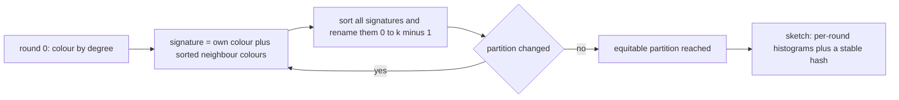
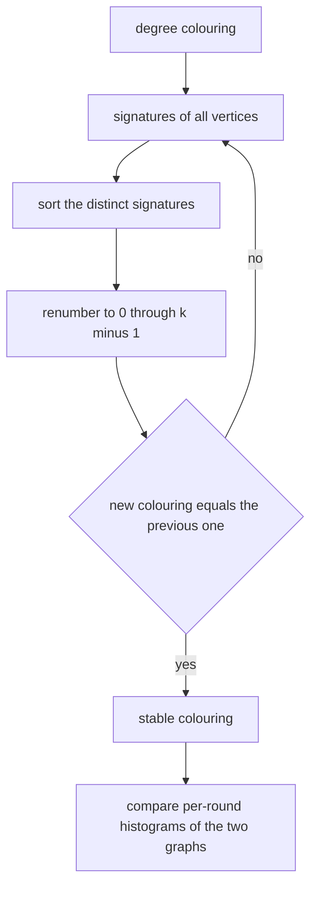
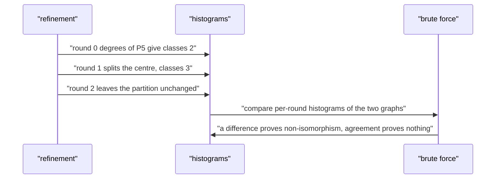

# 543 — Implement fingerprinting for graph similarity (Weisfeiler-Lehman sketch).

> **Tier:** Advanced · **CTCI chapter:** Ch 4 — Trees and Graphs
> **Task spec:** [543-implement-fingerprinting-for-graph-similarity-weisfeiler-lehman.md](../../../tasks/advanced/543-implement-fingerprinting-for-graph-similarity-weisfeiler-lehman.md)
> **Solutions:** [Python](../../../solutions/python/advanced/543-implement-fingerprinting-for-graph-similarity-weisfeiler-lehman/solution.py) ·
> [Java](../../../solutions/java/advanced/543-implement-fingerprinting-for-graph-similarity-weisfeiler-lehman/Solution.java) ·
> [JavaScript](../../../solutions/javascript/advanced/543-implement-fingerprinting-for-graph-similarity-weisfeiler-lehman/solution.js) ·
> [C#](../../../solutions/csharp/advanced/543-implement-fingerprinting-for-graph-similarity-weisfeiler-lehman/Solution.cs)

## 1. Problem restatement

**Input:** two undirected graphs given by their edge lists, and a number of refinement rounds.

**Output:** a **1-dimensional Weisfeiler-Lehman (colour refinement) sketch** of each graph, plus a
verdict on whether the two graphs are *indistinguishable* at that number of rounds. The sketch is a
per-graph fingerprint; the verdict is a one-sided test:

- if some round produces **different** colour histograms for the two graphs, they are provably **not**
  isomorphic (no false negatives);
- if every round agrees, the graphs *may* be isomorphic — colour refinement is a necessary, not a
  sufficient, invariant (false positives exist).

| Call | Result | Why |
| --- | --- | --- |
| `wl_sketch(P5, 5)["classes"]` | `[2, 3, 3, 3, 3, 3]` | round 0 splits by degree, round 1 splits the ends from the inner pair, then the partition is equitable |
| `wl_equivalent(cycle(6), two_triangles, 6)` | `True` | both are 2-regular; 1-WL cannot see the difference |
| `isomorphic_brute(cycle(6), two_triangles)` | `False` | the documented false positive |
| `wl_equivalent(path(6), star(6), 6)` | `False` | the degree histograms already differ |
| `wl_sketch(graph, n)["hash"]` for an isomorphic copy | equal | the fingerprint is relabelling invariant |
| `wl_sketch` of the same graph with reversed edge order | equal | adjacency order is irrelevant |

The counts, the blind spot and the invariance claims are asserted in the Python file's `main()`, and the
Java, JavaScript and C# files assert the same round structure and soundness properties.

## 2. Intuition

Two graphs are isomorphic when a bijection preserves adjacency; testing that by search is factorial, so
practical similarity tools use *invariants* that are cheap and usually discriminating. The WL
refinement is the strongest such invariant that is still simple:

1. **Round 0:** colour every vertex by its degree.
2. **Each later round:** replace a vertex's colour by a canonical name for the pair
   *(own colour, sorted multiset of neighbour colours)*.

The renumbering step is what makes the colours comparable across graphs: collect all signatures, sort
them, and rename them `0..k-1` in that order. The colours then depend only on the structure, never on
vertex names or adjacency order — which is exactly what the invariance assertions check.

The colour of a vertex after `r` rounds is a complete description of its **rooted ball of radius `r`**
up to isomorphism. So refinement is **monotone**: the partition can only get finer, the number of
classes never decreases, and it stabilises within `n` rounds (the file asserts stability after `n`
rounds and checks the refinement relation cell by cell).



The limit is structural, not an implementation detail: 1-WL only sees **local ball shapes**. A 6-cycle
and two disjoint triangles are both 2-regular, so every vertex has the same degree, the same neighbour
degree multiset, and so on forever — the two graphs stay one single colour class in every round, while
brute-force bijection search separates them at once. The Python file deliberately includes that pair in
its sample and asserts `false_positives >= 1` rather than hiding the limitation.

## 3. Algorithm

1. **Round 0.** Colour `v` by `len(adj[v])`; canonicalise the degree vector to `0..k-1`.
2. **Refine.** Compute `signature[v] = (colour[v], sorted(colour[w] for w in adj[v]))`, then canonicalise
   the signatures: sort the distinct ones and renumber. Record the colour vector and the class count of
   every round.
3. **Sketch.** For each round take the histogram of colours (as sorted `(colour, count)` pairs); fold the
   histograms into a stable polynomial hash, and also keep the raw histories.
4. **Joint verdict.** Put the two graphs side by side as a disjoint union, run the same refinement, and
   after each round compare the histogram of the first `n1` colours with that of the last `n2`. A
   mismatch at any round means "not isomorphic"; agreement through all rounds means "not separated".
5. **Independent references.** A separately written partition-refinement loop (starting from one cell and
   splitting by neighbour profiles) must produce the same partition, and a brute-force bijection search
   provides ground truth.

```text
procedure wl_rounds(graph, iterations)
    colours, classes ← canonicalise the degree of every vertex
    history ← [colours]
    class_counts ← [classes]
    repeat iterations times
        signatures ← for every v: pair of colours[v] and the sorted list of colours of neighbours of v
        colours, classes ← canonicalise(signatures)
        append colours to history
        append classes to class_counts
    end
    return history, class_counts
end

procedure canonicalize(values)
    unique ← sorted distinct values
    mapping ← value to its index in unique
    return the mapped list, and the number of distinct values
end
```

```text
procedure wl_equivalent(graph1, graph2, iterations)
    build the adjacency of the disjoint union of the two graphs
    colours ← canonicalise the degrees
    repeat iterations times
        signatures ← pair of own colour and sorted neighbour colours
        colours ← canonicalise(signatures)
        if histogram of the colours of graph1 ≠ histogram of the colours of graph2 then
            return false
        end
    end
    return true
end

procedure partition_refinement(graph)
    cells ← one cell holding every vertex
    loop forever
        signatures ← pair of the cell index and the sorted cell indices of the neighbours
        new cells ← group the vertices by signature
        if the new cells equal the old cells then return the cells
        cells ← the new cells
    end
end
```

The C# file renders each round's colour as the canonical string `"old|sorted neighbour colours"` and
defines a **WL kernel** as the histogram intersection summed over rounds and normalised by the self
intersections, so the similarity is `1` exactly when the fingerprints coincide. The Java file keeps a
shared dictionary for hashed signatures, and the JavaScript file keeps both a hashing engine (which
ranks the keys of a round in sorted order) and a hash-free partition-refinement engine, asserting that
they produce identical partitions in every round.



## 4. Worked example

Refine the path `P5` (`0-1-2-3-4`) for two rounds.

| Round | Colour vector | Classes | Why |
| --- | --- | --- | --- |
| 0 | `[0, 1, 1, 1, 0]` | `2` | degrees `1, 2, 2, 2, 1`; colour `0` = degree 1, colour `1` = degree 2 |
| 1 | `[0, 1, 2, 1, 0]` | `3` | signatures `(0, (1))`, `(1, (0, 1))`, `(1, (1, 1))`, `(1, (0, 1))`, `(0, (1))` — the centre splits from the inner pair |
| 2 | `[0, 1, 2, 1, 0]` | `3` | signatures `(0, (1))`, `(1, (0, 2))`, `(2, (1, 1))`, `(1, (0, 2))`, `(0, (1))` — same three classes, so the colouring is stable |
| 3, 4, 5 | `[0, 1, 2, 1, 0]` | `3` | an equitable partition: `{0, 4}`, `{1, 3}`, `{2}` |

The class-count sequence `[2, 3, 3, 3, 3, 3]` is exactly what the file asserts for
`wl_sketch(path5, 5)["classes"]`, together with `counts[0] == 2`, `counts[1] == 3`, the monotonicity
`counts[i] <= counts[i+1]`, the stability `counts[-1] == counts[-2] == 3`, and that every round's
histogram sums to `n = 5`.

**The blind spot.** Let `C6` be the 6-cycle and `T = 2·C3` the disjoint union of two triangles.

| Round | `C6` colour classes | `2·C3` colour classes | Verdict |
| --- | --- | --- | --- |
| 0 | `1` (all degrees `2`) | `1` | identical histograms |
| 1 | `1` (every neighbour has colour of degree 2) | `1` | identical |
| ... up to 6 | `1` | `1` | `wl_equivalent` returns `True` |
| brute force | — | — | `isomorphic_brute` returns `False` |

Both graphs are 2-regular, so no round can split a class, and the file asserts
`classes == [1] * 7` for both. This one pair supplies the `false_positives >= 1` assertion in the
sampled soundness sweep; conversely every pair the refinement *separates* is asserted to be
non-isomorphic by brute force, which is the one-directional guarantee that makes WL safe to use as a
filter.



## 5. Complexity

Let `n` be the number of vertices, `m` the number of edges and `r` the number of rounds.

| Measure | Bound | Why it holds |
| --- | --- | --- |
| One round | O(n + m) plus sorting of signatures | every vertex builds a sorted list of its neighbour colours |
| Whole refinement | O(r (n + m) log n) | signatures over all rounds; sorting the distinct ones gives canonical names |
| Stability | after at most `n` rounds | each round either splits a class or is the last, and there are at most `n` classes |
| Sketch memory | O(n r) | the colour vector of every round is kept |
| Joint verdict | O(r (n1 + n2 + m1 + m2) log n) | one refinement on the disjoint union |
| Hash | O(n r) modular operations | the polynomial hash folds every histogram entry once |
| Brute force ground truth | O(n!) | it permutes vertices; used only on tiny graphs |
| WL kernel (C#) | O(r * classes) | histogram intersection per round |

## 6. Pitfalls and edge cases

- **False positives are inherent.** `C6` versus two triangles stay equivalent under any number of 1-WL
  rounds; the file asserts that `wl_equivalent` returns `True` while `isomorphic_brute` returns `False`,
  and counts such cases instead of treating the sketch as an isomorphism test.
- **No false negatives.** A round whose histograms differ proves non-isomorphism, and the file asserts
  this against brute force on every sampled pair (`assert not actually`). Getting this direction wrong
  would be a correctness bug, unlike the false positives.
- **Relabelling invariance.** The sketch must be unchanged by an LCG relabelling of the vertices; only
  the *vertex-indexed* colour vector is permuted, so the tests compare histograms, class counts and the
  sorted final colour vector rather than the raw vectors.
- **Adjacency order invariance.** `Graph(n, reversed(edges))` must give the same hash; the refinement
  sorts neighbour colours, which is what removes the dependency.
- **Canonical renumbering is essential.** Naming colours by first appearance instead of sorted order
  makes the sketch depend on vertex order and breaks cross-graph comparison; the helper `canonicalize`
  is the single place that fixes this.
- **Round 0 is the degree sequence.** Two graphs with different degree histograms are separated
  immediately — a star from a path, a `C4` from a `K4`. The file asserts the degree histogram
  difference directly.
- **Unequal sizes.** Comparing graphs with different vertex counts can still return
  `wl_equivalent == False` through the histogram comparison; the joint refinement is built on the
  disjoint union, so index offsets (`n1 + v`) must be right.
- **Stability bound.** The colouring is stable after at most `n` rounds; the file refines `n` rounds and
  asserts `history[-1] == history[-2]` and that every new cell is contained in an old one (the
  refinement relation), which is stronger than comparing class counts.
- **Independent partition refinement.** The second engine starts from a single cell and splits by
  neighbour profiles; agreement with the degree-seeded engine is asserted on several random graphs, and
  the resulting cells are verified to have identical profiles — an equitable partition, not just a
  partition.
- **Histogram sanity.** Every round's histogram must sum to `n`, and every count must be positive;
  both are asserted, which catches an accidental colour renumbering that drops a class.
- **The polynomial hash is not the sketch.** It is a compact fold of the histograms; the file only uses
  it where the refinement already says the graphs are separated or isomorphic, so a collision could not
  hide a real difference in those assertions.
- **Kernel normalisation (C#).** The WL kernel value is `1` exactly when the fingerprints coincide;
  without normalising by the self intersections the value grows with graph size and is not comparable
  across pairs.
- **Multiple components.** Every routine works component-wise without special handling — but that is
  exactly why `C6` and `2·C3` are indistinguishable: the refinement never relates two components.
- **Determinism.** Repeated runs give identical sketches and hashes, which the file asserts alongside
  the four deliberately isomorphic control copies in the soundness sweep.

## 7. Variants and follow-ups

- **Trees and canonical forms.** For trees a single refinement round suffices and the AHU canonical code
  is exact — [542-implement-tree-isomorphism-hashing-ahu-algorithm.md](../../../tasks/advanced/542-implement-tree-isomorphism-hashing-ahu-algorithm.md).
- **Higher-dimensional WL.** The `k`-WL test refines tuples of vertices and is strictly stronger; it also
  costs `O(n^k)` per round, which is why 1-WL dominates in practice.
- **Sketches on streams.** When the graph does not fit in memory the same colouring can be maintained
  incrementally over an edge stream, in the spirit of
  [544-implement-streaming-graph-triangle-counting-approximation.md](../../../tasks/advanced/544-implement-streaming-graph-triangle-counting-approximation.md).
- **Spectral alternatives.** Eigenvalue-based fingerprints can separate regular pairs that 1-WL cannot —
  [547-implement-spectral-graph-partitioning-small-demo.md](../../../tasks/advanced/547-implement-spectral-graph-partitioning-small-demo.md).
- **Kernels for learning.** The per-round colour histograms are the feature vector of the WL subtree
  kernel, which is how this invariant is usually consumed downstream.

## 8. Check yourself

1. Why is the renumbering step (sort the signatures, rename `0..k-1`) crucial?

<details><summary>Show answer</summary>

Because colour *names* must mean the same thing in both graphs. Sorting the distinct signatures and
renaming them in that order makes the naming depend only on the comparisons among signatures, not on
vertex order or adjacency order — so two isomorphic graphs (and relabelled copies of the same graph)
produce identical colour histograms, which is what the cross-graph comparison needs.

</details>

2. Refine `P5` for two rounds: what are the class counts, and why does the process stop there?

<details><summary>Show answer</summary>

Round 0 gives `2` classes (degrees `1` and `2`); round 1 splits the two ends, the inner pair and the
centre into `3` classes; round 2 reproduces exactly those classes, so the colouring is stable. The
partition `{0,4}, {1,3}, {2}` is equitable: every vertex in a cell has the same number of neighbours in
each cell, so no further split is possible.

</details>

3. Why are `C6` and two disjoint triangles indistinguishable to 1-WL, and what does that imply about the
   tool?

<details><summary>Show answer</summary>

Both are 2-regular, so every vertex starts with the same degree, every neighbour also has degree 2, and
by induction the whole graph stays a single colour class in every round: the histograms are identical, so
`wl_equivalent` returns `True`. Yet the graphs are not isomorphic, so the refinement can only be used as
a *filter*: a difference proves non-isomorphism, agreement means "not separated", not "isomorphic".

</details>

4. Which direction of the verdict is guaranteed, and how does the file check it?

<details><summary>Show answer</summary>

A difference at any round is a proof of non-isomorphism (no false negatives). The file checks it by
running `isomorphic_brute` on every sampled pair and asserting `not actually` whenever
`wl_equivalent` returned `False`, and by counting the pairs so the sample is known to be meaningful
(`separations > 40`, `positives >= 12`, `false_positives >= 1`).

</details>

5. Why does the file keep a second, hash-free partition-refinement engine?

<details><summary>Show answer</summary>

As an independent implementation of the same invariant: the primary engine seeds colours with degrees and
ranks signatures, while the second starts from one cell and splits by explicit neighbour profiles. They
must agree on the final partition, and the second one additionally allows checking that each final cell
is *equitable* (all its vertices have identical neighbour profiles), which is the mathematically
meaningful statement of stability.

</details>
