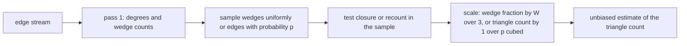
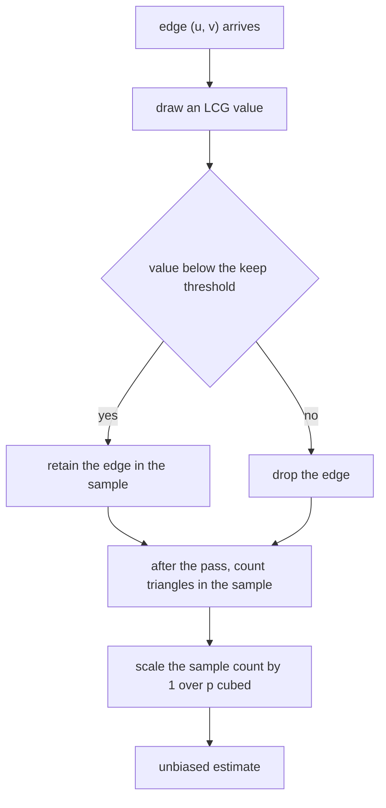
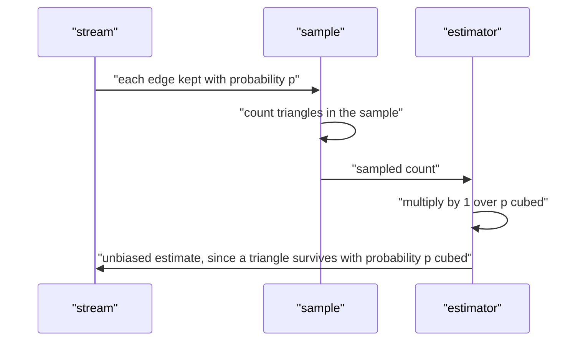

# 544 — Implement streaming graph triangle counting approximation.

> **Tier:** Advanced · **CTCI chapter:** Ch 4 — Trees and Graphs
> **Task spec:** [544-implement-streaming-graph-triangle-counting-approximation.md](../../../tasks/advanced/544-implement-streaming-graph-triangle-counting-approximation.md)
> **Solutions:** [Python](../../../solutions/python/advanced/544-implement-streaming-graph-triangle-counting-approximation/solution.py) ·
> [Java](../../../solutions/java/advanced/544-implement-streaming-graph-triangle-counting-approximation/Solution.java) ·
> [JavaScript](../../../solutions/javascript/advanced/544-implement-streaming-graph-triangle-counting-approximation/solution.js) ·
> [C#](../../../solutions/csharp/advanced/544-implement-streaming-graph-triangle-counting-approximation/Solution.cs)

## 1. Problem restatement

**Input:** an undirected simple graph presented as a stream of edges, and a sampling budget. The exact
count of triangles is needed as a yardstick, but the streaming setting only allows one pass and
sublinear storage.

**Output:** an **unbiased estimate** of the triangle count from one pass over the edges. The files
implement both sides of the problem:

| Component | What it computes |
| --- | --- |
| degree-oriented exact counter | the exact count in `O(m^1.5)`, each triangle charged to its lowest-ranked vertex |
| `O(n^3)` triple scan | the batch reference |
| `tr(A^3) / 6` | an algebraic reference, independent of the combinatorial counters |
| wedge identity | `sum over v of C(deg(v), 2) = 3T + (open length-2 paths)` |
| DOULION sparsification | keep each edge independently with probability `p`, count in the sample, scale by `1/p^3` |
| wedge sampling | sample wedges uniformly, scale `(sum of C(deg v, 2)) / 3` by the closed fraction |

| Instance | Exact count | Why |
| --- | --- | --- |
| `K4` | `4` | `C(4,3)` |
| `K5` | `10` | `C(5,3)` |
| `K6` | `20` | `C(6,3)` |
| single triangle | `1` | one triple |
| `C6` | `0` | the cycle has no chords |
| `K(3,3)` | `0` | bipartite graphs contain no triangle |
| windmill of three triangles | `3` | three triples sharing a hub |
| a path | `0` | a tree |

Those counts, the three-way agreement of the exact methods and the estimator statistics are asserted in
the Python file's `main()`; the Java, JavaScript and C# files assert the same identities in their own
formulation.

## 2. Intuition

Counting triangles exactly is easy with the whole graph — test every triple, `O(n^3)` — and can be done
in `O(m^1.5)` by **orientation**: rank every vertex by `(degree, id)`, direct every edge from the
lower-ranked endpoint to the higher-ranked one, and then for each vertex intersect its out-neighbours
pairwise, testing adjacency. Every triangle has a unique lowest-ranked vertex and is therefore charged
exactly once.

The streaming twist is that the edges arrive once and cannot be stored. Two classic answers:

1. **Sparsification (DOULION).** Keep each edge independently with probability `p`, count triangles in
   the small sampled graph with the same exact counter, and multiply by `1/p^3`. A triangle survives the
   sampling exactly when all three of its edges survive, and that happens with probability `p^3`
   independently of everything else — so the scaled count is unbiased, and the variance falls as `p`
   grows.
2. **Wedge sampling.** A triangle contains exactly three wedges (two edges sharing a centre). Draw `S`
   wedges uniformly and count how many are *closed* (the two outer endpoints are adjacent); the closure
   rate estimates the fraction of wedges that belong to triangles, and
   `T ≈ (closed / S) * (sum over v of C(deg(v), 2)) / 3`.



The files also show the incremental exact variant, which is what a one-pass implementation looks like
when the graph *does* fit: when edge `(u, v)` arrives, add `|N(u) ∩ N(v)|` over the edges seen so far.
Every triangle is closed exactly once, at the arrival of its last edge — the JavaScript file verifies
that the running count equals the exact triangle count of **every prefix**, and the C# file re-runs with
three different stream orders, including a shuffled one, to show the result is order independent.

## 3. Algorithm

**Exact orientation counter.**

1. Build adjacency sets and degrees.
2. Rank vertices by `(degree, id)`.
3. Orient every edge from the lower rank to the higher rank.
4. For each vertex `u`, take its ordered out-neighbours in pairs `(a, b)` and count the pairs with
   `b ∈ N(a)`. Every triangle is counted once, at its lowest-ranked vertex.

**DOULION streaming estimator.**

5. Walk the stream once; for each edge draw an LCG value and keep the edge when
   `seed % 1000 < keep_per_mille` (`p = keep_per_mille / 1000`), recording the inspected and kept
   counts.
6. Count triangles in the kept subgraph with the orientation counter.
7. Return `sampled * (1 / p)^3`.

**Wedge sampling estimator.**

8. Enumerate the wedge distribution (or note the first pass can accumulate `C(deg(v), 2)` per vertex).
9. Draw `S` wedges uniformly with replacement from a deterministic LCG stream.
10. Return `(closed / S) * total_wedges / 3`.

```text
procedure exact_triangles(n, edges)
    adj ← adjacency sets
    rank ← vertices sorted by degree then id, mapped to their position
    out ← for every edge (u, v): append v to out[u] if rank[u] < rank[v], else append u to out[v]
    count ← 0
    for u ← 0 to n - 1 do
        listed ← out[u]
        for i ← 0 to length(listed) - 1 do
            for j ← i + 1 to length(listed) - 1 do
                if listed[j] is a neighbour of listed[i] then
                    count ← count + 1
                end
            end
        end
    end
    return count
end
```

```text
procedure stream_estimate(stream, n, keep_per_mille, seed)
    kept ← empty list
    inspected ← 0
    for each edge (u, v) in stream do
        inspected ← inspected + 1
        seed ← next LCG value
        if seed mod 1000 < keep_per_mille then
            append (u, v) to kept
        end
    end
    sampled ← exact_triangles(n, kept)
    scaled ← sampled * (1000 / keep_per_mille) ^ 3
    return scaled, inspected, kept, sampled
end

procedure wedge_sampling_estimate(n, edges, samples, seed)
    build the list of all wedges, each written as (centre, a, b)
    total_wedges ← length of the list
    if total_wedges = 0 or samples = 0 then return 0
    closed ← 0
    repeat samples times
        seed ← next LCG value
        (centre, a, b) ← wedges[seed mod total_wedges]
        if b is a neighbour of a then closed ← closed + 1
    end
    return closed / samples * total_wedges / 3
end
```



The other three files add their own second estimator and oracle: the Java file uses a semi-streaming
wedge sampler that maps LCG uniforms onto the cumulative `C(deg(v), 2)` table and counts the closed
fraction, the JavaScript file keeps the incremental per-arrival intersection counter and compares its
membership-test count against the ordered orientation counter, and the C# file adds triple sampling
(`T ≈ C(n,3) * closed triples / samples`) plus the closed form `C(n,3)` for `K_n`.

## 4. Worked example

**The windmill of three triangles** — a hub `0` joined to six vertices `1..6`, with the pairs
`(1,2)`, `(3,4)`, `(5,6)` also joined: `n = 7`, `T = 3`.

| Quantity | Value | Computation |
| --- | --- | --- |
| degrees | hub `6`, each arm `2` | hub joined to all six arms, arms joined to hub and their partner |
| wedges `sum C(deg, 2)` | `21` | hub: `C(6,2) = 15`; six arms: `6 * C(2,2) = 6` |
| closed wedges | `9` | hub: one per triangle `= 3`; arms: one each `= 6` |
| open wedges | `12` | the hub's cross-arm pairs, `21 - 9 = 12` |
| identity | `21 = 3*3 + 12` | the file asserts exactly this decomposition |

**The orientation counter on `K4`** (`n = 4`, `T = 4`, `m = 6`): all degrees are `3`, so the rank order is
`0, 1, 2, 3` and the oriented edges are `0->1, 0->2, 0->3, 1->2, 1->3, 2->3`.

| Vertex | Out-neighbours | Pairs tested | Closed pairs |
| --- | --- | --- | --- |
| 0 | `[1, 2, 3]` | `(1,2)`, `(1,3)`, `(2,3)` | `3` |
| 1 | `[2, 3]` | `(2,3)` | `1` |
| 2 | `[3]` | none | `0` |
| 3 | `[]` | none | `0` |

Total `4 = C(4,3)`, and each triangle is charged to its lowest-ranked vertex exactly once.

**The DOULION arithmetic.** With `p = 1/2` on `K4`, a triangle survives the sampling with probability
`p^3 = 1/8`, so the sampled count has expectation `4 * 1/8 = 0.5` and the scaled estimate has
expectation `0.5 * 8 = 4 = T`. The Python file makes the same statement empirically: at
`keep = 300, 500, 800` per mille the mean of 200 independent sparsifications lands within 25%, 15% and
8% of the exact count (the measured deviations are 3.0%, 1.9% and 0.3%), the spread at `800` is less
than three quarters of the spread at `300`, and at `keep = 1000` (`p = 1`) the estimate reproduces the
exact count bit for bit with nothing to scale.



The single-pass properties are asserted as well: the number of inspected edges equals the stream length,
about a `p` fraction of the edges is retained (within 12% of `p * m`), and the kept edges appear in the
stream as a **subsequence** — a cheap way to prove that no edge was replaced or re-read.

## 5. Complexity

Let `n` be the number of vertices, `m` the number of edges and `T` the triangle count.

| Measure | Bound | Why it holds |
| --- | --- | --- |
| Orientation counter | O(m^1.5) | out-degrees are bounded by `sqrt(2m)` after ranking by degree, so the pairwise intersections are `O(m^1.5)` |
| Triple scan | O(n^3) | every triple is tested; used as a reference only |
| `tr(A^3)/6` | O(n^3) | two dense matrix multiplications |
| DOULION pass | O(m) | one decision per edge, constant work |
| Sample counting | O(m_sample^1.5) with `m_sample ≈ p m` | the same engine on the sample |
| Wedge enumeration | O(sum of C(deg, 2)) | every wedge is materialised in the file's explicit implementation |
| Wedge sampling | O(S) closure tests after the wedge table | a constant-time adjacency test per sample |
| Memory, DOULION | O(p m) | only the kept edges are stored |
| Memory, wedge sampling | O(sum of C(deg, 2)) in the file's version | a semi-streaming version keeps only the `C(deg, 2)` counts plus the adjacency needed for closure tests |
| Unbiasedness | exact | a triangle survives with probability `p^3`, independently of the rest |

## 6. Pitfalls and edge cases

- **Self-loops and multi-edges.** `adjacency` asserts `u != v` and rejects repeated edges (simple graphs only).
- **Each triangle counted once.** The orientation must rank by `(degree, id)`, and ties must be broken by
  id, or a triangle may be charged twice or missed; the file validates the counter against the `O(n^3)`
  scan and against `tr(A^3)/6` on several random graphs.
- **The wedge identity is `3T` plus open paths, not `T`.** `sum over v of C(deg(v), 2)` counts every
  wedge, and each triangle closes exactly three of them; on the windmill the numbers are `21 = 9 + 12`.
- **`p = 1` must not scale.** With `keep_per_mille = 1000` every edge is kept and the estimate must equal
  the exact count; the file asserts equality with `<= 1e-9` and that the kept list is the whole stream.
- **Unbiasedness needs independence.** The keep decision must not depend on the edge or on the graph, or
  the `p^3` survival probability fails; the file's threshold on the LCG stream is per edge and
  deterministic per seed.
- **Triangle-free streams cannot invent triangles.** A path and `K(3,3)` must return exactly `0` for
  every seed and every keep rate — the file asserts `sampled == 0 and estimate == 0.0` on both.
- **Subsequence bookkeeping.** Comparing the kept list with the stream filtered by the kept set proves
  the pass is a single forward scan without reordering.
- **Retention rate.** `len(kept)` must be within 12% of `p * m` for the three rates tested; a buggy
  threshold (for example `<=` versus `<`) shifts the rate without changing any single-edge test.
- **Degenerate samples.** A sample with fewer than three kept edges yields zero triangles and a
  zero estimate — correct, not a failure; the minimum over 200 trials is asserted to be non-negative.
- **Wedge sampling with no wedges.** A tree has `sum C(deg, 2) > 0` but every wedge is open, so the
  closure rate is `0` and the estimate is `0`; a graph with no wedges at all returns `0.0` directly
  rather than dividing by zero.
- **`samples = 0`.** Returns `0.0` instead of a division by zero; the file's guard is explicit.
- **Exactness on the whole wedge population.** `all_closed == 3 * T` and
  `all_closed / all_wedges * total_wedges / 3 == T` are asserted, which pins the estimator's arithmetic
  independently of the sampling.
- **Variance, not just bias.** Both estimators are checked for a shrinking spread as the budget grows
  (`spreads[800] < 0.75 * spreads[300]`, and the wedge sampler's variance shrinks with the sample
  count); an estimator could be unbiased and still useless if its variance refused to fall.
- **Triangle-free bipartite input.** `K(3,3)` has nine edges and no triangle; together with the path it
  covers both "sparse but wedged" and "no closed wedge" situations.
- **Stream order independence.** The C# file re-runs the exact streaming counter with three orders,
  including a shuffled one, and asserts equal results; the JavaScript file asserts prefix-by-prefix
  correctness against a fresh brute force.
- **Determinism.** Both estimators are deterministic under a repeated seed — the file asserts identical
  tuples on repeated `stream_estimate` calls, which makes every tolerance-based assertion reproducible.

## 7. Variants and follow-ups

- **Sketches with similar guarantees.** Count-Min and HyperLogLog solve the frequency and cardinality
  analogues of "estimate a global aggregate in one pass" —
  [465-implement-count-min-sketch-for-frequency-estimation.md](../../../tasks/advanced/465-implement-count-min-sketch-for-frequency-estimation.md)
  and [466-implement-hyperloglog-sketch-for-cardinality-estimation-outline.md](../../../tasks/advanced/466-implement-hyperloglog-sketch-for-cardinality-estimation-outline.md).
- **Graph fingerprints.** Colour refinement gives a structural invariant rather than a count —
  [543-implement-fingerprinting-for-graph-similarity-weisfeiler-lehman.md](../../../tasks/advanced/543-implement-fingerprinting-for-graph-similarity-weisfeiler-lehman.md).
- **Spectral counting.** `tr(A^3)/6` is the algebraic view of triangle counting and connects to spectral
  graph algorithms such as
  [547-implement-spectral-graph-partitioning-small-demo.md](../../../tasks/advanced/547-implement-spectral-graph-partitioning-small-demo.md).
- **Degree-ordered intersections.** The same orientation trick accelerates listing, not just counting,
  and underlies practical triangle enumerators on large static graphs.
- **Better estimators.** Neighbourhood sampling, TRIEST-style incremental maintenance and colour coding
  trade variance and memory differently; the wedge and sparsification estimators here are the two
  classical baselines.

## 8. Check yourself

1. Why is the DOULION estimate unbiased?

<details><summary>Show answer</summary>

Because a triangle survives the edge sampling exactly when all three of its edges are kept, which happens
with probability `p^3` and independently of every other triangle; so the sampled count has expectation
`p^3 * T`, and dividing by `p^3` recovers `T`. The scale factor is `(1/p)^3`, which is why the
implementation multiplies by `(1000 / keep_per_mille)^3`.

</details>

2. How does the orientation counter charge each triangle exactly once?

<details><summary>Show answer</summary>

Every edge is directed from the endpoint with the smaller `(degree, id)` key to the larger one, which
gives an acyclic orientation. In any triangle exactly one vertex is lowest in that order, and both of its
triangle edges point away from it, so the triangle contributes exactly one closed pair in that vertex's
out-neighbour list — and none anywhere else.

</details>

3. On the windmill of three triangles, why is `sum C(deg(v), 2)` equal to `21` and how does it split?

<details><summary>Show answer</summary>

The hub has degree `6`, contributing `C(6,2) = 15` wedges; each of the six arms has degree `2`,
contributing one wedge, for `6` more — `21` in total. Of these, `9` are closed (`3` at the hub, one per
triangle, plus `6` at the arms) and `12` are open, which is exactly the identity `21 = 3*3 + 12` the file
asserts.

</details>

4. What does the file check beyond the mean of the estimates?

<details><summary>Show answer</summary>

The shape of the error distribution: the spread at `keep = 800` must be smaller than at `keep = 300`, and
specifically less than three quarters of it; the wedge sampler's variance must shrink as the number of
samples grows; every estimate must be non-negative; and the estimators must be deterministic under a
fixed seed. An unbiased estimator with a variance that does not fall with the budget would be useless, so
both properties are asserted.

</details>

5. The JavaScript and C# files implement a different exact streaming counter. What does it do, and what
   does it prove?

<details><summary>Show answer</summary>

When edge `(u, v)` arrives it adds `|N(u) ∩ N(v)|` — the number of common neighbours already seen — to a
running total. That counts each triangle exactly once, at the arrival of its last edge, so the running
total after any prefix is the exact triangle count of that prefix. The JavaScript file verifies this
against a fresh brute force for every prefix, and the C# file re-runs with shuffled stream orders to show
the result does not depend on order.

</details>
