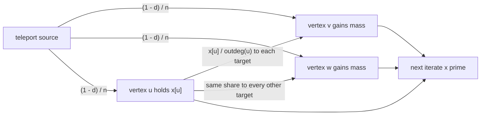
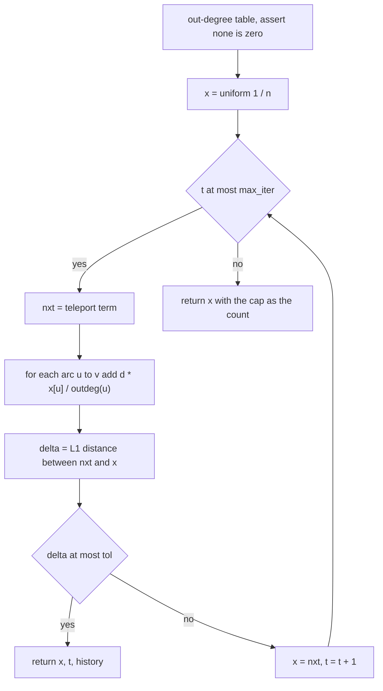
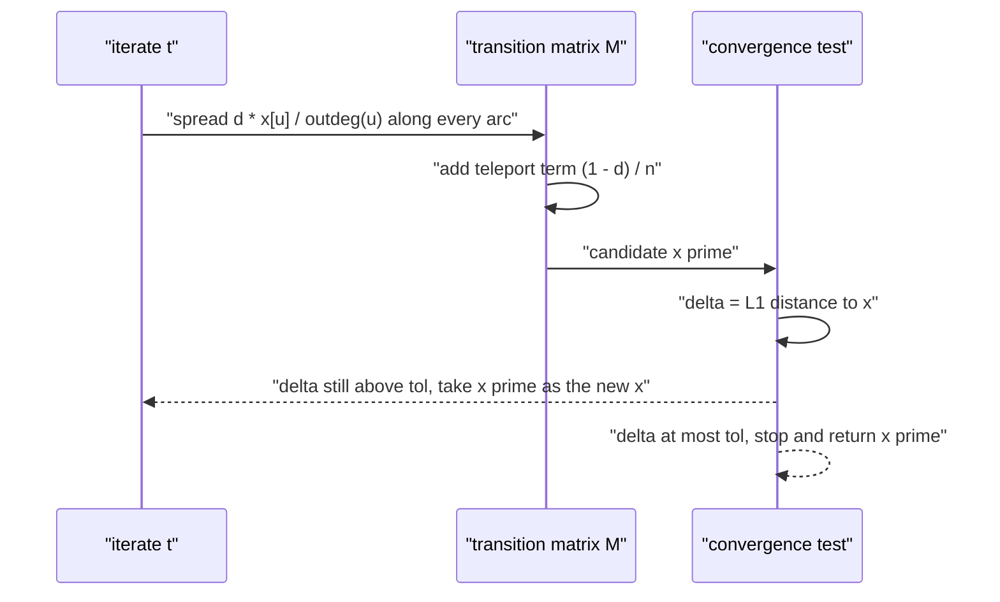

# 545 — Implement pagerank iterative solver and convergence check.

> **Tier:** Advanced · **CTCI chapter:** Ch 4 — Trees and Graphs
> **Task spec:** [545-implement-pagerank-iterative-solver-and-convergence-check.md](../../../tasks/advanced/545-implement-pagerank-iterative-solver-and-convergence-check.md)
> **Solutions:** [Python](../../../solutions/python/advanced/545-implement-pagerank-iterative-solver-and-convergence-check/solution.py) ·
> [Java](../../../solutions/java/advanced/545-implement-pagerank-iterative-solver-and-convergence-check/Solution.java) ·
> [JavaScript](../../../solutions/javascript/advanced/545-implement-pagerank-iterative-solver-and-convergence-check/solution.js) ·
> [C#](../../../solutions/csharp/advanced/545-implement-pagerank-iterative-solver-and-convergence-check/Solution.cs)

## 1. Problem restatement

**Input:** a simple directed graph as an adjacency list `adj`, where `adj[u]` lists the
out-neighbours of `u`; a damping factor `d` (default `0.85`); a convergence tolerance (default
`1e-12`); an iteration cap (default `500`); and an optional starting distribution `start`.

**Output:** the stationary rank vector `x` with `sum(x) = 1`, the number of iterations performed,
and the recorded sequence of per-iteration step sizes. Every vertex of every graph used by the
self-tests has out-degree at least one, which the solver asserts.

The contract at work is the damped power iteration

```text
x_{t+1}[v] = (1 - d) / n  +  d * sum over arcs u -> v of ( x_t[u] / outdeg(u) )
```

which every solution file implements. The concrete consequences the files assert:

| Call | Result | Why |
| --- | --- | --- |
| `pagerank(cycle(2))` | `(0.5, 0.5)` | a regular graph makes the stationary vector uniform |
| `pagerank(cycle(3))`, `cycle(5)` | each coordinate `1 / n` within `1e-9` | same reason; the Python file also checks `cycle(4)` and `cycle(7)` |
| `pagerank([[1], [0, 1]])` | `ranks[1] > ranks[0]`, exact `(0.350877…, 0.649122…)` | vertex `1` has a self-loop on top of the arc from `0` |
| `pagerank(adj, damping=0.0)` | uniform `1 / n` within `1e-12` | with `d = 0` the teleport term is the whole update |
| `sum(ranks)` on any test graph | `1.0` within `1e-12` | mass is conserved exactly, not approximately |

The four implementations agree on the mathematics and differ only in representation: Python and
C# scatter mass along the adjacency list and keep a dense transpose as a second reference, the
JavaScript file builds the Google matrix `G = alpha * P + (1 - alpha) / n * J` and iterates
`x_{k+1} = G^T x_k`, and the Java file records the whole delta history so that the contraction
claims can be checked rather than asserted.

## 2. Intuition

The naive idea is "count the incoming links and normalise": `rank[v] = indegree(v) / edges`. That
is wrong on any graph where a linked-from hub has a huge out-degree — a spam page with a thousand
out-links would transfer its full weight to every target, so a single link is worth as much as a
thousand. The fix has two parts:

1. **Split the weight.** A vertex `u` holds `x[u]` units of mass and hands exactly `x[u] / outdeg(u)`
   to each out-neighbour. Summing over the arcs that end at `v` gives the second term above.
2. **Teleport with probability `1 - d`.** Redistribute `(1 - d) / n` to *every* vertex every round.
   This is what makes the fixed point unique and keeps the update from getting trapped in a sink.

The key insight is that the update is **linear and contractive in the L1 norm**. Writing `M` for
the column-stochastic matrix with `M[v][u] = 1 / outdeg(u)`, one round is
`x' = (1 - d) / n * 1 + d * M x`. Because `M` is column-stochastic, `||M z||_1 <= ||z||_1` for every
zero-sum `z`, so the difference between any two iterates shrinks by at least the factor `d` each
round. Convergence is therefore not a hope — it is a geometric bound, and the step size itself is a
certificate of it.



Reading the diagram as a rule: the walker either follows a uniform random out-link with
probability `d`, or jumps to a uniformly random vertex with probability `1 - d`. PageRank is the
fraction of time that walker spends at each vertex, which is exactly what the documented
Monte-Carlo surfer in the solution files measures.

## 3. Algorithm

1. Compute `outdeg(u)` for every vertex and assert that none is zero — this task deliberately
   excludes dangling vertices, and handling them is the subject of task 546.
2. Initialise `x` to the uniform vector, or normalise the caller's start vector to sum to one.
3. Repeat up to `max_iter` times:
   1. Set `nxt[v] = (1 - d) / n` for every `v` — the teleport term of the next iterate.
   2. For each `u`, compute `share = d * x[u] / outdeg(u)` and add it to `nxt[v]` for every arc
      `u -> v`.
   3. Compute the L1 step `delta = sum |nxt[i] - x[i]|`, append it to the history, set `x = nxt`.
   4. If `delta <= tol`, return `(x, t, history)`.
4. If the cap is reached first, return the current iterate together with the cap as the count.

```text
procedure pagerank(adj, d, tol, max_iter, start)
    n ← length(adj)
    outdeg[u] ← length(adj[u]) for every u
    assert outdeg[u] >= 1 for every u
    if start is none then
        x ← vector of n copies of 1 / n
    else
        x ← start scaled so that its entries sum to 1
    end
    history ← empty list
    for t ← 1 to max_iter do
        nxt ← vector of n copies of (1 - d) / n
        for u ← 0 to n - 1 do
            share ← d * x[u] / outdeg[u]
            for each v in adj[u] do
                nxt[v] ← nxt[v] + share
            end
        end
        delta ← sum over i of abs(nxt[i] - x[i])
        append delta to history
        x ← nxt
        if delta <= tol then
            return x, t, history
        end
    end
    return x, max_iter, history
end
```

The exact reference solver used for cross-checking takes the other road: it materialises
`M`, forms the non-singular system `(I - d·M) x = (1 - d)/n · 1` and solves it by Gaussian
elimination with partial pivoting. The iterative answer must match it componentwise to `1e-9`.



Two stopping paths, one contract: the returned vector is a fixed point up to the tolerance in
either case, and the stricter the tolerance the later the exit.

## 4. Worked example

Trace the smallest non-regular graph, `adj = [[1], [0, 1]]`: vertex `0` points only at `1`, while
vertex `1` points at `0` and at itself. So `n = 2`, `outdeg = (1, 2)`, `d = 0.85` and the teleport
term is `(1 - 0.85) / 2 = 0.075`.

| Step | `x` before | `nxt[0] = 0.075 + 0.85·x[1]/2` | `nxt[1] = 0.075 + 0.85·(x[0] + x[1]/2)` | `delta` |
| --- | --- | --- | --- | --- |
| 1 | `(0.5, 0.5)` | `0.075 + 0.2125 = 0.2875` | `0.075 + 0.6375 = 0.7125` | `0.425` |
| 2 | `(0.2875, 0.7125)` | `0.075 + 0.3028125 = 0.3778125` | `0.075 + 0.5471875 = 0.6221875` | `0.180625` |
| 3 | `(0.3778125, 0.6221875)` | `0.33942969` | `0.66057031` | `0.07676562` |
| ⋮ | ⋮ | ⋮ | ⋮ | ⋮ |
| limit | — | `0.350877…` | `0.649122…` | `0` |

The limit is the exact solution of the two fixed-point equations
`a = 0.075 + 0.425·b` and `a + b = 1`, giving `a = 0.5 / 1.425 ≈ 0.350877` and
`b ≈ 0.649122`. Two details in the table are the whole convergence argument:

- The steps form a geometric sequence with ratio exactly `0.425 = d` here, which is the
  documented bound `delta_{t+1} <= d * delta_t`; the Python file asserts that inequality for every
  consecutive pair of recorded steps on ten random digraphs, and the Java file checks the stronger
  error bound `||x_t - x*||_1 <= d^t ||x_0 - x*||_1` at every iterate.
- Vertex `1` stays ahead because its self-loop recycles `d · x[1] / 2` back into itself, while
  vertex `0` can only be reached from `1`. The Python file asserts `ranks[1] > ranks[0]` on this
  graph and that both match the Gaussian-elimination answer to `1e-9`.



The same trace on a cycle gives the other documented extreme. On `cycle(n)` every vertex has
out-degree one, so `M` is a permutation matrix, the start is already the fixed point, and the
solver exits after a single step with all `delta = 0` — which is why the files can assert exact
uniformity on `C2`, `C3`, `C4`, `C5` and `C7`.

## 5. Complexity

Let `n` be the number of vertices, `m` the number of arcs and `T` the number of iterations
actually performed.

| Measure | Bound | Why it holds |
| --- | --- | --- |
| Time per iteration | O(n + m) | the teleport term touches `n` slots and the scatter touches each arc once |
| Time, total | O(T · (n + m)) | the loop is the only work in the solver |
| Iterations `T` | O(log(1 / tol) / log(1 / d)) | the documents record `delta_{t+1} <= d · delta_t`, so the step size falls geometrically |
| Space | O(n + m) | the adjacency list, the two rank vectors, the out-degree table and the step history |
| Time of the direct reference | O(n³) | Gaussian elimination with partial pivoting on the dense `(I - d·M)` system |
| Space of the direct reference | O(n²) | the dense matrix is materialised to solve it |

The two solvers are complementary: the iteration is cheap and approximate but needs a tolerance,
while the direct solve is expensive but exact, which is why every solution file uses the second one
only to certify the first. The per-iteration cost is dominated by the arc scatter; a
matrix-vector product against a dense `M` would cost `O(n²)` and is only used in the contraction
check, where the files verify `||G x - G y||_1 <= d ||x - y||_1` for twenty random pairs of
probability vectors on a 9-vertex graph.

## 6. Pitfalls and edge cases

- **Dangling vertices.** A vertex with out-degree zero has no share to scatter, and the naive loop
  silently loses `d · x[u]` of mass, so the iterate stops summing to one. The Python solver
  asserts `outdeg(u) >= 1` instead; dangling handling is deliberately deferred to
  [546-implement-pagerank-with-dangling-node-handling.md](../../../tasks/advanced/546-implement-pagerank-with-dangling-node-handling.md).
- **`d = 1`.** Without teleport the walk can be periodic (a cycle never mixes) and the `L1`
  contraction factor becomes `1`, so the stopping rule can stall. The files only probe `d = 0.9999`
  and require it to fit inside the cap.
- **Accepting the cap as convergence.** The JavaScript solver reports whether it converged inside
  the cap, and the Python one asserts `delta <= tol` on the last recorded step and `delta > tol` on
  the second-to-last; returning after `max_iter` silently is a bug, not a result.
- **Mass drift.** The teleport term plus the scattered shares add to exactly one in exact
  arithmetic, and the assertions keep the drift at `1e-12`. Any update that renormalises by hand
  instead of computing shares will not match the direct solve to `1e-9`.
- **Multiple edges and self-loops.** The test graphs are simple: repeated arcs would inflate a
  target's share, so the Python file asserts `len(set(adj[u])) == len(adj[u])`. Self-loops, on the
  other hand, are legitimate and are exactly what makes the `[[1], [0, 1]]` example non-uniform.
- **Starting vector.** Starting from a concentrated vector must still land on the same fixed point
  (uniqueness for `d < 1`), but the iteration count changes — with a bottleneck it changes a lot.
  A start vector that does not sum to one must be normalised, not assumed.
- **Slow mixing.** On `dumbbell(5)` — two 5-cliques joined by a single bridge edge — the Python
  file documents `91 < 164 < 238` iterations for `d = 0.85, 0.95, 0.99` at tolerance `1e-10`
  from a concentrated start. The count grows with `d`, and the assertion `> 50` records that the
  bridge really is the bottleneck.
- **Monte-Carlo noise.** The 16-bit `lcg` used for sample data elsewhere in the repository has too
  short a period here: averaged over a 200 000-step surfer the visit frequencies plateau about
  `0.007` away from the true ranks. The files therefore drive the surfer with a full-period 64-bit
  generator, which keeps the empirical estimate within the documented `0.005`.
- **Floating-point ties.** `d = 0.95` versus `d = 0.85` must give a measurably different ranking
  (`> 1e-12` in `L∞`), so the comparison is done on the vectors, not on rounded printouts.

## 7. Variants and follow-ups

- **Dangling nodes.** Store `M` with a zero column and add a term
  `d · (sum of mass on dangling vertices) / n`; the update then stays column-stochastic. See
  [546-implement-pagerank-with-dangling-node-handling.md](../../../tasks/advanced/546-implement-pagerank-with-dangling-node-handling.md).
- **Exact instead of iterative.** Solve `(I - d·M) x = (1 - d)/n · 1` once. This is the reference
  in every solution file here, and it becomes the algorithm of choice on small graphs where the
  `O(n³)` factor is affordable.
- **Spectral view.** The same matrix is the object of
  [547-implement-spectral-graph-partitioning-small-demo.md](../../../tasks/advanced/547-implement-spectral-graph-partitioning-small-demo.md),
  which uses its eigenvectors rather than its dominant fixed point.
- **Cluster instead of rank.** Replacing the global teleport with a per-community redistribution
  turns the ranking into a partition problem; the label-propagation task
  [549-implement-label-propagation-for-community-detection.md](../../../tasks/advanced/549-implement-label-propagation-for-community-detection.md)
  is the iterative cousin of this solver on the same graphs.
- **Sampling instead of iterating.** The deterministic surfer in the solution files is a random-walk
  estimator; the sketches in
  [550-implement-graph-sketches-for-neighborhood-similarity-minhash.md](../../../tasks/advanced/550-implement-graph-sketches-for-neighborhood-similarity-minhash.md)
  take the same "estimate a global quantity from local samples" attitude to set similarity.
- **Powers of the matrix.** If you only need the ranks to a fixed number of digits, squaring the
  Google matrix converges in `O(log T)` products; that trick is the subject of
  [556-implement-adjacency-matrix-exponentiation-for-path-counting-fast.md](../../../tasks/advanced/556-implement-adjacency-matrix-exponentiation-for-path-counting-fast.md).

## 8. Check yourself

1. Why does the iteration conserve mass exactly when every vertex has an out-link?

<details><summary>Show answer</summary>

The teleport term contributes `n · (1 - d)/n = 1 - d` in total, and each vertex `u` scatters
`d · x[u]` in total, because `outdeg(u)` targets each receive `d · x[u] / outdeg(u)`. So the total
after one round is `(1 - d) + d · sum(x) = 1`. The assertions keep the drift at `1e-12`.

</details>

2. Where does the bound `delta_{t+1} <= d · delta_t` come from?

<details><summary>Show answer</summary>

From the column-stochasticity of `M`: for any two vectors the update satisfies
`x' - y' = d · M (x - y)`, hence `||x' - y'||_1 <= d ||x - y||_1`. Applying that to consecutive
iterates gives the bound on the step sizes, and iterating it gives the error bound
`||x_t - x*||_1 <= d^t ||x_0 - x*||_1`. The Python file asserts the first form on ten random
digraphs; the Java file checks the second at every recorded iterate.

</details>

3. On `cycle(5)` the solver returns after exactly one step with `delta = 0`. Is that a degenerate
   case or a real answer?

<details><summary>Show answer</summary>

A real answer. Every vertex of a cycle has out-degree one, so `M` is a permutation matrix and the
uniform vector is its eigenvector with eigenvalue one; the uniform start is already the fixed point.
The files assert `1/n` within `1e-9` for `C2`, `C3`, `C4`, `C5` and `C7`, which is the closed form
the uniformity buys.

</details>

4. Why can a random surfer estimate the ranks, and what went wrong with the 16-bit generator?

<details><summary>Show answer</summary>

The PageRank vector is the stationary distribution of the walk "with probability `d` take a uniform
out-link, otherwise teleport uniformly", so the visit frequencies of that walk converge to the
ranks. The 16-bit `lcg` has too short a period: averaged over 200 000 steps the surfer repeats
itself and the frequencies plateau about `0.007` away from the truth, which is why the files use a
full-period 64-bit generator and assert agreement within `0.005`.

</details>

5. `pagerank(adj, damping=0.0)` returns the uniform vector. What does that tell you about the role
   of the damping factor?

<details><summary>Show answer</summary>

With `d = 0` the update is `x' = 1/n · 1` regardless of `x`, so the fixed point is uniform and the
graph structure is irrelevant. Damping interpolates between "the graph does not matter" and "the
walk never restarts"; `d = 0.85` keeps the link structure dominant while the `15 %` teleport removes
periodicity and guarantees a unique fixed point.

</details>

