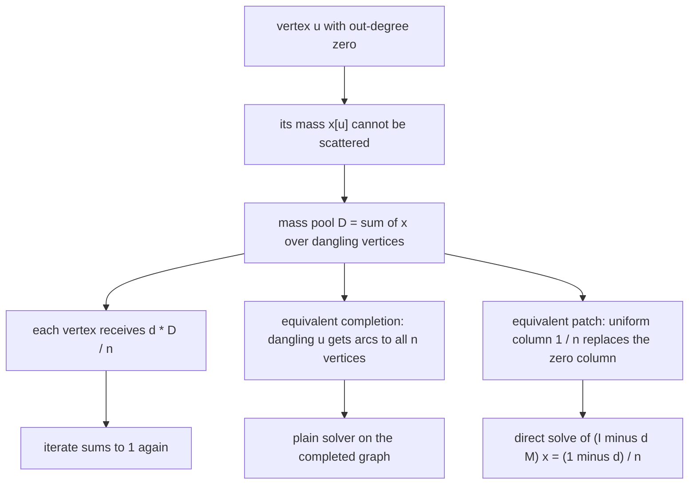
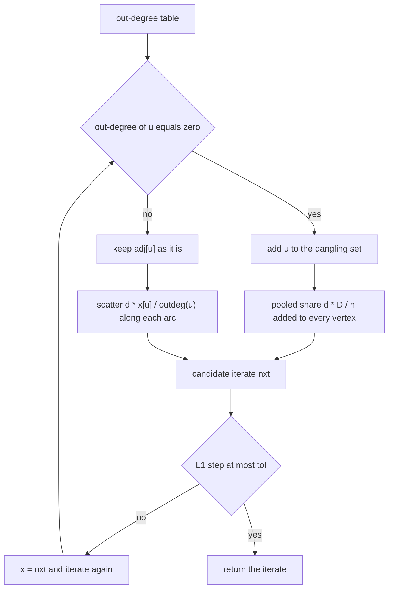
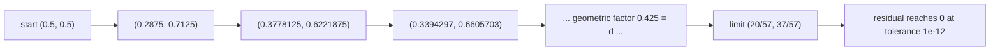
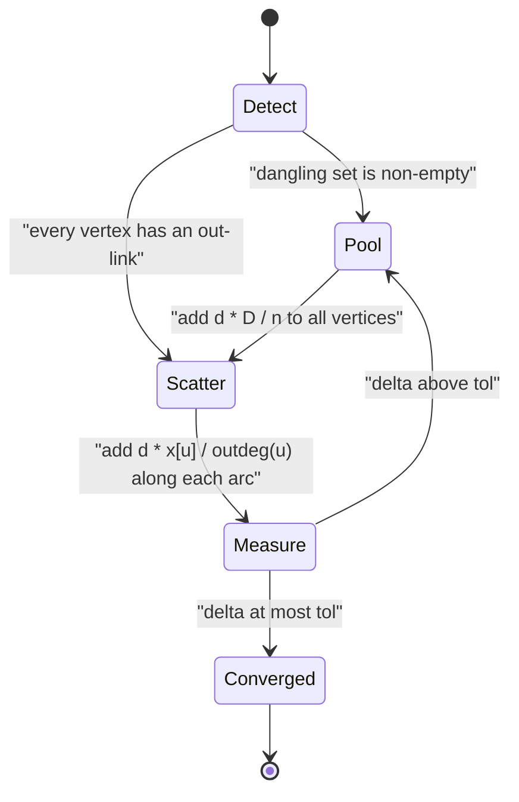

# 546 — Implement pagerank with dangling node handling.

> **Tier:** Advanced · **CTCI chapter:** Ch 4 — Trees and Graphs
> **Task spec:** [546-implement-pagerank-with-dangling-node-handling.md](../../../tasks/advanced/546-implement-pagerank-with-dangling-node-handling.md)
> **Solutions:** [Python](../../../solutions/python/advanced/546-implement-pagerank-with-dangling-node-handling/solution.py) ·
> [Java](../../../solutions/java/advanced/546-implement-pagerank-with-dangling-node-handling/Solution.java) ·
> [JavaScript](../../../solutions/javascript/advanced/546-implement-pagerank-with-dangling-node-handling/solution.js) ·
> [C#](../../../solutions/csharp/advanced/546-implement-pagerank-with-dangling-node-handling/Solution.cs)

## 1. Problem restatement

**Input:** an adjacency list `adj` that may contain **dangling vertices** — vertices with out-degree
zero, so the surfer standing there has no link to follow. Plus the usual knobs: damping factor
`d = 0.85`, tolerance `1e-12`, iteration cap `500`.

**Output:** a rank vector that is still a probability distribution (`sum = 1`, every coordinate
strictly positive), computed under the convention that *the entire share of a dangling vertex is
teleported uniformly to all `n` vertices*:

```text
x_{t+1}[v] = (1 - d)/n  +  d * ( sum over arcs u -> v of x_t[u] / outdeg(u) )  +  d * D / n

D = sum of x_t[u] over the dangling vertices u
```

The assertions in the solution files pin the contract:

| Call | Result | Why |
| --- | --- | --- |
| `adj = [[1], []]` (arc `0 -> 1`, vertex `1` dangling) | exactly `(20/57, 37/57)` | the sink collects all of `0`'s mass and spreads it over everything, itself included |
| same graph, reverse reading | `ranks[1] > ranks[0]` | the dangling vertex outranks its only predecessor |
| all-dangling graph, single-vertex graph | uniform `1/n` immediately, first step size `0` | with no arcs at all every round is pure teleport |
| identical graph without dangling vertices | corrected solver equals the plain solver of task 545 | the correction term is identically zero |
| corrected iteration, any test graph | `sum(x) = 1` within `1e-12` | the correction returns exactly the mass the dangling vertices hold |
| naive variant that drops the dangling mass | total mass leaks; on the two-node example vertex `0` is stuck at `0.075` against the correct `0.351` | the dangling mass is discarded instead of redistributed |

## 2. Intuition

Start from the plain update `x' = (1 - d)/n · 1 + d · M x` with `M[v][u] = 1/outdeg(u)`. If `u` is
dangling then `outdeg(u) = 0` and the column of `M` that belongs to `u` is **all zeros**. Two things
break at once:

- `M` is no longer column-stochastic, so `sum(x)` shrinks by `d · x[u]` every round. Run the
  iteration long enough and the whole vector decays toward zero.
- The "no mass is created or destroyed" argument that justified the contraction and the uniqueness
  of the fixed point in task 545 no longer applies.

The fix is a convention, not an approximation: a surfer who cannot follow a link behaves exactly
like a surfer who teleports. So the mass sitting on dangling vertices, `D`, is spread as `d · D / n`
to every vertex — the extra term in the update above. The insight that makes this easy to trust is
that the convention has three exactly equivalent formulations, and the solution files implement all
of them and cross-check:

1. **Redistribute.** Add `d · D / n` to every slot of the next iterate (Python, Java, C#).
2. **Complete the graph.** Append one arc from each dangling vertex to *every* vertex, giving that
   vertex out-degree `n` and uniform shares `1/n`; then run the plain task-545 solver on the
   completed graph and expect the same answer.
3. **Patch the matrix.** Replace each zero column of `M` by the uniform column `1/n`, and solve
   `(I - d·M) x = (1 - d)/n · 1` by dense Gaussian elimination with partial pivoting.



The JavaScript solution goes one step further and implements three *policies* side by side, because
"where does the dangling mass go" is a modelling decision with more than one defensible answer:
`uniform` (the classic redistribution above), `self` (the mass stays on the dangling vertex, i.e. a
self-loop), and `drop` (the mass simply disappears — kept only to demonstrate the failure mode).

## 3. Algorithm

1. Compute the out-degree of every vertex and collect the dangling set
   `dangling = [u : outdeg(u) = 0]`.
2. Initialise `x` to the uniform vector `1/n`.
3. Repeat up to `max_iter` times:
   1. Set `nxt[v] = (1 - d)/n` for all `v` — the teleport term.
   2. If the dangling set is non-empty, add `share = d · (sum of x over dangling) / n` to **every**
      slot of `nxt`.
   3. For each non-dangling `u`, add `d · x[u] / outdeg(u)` to `nxt[v]` for every arc `u -> v`.
      Dangling vertices are skipped here — their share was already pooled in step 3.2.
   4. Measure the step `delta = sum |nxt[i] - x[i]|`, set `x = nxt`, and stop when `delta <= tol`.
4. Return the iterate, the number of iterations and the recorded step sizes.

```text
procedure pagerank_dangling(adj, d, tol, max_iter)
    n ← length(adj)
    outdeg[u] ← length(adj[u]) for every u
    dangling ← all u with outdeg[u] = 0
    x ← vector of n copies of 1 / n
    for t ← 1 to max_iter do
        nxt ← vector of n copies of (1 - d) / n
        if dangling is not empty then
            pooled ← d * (sum of x[u] over u in dangling) / n
            for i ← 0 to n - 1 do
                nxt[i] ← nxt[i] + pooled
            end
        end
        for u ← 0 to n - 1 do
            if outdeg[u] = 0 then continue end
            contribution ← d * x[u] / outdeg[u]
            for each v in adj[u] do
                nxt[v] ← nxt[v] + contribution
            end
        end
        delta ← sum over i of abs(nxt[i] - x[i])
        x ← nxt
        if delta <= tol then
            return x, t, recorded step sizes
        end
    end
    return x, max_iter, recorded step sizes
end
```

The completion used for cross-checking is a two-line transformation: a dangling vertex receives the
target list `0, 1, ..., n-1` instead of the empty list, which makes its out-degree `n` and its share
exactly `1/n` per target — the same uniform redistribution, expressed as an ordinary graph.



Note the ordering inside one round: the pooled share is added first, then the arc scatter. The two
contributions are independent, so the order does not change the values — but keeping the pool
separate from the scatter is what makes the cross-check against the completed graph exact to `1e-12`.

## 4. Worked example

Trace the hand-checked instance `adj = [[1], []]`: `n = 2`, `d = 0.85`, `outdeg = (1, 0)`, so vertex
`1` is dangling, the teleport term is `0.075` and the pooled share is `0.85 · x[1] / 2`.

| Step | `x` before | `nxt[0] = 0.075 + 0.425·x[1]` | `nxt[1] = 0.075 + 0.425·x[1] + 0.85·x[0]` | `delta` |
| --- | --- | --- | --- | --- |
| 1 | `(0.5, 0.5)` | `0.2875` | `0.7125` | `0.425` |
| 2 | `(0.2875, 0.7125)` | `0.3778125` | `0.6221875` | `0.180625` |
| 3 | `(0.3778125, 0.6221875)` | `0.3394296875` | `0.6605703125` | `0.076765625` |
| ⋮ | ⋮ | ⋮ | ⋮ | ⋮ |
| limit | — | `20/57 ≈ 0.350877` | `37/57 ≈ 0.649123` | `0` |

The limit follows from the two fixed-point equations with `a + b = 1`:
`a = 0.075 + 0.425 · b` gives `1.425 · a = 0.5`, so `a = 20/57` and `b = 37/57`. The Python and C#
files assert those two rationals directly to `1e-9` and `1e-12` respectively, which is why the
worked example is a real check rather than an illustration.

The same run shows what the naive variant does. It skips the pooled share, so vertex `0` receives
nothing at all and freezes at the teleport value `0.075 = (1 - d)/n`, while vertex `1` collects
`0.075 + 0.85 · 0.075`. The Java file records the general leak
`S_k - S_{k+1} = (1 - d)(S_k - 1) + d · D_k`, which on this graph gives the totals `1`, `0.575`,
`0.21375` for the first three iterates — the iterates stop being a distribution after the very
first round.





The `Detect -> Scatter` shortcut is the compatibility test: when there is no dangling vertex the
corrected solver must reproduce the plain solver of task 545 exactly, and the files assert equality
to `1e-12` rather than "approximately" for exactly that reason.

## 5. Complexity

Let `n` be the vertex count, `m` the arc count and `T` the number of iterations performed.

| Measure | Bound | Why it holds |
| --- | --- | --- |
| Time per iteration | O(n + m) | the teleport and the pooled share each touch `n` slots; the scatter touches each arc once |
| Time, total | O(T · (n + m)) | identical to the plain solver — the correction changes the constants, not the shape |
| Space | O(n + m) | adjacency list, out-degree table, two rank vectors, step history |
| Extra vs task 545 | O(n) | the pooled share is a single scalar added to every slot; no matrix is needed |
| Time, completed-graph check | O(T · (n + m + n·|dangling|)) | every dangling vertex gains `n` arcs, so the completed graph is denser |
| Time, direct check | O(n³) | Gaussian elimination on the patched `(I - d·M)` system |
| Space, direct check | O(n²) | the dense patched matrix is materialised |
| Monte-Carlo reference | O(steps) | the deterministic surfer of the files, teleporting when it lands on a dangling vertex |

The completion is the most expensive of the three formulations when many vertices dangle, but it is
also the one that needs no new code — it reuses the task-545 solver verbatim, which is exactly why
the files use it as an independent oracle instead of trusting the redistribution arithmetic twice.

## 6. Pitfalls and edge cases

- **Silently dropping the dangling mass.** This is the failure the task exists to fix. The naive
  variant converges to a vector whose entries sum to less than one, and its fixed point is not the
  PageRank vector: on the two-node example vertex `0` sits at `0.075` instead of `0.351`. The Java
  file compares the *unpatched* iteration against the corrected one on every instance rather than
  assuming the difference matters.
- **Forgetting to skip the dangling vertex in the scatter.** A dangling vertex has no targets, so
  the scatter loop contributes nothing anyway — but a `1 / outdeg(u)` computed eagerly would divide
  by zero. The pseudocode above checks `outdeg[u] = 0` before computing the share for that reason.
- **All-dangling graphs.** With no arcs anywhere the update is pure teleport, so the first iterate
  is uniform and the step size is exactly zero: the solver returns after one round. The single
  vertex graph `adj = [[]]` is the degenerate case of the same phenomenon and also returns `(1)`.
- **A self-loop makes a vertex non-dangling.** `adj = [[0]]` has out-degree one, so no pooling
  happens and the mass stays put; the files use this to show that `self` and `uniform` policies
  differ only on genuinely dangling vertices.
- **Double counting.** Adding the pooled share *and* scattering from a dangling vertex would count
  the same mass twice. The pseudocode has a single source of truth: dangling vertices feed the pool,
  non-dangling vertices feed the scatter.
- **Ordering sensitivity of the cross-check.** Comparing the redistribution against the completed
  graph is asserted at `1e-12`, tighter than the `1e-9` used against the Gaussian solve, because it
  is the same arithmetic in a different arrangement and floating-point summation order is the only
  difference.
- **Renormalising to hide the leak.** Dividing a leaky iterate by its own sum makes the vector sum
  to one again but not the right one — the C# file carries both the raw and the renormalised
  unpatched variant precisely to show that renormalisation does not repair the missing arc terms.
- **Zero-weight starts.** If every vertex dangles the first step is zero, so a convergence test that
  insists on a *strict* decrease never fires. The files test `delta <= tol`, not `delta < tol`.
- **Monte-Carlo surfer.** When the walker steps onto a dangling vertex it must teleport instead of
  walking; the Python and Java files use that rule in their deterministic walk and assert agreement
  with the ranks to `5e-3`.

## 7. Variants and follow-ups

- **The solver without dangling vertices.** Exactly this iteration with the pooled term deleted is
  [545-implement-pagerank-iterative-solver-and-convergence-check.md](../../../tasks/advanced/545-implement-pagerank-iterative-solver-and-convergence-check.md);
  the corrected solver here must reproduce it to `1e-12` on graphs where the dangling set is empty.
- **Choosing a different policy.** `self` and `drop` are the two other defensible conventions: the
  JavaScript file implements all three and asserts that they agree on graphs without dangling
  vertices, while `drop` on an all-dangling graph settles at total mass exactly `1 - d`.
- **Spectral reading of the same matrix.** The patched matrix `M` is a column-stochastic object with
  a dominant eigenvector; partitioning its graph by eigenvectors is the subject of
  [547-implement-spectral-graph-partitioning-small-demo.md](../../../tasks/advanced/547-implement-spectral-graph-partitioning-small-demo.md).
- **Redistributing to a community instead of the globe.** Replacing the uniform pool by a
  per-community pool turns ranking into clustering, which is what
  [549-implement-label-propagation-for-community-detection.md](../../../tasks/advanced/549-implement-label-propagation-for-community-detection.md)
  does with label majorities.
- **Estimating instead of iterating.** The Monte-Carlo surfer in the solution files is a sampling
  estimator; the sketches of
  [550-implement-graph-sketches-for-neighborhood-similarity-minhash.md](../../../tasks/advanced/550-implement-graph-sketches-for-neighborhood-similarity-minhash.md)
  apply the same "sample, then reason about the error" style to neighbourhood similarity.

## 8. Check yourself

1. Why does the naive iteration lose mass, and how much does it lose in one round?

<details><summary>Show answer</summary>

A dangling vertex has no out-arcs, so the `d · x[u]` that it should hand out is never added to any
target. With `D_k` the total mass on dangling vertices, one round loses exactly `d · D_k`, and the
Java file records the totals as `S_k - S_{k+1} = (1 - d)(S_k - 1) + d · D_k`. The corrected update
adds the same `d · D_k` back, spread as `d · D_k / n` per vertex.

</details>

2. Show that "add a complete set of out-edges to every dangling vertex" gives the same update as
   "pool the dangling mass and spread it uniformly".

<details><summary>Show answer</summary>

In the completed graph a dangling vertex `u` has out-degree `n` and therefore hands
`x[u] / n` to every vertex. Summing over all dangling `u` gives each target
`sum over dangling u of x[u] / n = D / n`, and multiplying by `d` produces exactly the pooled
term `d · D / n`. The files assert the two computations agree to `1e-12`.

</details>

3. What happens on a graph where every vertex is dangling, and on `adj = [[]]`?

<details><summary>Show answer</summary>

Nothing scatters, so each round is pure teleport: `x'[v] = (1 - d)/n` for all `v` — which is already
the uniform vector, so the step size is zero and the solver returns after one iteration. `adj = [[]]`
is the same story with `n = 1`, returning the single-coordinate vector `(1)`. The Python file asserts
the "immediately uniform, zero step" behaviour for both.

</details>

4. On `adj = [[1], []]`, why does the dangling vertex end up with the larger rank?

<details><summary>Show answer</summary>

Vertex `0`'s entire mass flows into vertex `1` (`0.85 · x[0]`), while vertex `0` only receives its
share of the pooled teleport. Vertex `1` therefore collects everything that reaches it and re-emits
`0.85` of it uniformly to both vertices; the fixed point solves `a = 0.075 + 0.425 · b` with
`a + b = 1`, giving `a = 20/57` and `b = 37/57`. Being a sink is a structural advantage under the
uniform-redistribution convention.

</details>

5. The `self` policy keeps the dangling mass on the dangling vertex. When do `self` and `uniform`
   give the same ranks?

<details><summary>Show answer</summary>

On a graph with no dangling vertices at all, because then there is no pooled mass and both policies
reduce to the plain iteration — but that case is trivial. The interesting answer is that they agree
only in that trivial case: on a genuinely dangling vertex `self` behaves like a self-loop (which,
as the `adj = [[0]]` test shows, makes the vertex non-dangling and keeps its mass in place) while
`uniform` spreads that mass over the whole graph, so the fixed points differ as soon as one dangling
vertex exists. The JavaScript file asserts exact agreement on the dangling-free instances.

</details>
