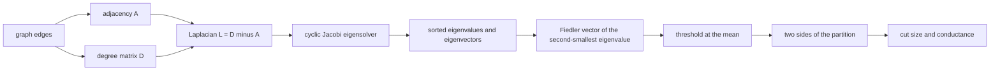
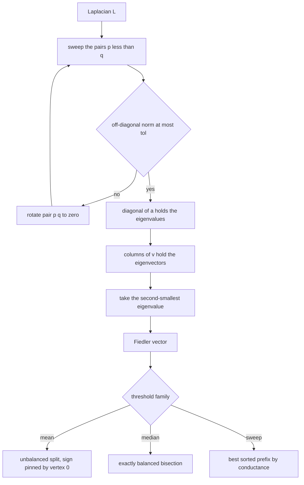
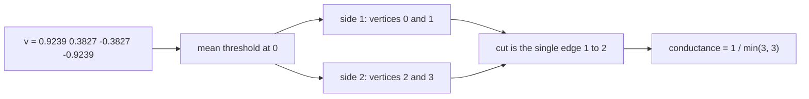
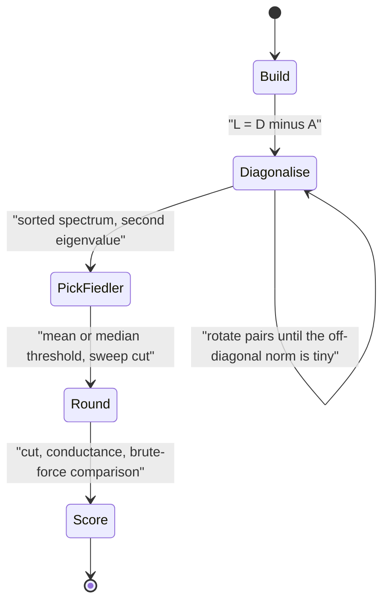

# 547 — Implement spectral graph partitioning small demo.

> **Tier:** Advanced · **CTCI chapter:** Beyond — Machine Learning & AI
> **Task spec:** [547-implement-spectral-graph-partitioning-small-demo.md](../../../tasks/advanced/547-implement-spectral-graph-partitioning-small-demo.md)
> **Solutions:** [Python](../../../solutions/python/advanced/547-implement-spectral-graph-partitioning-small-demo/solution.py) ·
> [Java](../../../solutions/java/advanced/547-implement-spectral-graph-partitioning-small-demo/Solution.java) ·
> [JavaScript](../../../solutions/javascript/advanced/547-implement-spectral-graph-partitioning-small-demo/solution.js) ·
> [C#](../../../solutions/csharp/advanced/547-implement-spectral-graph-partitioning-small-demo/Solution.cs)

## 1. Problem restatement

**Input:** a small undirected graph, given as an edge list or an explicit weight matrix (the Java and
C# files accept weights, the Python and JavaScript ones use the unweighted `D - A` and its normalised
sibling `I - D^{-1/2} A D^{-1/2}`).

**Output:** a two-way partition of the vertices obtained from the graph's own spectrum, together
with the evidence that it is right: the Laplacian eigenvalues, the Fiedler value `lambda2`, the
Fiedler vector, the eigen-residual and the orthogonality error, and the cut size and conductance the
partition achieves. Everything is cross-checked against brute force over all `2^(n-1)` bipartitions
and against closed-form spectra.

The concrete facts the solution files assert:

| Instance | Result | Why |
| --- | --- | --- |
| 3-path | spectrum `0, 1, 3` | hand-verified, and equal to the closed form `2 - 2·cos(k·pi/n)` |
| triangle | spectrum `0, 3, 3` | every non-zero eigenvalue of `K3` is `n = 3` |
| 4-cycle | spectrum `0, 2, 2, 4` | closed form `2 - 2·cos(2·k·pi/n)` |
| `K5` | `{0, 5, 5, 5, 5}`, every bisection cuts `6` | complete graph: all cuts are equal |
| two triangles joined by one bridge edge | Fiedler split **is** the two triangles, cut `1`, conductance `1/7` | both values equal the exhaustive minima |
| graph with two components | two zero eigenvalues; the balanced split recovers the components | the zero eigenspace is two-dimensional |
| 4x4 grid | minimum bisection is `4`, but the threshold and sweep cuts give `6` | asserted rather than glossed over |

Two conventions are fixed by the files: the split threshold is the **mean** of the Fiedler vector
with the sign pinned so that vertex `0` sits at or above it (this makes the labelling deterministic),
and a **median** variant of the same threshold produces an exactly balanced bisection.

## 2. Intuition

Cutting a graph well is a combinatorial problem: the number of bipartitions of `n` vertices grows
like `2^n`, so for anything but toy graphs brute force is out. The spectral idea replaces the
discrete choice "which side is each vertex on" by a real-valued vector and then rounds it.

The object that makes this work is the **combinatorial Laplacian** `L = D - A`: diagonal degrees
minus the adjacency matrix. Two of its properties do all the heavy lifting:

- For any vector `v`, `vᵀ L v = sum over edges (u, w) of (v[u] - v[w])²`. The quadratic form
  therefore *counts weighted disagreements along edges* — a vector that assigns very different
  values to the two ends of many edges is expensive.
- `L` is symmetric positive semi-definite and its smallest eigenvalue is `0`, achieved exactly by
  the constant vector. The spectrum is real and non-negative.

So if you want a partition, ask for the unit vector `v` that keeps `vᵀ L v` small while being
orthogonal to the constant vector (otherwise the minimiser is just `1` with value `0`). That
minimiser is the eigenvector of the **second-smallest** eigenvalue, the *Fiedler vector*. Its
entries cluster at two levels — one per side of the natural cut — and thresholding it hands back a
partition.



The relaxation is what the numbers in the worked example are about; the rounding step (mean
threshold, median threshold, or the sweep cut that keeps the best sorted prefix) is where the
"spectral" answer becomes a concrete partition.

## 3. Algorithm

1. Build the adjacency list and the Laplacian `L = D - A` (`L[v][v] = degree(v)`, `L[v][w] = -1` per
   edge, or `-w` for weights).
2. Diagonalise `L` with **cyclic Jacobi rotations**: loop over the pairs `(p, q)` with `p < q`,
   rotate to zero out `L[p][q]`, and repeat full sweeps until the off-diagonal Frobenius norm is
   below the tolerance (`1e-13` in Python, `1e-12` in Java and C#, caps of 200 and 100 sweeps).
3. Sort the eigenvalues, take the index of the second-smallest, and read off the corresponding
   eigenvector — that is the Fiedler vector `v`.
4. Threshold `v`: mark `i` as one side when `v[i] >= mean(v)`, then flip all signs if vertex `0`
   ended up below the mean, so the labelling is reproducible. The median threshold is the balanced
   alternative; the sweep sorts by `v` and keeps the prefix with the smallest conductance.
5. Score the split: `cut(S) = degrees(S) - 2·inner(S)` and
   `conductance(S) = cut(S) / min(vol(S), vol(S̄))`, and compare against the brute-force optimum.

```text
procedure spectral_bisect(n, adj)
    L ← laplacian of adj
    values, vectors ← jacobi_eigh(L)
    order the eigenvalue indices so that values are non-decreasing
    fiedler_index ← the second index in that order
    v ← column fiedler_index of vectors
    threshold ← mean of the entries of v
    S ← all i with v[i] at or above threshold
    if vertex 0 is not in S then
        S ← complement of S
    end
    return S, cut of S, conductance of S
end

procedure jacobi_eigh(matrix, tol, max_sweeps)
    a ← copy of matrix
    v ← identity matrix
    for sweep ← 1 to max_sweeps do
        off ← frobenius norm of the strictly upper triangle of a
        if off <= tol then break end
        for p ← 0 to n - 2 do
            for q ← p + 1 to n - 1 do
                compute rotation angle from a[p][q], a[p][p], a[q][q]
                apply the rotation to the remaining rows and columns of a
                apply the same rotation to the columns p and q of v
                a[p][q] ← 0 and a[q][p] ← 0
            end
        end
    end
    return the diagonal of a, the matrix v
end
```

Because `L` is symmetric, a single real rotation per pair is enough — no complex arithmetic, no
pivoting, and the rotations are numerically the most stable way to diagonalise a symmetric matrix
of this size. The residual `||L v - lambda·v||` and the orthogonality error `|sum(v)|` are both
asserted below `1e-9`, which is what makes the eigenvalue story trustworthy rather than decorative.



## 4. Worked example

Take the 4-path `P4` with edges `(0,1), (1,2), (2,3)`. Its Laplacian is the tridiagonal matrix with
`1, 2, 2, 1` on the diagonal and `-1` on the adjacent off-diagonals, and the closed form the files
reproduce is `lambda_k = 2 - 2·cos(k·pi/4)` for `k = 0, 1, 2, 3`, with the Fiedler vector
`v[i] = cos(pi·(i + 0.5)/4)`:

| `k` | `lambda_k` | eigenvector meaning | Fiedler? |
| --- | --- | --- | --- |
| 0 | `0` | the constant vector | no — that is the trivial eigenpair |
| 1 | `0.5858` | `(0.9239, 0.3827, -0.3827, -0.9239)` | **yes** |
| 2 | `2` | alternating signs | no |
| 3 | `3.4142` | fastest sign flips | no |

Rounding that vector:

| Step | Operation | Result |
| --- | --- | --- |
| 1 | mean of `(0.9239, 0.3827, -0.3827, -0.9239)` | `0` |
| 2 | vertices with `v[i] >= 0` | `S = {0, 1}` |
| 3 | vertex `0` is already in `S`, no sign flip needed | `S = {0, 1}`, other side `{2, 3}` |
| 4 | `cut(S) = degrees(S) - 2·inner(S) = (1 + 2) - 2·1` | `1`, the only edge crossing is `1 - 2` |
| 5 | median threshold of the sorted values | same split, and it is exactly balanced |

The staircase shape is the mechanism: because `v` is monotone along the path, the cut the threshold
produces is the single edge in the middle, and the median threshold lands on the same edge. On the
two triangles joined by a bridge the same procedure returns the bridges' absence: the Fiedler vector
is constant on each triangle, the mean threshold separates the two triangles exactly, the cut is
`1`, and the conductance `cut / min(vol(S), vol(S̄)) = 1 / 7` equals the exhaustive minimum. On the
4x4 grid, by contrast, the same style of threshold gives a staircase prefix that cuts `6` edges
while the true minimum bisection cuts `4` — the file asserts both numbers, so the demo documents its
own failure mode instead of hiding it.





The `PickFiedler -> Round` step is the only place where the spectrum is turned into a decision. Every
other step is linear algebra with an explicit residual check, which is why the files can assert the
eigen-residual at `1e-9` and still treat the partition as a claim to be verified by brute force.

## 5. Complexity

Let `n` be the vertex count and `m` the edge count.

| Measure | Bound | Why it holds |
| --- | --- | --- |
| Build `L` (dense) | O(n²) | the matrix is materialised, degrees on the diagonal and weights off it |
| Jacobi diagonalisation | O(s · n³) per full sweep over all pairs | each rotation updates a row, a column and the eigenvector block in O(n) time, and there are `n(n-1)/2` pairs |
| Sweeps `s` | documented cap 200 (Python) / 100 (Java, C#) | the loop stops as soon as the off-diagonal Frobenius norm drops below `1e-13` / `1e-12` |
| Threshold and scoring | O(n + m) | one pass over the vector plus one over the edges |
| Sweep cut variant | O(m + n log n) | sort by the Fiedler vector, then score every prefix incrementally |
| Brute-force ground truth | O(2^n · (n + m)) | all `2^(n-1)` bipartitions are scored, which is feasible only for the demo sizes |
| Space | O(n²) | `L` and the eigenvector matrix dominate |

For the tiny graphs of this demo the `O(n³)` Jacobi cost is irrelevant; the interesting comparison is
against the brute force, whose `2^n` factor is exactly what the spectral relaxation exists to avoid.
On a graph with millions of edges you would not materialise `L` at all — you would use a Lanczos or
LobPCG solver that only needs matrix-vector products.

## 6. Pitfalls and edge cases

- **Forgetting the orthogonality constraint.** The smallest eigenvector of `L` is the constant
  vector with value `0`; thresholding *it* produces a meaningless split. The Fiedler vector is
  explicitly the *second* smallest, and the files assert `|sum(v)| <= 1e-9`.
- **Disconnected graphs.** Each component contributes one zero eigenvalue, so `lambda2 = 0` and the
  zero eigenspace is multi-dimensional: Jacobi returns an arbitrary basis of it, and the
  mean-threshold split degenerates. The Python file asserts two zero eigenvalues on a
  two-component graph and recovers the components by an independent traversal instead.
- **Degenerate thresholds.** If every Fiedler value sits on the same side of the mean, one side is
  empty; the Java file falls back to the median threshold in that case. A partition that puts all
  `n` vertices on one side has `cut = 0` and is not a bisection.
- **Sign symmetry.** `v` and `-v` are both valid Fiedler vectors, so an implementation that does not
  pin the sign produces a different labelling on every run. Pinning vertex `0` at or above the mean
  is what makes the demo deterministic.
- **Unbalanced cuts.** The mean threshold optimises nothing in particular; it just rounds the
  relaxation. When a balanced bisection is required, use the median threshold, and when the
  objective is conductance, use the sweep. The grid example shows the three can disagree: the true
  minimum bisection is `4`, while the threshold and sweep prefixes cut `6`.
- **Conductance versus cut size.** A cut of one edge next to a vertex of degree `1` has conductance
  `1` and is trivial. Normalising by `min(vol(S), vol(S̄))` is why the triangle example reports `1/7`
  rather than `1`, and why the balanced variants are needed at all.
- **Self-loops and multi-edges.** A self-loop adds two to the degree but does not change the
  quadratic form, so it shifts the spectrum; the files assert `u != v` when building the graphs.
- **Weights.** `D - W` only has the counting interpretation above when the weights are non-negative;
  a negative weight makes the quadratic form indefinite and the whole argument collapses.
- **Numerical residuals.** The eigensolver is asserted at `1e-9` while its stopping tolerance is
  `1e-13`. Those are different numbers for a reason: the first checks the *answer*, the second only
  decides when to stop rotating.
- **`lambda2` is a lower bound on the ratio cut, not the answer.** The files assert
  `lambda2 <= minRatioCut` over every non-trivial subset, and separately that the resulting
  conductance is within the factor-three Cheeger bound — neither claim says the spectral split is
  optimal, and the grid case shows it is not.

## 7. Variants and follow-ups

- **Normalised Laplacian.** Replacing `D - A` by `I - D^{-1/2} A D^{-1/2}` divides each disagreement
  by the endpoint degrees, which stops a single high-degree vertex from dominating the cut. The
  JavaScript and C# files diagonalise both matrices with the same routine.
- **Recursive bisection.** Applying the same split to each side turns a bisection into a full
  partition; the modularity-flavoured heuristic in
  [548-implement-community-detection-louvain-heuristic-outline.md](../../../tasks/advanced/548-implement-community-detection-louvain-heuristic-outline.md)
  is the greedy alternative that never touches an eigensolver.
- **Local-majority alternative.** If the spectrum is too expensive to compute,
  [549-implement-label-propagation-for-community-detection.md](../../../tasks/advanced/549-implement-label-propagation-for-community-detection.md)
  reaches a comparable partition by repeatedly adopting the majority label of your neighbours.
- **The same matrix, a different question.** Task 545 uses a stochastic matrix built from the same
  graph but asks for its dominant eigenvector instead of its second-smallest:
  [545-implement-pagerank-iterative-solver-and-convergence-check.md](../../../tasks/advanced/545-implement-pagerank-iterative-solver-and-convergence-check.md).
- **Spectra without eigenvectors.** When only eigenvalue sums are needed, `trace(L^k)` can be
  estimated by sampling closed walks — the sampling spirit behind
  [553-implement-induced-subgraph-frequency-sampling.md](../../../tasks/advanced/553-implement-induced-subgraph-frequency-sampling.md).

## 8. Check yourself

1. Why is the Fiedler vector the eigenvector of the *second*-smallest eigenvalue rather than the
   smallest?

<details><summary>Show answer</summary>

Because the smallest eigenvalue is `0` and its eigenvector is the constant vector. Since
`vᵀ L v = sum over edges (v[u] - v[w])²`, the constant vector is the trivial minimiser: it puts every
vertex on the same side and cuts nothing. The relaxation must therefore minimise over the subspace
orthogonal to it, and the minimum there is attained by the eigenvector of the next eigenvalue up,
the Fiedler vector. The files assert `|sum(v)| <= 1e-9` to confirm it really is orthogonal to the
constant.

</details>

2. On the two triangles joined by a single bridge, why is the spectral split exactly the two
   triangles?

<details><summary>Show answer</summary>

The Fiedler vector is constant on each triangle and takes opposite signs on the two sides, because the
only edge whose endpoints can disagree cheaply is the bridge: the quadratic form punishes every
disagreeing edge, and every edge inside a triangle would have to be paid for too. Thresholding that
vector at its mean separates the two triangles, cutting exactly the bridge — cut `1` with conductance
`1/7`, both equal to the values an exhaustive search over all bipartitions finds.

</details>

3. What goes wrong with the mean threshold on a graph with two connected components?

<details><summary>Show answer</summary>

`L` then has two zero eigenvalues, so `lambda2 = 0` and the second eigenvector is not unique: any
vector supported on one component (or any linear combination of such vectors) is a valid answer, and
Jacobi returns an arbitrary basis of that two-dimensional eigenspace. Thresholding an arbitrary basis
vector can put almost everything on one side. The Python file handles this by detecting the
multiplicity of the zero eigenvalue and returning the components that a traversal finds.

</details>

4. The 4x4 grid has minimum bisection `4`, but the Fiedler threshold and the sweep both cut `6`.
   Does that mean the implementation is broken?

<details><summary>Show answer</summary>

No. The spectral method is a relaxation, not an exact algorithm: it minimises the real-valued
objective and then rounds, and rounding can lose. A grid is the canonical example where the optimum
is a straight line of `4` edges while every staircase prefix induced by the Fiedler vector cuts `6`
(ten staircase edges minus four shared). The file asserts the exact optimum `4` from brute force and
the achieved `6` side by side, and it also verifies the theoretical bound `lambda2 <= minRatioCut`,
which is what the relaxation actually guarantees.

</details>

5. Where do the closed-form spectra `2 - 2·cos(k·pi/n)` for the path and `2 - 2·cos(2·k·pi/n)` for
   the cycle come from?

<details><summary>Show answer</summary>

Both are cosine transforms of a constant-coefficient difference equation. For the cycle, `L v = lambda v`
at vertex `i` reads `2·v[i] - v[i-1] - v[i+1] = lambda·v[i]`, which the sinusoid
`v[i] = cos(2·k·pi·i/n)` satisfies with `lambda = 2 - 2·cos(2·k·pi/n)`; the path uses the same
sinusoid with a half-step so that the zero-derivative boundary condition at both ends is met, giving
`2 - 2·cos(k·pi/n)`. The files reproduce these values on `P3`, `P4`, `C4` and the two-component
graphs, which is also how `lambda2 = 0.5858` for `P4` in the worked example is sourced.

</details>
