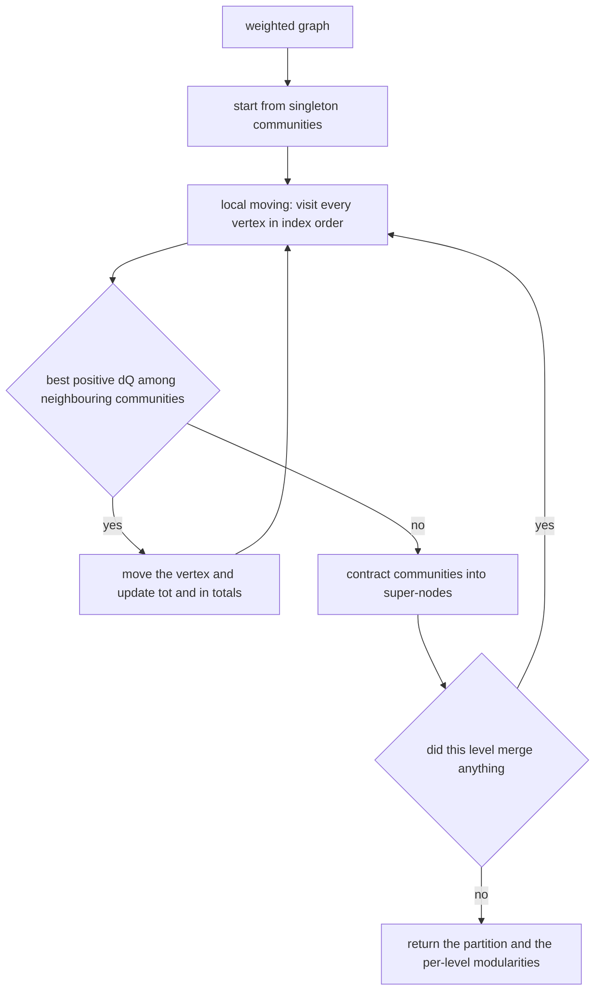
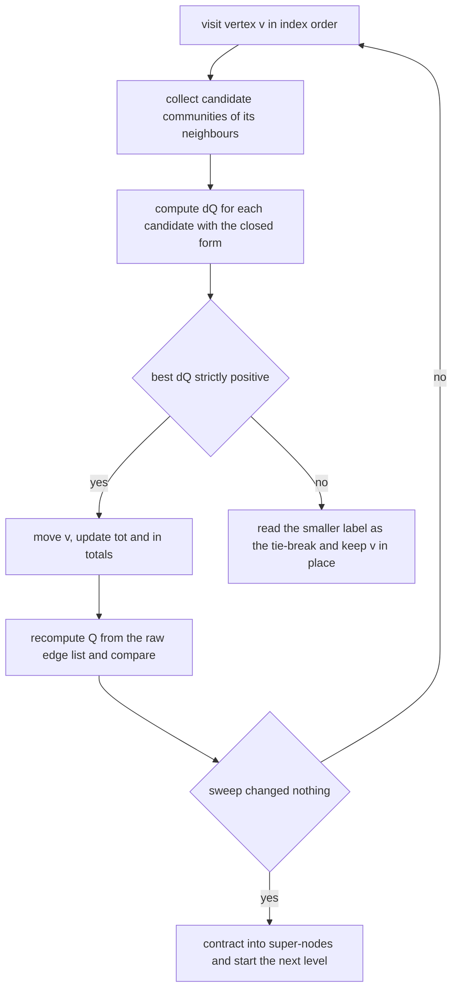
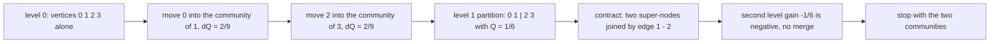
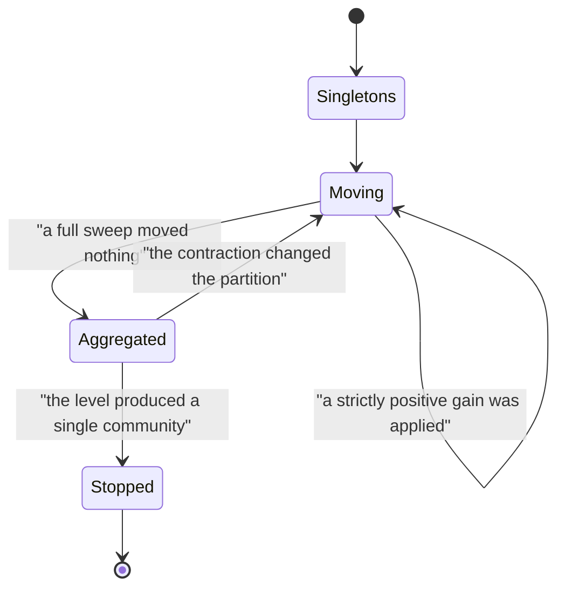

# 548 — Implement community detection (Louvain heuristic outline).

> **Tier:** Advanced · **CTCI chapter:** Beyond — Machine Learning & AI
> **Task spec:** [548-implement-community-detection-louvain-heuristic-outline.md](../../../tasks/advanced/548-implement-community-detection-louvain-heuristic-outline.md)
> **Solutions:** [Python](../../../solutions/python/advanced/548-implement-community-detection-louvain-heuristic-outline/solution.py) ·
> [Java](../../../solutions/java/advanced/548-implement-community-detection-louvain-heuristic-outline/Solution.java) ·
> [JavaScript](../../../solutions/javascript/advanced/548-implement-community-detection-louvain-heuristic-outline/solution.js) ·
> [C#](../../../solutions/csharp/advanced/548-implement-community-detection-louvain-heuristic-outline/Solution.cs)

## 1. Problem restatement

**Input:** a small undirected weighted graph as an edge list (unweighted edges count as weight one).

**Output:** a partition of the vertices into communities, together with the modularity of every
level of the hierarchy. Modularity is Newman's

```text
Q = sum over communities c of [ in_c / (2m)  -  (tot_c / (2m))^2 ]
```

where `m` is the total edge weight, `in_c` is the internal weight of community `c` counting each
internal edge twice (`in_c = 2m` when everything is one community), and `tot_c` is the sum of the
weighted degrees of its members.

The spec is titled "outline", but every solution file documents that it implements Louvain **in
full rather than as an outline**: local moving plus aggregation plus repetition. The asserted
behaviour:

| Instance | Result | Why |
| --- | --- | --- |
| ring of four 5-cliques | the four cliques, recovered exactly | the planted partition, and the heuristic beats the planted modularity value |
| two cliques joined by a single edge | the two cliques | the bridge is the only edge that crosses |
| complete graph | one community | every extra split lowers `Q` |
| empty graph (no edges) | each vertex alone, `Q = 0` | the function returns `0.0` immediately when `m = 0` |
| any forest | documented as a test case | trees have no dense interior worth isolating |
| every tiny graph | the heuristic reaches the brute-force optimum modularity | checked against all set partitions (restricted growth strings) |
| every level | `Q` non-decreasing from level to level | the hierarchy is monotone by construction |
| every level | communities are connected | verified by an independent traversal |

Two conventions are pinned by the files: vertices are visited in index order and ties go to the
**smaller community id**, so a run is reproducible; and every accepted move is cross-checked against
a from-scratch recomputation of `Q` rather than against the incremental bookkeeping.

## 2. Intuition

Modularity compares the weight inside a community with what you would expect if the same degrees
were wired together at random. `in_c / (2m)` is the observed share of internal weight;
`(tot_c / (2m))^2` is the share of edge weight a random graph with the same degree sequence would
put inside `c`. A good community beats chance; a bad one loses to it.

Two calibration facts make the scale interpretable and both are asserted by the files:

- One community containing everything has `in_c / 2m = 1` and `(tot_c / 2m)^2 = 1`, so `Q = 0`.
- All singletons have no internal weight at all, so `Q = -sum over i of (k_i / 2m)^2`, which is
  negative and slightly below `-1/n` for a regular graph.

Maximising `Q` exactly is NP-hard, and moving a single vertex is also expensive if you recompute the
whole sum. The insight that makes Louvain practical is that the **change** in `Q` when a single
vertex `v` leaves community `A` and joins community `B` has a closed form:

```text
dQ = (a - b) / m  +  k_v * (tot_A - tot_B - k_v) / (2 * m^2)

a = weight from v into B          b = weight from v into A, minus v's own self-loop
k_v = degree of v                 tot_X = sum of degrees in community X
```

Everything in that expression is a running total, so one move costs time proportional to the
neighbourhood of `v` instead of the whole graph. Once no single move improves `Q`, the communities
are **contracted** into super-nodes with self-loop weights holding the internal mass, and the same
procedure runs on the smaller graph — which is why Louvain finds structure at several scales.



The mutual reinforcement is the point: local moving is myopic but cheap, aggregation gives the
myopic moves a global view, and iterating the pair is what gets the four-clique ring right where a
single pass would stop halfway.

## 3. Algorithm

One level consists of phase one (local moving) followed by phase two (aggregation):

1. Represent the working graph as weighted adjacency dictionaries with self-loops, where a
   self-loop of weight `w` stands for `w` of contracted interior weight.
2. Give every vertex its own community and compute the totals `k_v`, `tot(c) = degree sum of c` and
   `in(c) = 2 × internal weight of c`.
3. Repeat sweeps until no vertex moves:
   1. Visit each unvisited vertex `v` in index order.
   2. For every community `B` holding a neighbour of `v`, compute the gain
      `dQ = (a - b)/m + k_v·(tot_A - tot_B - k_v)/(2m²)` with `A` the current community of `v`;
      the singleton community of `v` is always a candidate.
   3. Apply the strictly best positive move; ties go to the smaller community id. Verify the move by
      recomputing `Q` from the raw edge list.
4. If the level changed the partition, contract: each community becomes one super-node whose
   self-loop weight is twice its internal weight and whose inter-community edges keep their
   summed weight; then go back to step 2 with the smaller graph.
5. Return the final labels, every level's label vector, and every level's modularity.

```text
procedure louvain(n, edges, max_levels)
    graph ← weighted adjacency with self-loops
    labels ← one community per vertex
    levels ← empty list
    for level ← 1 to max_levels do
        repeat
            moved ← false
            for v in index order do
                best ← current community of v, best_gain ← 0
                for each community B holding a neighbour of v do
                    gain ← (weight into B minus weight into current) / m
                            + k_v * (tot_A - tot_B - k_v) / (2 * m^2)
                    if gain > best_gain or (gain = best_gain and B < best) then
                        best ← B, best_gain ← gain
                    end
                end
                if best is not the current community then
                    move v into best and update tot and in totals
                    assert modularity(graph, labels) improved
                    moved ← true
                end
            end
        until not moved
        append renumbered labels and modularity to levels
        graph ← contract(graph, labels)
    end
    return the last level's labels and the recorded levels
end
```

The gain formula is the one place where a sign error is easy to make and hard to notice, so the
Python file validates it on a probe graph against a full recomputation of `Q` before and after a
move, and the C# file asserts the community-sum formula and the pairwise formula
`Q = (1/2m)·sum over u, v of (A_uv - k_u·k_v/(2m))·[c_u = c_v]` agree to `1e-12` on every level.



## 4. Worked example

Trace the 4-path `P4` with edges `(0,1), (1,2), (2,3)`, so `m = 3`, `k = (1, 2, 2, 1)` and every
vertex starts in its own community. The teleport-free gains come straight from the formula above
with `tot_A = k_v` while `v` is still a singleton:

| Visit | Candidate move | `a` | `b` | `dQ` | Decision |
| --- | --- | --- | --- | --- | --- |
| `v = 0` | into `{1}` | `1` | `0` | `1/3 - 1/9 = 2/9 ≈ 0.2222` | move |
| `v = 1` | into `{2}` | `1` | `1` (its edge to `0`) | `0 - 2/18 = -1/9` | stay |
| `v = 2` | into `{0,1}` | `1` | `0` | `1/3 - 1/3 = 0` | not strictly positive, stay |
| `v = 2` | into `{3}` | `1` | `0` | `1/3 - 1/9 = 2/9` | move |
| `v = 3` | its only neighbour is already in its community | — | — | no candidate | stay |

After the sweep the partition is `{0, 1} | {2, 3}` and no further move improves it, so the level
ends. The modularity of each stage, evaluated with the community-sum formula:

| Partition | `in_c / (2m)` per community | `(tot_c / (2m))²` per community | `Q` |
| --- | --- | --- | --- |
| all singletons | `0` | `(1/6)², (2/6)², (2/6)², (1/6)²` | `-10/36 ≈ -0.2778` |
| `{0,1} \| {2,3}` | `2/6` for each side | `(3/6)²` for each side | `2·(1/3 - 1/4) = 1/6 ≈ 0.1667` |
| one community | `6/6 = 1` | `(6/6)² = 1` | `0` |

The hierarchy is monotone: `-0.2778 < 0.1667`, and the trivial single community's `0` is worse than
the two-community split, which is why the algorithm stops instead of merging further. Aggregation
then builds two super-nodes joined by the single original edge `1-2` of weight `1`, each with a
self-loop of twice its internal weight. Running the same gain formula at the second level with
`tot_A = tot_B = 3`, `a = 1`, `b = 0` and `k_v = 3` gives `1/3 - 9/18 = -1/6 < 0`, so the merge is
rejected and the algorithm terminates with `Q = 1/6`.





Every transition that changes the partition is a documented improvement, which is what the asserted
"modularity non-decreasing from level to level" property means: the frontier only advances when a
level actually merges something.

## 5. Complexity

Let `n` be the vertex count, `m` the edge count (weights treated as unit cost) and `L` the number of
levels.

| Measure | Bound | Why it holds |
| --- | --- | --- |
| One gain evaluation | O(deg(v)) | only communities holding a neighbour of `v` are candidates |
| One local-moving sweep | O(m · (1 + deg)) worst case | each vertex visits its neighbourhood; a dictionary keeps the per-community weights |
| Local moving to convergence | O(m) per pass in practice | the standard Louvain cost model, and the files cap the levels at `50` |
| Aggregation | O(n + m) | edge weights are summed per community pair and the diagonal is halved |
| Modularity recomputation | O(n + m) per call | the cross-check runs from the raw edge list instead of trusting the bookkeeping |
| Total | O(L · m) | with `L` levels, each level being linear in the current graph size |
| Brute-force reference | O(B(n) · (n + m)) | all set partitions via restricted growth strings, feasible only on tiny graphs |
| Space | O(n + m) | the weighted adjacency dictionaries plus one label vector per level |

The heuristic is linear per level, which is why it scales to graphs where the `2^n` brute force used
as ground truth in the tests is hopeless — but the tests also show it can miss: only on tiny graphs
does the file *assert* optimality, and there it must reach the brute-force optimum.

## 6. Pitfalls and edge cases

- **The gain formula's self-loop term.** `b` is the weight from `v` into its current community
  *excluding* `v`'s own self-loop; including it changes the sign of the result. The Python file
  validates the formula against a from-scratch recomputation on a probe graph for this reason.
- **Empty graph.** With `m = 0` the modularity is undefined and every community-sum term would divide
  by zero; the function returns `0.0` before touching the formula, and the partition is all
  singletons.
- **Complete graph.** Modularity rewards denser-than-random internal weight, and in `K_n` no split
  beats chance, so the local moving phase merges everything into one community with `Q = 0`.
- **Ties and determinism.** Two candidate communities with identical gains are common in symmetric
  graphs, and the ring of four 5-cliques is exactly symmetric. Visiting vertices in index order and
  breaking ties towards the smaller community id makes runs reproducible; the files assert
  determinism explicitly.
- **Disconnected components.** There is no gain in joining two components (they share no
  neighbour-based candidate), so Louvain never mixes them — the flip side of the "communities stay
  connected" property the files verify with an independent traversal.
- **Forests.** With no cycles the graph is too sparse to beat chance, so the heuristic stays near
  singletons; the documented test case exists to pin that it does not do something silly such as
  merging every leaf into its parent.
- **Levels that change nothing.** Re-running the loop on an unchanged contraction would loop
  forever; termination is on "a level produced no merge", and `max_levels` is a documented belt and
  braces cap.
- **Modularity is not comparable across graphs.** It depends on `m` and on the degree distribution,
  so the assertions compare levels within one instance and against the planted value of the same
  instance — never against a number from another graph.
- **Floating-point accumulation.** Weights are integers in these files, so `tot(A) - tot(B) - k_v`
  is exact and the only rounding is in the final division; that is why `1e-12` is achievable for the
  two-formula agreement.

## 7. Variants and follow-ups

- **Spectral alternative.** Instead of moving vertices greedily, cut the graph by its Fiedler vector:
  [547-implement-spectral-graph-partitioning-small-demo.md](../../../tasks/advanced/547-implement-spectral-graph-partitioning-small-demo.md)
  needs an eigensolver but no modularity bookkeeping.
- **Simpler, faster, less accurate.** Label propagation drops the gain formula entirely and adopts
  the majority label of the neighbourhood, which is the same "local majority" instinct without the
  contraction phase:
  [549-implement-label-propagation-for-community-detection.md](../../../tasks/advanced/549-implement-label-propagation-for-community-detection.md).
- **Guaranteed approximations instead of heuristics.** When a provable ratio matters more than
  speed, greedy submodular maximisation gives a `1 - 1/e` guarantee:
  [568-implement-submodular-maximization-greedy-guarantee-example.md](../../../tasks/advanced/568-implement-submodular-maximization-greedy-guarantee-example.md).
- **Sampling the structure.** For graphs too large to sweep exhaustively, the sketches of
  [550-implement-graph-sketches-for-neighborhood-similarity-minhash.md](../../../tasks/advanced/550-implement-graph-sketches-for-neighborhood-similarity-minhash.md)
  estimate local similarity from a few samples and let a cheaper clustering run on top.

## 8. Check yourself

1. Why does one community containing every vertex have modularity exactly `0`?

<details><summary>Show answer</summary>

Then `in_c / (2m) = 1` because all `2m` edge endpoints are internal, and
`(tot_c / (2m))^2 = 1` because the sum of all degrees is `2m`. The single term is `1 - 1 = 0`. It is
also why `Q` is not automatically positive: the all-singletons partition is `-sum (k_i / 2m)^2`,
which is strictly negative, and Louvain's job is to climb above those two baselines.

</details>

2. Derive the sign of the term `k_v·(tot_A - tot_B - k_v)/(2m²)` in the gain formula.

<details><summary>Show answer</summary>

`Q` has a negative term `-(tot_c / 2m)²` per community. When `v` leaves `A` for `B`, `tot_A` drops to
`tot_A - k_v` and `tot_B` rises to `tot_B + k_v`, so the change contributed by the two squared terms
is

```text
- [ (tot_A - k_v)^2 - tot_A^2 + (tot_B + k_v)^2 - tot_B^2 ] / (2m)^2
  = - [ -2 k_v tot_A + k_v^2 + 2 k_v tot_B + k_v^2 ] / (4 m^2)
  = + k_v (tot_A - tot_B - k_v) / (2 m^2)
```

which is exactly the term the files implement, with the opposite sign convention to the penalty — a
move into a *heavier* community therefore subtracts more, precisely as intuition requires.

</details>

3. In the `P4` trace, moving vertex `2` into `{0,1}` has `dQ = 0`. Why is the move rejected?

<details><summary>Show answer</summary>

The implementations require a **strictly** positive gain (`gain > 0`), so a zero gain means "not
better than staying". Rejecting zero-gain moves also guarantees termination: with only strictly
improving moves the value of `Q` strictly increases at every accepted step, and `Q` is bounded above
by `1 - 1/n`, so the local moving phase cannot cycle.

</details>

4. Why is the second level of the hierarchy needed at all, when the first level already improves
   `Q`?

<details><summary>Show answer</summary>

Because local moving is myopic: it only ever relocates one vertex at a time, so two vertices that
would be better off merged together can each be individually worse off moving. Contraction replaces
each community by a single super-node whose self-loop holds the internal weight, after which the same
gain test can evaluate whole-community merges. In the four-clique ring the first level typically
settles with cliques paired up; it is the aggregated pass that joins the pairs into the true ring.
The files assert the modularity of each level, so the improvement is measured, not assumed.

</details>

5. The tests assert that Louvain reaches the brute-force optimum modularity on tiny graphs. Does the
   same guarantee hold on the four-clique ring?

<details><summary>Show answer</summary>

No — the brute force is only affordable on tiny graphs, and Louvain is a heuristic with no optimality
guarantee in general. On the ring of four 5-cliques the files assert something weaker and specific:
the recovered partition *is* the ring of cliques, and its modularity is higher than the planted
value. That is a property of that instance, and it is exactly the kind of claim a test can honestly
make.

</details>
