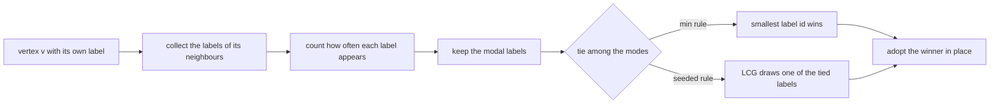
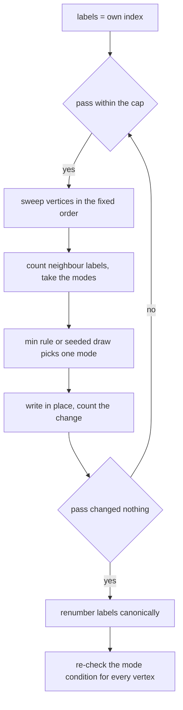
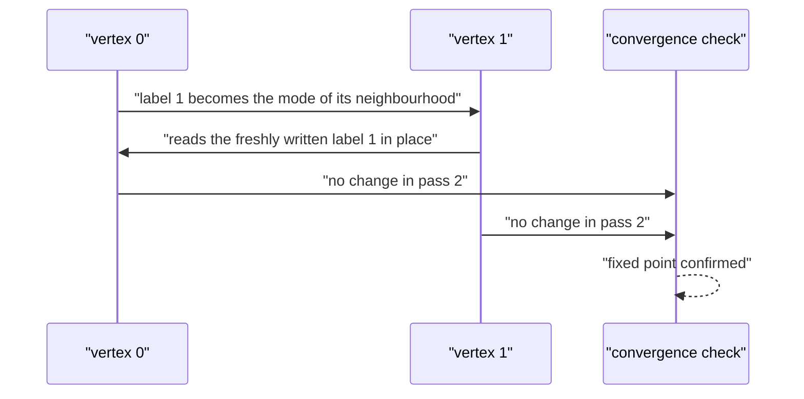
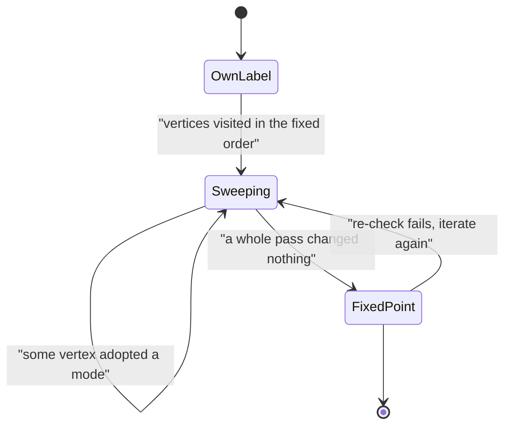

# 549 — Implement label propagation for community detection.

> **Tier:** Advanced · **CTCI chapter:** Beyond — Machine Learning & AI
> **Task spec:** [549-implement-label-propagation-for-community-detection.md](../../../tasks/advanced/549-implement-label-propagation-for-community-detection.md)
> **Solutions:** [Python](../../../solutions/python/advanced/549-implement-label-propagation-for-community-detection/solution.py) ·
> [Java](../../../solutions/java/advanced/549-implement-label-propagation-for-community-detection/Solution.java) ·
> [JavaScript](../../../solutions/javascript/advanced/549-implement-label-propagation-for-community-detection/solution.js) ·
> [C#](../../../solutions/csharp/advanced/549-implement-label-propagation-for-community-detection/Solution.cs)

## 1. Problem restatement

**Input:** an undirected simple graph (self-loops are dropped when the adjacency list is built) and,
optionally, a seed for the tie-break draw.

**Output:** a label per vertex — the community assignment — the number of vertices that changed label
in each pass, and whether the process converged. Labels are renumbered into `0, 1, 2, ...` in order
of first appearance so that two partitions can be compared without caring about label names.

The algorithm is Raghavan–Albert–Kumara label propagation: every vertex starts with its own unique
label and repeatedly adopts a label that is **modal among its neighbours**. The assertions and
documented findings:

| Instance | Result | Why |
| --- | --- | --- |
| empty graph (no edges) | every vertex keeps its own label | a vertex with no neighbours is skipped |
| a clique | collapses in a single pass | every neighbour already carries the same label |
| a path | collapses over a few passes | the majority label spreads one hop per pass at the frontier |
| two triangles joined by one bridge edge | merges into **one** community | label propagation's documented over-merging |
| ring of four 5-cliques, smallest-label tie-break | merged into a single community | the min rule is order-biased and over-merges |
| same ring, seeded tie-break | the planted four communities, modularity at least the planted value | a structure-preserving tie-break |
| `K2` and `C6`, synchronous variant | never settle | the two halves swap labels forever |
| `C5`, synchronous variant | settles | the odd cycle breaks the symmetry that causes the swap |

Two tie-break rules ship in every file: `min` (adopt the smallest label among the modal ones — fully
deterministic, but biased) and a **deterministic pseudo-random** rule driven by the repository's LCG
with a fixed seed (still reproducible, but no longer index-biased). The C# file adds an `xorshift`
draw and a third, non-iterative variant that labels each vertex with the plurality among the
vertices within graph distance `h`.

## 2. Intuition

Modularity maximisation (task 548) needs an explicit objective and a gain formula. Label propagation
throws all of that away and keeps only one instinct: **a vertex should carry the label most common in
its neighbourhood**. Dense groups converge to one label per group almost immediately, because inside
a clique everybody already sees the same label, while sparse boundaries keep seeing ties.

The naive worry is that "most common" is rarely unique. With unique starting labels, a vertex sitting
between two communities typically sees a tie, and *the tie-break rule is the entire algorithm* — both
the quality of the answer and the reproducibility of the run depend on it:

- Choosing the **smallest** label is deterministic and needs no state, but it is systematically
  biased downward. Label `0` is overwritten before anybody can adopt it, so in a connected graph the
  surviving labels migrate towards small ids and everything collapses. The files assert exactly that
  over-merging on the ring of four 5-cliques.
- Choosing **uniformly among the tied labels** from a fixed seed is still reproducible, but it no
  longer prefers small ids. That version reproduces the planted partition on the ring of four
  5-cliques and on two bridged cliques.

The second insight is that the update must be **asynchronous** (in place, along a fixed order). A
synchronous sweep, where every vertex reads the previous pass's labels, has no reason to settle on a
bipartite structure: `K2` and `C6` swap labels forever, which the files demonstrate by implementing
the synchronous variant next to the asynchronous one.



Because both rules are deterministic, the whole pipeline is reproducible; because the seeded rule is
not order-biased, it does not collapse the graph — that is the trade the task asks you to see.

## 3. Algorithm

1. Build sorted adjacency lists, dropping self-loops.
2. Give every vertex its own label (`labels[v] = v`).
3. Repeat up to `max_passes` times (the documented bound is `n` passes, with a cap of `100`):
   1. Sweep the vertices in the fixed order — index order, or a seeded LCG shuffle.
   2. Skip a vertex with no neighbours: it keeps its label.
   3. Count the neighbour labels, find the maximum count, and collect the labels achieving it as
      `modes`, sorted.
   4. Pick `modes[0]` under the min rule, or `modes[state mod len(modes)]` after advancing the LCG
      state under the seeded rule.
   5. Write the winner back **in place** and count the change.
   6. Stop when a pass changes nothing — that is convergence.
4. Renumber the labels in order of first appearance and return them with the per-pass change counts.

```text
procedure label_propagation(n, edges, seed, max_passes)
    adj ← sorted adjacency, self-loops removed
    labels ← [0, 1, ..., n - 1]
    state ← seed
    updates ← empty list
    for pass ← 1 to max_passes do
        changed ← 0
        for v in visit order do
            if adj[v] is empty then continue end
            counts ← frequencies of labels of the neighbours of v
            top ← maximum count in counts
            modes ← sorted labels whose count equals top
            if seed is none then
                best ← modes[0]
            else
                state ← lcg(state)
                best ← modes[state mod length of modes]
            end
            if labels[v] is not best then
                labels[v] ← best
                changed ← changed + 1
            end
        end
        append changed to updates
        if changed = 0 then
            return renumber(labels), updates, converged
        end
    end
    return renumber(labels), updates, not converged
end
```

The files do not trust the loop that produced the answer: they **re-derive the fixed point cell by
cell**, checking that for every vertex its final label is still the mode of its neighbours (and the
smallest mode under the min rule), with the documented `1e-12` weight tolerance. That check turns
"the loop stopped" into "the labelling really is a fixed point".



## 4. Worked example

Two traces make the mechanism and the failure mode visible.

**A path collapses under the min rule.** Take `P4` with edges `(0,1), (1,2), (2,3)` and sweep in index
order, updating in place:

| Step | Reading | `modes` | Winner | `labels` after |
| --- | --- | --- | --- | --- |
| `v = 0` | neighbour `1` carries label `1` | `[1]` | `1` | `[1, 1, 2, 3]` |
| `v = 1` | neighbours carry `1` and `2` | `[1, 2]` | `1` (min) | `[1, 1, 2, 3]` |
| `v = 2` | neighbours carry `1` and `3` | `[1, 3]` | `1` (min) | `[1, 1, 1, 3]` |
| `v = 3` | neighbour `2` now carries `1` | `[1]` | `1` | `[1, 1, 1, 1]` |
| pass 2 | nothing to change | — | — | `[1, 1, 1, 1]`, changes `0` |

Three changes in the first pass and none in the second: the path collapses in two passes. Note the
row for `v = 2`: the in-place write at `v = 0` handed `v = 2` a *more popular* label than it would
have seen under a synchronous sweep, which is precisely why the asynchronous order matters.

**`K2` oscillates synchronously but not asynchronously.** With vertices `0` and `1` and one edge
between them:

| Variant | Pass 1 | Pass 2 | Outcome |
| --- | --- | --- | --- |
| asynchronous (in place, `v = 0` then `v = 1`) | `[1, 1]` — vertex `1` reads the *new* label of `0` | no change | converged in 2 passes |
| synchronous (read the previous pass) | `[1, 0]` | `[0, 1]` again | never settles |

The synchronous variant is a Jacobi iteration on a two-cycle: each vertex sees the other's old label
and both swap forever. `C6` has the same problem; `C5` does not, because an odd cycle cannot be split
into two halves that swap. That is the documented reason the published algorithm uses the
asynchronous update.





The over-merging claim is the other half of the worked example. On two triangles joined by a single
bridge edge, the bridge vertex sees a tie between its triangle's label and the other triangle's
label; the min rule resolves that tie downwards, the two triangles end up sharing a label, and the
whole connected component becomes one community. The JavaScript file asserts this explicitly — two
*disconnected* triangles stay two communities, and adding one bridge edge merges them — and the
Python file documents the same collapse on the ring of four 5-cliques.

## 5. Complexity

Let `n` be the vertex count, `m` the edge count and `P` the number of passes performed.

| Measure | Bound | Why it holds |
| --- | --- | --- |
| One vertex update | O(deg(v) log deg(v)) | count the neighbour labels, then sort the modes (a hash map plus a small sort) |
| One sweep | O(m log Δ) | summing the per-vertex costs over all edges; `Δ` is the maximum degree |
| Passes `P` | at most `n` per the documented bound, cap `100` | labels spread one hop per pass and the number of distinct labels does not increase |
| Total | O(P · m log Δ) | close to linear in the graph size for small `P` |
| Re-check of the fixed point | O(m log Δ) | one extra sweep that recomputes the modes without writing |
| Space | O(n + m) | adjacency lists, the label vector and one counter map per vertex |
| Synchronous variant | same per-pass cost | it materialises a second label vector for the previous pass |
| Louvain comparison (task 548) | O(L · m) with an expensive constant | local moving evaluates modularity gains, not majority counts |

Label propagation is the cheapest of the community-detection heuristics: no objective, no gain
formula, no aggregation phase. What it buys in simplicity it pays back in reliability — the min rule
over-merges, and even the seeded rule has no optimality guarantee. Only the planted-recovery
assertions on specific graphs are claimed by the files.

## 6. Pitfalls and edge cases

- **Synchronous updates.** The most common wrong implementation, and the one the files implement on
  purpose to exhibit the oscillation on `K2` and `C6`. The published algorithm is asynchronous for
  this reason.
- **The min rule's bias.** Picking the smallest tied label systematically prefers low ids, so a
  connected graph collapses onto one community. The files assert that collapse and document it in
  the headers rather than pretending the rule is merely a stylistic choice.
- **Isolated vertices.** A vertex with no neighbours has no modes to take; it is skipped and keeps
  its own label, which is why the empty graph returns every vertex as a singleton community.
- **Self-loops.** The adjacency builder drops `u = v`, because a self-loop would let a vertex vote for
  itself and inflate its own label's count.
- **Ties everywhere.** On a regular graph many vertices face ties on every pass; the result then
  depends on the visit order and on the draw, so any comparison between two partitions must renumber
  labels canonically first — the files do that with a first-appearance map.
- **Termination.** "No label changed in a full pass" is the stopping rule, with the documented bound
  of `n` passes and a cap of `100`. Real graphs converge well inside that bound, and the files record
  the per-pass change counts so convergence is observed, not assumed.
- **Oscillation without a bipartite structure.** `C6` oscillates synchronously even though it is not
  bipartite in the community sense — it is the even-cycle symmetry that matters. `C5` is the
  contrast case and does settle.
- **Determinism is a property of the seed, not of the algorithm.** A fixed seed gives a reproducible
  run; two different seeds may give two different valid partitions, differing only in the choice
  among tied labels. The files assert exactly that weaker statement.
- **Bridge vertices.** A vertex on a bridge can see a three-way tie (its own old label plus two
  neighbour labels) and drift to the smaller one, which is how a whole component gets swallowed.

## 7. Variants and follow-ups

- **Objective-driven clustering.** Louvain replaces the majority rule with a greedy modularity gain
  and an aggregation phase, which is what stops it from collapsing a bridged graph:
  [548-implement-community-detection-louvain-heuristic-outline.md](../../../tasks/advanced/548-implement-community-detection-louvain-heuristic-outline.md).
- **Spectral ground truth.** The Fiedler vector gives structure without any update rule at all:
  [547-implement-spectral-graph-partitioning-small-demo.md](../../../tasks/advanced/547-implement-spectral-graph-partitioning-small-demo.md),
  and its split on the bridged triangles is the two triangles, not one community.
- **Distance-limited labelling.** The `h`-hop variant in the C# file labels each vertex with the
  plurality of the vertices within graph distance `h` in a single non-iterative pass — no convergence
  question, at the cost of a local window.
- **Sampled neighbourhoods.** When the adjacency lists are too large to count exactly, the sketches of
  [550-implement-graph-sketches-for-neighborhood-similarity-minhash.md](../../../tasks/advanced/550-implement-graph-sketches-for-neighborhood-similarity-minhash.md)
  estimate neighbourhood similarity from a fixed-size signature instead of a full count.

## 8. Check yourself

1. Why does the asynchronous update converge while the synchronous one can oscillate?

<details><summary>Show answer</summary>

In the asynchronous variant a vertex reads labels that may already have been updated in this same
pass, so a majority can propagate one hop per pass without any cell reading a stale partner. In the
synchronous variant every vertex reads the previous pass, which on a two-cycle (`K2`, `C6`) makes the
two sides swap labels indefinitely: each vertex sees the other's old label, adopts it, and the
configuration repeats with period two. The files demonstrate both: `K2` converges in two
asynchronous passes and never synchronously, while `C5` settles in both variants.

</details>

2. Why does the smallest-label tie-break over-merge connected graphs?

<details><summary>Show answer</summary>

Because it is biased downwards. With unique initial labels, a vertex only ever adopts a label it can
see in its neighbourhood, and label `0` is overwritten before any neighbour has the chance to adopt
it, so the surviving labels drift towards small ids. In a connected graph the smallest labels
available at each tie keep winning, the communities coalesce, and the algorithm ends with one label
for the whole component. The Python file asserts this collapse on the ring of four 5-cliques, and the
C# header states it explicitly rather than hiding it.

</details>

3. Two disconnected triangles stay two communities, but adding one bridge edge merges them. Why?

<details><summary>Show answer</summary>

With no bridge the two components never see each other's labels, so each triangle settles
independently — a clique collapses in a single pass because every neighbour already carries the same
label. The bridge vertex is the only vertex with neighbours in both triangles, so it faces a tie
between the two labels; whichever way the tie-break resolves it, the losing side's label penetrates
through the bridge on the next pass, and the two labels coincide. That over-merging is a documented
weakness of label propagation rather than a bug in this implementation.

</details>

4. What does the file verify after the loop finishes, and why is that check necessary?

<details><summary>Show answer</summary>

It recomputes, cell by cell, that every vertex's final label is still the mode of its neighbours'
labels (and the smallest mode under the min rule), using the documented `1e-12` weight tolerance.
The check matters because the loop's termination condition only says "the last pass changed nothing";
an off-by-one in the in-place bookkeeping or a stale counter could leave a labelling that is not
actually a fixed point, and the independent re-check catches that without re-running the loop.

</details>

5. Where does the documented bound of `n` passes come from?

<details><summary>Show answer</summary>

Each pass either merges at least two labels into one or stops, so the number of distinct labels is
non-increasing and can fall at most `n - 1` times; with a fixed order and deterministic tie-breaks
each merge happens within one pass of the labels meeting. Hence convergence in at most `n` passes,
and the implementation additionally caps the loop at `100` passes as a documented guard. The files
record the observed pass counts and assert they are inside the bound.

</details>
