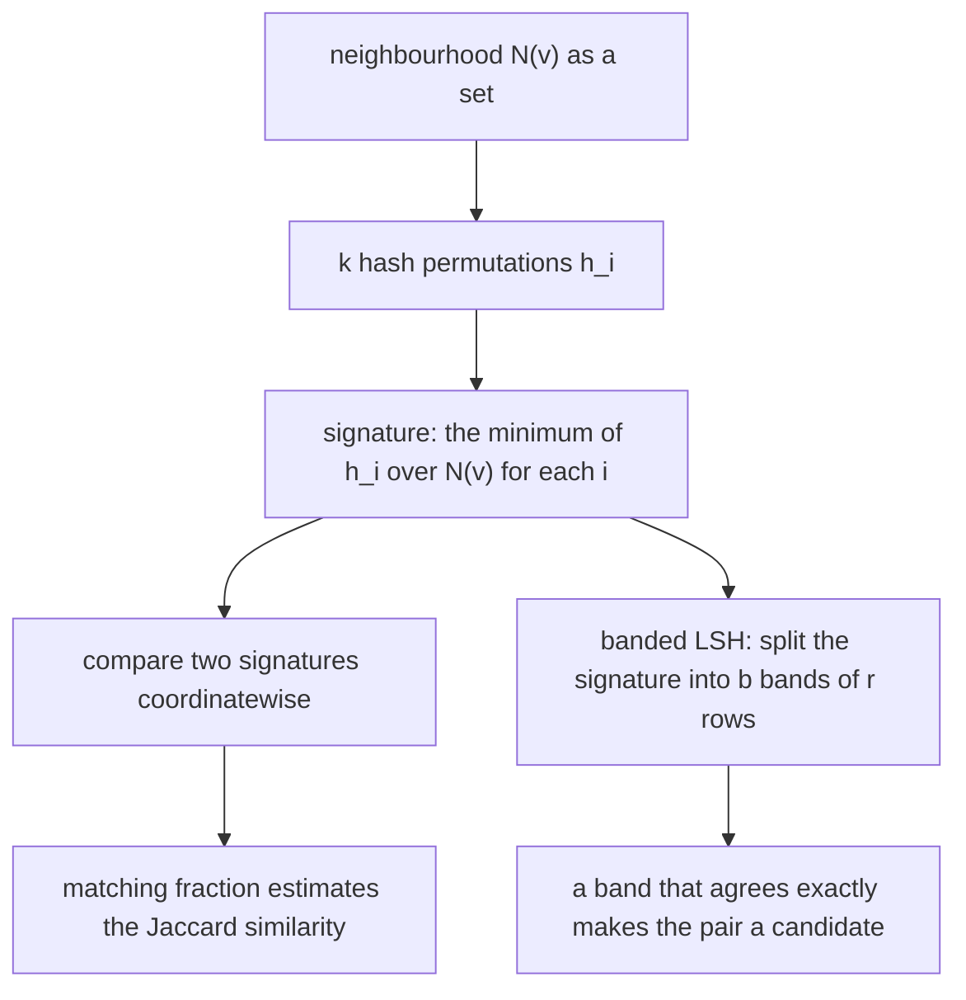
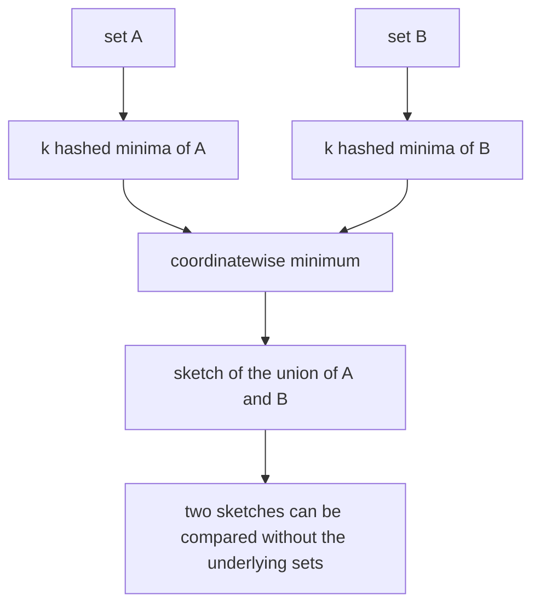
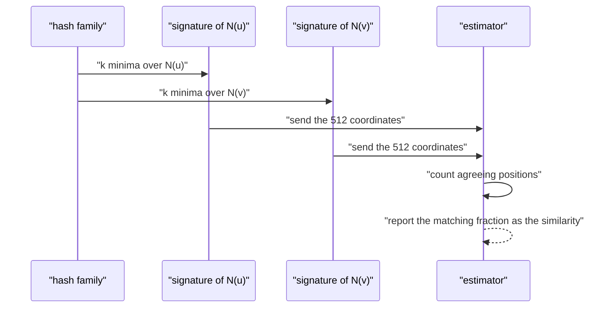
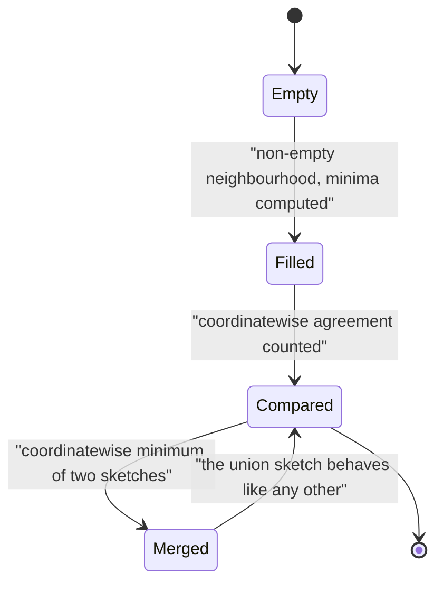

# 550 — Implement graph sketches for neighborhood similarity (MinHash).

> **Tier:** Advanced · **CTCI chapter:** Beyond — Advanced Data Structures & Algorithms
> **Task spec:** [550-implement-graph-sketches-for-neighborhood-similarity-minhash.md](../../../tasks/advanced/550-implement-graph-sketches-for-neighborhood-similarity-minhash.md)
> **Solutions:** [Python](../../../solutions/python/advanced/550-implement-graph-sketches-for-neighborhood-similarity-minhash/solution.py) ·
> [Java](../../../solutions/java/advanced/550-implement-graph-sketches-for-neighborhood-similarity-minhash/Solution.java) ·
> [JavaScript](../../../solutions/javascript/advanced/550-implement-graph-sketches-for-neighborhood-similarity-minhash/solution.js) ·
> [C#](../../../solutions/csharp/advanced/550-implement-graph-sketches-for-neighborhood-similarity-minhash/Solution.cs)

## 1. Problem restatement

**Input:** an undirected graph, and a sketch width `k` (the tests use `k = 512` in the bulk
comparison).

**Output:** for every vertex `v`, a fixed-length sketch of its neighbourhood `N(v)` such that
comparing two sketches estimates the neighbourhood Jaccard similarity

```text
J(u, v) = |N(u) ∩ N(v)| / |N(u) ∪ N(v)|
```

without ever materialising either neighbourhood. The files also return the pairwise estimates, the
exact values for comparison, and — in the C# and Java files — banded locality-sensitive hashing over
the sketches that turns them into candidate pairs.

Two sketch families are implemented in every language, because they are structurally different:

- **MinHash.** `k` universal hashes `h_i(x) = (a_i·(x + 1) + b_i) mod P` with `a_i ≠ 0`; the
  signature of a set is the vector of per-hash minima, and the fraction of agreeing coordinates is
  the estimator.
- **Bottom-k (k-minimum-values).** One ranking function `plan`, truncated at the `k` smallest values,
  with the estimator `|A ∩ B ∩ {h ≤ t}| / |(A ∪ B) ∩ {h ≤ t}|` for `t = min(k`-th smallest of `A`,
  `k`-th smallest of `B`)`.

Documented facts the assertions rest on:

| Instance | Result | Why |
| --- | --- | --- |
| identical sets | estimate exactly `1` | every coordinate agrees |
| disjoint sets | estimate exactly `0` | the hashes are injective on the element range, so no collision can fake a match |
| bowtie (two triangles sharing a hub) | rim pair `= 1/3`, rim versus hub `= 1/5` | hand-checked set arithmetic |
| diamond (`K4` minus one edge) | the two non-adjacent vertices score exactly `1` | their neighbourhoods are identical — the textbook link-prediction case |
| empty neighbourhood | `J(∅, ∅) = J(∅, S) = 0` by documented convention | the empty set keeps the sentinel in every column and never matches |
| all pairs of LCG graphs, `k = 512` | within `0.1` of the exact value; mean absolute error shrinks as `k` grows | the standard error is at most `1/(2·sqrt(k))` |
| 40 independent hash families | the estimator is unbiased | `E[matching positions / k] = J` |
| ranking pairs by the sketch | the top pair is within `0.05` of the exact best | the estimate is good enough to order pairs |

## 2. Intuition

Comparing two neighbourhoods costs `O(|N(u)| + |N(v)|)` per pair, and there are `n(n-1)/2` pairs — on
a graph with a million vertices that is hopeless. The sketch idea is to compress each set in advance
so that one comparison costs `O(k)` regardless of the actual degree.

Why does a vector of hashed minima work? Take one random permutation `h` of the universe. The
minimum of `h` over `A` and the minimum over `B` are the same element exactly when **the smallest
element of `A ∪ B` lies in `A ∩ B`**. With a uniformly random permutation that happens with
probability `|A ∩ B| / |A ∪ B|`, which is exactly the Jaccard similarity. One hash gives one biased
coin; `k` independent hashes give `k` coins, and the fraction of agreement is their average — an
unbiased estimator with standard error `sqrt(J(1 - J)/k) <= 1/(2·sqrt(k))`.

The subtleties that the files document are the interesting part:

- **The family must behave like random permutations.** `h(x) = (a·x + b) mod p` is only *2-universal*.
  On the small integer universes of a graph that is not enough: the JavaScript header records that the
  raw linear family measurably violates the min-wise assumption, which is why its hashes run through a
  32-bit avalanche mixer. The C# and Java files work modulo the Mersenne prime `p = 2^31 - 1` and pick
  `a ≠ 0`, which makes each `h` a genuine bijection of the residue range.
- **The hash coefficients must be independent.** The Python file derives coefficients from a
  full-period 64-bit generator because the repository's 16-bit `lcg` cannot supply both `a` and `b`
  independently: taking both from one scalar puts the whole family on a single line
  (`b = 7919(a - 1)/97 mod P`), i.e. 256 copies of essentially the same permutation, and the estimates
  come out correlated — the file records the estimator returning `0` where the exact similarity was
  `0.25`.
- **Sketches are mergeable.** The sketch of a union is the coordinatewise minimum of the sketches of
  the parts; for bottom-k it is the `k` smallest values of the merged lists (exact when both sketches
  are full). That is what makes sketches usable in a streaming or distributed setting.



## 3. Algorithm

1. Convert the graph into neighbourhood **sets**, so parallel edges fold away and duplicate entries do
   not change the sketch.
2. Build the hash family: for `i = 1..k`, draw `a_i ≠ 0` and `b_i` independently from a deterministic
   generator seeded per run.
3. For each vertex, compute the signature: for every `i`, take the minimum of `h_i(x)` over
   `N(v)`, storing the sentinel `P` when the set is empty.
4. Estimate a pair's similarity as the fraction of agreeing coordinates, returning `0` when either
   signature is entirely sentinel.
5. For bottom-k: rank the elements with one function, keep the `k` smallest, and compare the truncated
   sets under the `k`-minimum-values estimator.
6. Optionally band the signatures into `b` bands of `r` rows (`b·r = k`) and treat two vertices as a
   candidate pair when any band matches exactly.

```text
procedure minhash_signature(elements, family)
    signature ← empty list
    for (a, b) in family do
        best ← SENTINEL
        for x in elements do
            candidate ← (a * (x + 1) + b) mod P
            if candidate < best then best ← candidate end
        end
        append best to signature
    end
    return signature
end

procedure jaccard_estimate(signature_a, signature_b)
    if either signature is entirely SENTINEL then return 0.0 end
    agree ← count of positions where signature_a[i] = signature_b[i]
    return agree / length(signature_a)
end

procedure bottom_k_estimate(set_a, set_b, k)
    chosen_a, threshold_a ← the k smallest ranks of set_a
    chosen_b, threshold_b ← the k smallest ranks of set_b
    t ← min(threshold_a, threshold_b)
    return size of intersection of (set_a filtered by rank <= t) and (set_b filtered by rank <= t)
           divided by size of their union
end
```

Mergeability follows from the same arithmetic: coordinatewise minima over a union are the minima of
the coordinatewise minima, and for bottom-k the union's `k` smallest are the `k` smallest of the
merged sorted lists whenever both inputs are full (`|S| >= k`). The files verify that **exactly**,
not statistically, which is a much sharper check than comparing estimates.



## 4. Worked example

The bowtie graph makes the exact values small enough to check by hand. Let the hub be `h` and the rims
of the two triangles be `a, b` and `c, d`: edges `h-a, h-b, a-b, h-c, h-d, c-d`. Then

```text
N(h) = {a, b, c, d}      N(a) = {h, b}      N(b) = {h, a}
N(c) = {h, d}            N(d) = {h, c}
```

| Pair | `N(u) ∩ N(v)` | `N(u) ∪ N(v)` | exact `J` | documented sketch estimate |
| --- | --- | --- | --- | --- |
| `a, b` (rims of the same triangle) | `{h}` | `{h, a, b}`, size 3 | `1/3` | within `0.1` at `k = 512` |
| `a, c` (rims of different triangles) | `{h}` | size 5 | `1/5` | within `0.1` |
| `a, h` (rim versus hub) | `{b}` | size 5 | `1/5` | within `0.1` |
| `c, d` | `{h}` | size 3 | `1/3` | within `0.1` |

The diamond (`K4` minus the edge `0 - 3`) is the other hand-checked instance: `N(0) = {1, 2}` and
`N(3) = {1, 2}` are *identical sets*, so the exact similarity is `1` and the estimator must return
exactly `1` — every coordinate of the two signatures agrees, including when both neighbourhoods are
empty. The runtime the estimate is expected to hit at `k = 512` is
`1/(2·sqrt(512)) ≈ 0.022`, which is why the asserted tolerance is `0.1`: about four and a half
standard errors.

| Step | Operation | Result |
| --- | --- | --- |
| 1 | neighbourhood sets | `N(a) = {h, b}`, `N(b) = {h, a}` |
| 2 | apply `h_i`, keep the minimum per `i` | `sig(a)`, `sig(b)`, both length `512` |
| 3 | count agreeing coordinates | `agree` |
| 4 | estimate | `agree / 512 ≈ 1/3`, the exact value is `1/3` |
| 5 | same for a disjoint pair | `agree = 0` exactly, because the hashes are injective on the element range |





The `Empty` state is not cosmetic: an empty neighbourhood keeps the sentinel in every column, so it
never matches anything, which is exactly the documented convention `J(∅, ∅) = J(∅, S) = 0` — without
it, the sentinel would agree with itself and every empty set would look identical to every other.

## 5. Complexity

Let `n` be the vertex count, `m` the edge count, `k` the sketch width and `d(v)` the degree of `v`.

| Measure | Bound | Why it holds |
| --- | --- | --- |
| One signature | O(k · d(v)) | every hash scans the whole neighbourhood |
| All signatures | O(k · sum of degrees) = O(k · m) | parallel edges are folded away in the sets, and each hash is `O(1)` |
| One pair comparison | O(k) | independent of the degrees |
| All pairs by sketch | O(k · n²) | still quadratic in pairs, but with `k` instead of the degrees |
| Exact all-pairs | O(n² · (avg degree)) | the expensive baseline the sketch replaces |
| Bottom-k sketch | O(d(v) log k) | keep the `k` smallest ranks with a bounded heap |
| Merge of two sketches | O(k) | coordinatewise minimum, or a merge of two sorted lists of length `k` |
| Space per vertex | O(k) | the signature; the neighbourhood itself need not be kept |
| Error | at most `1/(2·sqrt(k))` | `sqrt(J(1 - J)/k) <= 1/(2·sqrt(k))` for `J` in `[0, 1]` |

The trade is explicit: `O(k · m)` once, versus `O(degree)` per comparison afterwards, with a
statistical error that shrinks like `1/sqrt(k)`. Doubling `k` removes about 30 % of the error while
doubling the sketch memory, which is why `k = 512` is a reasonable demo point and why the files also
check that the mean absolute error *decreases* with `k` rather than merely staying under a bound.

## 6. Pitfalls and edge cases

- **A 2-universal family is not enough.** "Universal hashing" and "min-wise independence" are
  different properties; the JavaScript header records that the raw linear family violates min-wise
  independence on small integer universes and needs an avalanche mixer. A test that only compares
  *averages* over large sets may never notice.
- **Correlated hash coefficients.** Deriving `a` and `b` from the same 16-bit state collapses the
  family onto one line, and the estimates acquire correlated errors; the Python file documents the
  estimator returning `0` for a pair whose exact similarity was `0.25`. Independent coefficients from a
  full-period generator fix it.
- **Collisions.** If the hash is not injective on the element range, two disjoint sets can share a
  minimum by accident and the estimate of a disjoint pair will not be exactly zero. The files assert
  the injectivity and therefore can assert the exact `0`.
- **Empty neighbourhoods.** The sentinel convention must be chosen deliberately: with `J(∅, ∅) = 0`
  the sentinel never counts as a match, and `J(∅, S) = 0` follows. Getting this wrong makes all
  isolated vertices look mutually identical.
- **Parallel edges and duplicates.** Neighbourhoods are *sets*; building them as sets (or folding
  duplicates) is what makes the sketch invariant under repeated entries. Building as a list would
  change the minima not at all, but it would change the exact Jaccard the estimate is compared
  against.
- **Self-loops.** They would make a vertex its own neighbour and inflate its set; the graph builders
  treat the neighbourhood as the other endpoints.
- **Bottom-k needs full sketches to merge exactly.** The merge identity holds when both sketches hold
  `k` elements; if a set is smaller than `k` its "threshold" is the sentinel, and the estimator has to
  fall back to comparing the truncated sets directly — which is what the Python `bottom_k_estimate`
  does with `max(threshold_a, threshold_b)`.
- **Banding probabilities.** With `b` bands of `r` rows, the chance that a pair with similarity `s`
  becomes a candidate is exactly `1 - (1 - s^r)^b`. Bands reduce the comparison count, but a pair with
  moderate `s` can still be missed — banding changes the *recall*, not the estimate.
- **Tolerance versus standard error.** `0.1` at `k = 512` is a few standard errors, so a single pair
  can exceed it; that is why the bulk comparison across all pairs is asserted as a distribution and
  the unbiasedness check averages over 40 independent families.
- **Determinism.** Every generator is seeded, so two runs of the same file produce identical
  sketches; the assertions include that, because a sketch that changes between runs cannot be used as
  a cache key.

## 7. Variants and follow-ups

- **Streaming distinct counts.** A sketch is the same bargain as a HyperLogLog register set — fixed
  memory, provable error — applied to counting rather than to similarity:
  [561-implement-online-algorithm-for-sliding-window-distinct-count-hyp.md](../../../tasks/advanced/561-implement-online-algorithm-for-sliding-window-distinct-count-hyp.md).
- **Sampling instead of hashing.** Where the quantity of interest is a subgraph frequency rather than
  a set similarity,
  [553-implement-induced-subgraph-frequency-sampling.md](../../../tasks/advanced/553-implement-induced-subgraph-frequency-sampling.md)
  draws random samples and reasons about the sampling error in the same spirit.
- **Sketch-driven clustering.** Label propagation on a graph whose edge weights come from sketch
  estimates is a cheap approximation of similarity clustering:
  [549-implement-label-propagation-for-community-detection.md](../../../tasks/advanced/549-implement-label-propagation-for-community-detection.md).
- **Coordinatewise minima as a merge.** The mergeability identity is the sketch analogue of
  [568-implement-submodular-maximization-greedy-guarantee-example.md](../../../tasks/advanced/568-implement-submodular-maximization-greedy-guarantee-example.md)'s
  greedy certificate: both replace an exact global quantity by something you can update incrementally
  without losing a guarantee.

## 8. Check yourself

1. Why is the fraction of agreeing coordinates an unbiased estimator of the Jaccard similarity?

<details><summary>Show answer</summary>

For a single random permutation `h`, the minimum of `h` over `A` equals the minimum over `B` exactly
when the smallest element of `A ∪ B` lies in `A ∩ B`, which happens with probability
`|A ∩ B| / |A ∪ B| = J`. Each coordinate is therefore a Bernoulli(`J`) trial, and the average of `k`
independent trials has expectation `J` — unbiasedness — with standard error `sqrt(J(1 - J)/k)`.
The files also verify it empirically by averaging over 40 hash families.

</details>

2. Why does the raw linear hash family `(a·x + b) mod p` misbehave, and what do the files do about it?

<details><summary>Show answer</summary>

It is a 2-universal family, not a min-wise independent one: pair collision probabilities are right but
the minima induced by different members of the family are correlated on small integer universes, so
the coordinates of the signature are not independent Bernoulli trials. The fixes in the repository are
an avalanche mixer applied after the linear map (JavaScript), working modulo a Mersenne prime with
`a ≠ 0` so that each hash is a bijection (Java, C#), and deriving `a` and `b` independently from a
full-period 64-bit generator instead of one 16-bit state (Python).

</details>

3. On the bowtie graph, why do a rim vertex and the hub score `1/5` while two rims of the same
   triangle score `1/3`?

<details><summary>Show answer</summary>

`N(a) = {h, b}` and `N(h) = {a, b, c, d}` share only `b`, while the union has five elements, so the
Jaccard value is `1/5`. Two rims of the same triangle, `N(a) = {h, b}` and `N(b) = {h, a}`, share
`h` and their union is `{h, a, b}` of size three, giving `1/3`. The hub has a large neighbourhood, so
it is similar to nobody in particular.

</details>

4. In the diamond (`K4` minus one edge) the two non-adjacent vertices have similarity exactly `1`.
   Why is that interesting?

<details><summary>Show answer</summary>

Because it is the link-prediction case: two vertices that are *not* connected but whose neighbourhoods
coincide are the most likely pair to gain an edge next, and any neighbourhood-similarity heuristic
should rank them top. Their sets are literally equal — `N(0) = N(3) = {1, 2}` — so the exact value is
`1` and the sketch estimate must be exactly `1` too, since every coordinate of the two signatures is
the minimum over the same set.

</details>

5. Two mergeable sketches are combined, and the combined sketch has width `k`. When is the merge
   *exact* rather than approximate?

<details><summary>Show answer</summary>

Always for MinHash — the coordinatewise minimum of two signatures is precisely the signature of the
union, because the minimum over `A ∪ B` is the smaller of the minima over `A` and `B`. For bottom-k
the merge is exact only when both input sketches are full (`|S| >= k`), in which case the union's
`k` smallest ranks are the `k` smallest of the two merged lists; a set smaller than `k` has no valid
truncation threshold and needs the fallback the files implement.

</details>
