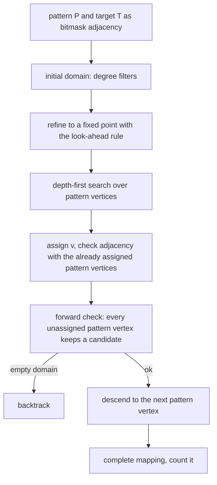
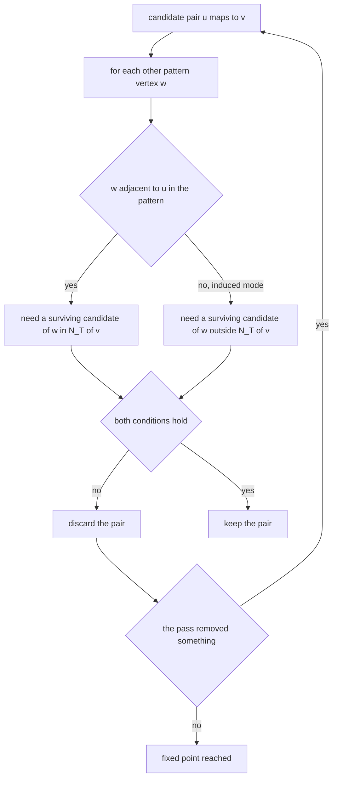
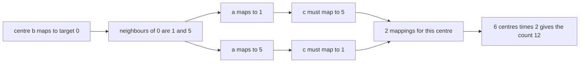
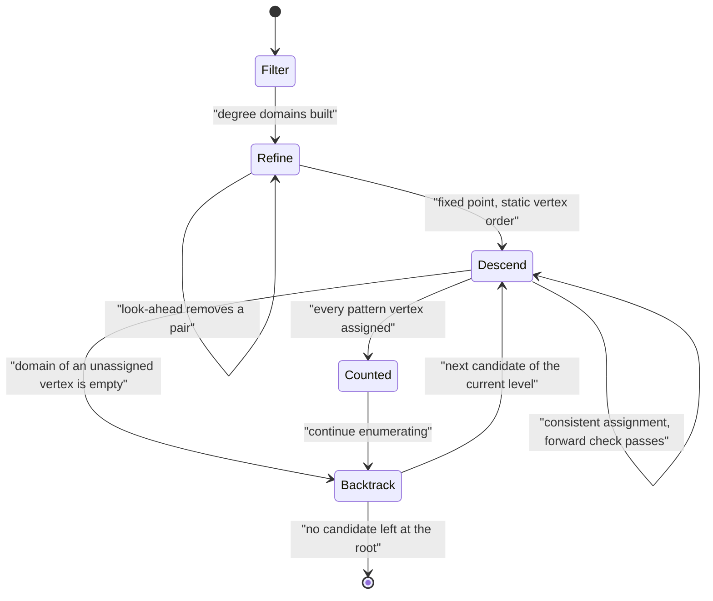

# 551 — Implement subgraph isomorphism backtracking (Ullmann outline).

> **Tier:** Advanced · **CTCI chapter:** Ch 4 — Trees and Graphs
> **Task spec:** [551-implement-subgraph-isomorphism-backtracking-ullmann-outline.md](../../../tasks/advanced/551-implement-subgraph-isomorphism-backtracking-ullmann-outline.md)
> **Solutions:** [Python](../../../solutions/python/advanced/551-implement-subgraph-isomorphism-backtracking-ullmann-outline/solution.py) ·
> [Java](../../../solutions/java/advanced/551-implement-subgraph-isomorphism-backtracking-ullmann-outline/Solution.java) ·
> [JavaScript](../../../solutions/javascript/advanced/551-implement-subgraph-isomorphism-backtracking-ullmann-outline/solution.js) ·
> [C#](../../../solutions/csharp/advanced/551-implement-subgraph-isomorphism-backtracking-ullmann-outline/Solution.cs)

## 1. Problem restatement

**Input:** a *pattern* graph `P` with `k` vertices and a *target* graph `T` with `n` vertices, both
stored as bitmask adjacency lists, plus a relation mode:

- **monomorphism** (non-induced subgraph isomorphism): every pattern edge must map to a target edge,
  but target edges between images are allowed.
- **induced**: pattern edges and non-edges must both be preserved, so the image is an induced
  subgraph.

**Output:** the number of **injective mappings** `P -> T` that preserve the chosen relation, and —
in the Python file — the mappings themselves. Counting injective mappings means a `K_k` sitting in
`n` vertices is counted `k!` times, so dividing by `k!` gives the number of distinct images.

The spec is titled "outline", but the files implement Ullmann's algorithm rather than sketching it,
and they document both pruning mechanisms. The asserted facts:

| Instance | Result | Why |
| --- | --- | --- |
| `K3` in `K4` | 24 injective maps | `4 · 3 · 2`, and each is verified independently |
| triangle in a triangle | 6 maps | `3!` automorphisms |
| induced `P3` in a triangle | **0**, versus 6 in monomorphism mode | the standard induced-versus-monomorphism discriminator |
| `P3` in `C6` | 12 in both modes | 6 centres × 2 neighbour choices; `C6` is triangle-free so the modes coincide |
| `P3` in `P6` | 8 | 4 possible centres, 2 orientations each |
| induced `K3` in `C6` | 0 | no triangle exists |
| all 4096 pairs of 4-vertex graphs, both modes | equals a permutation brute force | exhaustive validation, not a spot check |
| automorphisms of `K4`, `C5`, `P4`, `K_{1,3}`, `C6`, `K_{1,4}` | `24, 10, 2, 6, 12, 24` | the vertex count of each automorphism group |
| `K4` in `K4`, every variant | exactly 40 partial maps explored | the documented caveat that refinement does not change the worst case |

## 2. Intuition

Trying every injective mapping is `n · (n-1) · ... · (n-k+1)` possibilities — at most `n!` for
`k = n`, which is hopeless beyond the smallest graphs. The two ideas that make Ullmann's algorithm
usable both *remove pairs that no embedding can use*, so they never discard an answer:

1. **A degree domain.** Pattern vertex `u` can only map to target vertex `v` if
   `deg_P(u) <= deg_T(v)`; in induced mode also `k - 1 - deg_P(u) <= n - 1 - deg_T(v)`, because the
   non-neighbours have to fit too.
2. **Look-ahead refinement.** `u` can only map to `v` if every *other* pattern vertex `w` still has a
   candidate among the neighbours of `v` when `w` is adjacent to `u` — and, in induced mode, among the
   *non-neighbours* of `v` when it is not. Repeating that rule to a fixed point removes pairs that
   cannot participate in any embedding, which is why the candidate matrix is called a look-ahead
   matrix.

The third mechanism is in the search itself: a **forward check** after each assignment, so that every
unassigned pattern vertex keeps at least one compatible, unused candidate. A dead end is detected one
level below the assignment that caused it instead of after a full descent.



The honest caveat, asserted by the files, is that refinement does not change the worst case: on the
fully symmetric `K4`-in-`K4` pair *every* variant — plain domain backtracking, refinement only,
refinement plus forward checking — explores exactly the same `40` partial maps. Refinement pays off
on asymmetric instances; on a symmetric one there is nothing to prune, because every candidate really
does belong to some embedding.

## 3. Algorithm

1. Build the initial candidate domain per pattern vertex: `v` is a candidate for `u` if the degree
   test (and, in induced mode, the complement degree test) passes.
2. Refine to a fixed point: keep `(u, v)` only when, for every other pattern vertex `w`,
   - `w` has a surviving candidate adjacent to `v` if `u` and `w` are adjacent, and
   - `w` has a surviving candidate non-adjacent to `v` if they are not (induced mode only).
   Repeat until a full pass removes nothing (documented cap of `64` rounds, never hit on these
   instances).
3. Order the pattern vertices by fewest surviving candidates first, breaking ties by index; this
   order is static and the search tries targets in increasing index.
4. Depth-first search:
   1. Take the next pattern vertex in the static order and try each surviving, unused candidate.
   2. Test the assignment against every already assigned pattern vertex: adjacency must match
      (equality in induced mode, "pattern edge implies target edge" in monomorphism mode).
   3. Run the forward check: for each unassigned pattern vertex, at least one candidate must remain
      compatible and unused. If any is empty, backtrack.
   4. On a complete assignment, count it (the Python file also records it).
5. Return the count (and the mappings).

```text
procedure ullmann(pattern, target, induced)
    domain[u] ← target vertices passing the degree tests
    repeat
        changed ← false
        for u in pattern vertices, for v in domain[u] do
            for w in pattern vertices, w not equal to u do
                adjacent ← w is a neighbour of u in the pattern
                kept ← candidates of w inside the neighbourhood of v
                outside ← candidates of w outside the neighbourhood of v
                if adjacent and kept is empty then remove v from domain[u], changed ← true end
                if induced and not adjacent and outside is empty then
                    remove v from domain[u], changed ← true
                end
            end
        end
    until not changed
    order ← pattern vertices sorted by domain size then index
    count ← 0
    search(pattern, target, order, domain, empty assignment, used target set)
    return count
end

procedure search(order, level, assignment, used)
    if level equals length of order then
        count ← count + 1
        return
    end
    u ← order[level]
    for v in candidates of u in increasing index do
        if v is used then continue end
        if assignment is consistent with (u, v) then
            place u at v, mark v used
            if forward check keeps every unassigned vertex non-empty then
                search(next level)
            end
            undo the placement
        end
    end
end
```

The forward check is the only place where the algorithm looks ahead beyond the current level without
committing, and it is what turns the refined domain into a running invariant rather than a one-off
preprocessing step.



## 4. Worked example

Count the embeddings of the path `P3` (`a - b - c`) in the 6-cycle `C6`, in monomorphism mode. The
pattern's middle vertex has degree `2`, the two leaves have degree `1`, and every target vertex has
degree `2`, so the degree filter keeps all six targets for every pattern vertex and refinement prunes
nothing (`C6` is vertex-transitive and triangle-free). The search order therefore puts `b` first — the
only vertex with degree `2` — and the trace is short:

| Level | Assignment | Candidate set for the next vertex | Why |
| --- | --- | --- | --- |
| 0 | `b -> 0` | `a ∈ {1, 5}`, `c ∈ {1, 5}` | the neighbours of target `0` |
| 1 | `a -> 1` | `c ∈ {5}` | `5` is adjacent to `0` and not equal to `1`; `1` and `5` are non-adjacent, so nothing else is forbidden |
| 2 | `c -> 5` | complete | one mapping for this centre |
| 1′ | `a -> 5` | `c ∈ {1}` | the mirror image |
| 2′ | `c -> 1` | complete | the second mapping for this centre |

Two mappings per centre and six possible centres give `12` — the documented count, and the same `12`
in induced mode because `C6` is triangle-free: any three distinct vertices of a 6-cycle cannot form a
triangle, so there are no accidental extra edges for the induced relation to reject.

The two discriminating instances come from the same trace logic:

| Instance | Induced mode | Monomorphism mode | Reason |
| --- | --- | --- | --- |
| `P3` in a triangle | `0` | `6` | the image of a path on three vertices carries the triangle's third edge, which the induced relation forbids; the monomorphism relation does not care |
| `P3` in `P6` | `8` | `8` | four possible centres, each with two orientations |
| induced `K3` in `C6` | `0` | `0` | no target triangle exists |
| `K3` in `K4` | `24` | `24` | `4 · 3 · 2` injective maps, verified one by one |





The `Refine -> Refine` self-loop is why the pass is repeated: one removal can empty another domain,
so the rule has to be re-applied until nothing changes. The files verify that the result is a genuine
fixed point of `refine`, that it never grows and never escapes the raw degree domain, and — the
important direction — that every brute-force embedding survives it.

## 5. Complexity

Let `k` be the pattern size, `n` the target size, and `N` the number of nodes in the search tree.

| Measure | Bound | Why it holds |
| --- | --- | --- |
| Initial domains | O(k · n) | one degree comparison per pair, `O(1)` with bitmasks |
| One refinement pass | O(k² · n) with bitmask tests | for each pair `(u, v)` the test for every `w` is a mask intersection |
| Refinement to a fixed point | O(rounds · k² · n), cap 64 rounds | each round either removes a pair or stops |
| Consistency test of an assignment | O(k) | compare adjacency of the new vertex against the assigned ones |
| Forward check | O(k · n) | one mask test per unassigned pattern vertex |
| Search | O(N · k · n) | the node count is what the pruning must reduce |
| Space | O(k · n) | the candidate matrix plus the `O(k)` recursion stack |

The pruning is a constant-factor and instance-dependent win, not a complexity-class win: the files
record the node counts for every variant and state plainly that on `K4` in `K4` all of them explore
the same `40` partial maps. Where refinement does pay is on targets whose degree sequence cannot host
the pattern at all — then the initial domains rule everything out and the search never starts.

## 6. Pitfalls and edge cases

- **Counting mappings instead of images.** The reported quantity is *injective mappings*, so every
  `K_k` inside `n` vertices contributes `k!` — `K3` in `K4` is `24`, not `4`. Divide by `k!` when you
  want distinct images, and be careful not to divide by the pattern's automorphism count twice.
- **Induced versus monomorphism.** The single most common bug: reusing the induced relation for the
  subgraph problem (or the reverse) makes `P3` in a triangle come out `0` instead of `6`. The files
  assert that pair as the discriminator, in both modes.
- **Empty pattern.** `k = 0` has exactly one injective mapping (the empty map), and the count must be
  `1`, not `0` — the degenerate input the files pin down explicitly.
- **Single-vertex pattern.** It has `n` embeddings (one per target vertex), and the degree filter must
  not require an edge.
- **Pattern larger than the target.** Impossible: the count must be `0`, and the search has to say so
  without indexing out of range.
- **Degree-impossible patterns.** If the pattern has a vertex of degree `5` and no target vertex
  reaches `5`, the count is `0` and the refined domains are all empty; the search returns immediately
  rather than exploring `n!` mappings. In induced mode the complement degree test is needed as well —
  a pattern with many non-edges needs targets with enough non-neighbours.
- **Fixed-point refinement.** A single pass of the look-ahead rule can leave removable pairs behind,
  because removing one pair can enable another removal. Iterating until a full pass changes nothing is
  the algorithm; the files also assert that the result is a fixed point of `refine`.
- **Refinement must never be over-aggressive.** Its only justification is that a removed pair cannot
  appear in any embedding; the files test exactly that by checking every brute-force embedding against
  the refined matrix on all 4096 pairs of 4-vertex graphs.
- **Random graph generators.** The Python file uses a full-period 64-bit generator read in its **high
  bits** because the repository's 16-bit `lcg` has a short period and its low bits track density,
  which would make "random" pattern/target pairs systematically similar and the tests weak.
- **Re-verification.** Every returned mapping is independently re-checked (injective,
  relation-preserving, and relation-reflecting in induced mode) and counted distinct, so a bug in the
  counting is not punished by a bug in the search — they are checked separately.

## 7. Variants and follow-ups

- **VF2.** Instead of refining a full candidate matrix and then searching, VF2 grows the mapping over
  reachable vertex pairs with its own feasibility rules, which is far cheaper in memory:
  [552-implement-vf2-algorithm-skeleton-for-subgraph-iso.md](../../../tasks/advanced/552-implement-vf2-algorithm-skeleton-for-subgraph-iso.md).
- **Counting motifs instead of testing one pattern.** Enumerating small subgraphs over all patterns at
  once is the subject of
  [554-implement-motif-counting-in-small-graphs-enumeration.md](../../../tasks/advanced/554-implement-motif-counting-in-small-graphs-enumeration.md),
  where the induced/monomorphism distinction shows up again as the difference between triangle and
  wedge counts.
- **Estimating frequencies instead of exact counting.** When `n` is too large for exact enumeration,
  [553-implement-induced-subgraph-frequency-sampling.md](../../../tasks/advanced/553-implement-induced-subgraph-frequency-sampling.md)
  samples induced subgraphs and extrapolates.
- **Bitmask engineering.** The candidate matrix is a vector of bitmasks here; the same idea at scale is
  the subject of
  [558-implement-boolean-matrix-multiplication-optimization-using-bitse.md](../../../tasks/advanced/558-implement-boolean-matrix-multiplication-optimization-using-bitse.md).

## 8. Check yourself

1. Why is `24` the right count for `K3` inside `K4` rather than `4`?

<details><summary>Show answer</summary>

Because the algorithm counts injective *mappings*, not images. Choosing the three target vertices for
the triangle can be done in `C(4,3) = 4` ways, and each choice admits `3! = 6` bijections from the
pattern's three vertices, giving `4 · 6 = 24`. To report distinct images you divide by the pattern's
automorphism count — `k!` for a complete pattern.

</details>

2. `P3` inside a triangle counts `6` in monomorphism mode and `0` in induced mode. Explain both
   numbers.

<details><summary>Show answer</summary>

A monomorphism only asks that every pattern edge maps to a target edge. Pick any of the 3 target
vertices as the image of the middle pattern vertex, then the two leaves map to the other two (2 ways):
`6` mappings, and the image necessarily contains the third triangle edge. The induced relation
additionally forbids target edges between images of *non-adjacent* pattern vertices, but the two leaves
are non-adjacent in `P3` while their images are adjacent in a triangle, so every mapping is rejected
and the count is `0`.

</details>

3. What exactly does the look-ahead refinement check, and why can it never remove a pair used by an
   embedding?

<details><summary>Show answer</summary>

It keeps `(u, v)` only if every other pattern vertex `w` still has a surviving candidate compatible
with `v` under the relation — inside the neighbourhood of `v` when `w` is adjacent to `u`, and (induced
mode) outside it when it is not. If an embedding mapped `u` to `v`, it would map each other `w` to some
target vertex that *is* compatible in exactly this sense, so the pair `(u, v)` cannot be the reason a
required candidate disappears. Hence the rule only removes pairs no embedding can use; the files verify
that by checking every brute-force embedding against the refined matrix.

</details>

4. Why is the pattern vertex order sorted by the number of surviving candidates?

<details><summary>Show answer</summary>

To fail fast. The most constrained pattern vertex is the one that eliminates branches highest in the
tree — if it has only one candidate, the whole search commits immediately and any inconsistency
surfaces one level down. Ordering by fewest candidates first (ties by index, for determinism) is the
standard minimum-remaining-values heuristic; the files use it as the static order rather than
recomputing it dynamically.

</details>

5. The `K4`-in-`K4` experiment shows refinement and forward checking exploring the same `40` nodes as
   plain backtracking. Why does the algorithm still bother?

<details><summary>Show answer</summary>

Because `K4` is maximally symmetric: every candidate pair genuinely participates in some embedding, so
there is nothing for the look-ahead rule to remove and the search is not "wasting" anything the
refinement could detect. On asymmetric instances both mechanisms remove real work, and in the
degree-impossible cases the refined domains are empty before the search even starts, which is an
asymptotic difference — the search never begins instead of exhausting `n!` partial maps. The honest
statement, which the file asserts, is that the pruning is instance-dependent rather than a worst-case
improvement.

</details>
