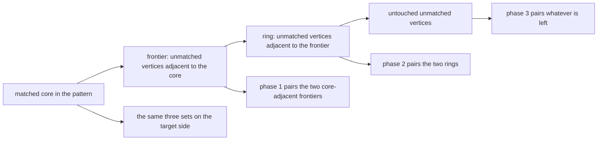
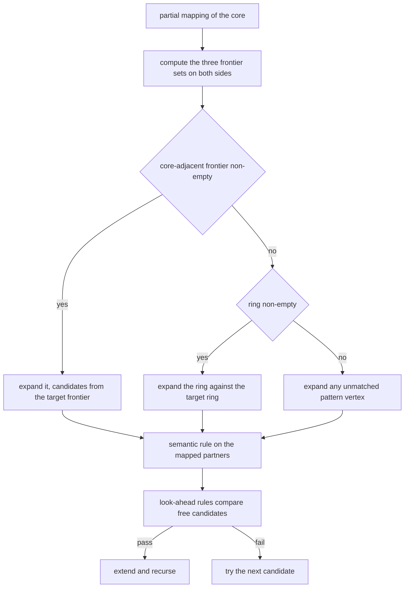
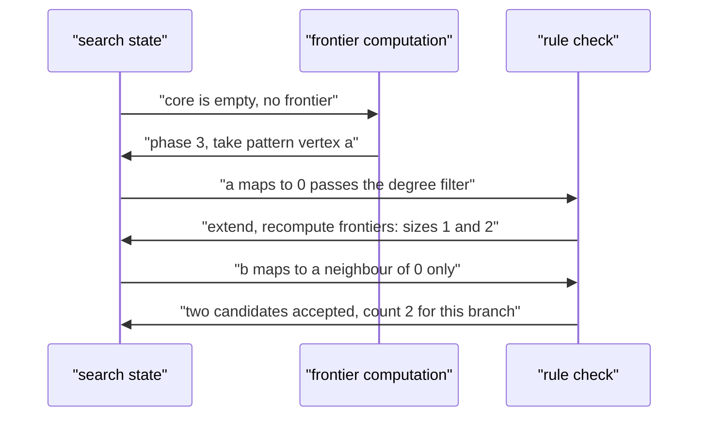
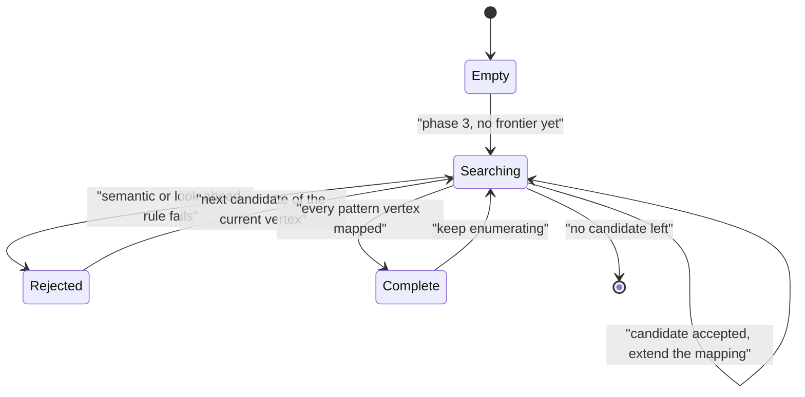

# 552 — Implement VF2 algorithm skeleton for subgraph iso.

> **Tier:** Advanced · **CTCI chapter:** Ch 4 — Trees and Graphs
> **Task spec:** [552-implement-vf2-algorithm-skeleton-for-subgraph-iso.md](../../../tasks/advanced/552-implement-vf2-algorithm-skeleton-for-subgraph-iso.md)
> **Solutions:** [Python](../../../solutions/python/advanced/552-implement-vf2-algorithm-skeleton-for-subgraph-iso/solution.py) ·
> [Java](../../../solutions/java/advanced/552-implement-vf2-algorithm-skeleton-for-subgraph-iso/Solution.java) ·
> [JavaScript](../../../solutions/javascript/advanced/552-implement-vf2-algorithm-skeleton-for-subgraph-iso/solution.js) ·
> [C#](../../../solutions/csharp/advanced/552-implement-vf2-algorithm-skeleton-for-subgraph-iso/Solution.cs)

## 1. Problem restatement

**Input:** a pattern graph `G1 = (P, E1)` and a target graph `G2 = (T, E2)`, both as bitmask adjacency
rows, plus the relation mode: **induced** (adjacency and non-adjacency must both be preserved) or
**monomorphism** ("pattern edge implies target edge", extra target edges allowed).

**Output:** the number of injective mappings `P -> T` satisfying the relation, plus the state
statistics the search collects (which frontier phases fired, and the frontier sizes at every node).

The spec is titled "skeleton", but the files document that they implement VF2 as a **working search
rather than an outline**. The asserted facts:

| Instance | Result | Why |
| --- | --- | --- |
| `K3` in `K4` | 24 mappings | `4 · 3 · 2`, each independently re-verified |
| `K3` in `K3` | 6 | `3!` |
| induced `P3` in a triangle | 0, versus 6 in monomorphism mode | the relation discriminator |
| `P3` in `C6` | 12 in both modes | 6 centres × 2 orientations; no target triangle |
| automorphisms of `K4, C5, P4, K_{1,3}, C6, K5` | `24, 10, 2, 6, 12, 120` | group orders |
| all 3-pattern/4-target pairs and 4-pattern/4-target pairs | agree with permutation brute force | 3072 pairs in both modes |
| 9-in-13 and 7-in-10 pairs | searched by VF2 and plain backtracking | the brute force is not affordable at that size, and the file says so |
| VF2 candidate examinations | never more than the same backtracking without look-ahead | measured per instance |
| `K4` in `K4` | every variant enumerates the same 40 partial maps | the look-ahead buys nothing on a symmetric instance |

The headers also record three **honest caveats**, each backed by an assertion rather than a comment:

- The often-quoted invariant `|T1in| = |T2in|` is **false**: with the single-edge pattern and a
  triangle as target, the state after the first matched pair has frontier sizes `1` and `2`.
- The weaker `|T1in| <= |T2in|` is not an invariant either — it held at every state of the induced
  batteries (violation count zero, asserted) but the **monomorphism** search reaches states with
  `|T1in| > |T2in|` (violation count positive, asserted as well).
- The second frontier phase is **unreachable** on every instance here, and the phase counters record
  that.

## 2. Intuition

VF2 grows a partial mapping one pattern vertex at a time, and the whole design is about *which*
vertex to add next. Instead of walking the pattern in a fixed order (Ullmann's static order, task
551), VF2 maintains two frontier sets on each side and always expands the pattern's frontier:

- vertices that are **adjacent to the already mapped core** — the natural next candidates, because
  everything about them is constrained by the core, and
- vertices that are not adjacent to the core but are adjacent to the first group.

The naming of the two sets differs between the files — the Java and C# headers call the
core-adjacent set `T1_out`/`T2_out` and the second ring `T1_in`/`T2_in`, while the Python header
uses the opposite labels — so the safest reading is by *meaning*: the core-adjacent frontier, then
the ring beyond it, then everything still untouched.

The pay-off of expanding the frontier is a low branching factor: a new vertex already has an image
constraint from its mapped neighbours, so most target vertices are eliminated before any recursion
happens. The search never wanders into a disconnected part of the pattern that cannot be related to
what is already mapped.



Two families of rules decide whether a candidate pair `(u, v)` is feasible:

- **Semantic rules.** Adjacency of `u` to every already mapped pattern vertex must reproduce the
  adjacency of `v` to its image — equality in induced mode, one direction only in monomorphism mode.
- **Look-ahead rules.** Every unmapped pattern neighbour of `u` must have an unused candidate among
  the neighbours of `v`, and (induced only) every unmapped *non*-neighbour must have a candidate among
  the non-neighbours. Counting-style versions of the same idea compare
  `|N1(u) ∩ frontier|` with `|N2(v) ∩ frontier|` for each of the three sets.

Every rule is a necessary condition for extending the partial map, so the search stays complete —
which the files verify exhaustively against a permutation brute force instead of assuming.

## 3. Algorithm

1. Represent each graph as bitmask adjacency rows and keep the partial injective mapping as two
   matched masks.
2. At each node, compute the frontiers: the unmatched vertices adjacent to the matched core, the ring
   outside them that touches the frontier, and the rest. The Python file recomputes them from scratch
   and also carries the incremental VF2-style update, asserting the two agree at every explored state.
3. Choose the next pattern vertex by the phase order:
   1. a vertex from the core-adjacent frontier, candidates restricted to the target's core-adjacent
      frontier;
   2. otherwise a vertex from the ring, candidates restricted to the target's ring;
   3. otherwise any unmatched vertex.
   Ties break towards the smallest index, and the C#/JavaScript files refine this by taking the
   vertex whose candidate list is shortest — the look-ahead step the paper credits for the low
   branching factor.
4. For each candidate `v` of `u`:
   1. Apply the semantic rule `R_new`: the adjacency of `u` to every mapped pattern vertex must match
      the adjacency of `v` to its image.
   2. Apply the look-ahead rules: for each unmapped pattern neighbour `w` of `u`, a free candidate
      must exist among the neighbours of `v` (`R_succ`), and in induced mode the symmetric condition
      for non-neighbours (`R_pred`); the counting form compares frontier sizes as described above.
   3. On success, extend the mapping, recurse, then undo the extension.
5. Count the complete mappings when every pattern vertex is matched.

```text
procedure vf2(pattern, target, induced)
    matched1 ← empty mask, matched2 ← empty mask
    count ← 0
    search(matched1, matched2, empty mapping)
    return count
end

procedure search(matched1, matched2, mapping)
    if matched1 covers every pattern vertex then
        count ← count + 1
        return
    end
    frontier1in, frontier1out ← frontiers(matched1, adj1)
    frontier2in, frontier2out ← frontiers(matched2, adj2)
    if frontier1in is non-empty then
        u ← smallest index in frontier1in, v ranges over frontier2in
    else if frontier1out is non-empty then
        u ← smallest index in frontier1out, v ranges over frontier2out
    else
        u ← smallest unmatched index, v ranges over every unmatched target vertex
    end
    for v in candidate range, v unused do
        if semantic rule R_new holds for (u, v) then
            if look-ahead rules R_succ and R_pred hold for (u, v) then
                extend mapping with (u, v)
                search(matched1 with u, matched2 with v, mapping)
                undo the extension
            end
        end
    end
end
```

The look-ahead rules are the counting statement of "the future can still fit": if the pattern vertex
`u` has three unmapped neighbours but the target vertex `v` has only two free neighbours left, no
extension of this partial map can ever work, so the pair dies immediately.



## 4. Worked example

Take the smallest instance that exposes the frontier structure: the pattern is a **single edge**
(`a - b`) and the target is a **triangle** (`0, 1, 2`). With no matched vertices both frontiers are
empty, so phase 3 fires and the first pattern vertex is `a` (smallest index); all three target
vertices are candidates, because the pattern degree `1` fits under the target degree `2`.

Match `a -> 0` and recompute the frontiers:

| Set | Meaning | Value after `a -> 0` |
| --- | --- | --- |
| pattern, adjacent to the core | unmatched pattern vertices adjacent to `{a}` | `{b}` — size 1 |
| pattern, not adjacent to the core | unmatched pattern vertices with no link into `{a}` | `{}` — size 0 |
| target, adjacent to the core | unmatched target vertices adjacent to `{0}` | `{1, 2}` — size 2 |
| target, not adjacent to the core | the rest | `{}` — size 0 |

That single state is the documented counterexample: the frequently quoted invariant
`|frontier_pattern| = |frontier_target|` gives `1 = 2`, so it is false. The continuation is short:

| Step | Move | Check | Outcome |
| --- | --- | --- | --- |
| 1 | `a -> 0` | degree filter only | accept |
| 2 | `b -> 1` | `b` is adjacent to the mapped `a`, and `1` is adjacent to `0` | count 1 |
| 3 | `b -> 2` | same rule with `2` | count 2 |
| 4 | `a -> 1`, then `b -> 0` or `b -> 2` | by symmetry | 2 more |
| 5 | `a -> 2`, then `b -> 0` or `b -> 1` | by symmetry | 2 more |
| total | — | — | **6**, the number of ordered adjacent pairs in a triangle |

The phase counters also record something worth knowing: the **ring phase never fired on any instance**
in the batteries. The reason is structural — a non-empty ring forces a non-empty core-adjacent
frontier, which makes phase 1 fire instead; and if the target's core-adjacent frontier were empty,
every frontier pattern vertex would be provably infeasible because its image would have to lie in that
empty set. The file asserts the phase counts rather than quietly ignoring the dead branch.





## 5. Complexity

Let `k` be the pattern size, `n` the target size and `N` the number of explored search nodes.

| Measure | Bound | Why it holds |
| --- | --- | --- |
| Frontier computation | O(n) per side | one bitmask scan over the unmatched vertices |
| Incremental frontier update | O(1) bitwise operations plus the neighbours of the new vertex | the update only adds unmatched neighbours and re-examines the ring |
| Candidate enumeration | O(n) per node | the candidate range is one of the three target sets |
| Semantic rule | O(k) | compare the new vertex against every mapped partner |
| Look-ahead rules | O(k · n) worst case, usually far less | one free-candidate scan per unmapped neighbour |
| Search | O(N · k · n) | the node count is what the design tries to minimise |
| Space | O(k + n) | two matched masks, the frontier masks and the `O(k)` recursion stack |

The memory profile is the headline difference from Ullmann's algorithm (task 551): VF2 never
materialises a `k × n` candidate matrix, only bitmask state, so it scales to targets where a full
refinement pass would be the dominant cost. The price is that the look-ahead rules are re-evaluated
at every node, which is why the files measure candidate examinations instead of assuming the pruning
wins — and on `K4` in `K4` it does not, because every candidate is genuinely feasible.

## 6. Pitfalls and edge cases

- **The `|T1in| = |T2in|` folklore.** It is false, and the single-edge-in-a-triangle instance shows
  `1` against `2`. Treat the frontiers as sets defined by adjacency to the core, not as quantities
  expected to balance.
- **Monomorphism frontier inequality.** Even `|T1in| <= |T2in|` fails in monomorphism mode, where the
  out-phase look-ahead may count candidates inside the target's inner frontier. The Python file
  asserts both the zero-violation induced result and the positive-violation monomorphism result.
- **Recomputing versus updating the frontiers.** The incremental update is faster and easy to get
  subtly wrong (a vertex can leave the ring only when its last frontier neighbour is matched). The
  Python file keeps both and asserts they agree at every state, including on the larger 9-in-13 and
  7-in-10 instances.
- **Counting mappings, not images.** `K3` in `K4` is 24 because the count is over injective mappings;
  the automorphism batteries (`K4 -> 24`, `C5 -> 10`, `P4 -> 2`, `K_{1,3} -> 6`, `C6 -> 12`,
  `K5 -> 120`) are the same statement specialised to pattern equals target.
- **Induced versus monomorphism.** The `P3`-in-a-triangle pair is the discriminator: `0` against `6`.
  Getting the `R_new` direction wrong turns one mode into the other.
- **Degenerate inputs.** Empty pattern (one mapping), single-vertex pattern (`n` mappings), pattern
  larger than the target (zero), and patterns whose degrees exceed every target degree (zero, decided
  before any recursion) are all pinned down.
- **Brute force is not always affordable.** Beyond small sizes the reference has to change: the
  exhaustive sweep is used where it fits, and the larger instances are checked by two independent
  searches instead — a documented substitution, not a silent one.
- **Random generators.** As in the other advanced tasks, the pattern/target pairs come from a
  full-period 64-bit generator read in its **high bits**, because the repository's 16-bit `lcg` has a
  short period and low-bit structure that would bias the graph density and make the tests weak.
- **Dead branches.** A phase that never fires on any instance is worth recording, not deleting: the
  phase counters in the files turn "we think this branch is unreachable" into a measurement.

## 7. Variants and follow-ups

- **Ullmann's candidate-matrix approach.** The other half of the comparison: a refined `k × n` matrix
  plus a static vertex order instead of dynamic frontiers, at the cost of memory —
  [551-implement-subgraph-isomorphism-backtracking-ullmann-outline.md](../../../tasks/advanced/551-implement-subgraph-isomorphism-backtracking-ullmann-outline.md).
- **Counting all small patterns at once.** Motif counting reuses the same feasibility machinery but
  enumerates every pattern of a fixed size, where the induced relation decides triangle versus wedge
  counts: [554-implement-motif-counting-in-small-graphs-enumeration.md](../../../tasks/advanced/554-implement-motif-counting-in-small-graphs-enumeration.md).
- **Sampling instead of enumerating.** For targets too large to search,
  [553-implement-induced-subgraph-frequency-sampling.md](../../../tasks/advanced/553-implement-induced-subgraph-frequency-sampling.md)
  estimates subgraph frequencies from random induced samples.
- **Set operations as bitmasks.** The frontier arithmetic is bitmask algebra over vertex sets; the
  same primitives applied to matrices are the subject of
  [558-implement-boolean-matrix-multiplication-optimization-using-bitse.md](../../../tasks/advanced/558-implement-boolean-matrix-multiplication-optimization-using-bitse.md).

## 8. Check yourself

1. Why does VF2 expand a frontier vertex instead of the next vertex in a fixed pattern order?

<details><summary>Show answer</summary>

Because a frontier vertex is adjacent to the already mapped core, so its image is constrained by the
images already chosen: it must be adjacent to the right vertices. That makes most target candidates
fail the semantic rule before any recursion, keeping the branching factor low. A fixed order can pick
a pattern vertex whose image is entirely unconstrained by the current partial map, which wastes work
and can explore disconnected parts of the pattern that cannot be related to the core.

</details>

2. The files record a state with frontier sizes `1` and `2` for the single-edge pattern in a triangle.
   What precisely does that refute?

<details><summary>Show answer</summary>

It refutes the frequently repeated claim that VF2 maintains `|T1in| = |T2in|` between the two
frontiers. After matching the first pattern vertex `a` to a target vertex `0`, the pattern's
core-adjacent frontier contains only `b` (size 1) while the target's core-adjacent frontier contains
both remaining vertices (size 2). The sets are defined by adjacency to the core on their own side, and
nothing forces the two graphs to have equal degrees there.

</details>

3. What do the look-ahead rules actually test, and why is the count-based form equivalent?

<details><summary>Show answer</summary>

`R_succ` requires that every unmapped pattern neighbour `w` of `u` still has a free candidate among
the neighbours of `v`, and `R_pred` requires (induced mode only) the same for non-neighbours among the
non-neighbours of `v`. The counting form, comparing `|N1(u) ∩ frontier|` with
`|N2(v) ∩ frontier|`, is the necessary condition obtained by observing that all those neighbours must
be mapped to distinct free vertices inside the corresponding target set. Both forms are necessary
conditions for extending the mapping, which is exactly what keeps the search complete.

</details>

4. Why is the second frontier phase unreachable on these instances?

<details><summary>Show answer</summary>

Because a non-empty ring forces a non-empty core-adjacent frontier — a vertex at distance two from the
core got its ring status through a frontier vertex — so the first phase fires instead. The only escape
is an empty target core-adjacent frontier, in which case every frontier pattern vertex is infeasible
anyway, since its image would have to be a free neighbour of a matched target vertex and there is none.
The phase counters in the files record the observed counts rather than asserting the argument.

</details>

5. Why does the look-ahead machinery buy nothing on `K4` in `K4`?

<details><summary>Show answer</summary>

Because `K4` is vertex-transitive and complete: after any partial mapping, every remaining candidate
pair is genuinely feasible, so no rule can remove anything and all variants enumerate the same `40`
partial maps. The look-ahead rules pay off on asymmetric or sparse instances and in cases where the
degree structure alone rules the pattern out; the file asserts the node counts so the caveat is
measured rather than assumed.

</details>
