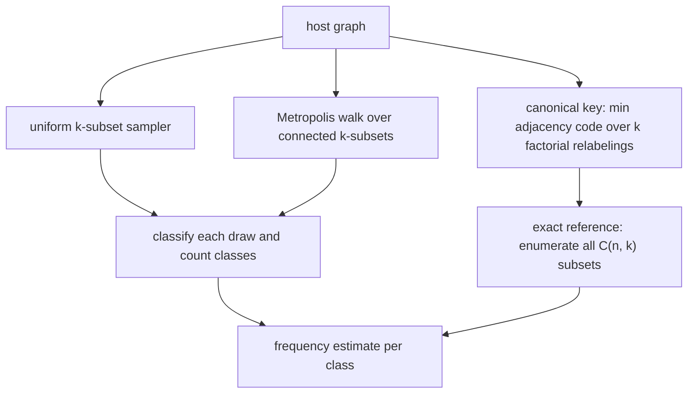
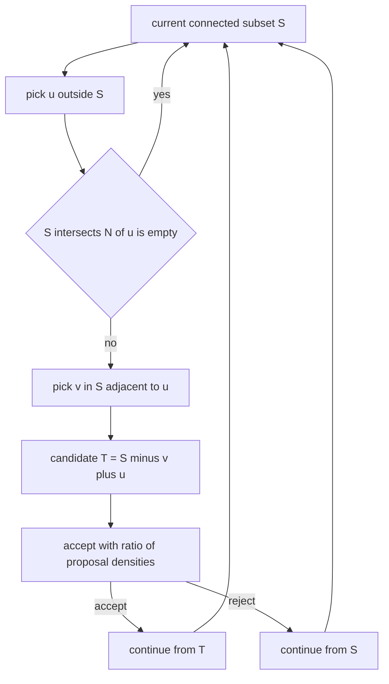
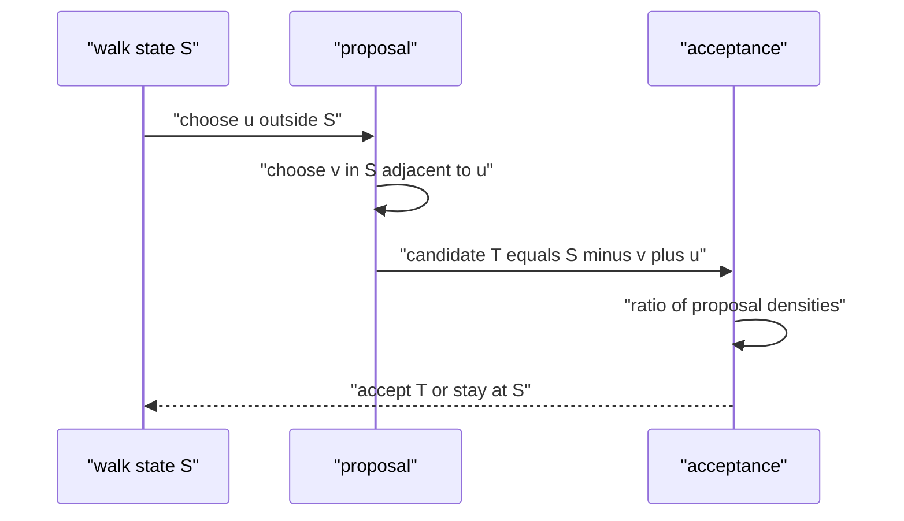
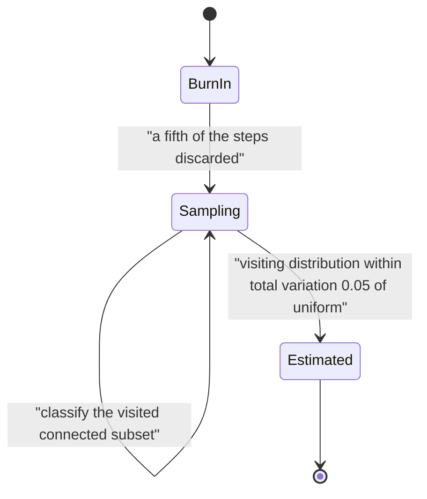

# 553 — Implement induced subgraph frequency sampling.

> **Tier:** Advanced · **CTCI chapter:** Ch 4 — Trees and Graphs
> **Task spec:** [553-implement-induced-subgraph-frequency-sampling.md](../../../tasks/advanced/553-implement-induced-subgraph-frequency-sampling.md)
> **Solutions:** [Python](../../../solutions/python/advanced/553-implement-induced-subgraph-frequency-sampling/solution.py) ·
> [Java](../../../solutions/java/advanced/553-implement-induced-subgraph-frequency-sampling/Solution.java) ·
> [JavaScript](../../../solutions/javascript/advanced/553-implement-induced-subgraph-frequency-sampling/solution.js) ·
> [C#](../../../solutions/csharp/advanced/553-implement-induced-subgraph-frequency-sampling/Solution.cs)

## 1. Problem restatement

**Input:** a host graph `G` with `n` vertices, a pattern size `k`, and a number of draws `m`.

**Output:** estimates of the **induced subgraph frequencies** — for a `k`-vertex pattern `H`, the
fraction of the `C(n, k)` vertex subsets whose *induced* subgraph is isomorphic to `H` — together
with the exact frequencies for comparison on graphs small enough to enumerate.

The files implement three components and check each of them separately:

1. A **canonical key** that classifies the induced subgraph of a vertex subset up to isomorphism: the
   adjacency is packed into a `k(k-1)/2`-bit code and the smallest code over all `k!` relabelings
   wins. For `k = 4` this yields exactly the **11 unlabelled graphs on 4 vertices**, which the files
   verify are complete and distinct.
2. A **uniform k-subset sampler** (partial Fisher–Yates) whose estimator is `count / trials`, unbiased
   for the fraction with standard error `sqrt(p(1-p)/m)` because draws are independent and with
   replacement.
3. A **Metropolis walk over the connected k-subsets**, which is the distribution motif studies
   actually want, with acceptance probability `min(1, |S ∩ N(u)| / |T ∩ N(v)|)` and a uniform
   stationary distribution over connected subsets.

The asserted facts:

| Check | Result | Why |
| --- | --- | --- |
| canonical keys | invariant under relabelling, and distinguish subsets with different edge counts | the key is a minimum over all relabelings |
| triangles | `T = trace(A³) / 6` | closed form, checked on random graphs |
| induced paths `P3` | `count = sum over v of C(d_v, 2) - 3T` | every wedge, triangles counted three times |
| single-edge triples | `count = (n - 2)·m - 2·(#P3) - 3T` | count endpoint pairs and subtract |
| independent triples | `C(n, 3)` minus the other three classes | the classes partition the triples |
| uniform sampler | each vertex hit with frequency `k / n`; subset distribution within total variation `0.05` of uniform after 60 000 draws | 330 subsets compared on an 11-vertex instance |
| pattern estimator | within three standard errors of the exact frequency over 6 seed families (12 000 draws), error shrinking at 200 / 800 / 3200 draws | unbiasedness plus the binomial error |
| Metropolis walk | stays inside connected subsets, deterministic, exact transition matrix stochastic **and symmetric** | symmetry forces the uniform stationary distribution, an exact statement |
| visiting distribution after burn-in | within total variation `0.05` of uniform over the connected subsets found by enumeration | the only empirical claim; no mixing-time bound is proved or claimed |
| connected-only versus all-subsets | the connected-pattern frequencies differ substantially | the two estimators are only ever compared against their own exact reference |

## 2. Intuition

Counting induced subgraphs exactly costs `C(n, k)` classifications, and each classification costs up
to `k!` relabelings — on a graph with a million vertices and `k = 4` that is astronomically many
subsets. Sampling replaces the enumeration with a statistic: draw `m` subsets uniformly, classify
them, and report the fraction that matches. Unbiasedness is immediate, and so is the error:
`sqrt(p(1-p)/m)`, the plain binomial standard error, because independent draws with replacement are
exactly `m` Bernoulli trials.

Two details decide whether the estimator is honest:

- **Classification must be isomorphism-invariant.** "Number of 4-subsets inducing an edge" is not a
  well-formed question; the graph classes are. The canonical key makes the classes explicit by
  minimising over relabelings, which is why the files can assert that the 4-vertex classes are
  complete and distinct.
- **The distribution you sample matters.** Uniform `k`-subsets are the natural choice for "fraction
  of subsets", but motif studies usually want *connected* patterns only, and the two targets are
  genuinely different distributions. The files make that a first-class counterexample: on the tested
  graph the connected-pattern frequencies differ substantially from the frequencies over all subsets,
  so each estimator is compared only against its own exact reference.



The random walk is the clever part. Uniform sampling of *connected* subsets is not something you can
do by rejection on sparse graphs; instead the walk keeps a current connected subset and proposes a
swap `S -> S \ {v} ∪ {u}` with a `u` outside `S` and a `v` inside `S` that is adjacent to `u`, which
is exactly the move that preserves connectivity.

## 3. Algorithm

**Canonical key.**

1. For a subset of `k` vertices, read the induced adjacency as a `k(k-1)/2`-bit integer using a fixed
   bit order on the upper triangle.
2. For every one of the `k!` relabelings, recompute that code and keep the minimum.
3. Return the minimum; two subsets share a key exactly when they induce isomorphic graphs.

**Uniform sampling.**

1. Seed a full-period 64-bit generator, read its **high** bits for the draws.
2. Draw a `k`-subset by partial Fisher–Yates: swap `k` random positions into the front of a pooled
   index array, so every subset is equally likely.
3. Classify the induced subgraph, count the class, and estimate the frequency as `count / m`.
4. Optionally pre-filter by induced edge count to skip classes that cannot match the target pattern.

**Metropolis walk over connected subsets.**

1. Start from any connected `k`-subset (found by growth or by exhaustive search on small graphs).
2. Propose `u` outside `S` and `v` in `S ∩ N(u)`; the candidate is `T = S \ {v} ∪ {u}`.
3. Accept with probability `min(1, |S ∩ N(u)| / |T ∩ N(v)|)` — the ratio of the two proposal
   densities, which is what makes the chain symmetric and the stationary distribution uniform.
4. Discard the first fifth of the steps as burn-in and classify the rest.

```text
procedure canonical_key(local_adjacency, k)
    best ← infinity
    for every permutation pi of the k local vertices do
        code ← 0
        for each pair (i, j) with i < j do
            if local_adjacency[pi[i]][pi[j]] then
                code ← code + 2 raised to the bit index of (i, j)
            end
        end
        if code < best then best ← code end
    end
    return best
end

procedure uniform_subset(n, k, state)
    pool ← [0, 1, ..., n - 1]
    for i ← 0 to k - 1 do
        state ← next random state
        j ← i + (high bits of state) mod (n - i)
        swap pool[i] and pool[j]
    end
    return the first k entries of pool
end

procedure metropolis_step(S, k, state)
    state ← next random state
    u ← a uniform vertex outside S
    if S intersects N(u) is empty then return S end
    state ← next random state
    v ← a uniform vertex in S intersect N(u)
    accept ← min(1, size of S intersect N(u) divided by size of T intersect N(v))
    if accept then return S minus v plus u else return S end
end
```

The acceptance ratio is the ratio of proposal densities: from `S` the number of ways to propose a
given `T` is `|S ∩ N(u)|`, and from `T` the number of ways back is `|T ∩ N(v)|`. When the chain is
symmetric, the uniform distribution over connected subsets is stationary — and the files verify that
by building the exact transition matrix and checking that it is both stochastic and symmetric, an
*exact* statement rather than a sampled one.



## 4. Worked example

Classify every 3-subset of the 4-cycle `C4` with the closed forms the file reproduces. Here
`n = 4`, `m = 4`, every degree is `2`, and `C4` is triangle-free:

```text
triangles           T = trace(A^3) / 6 = 0
induced P3          sum over v of C(d_v, 2) - 3T = 4 * 1 - 0 = 4
single-edge triples (n - 2) * m - 2 * (#P3) - 3T = 2 * 4 - 2 * 4 - 0 = 0
independent triples C(n, 3) - T - #P3 - single-edge = 4 - 0 - 4 - 0 = 0
total               4 subsets of size 3
```

| 3-subset | induced edges | class |
| --- | --- | --- |
| `{0, 1, 2}` | `0-1`, `1-2` | `P3` |
| `{0, 1, 3}` | `0-1`, `3-0` | `P3` |
| `{0, 2, 3}` | `0-3`, `2-3` | `P3` |
| `{1, 2, 3}` | `1-2`, `2-3` | `P3` |

The counts add up: 4 subsets, all of them paths, which is exactly what the closed forms say. This is
what "the classes partition the triples" means, and why the file can check the enumeration against
arithmetic instead of against another implementation.

Against that background, the sampling side is a statement about how many draws it takes to see the
same numbers. The documented sizes:

| Component | Budget | Purpose |
| --- | --- | --- |
| uniform sampler | 60 000 draws on an 11-vertex instance (330 four-vertex subsets) | each vertex should be hit with frequency `k/n`, and the subset distribution should be within total variation `0.05` of uniform |
| pattern estimator | 6 seed families × 2 000 draws | the average must land within three standard errors of the exact frequency |
| error versus trials | 3 families at 200, 800 and 3200 draws | the mean absolute error must shrink, not merely stay under a bound |
| Metropolis walk | 40 000 steps on a 9-vertex instance, a fifth discarded as burn-in | staying inside connected subsets and matching the enumerated uniform law within total variation `0.05` |
| transition matrix | 9-vertex instance with more than 20 connected-subset states | stochastic and symmetric, hence uniform stationary — checked exactly |





The `Estimated` transition is deliberately the weakest link in the chain: symmetry of the transition
matrix proves the stationary law *exactly*, but "the walk has converged after this many steps" has no
proof here. The file states plainly that no mixing-time bound is proved or claimed, and verifies only
that the burn-in was long enough *on this instance*.

## 5. Complexity

Let `n` be the host size, `k` the pattern size, `m` the number of draws and `C(n, k)` the binomial.

| Measure | Bound | Why it holds |
| --- | --- | --- |
| One canonical key | O(k! · k²) naive, less with the hoisted relabeling tables | every relabeling rebuilds the adjacency code |
| Exact enumeration | O(C(n, k) · k! · k²) | every subset is classified at full cost |
| One uniform draw | O(k) | partial Fisher–Yates performs exactly `k` swaps |
| Sampling estimate | O(m · (k + key cost)) | classification dominates; pre-filtering by edge count trims it |
| Standard error | `sqrt(p(1 - p) / m) <= 1 / (2·sqrt(m))` | `m` independent Bernoulli trials |
| One Metropolis step | O(k + deg(u)) | one vertex draw, one neighbourhood intersection, one acceptance test |
| Burn-in | documented 8 000 of 40 000 steps | one fifth discarded on the 9-vertex instance |
| Space | O(n + k) | the pooled index array, the current subset and the induced adjacency |

The comparison that matters is `C(n, k)` versus `m`: the sampler's cost is *independent of the host
size* except for the subset draw, so `m = 2 000` draws cost the same on a 24-vertex graph as on a
million-vertex one. What grows instead is the error, and it grows like `1/sqrt(m)` — which is why the
files study the error at three budget levels instead of asserting a single tolerance.

## 6. Pitfalls and edge cases

- **Sampling the wrong distribution.** Uniform `k`-subsets and uniform *connected* `k`-subsets are
  different targets with different transition rules. The files compare each estimator only against its
  own exact reference, and document that connected-pattern frequencies differ substantially from the
  subset frequencies on the tested graph.
- **Canonicalisation is not optional.** Comparing subsets by their edge count alone merges non-isomorphic
  graphs — the three 4-vertex graphs with two edges are not all the same. Minimising over all `k!`
  relabelings is what makes the classes isomorphism classes; the files assert the 11 four-vertex keys
  are complete and distinct.
- **Randomness quality.** The 16-bit repository LCG is not used here at all: over tens of thousands of
  independent draws its short period and low-bit structure would show up as structure in the sampled
  subsets. The samplers read the high bits of a full-period 64-bit generator.
- **Degenerate inputs.** `k = 0` (one empty subset), `k = 1` (every vertex, `n` classes), `k = n` (one
  subset), `k > n` (no subsets at all), and graphs with no connected `k`-subset (the walk cannot even
  start) are all pinned down by the files.
- **Burn-in is a choice, not a proof.** The Metropolis walk's stationary distribution is uniform, but
  the number of steps needed to *reach* it is not bounded here. Reporting the post-burn-in visiting
  distribution as an estimate and claiming a mixing-time guarantee are different statements, and only
  the first is made.
- **Pre-filtering by edge count.** Skipping subsets whose induced edge count cannot match the pattern
  is legitimate for a *specific* pattern, but it biases the frequencies of the *other* classes; the
  files use it as a candidate filter, not as a substitute for classifying.
- **Staying connected.** The proposal only ever replaces a vertex `v` that is adjacent to the incoming
  `u`, so connectivity is preserved by construction; the files assert the walk never leaves the
  connected subsets rather than trusting the argument.

## 7. Variants and follow-ups

- **Enumerate instead of sampling.** When the host is small enough for exhaustive classification,
  [554-implement-motif-counting-in-small-graphs-enumeration.md](../../../tasks/advanced/554-implement-motif-counting-in-small-graphs-enumeration.md)
  gives exact frequencies for every class at once.
- **Give the classes names.** Classifying induced subgraphs is a canonicalisation problem; the
  isomorphism machinery for a designated pattern instead of a whole class is
  [551-implement-subgraph-isomorphism-backtracking-ullmann-outline.md](../../../tasks/advanced/551-implement-subgraph-isomorphism-backtracking-ullmann-outline.md)
  and [552-implement-vf2-algorithm-skeleton-for-subgraph-iso.md](../../../tasks/advanced/552-implement-vf2-algorithm-skeleton-for-subgraph-iso.md).
- **Estimate with even less structure.** Where the quantity is a set-overlap rather than a subgraph
  class, [550-implement-graph-sketches-for-neighborhood-similarity-minhash.md](../../../tasks/advanced/550-implement-graph-sketches-for-neighborhood-similarity-minhash.md)
  compresses neighbourhoods into fixed-width sketches with a comparable error guarantee.
- **Count distinct objects in a stream.** The HyperLogLog outline of
  [561-implement-online-algorithm-for-sliding-window-distinct-count-hyp.md](../../../tasks/advanced/561-implement-online-algorithm-for-sliding-window-distinct-count-hyp.md)
  is the same "fixed memory, controlled error" bargain applied to cardinality instead of frequency.

## 8. Check yourself

1. Why is the canonical key defined as a *minimum* over relabelings rather than, say, a sorted edge
   list?

<details><summary>Show answer</summary>

Because the classification must be invariant under relabeling: two subsets induce isomorphic graphs
exactly when some relabeling of one reproduces the other. Taking the minimum over all `k!` relabelings
of a fixed bit encoding gives every isomorphism class exactly one representative code, so a dictionary
keyed by that code counts classes rather than labelled subgraphs. A sorted edge list would work too,
but the bitmask minimum is a few instructions per relabeling and packs the compare into an integer.

</details>

2. On `C4`, why is the count of single-edge triples zero?

<details><summary>Show answer</summary>

Because every 3-subset of a 4-cycle induces a path. Removing one vertex from `C4` leaves the path
`P3` on the other three, so all four triples have two edges and none has exactly one. The closed form
shows it arithmetically: `(n - 2)·m - 2·(#P3) - 3T = 8 - 8 - 0 = 0`.

</details>

3. What exactly does the acceptance ratio `min(1, |S ∩ N(u)| / |T ∩ N(v)|)` accomplish?

<details><summary>Show answer</summary>

It makes the chain reversible with respect to the uniform distribution over connected subsets: the
probability of proposing `T` from `S` is proportional to `|S ∩ N(u)|` (the number of choices of `v`),
and the probability of proposing `S` from `T` is proportional to `|T ∩ N(v)|`. Dividing the two gives
the Metropolis–Hastings ratio, so detailed balance holds and the uniform law is stationary. The files
verify the consequence directly by building the transition matrix and checking it is stochastic and
symmetric.

</details>

4. Why is the error `sqrt(p(1-p)/m)` justified here rather than some without-replacement correction?

<details><summary>Show answer</summary>

Because the draws are independent and with replacement: each draw is a Bernoulli trial that lands in
the target class with probability `p` (the true frequency), so the estimator is the mean of `m` i.i.d.
trials with variance `p(1-p)/m`. A without-replacement sampling scheme would need the
finite-population correction and would make the error depend on `C(n,k)`; the files deliberately use
the simpler scheme and quote the plain binomial error.

</details>

5. The transition matrix is symmetric, so the uniform distribution is stationary. Why does the file
   still need an empirical check of the visiting distribution?

<details><summary>Show answer</summary>

Because stationarity says "if the chain starts in the uniform law, it stays there" — it says nothing
about how fast an arbitrary starting state approaches it. The total-variation `0.05` comparison after
a fifth of the steps discarded as burn-in is evidence that convergence happened on this instance, and
the file explicitly says that no mixing-time bound is proved or claimed. Exactness and convergence
rate are separate claims.

</details>
