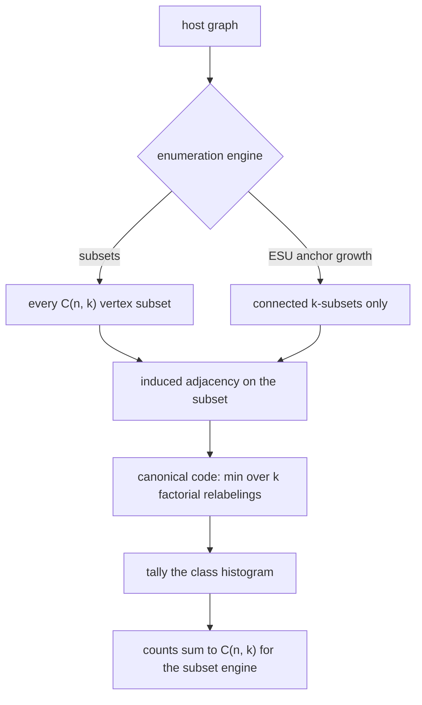
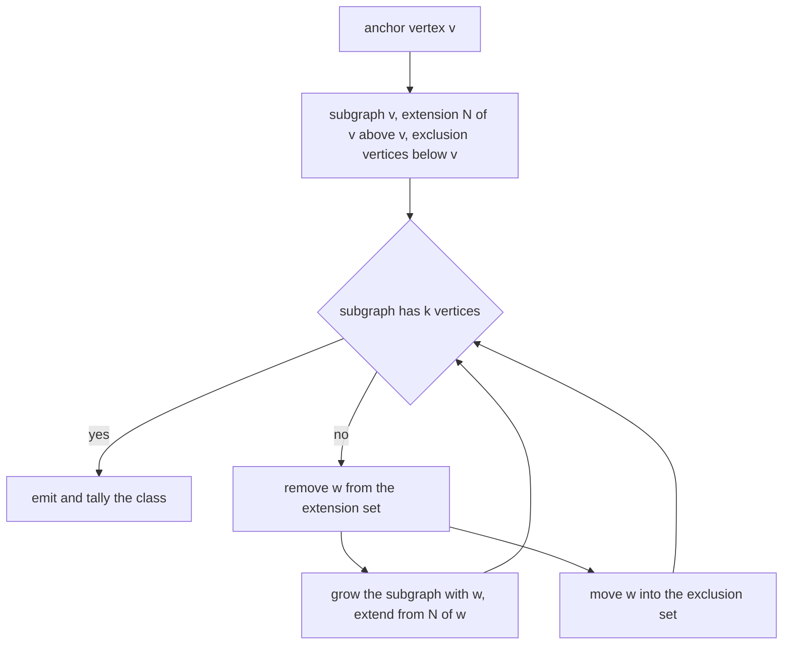
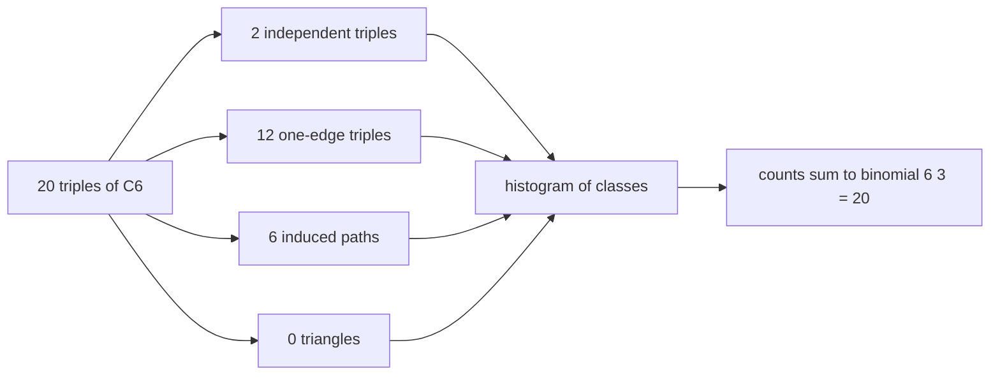
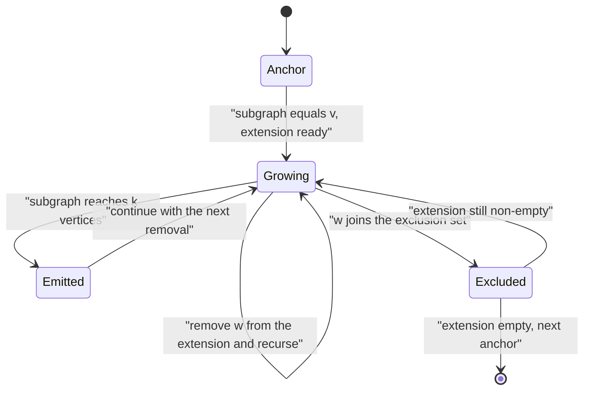

# 554 — Implement motif counting in small graphs (enumeration).

> **Tier:** Advanced · **CTCI chapter:** Ch 4 — Trees and Graphs
> **Task spec:** [554-implement-motif-counting-in-small-graphs-enumeration.md](../../../tasks/advanced/554-implement-motif-counting-in-small-graphs-enumeration.md)
> **Solutions:** [Python](../../../solutions/python/advanced/554-implement-motif-counting-in-small-graphs-enumeration/solution.py) ·
> [Java](../../../solutions/java/advanced/554-implement-motif-counting-in-small-graphs-enumeration/Solution.java) ·
> [JavaScript](../../../solutions/javascript/advanced/554-implement-motif-counting-in-small-graphs-enumeration/solution.js) ·
> [C#](../../../solutions/csharp/advanced/554-implement-motif-counting-in-small-graphs-enumeration/Solution.cs)

## 1. Problem restatement

**Input:** a small host graph and a motif size `k` (the files enumerate `k = 2..5`).

**Output:** the exact histogram of **induced** `k`-vertex motif classes — for every subset of `k`
vertices, classify the subgraph it induces and tally the class. The class counts must sum to
`C(n, k)`.

Two independent enumeration engines are implemented:

- **Subset enumeration.** Walk all `C(n, k)` vertex subsets, build the induced subgraph, and
  canonicalise it by minimising the `k(k-1)/2`-bit adjacency code over all `k!` relabelings.
- **ESU anchor growth (Wernicke).** For each vertex `v` start from `{v}` with extension set
  `N(v) ∩ {u > v}` and exclusion set `{u < v}`, expand by removing a vertex `w` from the extension,
  adding `N(w)` minus the exclusion set minus the current subgraph, recursing, and finally moving `w`
  into the exclusion set.

The documented numbers that make the tutorial checkable:

| Instance | Result | Why |
| --- | --- | --- |
| number of unlabelled graphs on `1..5` vertices | `1, 2, 4, 11, 34` | the canonicaliser is validated against the known class counts |
| number of connected graphs on `1..5` vertices | `1, 1, 2, 6, 21` | same, restricted to connected classes |
| three-vertex classes | `4` (independent, one edge, path, triangle) | named in the Python file |
| four-vertex classes | `11`, named as `K4, C4, K_{1,3}`, paw, diamond, `P4`, `P3`+isolated, `2K2`, `K2`+2 isolated, `K3`+isolated, independent-4 | the whole universe is pinned down |
| `C6`, `k = 3` | `2` independent triples, `12` one-edge triples, `6` induced paths, `0` triangles | the four counts partition `C(6,3) = 20` |
| `K5`, `k = 3` and `k = 4` | ten triangles, five `K4` | every triple and every 4-subset is complete |
| `K_{3,3}` | six stars (`K_{1,3}`) and nine four-cycles, nothing else | one star per centre, `C(3,2)·C(3,2)` four-cycles |
| `K3 ∪ K3` | two triangles, eighteen one-edge triples, no induced paths | the remaining triples straddle the components |
| signature (edge count + degree sequence) | complete for `k <= 4`, incomplete from `k = 5` | exactly 3 of the 31 signatures of 5-vertex graphs merge two isomorphism classes each, so it sees 31 buckets where there are 34 motifs |

## 2. Intuition

Motif counting by enumeration is the brute-force floor of the whole topic: extract every `k`-subset,
classify it, and tally. What makes it interesting is the *classification* step, because "the same
subgraph" is a statement about isomorphism, not about vertex labels.

The canonical form solves it in one stroke: pack the induced adjacency into a `k(k-1)/2`-bit integer
using a fixed bit order, then take the minimum over all `k!` relabelings of the subset's vertices.
Every isomorphism class gets exactly one representative code, so a dictionary keyed by that code *is*
the histogram. Because the same classifier can be applied to every labelled graph on `k` vertices, the
files derive the class counts `1, 2, 4, 11, 34` themselves instead of quoting them — and validate the
classifier against them.

The cheap alternative is a **signature**: the edge count plus the sorted degree sequence. It is
tempting because it is `O(k²)` instead of `O(k!·k²)`, and it is genuinely complete up to `k = 4`. But
from `k = 5` it fails: exactly 3 of the 31 signatures of 5-vertex graphs have to merge two
isomorphism classes each, so the signature sees 31 buckets where there are 34 motifs. That is the kind
of fact worth knowing before simplifying a classifier.



The second engine exists because connected motifs are what graphlet studies report, and growing along
edges only reaches connected subsets. That is also its limitation: a disconnected pattern can never be
produced by edge growth, so the two engines answer subtly different questions and their normalisation
must differ.

## 3. Algorithm

**Subset enumeration.**

1. For every `k`-subset of the vertices, read the induced adjacency as a `k(k-1)/2`-bit code.
2. Minimise that code over all `k!` relabelings of the subset's vertices — the canonical key.
3. Increment the tally for that key.
4. Verify that the tallies sum to `C(n, k)`, and that the keys reproduce the known class counts when
   the same classifier is applied to all labelled graphs on `k` vertices.

**ESU anchor growth.**

1. For each anchor vertex `v`, initialise the current subgraph `{v}`, the extension set
   `N(v) ∩ {u > v}` and the exclusion set `{u < v}`.
2. While the current subgraph has fewer than `k` vertices and the extension set is non-empty:
   1. Remove a vertex `w` from the extension set.
   2. If the current subgraph plus `w` has exactly `k` vertices, emit it.
   3. Otherwise recurse with `w` added to the subgraph and the extension set extended by
      `N(w) \ exclusion \ subgraph`.
   4. Move `w` into the exclusion set.
3. Classify every emitted subset with the same canonical key and tally.

```text
procedure count_motifs_by_subsets(graph, k)
    tally ← empty dictionary
    for every k-subset S of the vertices do
        key ← canonical_key(induced adjacency of S, k)
        tally[key] ← tally[key] + 1
    end
    assert sum of tallies equals binomial(n, k)
    return tally
end

procedure esu_emit(graph, k, v)
    extend({v}, neighbours of v with index greater than v, vertices with index less than v)
end

procedure extend(subgraph, extension, exclusion)
    if size of subgraph equals k then
        emit subgraph
        return
    end
    while extension is not empty do
        w ← any vertex in extension
        remove w from extension
        if size of subgraph plus one equals k then
            emit subgraph plus w
        else
            new_extension ← (neighbours of w minus exclusion minus subgraph minus extension)
            extend(subgraph plus w, new_extension, exclusion)
        end
        add w to exclusion
    end
end
```

The honest caveats are part of the algorithm description, not an afterthought:

- **ESU can repeat work here.** With an arbitrary removal order the same subset can be grown by
  several orders; on the fixed 8-vertex instance the raw traversal emits 68 subsets that collapse to
  53 distinct ones. The files memoise the emitted subsets and report the raw count next to the
  distinct count instead of hiding it, and what they verify is *coverage*: the emitted family equals
  an independently filtered family of connected `k`-subsets.
- **The signature is a trap from `k = 5` on.** Any implementation that classifies by edge count plus
  degree sequence will merge 3 pairs of classes at that size.



## 4. Worked example

Classify all `C(6, 3) = 20` triples of `C6`, which is the instance the files pin down by hand:

| Class | Count | Which triples |
| --- | --- | --- |
| independent triple | `2` | `{0, 2, 4}` and `{1, 3, 5}` — every other triple has an edge |
| one edge | `12` | the remaining triples that contain exactly one of the three "short" arcs |
| induced path `P3` | `6` | the six consecutive triples `{i-1, i, i+1}`, one per centre |
| triangle | `0` | `C6` has no triangle |
| total | `20` | equals `C(6, 3)` |

The same classifier on the complete graph gives the other sanity check: `K5` has `C(5,3) = 10`
triples, all of them triangles, and `C(5,4) = 5` four-subsets, all of them `K4`.

The subtlety that this table hides is *induced* versus *subgraph* counting, and the files make it
explicit:

| Question | Answer | Reason |
| --- | --- | --- |
| induced triangles in `K4` | `4` | one per choice of three vertices |
| labelled triangle occurrences in `K4` | `24` | `4 · 3 · 2` ordered embeddings, or `4` images × `3!` |
| `P3` occurrences in `C6` as a *subgraph* | `12` | six centres, and the two leaves may be assigned in either order — embeddings, not subsets |
| induced `P3` in `C6` | `6` | one per centre: the subset `{i-1, i, i+1}` — the same pattern counted per vertex subset instead of per embedding |
| `K_{3,3}`, `k = 4` | six `K_{1,3}` stars, nine `C4` | 3 centres × 1 choice of the other side for stars; `C(3,2)·C(3,2)` four-cycles |





`Growing -> Emitted -> Growing` is why the raw emission count can exceed the number of distinct
subsets: two different removal orders can both reach `k` vertices on the same underlying set. The
files memoise on the subset, so the tally stays correct, and the raw count is reported as a diagnostic.

## 5. Complexity

Let `n` be the host size, `k` the motif size and `C(n, k)` the binomial coefficient.

| Measure | Bound | Why it holds |
| --- | --- | --- |
| One canonical key | O(k! · k²) naive | every relabeling rebuilds the bit code |
| Subset enumeration | O(C(n, k) · k! · k²) | the classifier dominates every subset |
| ESU growth | O(reachable k-subsets × branching) | grows along edges, so only connected subsets can appear |
| ESU emissions | can exceed the distinct count | 68 raw emissions collapse to 53 distinct subsets on the fixed 8-vertex instance |
| Tally storage | O(number of classes) | 4 classes for `k = 3`, 11 for `k = 4`, 34 for `k = 5` |
| Space for the enumeration | O(k²) per subset, O(n) per recursion level for ESU | the subset itself plus the current subgraph, extension and exclusion sets |

The two engines trade coverage for reach: subset enumeration is exact for every class including
disconnected ones, while ESU touches only the connected subsets of the graph — efficient on sparse
graphs, but it cannot report a disconnected motif at all. That is why the files normalise connected
motif frequencies over the connected subsets and demonstrate that dividing the connected counts by
*all* subsets gives frequencies summing to considerably more than one.

## 6. Pitfalls and edge cases

- **Induced versus occurrence counting.** The histogram counts induced subgraphs: `K4` contains `4`
  induced triangles but `24` labelled triangle occurrences, and a triangle inside a larger clique is
  not a "triangle motif" in the induced sense at all. Stating which one you mean is not pedantry; the
  two numbers differ by a factor of `6` here.
- **Normalising connected counts over all subsets.** Because ESU emits only connected subsets, the
  frequencies must be divided by the number of connected `k`-subsets. Dividing by `C(n, k)` instead
  gives frequencies that sum to well over one — an error the files demonstrate on a concrete instance.
- **Duplicate ESU emissions.** With an arbitrary removal order the same subset can be grown several
  times (68 emissions versus 53 distinct subsets on the fixed 8-vertex instance). Memoise the emitted
  subsets, or enforce a canonical growth order; either way, verify *coverage* against an independent
  filter rather than assuming the textbook uniqueness claim.
- **Unreachable classes.** ESU can never emit a disconnected motif, so a histogram from ESU alone is
  missing classes by construction. The subset engine is the one that must produce the complete
  histogram.
- **The cheap signature.** Edge count plus sorted degree sequence classifies `k <= 4` exactly but
  merges 3 pairs of classes at `k = 5`. If you replace the canonical form with a signature, you have
  changed the definition of a motif class.
- **Cost of `k!`.** Canonicalising is `O(k!·k²)` per subset, so the technique stops being practical
  past `k = 5`. The files cap the enumeration at `k = 5` for exactly this reason.
- **Relabeling invariance.** The counts must not change if you rename the host's vertices, and the
  files assert that — it is the property that makes the histogram a statement about the graph rather
  than about the input ordering.
- **Cross-checks that are not the same algorithm.** The C# file counts *ordered* vertex tuples whose
  induced adjacency matches the motif and divides by the motif's automorphism count `|Aut|`, computed
  independently by brute force over `k!` relabelings. Two structurally different procedures agreeing is
  a much stronger check than running the same canonicaliser twice.
- **Degenerate sizes.** `k = 1` (one class per vertex, `n` subsets), `k = 2` (two classes: one edge or
  not), `k = n` (one subset), and `k > n` (no subsets) all need to behave; the files pin them down.
- **Randomness is only in the test data.** The algorithms here are deterministic; where random graphs
  are used they come from a full-period 64-bit generator read in its high bits, because the
  repository's 16-bit `lcg` has low-bit structure that would bias the edge density.
- **Closed forms as an oracle.** Triangles `= trace(A³)/6`, induced `P3 = sum over v of C(d_v, 2) - 3T`,
  one-edge triples `= (n-2)·m - 2·#P3 - 3T`, and independent triples as the remainder of `C(n,3)`
  partition the triples exactly, which makes them a genuine independent check on the enumeration.

## 7. Variants and follow-ups

- **Sampling instead of enumerating.** When `C(n, k)` is too large, the induced subgraph sampling of
  [553-implement-induced-subgraph-frequency-sampling.md](../../../tasks/advanced/553-implement-induced-subgraph-frequency-sampling.md)
  estimates the same frequencies with a known error, and its Metropolis walk targets the connected
  distribution ESU can enumerate exactly on small graphs.
- **Testing one pattern instead of all classes.** When the question is "does this specific motif
  occur", the search machinery of
  [551-implement-subgraph-isomorphism-backtracking-ullmann-outline.md](../../../tasks/advanced/551-implement-subgraph-isomorphism-backtracking-ullmann-outline.md)
  and [552-implement-vf2-algorithm-skeleton-for-subgraph-iso.md](../../../tasks/advanced/552-implement-vf2-algorithm-skeleton-for-subgraph-iso.md)
  answers it without enumerating every subset.
- **Triangles as a first-class primitive.** A clique count is the one motif cheap enough to compute
  from matrix algebra rather than enumeration, which is what
  [556-implement-adjacency-matrix-exponentiation-for-path-counting-fast.md](../../../tasks/advanced/556-implement-adjacency-matrix-exponentiation-for-path-counting-fast.md)
  exploits.
- **Compressing the classes.** Sketching neighbourhoods instead of enumerating subgraphs is the
  cheaper-but-approximate route of
  [550-implement-graph-sketches-for-neighborhood-similarity-minhash.md](../../../tasks/advanced/550-implement-graph-sketches-for-neighborhood-similarity-minhash.md).

## 8. Check yourself

1. Why does canonicalising over all `k!` relabelings succeed at identifying isomorphism classes?

<details><summary>Show answer</summary>

Two graphs on the same `k` vertices are isomorphic exactly when some relabeling maps one onto the
other. The adjacency code of a fixed labelling is one number per relabeling, so the *set* of codes
generated by all `k!` relabelings is an isomorphism invariant — and taking the minimum picks a
canonical representative of that set. Hence equal minima imply isomorphic induced subgraphs, and
different minima imply non-isomorphic ones. The files validate the classifier by reproducing the known
class counts `1, 2, 4, 11, 34`.

</details>

2. `C6` with `k = 3` yields `2` independent triples, `12` one-edge triples and `6` induced paths. Why
   are there no triangles?

<details><summary>Show answer</summary>

Because `C6` is triangle-free: three vertices of a 6-cycle can induce at most two edges unless they
are consecutive, in which case they induce a path. The counts add up to `2 + 12 + 6 = 20 = C(6,3)`,
which is the check the files assert.

</details>

3. Why can ESU not produce a disconnected motif?

<details><summary>Show answer</summary>

Because it grows the subgraph along edges: every extension vertex is added from the neighbourhood of a
vertex already in the subgraph, so the subgraph is connected at every step and stays connected when it
reaches `k` vertices. A disconnected `k`-subset is never generated, hence frequencies computed from
ESU output must be normalised over connected subsets — dividing by `C(n,k)` inflates them.

</details>

4. The signature "edge count plus sorted degree sequence" is complete for `k <= 4`. Where does it
   break, and how badly?

<details><summary>Show answer</summary>

It breaks at `k = 5`: exactly 3 of the 31 signatures of 5-vertex graphs are shared by two isomorphism
classes each, so the signature distinguishes 31 buckets where there are 34 motifs. In other words the
merge is small and easy to miss, which is precisely why it is worth documenting instead of relying on
the cheaper classifier.

</details>

5. Why does the C# file count ordered tuples and divide by `|Aut|` instead of just enumerating
   subsets?

<details><summary>Show answer</summary>

As an independent oracle. Enumerating subsets and canonicalising answers the question directly;
counting ordered vertex tuples whose induced adjacency matches the motif and dividing by the motif's
automorphism count `|Aut|` is a structurally different procedure that must produce the same number.
Agreement between two different derivations is much stronger evidence than agreement of an
implementation with itself.

</details>
