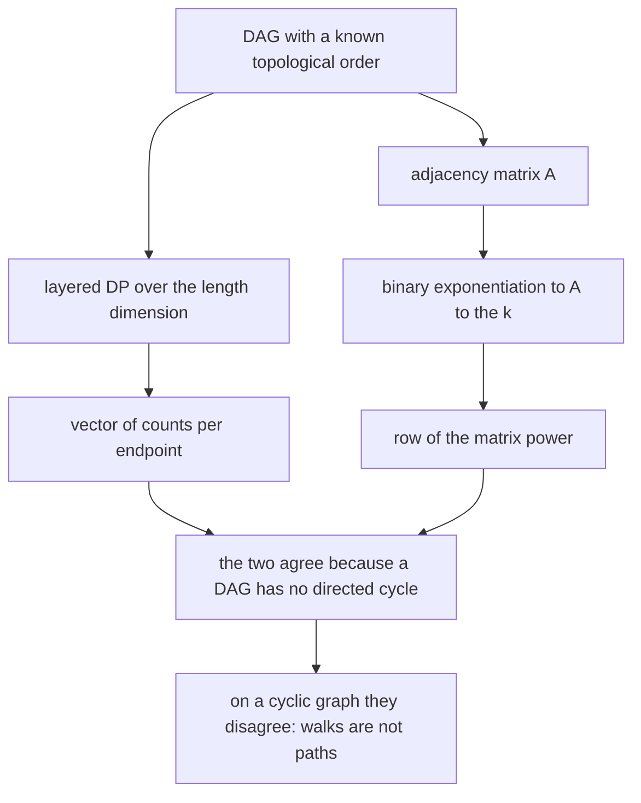
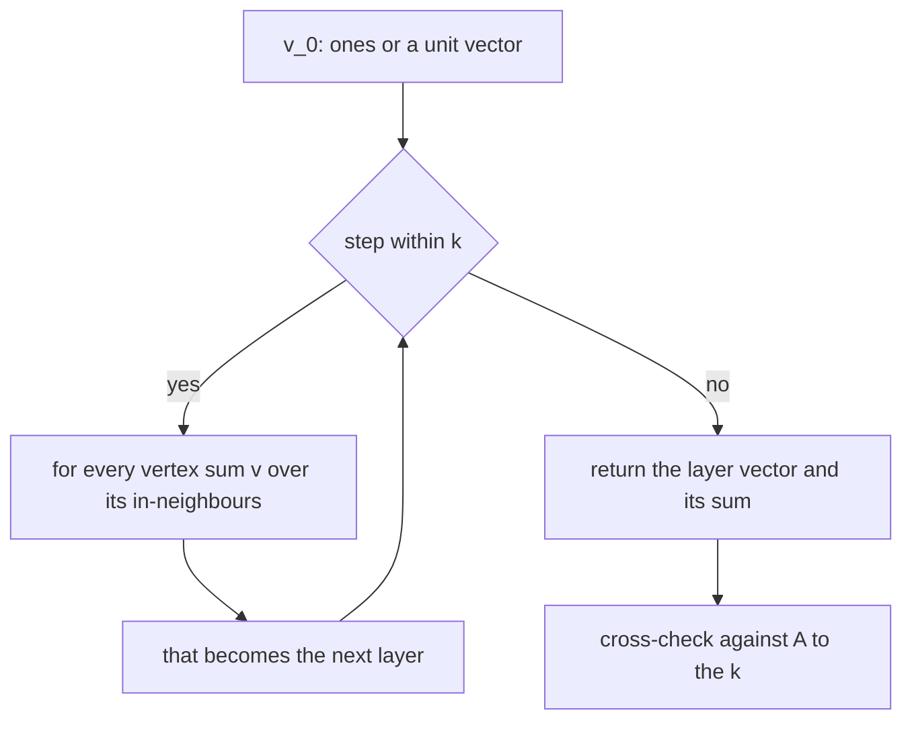
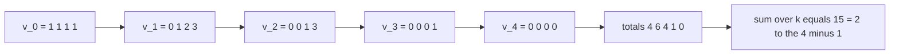
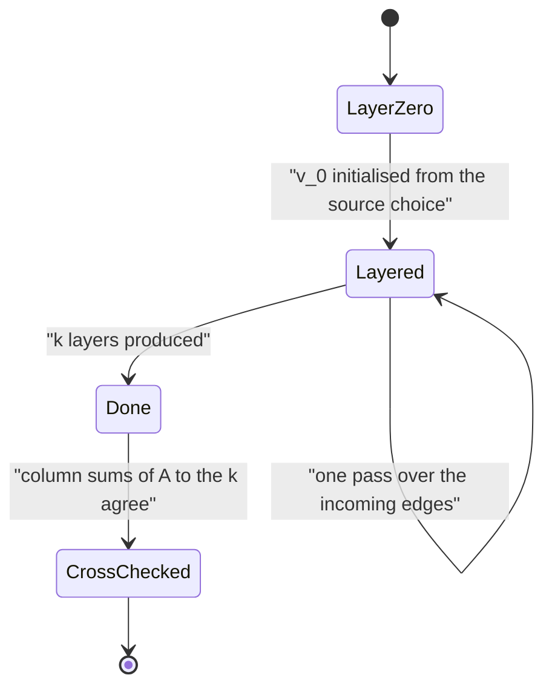

# 555 — Implement dynamic programming for counting paths of length k in DAG (matrix exponentiation).

> **Tier:** Advanced · **CTCI chapter:** Beyond — Advanced Data Structures & Algorithms
> **Task spec:** [555-implement-dynamic-programming-for-counting-paths-of-length-k-in.md](../../../tasks/advanced/555-implement-dynamic-programming-for-counting-paths-of-length-k-in.md)
> **Solutions:** [Python](../../../solutions/python/advanced/555-implement-dynamic-programming-for-counting-paths-of-length-k-in/solution.py) ·
> [Java](../../../solutions/java/advanced/555-implement-dynamic-programming-for-counting-paths-of-length-k-in/Solution.java) ·
> [JavaScript](../../../solutions/javascript/advanced/555-implement-dynamic-programming-for-counting-paths-of-length-k-in/solution.js) ·
> [C#](../../../solutions/csharp/advanced/555-implement-dynamic-programming-for-counting-paths-of-length-k-in/Solution.cs)

## 1. Problem restatement

**Input:** a directed **acyclic** graph with `n` vertices (`0..n-1` in topological order for the seeded
instances, which draw an edge `i -> j` with a fixed probability for `i < j`), an edge count `k`, and
optionally a source vertex.

**Output:** the number of paths with **exactly `k` edges**. Two shapes of the answer appear in the
files:

- the vector `v_k`, where `v_k[j]` counts the paths ending at `j` (or starting at `j` in the Java
  formulation `dp[i][l]`), and
- the scalar total, `sum of v_k`, or `v_k[source]` when a single source or target is wanted.

Three independent counters are implemented, and the whole point of the task is that they agree:

1. **Layered DP.** `v_0[v] = 1` for every vertex (the empty path at `v`), and
   `v_{t+1}[v] = sum over in-neighbours u of v of v_t[u]`, for `k` passes.
2. **Matrix exponentiation.** `v_k = v_0 · A^k`, where `A` is the adjacency matrix, computed by binary
   exponentiation with exact integers — and in modular mode modulo `1000000007`.
3. **Brute-force reference.** DFS enumeration of walks, plus a subset DP over the vertex set that
   counts ordered *simple* paths (exponential, used only as an oracle).

The documented facts:

| Instance | Result | Why |
| --- | --- | --- |
| complete DAG on `n` vertices, all sources | `C(n, k+1)` paths of length `k` | the binomial closed form |
| complete DAG, source `i` | `C(n - 1 - i, k)` | paths from `i` choose `k` increasing successors |
| complete DAG, all lengths summed | `2^n - 1` | `sum over k of C(n, k+1) = 2^n - 1` |
| any DAG, `k = 0` | identity: `n` trivial paths | the empty path at each vertex |
| any DAG, `k >= n` | `A^k` is the zero matrix, `v_k = 0` | no path can have `n` or more edges |
| topological order | every edge respects it | Kahn's algorithm, smallest ready vertex first |
| binary exponentiation | at most `2·ceil(log2 k)` matrix multiplications | versus `k - 1` for repeated multiplication |
| directed 3-cycle `0 -> 1 -> 2 -> 0`, `k = 3` | matrix power reports `3` closed walks, simple paths are `0` | **the honest counterexample**: `A^k` counts walks |
| undirected triangle, `k = 3` | `6` versus `0` | same divergence in the symmetric case |

## 2. Intuition

The naive way to count paths of length `k` is to enumerate them, which is exponential even on a DAG.
The layered observation kills that: a path of `t + 1` edges ending at `v` is a path of `t` edges
ending at some in-neighbour of `v`, followed by the last edge. So instead of tracking paths, track
*counts per endpoint* and extend them one layer at a time.

```text
v_0[v] = 1                                   the empty path at v
v_{t+1}[v] = sum over u in N_in(v) of v_t[u]
answer = sum over v of v_k[v]                or v_k[target] for one destination
```

That is a dynamic program over the length dimension, and each layer costs one pass over the incoming
edges: `O(k · (n + m))` total. Because the graph is acyclic, the layers are also consistent with a
topological order, which is what the files check by running the same DP while explicitly relaxing
vertices in Kahn's order.

The second idea — matrix exponentiation — is what makes *large* `k` feasible. `(A^k)[i][j]` counts
walks of length `k` from `i` to `j`, and binary exponentiation reaches `A^k` in
`O(n³ · log k)` instead of `O(n³ · k)`. The price is the word *walk*:

- On a **DAG**, every walk is automatically a simple path, because revisiting a vertex would require a
  directed cycle. So the matrix power counts exactly what the DP counts, and the files assert the
  agreement on every instance.
- On a graph **with cycles** the two counters diverge, and the files turn that into an asserted
  counterexample rather than a footnote: on the directed 3-cycle the matrix power reports `3` closed
  walks of length 3, while there is no simple path of length 3 at all; on the undirected triangle the
  numbers are `6` and `0`.



The distinction matters beyond pedantry: "number of paths of length `k`" is a different question from
"number of walks of length `k`", and only on a DAG are the answers the same.

## 3. Algorithm

**Layered DP (the primary method).**

1. Build the incoming-neighbour lists.
2. Initialise `v_0`: all ones for "any source", or a unit vector for a single source.
3. Repeat `k` times: compute `following[v] = sum of v[u] over u in N_in(v)`, then set `v = following`.
4. Report `v` and its sum; for a single destination, report `v[target]`.

**Topological variant.** The same recurrence, but each layer relaxes the vertices in an explicit
topological order produced by Kahn's algorithm with the smallest ready vertex first (for
determinism); the file asserts that every edge goes forward in that order.

**Matrix exponentiation.**

1. Build the `n × n` adjacency matrix.
2. Compute `A^k` by binary exponentiation: square the running power, multiply it in when the
   corresponding bit of `k` is set, all with exact integers (or modulo `1000000007`).
3. Apply the start vector, or read the required entry: `v_k[j] = sum over i of v_0[i] · (A^k)[i][j]`.

```text
procedure path_vector_dp(n, incoming, k, source)
    if source is none then
        vector ← all ones
    else
        vector ← unit vector at source
    end
    for step ← 1 to k do
        following ← zero vector
        for v ← 0 to n - 1 do
            total ← 0
            for u in incoming[v] do
                total ← total + vector[u]
            end
            following[v] ← total
        end
        vector ← following
    end
    return vector, sum of vector
end

procedure matrix_power(A, k)
    result ← identity matrix
    power ← A
    while k > 0 do
        if k is odd then result ← result times power end
        power ← power times power
        k ← k divided by 2
    end
    return result
end
```

Two invariants make the cross-checks meaningful: `v_k` must equal the column sums of `A^k` (and the
`source` row applied to `A^k` when a source is fixed), and the DP in topological order must produce
the identical vector to the DP in index order — otherwise the order assumption is broken.



## 4. Worked example

Take the complete DAG on `n = 4` vertices: edges `i -> j` for every `i < j`, which is exactly the
structure of the `C(n, k+1)` closed form. Running the DP with all sources (`v_0` = all ones):

| Step | `v_t` | Total | Closed form | Check |
| --- | --- | --- | --- | --- |
| `t = 0` | `(1, 1, 1, 1)` | `4` | `C(4, 1)` | one empty path per vertex |
| `t = 1` | `(0, 1, 2, 3)` | `6` | `C(4, 2)` | vertex `v` has `v` in-neighbours |
| `t = 2` | `(0, 0, 1, 3)` | `4` | `C(4, 3)` | `v_2[3] = 0 + 1 + 2` |
| `t = 3` | `(0, 0, 0, 1)` | `1` | `C(4, 4)` | only the chain `0 -> 1 -> 2 -> 3` |
| `t = 4` | `(0, 0, 0, 0)` | `0` | — | `k >= n`, so `A^4` is the zero matrix |

The totals `4 + 6 + 4 + 1 = 15 = 2^4 - 1` match the documented identity `sum over k of C(n, k+1)`,
and the per-source form is the other closed form: from source `0`, the numbers of paths of length
`k = 1, 2, 3` are `C(3,1) = 3`, `C(3,2) = 3`, `C(3,3) = 1`.

The matrix side of the same instance: `A` is strictly upper triangular (all entries below the
diagonal are zero, including the diagonal itself), so `A^4 = 0` follows from triangularity alone —
which is why "`k >= n` gives zero" is a statement about the graph rather than about the DP.

The counterexample the files assert uses the same machinery outside its valid domain:

| Graph | `k` | Matrix power `A^k` trace-ish count | Simple paths | Note |
| --- | --- | --- | --- | --- |
| directed 3-cycle `0 -> 1 -> 2 -> 0` | `3` | `3` closed walks | `0` | the walk `0->1->2->0` revisits `0` and has no vertices left |
| undirected triangle | `3` | `6` closed walks | `0` | two orientations per starting vertex |





## 5. Complexity

Let `n` be the vertex count, `m` the edge count and `k` the requested path length.

| Method | Time | Space | Why |
| --- | --- | --- | --- |
| Layered DP | `O(k · (n + m))` | `O(n + m)` | one pass over incoming edges per layer |
| Topological DP | `O(k · (n + m))` plus `O(n + m)` for Kahn's order | `O(n + m)` | same recurrence, explicit vertex order, plus the order check |
| Matrix exponentiation | `O(n³ · log k)` | `O(n²)` | `log k` squarings and up to `log k` multiplies of `n × n` matrices |
| Matrix multiplications | at most `2·ceil(log2 k)` | — | versus `k - 1` for repeated multiplication |
| Brute-force DFS | exponential in `k` | `O(k)` recursion | enumerates actual walks, so it is the slow oracle |
| Subset DP over the vertex set | `O(2^n · n)` | `O(2^n · n)` | counts ordered simple paths exactly; oracle only |
| Exact integers | plus the cost of big-integer arithmetic | — | Python and the exact-integer modes keep full precision |
| Modular mode | cheap `O(n³ log k)` in machine words | `O(n²)` | modulo `1000000007`, asserted to agree with the exact result |

The two main methods trade `k` for `log k`: the DP is linear in the length and cheap per layer, the
matrix power is logarithmic in the length and cubic per operation. For small `k` on a sparse graph the
DP wins by a wide margin; for enormous `k` on a small dense graph only the matrix power is feasible.
Both are implemented so the choice can be demonstrated rather than asserted.

## 6. Pitfalls and edge cases

- **Walks versus paths.** `A^k` counts walks. On a DAG they coincide because a walk cannot revisit a
  vertex; on any graph with a cycle they do not. The files assert the divergence on the directed
  3-cycle (`3` versus `0`) and on the undirected triangle (`6` versus `0`) rather than mentioning it in
  prose.
- **`k = 0`.** The answer is the identity: `n` trivial paths, one per vertex, and `v_0` is the all-ones
  vector or a unit vector depending on the source choice. Returning `0` here is a common off-by-one.
- **`k >= n` on a DAG.** No path can be longer than `n - 1` edges, so `A^k` is the zero matrix and
  `v_k` is the zero vector; the assertion exists to catch "the DP kept going because nothing stopped
  it".
- **Completed DAG totals.** The identity `sum over k of C(n, k+1) = 2^n - 1` is a check on the
  *sum over lengths*, not on any single layer; the files use it to validate the whole run at once.
- **Topological order assumptions.** The index-order DP is only valid because the seeded instances
  guarantee `i < j` for every edge. Where the order is not known by construction, the files compute it
  with Kahn's algorithm (smallest ready vertex first, for determinism) and assert that every edge goes
  forward; running the DP on a cyclic graph without noticing gives numbers that look plausible.
- **Overflow.** Counts grow exponentially: on a complete DAG the total is `2^n - 1`. Python and the
  exact-integer modes handle that, but fixed-width integers need a modulus — which is why the files
  carry a modular mode and assert that it agrees with the exact result on the instances where both fit.
- **Exponentiation cost.** Repeated multiplication is `k - 1` matrix products; binary exponentiation is
  at most `2·ceil(log2 k)`. The difference is the reason to write the squaring loop carefully rather
  than loop `k` times.
- **Matrix versus vector.** Multiplying `v_k = v_0 · A^k` column-wise and reading one entry is cheaper
  than materialising the whole product; the files check the vector formulation against the full `A^k`
  so that both readings are pinned down.
- **Source conventions.** With no source the DP counts all `n` starting points; with a source it counts
  paths from that vertex. Mixing the two silently changes every total by a factor equal to the number
  of feasible sources.
- **Random DAG generation.** Edges are drawn from a full-period 64-bit generator read in its high bits,
  because the repository's 16-bit `lcg` has low-bit structure that would correlate consecutive edge
  decisions and quietly bias the density.
- **Oracle limits.** The subset DP over the vertex set is exponential, so it can only validate small
  instances; beyond that the cross-check has to be between the DP and the matrix power, which are
  different algorithms but share the same graph representation.

## 7. Variants and follow-ups

- **Fast matrix power as the topic itself.** The squaring loop and its costs are the subject of
  [556-implement-adjacency-matrix-exponentiation-for-path-counting-fast.md](../../../tasks/advanced/556-implement-adjacency-matrix-exponentiation-for-path-counting-fast.md).
- **A different semiring.** Replacing `(+, ×)` by `(min, +)` turns "how many paths" into "the shortest
  path", with the same exponentiation skeleton:
  [557-implement-algebraic-path-finding-with-min-plus-matrix-multiply-t.md](../../../tasks/advanced/557-implement-algebraic-path-finding-with-min-plus-matrix-multiply-t.md).
- **Linearity beyond path counting.** The same "linear recurrence, exponentiate a matrix" pattern drives
  [559-implement-fast-exponentiation-of-linear-recurrences-using-matrix.md](../../../tasks/advanced/559-implement-fast-exponentiation-of-linear-recurrences-using-matrix.md).
- **When the counts are motifs instead of paths.** Enumerating induced subgraphs rather than walks is
  the enumeration task
  [554-implement-motif-counting-in-small-graphs-enumeration.md](../../../tasks/advanced/554-implement-motif-counting-in-small-graphs-enumeration.md).

## 8. Check yourself

1. Why does the layered recursion count paths at all, given that it never stores a path?

<details><summary>Show answer</summary>

Because every path of `t + 1` edges ending at `v` decomposes uniquely into a path of `t` edges ending
at some in-neighbour `u` followed by the edge `u -> v`. Summing the counts over all in-neighbours
therefore counts exactly the extensions, with no double counting: distinct paths have distinct
prefixes and different last edges. The DP tracks only the counts, which is why it is linear in the
length rather than exponential.

</details>

2. On `K4`'s complete DAG orientation, why is the number of length-2 paths equal to `C(4, 3) = 4`?

<details><summary>Show answer</summary>

A path of length `k` in a complete DAG is determined by the set of `k + 1` vertices it visits, in
increasing order, so the count is the number of `(k+1)`-subsets: `C(n, k+1)`. For `n = 4` and `k = 2`
that is `C(4, 3) = 4`. The worked-example table shows the same number as the total of `v_2`.

</details>

3. When is `A^k` a legitimate answer to "count the paths of length `k`"?

<details><summary>Show answer</summary>

Only on a graph with no directed cycle, where every walk is automatically a simple path. On the
directed 3-cycle the matrix power reports 3 closed walks of length 3 while no simple path of length 3
exists; on the undirected triangle the counts are 6 and 0. The files assert both divergences, so the
legitimacy of the matrix answer is tied to acyclicity rather than to the matrix.

</details>

4. Why is the DP's index-order and topological-order equality worth asserting?

<details><summary>Show answer</summary>

Because the recurrence reads `v_t[u]` for in-neighbours `u` of `v`, so the layer has to be complete
before it is read. Relaxing in a valid topological order guarantees that; the files compute the order
independently with Kahn's algorithm, assert that every edge goes forward in it, and then check that
both orders produce the same vector. If they did not, the "acyclic" premise of the whole task would be
broken.

</details>

5. Why keep a brute-force walk enumerator and an exponential subset DP in the same file?

<details><summary>Show answer</summary>

As independent oracles with different failure modes. The DFS enumerator validates the counts on small
instances where walks and paths coincide; the subset DP counts *ordered simple paths* directly from the
definition, so it can validate the DP on a DAG *and* expose the walk-versus-path difference on a cyclic
graph. Agreement between three algorithms that share only the input graph is much stronger evidence
than agreement between two variants of the same loop.

</details>
