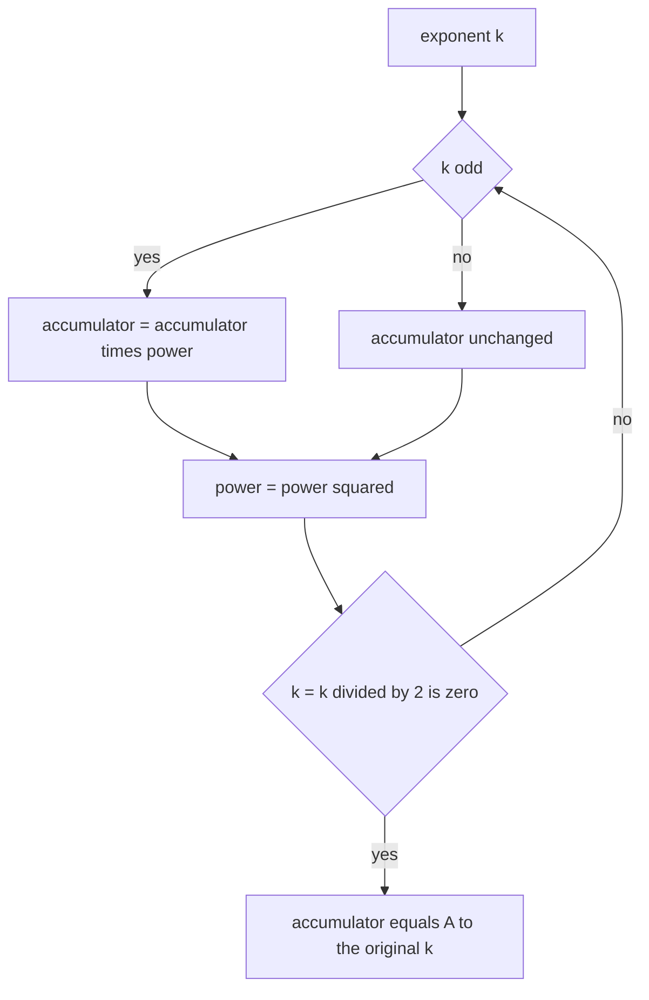
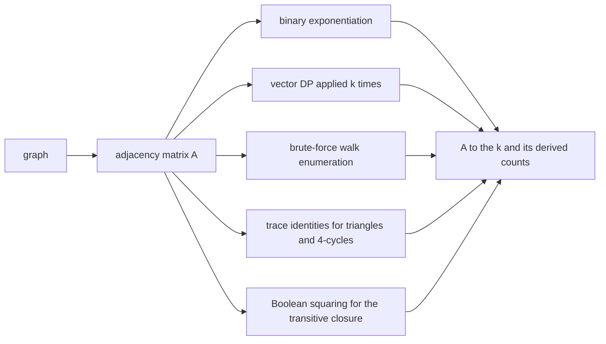
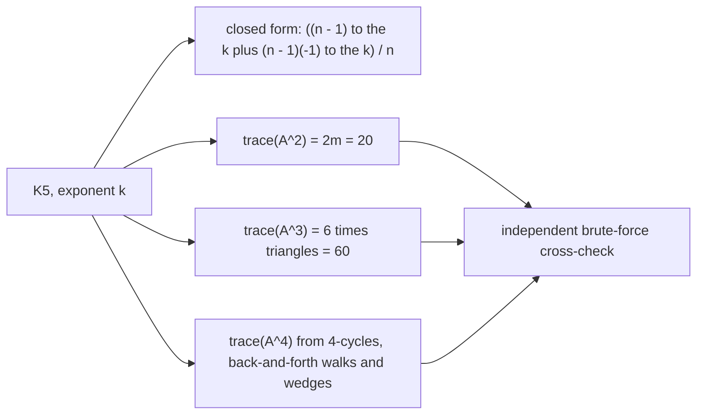
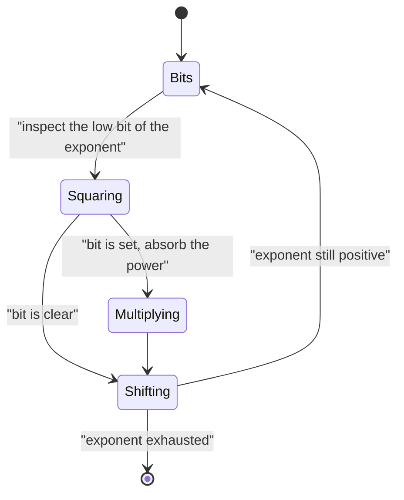

# 556 — Implement adjacency matrix exponentiation for path counting (fast exponent).

> **Tier:** Advanced · **CTCI chapter:** Beyond — Advanced Data Structures & Algorithms
> **Task spec:** [556-implement-adjacency-matrix-exponentiation-for-path-counting-fast.md](../../../tasks/advanced/556-implement-adjacency-matrix-exponentiation-for-path-counting-fast.md)
> **Solutions:** [Python](../../../solutions/python/advanced/556-implement-adjacency-matrix-exponentiation-for-path-counting-fast/solution.py) ·
> [Java](../../../solutions/java/advanced/556-implement-adjacency-matrix-exponentiation-for-path-counting-fast/Solution.java) ·
> [JavaScript](../../../solutions/javascript/advanced/556-implement-adjacency-matrix-exponentiation-for-path-counting-fast/solution.js) ·
> [C#](../../../solutions/csharp/advanced/556-implement-adjacency-matrix-exponentiation-for-path-counting-fast/Solution.cs)

## 1. Problem restatement

**Input:** a graph as an adjacency matrix (or bitmask rows), an exponent `k` — possibly enormous, the
JavaScript header mentions `k = 10^9` — and optionally a modulus.

**Output:** the walk-counting matrix `A^k`, where `(A^k)[i][j]` is the number of **walks** of exactly
`k` edges from `i` to `j`, together with the derived quantities the files check (total walks, closed
walks on the diagonal, traces) and a count of how many matrix multiplications the exponentiation
performed.

Four engines are implemented so the numbers can be cross-checked rather than trusted:

1. **Binary exponentiation, bottom-up** (square-and-multiply) with exact integers or modulo
   `1000000007`.
2. **Top-down recursion** of the same algorithm, as a structurally different implementation.
3. **Repeated multiplication** (`k - 1` products), the baseline the first two are measured against.
4. **Boolean and GF(2) engines**, which multiply matrices with bit rows and bit columns and count
   *word* operations (`n²` of them) instead of scalar ones (`n³`).

The documented facts:

| Check | Statement | Why |
| --- | --- | --- |
| `A^0` | the identity matrix | the empty walk |
| `A^1` | `A` itself | one edge |
| semigroup law | `A^a · A^b = A^(a+b)` | associativity of composition |
| squaring | `(A^m)² = A^(2m)` | the identity that makes exponentiation fast |
| vector DP | applying `A` to a vector `k` times equals `A^k` | `O(k·n²)` versus `O(n³·log k)` |
| brute force | walk enumeration for `k = 0..6` on 5- and 6-vertex graphs | the independent reference |
| multiplication count | at most `2·floor(log2 k)` products (plus one in some implementations) | versus `k - 1` for repeated multiplication |
| complete graph | closed walks `((n-1)^k + (n-1)·(-1)^k)/n`; between distinct vertices `((n-1)^k - (-1)^k)/n` | the spectral closed form |
| traces | `trace(A²) = 2m`, `trace(A³) = 6·(triangles)`, `trace(A⁴) = 8·(4-cycles) + 2m + 2·sum over v of d_v(d_v - 1)` | 4-cycles brute-forced: `K4 -> 3`, `K_{3,3} -> 9` |
| bipartite graphs | a tree and a star have zero odd traces | no odd cycles |
| Boolean engine | squaring `(I or A)` `ceil(log2(n-1))` times reaches exactly the BFS/Floyd–Warshall transitive closure | verified on random graphs up to 8 vertices |
| bipartiteness by trace | an undirected graph has no odd closed walk of length at most `n` **iff** it is bipartite | iterating odd `trace(A^k)` agrees with a BFS two-colouring on every random instance |
| honest caveat | `A^k` counts walks, not simple paths: `K3` has six closed 3-walks and **no** simple closed walk of length 3 | asserted, not footnoted |

## 2. Intuition

Why does a matrix power count walks? Because `(A²)[i][j] = sum over p of A[i][p]·A[p][j]` sums over
the intermediate vertex — a length-2 walk `i -> p -> j` is exactly a choice of an intermediate `p`
with both edges present. Induction gives the general statement: a walk of length `k` from `i` to `j`
decomposes into a walk of length `k - 1` from `i` to some `p` followed by the edge `p -> j`, and matrix
multiplication is the operator that performs exactly that summation.

Then the *fast* part is square-and-multiply. The naive loop needs `k - 1` products of `n × n`
matrices, so `O(n³·k)`. Binary exponentiation uses the identities

```text
A^0 = I            (A^a) · (A^b) = A^(a + b)            (A^m)^2 = A^(2m)
```

to represent `A^k` as a product of `O(log k)` squared powers, one for each set bit of `k`, costing at
most `2·floor(log2 k)` matrix products and `O(n³·log k)` time. That is what makes `k = 10^9`, or the
finite `k = n - 1` needed for a transitive closure, practical.



The Boolean engine is the same skeleton over a different algebra: over GF(2) addition is XOR, so
counts collapse to reachability, and squaring `(I or A)` `ceil(log2(n-1))` times yields the transitive
closure — the same information breadth-first search produces, obtained by matrix algebra instead of
traversal. The files compare that against both a BFS closure and a Floyd–Warshall closure, which is
what makes the matrix route credible.

## 3. Algorithm

1. Build the `n × n` adjacency matrix, or keep the graph as bitmask rows for the Boolean engines.
2. Convert the exponent to binary and iterate over its bits from the least significant:
   1. If the current bit is set, multiply the accumulator by the running power.
   2. Square the running power.
   3. Shift the exponent right by one bit.
3. Return the accumulator; every multiplication is done exactly, or modulo `1000000007` when the counts
   grow too large for machine words (the files assert that the modular and exact results agree where
   both are representable).
4. Cross-check, on the same graph:
   - the `k`-step **vector DP** (`O(k·n²)`), which applies `A` to a vector repeatedly,
   - **brute-force** enumeration of walks for small `k`, and a separate brute force for closed walks on
     the diagonal,
   - the **trace identities** (`trace(A²) = 2m`, `trace(A³) = 6·triangles`, the 4-cycle formula),
   - the **Boolean** transitive closure against BFS and Floyd–Warshall.

```text
procedure matpow(A, k, mod)
    n ← number of rows of A
    result ← identity matrix of size n
    power ← A
    while k > 0 do
        if k is odd then
            result ← matmul(result, power, mod)
        end
        power ← matmul(power, power, mod)
        k ← k divided by 2
    end
    return result
end

procedure boolean_closure(A, n)
    reach ← A with the diagonal set
    steps ← ceil(log2(n - 1))
    for step ← 1 to steps do
        reach ← boolean_product(reach, reach)
    end
    return reach
end
```

Counting the multiplications is part of the algorithm description, not a benchmark: the files tally
`n³` scalar operations per product so that "fast" is a measured claim. The same reasoning applies to
the Boolean engine, where one product costs `n²` word operations because each row is a machine word:
the file reports the operation counts instead of wall-clock seconds, "precisely because wall-clock
timing is not a portable assertion".



## 4. Worked example

Take the complete graph `K5`, where the spectral closed form gives everything by hand. With `n = 5`
and eigenvalues `4` and four copies of `-1`:

```text
closed walks of length k from a vertex to itself   ((n - 1)^k + (n - 1)(-1)^k) / n
walks of length k between two distinct vertices    ((n - 1)^k - (-1)^k) / n
```

| `k` | closed walks per vertex | `trace(A^k)` | distinct pair count | sanity check |
| --- | --- | --- | --- | --- |
| 1 | `(4 - 4)/5 = 0` | `0` | `(4 + 1)/5 = 1` | no loops, one edge between distinct vertices |
| 2 | `(16 + 4)/5 = 4` | `20 = 2m` | `(16 - 1)/5 = 3` | four back-and-forth walks per vertex; three intermediates per pair |
| 3 | `(64 - 4)/5 = 12` | `60` | `(64 + 1)/5 = 13` | `trace(A³) = 6 · 10 = 60`, and `K5` has `C(5,3) = 10` triangles |
| 4 | `(256 + 4)/5 = 52` | `260` | `(256 - 1)/5 = 51` | `trace(A⁴)` decomposes into 4-cycles, back-and-forth walks and wedges |

The `k = 2` and `k = 3` rows are the two identities the file checks independently:
`trace(A²) = 2m = 20` for `m = 10` edges, and `trace(A³) = 6 · 10 = 60`. The `k = 4` formula is the
interesting one — `trace(A⁴) = 8·(4-cycles) + 2m + 2·sum over v of d_v(d_v - 1)` — and it is validated
against a brute force over vertex quadruples rather than against itself; for `K4` that brute force
counts `3` four-cycles and for `K_{3,3}` it counts `9`.

Two more instances come from the same identities. A **tree or a star** is bipartite, so it has no odd
cycles and every odd trace is zero — the file asserts that directly. And the `K3` caveat is settled by
the same formula that produced the table:

| Question | Answer | Note |
| --- | --- | --- |
| closed 3-walks in `K3` | `6` | two orientations per starting vertex around the triangle |
| simple closed walks of length 3 | `0` | a closed walk of length 3 on 3 vertices would have to repeat an edge |
| closed 3-walks in `K5` | `60` | `6 · 10` triangles |





The number of `Bits -> Squaring -> Multiplying -> Shifting` rounds is `ceil(log2 k)`, which is where
the `2·floor(log2 k)` product bound comes from: one square per bit, one multiply per set bit.

## 5. Complexity

Let `n` be the vertex count, `m` the edge count and `k` the exponent.

| Method | Time | Space | Note |
| --- | --- | --- | --- |
| Binary exponentiation | `O(n³ · log k)` | `O(n²)` | at most `2·floor(log2 k)` (some implementations `+1`) matrix products |
| Repeated multiplication | `O(n³ · k)` | `O(n²)` | `k - 1` products; the baseline the fast route is measured against |
| Vector DP (`A` applied `k` times) | `O(k · n²)` | `O(n)` | cheaper per step, linear in `k`, so it wins for small exponents |
| Brute-force walk enumeration | exponential in `k` | `O(k)` | exact reference for `k = 0..6` on 5- and 6-vertex graphs |
| Trace identities | `O(n³)` | `O(n²)` | `trace(A^k)` from one matrix power |
| Boolean transitive closure | `O(n² · log n)` word operations | `O(n)` words | `ceil(log2(n - 1))` squarings of bit-row matrices |
| Naive Boolean product | `O(n³)` scalar bit operations | `O(n²)` | the bit-row engine replaces this by `n²` word operations |
| Modular mode | same asymptotics | `O(n²)` | keeps the numbers in machine words instead of big integers |

The operation-count comparison is the honest form of "fast": one matrix product is `n³` scalar
operations, so `2·floor(log2 k)` products beat `k - 1` products as soon as `k` is more than a few
thousand, and the Boolean engine's `n²` word operations collapse the factor `n` for reachability
questions. What exponentiation cannot fix is that the answer itself is an `n × n` matrix.

## 6. Pitfalls and edge cases

- **Walks are not paths.** `A^k` counts walks, so vertices may repeat. `K3` has six closed 3-walks and
  no simple closed walk of length 3; on a DAG the two notions coincide, which is why task 555 can use
  the matrix power as a path counter.
- **`k = 0`.** The answer is the identity, not the zero matrix; getting this wrong breaks the semigroup
  identity `A^a·A^b = A^(a+b)` and silently corrupts any exponentiation that starts from a wrong base.
- **Overflow.** Walk counts grow like `(n-1)^k`, so `k = 10^9` is astronomically large. The files use
  exact integers or `BigInt`/`BigInteger` for verification and a modulus (`1000000007`) for the
  practical path, asserting that the two agree where both are representable.
- **Counting operations versus timing.** Wall-clock assertions are not portable, so the files count
  `n³` scalar operations per product and `n²` word operations for the bit-row engine. "Fast" has to be
  substantiated by a counter, not by a stopwatch.
- **Boolean versus GF(2) versus integer algebra.** The Boolean engine answers reachability (OR/AND),
  the GF(2) engine answers parity of walk counts (XOR/AND), and the integer engine answers exact
  counts. They agree only in the special cases the files check (the closure, the parity of the exact
  trace), and confusing them is a classic source of wrong "path counts".
- **Transitive closure needs `(I or A)`, not `A`.** Squaring `A` alone misses zero-length reachability,
  and it needs `ceil(log2(n-1))` squarings to saturate — the file verifies the result against both a
  BFS closure and a Floyd–Warshall closure.
- **Traces are counts of geometric objects only through identities.** `trace(A²) = 2m` and
  `trace(A³) = 6·triangles` hold for simple undirected graphs; with loops or multi-edges the constants
  change. The 4-cycle formula has three terms for the same reason, and the file brute-forces the
  4-cycle count separately before trusting the formula.
- **Bipartiteness by trace.** A graph has no odd closed walk of length at most `n` exactly when it is
  bipartite, so a tree and a star have zero odd traces. This is the one place where a matrix trace
  answers a structural question, and the file cross-checks it with a BFS two-colouring.
- **Matrix multiplication order.** `A^a · A^b = A^(a+b)` holds because powers of the same matrix
  commute; products of *different* matrices do not, so an implementation that reorders factors during
  squaring is wrong. The file checks both multiplication orders on the commuting case.
- **Sparse graphs.** Materialising `A^k` costs `O(n²)` memory no matter how sparse `A` is. The vector DP
  in `O(k·n²)` time and `O(n)` memory is the better tool when only `v · A^k` is needed, and the
  bit-row engine is the better tool when the answers are Boolean.

## 7. Variants and follow-ups

- **DAG path counting with the same matrix.** When the graph is acyclic the walk counts *are* path
  counts, and the layered DP is the linear-in-`k` alternative:
  [555-implement-dynamic-programming-for-counting-paths-of-length-k-in.md](../../../tasks/advanced/555-implement-dynamic-programming-for-counting-paths-of-length-k-in.md).
- **From counting to optimising.** Replacing `(+, ×)` with `(min, +)` turns the same exponentiation into
  a shortest-path / algebraic-path solver:
  [557-implement-algebraic-path-finding-with-min-plus-matrix-multiply-t.md](../../../tasks/advanced/557-implement-algebraic-path-finding-with-min-plus-matrix-multiply-t.md).
- **Making the product itself cheaper.** The `n³` factor is attacked directly by the bit-row engine here
  and in [558-implement-boolean-matrix-multiplication-optimization-using-bitse.md](../../../tasks/advanced/558-implement-boolean-matrix-multiplication-optimization-using-bitse.md).
- **The same squaring on a recurrence.** A linear recurrence advanced by `k` steps is `A^k` applied to
  an initial vector, which is the subject of
  [559-implement-fast-exponentiation-of-linear-recurrences-using-matrix.md](../../../tasks/advanced/559-implement-fast-exponentiation-of-linear-recurrences-using-matrix.md).

## 8. Check yourself

1. Why does `(A^k)[i][j]` count walks?

<details><summary>Show answer</summary>

By induction on `k`. For `k = 1` the entry is the indicator of the edge `i -> j`. For the step, a walk
of length `k` from `i` to `j` has a unique first vertex `p` after leaving `i`, so the count is
`sum over p of (number of length-(k-1) walks p -> j) · A[i][p]` — which is exactly the definition of
the matrix product `A · A^(k-1)`. Repeated vertices are allowed at every step, which is why the count
is of walks rather than paths.

</details>

2. How many matrix multiplications does the exponentiation perform for `k = 1000`, and how many does
   repeated multiplication need?

<details><summary>Show answer</summary>

`1000` in binary is ten bits, so squaring happens ten times and multiplication into the accumulator
happens once per set bit — six set bits in `1000` (`1111101000`) — for sixteen products, matching the
documented bound of at most `2·floor(log2 k)`. Repeated multiplication needs `999`. The quadratic
factor of `n³` is identical, which is why the win is entirely the `log` in the exponent.

</details>

3. `K3` has `trace(A³) = 6`, yet no simple closed walk of length 3 exists. Reconcile the two.

<details><summary>Show answer</summary>

`trace(A³)` counts *closed walks* of length 3, and each of the three vertices can start a walk that
goes around the triangle in either direction: `3 × 2 = 6`. A *simple* closed walk on three vertices
would need three distinct edges forming a cycle — impossible on `K3` because a 3-cycle would need to
return using a new edge, and the triangle already uses all three. So the trace counts walks, and the
identity `trace(A^k) = 6·triangles` only holds for `k = 3` because a 3-walk that is not the triangle
would have to repeat an edge.

</details>

4. Why is the Boolean transitive closure computed by squaring `(I or A)` rather than `A`?

<details><summary>Show answer</summary>

Because reachability includes "stay where you are": the closure must contain the diagonal. Setting the
diagonal makes the matrix the adjacency of the reflexive graph, so `(I or A)^t[i][j]` is true exactly
when `j` is reachable from `i` in at most `t` steps. Squaring `ceil(log2(n-1))` times saturates that,
because any path in an `n`-vertex graph has at most `n - 1` edges — the file then compares the result
with a BFS closure and a Floyd–Warshall closure on random graphs up to 8 vertices.

</details>

5. How does a trace decide bipartiteness, and why is that a cross-check rather than a definition?

<details><summary>Show answer</summary>

A graph is bipartite exactly when it has no odd cycle, and an odd closed walk of any length can be
shortened to an odd cycle, so bipartiteness is equivalent to having no odd closed walk of length at
most `n`. An odd closed walk requires an odd closed walk of length 3 in the sense of the parity
argument, and `trace(A^k) = 0` for odd `k` is precisely "no odd closed walk of length `k`". The files
iterate odd traces and compare against an independent BFS two-colouring, so the trace statement is
verified rather than taken as the definition of bipartiteness.

</details>
