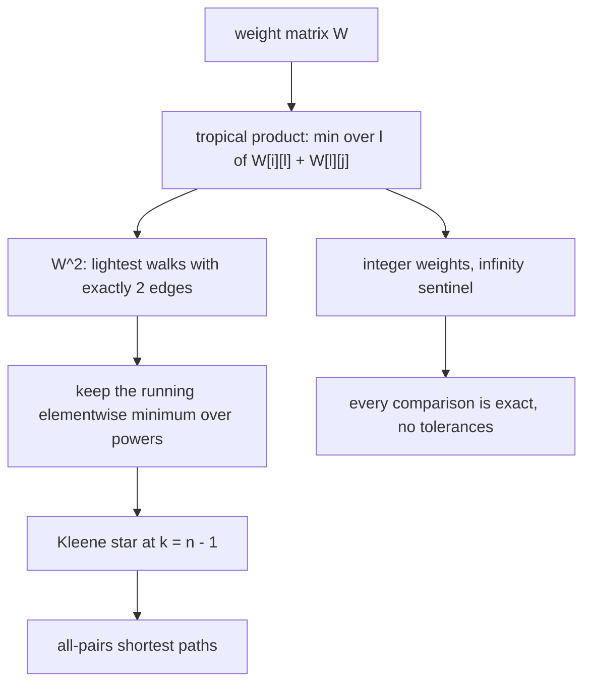
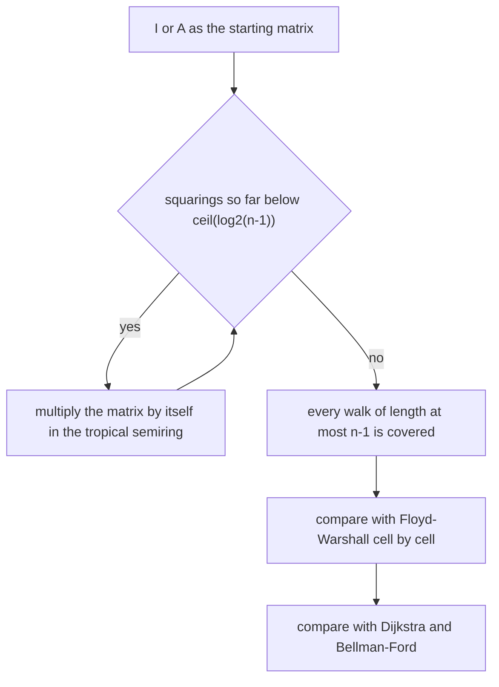
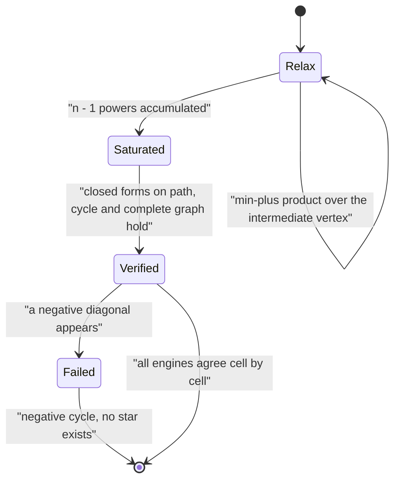

# 557 — Implement algebraic path finding with min-plus matrix multiply (tropical semiring).

> **Tier:** Advanced · **CTCI chapter:** Beyond — Advanced Data Structures & Algorithms
> **Task spec:** [557-implement-algebraic-path-finding-with-min-plus-matrix-multiply-t.md](../../../tasks/advanced/557-implement-algebraic-path-finding-with-min-plus-matrix-multiply-t.md)
> **Solutions:** [Python](../../../solutions/python/advanced/557-implement-algebraic-path-finding-with-min-plus-matrix-multiply-t/solution.py) ·
> [Java](../../../solutions/java/advanced/557-implement-algebraic-path-finding-with-min-plus-matrix-multiply-t/Solution.java) ·
> [JavaScript](../../../solutions/javascript/advanced/557-implement-algebraic-path-finding-with-min-plus-matrix-multiply-t/solution.js) ·
> [C#](../../../solutions/csharp/advanced/557-implement-algebraic-path-finding-with-min-plus-matrix-multiply-t/Solution.cs)

## 1. Problem restatement

**Input:** a weighted graph as a weight matrix `W`, where `W[i][j]` is the weight of the lightest edge
`i -> j` (or the additive identity when there is none), integer weights, possibly negative, possibly
directed.

**Output:** shortest-path information expressed as linear algebra over the **tropical (min-plus)
semiring**:

- `A^k` (tropical power) — the lightest walk with **exactly** `k` edges between each pair;
- the **Kleene star** `A* = I ⊕ A ⊕ A² ⊕ ...` — the all-pairs shortest-path matrix, which every file
  computes two ways (a `k = 1..n-1` accumulation, and repeated min-plus squaring of `I ⊕ A`) and
  cross-checks against Floyd–Warshall, Dijkstra and — where negative weights appear — Bellman–Ford.

The semiring is `(R ∪ {+inf}, min, +)`: the sum of two elements is their minimum, the product is
ordinary addition, the additive identity is `+inf` and the multiplicative identity is `0` (which means
the identity **matrix** is `0` on the diagonal and `+inf` elsewhere).

The documented checks, all exact rather than tolerance-based because the weights are integers and the
sentinel is an infinity:

| Check | Statement | Why |
| --- | --- | --- |
| semiring laws | min-plus multiplication is associative, `min` distributes over `+`, the identity matrix is a two-sided unit | verified numerically on random matrices |
| engines agree | Floyd–Warshall, squaring, Dijkstra (and Bellman–Ford with negative weights) give identical distances | three different algorithms, integer weights |
| path graph | distance `|i - j|` | unit weights along a chain |
| cycle | `min(|i - j|, n - |i - j|)` | two ways around |
| complete graph, unit weights | `1` between distinct vertices | every shortest path is a single edge |
| scale weights by `c` | every distance scales by `c`; doubling weights doubles distances | the product of the semiring is `+` |
| add `c` to every weight | distance grows by `c` per edge: exactly `+c` on the complete graph, and `4·|i - j|` instead of `|i - j|` on the unit path with `c = 3` | path length matters |
| running minimum | non-increasing in `k`, reaching the closure at `k = n - 1` | every shortest walk can be taken simple |
| semigroup law | `A^(p+q) = A^p ⊗ A^q` exactly | it is matrix algebra |
| the honest note | the exactly-`k` matrix is **not** monotone in `k`: on a single edge the 1-edge distance is the weight and the 2-edge distance is `+inf` | so the star is a minimum over `k`, not a limit of powers |
| negative cycles | with one, the star does not exist: Floyd–Warshall leaves a negative diagonal exactly when Bellman–Ford detects a cycle, and squaring drives the diagonal down without bound | asserted, both symptoms |
| max-plus | the analogous closure is unbounded as soon as a positive cycle exists (demonstrated on a self-loop), while exactly-`k` max-plus powers still match the DP longest path on a DAG | the mirror-image caveat |

## 2. Intuition

Ordinary matrix multiplication computes `(A·B)[i][j] = sum over l of A[i][l]·B[l][j]`. Replace the two
operations with `min` and `+` and the same formula reads

```text
(A ⊗ B)[i][j] = min over l of ( A[i][l] + B[l][j] )
```

which is *exactly one relaxation step* of a shortest-path algorithm: "to reach `j`, pick an
intermediate `l`, pay the cost of reaching `l` and then the cost of `l -> j`, keep the cheapest". So
the entire shortest-path theory can be phrased as matrix algebra over the semiring
`(R ∪ {+inf}, min, +)`, and every identity of ordinary linear algebra has a min-plus counterpart:

- The **identity matrix** is `0` on the diagonal and `+inf` off it.
- **Powers** compose edge counts: `A^p ⊗ A^q` is the exactly-`(p+q)`-edge lightest walk matrix.
- The **Kleene star** `I ⊕ A ⊕ A² ⊕ ...` sums (i.e. minimises) over all edge counts, giving the
  shortest-path matrix.
- The star is finite because every shortest walk can be taken to be a simple path, so `n - 1` edges
  suffice; that is why `I ⊕ A ⊕ ... ⊕ A^(n-1)` is already the closure.

The subtlety that trips people up is that the *exactly-k* matrices are not monotone in `k`: on a
single edge the 1-edge distance is the edge weight and the 2-edge distance is `+inf`, so the sequence
`A^1, A^2, A^3, ...` is not decreasing, while the running minimum *is* non-increasing and stabilises at
`k = n - 1`. Taking a minimum over all lengths is therefore the operation that produces distances, not
reading off a large power.



Two independent engines compute the star, which is what makes the result believable:

- **Floyd–Warshall** as Gauss–Jordan elimination in the semiring: `n³` min-plus relaxations, `O(n³)`.
- **Repeated squaring** of `I ⊕ A`: after `t` squarings the matrix covers every walk of length at most
  `2^t`, so `ceil(log2(n - 1))` squarings reach the fixed point — `O(n³ · log n)`.

Both must agree cell by cell, and both must agree with Dijkstra (and Bellman–Ford when negative weights
are present).

## 3. Algorithm

**Tropical product.**

1. Initialise the result to `+inf` everywhere.
2. For every `(i, j)`, take the minimum over `l` of `A[i][l] + B[l][j]`; entries equal to `+inf` are
   skipped, which also means no saturated addition can overflow.
3. Return the result — the exactly-`(p+q)`-edge matrix if `A` was exactly-`p` and `B` exactly-`q`.

**Star, three ways.**

1. **Accumulation:** start from `I`, repeatedly take the elementwise minimum with successive products
   `I ⊕ A ⊕ A² ⊕ ...`; stop after `n - 1` powers, where the running minimum has reached the closure.
2. **Squaring:** `R = I ⊕ A`, then `R = R ⊗ R` exactly `ceil(log2(n - 1))` times; each squaring doubles
   the maximum walk length covered.
3. **Floyd–Warshall:** the textbook triple loop, which is the semiring Gauss–Jordan elimination of
   `(I ⊕ A)`.

```text
procedure tropical_matmul(a, b)
    for i ← 0 to n - 1 do
        for j ← 0 to n - 1 do
            best ← INF
            for l ← 0 to n - 1 do
                if a[i][l] is not INF and b[l][j] is not INF then
                    candidate ← a[i][l] + b[l][j]
                    if candidate < best then best ← candidate end
                end
            end
            result[i][j] ← best
        end
    end
    return result
end

procedure kleene_star(W, n)
    closure ← identity matrix of size n
    running ← identity matrix of size n
    for k ← 1 to n - 1 do
        running ← tropical_matmul(running, W)
        closure ← elementwise minimum of closure and running
    end
    return closure
end

procedure star_by_squaring(W, n)
    reach ← elementwise minimum of identity and W
    for step ← 1 to ceil(log2(n - 1)) do
        reach ← tropical_matmul(reach, reach)
    end
    return reach
end
```

The `O(n³ log n)` squaring route and the `O(n³)` relaxations have very different constants but identical
output, and the files check that equality cell by cell instead of assuming it — with integer weights
and an `inf` sentinel the comparison is exact, which is the reason this task needs no tolerance
anywhere.



## 4. Worked example

Take a 4-vertex directed chain with weights `0 -> 1` of `2`, `1 -> 2` of `3`, `2 -> 3` of `4`, and no
other edges. The exactly-`k` matrices are sparse and easy to write down:

| Matrix | `(0,1)` | `(0,2)` | `(0,3)` | `(1,2)` | `(1,3)` | `(2,3)` |
| --- | --- | --- | --- | --- | --- | --- |
| `W^1` (exactly one edge) | `2` | `+inf` | `+inf` | `3` | `+inf` | `4` |
| `W^2` | `+inf` | `5` | `+inf` | `+inf` | `7` | `+inf` |
| `W^3` | `+inf` | `+inf` | `9` | `+inf` | `+inf` | `+inf` |
| star `= min over k` | `2` | `5` | `9` | `3` | `7` | `4` |

Three facts are visible in this table, and each is asserted by the files:

- **The exactly-`k` matrices are not monotone.** `W[0][1] = 2` but `W²[0][1] = +inf`: there is no
  2-edge walk from `0` to `1` at all. So the star has to be a minimum over `k`, not a large power.
- **The running minimum stabilises at `k = n - 1`.** With `n = 4` the answer is complete after
  `k = 3`, which is exactly `n - 1` and the exponent at which the squaring route finishes.
- **The semigroup law holds exactly.** For instance `W^1 ⊗ W^2 = W^3`, since the only 1-edge prefix of a
  3-edge walk is the first edge: `2 + 5 = 7` is the `(0,2)` entry of `W^1 ⊗ W^2`… and the `(0,3)` entry
  `2 + 7 = 9` reproduces `W³[0][3] = 9`, matching the table.

The closed forms on the standard instances are the other side of the same arithmetic:

| Graph | Distance | Verified value |
| --- | --- | --- |
| unit-weight path | `|i - j|` | number of edges in the only simple route |
| unit-weight cycle | `min(|i - j|, n - |i - j|)` | two ways around |
| unit-weight complete graph | `1` between distinct vertices | direct edge is cheapest |
| unit path, every weight `+3` | `4·|i - j|` | each of the `|i - j|` edges pays `1 + 3` |
| complete graph, every weight `+c` | `1 + c` | the shortest path is a single edge, so only one edge is scaled |




## 5. Complexity

Let `n` be the vertex count and `m` the number of edges.

| Method | Time | Space | Note |
| --- | --- | --- | --- |
| Tropical product | `O(n³)` | `O(n²)` | `n³` min-plus candidates, infinite operands skipped |
| Star by accumulation | `O(n⁴)` | `O(n²)` | `n - 1` products |
| Star by squaring | `O(n³ · log n)` | `O(n²)` | `ceil(log2(n - 1))` products |
| Floyd–Warshall | `O(n³)` | `O(n²)` | the same closure as the accumulation star |
| Dijkstra (per source) | `O(m log n)` nonnegative weights | `O(n + m)` | the oracle for the nonnegative instances |
| Bellman–Ford (per source) | `O(n · m)` | `O(n + m)` | handles negative weights and detects negative cycles |
| Exactly-`k` power by squaring | `O(n³ · log k)` | `O(n²)` | `A^k` for a large `k`, same skeleton as task 556 |
| Weight-matrix storage | `O(n²)` | — | a sparse edge list would be `O(m)` but the semiring product wants the dense form |

The comparison worth stating out loud: for all-pairs shortest paths, Floyd–Warshall is `O(n³)` while the
algebraic squaring route is `O(n³ log n)` — the same closure, a logarithmic factor worse, and identical
output. The squaring route exists here as a *semantic* demonstration (the star is a fixed point of
`R ↦ R ⊗ R`) and as the tool for the exactly-`k` question, not to beat Floyd–Warshall.

## 6. Pitfalls and edge cases

- **Non-monotonicity in `k`.** `A^k` is the exactly-`k` matrix, so it can lose entries as `k` grows — on
  a single edge the 1-edge distance is the weight and the 2-edge distance is `+inf`. A shortest-path
  routine that reads off a fixed large power instead of a minimum over powers is wrong.
- **Where the closure stops.** `k = n - 1` suffices because a shortest walk can always be taken simple;
  the files assert that the running minimum is non-increasing in `k` and has stopped moving at that
  point, rather than assuming it.
- **Negative cycles.** The star does not exist in that case, and the files show *both* symptoms: a
  negative diagonal entry in the Floyd–Warshall result, exactly when Bellman–Ford reports a negative
  cycle, and successive squarings driving the diagonal down without bound. Min-plus powers are a
  well-defined shortest-path matrix only on a `*`-closed instance.
- **The max-plus mirror.** In `(max, +)` the closure becomes unbounded as soon as a positive cycle
  exists — demonstrated with a single self-loop — while the exactly-`k` max-plus powers still agree with
  the dynamic-programming longest path on a DAG. The algebra is symmetric; the finiteness is not.
- **Infinity handling.** Adding `+inf` to anything must stay `+inf`, and in fixed-width languages it
  must not overflow: the C# file uses `long.MaxValue / 4` as the sentinel and skips infinite operands so
  no saturated addition happens. Using the true maximum value would silently corrupt a sum.
- **Multiple edges.** The weight matrix keeps the lightest edge for each pair, which is the correct
  reduction; keeping the last one read gives wrong distances. The files build the matrix with a
  minimum over edges.
- **Self-loops.** A self-loop of positive weight never helps a shortest path; a negative one is a
  negative cycle and puts the instance outside the closure. The identity matrix has `0` on the diagonal,
  which is exactly "staying costs nothing" — not a self-loop.
- **Directed versus undirected.** The files generate symmetric instances by mirroring each edge, and the
  closed forms (path, cycle, complete graph) are stated for the appropriate orientation. Mixing them up
  turns a cycle into a path.
- **Exactness.** Integer weights plus an `inf` sentinel make every comparison exact, which is why this
  task asserts equality rather than a tolerance; with floating-point weights the same code would need
  `eps` handling everywhere, especially in the negative-cycle test.
- **Dense versus sparse computation.** The semiring product is `O(n³)` because it is dense. On a sparse
  graph, Dijkstra or Bellman–Ford per source is the right tool — the algebra is the framework, not
  always the fastest implementation.

## 7. Variants and follow-ups

- **The same skeleton with `(+, ×)`.** The walk-counting twin of this task, where the identity matrix is
  the ordinary unit and powers count walks:
  [556-implement-adjacency-matrix-exponentiation-for-path-counting-fast.md](../../../tasks/advanced/556-implement-adjacency-matrix-exponentiation-for-path-counting-fast.md).
- **Paths of a fixed length in a DAG.** Where the edge count itself is the constraint, the layered DP
  answers the "exactly `k` edges" question in linear time:
  [555-implement-dynamic-programming-for-counting-paths-of-length-k-in.md](../../../tasks/advanced/555-implement-dynamic-programming-for-counting-paths-of-length-k-in.md).
- **Boolean reaching with the same product.** Substituting `(or, and)` gives reachability, and the
  bit-parallel product that makes it fast is
  [558-implement-boolean-matrix-multiplication-optimization-using-bitse.md](../../../tasks/advanced/558-implement-boolean-matrix-multiplication-optimization-using-bitse.md).
- **Semiring choice as a modelling decision.** The same "closure of a weighted relation" idea underlies
  [560-implement-berlekamp-massey-for-minimal-linear-recurrence-concept.md](../../../tasks/advanced/560-implement-berlekamp-massey-for-minimal-linear-recurrence-concept.md)'s
  algebraic view of sequences.

## 8. Check yourself

1. Why is the identity matrix `0` on the diagonal and `+inf` elsewhere?

<details><summary>Show answer</summary>

Because `0` is the multiplicative identity of the semiring (the `+` of ordinary arithmetic) and `+inf`
is the additive identity (the `min` that contributes nothing). The unique matrix `I` with
`I ⊗ A = A ⊗ I = A` therefore has `0` on the diagonal — "reaching a vertex from itself with zero edges
costs nothing" — and `+inf` off it, because there is no zero-edge walk between distinct vertices.

</details>

2. Why is the star `A* = I ⊕ A ⊕ ... ⊕ A^(n-1)` rather than a limit of powers?

<details><summary>Show answer</summary>

Because the exactly-`k` matrices are not monotone in `k`: on a single edge the 2-edge distance to the
neighbour is `+inf`, so a large power can be *worse* than a small one. Shortest walks, however, can
always be taken simple — a repeated vertex implies a removable cycle, which cannot be negative if the
instance is `*`-closed — so every shortest walk has at most `n - 1` edges and the finite sum up to
`n - 1` is already complete. That is also why the running minimum is non-increasing even though the
powers are not.

</details>

3. Floyd–Warshall is `O(n³)` and the squaring closure is `O(n³ log n)`. Why implement both?

<details><summary>Show answer</summary>

Because they are the same mathematical object arrived at differently, which makes them mutual checks: the
squaring route *is* the Kleene star as a fixed point of `R ↦ R ⊗ R`, and the elimination route is the
Gauss–Jordan procedure specialised to `(min, +)`. Agreement cell by cell on integer-weighted graphs is
exact evidence, and the squaring route is also the tool of choice for the exactly-`k` question, where
`O(n³ log k)` beats iterating `A` `k` times.

</details>

4. Adding `c` to every weight adds `c` per edge of the shortest path. Why is the effect exactly `+c` on
   the complete graph but `4·|i - j|` on a unit path with `c = 3`?

<details><summary>Show answer</summary>

Because the semiring product is addition, so a path of `L` edges gains `L·c`. On a unit-weight complete
graph every shortest path is a single edge, so `L = 1` and the gain is exactly `c`. On the unit path
between `i` and `j` the shortest path has `|i - j|` edges, so the new distance is
`|i - j| + c·|i - j| = (1 + c)·|i - j| = 4·|i - j|` for `c = 3`. The files use both instances because
the two answers show that edge *counts* are what scale.

</details>

5. What exactly goes wrong when the instance has a negative cycle, and how is it detected?

<details><summary>Show answer</summary>

The closure does not exist: shortening a negative cycle indefinitely drives some distance to `-inf`.
Two symptoms appear and the files assert both — Floyd–Warshall leaves a negative entry on the diagonal
(meaning the vertex can reach itself for negative cost), and iterated tropical squaring keeps reducing
the diagonal without converging. Bellman–Ford is the independent oracle: it reports a negative cycle
exactly on the instances where the diagonal goes negative, which is what turns the symptom into a
verified statement.

</details>
