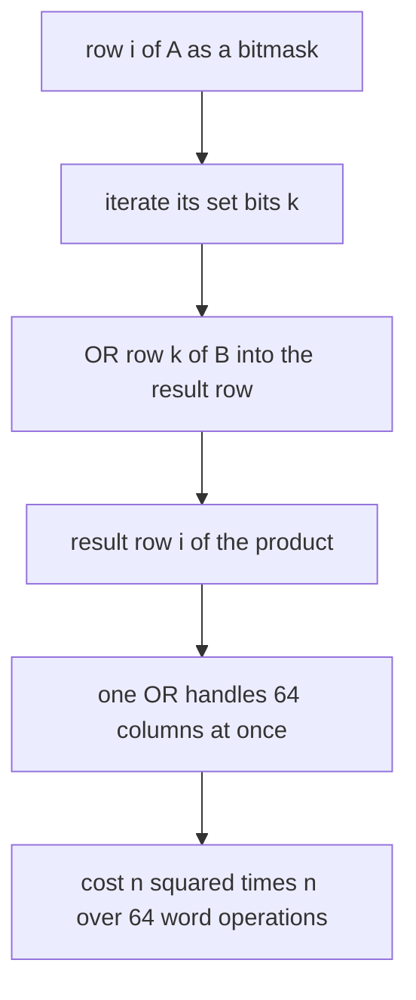
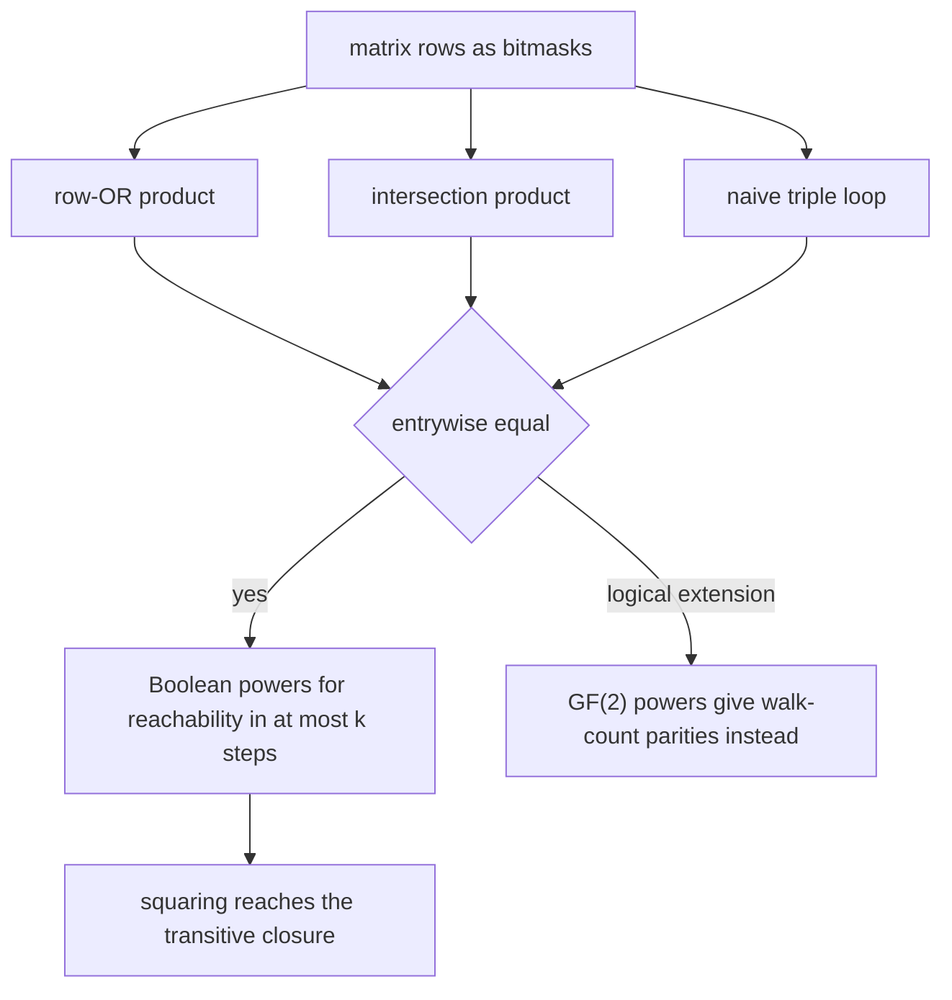
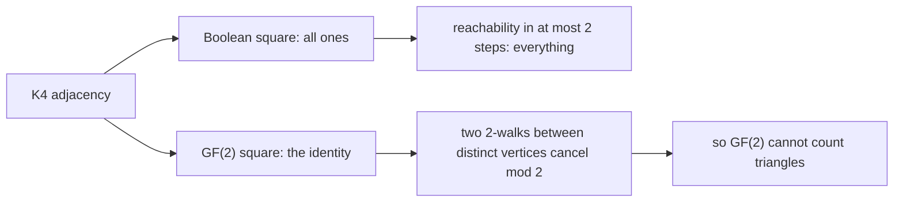
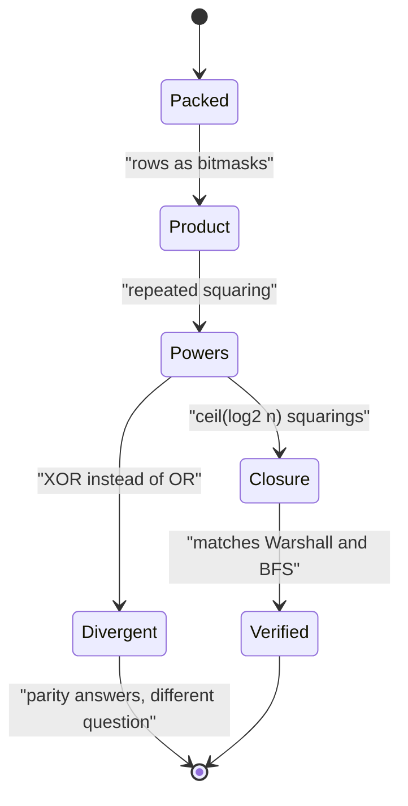

# 558 — Implement boolean matrix multiplication optimization using bitsets.

> **Tier:** Advanced · **CTCI chapter:** Ch 5 — Bit Manipulation
> **Task spec:** [558-implement-boolean-matrix-multiplication-optimization-using-bitse.md](../../../tasks/advanced/558-implement-boolean-matrix-multiplication-optimization-using-bitse.md)
> **Solutions:** [Python](../../../solutions/python/advanced/558-implement-boolean-matrix-multiplication-optimization-using-bitse/solution.py) ·
> [Java](../../../solutions/java/advanced/558-implement-boolean-matrix-multiplication-optimization-using-bitse/Solution.java) ·
> [JavaScript](../../../solutions/javascript/advanced/558-implement-boolean-matrix-multiplication-optimization-using-bitse/solution.js) ·
> [C#](../../../solutions/csharp/advanced/558-implement-boolean-matrix-multiplication-optimization-using-bitse/Solution.cs)

## 1. Problem restatement

**Input:** two `n × n` Boolean matrices (adjacency relations), stored **row-major as packed words** — a
row lives in `ceil(n / 64)` 64-bit words, or as a single machine-size integer in the Python and
JavaScript versions (`Uint32Array` words in JavaScript).

**Output:** the Boolean product `C = A ⊙ B` with `C[i][j] = OR over l of (A[i][l] AND B[l][j])`, plus
the applications built on it:

- **Boolean powers**, where `(I ∨ A)^k` has a `1` at `(i,j)` exactly when there is a walk from `i` to
  `j` of at most `k` edges — so the smallest such `k` is the BFS distance, and `ceil(log2 n)` squarings
  give the transitive closure;
- **Warshall's algorithm with bit rows**: one row OR per set bit instead of `n³` scalar steps;
- **GF(2) powers**, where the entries of `A^k` are walk counts modulo 2.

Three implementations of the product are kept so each can check the others: the **row-OR** form (visit
every set bit `(i, k)` of `A` and OR row `k` of `B` into row `i` of the result), the **intersection**
form (the popcount of `row i of A AND row j of Bᵀ` decides entry `(i, j)`), and the **naive triple
loop** as the oracle.

The documented checks:

| Check | Statement | Why |
| --- | --- | --- |
| correctness | the bit-parallel product equals the naive product on random matrices of several sizes and densities | entrywise comparison |
| structured matrices | identity is a two-sided unit; all-ones, upper-triangular, zero and permutation matrices behave; the product of permutation matrices equals the composition of the permutations | the algebra must hold on the extremes |
| GF(2) engine | equals the naive product modulo 2 | independent arithmetic |
| operation count | the word-operation count equals the number of set bits consumed and stays below `n³` (likewise for Warshall against its `n³` version) | "optimized" is counted, not timed |
| powers | the `k`-th Boolean power of `I ∨ A` equals an independent `k`-step reachability DP for every `k` | two different recursions |
| distances | the smallest `k` with a `1` entry equals the BFS distance | the semantic meaning of the power |
| closure | squaring reaches exactly the closure found by bitset Warshall, naive Warshall and BFS | four routes, one answer |
| cycles in digraphs | the first power with a set diagonal agrees with DFS colouring | the diagonal criterion works on directed graphs |
| caveat 1 | Boolean and GF(2) products **differ**: on `K4` the Boolean square is all ones while the GF(2) square is the identity | the two 2-walks between distinct vertices cancel mod 2, and the diagonal is the odd degree |
| caveat 2 | GF(2) cannot count triangles: the diagonal of `A³` vanishes identically | every closed 3-walk cancels with its reversal, while the integer trace is `6·(triangles)` |
| caveat 3 | the diagonal criterion does **not** detect cycles in an undirected graph: every edge is already a closed 2-walk, so a tree passes it | asserted on a tree |

## 2. Intuition

The naive product costs `n³` scalar `AND`/`OR` operations, because for every `(i, j)` pair it scans all
`l`. The bit-parallel idea observes that this scan is the same work for a whole row: if row `i` of `A`
is the bitmask of the columns reachable in one step, then **row `i` of the product is the OR of the rows
of `B` selected by the set bits of row `i` of `A`**.

```text
C[i] = OR over every set bit k of A[i] of B[k]
```

Two consequences make this fast:

- The inner loop disappears. Instead of `n` scalar operations per entry, one bitwise OR of two packed
  rows processes `64` (or `32`) columns at once, so the cost drops from `n³` scalar operations to
  `O(n² · n / 64)` **word** operations — a factor of `w`, the word width.
- The number of OR operations is exactly the number of set bits consumed, which is why the files can
  count it and assert that it stays below `n³` instead of timing anything. Wall-clock timing is not a
  portable assertion; an operation counter is.

The suite of applications then follows from the same primitive, and the interesting part of the task is
the boundary where the Boolean and GF(2) readings of the same bitmask diverge:

- `(I ∨ A)^k` answers **reachability in at most `k` steps**; the smallest `k` with a `1` is the BFS
  distance; squaring until saturation gives the transitive closure.
- `A^k` over GF(2) answers **walk counts modulo 2**, which is a genuinely different quantity.



## 3. Algorithm

**Bit-parallel Boolean product (row-OR form).**

1. Store each row as a bitmask (or as packed words, row-major).
2. For each row `i`: start with an empty result mask; for every set bit `k` of `A[i]`, OR the whole row
   `B[k]` into it; count one word operation per OR.
3. Store the result row; the operation counter now equals the number of set bits consumed.

**Intersection form (cross-check).** Precompute the columns of `B` (or `Bᵀ`'s rows) and decide each
entry by whether `row i of A AND row j of Bᵀ` is non-zero — the same quantity computed in a completely
different order.

**Closure and powers.**

1. Form `R = I ∨ A`.
2. Boolean power: `R^k` computed by binary exponentiation; the smallest `k` with a set entry is the
   BFS distance, and `ceil(log2 n)` squarings saturate to the closure.
3. Warshall with bit rows: propagate each row once per set bit.
4. GF(2) variant: identical loops with XOR instead of OR, giving walk-count parities.

```text
procedure bitset_boolean_matmul(rows_a, rows_b, n)
    result ← empty list
    for i ← 0 to n - 1 do
        row ← 0
        bits ← rows_a[i]
        while bits is not zero do
            low ← bits AND minus bits
            bits ← bits XOR low
            row ← row OR rows_b[index of low]
            count one word operation
        end
        append row to result
    end
    return result, count of word operations
end

procedure closure_by_squaring(rows, n)
    reach ← rows with every diagonal bit set
    for step ← 1 to ceil(log2 n) do
        reach ← bitset_boolean_matmul(reach, reach, n)
    end
    return reach
end
```

Squaring suffices because a shortest path has at most `n - 1` edges, so covering walks of length at most
`2^ceil(log2 n)` covers everything; the files verify the result against bitset Warshall, naive Warshall
and BFS, which is four independent routes to the same closure.



## 4. Worked example

The clearest instance is `K4`, where the Boolean and GF(2) squares disagree completely. With `A` the
adjacency of `K4`:

| Entry | Boolean `A²` | GF(2) `A²` | Reason |
| --- | --- | --- | --- |
| `(i, i)` | `1` | `1` | three 2-walks `i -> j -> i` (odd degree `3`), so the parity is `1` |
| `(i, j)`, `i` distinct from `j` | `1` | `0` | two common neighbours, so two 2-walks cancel modulo 2 |
| whole matrix | all ones | the identity | Boolean asks "is there one?"; GF(2) asks "how many, mod 2?" |

The second row is the whole caveat: `A²` over GF(2) is the identity because the two 2-walks between
distinct vertices cancel, while the Boolean square is all ones because both exist. The same difference
destroys GF(2) triangle counting: the diagonal of `A³` vanishes identically, since every closed 3-walk
cancels with its reversal, whereas the integer trace is `6 · (triangles)`.

The operation counting runs on the same example. For `n = 64` and a dense matrix (all `n²` bits set),
the row-OR product performs exactly `n² = 4096` word ORs, which is `1/64` of the `n³ = 262144` scalar
operations the triple loop performs — the factor of the word width, and the file asserts the counts
rather than timing them.

| Application | Question answered | How it is checked |
| --- | --- | --- |
| `(I ∨ A)^k` | reachability in at most `k` steps | equals an independent `k`-step reachability DP for every `k` |
| smallest `k` with a `1` | BFS distance | equals the BFS label |
| squaring `I ∨ A` | transitive closure | equals bitset Warshall, naive Warshall and BFS |
| set diagonal in a power of `A` | a directed cycle exists | agrees with DFS colouring on random digraphs |
| GF(2) powers | walk-count parity | equals the naive product modulo 2 |





## 5. Complexity

Let `n` be the dimension and `w` the word width (64 in Java and C#, 32 in the JavaScript
`Uint32Array` version, and the machine integer width for the Python bit-row version).

| Operation | Cost | Why |
| --- | --- | --- |
| Naive triple loop | `O(n³)` scalar bit operations | every `(i, k, j)` visited |
| Row-OR product | `O(n² · n / w)` word operations | one OR per set bit, each handling `w` columns |
| Operation counter | equals the number of set bits consumed | asserted to stay below `n³` |
| Boolean power | `O(log k)` products | binary exponentiation |
| Transitive closure by squaring | `O(log n)` products | `ceil(log2 n)` squarings saturate |
| Warshall with bit rows | `O(n² · n / w)` | one row OR per set bit, versus `n³` scalar |
| GF(2) power | same as Boolean, XOR instead of OR | identical loop structure |
| Step reachability DP (oracle) | `O(k · n² / w)` | `k` row propagations |
| Space | `O(n · n / w)` words | the packed matrix; no scalar copy is needed |

The gain is a factor `w` on the constant, not an asymptotic class change: `O(n³/w)` is still cubic in
`n`. The reason the files count operations is that this factor is easy to *claim* and easy to
mis-implement (a bit-set enumeration that costs `n` steps per row would give it back), and a counter
turns "the bitset version is faster" into a statement that can be checked on any machine.

## 6. Pitfalls and edge cases

- **Bit iteration must be cheap.** The gain depends on enumerating only the set bits (`low = bits & -bits`
  then clearing it). Scanning all `n` positions per row and testing each would restore the `n³` factor
  while still *looking* bit-parallel.
- **Boolean is not GF(2).** `OR`/`AND` answer "is there a walk", `XOR`/`AND` answer "how many, modulo 2".
  On `K4` the Boolean square is all ones while the GF(2) square is the identity; confusing the two
  silently changes the question.
- **GF(2) cannot count triangles.** The diagonal of `A³` is identically zero over GF(2), because each
  closed 3-walk cancels with its reversal. The integer trace is `6 · (triangles)`, which is the identity
  that actually works — over the integers, not over GF(2).
- **The diagonal criterion and undirected graphs.** A set diagonal entry in `A²` reports a "cycle" for
  every single edge, because `i -> j -> i` is a closed 2-walk. On an undirected *tree* the criterion
  fires while the graph has no cycle; it is only a cycle test on directed graphs, and the files assert
  exactly that.
- **Reachability versus exactly-`k` steps.** `A^k` is "exactly `k` steps", `(I ∨ A)^k` is "at most `k`
  steps". Only the second is monotone in `k`, and only the second is the transitive closure when squared
  enough times.
- **Small `n`.** For `n < w` a row fits in one word, so the word-level loop degenerates to a single
  operation per row; the implementations must handle `n` not being a multiple of the word width,
  including the padding bits that must never leak into popcounts or comparisons.
- **Padding bits in popcounts.** The intersection formulation uses popcounts; unseen padding bits are
  zero so they cannot inflate a popcount, but a transposed row built with a wrong shift can.
- **Structured instances.** Identity as a two-sided unit, all-ones, zero, upper-triangular and
  permutation matrices are all tested — permutation matrices are the case where the product must equal
  the composition of the permutations, which catches index-order mistakes that random matrices mask.
- **Operation counting, not timing.** Wall-clock measurements are not portable assertions; the files
  count OR/XOR word operations and compare against `n³`, and they do the same for the bit-row Warshall
  against its `n³` version.
- **Random data quality.** Matrices are generated from a full-period 64-bit generator read in its high
  bits, because the repository's 16-bit `lcg` has low-bit structure that would bias the density and make
  the "random" comparison weak.

## 7. Variants and follow-ups

- **The same product over a different semiring.** Replacing `(OR, AND)` with `(min, +)` turns the product
  into shortest-path relaxation, with transitivity replaced by the Kleene star:
  [557-implement-algebraic-path-finding-with-min-plus-matrix-multiply-t.md](../../../tasks/advanced/557-implement-algebraic-path-finding-with-min-plus-matrix-multiply-t.md).
- **Counting instead of testing.** The integer-power version of the same matrix, where entries are walk
  counts rather than bits, is
  [556-implement-adjacency-matrix-exponentiation-for-path-counting-fast.md](../../../tasks/advanced/556-implement-adjacency-matrix-exponentiation-for-path-counting-fast.md).
- **Squaring as a general trick.** The same "square until saturated" pattern advances linear recurrences:
  [559-implement-fast-exponentiation-of-linear-recurrences-using-matrix.md](../../../tasks/advanced/559-implement-fast-exponentiation-of-linear-recurrences-using-matrix.md).
- **Bitsets as a data structure in their own right.** The packed-row primitives here (intersection,
  union, popcount, transpose) are the toolkit behind
  [550-implement-graph-sketches-for-neighborhood-similarity-minhash.md](../../../tasks/advanced/550-implement-graph-sketches-for-neighborhood-similarity-minhash.md)'s
  set operations and the candidate matrix of
  [551-implement-subgraph-isomorphism-backtracking-ullmann-outline.md](../../../tasks/advanced/551-implement-subgraph-isomorphism-backtracking-ullmann-outline.md).

## 8. Check yourself

1. Why does OR-ing whole rows replace the innermost loop of the triple product?

<details><summary>Show answer</summary>

Because `C[i][j] = OR over l of (A[i][l] AND B[l][j])` factors per row: for a fixed `i`, the entries
`A[i][l]` that are `1` select exactly the rows `l` of `B` whose bits must be OR-ed into row `i` of the
result. Every `j` is handled simultaneously by the word-wide OR, so the `j` loop disappears and the
remaining cost is one OR per set bit of `A[i]`, each touching `n/w` words.

</details>

2. On `K4`, why is the Boolean square all ones while the GF(2) square is the identity?

<details><summary>Show answer</summary>

Between two distinct vertices of `K4` there are exactly two 2-walks (through each of the other two
vertices), so the Boolean product sees at least one and sets the entry, while GF(2) adds two `1`s and
gets `0`. On the diagonal there are `degree = 3` back-and-forth walks, an odd number, so both readings
set it. Hence the Boolean square is all ones and the GF(2) square is the identity matrix.

</details>

3. Why can GF(2) arithmetic not count triangles?

<details><summary>Show answer</summary>

Because the diagonal of `A³` over GF(2) is identically zero: every closed 3-walk `i -> j -> k -> i`
has a reversal `i -> k -> j -> i`, and the two cancel modulo 2. The integer trace counts them twice per
triangle, giving `trace(A³) = 6·(triangles)` over the integers. Parity destroys exactly the information a
triangle count needs.

</details>

4. A matrix has a set entry on the diagonal of `A²`. Does that prove the graph has a cycle?

<details><summary>Show answer</summary>

Only on a directed graph. On an undirected graph every edge gives the closed 2-walk `i -> j -> i`, so the
diagonal of `A²` is set for every non-isolated vertex — a tree would pass the test while containing no
cycle. The files assert the directed case against DFS colouring and the undirected failure explicitly.

</details>

5. Where does the factor `w` come from, and why does it not change the asymptotic class?

<details><summary>Show answer</summary>

A packed word holds `w` columns, so one bitwise OR of two rows does the work of `w` scalar ORs. The
product therefore costs `O(n² · n/w)` word operations instead of `O(n³)` scalar ones. That is a constant
factor improvement — still cubic in `n` — which is precisely why the files measure it with an operation
counter (`n²` ORs on a dense 64-wide instance against `n³` scalar operations) rather than with a
stopwatch.

</details>
