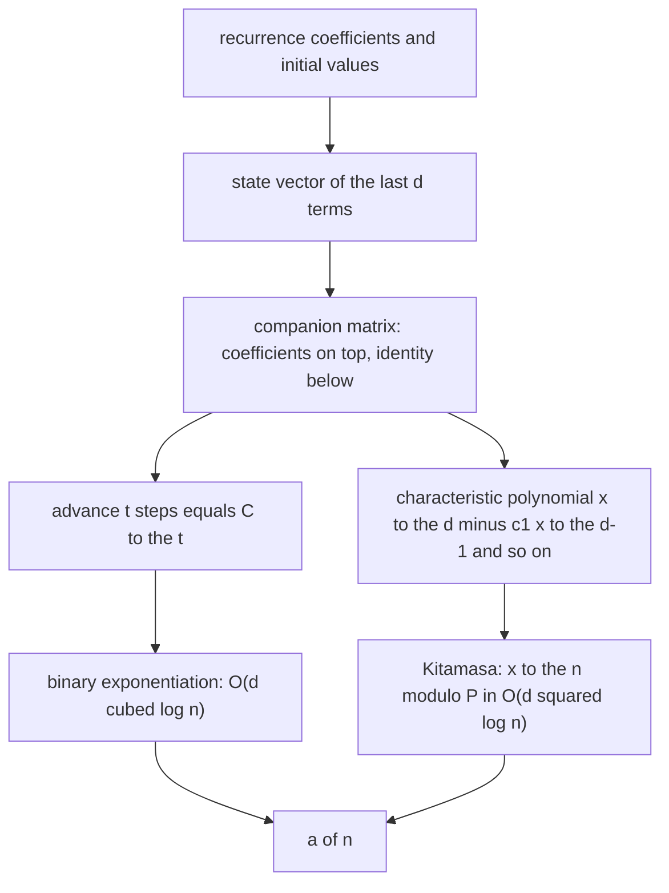
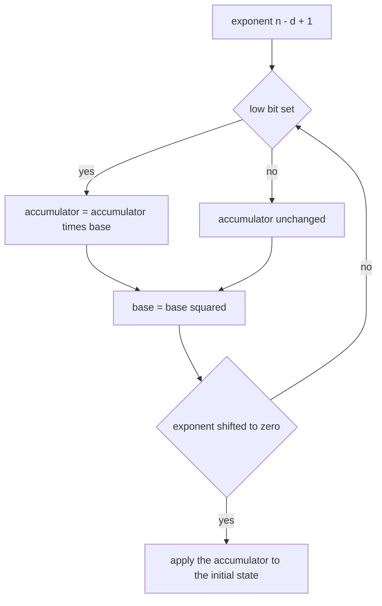
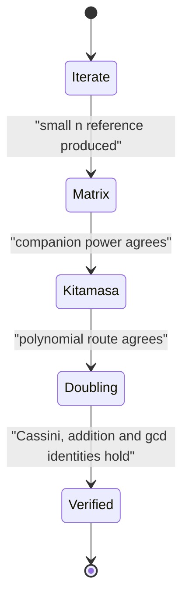

# 559 — Implement fast exponentiation of linear recurrences using matrix power.

> **Tier:** Advanced · **CTCI chapter:** Beyond — Advanced Data Structures & Algorithms
> **Task spec:** [559-implement-fast-exponentiation-of-linear-recurrences-using-matrix.md](../../../tasks/advanced/559-implement-fast-exponentiation-of-linear-recurrences-using-matrix.md)
> **Solutions:** [Python](../../../solutions/python/advanced/559-implement-fast-exponentiation-of-linear-recurrences-using-matrix/solution.py) ·
> [Java](../../../solutions/java/advanced/559-implement-fast-exponentiation-of-linear-recurrences-using-matrix/Solution.java) ·
> [JavaScript](../../../solutions/javascript/advanced/559-implement-fast-exponentiation-of-linear-recurrences-using-matrix/solution.js) ·
> [C#](../../../solutions/csharp/advanced/559-implement-fast-exponentiation-of-linear-recurrences-using-matrix/Solution.cs)

## 1. Problem restatement

**Input:** a `d`-th order linear recurrence `a(n) = c_1·a(n-1) + ... + c_d·a(n-d)` with initial values
`a(0..d-1)`, an index `n` (possibly enormous), and optionally a modulus.

**Output:** `a(n)`, computed by raising the **companion matrix** to a power rather than iterating the
recurrence — `O(d³ · log n)` instead of `O(d · n)` — with three independent evaluations cross-checked
against each other:

1. **Plain iteration** of the recurrence (`O(d · n)`), the definition, used as the reference for `n` up
   to a few hundred.
2. **Companion-matrix exponentiation** (`O(d³ · log n)`), exact or modular, with a counter of matrix
   multiplications.
3. **Kitamasa's polynomial method**, computing `x^n mod P(x)` where `P` is the characteristic polynomial
   `x^d - c_1·x^(d-1) - ... - c_d`, in `O(d² · log n)`, then reading `a(n)` off as
   `sum over i of q_i · a(i)`.

For Fibonacci specifically, a fourth route — **fast doubling** — corroborates the large-index answers.

The documented checks:

| Check | Statement | Why |
| --- | --- | --- |
| exact Fibonacci term | `F(100) = 354224848179261915075` | verified in exact integer arithmetic |
| small terms | Fibonacci, Lucas and tribonacci standard values | the basics |
| Cassini's identity | `F(n-1)·F(n+1) - F(n)² = (-1)^n` | a quadratic invariant of the recurrence |
| addition formula | `F(m+n) = F(m)·F(n+1) + F(m-1)·F(n)` over a grid of indices up to 500 | a multiplicative identity that only a working exponentiation supports |
| gcd identity | `gcd(F(m), F(n)) = F(gcd(m, n))` | a deep divisor theorem |
| Cayley–Hamilton | `C^d = c_1·C^(d-1) + ... + c_d·I` | the characteristic polynomial annihilates the matrix |
| semigroup law | `C^(p+q) = C^p · C^q` | matrix algebra |
| multiplication counter | reported, so "fast" is measured | no wall-clock timing |
| honest caveat | Binet's closed form in **double precision** is useless at `F(100)` — the float quotient is off by tens of thousands | it is used only for small `n`, and the file says so |

## 2. Intuition

A linear recurrence of order `d` carries a state of exactly `d` numbers: `(a(n), a(n-1), ..., a(n-d+1))`.
Advancing the state by one step is a **fixed linear map**, so the whole recurrence is one matrix:

```text
        [ c_1 c_2 ... c_d ]        [ a(n-1)   ]   [ a(n)    ]
C   =   [  1   0  ...  0  ]    ·   [ a(n-2)   ] = [ a(n-1) ]
        [  0   1  ...  0  ]        [   ...    ]   [   ...   ]
        [ ...  ...  ... ... ]      [ a(n-d)   ]   [ a(n-d+1)]
```

The first row is the coefficient vector, the subdiagonal carries the identity (so each component simply
shifts down), and the matrix is the **companion matrix** of the recurrence. Advancing `t` steps is
`C^t`, and for Fibonacci `C^n = [[F(n+1), F(n)], [F(n), F(n-1)]]` — a compact way of saying that the
recurrence's terms are literally the entries of a matrix power.

Then `O(d³ log n)` follows from binary exponentiation, exactly as in the walk-counting tasks. The reason
this is worth doing at all is the gap between the two costs: iterating to the millionth Fibonacci number
takes `10⁶` additions, while the matrix route takes about `2·20 = 40` matrix multiplications.

The second, sharper idea is that you do not need the matrix at all. The Cayley–Hamilton theorem says the
characteristic polynomial `P(x) = x^d - c_1·x^(d-1) - ... - c_d` annihilates `C`, so powers of `x`
reduce to combinations of the first `d` terms modulo `P`. Kitamasa's method does exactly that with
polynomial exponentiation, giving `O(d² · log n)` — cheaper per bit, and it reads the answer as
`sum over i of q_i · a(i)` with the coefficients of `x^n mod P`.



## 3. Algorithm

**Companion-matrix route.**

1. Build `C`: first row the coefficient vector, subdiagonal one, all other entries zero.
2. Build the initial state `(a(d-1), ..., a(0))`.
3. Compute `C^(n - d + 1)` by binary exponentiation (exact or modulo a prime), counting multiplications.
4. Apply it to the state vector and read the first component — that is `a(n)`.

**Kitamasa route.**

1. Reduce `x^n` modulo `P(x)` by binary exponentiation of polynomials: at each bit, square the current
   polynomial and reduce; when the bit is set, multiply by `x` and reduce.
2. The reduced result is `q` with `x^n ≡ sum over i of q_i·x^i (mod P)`.
3. Then `a(n) = sum over i of q_i · a(i)` from the initial values.

**Fast doubling (Fibonacci).**

```text
F(2k)   = F(k) · (2·F(k+1) - F(k))
F(2k+1) = F(k)^2 + F(k+1)^2
```

recurses on half the index, giving the same `O(log n)` depth with tiny constant factors.

```text
procedure recurrence_by_matrix(coefficients, initials, n, mod)
    d ← length(coefficients)
    if n < d then return initials[n] end
    C ← companion matrix of the coefficients
    power ← matpow(C, n - d + 1, mod)
    state ← reverse of initials
    result ← 0
    for i ← 0 to d - 1 do
        result ← result + power[0][i] * state[i]
    end
    return result modulo mod
end

procedure kitamasa(coefficients, initials, n)
    d ← length(coefficients)
    current ← polynomial 1
    base ← polynomial x
    while n > 0 do
        if n is odd then current ← reduce(current times base) end
        base ← reduce(base times base)
        n ← n divided by 2
    end
    return sum over i of current[i] * initials[i]
end
```

All three routes must return the same value, and the identities above are what make the claim
meaningful: Cassini, the addition formula and the gcd identity are not properties any wrong
exponentiation would satisfy by accident.



## 4. Worked example

For Fibonacci the companion matrix is `C = [[1, 1], [1, 0]]`, and its powers are self-describing:

| Power | Matrix | Meaning |
| --- | --- | --- |
| `C^1` | `[[1, 1], [1, 0]]` | `[[F(2), F(1)], [F(1), F(0)]]` |
| `C^2` | `[[2, 1], [1, 1]]` | `[[F(3), F(2)], [F(2), F(1)]]` |
| `C^4` | `[[5, 3], [3, 2]]` | `[[F(5), F(4)], [F(4), F(3)]]` |
| `C^8` | `[[34, 21], [21, 13]]` | `[[F(9), F(8)], [F(8), F(7)]]` |

Trace the square-and-multiply loop for exponent `n = 10`, whose binary form is `1010`:

| Bit | Exponent after the shift | Accumulator | Base | Multiplication |
| --- | --- | --- | --- | --- |
| `0` | `5` | `I` | `C^2` | 1 square |
| `1` | `2` | `C^2` | `C^4` | 1 multiply, 1 square |
| `0` | `1` | `C^2` | `C^8` | 1 square |
| `1` | `0` | `C^2 · C^8 = C^10` | — | 1 multiply |
| done | `0` | `[[89, 55], [55, 34]]` | — | 5 multiplications total |

`C^10 = [[F(11), F(10)], [F(10), F(9)]] = [[89, 55], [55, 34]]`, so `F(10) = 55` and `F(11) = 89` —
read straight off the matrix. The counter reports `5` multiplications, comfortably inside the
`2·ceil(log2 10) = 8` bound, and the same loop with `n = 10^9` would need about `60` multiplications
rather than a billion additions.

The identities are then checkable by hand on the same numbers:

| Identity | Instance | Value |
| --- | --- | --- |
| Cassini | `F(9)·F(11) - F(10)² = 34·89 - 55²` | `3026 - 3025 = 1 = (-1)^10` |
| addition formula | `F(2 + 3) = F(2)·F(4) + F(1)·F(3) = 1·3 + 1·2` | `5 = F(5)` |
| Cayley–Hamilton | `C² - C - I` for `C = [[1,1],[1,0]]` | `[[2,1],[1,1]] - [[1,1],[1,0]] - I = 0` |




## 5. Complexity

Let `d` be the recurrence order and `n` the index.

| Method | Time | Space | Note |
| --- | --- | --- | --- |
| Plain iteration | `O(d · n)` | `O(d)` | the definition; the reference for small `n` |
| Companion matrix power | `O(d³ · log n)` | `O(d²)` | binary exponentiation of a `d × d` matrix |
| Multiplications performed | at most `2·ceil(log2 n)` | — | counted by the implementation, not timed |
| Kitamasa polynomial method | `O(d² · log n)` | `O(d)` | `x^n mod P` with polynomial squaring and reduction |
| Fast doubling (Fibonacci) | `O(log n)` | `O(log n)` recursion | two multiplications per bit |
| Exact big-integer arithmetic | adds the cost of arbitrary precision | — | needed for `F(100) = 354224848179261915075` |
| Modular arithmetic | same asymptotics in machine words | `O(d²)` | modulo `1000000007`, asserted to agree with exact results where both fit |

The two matrix routes differ by a factor of `d`: Kitamasa does polynomial multiplications and a
reduction of degree `d`, so it is `O(d² log n)`, while the companion power is `O(d³ log n)`. For large
orders the polynomial route is the one to use; for small orders the matrix form is clearer and the
constant is lower.

## 6. Pitfalls and edge cases

- **Binet in floating point.** `(phi^n - psi^n)/sqrt(5)` looks exact but is not: at `F(100)` the double
  precision quotient is off by tens of thousands. The file uses it only for small `n` and says so —
  a closed form is not a license to skip exact arithmetic.
- **Index bookkeeping in the matrix route.** `a(n)` comes from `C^(n - d + 1)` applied to
  `(a(d-1), ..., a(0))`, not from `C^n` applied to `(a(0), ...)`. The off-by-`d-1` is the classic bug,
  and the small-index cases `n < d` return the initial value directly.
- **Order versus degree conventions.** The C# header numbers the coefficients from `c_0` while the Python
  header uses `c_1`; both describe the same first row. Copying a formula between the two conventions
  shifts every coefficient by one.
- **Modulus and exact arithmetic.** A modular run answers a *different* question than the exact run:
  agreement can only be asserted where both fit in range, which is why the exact big-integer path exists
  at all (`F(100)` is quoted exactly).
- **Negative or zero coefficients.** The matrix route never divides, so it works over any ring; the
  closed-form analysis and fast doubling do not. The files cover randomised positive coefficients.
- **Cayley–Hamilton as a check, not a step.** `C^d = c_1·C^(d-1) + ... + c_d·I` is asserted rather than
  used; an implementation that relied on it while building the matrix could hide a wrong coefficient.
- **The identities are the real test.** Small-term checks pass even for a broken exponentiation;
  Cassini, the addition formula over a grid up to `500`, and `gcd(F(m), F(n)) = F(gcd(m, n))` are the
  checks that require the full machinery to be right at large indices.
- **Fast doubling is not a general method.** The identities `F(2k) = F(k)(2F(k+1) - F(k))` and
  `F(2k+1) = F(k)² + F(k+1)²` are special to Fibonacci; other recurrences need the matrix or the
  polynomial route.
- **Kitamasa needs a monic characteristic polynomial.** The reduction `x^d ≡ c_1·x^(d-1) + ... + c_d`
  requires the leading coefficient to be `1`, which is exactly the form of a linear recurrence written
  with the coefficient on the left-hand side.
- **Counter, not clock.** The files count matrix multiplications (and for Kitamasa the polynomial
  operations) instead of timing, because wall-clock time is not a portable assertion.

## 7. Variants and follow-ups

- **The general matrix-exponentiation machinery.** The squaring loop, the operation counter and the
  cross-checks are the same as in
  [556-implement-adjacency-matrix-exponentiation-for-path-counting-fast.md](../../../tasks/advanced/556-implement-adjacency-matrix-exponentiation-for-path-counting-fast.md).
- **Going the other way: from terms to the recurrence.** Berlekamp–Massey recovers the shortest linear
  recurrence from a sequence of terms, which is the inverse of what this task does:
  [560-implement-berlekamp-massey-for-minimal-linear-recurrence-concept.md](../../../tasks/advanced/560-implement-berlekamp-massey-for-minimal-linear-recurrence-concept.md).
- **The same state-transition view.** The state-vector recurrence is the linear-time-in-`k` cousin of
  [555-implement-dynamic-programming-for-counting-paths-of-length-k-in.md](../../../tasks/advanced/555-implement-dynamic-programming-for-counting-paths-of-length-k-in.md),
  where the DP advances a state profile one edge at a time.
- **Reduction modulo a polynomial.** Kitamasa is a special case of arithmetic in a quotient ring, the
  same device that makes
  [558-implement-boolean-matrix-multiplication-optimization-using-bitse.md](../../../tasks/advanced/558-implement-boolean-matrix-multiplication-optimization-using-bitse.md)'s
  GF(2) arithmetic exact.

## 8. Check yourself

1. Why is `C^(n - d + 1)` the exponent, and not `C^n`?

<details><summary>Show answer</summary>

Because the state vector `(a(d-1), ..., a(0))` already represents `d` consecutive terms, and each
application of `C` advances by exactly one index. After `t` applications the state is
`(a(d-1+t), ..., a(t))`, so to see `a(n)` as the first component you need
`t = n - d + 1`. Using `C^n` would return `a(n + d - 1)` — consistently off by `d - 1`, which is why the
files also special-case `n < d` by returning `initials[n]` directly.

</details>

2. For Fibonacci, why is `C^n = [[F(n+1), F(n)], [F(n), F(n-1)]]`?

<details><summary>Show answer</summary>

By induction from `C = [[1, 1], [1, 0]]` and the recurrence: multiplying
`[[F(n+1), F(n)], [F(n), F(n-1)]]` by `C` on the right gives
`[[F(n+1) + F(n), F(n+1)], [F(n) + F(n-1), F(n)]]` — which is
`[[F(n+2), F(n+1)], [F(n+1), F(n)]]` exactly by the Fibonacci rule. So every power carries four
consecutive terms, and the worked example's `C^10 = [[89, 55], [55, 34]]` is that statement for
`n = 10`.

</details>

3. What does Cassini's identity test that a small-term comparison does not?

<details><summary>Show answer</summary>

It tests a *quadratic* relation between three consecutive terms at arbitrary index:
`F(n-1)·F(n+1) - F(n)² = (-1)^n`. A wrong exponentiation can still produce correct small terms and
even correct large single terms in some cases, but satisfying this identity at a grid of large indices
requires the products and the index parity to be right. On the worked example:
`34·89 - 55² = 1`, matching `(-1)^10`.

</details>

4. Why is Kitamasa `O(d² log n)` while the companion matrix is `O(d³ log n)`?

<details><summary>Show answer</summary>

Because Kitamasa works with polynomials instead of matrices. Squaring a degree-`d` polynomial and
reducing modulo the characteristic polynomial costs `O(d²)`, whereas multiplying two `d × d` matrices
costs `O(d³)`. Both need `O(log n)` steps, so the polynomial route is cheaper by a factor of `d` — and
it produces the same answer, which is why both are implemented and compared.

</details>

5. Why is Binet's formula not an acceptable implementation?

<details><summary>Show answer</summary>

Because it is a closed form in real arithmetic and the answer is an integer of exponential size.
`phi^n` grows without bound, and double precision has about 16 significant digits, so at `F(100)` the
computed quotient differs from the exact value `354224848179261915075` by tens of thousands. The files
keep it only as a small-`n` sanity check and assert the failure at `F(100)` explicitly.

</details>
