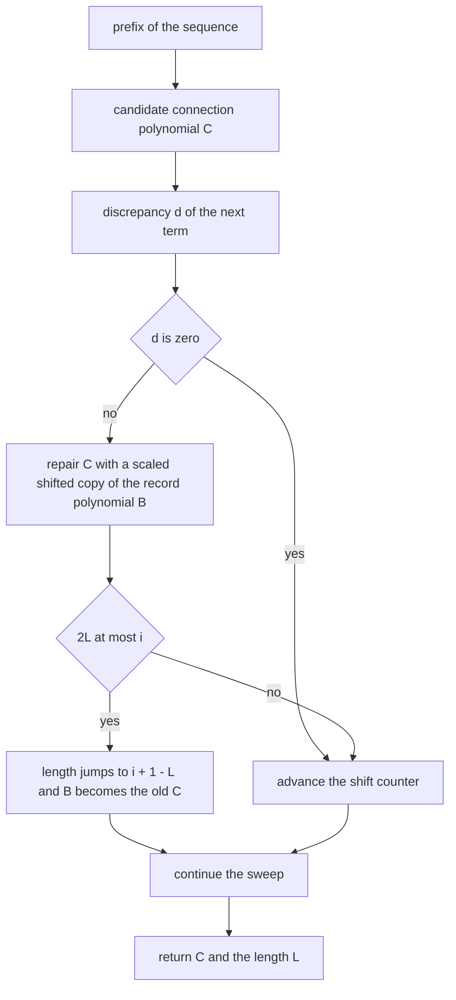
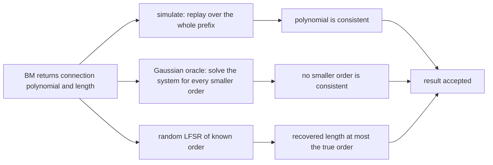
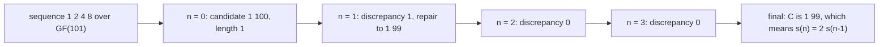
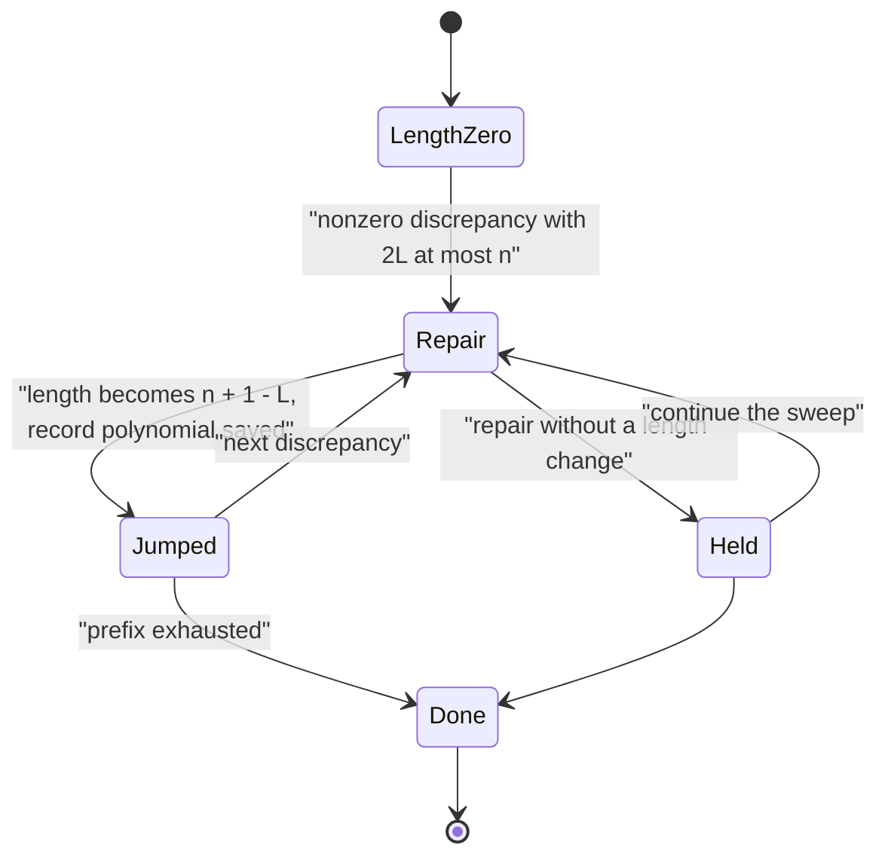

# 560 — Implement Berlekamp–Massey for minimal linear recurrence (conceptual).

> **Tier:** Advanced · **CTCI chapter:** Beyond — Advanced Data Structures & Algorithms
> **Task spec:** [560-implement-berlekamp-massey-for-minimal-linear-recurrence-concept.md](../../../tasks/advanced/560-implement-berlekamp-massey-for-minimal-linear-recurrence-concept.md)
> **Solutions:** [Python](../../../solutions/python/advanced/560-implement-berlekamp-massey-for-minimal-linear-recurrence-concept/solution.py) ·
> [Java](../../../solutions/java/advanced/560-implement-berlekamp-massey-for-minimal-linear-recurrence-concept/Solution.java) ·
> [JavaScript](../../../solutions/javascript/advanced/560-implement-berlekamp-massey-for-minimal-linear-recurrence-concept/solution.js) ·
> [C#](../../../solutions/csharp/advanced/560-implement-berlekamp-massey-for-minimal-linear-recurrence-concept/Solution.cs)

## 1. Problem restatement

**Input:** the first `m` terms of a sequence over a prime field `GF(p)` (`p = 1000000007` in the Java and
C# files, `GF(2^61 - 1)` with `BigInt` in the JavaScript file, and the C# file also runs `p = 97` and
`GF(2)`).

**Output:** the **shortest** linear recurrence that generates the sequence — the connection polynomial
`C(x) = 1 + c_1·x + ... + c_L·x^L`, equivalently

```text
s(n) = -( c_1·s(n-1) + ... + c_L·s(n-L) )
```

together with its degree `L`, the *linear complexity* of the prefix. The spec calls the task
"conceptual", but every file implements Berlekamp–Massey **in full rather than describing it**.

Three supporting pieces exist purely for verification: a **simulator** that extends any prefix using a
given connection polynomial, an exact **Gaussian-elimination rank test** that finds the smallest order
whose linear system is consistent (a minimality oracle that knows nothing about the algorithm), and a
generator of random LFSRs.

The documented checks:

| Check | Statement | Why |
| --- | --- | --- |
| all-zero sequence | `L = 0` | the empty relation generates it |
| constant sequence | the one-tap LFSR | `s(n) = s(n-1)` |
| Fibonacci and Lucas mod `p`, random order-5 recurrence | recovered length and taps as expected | known answers |
| replay | every recovered LFSR reproduces the **entire** prefix | the polynomial is replayed, not trusted |
| minimality | BM's length equals the Gaussian-elimination oracle on every test, and no smaller order is consistent | an independent oracle |
| random LFSRs | orders 3 to 6 over `GF(2)` and `GF(101)`; BM given `2d` to `4d` terms recovers a length `≤ d` LFSR that generates a **four-times-longer** run | the standard "`2L` terms determine an order-`L` LFSR" statement, used and verified |
| monotonicity | the length never decreases as terms arrive | the connection polynomial only ever grows |
| observed bound | `2L <= n + 2` on every tested prefix | asserted instead of the folklore `L <= n/2`, which a witness refutes |
| Massey's theorem | a maximal-length LFSR of degree 4 over `GF(2)` (primitive `x^4 + x + 1`), given its 15-term period, yields `L = 4` with the expected taps | a full-period instance |
| caveat 1 | on the first **four** terms of that degree-4 `m`-sequence BM returns the one-tap LFSR `s(n) = 0`; on the first **seven** it returns an order-4 LFSR — minimal, per the oracle — that fits all seven symbols yet is **not** the generating recurrence and diverges immediately afterwards; only the full `2L = 8` terms pin it down | asserted |
| caveat 2 | the folklore "`L <= n/2` after `n` terms" is **false**: over `GF(2)` the six-term prefix `1,1,0,0,0,1` has `L = 4` | the oracle confirms it is minimal |

## 2. Intuition

A sequence generated by an order-`L` linear recurrence is generated by a linear feedback shift register
with `L` taps. Berlekamp–Massey is the procedure that *finds* the shortest such register from the terms
themselves, and it does so in one left-to-right sweep:

1. Maintain a candidate connection polynomial `C(x)` that should predict every term so far.
2. At the next term, compute the **discrepancy** `d` — how far the prediction is off.
3. If `d = 0`, the candidate is still right; advance the shift counter.
4. If `d ≠ 0`, repair `C` by subtracting a scaled, shifted copy of the last *record* polynomial `B`,
   the last candidate that had a different length. The scaling is `d / bb` where `bb` is the discrepancy
   that went with `B` — which is why the field needs inverses.
5. If the discrepancy occurs late enough (`2L <= i`), the length jumps to `L' = i + 1 - L` and `B`
   becomes the old `C`.

The length jump is the heart of the algorithm: it says a failure that happens after enough terms cannot
be repaired by keeping the old length, and it produces the classical `L' = n + 1 - L` update.

The conceptual point — and the reason the task is titled "conceptual" — is the distinction between
*the shortest register consistent with the terms you have* and *the register that generated the
sequence*. Those coincide only once you have enough terms: `2L` terms determine an order-`L` LFSR, and
below that, BM's answer is genuinely minimal *for the prefix* while being wrong about the future. The
files assert exactly that with the degree-4 `m`-sequence: four terms give `s(n) = 0`, seven terms give a
minimal-but-wrong order-4 register, and only eight terms (`2L`) give the generator.



## 3. Algorithm

1. Initialise `C = [1]`, `B = [1]` (the last record polynomial), `L = 0`, `shift = 1`, `last = 1` (the
   discrepancy that produced `B`).
2. Sweep `n` over the terms:
   1. Compute `d = s(n) + sum over i = 1..L of C[i]·s(n-i)`, reduced modulo `p`.
   2. If `d = 0`, increment `shift` and continue.
   3. Otherwise let `factor = d · last^(-1)` and add `-factor · x^shift · B(x)` to `C(x)`.
   4. If `2L <= n`: remember the old `C`, set `L = n + 1 - L`, set `B` to the remembered polynomial, set
      `last = d`, and reset `shift = 1`. Otherwise just increment `shift`.
3. Trim `C` to `L + 1` terms and return `(C, L)`; the recurrence is `s(n) = -(c_1·s(n-1) + ... + c_L·s(n-L))`.

The modular inverse is Fermat's little theorem (`pow(last, p - 2, p)`) in Java and Python, and the
extended Euclidean algorithm in C# — both exact, which is why the Gaussian oracle can compare against
BM with equality rather than a tolerance.

```text
procedure berlekamp_massey(sequence, p)
    C ← [1]
    B ← [1]
    L ← 0
    shift ← 1
    last ← 1
    for n ← 0 to length(sequence) - 1 do
        d ← sequence[n]
        for i ← 1 to L do
            d ← (d + C[i] * sequence[n - i]) mod p
        end
        if d is zero then
            shift ← shift + 1
            continue
        end
        factor ← d * inverse(last) mod p
        if 2 * L <= n then
            remembered ← copy of C
            grow C to length of B plus shift
            for i ← 0 to length(B) - 1 do
                C[i + shift] ← (C[i + shift] - factor * B[i]) mod p
            end
            L ← n + 1 - L
            B ← remembered
            last ← d
            shift ← 1
        else
            grow C to length of B plus shift
            for i ← 0 to length(B) - 1 do
                C[i + shift] ← (C[i + shift] - factor * B[i]) mod p
            end
            shift ← shift + 1
        end
    end
    return the first L + 1 terms of C, and L
end
```

Verification is a separate pipeline, which is what makes the answer trustworthy: replay the polynomial
over the whole prefix, check minimality against the Gaussian oracle by testing every smaller order, and
generate random LFSRs whose true length is known by construction.



## 4. Worked example

Take the geometric sequence `1, 2, 4, 8, ...` over `GF(101)`, i.e. `s(n) = 2·s(n-1)`, and sweep BM by
hand. All arithmetic is modulo `101`, and `-1 ≡ 100`:

| `n` | `s(n)` | Discrepancy `d` | Branch taken | `C` after | `L` | `shift` |
| --- | --- | --- | --- | --- | --- | --- |
| 0 | `1` | `1` | length jump (`2L = 0 <= 0`) | `[1, 100]` | `1` | `1` |
| 1 | `2` | `2 + 100·1 = 1` | repair only (`2L = 2 > 1`) | `[1, 99]` | `1` | `2` |
| 2 | `4` | `4 + 99·2 = 202 ≡ 0` | no change | `[1, 99]` | `1` | `3` |
| 3 | `8` | `8 + 99·4 = 404 ≡ 0` | no change | `[1, 99]` | `1` | `4` |

The final polynomial is `C = [1, 99]`, so the recurrence is `s(n) = -(99·s(n-1))`. Since `-99 ≡ 2`
modulo `101`, that is `s(n) = 2·s(n-1)` — exactly the generator, recovered with `L = 1`. The `n = 1` row
is the instructive one: the first candidate `[1, 100]` predicted `s(1) = 1` instead of `2`, and the
repair step subtracted the missing amount using the record polynomial, without changing the length
because the failure came too early for a length jump.

The caveats are visible on the degree-4 `m`-sequence over `GF(2)` (primitive polynomial `x^4 + x + 1`,
period 15):

| Terms given | BM returns | Minimal for the prefix? | Generates the sequence? |
| --- | --- | --- | --- |
| first 4 | the one-tap LFSR `s(n) = 0` | yes | no — it predicts zero forever |
| first 7 | an order-4 LFSR | yes, per the Gaussian oracle | no — it diverges immediately after the seventh term |
| first 8 (`2L`) | the true order-4 register with the expected taps | yes | yes |
| all 15 (the period) | `L = 4` with the expected taps | yes | yes |





## 5. Complexity

Let `m` be the number of given terms and `L` the recovered linear complexity.

| Measure | Bound | Why it holds |
| --- | --- | --- |
| Time | `O(m · L)` field operations, `O(m²)` worst case | each term computes a discrepancy of length `L` and may repair a polynomial of length `L` |
| Modular inverse | `O(log p)` | Fermat or extended Euclid, once per nonzero discrepancy |
| Space | `O(L)` coefficients, plus the record polynomial | two coefficient vectors |
| Replay check | `O(m · L)` | simulate the polynomial over the whole prefix |
| Gaussian minimality oracle | `O(L³)` per order, `O(L⁴)` over all smaller orders | exact elimination for each candidate order |
| Random-LFSR experiment | `O(d)` terms in, four-times-longer run out | the "`2L` terms determine an order-`L` LFSR" statement |

The algorithm is quadratic in the worst case and linear in practice for sequences with small linear
complexity, which is exactly the regime it is used in — a random-looking sequence of length `m` has
`L ≈ m/2`, and the sweep is still cheap because `L` grows slowly. The expensive part of this task is not
BM but the verification: the Gaussian oracle re-solves the whole consistency question from scratch, which
is a much stronger (and slower) way to confirm minimality than re-running BM.

## 6. Pitfalls and edge cases

- **Minimal for the prefix is not "the generator".** On seven terms of a degree-4 `m`-sequence BM returns
  a minimal order-4 register that fits all seven terms and is wrong about the future. The `2L` threshold
  is the line between "consistent so far" and "determines the sequence", and the files assert both sides
  of it.
- **The folklore bound is false.** "`L <= n/2` after `n` terms" is contradicted by the six-term `GF(2)`
  prefix `1,1,0,0,0,1`, whose minimal order is `4` (confirmed by the Gaussian oracle). The file asserts
  only the bound it observes on every tested prefix, `2L <= n + 2`.
- **Field arithmetic must be exact.** The repair divides by the last discrepancy, so the implementation
  needs modular inverses — and a vanishing `last` would break it, which the algorithm's structure
  prevents (a discrepancy is only recorded when it is non-zero).
- **All-zero and constant sequences.** The all-zero sequence has `L = 0` (there is nothing to predict),
  and a constant sequence has the one-tap relation `s(n) = s(n-1)`. Both are easy to get wrong by
  returning `L = 1` with a zero tap.
- **Trim the polynomial.** The internal `C` can be longer than `L + 1` during the sweep; the returned
  connection polynomial must be trimmed, or a replay will use stale high-order coefficients.
- **Sign convention.** `C(x) = 1 + c_1·x + ...` and `s(n) = -(c_1·s(n-1) + ...)` carry a sign flip that is
  easy to lose when converting between the polynomial form and the recurrence form. The files return
  `(C, L)` and convert explicitly.
- **The characteristic vs connection polynomial.** The characteristic polynomial of the recurrence is the
  *reverse* of the connection polynomial; the connection polynomial has constant term `1`, the
  characteristic one has leading coefficient `1`. Task 559 reduces modulo the characteristic form, this
  task returns the connection form.
- **Prime field requirement.** The Gaussian oracle and the inverses need a field, so the modulus must be
  prime; the same code over `Z/2^61` would fail. The JavaScript file uses the prime `2^61 - 1`.
- **Prefix length versus period.** A maximal-length register of degree 4 has period 15, and BM on the
  full period returns `L = 4`. BM on a *shorter* prefix of the same sequence returns something else —
  possibly still minimal for that prefix.
- **Randomness quality.** Sequences and LFSR taps come from a full-period 64-bit generator read in its
  high bits, because the repository's 16-bit `lcg` has low-bit structure that would correlate the taps
  and make the recovery experiments easier than they should be.

## 7. Variants and follow-ups

- **The forward direction.** Given the recurrence, evaluating `s(n)` for a huge `n` is a matrix power:
  [559-implement-fast-exponentiation-of-linear-recurrences-using-matrix.md](../../../tasks/advanced/559-implement-fast-exponentiation-of-linear-recurrences-using-matrix.md).
  Together the two tasks are the encoding and decoding halves of the same object.
- **Over `GF(2)` specifically.** Berlekamp–Massey over `GF(2)` is the standard LFSR-synthesis tool, and
  the bit-parallel arithmetic that makes such field work fast is
  [558-implement-boolean-matrix-multiplication-optimization-using-bitse.md](../../../tasks/advanced/558-implement-boolean-matrix-multiplication-optimization-using-bitse.md).
- **Algorithms that need a good generator.** The collision-resistance property tests of
  [571-implement-collision-resistant-hash-property-tests-statistical.md](../../../tasks/advanced/571-implement-collision-resistant-hash-property-tests-statistical.md)
  rely on sequences whose structure is not accidentally linear.
- **Solving linear systems exactly.** The minimality oracle is Gaussian elimination over a prime field,
  the same primitive that underwrites
  [574-implement-ransac-robust-model-fitting-algorithm.md](../../../tasks/advanced/574-implement-ransac-robust-model-fitting-algorithm.md)'s
  exact least-squares fits on the sampled consensus sets.

## 8. Check yourself

1. What is the discrepancy, and why does a zero discrepancy mean "no work to do"?

<details><summary>Show answer</summary>

The discrepancy is `d = s(n) + sum over i of c_i·s(n-i)` — the amount by which the current connection
polynomial fails to predict the next term. If it is zero, the polynomial predicts the term exactly, so
the candidate is still valid and only the shift counter advances: the shift records how many terms have
passed since the last length change, which is exactly what a later repair needs to know.

</details>

2. Why does the length jump to `n + 1 - L` rather than increase by one?

<details><summary>Show answer</summary>

Because the failure at position `n` proves the old length cannot be repaired: the algorithm's invariant
is that the connection polynomial of length `L` explains the prefix as well as possible, and when the
discrepancy happens late (`2L <= n`) the only way to accommodate it is to reset to the complementary
length `n + 1 - L`, which is the classical Massey bound. That is also why the length is monotone
non-decreasing across the sweep even though the formula looks like a subtraction.

</details>

3. Why is `2L` terms the threshold for determining the recurrence?

<details><summary>Show answer</summary>

Because an order-`L` recurrence has `L` unknown coefficients and the terms provide one equation each, so
`2L` equations are enough to fix them with room to spare; the files test the statement directly by
giving BM `2d` to `4d` terms of a random order-`d` LFSR and checking that the recovered register
generates a run four times longer. Below `2L` terms BM still returns the *minimal* register for the
prefix, but a different one can fit equally well — which is exactly what the seven-term example shows.

</details>

4. The Gaussian oracle is much slower than BM. Why keep it?

<details><summary>Show answer</summary>

Because it answers a different question: "is there any consistent register of order `< L`?" It knows
nothing about Berlekamp–Massey, so agreement means BM's output is minimal for an independent reason
rather than by construction. Re-running BM would only test consistency of BM with itself, which would
not catch an incorrect length update.

</details>

5. What does the six-term `GF(2)` prefix `1,1,0,0,0,1` refute?

<details><summary>Show answer</summary>

The folklore bound "`L <= n/2` after `n` terms": here `n = 6` and the minimal order is `4`, which is
greater than `3`. The Gaussian oracle confirms that no smaller order fits, so the bound is simply false
as stated, and the files replace it with the observed `2L <= n + 2`, which this instance meets with
equality (`8 = 6 + 2`).

</details>
