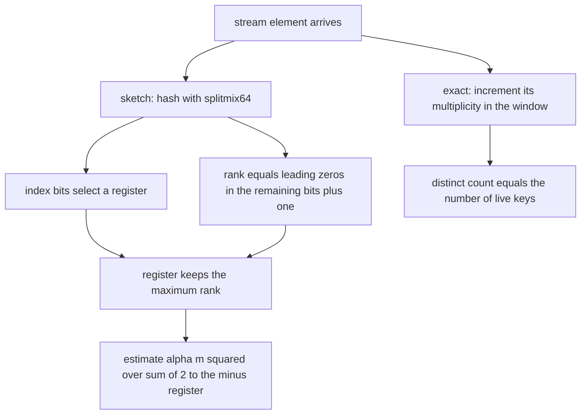
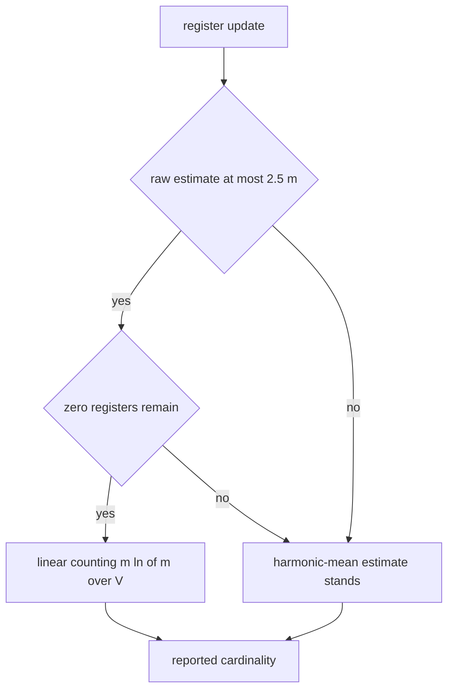
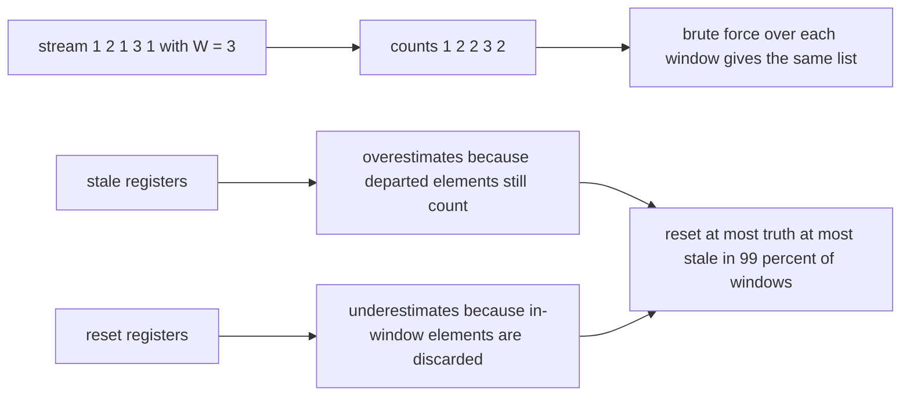
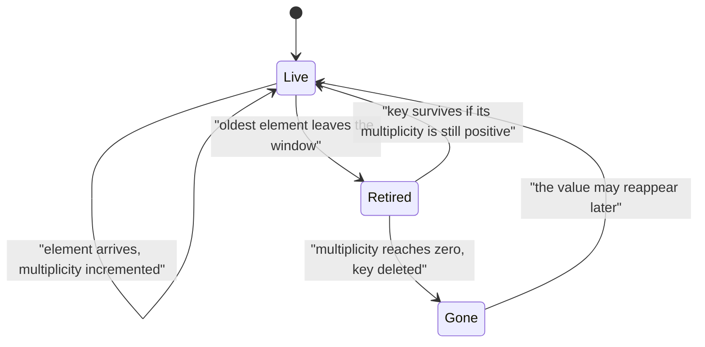

# 561 — Implement online algorithm for sliding-window distinct count (HyperLogLog outline).

> **Tier:** Advanced · **CTCI chapter:** Beyond — Advanced Data Structures & Algorithms
> **Task spec:** [561-implement-online-algorithm-for-sliding-window-distinct-count-hyp.md](../../../tasks/advanced/561-implement-online-algorithm-for-sliding-window-distinct-count-hyp.md)
> **Solutions:** [Python](../../../solutions/python/advanced/561-implement-online-algorithm-for-sliding-window-distinct-count-hyp/solution.py) ·
> [Java](../../../solutions/java/advanced/561-implement-online-algorithm-for-sliding-window-distinct-count-hyp/Solution.java) ·
> [JavaScript](../../../solutions/javascript/advanced/561-implement-online-algorithm-for-sliding-window-distinct-count-hyp/solution.js) ·
> [C#](../../../solutions/csharp/advanced/561-implement-online-algorithm-for-sliding-window-distinct-count-hyp/Solution.cs)

## 1. Problem restatement

**Input:** a stream of elements arriving in order, and a window length `W`.

**Output:** as each element arrives, the number of **distinct** elements in the last `W` positions —
computed online, in one pass, without rescanning the window. Two answers are implemented and
cross-checked:

1. **Exact.** A multiplicity dictionary over the live window (Python, JavaScript, C#), or a
   `last-seen-position` array plus a Fenwick tree holding a `1` at each value's *current* occurrence
   (Java), so the window count is a two-prefix-sum query. Cost per element: `O(1)` amortised, or
   `O(log n)` for the Fenwick variant.
2. **Approximate.** A **HyperLogLog** sketch with `p` index bits and `m = 2^p` registers (`p = 10`,
   `m = 1024` in the Java file): each element is hashed with `splitmix64`, the index bits select a
   register, and the rank (position of the leftmost `1` in the remaining bits, plus one) is kept if it
   exceeds the register's current value. The estimate is
   `alpha_m·m² / sum over j of 2^(-M_j)` with `alpha_m = 0.7213 / (1 + 1.079/m)`, switching to the
   **linear-counting** correction `m·ln(m/V)` (with `V` zero registers) while the raw estimate is below
   `2.5·m`.

Three windowed flavours exist, and the files measure how the two *streaming* ones fail:

| Variant | Behaviour | Documented bias |
| --- | --- | --- |
| exact-per-window sketch | a sketch is re-derived for each window | no measurable bias |
| streaming, **stale** | each register keeps its value forever, never expiring | **over**estimates, because it keeps counting elements that have left the window |
| streaming, **reset** | a register is zeroed when its latest maximum came from outside the window | **under**estimates, because it discards in-window elements that mapped to a register whose maximum is older |

The documented checks:

| Check | Statement | Why |
| --- | --- | --- |
| exact sliding count | equals a brute-force recomputation on **every** window of several streams | two independent structures |
| heavy repeats | the dictionary size equals the true distinct count | the multiset must be maintained, not just a set |
| degenerate windows | `W = 1`, `W` larger than the stream, and a `0`-length window behave | convention cases |
| accuracy | HLL estimates cardinalities `50, 500, 5000` within **three standard errors** of the `1.04/sqrt(m)` heuristic, at two register counts | the standard error model |
| register count | the larger register set is measurably more accurate | error shrinks with `m` |
| determinism | repeated runs give identical estimates | seeded hashing |
| bias | the exact-per-window sketch is unbiased, and the two streaming variants straddle the truth — `reset <= truth <= stale` in **99 %** of windows on a high-cardinality stream, and in the means | measured, not glossed over |
| merge | merging two sketches is a register-wise maximum, hence **exact**, not approximate | set union corresponds to max |
| documented limit | neither streaming variant is a substitute for a real windowed sketch | stated in the headers |

## 2. Intuition

The exact problem has a neat online solution. Keep the window itself as a deque plus a **multiplicity**
dictionary of what is inside it. When a new element arrives: increment its multiplicity; when an element
leaves the window, decrement its multiplicity and delete the key if the count hits zero. The number of
distinct elements in the window is then simply the number of keys — `O(1)` amortised per element, with
no rescanning, because an element's arrival or departure changes the distinct count by at most one.

The Java formulation is the same idea in prefix-sum clothing: keep `last[v]`, the latest position of
`v`, and a Fenwick tree with a `1` at each value's current position. When `v` repeats, move the `1` from
its old position to the new one, and the distinct count of the window ending at `R` is the number of
`1`s in `[R - W + 1, R]` — a difference of two prefix sums.

The *approximate* answer exists because maintaining a dictionary costs memory proportional to the
number of distinct elements. HyperLogLog replaces it with `m` tiny registers (a few bits each):
hash each element, use some bits as a register index, and record "how unusual was this hash" as the
number of leading zeros. The pattern is the same as in the MinHash task — *randomise, then reason about
the error* — and the estimator's relative error behaves like `1.04/sqrt(m)`.



Making the sketch *sliding* is where the honest difficulty lies, and it is why the task is titled an
outline. A sketch summarises the whole past, and there is no cheap way to subtract the elements that
leave a window. The files implement the two practical hacks and then measure their bias instead of
recommending either: never expiring registers (stale) drifts upwards; expiring by timestamp (reset)
drifts downwards, because zeroing a register throws away in-window elements too.

## 3. Algorithm

**Exact sliding distinct count.**

1. Keep a deque of the window and a dictionary of multiplicities.
2. On each new element: increment its multiplicity and push it.
3. If the window is full, pop the oldest element and decrement its multiplicity, deleting the key at
   zero.
4. Report the number of keys — the distinct count of the window.

**HyperLogLog sketch.**

1. Hash the element to 64 bits with `splitmix64`.
2. Take the low (or high) `p` bits as the register index and compute the rank of the remaining bits —
   the 1-based position of the leftmost set bit, `64 - p + 1` if all are zero.
3. Store the maximum of the register's current value and the rank.
4. Estimate: `alpha_m·m² / sum of 2^(-M_j)`, with `alpha_m = 0.7213/(1 + 1.079/m)`.
5. If the raw estimate is below `2.5·m` and there are `V` zero registers, replace it by the
   linear-counting estimate `m·ln(m/V)` — the small-range correction.
6. Merging two sketches is the register-wise maximum; because set union maps to max, the merge is exact.

**Windowed variants.**

- *Exact per window*: rebuild a sketch from the current window's contents (correct, `O(W)` per step).
- *Stale*: keep each register forever; never expire.
- *Reset*: store each register's value together with the position that produced it, and zero the
  register when that position leaves the window.

```text
procedure exact_sliding_distinct(stream, W)
    multiplicity ← empty dictionary
    history ← empty list
    for index ← 0 to length(stream) - 1 do
        multiplicity[stream[index]] ← multiplicity[stream[index]] + 1
        if W > 0 and index >= W then
            leaving ← stream[index - W]
            multiplicity[leaving] ← multiplicity[leaving] - 1
            if multiplicity[leaving] = 0 then remove leaving end
        end
        append the number of keys of multiplicity to history
    end
    return history
end

procedure hll_add(registers, element, p, m)
    hash ← splitmix64(element)
    register ← hash AND (m - 1)
    rank ← 1 + number of leading zeros in (hash shifted right by p)
    if rank > registers[register] then registers[register] ← rank end
end

procedure hll_estimate(registers, m)
    total ← sum over j of 2 raised to the power minus registers[j]
    zeros ← count of registers equal to 0
    estimate ← (0.7213 / (1 + 1.079 / m)) * m * m / total
    if estimate <= 2.5 * m and zeros > 0 then
        estimate ← m * ln(m / zeros)
    end
    return estimate
end
```



## 4. Worked example

The exact algorithm is small enough to trace completely. Take the stream `1, 2, 1, 3, 1` with window
`W = 3`:

| `index` | Element | Multiplicities after the update | Element leaving | Live keys | Distinct in window |
| --- | --- | --- | --- | --- | --- |
| 0 | `1` | `{1: 1}` | — | `{1}` | `1` |
| 1 | `2` | `{1: 1, 2: 1}` | — | `{1, 2}` | `2` |
| 2 | `1` | `{1: 2, 2: 1}` | — | `{1, 2}` | `2` |
| 3 | `3` | `{1: 2, 2: 1, 3: 1}` | `1` (position 0) | `{1: 1, 2: 1, 3: 1}` | `3` |
| 4 | `1` | `{1: 2, 3: 1}` | `2` (position 1) | `{1, 3}` | `2` |

Row 3 is the row that shows why a *multiplicity* is needed rather than a set: the `1` at position 0
leaves the window, but another `1` remains at position 2, so the key survives and the count is `3`, not
`2`. A brute-force recomputation over every window gives the same sequence `1, 2, 2, 3, 2`, which is
exactly what the file asserts on every window of several streams.

The degenerate window sizes are the documented convention cases:

| `W` | Behaviour | Reason |
| --- | --- | --- |
| `1` | the count is always `1` | a single-element window always has one distinct value |
| larger than the stream | the count is the distinct count of the whole prefix so far | nothing has left yet |
| `0` | no expiry happens, so the count is the running total distinct count | the implementation only retires when `W > 0` |

The approximate side is a statement about *error*, and the sizes the files use make it concrete: with
`m = 1024` registers the heuristic relative error is `1.04/sqrt(1024) ≈ 3.3 %`, and the estimates for
cardinalities `50`, `500` and `5000` must fall within three standard errors of that; increasing the
register count must measurably reduce the error, which the files check at two register counts.





## 5. Complexity

Let `n` be the number of stream elements, `W` the window length and `m = 2^p` the register count.

| Structure | Time per element | Space | Note |
| --- | --- | --- | --- |
| Exact, dictionary + deque | `O(1)` amortised | `O(distinct in window)` | each element enters and leaves once |
| Exact, `last` positions + Fenwick tree | `O(log n)` | `O(n)` for the tree, `O(distinct)` for `last` | two prefix sums per query |
| Brute-force reference | `O(W)` per window | `O(W)` | `O(n·W)` overall |
| HyperLogLog update | `O(1)` per element | `O(m)` registers | hash, index, rank, max |
| HyperLogLog estimate | `O(m)` | — | harmonic mean plus the zero count |
| Streaming stale variant | `O(1)` per element | `O(m)` | plus a position per register |
| Streaming reset variant | `O(1)` per element | `O(m)` | zeroing a register when its position expires |
| Exact-per-window sketch | `O(W)` per window | `O(m)` | rebuild; used as the unbiased reference |
| Merge of two sketches | `O(m)` | `O(m)` | register-wise maximum, exact |

The trade is memory against accuracy: the exact structure is `O(distinct in window)` — potentially as
large as the window — while the sketch is a fixed `O(m)` words with a relative error of roughly
`1.04/sqrt(m)` that does not depend on the stream length. What the sketch *cannot* do is forget: a
register has no memory of which elements produced it, which is the root of both streaming biases.

## 6. Pitfalls and edge cases

- **A set is not enough for a sliding window.** Elements leave one at a time and can be duplicated, so
  the structure must count multiplicities; a plain set would delete a key whose previous occurrence
  left the window while a newer one is still inside. The worked example's third row is exactly that case.
- **`W = 0` and `W = 1`.** A zero-length window (interpreted as no expiry in these files) and a
  one-element window must both be handled; the files test them explicitly rather than leaving the
  convention implicit.
- **Windows larger than the stream.** Nothing has left yet, so the count is the running total — a case
  where an off-by-one in the expiry check silently drops the first element.
- **Stale registers over-count.** A register that keeps an old maximum keeps contributing to the
  estimate long after the element that produced it has left the window; the files measure a positive
  bias on every query of the tested instance.
- **Reset registers under-count.** Zeroing a register discards the maxima of *all* elements that mapped
  to it, including ones still inside the window, so the estimate drifts down. On a high-cardinality
  stream the two variants straddle the truth: `reset <= truth <= stale` in 99 % of windows and in the
  means.
- **Neither variant is a real windowed sketch.** The headers say so, and the tutorial should too: the
  correct-but-expensive route is to rebuild the sketch per window, and everything else is an
  approximation with a known direction of error.
- **The small-range correction matters.** Without linear counting the harmonic-mean estimator is badly
  biased for small cardinalities; the switch happens while the raw estimate is below `2.5·m` and there
  are zero registers left. The `alpha_m` constant itself is a function of `m`, not a universal number.
- **Hash quality.** `splitmix64` is used deliberately; the repository's 16-bit `lcg` has too short a
  period and too much low-bit structure, so hashed elements would land in far too few registers and the
  estimator would look artificially accurate. This is a case where a bad hash flatters the result.
- **Error model.** `1.04/sqrt(m)` is a heuristic for the relative standard error, not a hard bound, and
  the files assert "within three standard errors" on specific cardinalities rather than claiming a
  worst case. Larger `m` must be measurably better — that is checked too.
- **Merge is exact, refresh is not.** Merging two sketches by taking register-wise maxima is exact for
  set union, because every register keeps the maximum rank over all elements of both sets. That
  exactness is about *unions of sets seen so far*; it does nothing for the sliding-expiry problem.
- **Determinism.** Hashing is seeded, so repeated runs give identical estimates; without that, the
  accuracy assertions would be flaky and the bias measurements meaningless.

## 7. Variants and follow-ups

- **Sketching set similarity instead of cardinality.** The MinHash task builds fixed-width signatures for
  neighbourhood Jaccard similarity — the same "fixed memory, controlled error" bargain applied to a
  different question:
  [550-implement-graph-sketches-for-neighborhood-similarity-minhash.md](../../../tasks/advanced/550-implement-graph-sketches-for-neighborhood-similarity-minhash.md).
- **Testing hash quality directly.** The property tests of
  [571-implement-collision-resistant-hash-property-tests-statistical.md](../../../tasks/advanced/571-implement-collision-resistant-hash-property-tests-statistical.md)
  measure collisions and bit behaviour, which is what determines whether a sketch's assumptions hold.
- **Robust statistics on top of noisy estimates.** Turning many noisy estimates into one trustworthy
  number is the subject of
  [572-implement-robust-median-estimator-for-noisy-data-median-of-means.md](../../../tasks/advanced/572-implement-robust-median-estimator-for-noisy-data-median-of-means.md).
- **Sampling instead of hashing.** When the quantity is a subgraph frequency rather than a cardinality,
  [553-implement-induced-subgraph-frequency-sampling.md](../../../tasks/advanced/553-implement-induced-subgraph-frequency-sampling.md)
  draws uniform samples and reasons about the sampling error in the same spirit.

## 8. Check yourself

1. Why is a set, rather than a multiplicity dictionary, not enough for the sliding window?

<details><summary>Show answer</summary>

Because a value can appear more than once inside the window. When the oldest occurrence leaves, a set
implementation would remove the value entirely even though a newer occurrence is still inside, so the
reported distinct count drops too early. Tracking multiplicities and deleting the key only when the
count reaches zero fixes it — the worked example shows the count staying at `3` after the first `1`
expires because a second `1` remains.

</details>

2. Why is a register-wise maximum the right way to merge two HyperLogLog sketches?

<details><summary>Show answer</summary>

Because each register stores the maximum rank of the elements that hashed into it, and the rank of a
register for a union is by definition the maximum of the ranks contributed by the elements of either
set. Hence the merged register equals the register-wise maximum, so the merge is *exact* with respect to
the union of the two element sets — a property the exact integer-set union also has, unlike anything
involving window expiry.

</details>

3. Why do the stale and reset streaming variants fail in opposite directions?

<details><summary>Show answer</summary>

Stale never expires a register, so maxima produced by elements that have already left the window keep
contributing — the estimate is too high. Reset zeroes a register as soon as the position that produced
its maximum leaves the window, which discards the maxima of every *other* element that mapped to that
register and is still inside the window — the estimate is too low. Because the errors go in opposite
directions, the exact count usually lies between them, which the file measures as
`reset <= truth <= stale` in 99 % of windows.

</details>

4. Where does the small-range correction come from, and when does it apply?

<details><summary>Show answer</summary>

The harmonic-mean estimator assumes enough elements to fill many registers, so it is unreliable when
most registers are still zero; the classic fix is linear counting, which estimates cardinality as
`m·ln(m/V)` from the number `V` of empty registers, an estimator with well-understood accuracy in that
regime. The files apply it while the raw estimate is at most `2.5·m` and there is at least one zero
register, and use the harmonic mean otherwise.

</details>

5. The exact-per-window sketch is unbiased and the streaming variants are not. Why not just use the
   exact-per-window sketch?

<details><summary>Show answer</summary>

Because it costs `O(W)` per step — it rehashes the whole window — which defeats the purpose of a fixed
memory sketch on a large window. The cheap streaming variants run in `O(1)` per element but have a
systematic bias whose direction the files measure. A real solution needs a sketch with genuine window
semantics (for example, register values stored with timestamps and an explicit eviction scheme with
error analysis), which is outside the scope of this outline — the honest conclusion the headers state.

</details>
