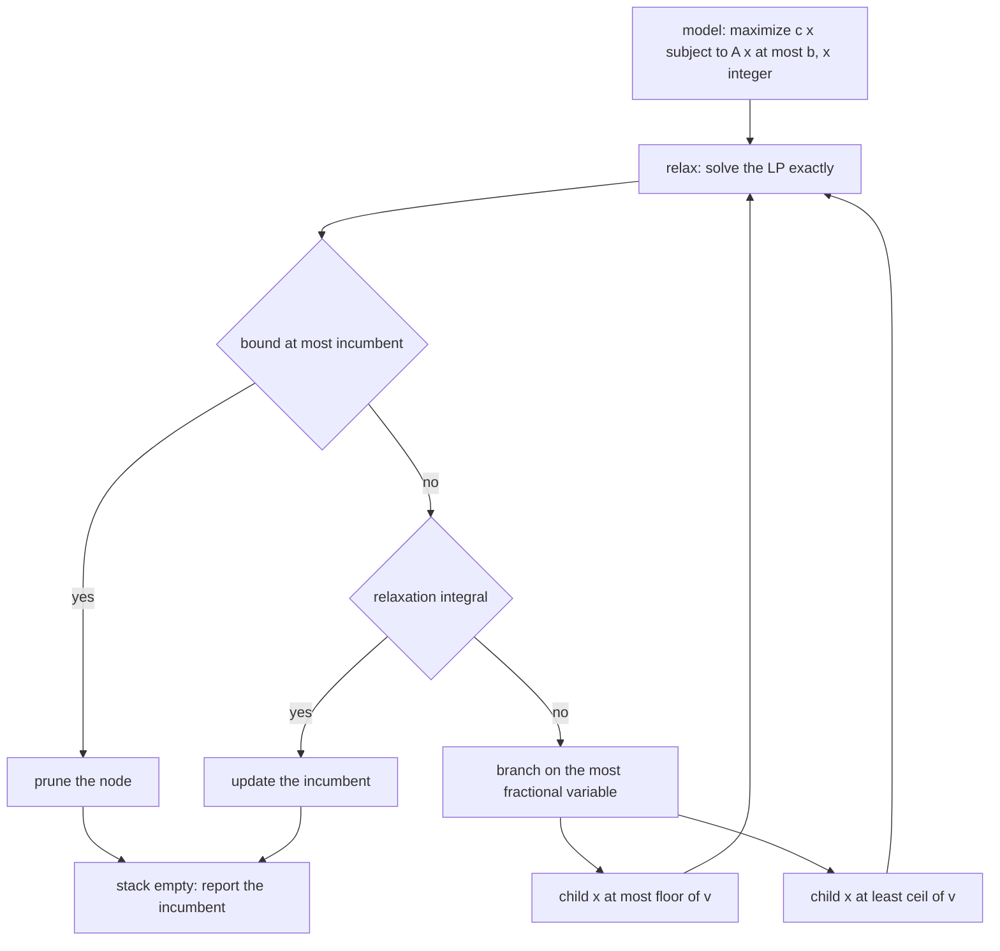
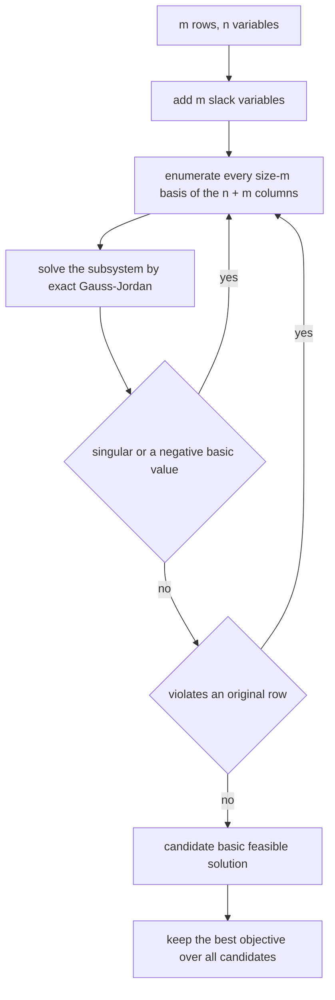
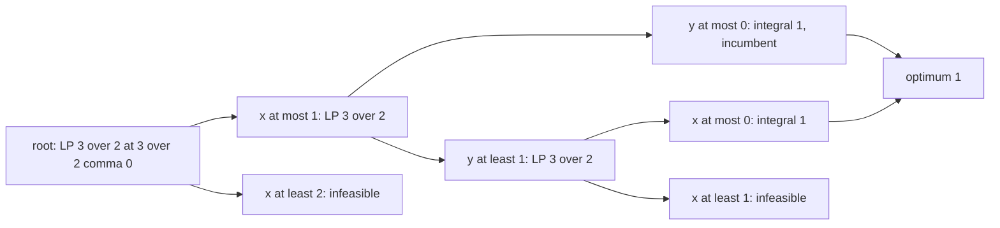
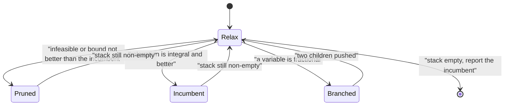

# 562 — Implement mixed integer programming small model using branch-and-bound outline.

> **Tier:** Advanced · **CTCI chapter:** Beyond — Compilers, Languages & Solvers
> **Task spec:** [562-implement-mixed-integer-programming-small-model-using-branch-and.md](../../../tasks/advanced/562-implement-mixed-integer-programming-small-model-using-branch-and.md)
> **Solutions:** [Python](../../../solutions/python/advanced/562-implement-mixed-integer-programming-small-model-using-branch-and/solution.py) ·
> [Java](../../../solutions/java/advanced/562-implement-mixed-integer-programming-small-model-using-branch-and/Solution.java) ·
> [JavaScript](../../../solutions/javascript/advanced/562-implement-mixed-integer-programming-small-model-using-branch-and/solution.js) ·
> [C#](../../../solutions/csharp/advanced/562-implement-mixed-integer-programming-small-model-using-branch-and/Solution.cs)

## 1. Problem restatement

**Input:** a small all-integer model `maximize c·x subject to A·x <= b` with integer data, `x >= 0` and
`x` integer, plus explicit upper-bound rows so that the feasible region is **bounded**.

**Output:** the integer optimal solution and its objective, the number of branch-and-bound nodes
explored, and the structure of the search — plus the LP relaxation value at the root, which is the
upper bound the search is built on.

The spec says "outline", but every file documents a **working** solver rather than a sketch. Two
ingredients are needed:

1. An **exact LP relaxation**. The Python file solves it in rational arithmetic
   (`fractions.Fraction`) by enumerating basic solutions: add `m` slack variables, pick every size-`m`
   subset of the `n + m` variables, solve that `m × m` system by Gaussian elimination, keep the
   non-negative solutions satisfying every row, and take the best objective. The Java file uses a dense
   two-phase simplex with **Bland's rule** (smallest eligible entering index, smallest basic index among
   tied minimum ratios), which rules out cycling; the C# and JavaScript files enumerate bases exactly with
   `BigInt` rationals.
2. **Branch and bound** on top: relax, prune when the bound cannot beat the incumbent, branch on the
   most fractional variable by adding `x_j <= floor(v)` or `x_j >= ceil(v)` as a new row, and stop when
   the stack is empty.

The documented checks:

| Check | Statement | Why |
| --- | --- | --- |
| knapsack | the B&B optimum equals an independent bitmask brute force **and** the textbook `O(nW)` knapsack DP | two independent oracles |
| relaxation | the LP value equals the greedy fractional-knapsack bound, as an exact rational | the classic LP/DP duality of the knapsack |
| bound validity | the relaxation bound is at least the integer optimum on every model | otherwise pruning would be unsound |
| the 2x2 example | `2x + 2y <= 3` with `maximize x + y` has LP value `3/2` — the whole edge `x + y = 3/2` is optimal and the vertex enumeration returns `(3/2, 0)` — against an integer optimum of `1` | the smallest instance that shows the integrality gap |
| branching | a model that needs real branching has node count greater than one and still finds the true optimum | the tree is doing work |
| feasibility | every reported solution satisfies the rows and its objective matches the reported value | no phantom optima |
| infeasibility | an infeasible model is reported `infeasible` by both the node search **and** the raw LP | two paths agree |
| optimality | the reported optimum is never beaten by any point of the brute-force box | exhaustive comparison |
| determinism | re-running gives the same answer | no reliance on hash or iteration order |
| documented scope | models are capped to bounded, mostly-binary shapes with explicit upper-bound rows, because the vertex enumeration would stall on an unbounded region | the header says so rather than pretending otherwise |

## 2. Intuition

Integer programming is linear programming plus "the answer must be integral", and the whole technique
comes from one observation: the LP relaxation — the same problem with the integrality dropped — is
**easy** and its optimum is an **upper bound** for the integer problem. If a relaxation on a subproblem
cannot beat the best integer solution found so far, that subproblem cannot contain anything better, so
it is discarded.

The search is therefore a tree of models, each one the original restricted by a few extra bound rows:

- **Relax**: solve the LP on the node's model.
- **Prune**: if the bound is at most the incumbent, discard the node.
- **Accept**: if the relaxation's optimum happens to be integral, it solves the node's integer problem
  exactly, so it can become the incumbent.
- **Branch**: otherwise pick a variable with a fractional value `v` and split the model into
  `x_j <= floor(v)` and `x_j >= ceil(v)`. The two children cover every integer point the parent had, so
  nothing is lost.

The second ingredient that makes this *exact* rather than approximate is how the relaxation is solved.
The files avoid floating-point simplex subtleties by using exact arithmetic — rationals in Python and
JavaScript, two-phase simplex with Bland's rule in Java — so the comparisons "is this value integral?"
and "is this bound at least the incumbent?" are exact rather than `eps`-dependent. That is also why the
worked example below can report the LP value as the rational `3/2` rather than `1.4999999997`.



## 3. Algorithm

1. Build the model: objective `c`, rows `A`, right-hand side `b`, and the box given by the
   upper-bound rows.
2. Put the root model on the stack with an incumbent of "nothing found yet".
3. While the stack is non-empty:
   1. Pop a node and solve its LP relaxation exactly.
   2. If the relaxation is infeasible, prune.
   3. If its value cannot beat the incumbent (Java allows a `1e-9` slack because its simplex is
      floating-point; the rational implementations compare exactly), prune.
   4. If every variable is integral, the node is solved: update the incumbent if it is better.
   5. Otherwise pick the most fractional variable `x_j` with value `v` and push the two children with
      the extra rows `x_j <= floor(v)` and `x_j >= ceil(v)`.
4. Report the incumbent, its objective, and the node count.

**LP relaxation by basic solutions (Python, C#, JavaScript).** For `m` rows and `n` variables, add `m`
slacks and enumerate every size-`m` subset of the `n + m` variables as the candidate basis; solve the
`m × m` subsystem; keep the solutions that are non-negative and satisfy every original row; keep the
best objective. This is exponential in the number of rows and only viable on tiny models, but it needs
no tolerance and no pivoting rule — which is exactly what lets the checks compare rationals for equality.

```text
procedure lp_relaxation(objective, rows, rhs)
    n ← number of variables, m ← number of rows
    if m = 0 then
        if any coefficient of objective is positive then return UNBOUNDED end
        return 0 with the origin
    end
    best ← none, best_point ← none
    for each size-m subset basic of the n + m columns do
        build the m by m subsystem of that basis
        values ← exact Gauss-Jordan solve
        if the system is singular or any value is negative then continue end
        build the full point with zeros outside the basis
        if the point violates any row then continue end
        if best is none or objective times point exceeds best then
            best ← objective times point
            best_point ← point
        end
    end
    return best, best_point
end

procedure branch_and_bound(objective, rows, rhs, upper_bounds)
    stack ← [root model]
    incumbent ← none, best_value ← minus infinity
    nodes ← 0
    while stack is not empty do
        node ← pop from stack
        nodes ← nodes + 1
        value, point ← lp_relaxation(node)
        if value is none then continue end
        if best_value is not none and value at most best_value then continue end
        if point is integral then
            best_value ← value, incumbent ← point
            continue
        end
        j ← the most fractional variable of point, v ← its value
        push the node with the row x[j] at most floor of v
        push the node with the row x[j] at least ceil of v
    end
    return best_value, incumbent, nodes
end
```



## 4. Worked example

The smallest model that shows the integrality gap, and the one the files pin down. Maximise `x + y`
subject to `2x + 2y <= 3`, `x, y >= 0` integers.

| Node | Extra rows | LP relaxation | Integral? | Action |
| --- | --- | --- | --- | --- |
| root | — | `3/2` at `(3/2, 0)` | no (`x` fractional) | branch on `x` |
| A | `x <= 1` | `3/2` at `(1, 1/2)` | no (`y` fractional) | branch on `y` |
| A1 | `x <= 1`, `y <= 0` | `1` at `(1, 0)` | yes | incumbent `= 1` |
| A2 | `x <= 1`, `y >= 1` | `3/2` at `(1/2, 1)` | no (`x` fractional) | branch on `x` |
| A2a | `x <= 0` (with A2's rows) | `1` at `(0, 1)` | yes | incumbent stays `1` |
| A2b | `x >= 1` (with A2's rows) | infeasible | — | prune |
| B | `x >= 2` | infeasible (`2x >= 4 > 3`) | — | prune |

Two facts are visible in the table. The **integrality gap** is `3/2 - 1 = 1/2`, so the root bound cannot
be achieved; and the LP optimum is not unique — the whole edge `x + y = 3/2` is optimal, and the vertex
enumeration returns the vertex `(3/2, 0)`. That non-uniqueness is why the file names the value, not the
point.

The **pruning** is doing real work: node A2's bound is `3/2`, which is above the incumbent `1`, so it
must be explored; its children are then either integral (`1`, not an improvement) or infeasible. Node B
dies on its bound immediately, and the search stops with the optimum `1` reached by both `(1, 0)` and
`(0, 1)` — a genuinely non-unique integer optimum, which the brute-force box comparison confirms.

For knapsack instances the same machinery lines up with two classical results:

| Quantity | Value | Independent check |
| --- | --- | --- |
| B&B integer optimum | the true optimum | bitmask brute force over the box, and the `O(nW)` knapsack DP |
| root LP relaxation | the greedy fractional-knapsack bound, exact rational | the textbook greedy rule |
| bound validity | relaxation `>=` integer optimum | asserted on every model |





## 5. Complexity

Let `n` be the number of variables, `m` the number of constraint rows and `N` the number of
branch-and-bound nodes explored.

| Component | Cost | Why |
| --- | --- | --- |
| Relaxation by basic-solution enumeration | `O(C(n + m, m) · m³)` | every size-`m` basis is solved by Gaussian elimination |
| Relaxation by two-phase simplex | polynomial in practice | Bland's rule guarantees termination, at a cost in steps |
| Branch and bound | `O(N ·` relaxation cost`)` | one relaxation per node |
| Node count | exponential in the worst case, small on the tested models | the documented instances report more than one node |
| Space | `O(N · m)` for the stack, `O(m²)` for a tableau | plus a node per open subproblem |
| Brute-force box oracle | `O(product of box sizes)` | exhaustive, only viable on tiny models |
| Knapsack DP oracle | `O(n · W)` | the pseudo-polynomial reference |

The exactness has a price: the rational vertex enumeration is exponential in the number of rows, and
the two-phase simplex trades that for floating-point arithmetic plus an `1e-9` pruning slack. The
knapsack comparison makes the trade concrete — a pseudo-polynomial DP is far cheaper *for that model*,
while branch and bound is the general technique that works when no structure is available.

## 6. Pitfalls and edge cases

- **An unbounded region breaks vertex enumeration.** Enumerating basic solutions assumes the optimum is
  attained at a vertex, which requires boundedness. The files restrict the models to bounded shapes with
  explicit upper-bound rows, and the header states that restriction instead of hiding it.
- **Basis size.** The C# header records a real trap: enumerating `n` columns as the basis instead of
  `m` is invalid as soon as there are fewer structural columns than rows. The basis of the standard form
  `[A | I]` has exactly `m` columns.
- **Cycling in the simplex.** Degenerate LPs can cycle forever with naive pivoting; Bland's rule
  (smallest eligible entering index, smallest basic index among tied minimum ratios) guarantees
  termination. The Java file implements it explicitly.
- **Tolerances versus exact arithmetic.** "Is this value integral?" and "is this bound at least the
  incumbent?" are exact questions. The rational implementations compare for equality; the floating-point
  simplex needs a `1e-9` slack, and that slack is a documented compromise rather than a detail.
- **Integrality is not a vertex property.** The `2x + 2y <= 3` example has an entire optimal edge, and
  the returned vertex is fractional: the LP optimum can be non-unique, so reporting the value is more
  meaningful than reporting one point.
- **Pruning must be conservative.** Pruning on `bound <= incumbent` is sound; pruning on
  `bound < incumbent + something generous` can cut off the true optimum. The files assert that the
  relaxation bound is at least the integer optimum on every model, which is the property that makes
  pruning safe.
- **Infeasibility has two paths.** A model can be infeasible at the root (the raw LP fails) or only
  under the integer constraints (the LP is feasible, but every leaf is pruned). The files check that
  both the node search and the raw LP report infeasibility for an infeasible model.
- **Branch variable choice.** Branching on the most fractional variable is a heuristic; any fractional
  variable gives a valid split, but the choice changes the node count. Determinism requires a tie-break,
  which the files fix by index order.
- **Numerical luck.** Floating-point LP solvers can return a value that is fractional by `1e-16`,
  triggering a pointless branch, or integral by `1e-16`, accepting a non-integral point. Exact rational
  arithmetic removes the problem entirely, which is why the Python file pays the exponential price.

## 7. Variants and follow-ups

- **The pure LP optimisation engine.** The simplex pivot mechanics — entering variable, ratio test,
  pivoting, Bland's rule — are demonstrated in
  [570-implement-linear-programming-simplex-pivot-demonstration.md](../../../tasks/advanced/570-implement-linear-programming-simplex-pivot-demonstration.md).
- **A different search for hard feasibility.** When the model is purely logical rather than arithmetic,
  branch-and-bound's cousin is the DPLL search of
  [563-implement-sat-solver-basic-dpll-algorithm.md](../../../tasks/advanced/563-implement-sat-solver-basic-dpll-algorithm.md),
  with unit propagation playing the role of relaxation pruning.
- **Approximation instead of exactness.** For facility-location-shaped models where exactness is too
  expensive, greedy approximation with a ratio guarantee is the alternative:
  [567-implement-facility-location-greedy-approximation-k-median-sketch.md](../../../tasks/advanced/567-implement-facility-location-greedy-approximation-k-median-sketch.md).
- **Rounding a relaxation on purpose.** Cutting-plane and heuristic rounding schemes are the practical
  middle ground when the LP is available but branching is too slow.

## 8. Check yourself

1. Why is the LP relaxation usable as an upper bound in a maximisation problem?

<details><summary>Show answer</summary>

Because dropping the integrality constraint *enlarges* the feasible set: every integer point of the node
is also a point of the relaxation, so the relaxation's optimum cannot be smaller than the node's integer
optimum. Therefore, if the relaxation's value is at most the best integer solution already found, no
point of this node can beat it and the node can be discarded. The files assert exactly this inequality
on every model.

</details>

2. In the worked example, why must node A2 be explored even though the incumbent is already `1`?

<details><summary>Show answer</summary>

Because its relaxation value is `3/2`, which is greater than `1`, so pruning would be unsound: the node
might still contain an integer point with value above `1`. It cannot, in fact — its children are either
integral with value exactly `1` or infeasible — but that is a conclusion the search has to reach by
exploring, not a fact it may assume. This is precisely the difference between a bound and an answer.

</details>

3. Why does the vertex enumeration return `(3/2, 0)` when the whole edge `x + y = 3/2` is optimal?

<details><summary>Show answer</summary>

Because the LP optimum is not unique on this instance: the objective is parallel to the constraint, so
every point of the facet is optimal. Vertex enumeration produces *a* vertex — `(3/2, 0)`, found by
setting `y = 0` and solving — and there is no reason for it to prefer the midpoint. The file therefore
asserts the optimal **value** `3/2` rather than the point, and separately asserts that the integer
optimum is `1`, which is the gap that makes the example interesting.

</details>

4. What makes the reported answer exact rather than approximate?

<details><summary>Show answer</summary>

The relaxation is solved in rational arithmetic: the Python and JavaScript files use exact rational
values (Python's `Fraction`, JavaScript's `BigInt` numerator/denominator pairs) and the Java file uses a
two-phase simplex with Bland's rule whose pruning comparison carries an explicit `1e-9` slack. With
exact arithmetic, "the value is integral" and "the bound does not beat the incumbent" are decided
without tolerances, which is why the tutorial can quote `3/2` and `1` as equalities.

</details>

5. Why do the files restrict the models to bounded shapes with explicit upper-bound rows?

<details><summary>Show answer</summary>

Because the fundamental theorem of linear programming — that an optimum is attained at a vertex (a basic
feasible solution) — is only useful when the polyhedron is bounded. On an unbounded region the relaxation
may be unbounded, so an "optimum at a vertex" would not exist and the enumeration would either miss the
answer or return a wrong bound. The files cap the models to bounded, mostly-binary shapes and document
that scope instead of pretending the method is general.

</details>
