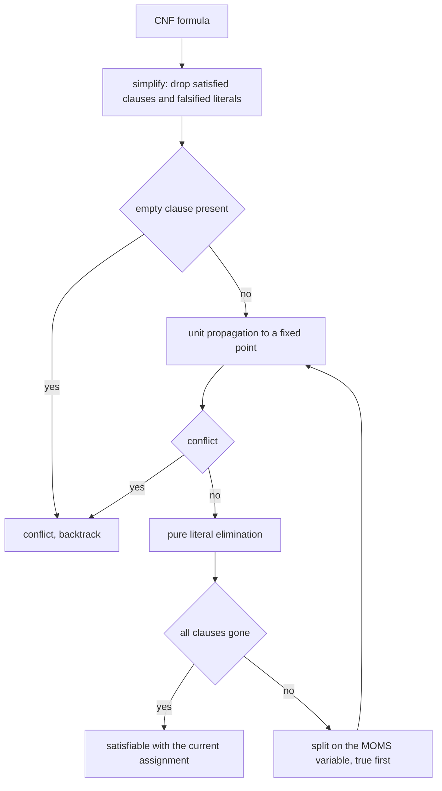
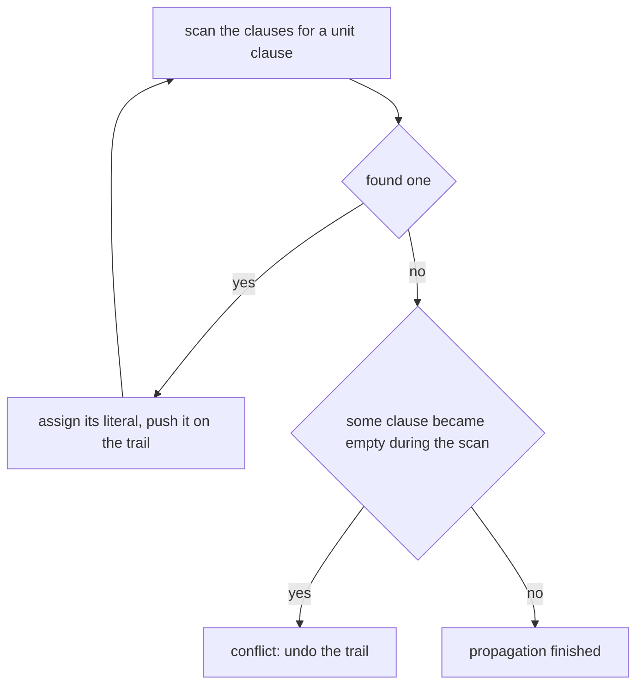
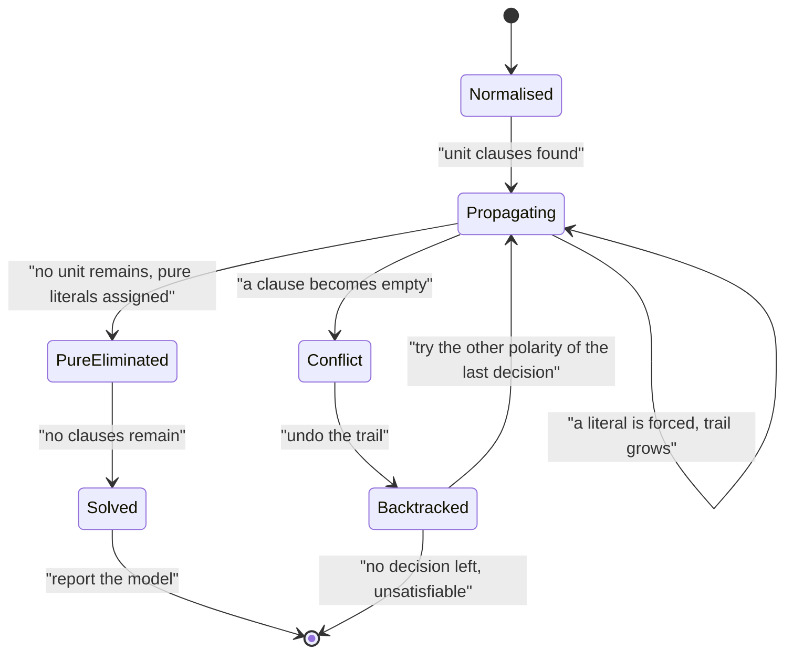

# 563 — Implement SAT solver basic DPLL algorithm.

> **Tier:** Advanced · **CTCI chapter:** Beyond — Compilers, Languages & Solvers
> **Task spec:** [563-implement-sat-solver-basic-dpll-algorithm.md](../../../tasks/advanced/563-implement-sat-solver-basic-dpll-algorithm.md)
> **Solutions:** [Python](../../../solutions/python/advanced/563-implement-sat-solver-basic-dpll-algorithm/solution.py) ·
> [Java](../../../solutions/java/advanced/563-implement-sat-solver-basic-dpll-algorithm/Solution.java) ·
> [JavaScript](../../../solutions/javascript/advanced/563-implement-sat-solver-basic-dpll-algorithm/solution.js) ·
> [C#](../../../solutions/csharp/advanced/563-implement-sat-solver-basic-dpll-algorithm/Solution.cs)

## 1. Problem restatement

**Input:** a CNF formula — a list of clauses, each a list of signed literals in DIMACS style, where
variable `v` (1-based) is the literal `v` and its negation is `-v`.

**Output:** a satisfying assignment (a full model) or a verdict of unsatisfiable, plus search
statistics: decisions, propagations and conflicts. The JavaScript file additionally counts **models** by
re-running with blocking clauses.

The solver is a complete DPLL search that repeats three rules to a fixed point at every node:

1. **Unit propagation** — a clause with exactly one unassigned literal forces that literal; repeat
   transitively, because each assignment can shrink another clause to a unit.
2. **Pure literal elimination** (optional, switchable) — a variable occurring with only one polarity in
   the remaining clauses is set to that polarity.
3. **Splitting** — branch on an unassigned variable, true first and false second, with the **MOMS**
   heuristic (maximum occurrences in minimum-size clauses, ties broken by the smallest index).

The documented checks:

| Check | Statement | Why |
| --- | --- | --- |
| verdicts | on random CNFs the satisfiable/unsatisfiable verdict equals an exhaustive truth-table enumeration | the reference |
| models | every returned model satisfies every clause | no phantom models |
| model counting | with blocking clauses, the number of models DPLL enumerates matches the brute-force model count | counting, not just deciding |
| pigeonhole | `PHP(4,3)` (12 variables, 22 clauses) and `PHP(3,2)` are unsatisfiable, while `PHP(3,4)` is satisfiable | the classic hard family |
| hand instances | a unit-propagation chain, a pure-literal instance and a formula containing a tautological clause resolve as computed by hand | small, checkable |
| propagation pays | unit propagation cuts the recursion count on a chosen instance versus the same search with propagation disabled | quantified pruning |
| heuristics agree | the MOMS branching and plain lowest-index-first branching agree on every instance | completeness does not depend on the heuristic |
| edge cases | the empty formula is satisfiable with the empty assignment; a formula containing the empty clause is unsatisfiable; tautologies are dropped and duplicate literals folded at parse time | the degenerate shapes |
| determinism | repeated runs are identical | no reliance on hash order |
| honest caveat | pure literal elimination preserves **satisfiability only** — it can leave other variables (and other models) behind, so the model counter runs with the rule switched **off**, and the rule may only ever undercount | asserted |

## 2. Intuition

Deciding satisfiability by trying all `2^n` assignments is exponential and hopeless past tiny `n`. DPLL
survives on one observation: **most of an assignment is forced**. If a clause is left with a single
unassigned literal, the formula is satisfiable only if that literal is true, so it can be assigned
without any search at all. That is unit propagation, and it cascades.

The second free move is pure literal elimination: if a variable occurs only positively in the clauses
that remain, setting it true cannot hurt — every clause containing it becomes satisfied at once. That is
the rule with the caveat attached: it preserves satisfiability, but it does *not* preserve the set of
models, so a model counter must not use it.

Only when neither rule applies does the search branch, and the heuristic used to choose the branch
variable (MOMS — the variable occurring most often in the shortest remaining clauses) decides how much
work is left. The files implement both MOMS and plain index order and assert the two agree on every
instance, which is the practical statement of DPLL's completeness: the heuristic affects the cost, not
the answer.



## 3. Algorithm

1. **Normalise** the formula: fold duplicate literals inside a clause and drop tautological clauses
   (those containing both `v` and `-v`), which are always satisfied.
2. **Simplify** against the current assignment: drop satisfied clauses, remove falsified literals.
3. **Unit propagation**: repeat until nothing changes — for every clause with exactly one unassigned
   literal, assign it; if a clause becomes empty, the node is a conflict.
4. **Pure literal elimination** (when enabled): for any variable whose remaining occurrences all have
   the same polarity, assign that polarity.
5. **Split**: if any clause remains, choose the unassigned variable that occurs most often in the
   shortest clauses (ties by smallest index), recurse with it true, then with it false.
6. **Undo**: the assignment is kept with an explicit trail so each step of the recursion is cheaply
   revertible.
7. Record statistics — decisions, propagations and conflicts — so the pruning can be quantified rather
   than asserted.

```text
procedure dpll(clauses, assignment, trail)
    propagate every unit clause to a fixed point, recording the trail
    if a clause became empty then
        undo the trail and return UNSAT
    end
    if pure elimination is enabled then
        assign every variable that occurs with one polarity only
    end
    if no clause remains then
        return SAT with the assignment
    end
    variable ← the unassigned variable with the most occurrences in the shortest clauses
    for truth_value in (true, false) do
        assign variable to truth_value, recording the trail
        result ← dpll(clauses, assignment, trail)
        if result is SAT then return result end
        undo the trail
    end
    return UNSAT
end
```

The tri-state assignment is not a detail: a Boolean array cannot distinguish "false" from "unassigned",
so the C# header calls that out as the classic way to break this algorithm. Every file keeps `0`
(unassigned), `+1` (true) and `-1` (false), and the trail makes each undo a single reversal.



## 4. Worked example

A unit chain shows the cascade. Take the formula

```text
(x1)  and  (not x1 or x2)  and  (not x2 or x3)  and  (not x3 or x4)
```

| Step | Rule | Clause inspected | Assignment after |
| --- | --- | --- | --- |
| 1 | unit | `(x1)` | `x1 = true` |
| 2 | unit | `(not x1 or x2)` — the first literal is falsified, one literal remains | `x1, x2 = true` |
| 3 | unit | `(not x2 or x3)` | `x1, x2, x3 = true` |
| 4 | unit | `(not x3 or x4)` | `x1, x2, x3, x4 = true` |
| 5 | done | every clause satisfied | `SAT` with no decisions taken |

Four assignments were forced by propagation and the search never branched: the decision count is `0`.
That is the pruning the file quantifies by running the same instance with propagation disabled and
comparing recursion counts.

The pigeonhole family gives the unsatisfiable side with hand-checkable sizes:

| Formula | Variables | Clauses | Verdict |
| --- | --- | --- | --- |
| `PHP(3,2)` (3 pigeons, 2 holes) | `6` | `3 + 2·C(3,2) = 9` | unsatisfiable |
| `PHP(4,3)` (4 pigeons, 3 holes) | `12` | `4 + 3·C(4,2) = 22` | unsatisfiable |
| `PHP(3,4)` (3 pigeons, 4 holes) | `12` | — | satisfiable |

The clause count of `PHP(4,3)` — exactly the `12` variables and `22` clauses the file names — follows
from the pigeonhole encoding: one "some hole" clause per pigeon (`4`), and one "not two pigeons in the
same hole" clause per hole and per pair of pigeons (`3 · C(4,2) = 18`). No assignment can satisfy all
of them, and DPLL has to prove it by exhausting unit propagation and then branching on the leftovers.




## 5. Complexity

Let `n` be the number of variables, `m` the number of clauses and `L` the total number of literals.

| Measure | Bound | Why it holds |
| --- | --- | --- |
| Normalisation | `O(L)` | one pass over the literals |
| One unit-propagation sweep | `O(L)` | scanning clauses and their literals for units |
| Propagation to a fixed point | `O(L)` per assigned literal in the naive form | each assignment can trigger new units; an occurrence index makes it amortised |
| Pure literal elimination | `O(L)` | count polarities over the remaining clauses |
| Search tree | up to `2^n` nodes in the worst case | DPLL is complete but not polynomial in general |
| Space | `O(n + L)` | assignment, trail and the occurrence index |
| Model counting | one blocking clause per model, so `O(models ·` search cost`)` | the count is only feasible on small formulas |

The honest statement of the cost: DPLL is exponential in the worst case, and what the heuristics buy is
a smaller tree on realistic instances. The pigeonhole family is the classic demonstration that even
these rules do not escape exponentiality — which is precisely why modern solvers add clause learning
(task 565) instead of relying on propagation alone.

## 6. Pitfalls and edge cases

- **Boolean assignment arrays.** A plain `bool` array cannot represent "unassigned", so an unassigned
  variable reads as `false` and the solver silently misbehaves. Tri-state values (unassigned, true,
  false) with an explicit trail are the fix, and the C# header names this as the classic bug.
- **Pure literal elimination is not model-preserving.** It preserves satisfiability: assigning the
  pure polarity satisfies every clause that contains the variable. But other variables may be left
  unconstrained, and other models disappear, so a model counter must switch the rule off — the files do
  exactly that and document that the rule may only ever *under*count.
- **Tautologies and duplicates.** A clause containing both `v` and `-v` is always satisfied and must be
  dropped; repeated literals inside a clause must be folded, or the clause appears longer than it is and
  a unit can be missed.
- **The empty formula and the empty clause.** The empty formula is satisfiable with the empty assignment;
  a formula containing the empty clause is unsatisfiable. Both cases arise naturally when a clause is
  reduced by propagation, so they must be handled before, not after, the search.
- **Conflict handling.** The empty clause must be detected inside propagation (when the last literal of
  a clause is falsified), not only at the top of the recursion, or a node will be explored whose search
  cannot succeed.
- **Undo discipline.** Every assignment made during propagation, pure elimination and branching has to be
  undone on backtrack; a missed undo leaves a poisoned assignment that makes later verdicts wrong. The
  explicit trail is what makes the undos exact.
- **Decision heuristic is a cost, not a correctness, choice.** MOMS and plain lowest-index-first must
  agree on every instance — the files assert it — because completeness comes from exploring both
  polarities of every decision variable, not from the heuristic.
- **Statistics are the evidence.** Decisions, propagations and conflicts are recorded so that the
  pruning claims ("propagation cuts the recursion count") are measurements on a named instance rather
  than general assertions.
- **Random formula generation.** Clauses come from a full-period 64-bit generator read in its high bits;
  the repository's 16-bit `lcg` would repeat clause patterns and quietly weaken the random tests.
- **Model counting via blocking clauses.** Counting needs one extra clause per found model to exclude
  it, which multiplies the search cost; the files only do it on instances small enough for the
  brute-force comparison to be meaningful.

## 7. Variants and follow-ups

- **Learning from conflicts.** CDCL adds clause learning and non-chronological backjumping to exactly
  this skeleton, which is what makes industrial solvers fast:
  [565-implement-clause-learning-sketch-for-sat-cdcl-outline.md](../../../tasks/advanced/565-implement-clause-learning-sketch-for-sat-cdcl-outline.md).
- **The polynomial special case.** When every clause has exactly two literals the problem is solved in
  linear time by implication-graph reachability instead of search:
  [564-implement-2-sat-solver-using-implication-graph-scc.md](../../../tasks/advanced/564-implement-2-sat-solver-using-implication-graph-scc.md).
- **Search with numeric bounds instead of logical clauses.** Branch-and-bound is the arithmetic sibling
  of this search, sharing the "relax, prune, branch" shape:
  [562-implement-mixed-integer-programming-small-model-using-branch-and.md](../../../tasks/advanced/562-implement-mixed-integer-programming-small-model-using-branch-and.md).
- **Heuristic search on hard combinatorial constraints.** When the constraint is over sets rather than
  literals, greedy submodular maximisation offers a ratio guarantee with no search at all:
  [568-implement-submodular-maximization-greedy-guarantee-example.md](../../../tasks/advanced/568-implement-submodular-maximization-greedy-guarantee-example.md).

## 8. Check yourself

1. Why is unit propagation sound — why can a unit literal be assigned with no search?

<details><summary>Show answer</summary>

Because the clause has exactly one unassigned literal and all its other literals are already falsified,
so the clause can only be satisfied by making that literal true. Hence every satisfying assignment of the
current node extends the one where it is true, and assigning it loses no solutions. Because each
assignment can reduce another clause to a unit, the rule is applied to a fixed point, which is what the
"propagation to a fixed point" loop does.

</details>

2. Why must pure literal elimination be switched off for model counting?

<details><summary>Show answer</summary>

Because it only preserves satisfiability. Setting a pure variable to its only polarity satisfies every
clause containing it, but it also fixes a variable that could otherwise take either value in some
models, so the count of models shrinks. The files run the counter with the rule disabled and note that
with the rule on, the count can only ever be too small.

</details>

3. `PHP(4,3)` has 12 variables and 22 clauses. Where do those numbers come from?

<details><summary>Show answer</summary>

The encoding uses one variable per pigeon-hole pair: `4 · 3 = 12`. The clauses are one "this pigeon is
somewhere" clause per pigeon (`4`) plus one "no two pigeons share a hole" clause per hole and per pair
of pigeons (`3 · C(4,2) = 3 · 6 = 18`), giving `4 + 18 = 22`. With three holes and four pigeons, no
assignment satisfies all of them, which DPLL must prove.

</details>

4. Why do the files implement two branching heuristics and assert they agree?

<details><summary>Show answer</summary>

Because the heuristic changes the *cost* of the search, never its answer: completeness comes from trying
both polarities of every decision variable, so MOMS and plain lowest-index-first must return the same
verdict on every formula. Asserting that agreement turns "the heuristic is only a performance choice"
into a checked statement, and it also guards against a heuristic that accidentally skips part of the
search space.

</details>

5. In the unit-chain example, the decision count is `0`. What does that tell you about the instance?

<details><summary>Show answer</summary>

That the whole assignment was forced: starting from the unit clause `(x1)`, each subsequent clause
became a unit as soon as its predecessor was assigned, so propagation alone produced a complete model
and the splitting rule never ran. The file measures exactly this effect by running the same instance
with propagation disabled and showing the recursion count rise.

</details>
