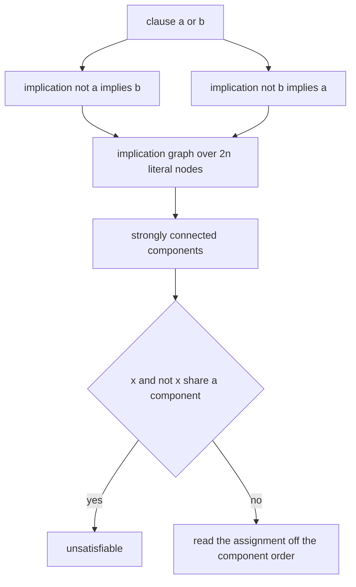
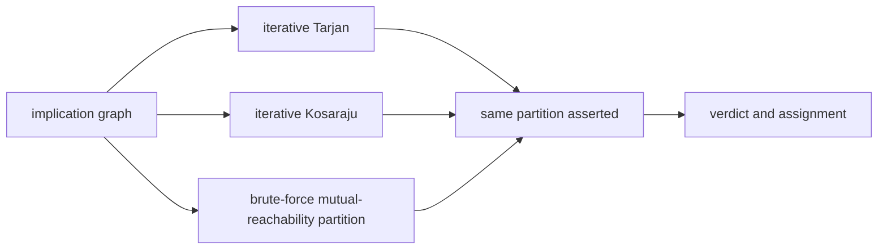
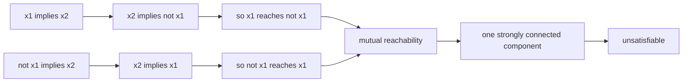
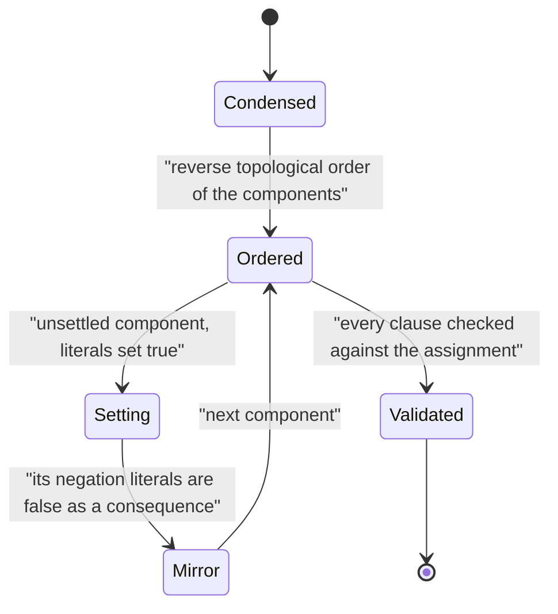

# 564 — Implement 2-SAT solver using implication graph & SCC.

> **Tier:** Advanced · **CTCI chapter:** Beyond — Compilers, Languages & Solvers
> **Task spec:** [564-implement-2-sat-solver-using-implication-graph-scc.md](../../../tasks/advanced/564-implement-2-sat-solver-using-implication-graph-scc.md)
> **Solutions:** [Python](../../../solutions/python/advanced/564-implement-2-sat-solver-using-implication-graph-scc/solution.py) ·
> [Java](../../../solutions/java/advanced/564-implement-2-sat-solver-using-implication-graph-scc/Solution.java) ·
> [JavaScript](../../../solutions/javascript/advanced/564-implement-2-sat-solver-using-implication-graph-scc/solution.js) ·
> [C#](../../../solutions/csharp/advanced/564-implement-2-sat-solver-using-implication-graph-scc/Solution.cs)

## 1. Problem restatement

**Input:** a 2-CNF formula — clauses with exactly two literals over a fixed number of variables, where
variables that never appear still get nodes.

**Output:** a satisfying assignment or the verdict "unsatisfiable", computed in **linear time** by
strongly connected components of the implication graph — no search at all.

The construction is standard and every file implements it in full:

- A clause `(a or b)` contributes the two implications `not a -> b` and `not b -> a`.
- The implication graph has `2n` nodes: node `2(v-1)` is literal `x_v` and node `2(v-1)+1` is its
  negation, so complementing a literal flips the lowest bit.
- The formula is unsatisfiable **exactly** when some variable's two literal nodes share an SCC.
- An assignment is read off the components: a literal is set true when its component is on the sink
  side relative to the component of its negation.

The documented checks:

| Check | Statement | Why |
| --- | --- | --- |
| verdicts | the SCC verdict equals a brute-force scan of all `2^n` assignments, on hand-written and many random formulas | the independent reference |
| models | the returned assignment satisfies every clause | the extraction rule is verified, not assumed |
| two SCC engines | iterative Tarjan and Kosaraju produce the same partition | two algorithms, one answer |
| third partition | a brute-force mutual-reachability partition agrees as well | no graph theory assumed |
| the theorem | unsatisfiability is equivalent to mutual reachability of `x` and `not x` on every tested formula | checked independently of the SCC machinery |
| hand instances | the refuted four-clause pattern, the satisfiable three-clause pattern, a chain, an implication cycle, tautological clauses and clauses with repeated literals | small and checkable |
| unmentioned variables | they keep their nodes, and the returned assignment covers them | the encoding covers all `2n` nodes |
| determinism | repeated runs are identical | no reliance on traversal order |

## 2. Intuition

Two clauses of a 2-CNF formula constrain each other through implication: if `(a or b)` holds then
`not a` forces `b`, and `not b` forces `a`. So a 2-CNF formula is nothing but a directed graph on
literals, and satisfiability is a statement about **cycles** in that graph.

Why? If `x` implies `not x`, then setting `x` true is impossible, so `x` must be false. If additionally
`not x` implies `x`, then `not x` is impossible too, so there is no assignment at all. "`x` implies
`not x` and `not x` implies `x`" is exactly "`x` and `not x` lie in the same strongly connected
component", which is the whole theorem. It also explains the algorithm: compute SCCs once, then read
off an assignment by respecting the implication order.

The assignment rule comes from the same reasoning. Components of the implication graph form a DAG, and
if a literal's component can reach the component of its negation, that literal must be false. So walking
the condensation in an order where every component is settled after everything it can reach — reverse
topological order — and setting each unsettled component's literals true yields a model, because a
component that would contradict its own mirror image has already been decided.



## 3. Algorithm

1. **Encode.** Build the implication graph over `2n` literal nodes; for each clause `(a or b)` add the
   arcs `not a -> b` and `not b -> a` (self-implications from repeated literals are harmless, and
   tautological clauses contribute both directions of a pair, which never breaks anything).
2. **Find the SCCs.** Iterative Tarjan (one pass with low-link indices on a stack) or iterative
   Kosaraju (a DFS for the finishing order, then a pass over the reversed graph). Both must produce the
   same partition.
3. **Decide.** If any variable has both its literals in one component, report unsatisfiable.
4. **Extract.** Walk the components in reverse topological order (Kosaraju's numbering, or the reverse
   comparison with Tarjan's numbering): when a component is still undecided, set all its literals
   true; its mirror-image literals end up false.
5. **Verify.** Check the assignment against every clause, and — independently — compare the verdict
   with a Boolean transitive closure of the implication graph, which expresses the same condition as
   "`x` reaches `not x` and `not x` reaches `x`".

```text
procedure solve_2sat(variables, formula)
    adjacency ← implication graph with 2 * variables nodes
    component ← tarjan_scc(adjacency)
    for v ← 1 to variables do
        if component[node_of(v)] = component[node_of(-v)] then
            return UNSAT
        end
    end
    assignment ← empty
    for each component in reverse topological order do
        if some literal of the component is already assigned then continue end
        for each node in the component do
            assignment[literal_of(node)] ← true
        end
    end
    return SAT with the assignment of every variable
end

procedure implication_graph(variables, formula)
    for each clause (a, b) in formula do
        add the arc from node_of(-a) to node_of(b)
        add the arc from node_of(-b) to node_of(a)
    end
    sort each adjacency list for a deterministic traversal
    return the adjacency lists
end
```

The two SCC engines and the closure check are deliberately redundant: Tarjan and Kosaraju both find
SCCs in linear time but with completely different traversals, and the mutual-reachability check does not
use SCCs at all. Agreement between three routes is what the files assert rather than trusting one.



## 4. Worked example

The classic refuted pattern is all four clauses over two variables:

```text
(x1 or x2), (x1 or not x2), (not x1 or x2), (not x1 or not x2)
```

Each clause yields two implications, and the redundancies are what make it unsatisfiable:

| Clause | Implications |
| --- | --- |
| `(x1 or x2)` | `not x1 -> x2`, `not x2 -> x1` |
| `(x1 or not x2)` | `not x1 -> not x2`, `x2 -> x1` |
| `(not x1 or x2)` | `x1 -> x2`, `not x2 -> not x1` |
| `(not x1 or not x2)` | `x1 -> not x2`, `x2 -> not x1` |

Following the arcs:

```text
x1 -> x2 -> not x1        hence x1 reaches its own negation
not x1 -> x2 -> x1        hence not x1 reaches x1
```

So `x1` and `not x1` are mutually reachable, which puts them in one SCC and proves the formula
unsatisfiable — no assignment search needed. The brute-force scan of all `2^2 = 4` assignments finds
none, as the file asserts; and the Boolean transitive closure of the same graph reproduces the mutual
reachability without consulting the SCC machinery.

The satisfiable counterpart is any three of those four clauses, for instance
`(x1 or x2), (not x1 or x2), (not x1 or not x2)`. Setting `x1` false and `x2` true satisfies each
clause (the second through `x2`, the third through `not x1`) — and indeed no variable's two literals
end up in a common component, so the extraction rule produces exactly such a model.

| Case | Hand instance | Verdict | Why |
| --- | --- | --- | --- |
| all four clauses | refuted pattern | unsatisfiable | `x1` and `not x1` are in one SCC |
| three clauses | as above | satisfiable | a model with `x1` false, `x2` true exists and is found |
| implication chain | `x1 -> x2 -> x3` style clauses | satisfiable | the graph is acyclic, so the condensation is trivially ordered |
| implication cycle | a cycle without a mirrored pair | satisfiable | cycles alone are fine; only mirrored cycles refute |
| tautological clause | `(x1 or not x1)` | dropped contribution | the clause is always satisfied; its two arcs are harmless |
| repeated literals | `(x1 or x1)` | unit effect | both arcs are `not x1 -> x1` |
| unmentioned variable | appears in no clause | satisfiable, and the assignment covers it | every variable keeps its two nodes |





## 5. Complexity

Let `n` be the number of variables and `m` the number of clauses; the implication graph has `2n` nodes
and `2m` arcs.

| Measure | Bound | Why it holds |
| --- | --- | --- |
| Graph construction | `O(n + m)` | two arcs per clause |
| Tarjan's SCC | `O(n + m)` | one DFS with low-link indices |
| Kosaraju's SCC | `O(n + m)` | two DFS passes over the graph and its reverse |
| Brute-force partition (check only) | `O(n · (n + m))` | reachability from every node |
| Boolean closure check (check only) | `O(n³ / 64)` word operations | transitive closure by bitset squaring |
| Assignment extraction | `O(n + m)` | one pass over the components and their nodes |
| Verification against `2^n` assignments | exponential | brute force, only on small formulas |
| Space | `O(n + m)` | adjacency plus the component array |

This is the rare case where the hard-looking problem has a **linear** algorithm: 2-SAT is decidable in
`O(n + m)` while general SAT is not known to be. That contrast is the point of the task, and the
exponential brute force in the checks exists only to confirm the linear answer on tiny instances.

## 6. Pitfalls and edge cases

- **Both implications per clause.** Writing only `not a -> b` loses half the constraints and can report
  a satisfiable formula as satisfiable for the wrong reason — or worse, an unsatisfiable one as
  satisfiable. Every clause contributes both arcs.
- **Node indexing.** With `2(v-1)` for `x_v` and `2(v-1)+1` for `not x_v`, complementing a literal flips
  the lowest bit; the C# header states it that way. Getting the mapping wrong makes "same SCC" test the
  wrong pair.
- **Tarjan versus Kosaraju numbering.** Tarjan numbers components in reverse topological order, Kosaraju
  numbers upstream components first, so the *same* assignment is extracted with opposite comparisons.
  The files implement both and assert both satisfy the formula, which is the safest way to avoid an
  inverted rule.
- **Unmentioned variables.** A variable that appears in no clause still has two nodes and no arcs; the
  assignment must cover it (either value works). Building the graph from the variable count rather than
  from the literals seen is what makes this automatic.
- **Tautological and repeated-literal clauses.** `(x or not x)` contributes `not x -> not x` and
  `x -> x`, which are harmless; `(x or x)` contributes `not x -> x` twice, which acts as a unit. Both
  are documented as tested.
- **Recursion depth in Tarjan or Kosaraju.** A naive recursive implementation overflows its stack on
  large graphs; the JavaScript header notes that its Kosaraju is "needlessly but deliberately
  iterative" for exactly that reason, and the Python implementation is iterative too.
- **The theorem needs the *mirrored* pair in one component.** A cycle in the implication graph is not
  fatal by itself — only a cycle that also contains the negation of one of its literals is, since that
  proves both polarities impossible. The worked example's chain and cycle instances are there to pin
  this distinction down.
- **Verification is not circular.** The transitive-closure check computes reachability without SCCs, so
  "unsatisfiable exactly when `x` and `not x` are mutually reachable" is confirmed by a route that
  cannot inherit a bug from the SCC code.
- **Determinism.** Adjacency lists are sorted, so the traversals are reproducible; otherwise two SCC
  engines could legitimately return different (but equally valid) component *numberings*, which would
  make the partition-equality assertion flaky.
- **Generation of random formulas.** Clauses come from a full-period 64-bit generator read in its high
  bits; the repository's 16-bit `lcg` would repeat the clause patterns and cheapen the random tests.

## 7. Variants and follow-ups

- **The general search version.** Dropping the "two literals per clause" restriction loses the linear
  algorithm and forces DPLL search:
  [563-implement-sat-solver-basic-dpll-algorithm.md](../../../tasks/advanced/563-implement-sat-solver-basic-dpll-algorithm.md).
- **Learning in search.** CDCL keeps the 2-SAT-style implication graph but adds learned clauses and
  backjumping, which is how modern solvers approach instances that 2-SAT cannot express:
  [565-implement-clause-learning-sketch-for-sat-cdcl-outline.md](../../../tasks/advanced/565-implement-clause-learning-sketch-for-sat-cdcl-outline.md).
- **Transitive closure as a cross-check.** The independent unsatisfiability test is a Boolean closure,
  which the bit-parallel product computes cheaply:
  [558-implement-boolean-matrix-multiplication-optimization-using-bitse.md](../../../tasks/advanced/558-implement-boolean-matrix-multiplication-optimization-using-bitse.md).
- **From implication graphs to scheduling.** The same "condensation plus topological order" step answers
  dependency-satisfaction questions such as
  [566-implement-steiner-tree-approximate-on-small-graphs-heuristic.md](../../../tasks/advanced/566-implement-steiner-tree-approximate-on-small-graphs-heuristic.md)'s
  ordering decisions.

## 8. Check yourself

1. Why is `(a or b)` equivalent to the two implications `not a -> b` and `not b -> a`?

<details><summary>Show answer</summary>

The clause is false exactly when both literals are false. So if `a` is false, `b` must be true — that is
`not a -> b` — and symmetrically `not b -> a`. In the other direction, if `not a -> b` holds and `a` is
false then `b` is true, and if `a` is true the clause is satisfied anyway; so no assignment violating
the clause can satisfy the implications. The two forms are equivalent, which is what lets a logical
formula be treated as a directed graph.

</details>

2. Why does a variable with both literals in one SCC make the formula unsatisfiable?

<details><summary>Show answer</summary>

Because they are then mutually reachable, so `x -> not x` and `not x -> x`. If `x` were true, the
implications would force `not x` to be true, a contradiction; if `x` were false, they would force `x` to
be true. Neither polarity works, so no assignment exists. Because SCCs are the equivalence classes of
mutual reachability, testing whether the two literal nodes share a component is exactly this test.

</details>

3. A cycle in the implication graph does not by itself refute the formula. What extra condition does?

<details><summary>Show answer</summary>

The cycle must contain both a literal and its negation — more precisely, some variable's two literals
must be on a common cycle, hence mutually reachable, hence in one SCC. A cycle among literals whose
negations are elsewhere is perfectly consistent: it just means those literals imply each other, and
setting them all true satisfies the clauses involved. The refined four-clause pattern in the worked
example exhibits the fatal version: `x1 -> x2 -> not x1` and back.

</details>

4. Why do the files compute SCCs three different ways?

<details><summary>Show answer</summary>

Because the verdict depends on the partition, not on the algorithm: Tarjan and Kosaraju are linear-time
algorithms with completely different traversals, and the brute-force mutual-reachability partition makes
no use of SCC theory at all. Agreement between them means the partition is a property of the graph rather
than an artefact of one traversal — and it also catches the numbering-convention mistakes that make the
*assignment extraction* (as opposed to the verdict) silently wrong.

</details>

5. What does 2-SAT's linear complexity tell you about the difference between 2-SAT and general SAT?

<details><summary>Show answer</summary>

It shows that the restriction to two literals per clause is structural, not cosmetic: with two literals
each clause is a pair of implications, and satisfiability collapses to a reachability question about
mirrored literal pairs, which SCC algorithms answer in `O(n + m)`. With three or more literals per
clause the same encoding does not exist, general SAT has no known polynomial algorithm, and one must
fall back on search — the DPLL and CDCL machinery of the neighbouring tasks.

</details>
