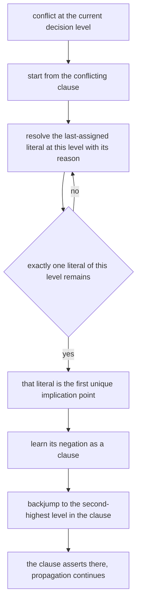
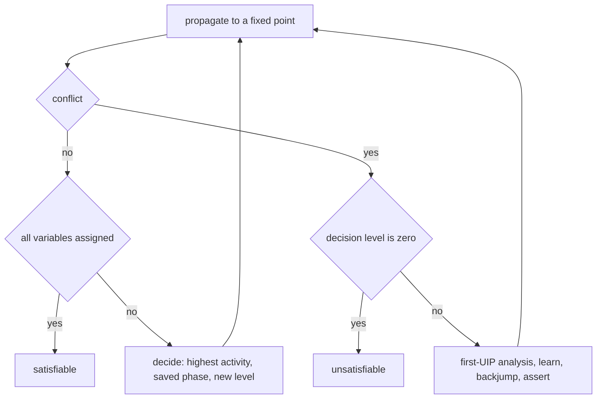
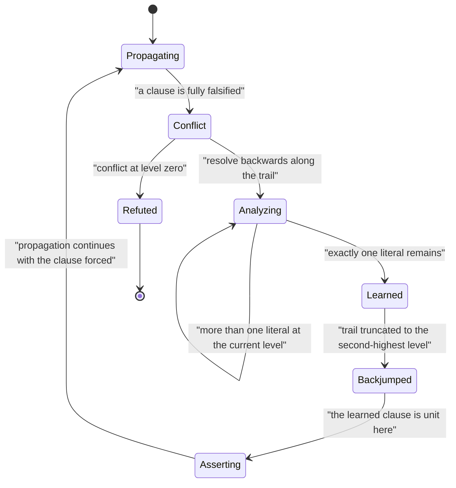

# 565 — Implement clause learning sketch for SAT (CDCL outline).

> **Tier:** Advanced · **CTCI chapter:** Beyond — Compilers, Languages & Solvers
> **Task spec:** [565-implement-clause-learning-sketch-for-sat-cdcl-outline.md](../../../tasks/advanced/565-implement-clause-learning-sketch-for-sat-cdcl-outline.md)
> **Solutions:** [Python](../../../solutions/python/advanced/565-implement-clause-learning-sketch-for-sat-cdcl-outline/solution.py) ·
> [Java](../../../solutions/java/advanced/565-implement-clause-learning-sketch-for-sat-cdcl-outline/Solution.java) ·
> [JavaScript](../../../solutions/javascript/advanced/565-implement-clause-learning-sketch-for-sat-cdcl-outline/solution.js) ·
> [C#](../../../solutions/csharp/advanced/565-implement-clause-learning-sketch-for-sat-cdcl-outline/Solution.cs)

## 1. Problem restatement

**Input:** a CNF formula (clauses of signed literals) and a variable count.

**Output:** a satisfiable model or the verdict unsatisfiable, produced by a **working CDCL** solver —
conflict-driven clause learning — together with the learned clauses themselves, which the checks inspect
one by one.

The spec says "outline", but every file states that it implements a real, compact CDCL solver. The
machinery on top of DPLL is:

1. **A trail with reasons.** Every implied literal records the clause that forced it (decisions have no
   reason), and each literal records its decision *level*.
2. **Unit propagation**, implemented with two watched literals (Python) or as a database scan whose cost
   is stated explicitly (C#: `O(total literal occurrences)` per propagation round).
3. **First-UIP conflict analysis.** On a conflict, resolve the conflicting clause backwards along the
   trail, jumping over literals of the current decision level, until exactly **one** literal of that
   level remains — the first unique implication point.
4. **Learning and non-chronological backjumping.** The learned clause is added to the database and used
   to jump to the **second-highest** decision level appearing in it, where it is *asserting*.
5. **VSIDS-style activity** bumped for the variables involved in a conflict, driving a deterministic
   decision heuristic (highest activity wins, ties by the smallest index), plus **phase saving** for the
   decision polarity.

Two simplifications are documented rather than implied: **no clause deletion** and **no restarts**, so
the learned database grows monotonically and the solver is complete but not competitive with an
industrial implementation.

The documented checks:

| Check | Statement | Why |
| --- | --- | --- |
| verdicts | on random CNFs the verdict equals an exhaustive truth-table scan | the reference |
| models | every returned model satisfies the input | no phantom models |
| counting | model counts via blocking clauses match brute force, as in task 563 | counting works too |
| pigeonhole | `PHP(3,2)` and `PHP(4,3)` refuted, `PHP(4,5)` satisfied | the classic family |
| learning happens | the refuted instances produce at least one conflict and at least one learned clause | the mechanism is exercised |
| implication | every learned clause is **logically implied** by the input formula (no satisfying assignment of the input falsifies it, checked by brute force) | soundness of learning |
| first-UIP | exactly one literal of the learned clause lies at the conflict's decision level | the defining property |
| backjump level | it equals the second-highest level appearing in the clause | the standard rule |
| asserting | after the backjump the clause is asserting: every other literal is false and the asserting literal unassigned | the invariant that makes the next propagation deterministic |
| reason unit | the Java file checks that each recorded reason clause is unit at the moment it is used | propagation bookkeeping |
| determinism | repeated runs are identical | no reliance on hash order |

## 2. Intuition

Plain DPLL (task 563) backtracks chronologically: a conflict undoes the most recent decision, and the
same conflict will be rediscovered in every branch that shares the culprit decisions. CDCL's idea is to
learn the *reason* for the conflict and never hit it again: from the conflict, derive a clause that the
input formula logically implies, then jump straight to the level where that clause is nearly satisfied —
skipping all the intermediate levels that cannot matter.

The derivation is resolution along the trail. The conflicting clause has all its literals false; take the
literal assigned **last** at the current decision level, and resolve it away with the clause that implied
it (its reason). Repeat until exactly one literal of the current level is left. That literal is the
**first unique implication point**: the single point through which all paths from the decision to the
conflict pass. Its negation is the learned clause, and the clause is *asserting* at the backjump level —
every other literal false, the remaining one unassigned — so the very next propagation step is forced and
progress is guaranteed.

The invariant chain the files verify is what makes this trustworthy: the learned clause is implied by the
formula (soundness), it has exactly one literal at the conflict level (first-UIP), the backjump level is
the second-highest level in it, and the clause is asserting afterwards. Checking those four properties on
every learned clause collected during a run is a far stronger statement than "the solver returned the
right answer".



## 3. Algorithm

1. Propagate to a fixed point, recording for each implied literal the clause that forced it and the
   current decision level; a fully falsified clause is a conflict.
2. On a conflict at a non-zero decision level:
   1. Take the conflicting clause as the working clause and mark the variables that occurred at the
      current decision level.
   2. Resolve the working clause with the reason of the last-assigned literal at the current level,
      dropping that literal.
   3. Repeat until exactly one literal of the current level remains — the first UIP.
   4. The learned clause is the working clause; bump the activity of its variables.
   5. Compute the backjump level as the second-highest level among the clause's literals (the highest is
      the current level, which is being abandoned), truncate the trail, and assert the remaining literal.
3. Otherwise decide: take the unassigned variable with the highest activity (ties by the smallest index),
   using the saved phase, and place it on the trail at the new decision level.
4. A conflict at decision level `0` proves unsatisfiability.
5. Verify the invariants on every learned clause: implied by the formula, first-UIP, backjump level, and
   asserting after the jump.

```text
procedure analyze_conflict(conflict_clause, trail, reason, level)
    clause ← conflict_clause
    while the number of literals of the current level in clause is greater than one do
        pick the literal p of the current level that was assigned last
        clause ← resolve(clause, reason[p]) on the variable of p
    end
    learned ← clause
    backjump ← the second-highest decision level among the literals of learned
    return learned, backjump
end

procedure cdcl(clauses, variables)
    trail ← empty, level 0
    loop
        propagate, recording reasons and levels
        if a clause is fully falsified then
            if the current decision level is 0 then return UNSAT end
            learned, backjump ← analyze_conflict(conflicting clause, trail, reason, level)
            assert: learned is implied by the formula
            assert: exactly one literal of learned is at the current level
            assert: backjump equals the second-highest level of learned
            add learned to the database and bump activities
            truncate the trail to backjump and assert the remaining literal
        else
            if every variable is assigned then return SAT with the trail end
            variable ← the unassigned variable with the highest activity, ties by smallest index
            push a decision on the trail using its saved phase at a new level
        end
    end
end
```



## 4. Worked example

Trace a conflict and its analysis. Take the formula

```text
1: (x1 or x2)
2: (not x1 or x3)
3: (not x2 or x3)
4: (not x3 or x4)
5: (not x3 or not x4)
```

Decide `x1 = false` at decision level 1, and propagate:

| Step | Assignment | Level | Reason clause | Note |
| --- | --- | --- | --- | --- |
| decision | `not x1` | 1 | — | the only decision |
| propagation | `x2` | 1 | clause 1 | `not x1` falsified the first literal, leaving `x2` |
| propagation | `x3` | 1 | clause 3 | `not x2` falsified the first literal, leaving `x3` |
| propagation | `x4` | 1 | clause 4 | `not x3` falsified the first literal, leaving `x4` |
| conflict | `not x4` | 1 | clause 5 | clause 5 became fully falsified |

The conflicting clause is 5, `(not x3 or not x4)`. Both literals are at level 1, so resolution starts:
the last-assigned literal at the current level is `x4`, and its reason is clause 4, `(not x3 or x4)`.
Resolving clause 5 with clause 4 on the variable `x4` cancels `not x4` against `x4` and leaves
`(not x3 or not x3)`, that is the unit `not x3`.

| Step | Working clause | Literals at the current level | Action |
| --- | --- | --- | --- |
| start | `(not x3 or not x4)` | `2` | resolve on `x4` with its reason |
| resolve | `(not x3)` | `1` | first UIP reached: the literal is `not x3` |

The learned clause is the unit `(not x3)`; the first UIP is the variable `x3`; the backjump level is the
second-highest level in the clause, which is `0` (the clause has no literal from level 1 other than the
one being resolved away), so the solver truncates the trail to level 0 and asserts `not x3` immediately.
Every invariant holds on this clause:

| Invariant | Instance |
| --- | --- |
| implied by the formula | if `x3` were true, clause 4 forces `x4` and clause 5 forces `not x4`, a contradiction — so `not x3` is implied |
| first-UIP | exactly one literal of the learned clause sits at the conflict's level |
| backjump level | `0`, the second-highest level appearing in the clause |
| asserting afterwards | after the jump the clause is unit, so propagation continues with no search |




## 5. Complexity

Let `n` be the number of variables, `m` the clauses and `L` the total number of literal occurrences.

| Measure | Bound | Why it holds |
| --- | --- | --- |
| Propagation, watched literals | `O(L)` per conflict-driven round | each literal is visited only when a watch moves |
| Propagation, database scan (C#) | `O(L)` per round | the header states this cost explicitly instead of hiding it |
| First-UIP analysis | `O(L)` worst case, usually far less | resolution walks the trail backwards at most once per literal |
| Backjump | `O(trail length)` | the trail is truncated to the target level |
| Decision | `O(n)` per decision | scanning activities, or a heap in a fuller implementation |
| Search tree | exponential in the worst case | CDCL is complete, not polynomial |
| Learned database | grows monotonically here | no clause deletion and no restarts are implemented |

CDCL's practical advantage is not an asymptotic one — it is still exponential in the worst case — but a
*structural* one: a learned clause removes a whole region of the search space, and non-chronological
backjumping skips levels that cannot matter. The two documented omissions matter in the other direction:
without clause deletion the database grows and propagation slows down, and without restarts the solver
loses the "keep the learned clauses, throw away the current assignment" move that industrial solvers use
constantly.

## 6. Pitfalls and edge cases

- **Watchers versus scanning.** Watched literals give `O(L)` propagation with a small constant, but the
  bookkeeping (moving watches on backtrack, ensuring the watched literals are the last assigned) is
  intricate. The C# file deliberately scans the database instead and states the cost, which is the honest
  trade for readability — and it means the two implementations are not identical in performance.
- **Reason clauses must be unit when used.** A stale reason (recorded before the clause became unit, or
  after a backtrack invalidated the level bookkeeping) makes conflict analysis derive a clause that is
  *not* implied by the formula. The Java file checks the reason is unit at the moment it is used.
- **First-UIP off-by-one.** The loop must stop when exactly one literal of the current decision level
  remains, not zero and not two. Stopping at zero loses the asserting property; stopping at two learns a
  clause that is not asserting and can loop forever.
- **Backjump level.** It is the second-highest level in the learned clause — the highest is the current
  level, which is being abandoned. Using the highest level means no progress; using the third-highest
  jumps over a level the clause still depends on and can make the clause non-asserting (or unsound).
- **Conflict at level 0.** There is nothing to resolve, and the formula is unsatisfiable; treating it as
  a normal conflict leads to an infinite loop.
- **Activities and determinism.** VSIDS-style bumping changes which variable is decided next, so a
  non-deterministic tie-break makes runs irreproducible. Ties are broken by the smallest index, and the
  file asserts repeated runs are identical.
- **Learned clauses grow the database.** With no deletion, propagation cost rises over time; the file
  documents that omission rather than pretending the solver is competitive.
- **No restarts.** A full CDCL implementation periodically restarts the search while keeping the learned
  clauses. Omitting restarts is fine for correctness and is stated in the header.
- **Counting models.** Counting still requires blocking clauses (one per model), and learned clauses must
  not be conflated with the input when checking implication — the check is "every model of the **input**
  satisfies the learned clause", which is what makes learning sound.
- **Random formulas.** Clauses come from a full-period 64-bit generator read in its high bits; the
  repository's 16-bit `lcg` would repeat clauses and weaken the comparison with brute force.

## 7. Variants and follow-ups

- **The search this one is built on.** DPLL with unit propagation and pure literal elimination, without
  learning, is
  [563-implement-sat-solver-basic-dpll-algorithm.md](../../../tasks/advanced/563-implement-sat-solver-basic-dpll-algorithm.md);
  CDCL keeps its loop and replaces chronological backtracking with analysis.
- **The polynomial fragment.** 2-SAT replaces the search with SCCs of an implication graph, which is what
  makes clause learning unnecessary when every clause has two literals:
  [564-implement-2-sat-solver-using-implication-graph-scc.md](../../../tasks/advanced/564-implement-2-sat-solver-using-implication-graph-scc.md).
- **Pruning with arithmetic bounds.** Branch and bound is the numeric analogue of "learn and jump":
  [562-implement-mixed-integer-programming-small-model-using-branch-and.md](../../../tasks/advanced/562-implement-mixed-integer-programming-small-model-using-branch-and.md).
- **Where the learned clauses come from.** Conflict analysis resolves clauses, which is the same
  resolution rule used for the learned-clause soundness check in this task and implemented around
  [560-implement-berlekamp-massey-for-minimal-linear-recurrence-concept.md](../../../tasks/advanced/560-implement-berlekamp-massey-for-minimal-linear-recurrence-concept.md)'s
  linear-algebraic style.

## 8. Check yourself

1. What is a "reason" clause, and why does every implied literal need one?

<details><summary>Show answer</summary>

The reason of an implied literal is the clause that forced it: at the moment of assumption it was the only
clause whose remaining unassigned literal was that one. Decisions have no reason. Conflict analysis needs
the reasons because resolution works backwards: to eliminate the last-assigned literal at the current
level, the clause that implied it provides the complementary literals needed to keep the derived clause
logically implied by the formula.

</details>

2. What does "asserting" mean, and why is it the property that guarantees progress?

<details><summary>Show answer</summary>

After the backjump, a learned clause is asserting when every literal except one is false under the
truncated trail and the remaining literal is unassigned. Then the clause is unit, so propagation
immediately assigns that literal — no decision is needed, and the search continues from a strictly
stronger assignment. That is why the solver cannot loop: each learned clause forces a new assignment
before any branching happens.

</details>

3. Why is the backjump level the *second*-highest level in the learned clause?

<details><summary>Show answer</summary>

The highest level is the current (conflicting) level, which the solver is leaving behind — all its
assignments are undone. The remaining highest level is the deepest one the clause still depends on, so
jumping exactly to it makes the clause asserting there. Jumping to the current level would undo nothing;
jumping deeper would leave the clause satisfiable or non-asserting, which weakens or breaks the invariant.

</details>

4. Why do the checks re-derive the learned clauses' soundness by brute force instead of trusting the
   analysis?

<details><summary>Show answer</summary>

Because a bug in conflict analysis can produce a clause that *looks* fine (the solver may still return
the right verdict on the tested instances) but is not logically implied by the input, which could make
the solver report unsatisfiable for a satisfiable formula. The check enumerates assignments of the input
formula and verifies that none of them falsifies any learned clause — an independent, exponential but
conclusive test of soundness, run alongside the structural checks of the first-UIP, backjump and
asserting invariants.

</details>

5. Which two mechanisms are deliberately missing, and what is the consequence?

<details><summary>Show answer</summary>

Clause deletion and restarts. Without deletion the learned database grows monotonically, so propagation
costs more and more over a long run; without restarts the solver never abandons a currently poor
assignment while keeping what it learned. Both omissions are documented rather than implied, and they are
why the files describe themselves as a compact working solver rather than a MiniSat clone — the answers
are still complete and correct, the performance is not competitive.

</details>
