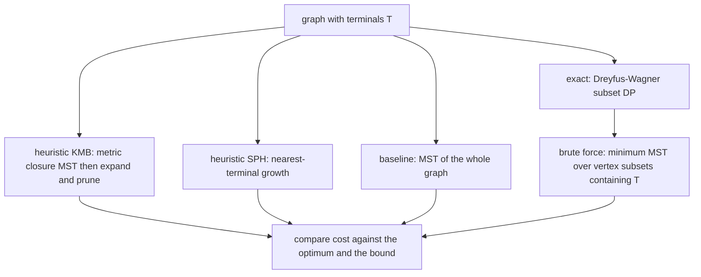
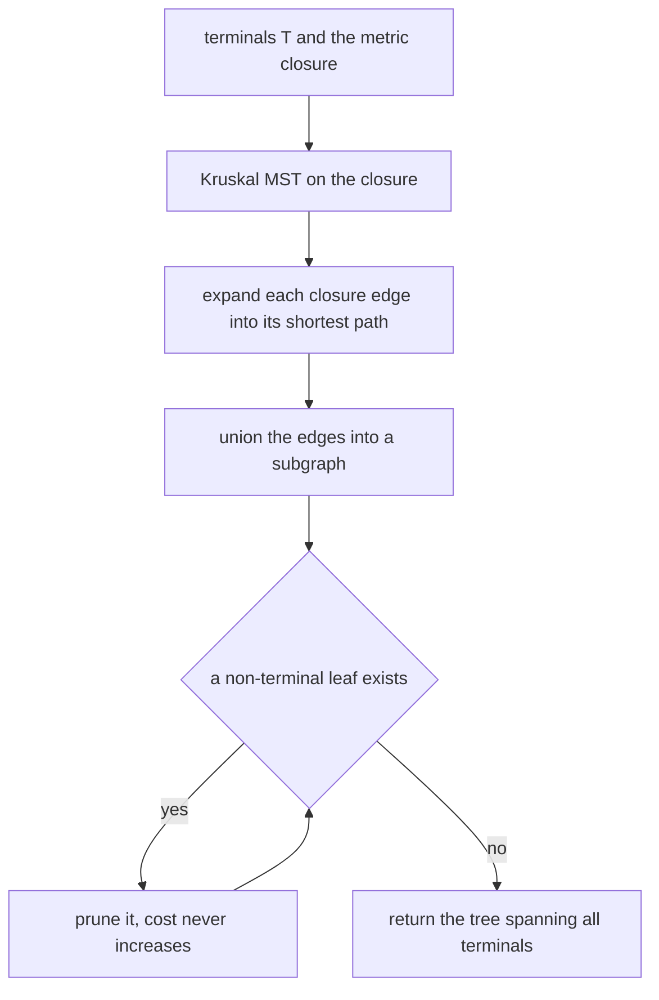
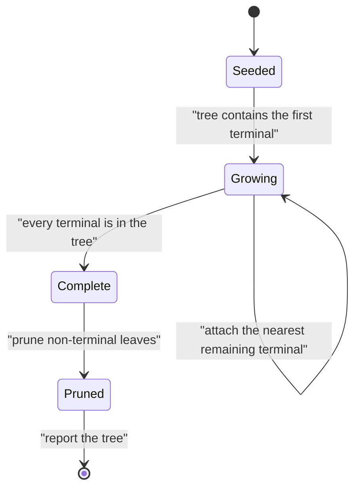

# 566 — Implement Steiner tree approximate on small graphs (heuristic).

> **Tier:** Advanced · **CTCI chapter:** Ch 4 — Trees and Graphs
> **Task spec:** [566-implement-steiner-tree-approximate-on-small-graphs-heuristic.md](../../../tasks/advanced/566-implement-steiner-tree-approximate-on-small-graphs-heuristic.md)
> **Solutions:** [Python](../../../solutions/python/advanced/566-implement-steiner-tree-approximate-on-small-graphs-heuristic/solution.py) ·
> [Java](../../../solutions/java/advanced/566-implement-steiner-tree-approximate-on-small-graphs-heuristic/Solution.java) ·
> [JavaScript](../../../solutions/javascript/advanced/566-implement-steiner-tree-approximate-on-small-graphs-heuristic/solution.js) ·
> [C#](../../../solutions/csharp/advanced/566-implement-steiner-tree-approximate-on-small-graphs-heuristic/Solution.cs)

## 1. Problem restatement

**Input:** an undirected weighted graph and a set of **terminals** `T`.

**Output:** a connected subgraph containing every terminal, of minimum total edge weight — the Steiner
tree — computed two ways so the approximation can be *measured* rather than praised:

1. **Exactly**, for small instances: the **Dreyfus–Wagner** subset DP
   `dp[S][v] = cheapest tree connecting the terminals of S with v as a root`, built by merging
   complementary subsets at a common vertex and then relaxed over the graph with a Dijkstra (or
   Floyd–Warshall) pass; the answer is `min over v of dp[all][v]`. The cost is
   `O(3^k·n + 2^k·(m log n))` in the number of terminals `k`, which is why the files keep `k <= 5`.
   A brute-force oracle — the minimum MST cost over every vertex subset containing the terminals — is a
   second, fully independent exact reference.
2. **Approximately**, with two classical heuristics: **KMB** (metric-closure MST, the textbook
   2-approximation) and **SPH** (nearest-terminal growth, Takahashi–Matsuyama). A third baseline — the
   MST of the whole graph, which ignores the terminals — is included for comparison.

The documented checks:

| Check | Statement | Why |
| --- | --- | --- |
| exactness | the Dreyfus–Wagner value equals the brute-force minimum on every random small instance | two independent exact methods |
| closure invariance | the optimal value is the same in the graph and in its metric closure | the closure is a legitimate relaxation |
| heuristic sanity | both heuristics return a real connected subgraph spanning the terminals, with cost at least the optimum and at most `2(1 - 1/|T|)` times it | the safe form of the textbook `2(1 - 1/l)` bound (`l` = leaves of the optimal tree, and `l <= |T|`) |
| worst ratio | reported from the measurements | the file quotes what it observed |
| special cases | no terminals and one terminal cost `0`; two terminals equal the shortest path; all vertices equal the MST | closed forms |
| pruning | pruning non-terminal leaves never raises the cost and never disconnects a terminal | the step is verified, not assumed |
| heuristics versus optimum | SPH and KMB never beat the optimum | a cheaper answer would be a bug |
| determinism | repeated runs are identical | deterministic tie-breaking in Kruskal and Dijkstra |
| honest caveat | the guarantee is relative to the **metric closure**, and observed ratios stay strictly below the bound, so the file reports the measured worst case instead of claiming tightness | asserted |

## 2. Intuition

Connecting a set of terminals is the MST problem *plus* the freedom to use extra vertices. That freedom
is what makes the problem hard: a non-terminal vertex may be worth including if several terminals can
reach it cheaply, and deciding which ones to include is a combinatorial choice — NP-hard in general,
which is why the files pair an exact exponential method with heuristics on small graphs.

Two facts make the approximate side work:

- **The metric closure is a relaxation.** Because any tree in the graph expands into a tree in the
  closure of the terminals (each path being an edge of the closure), the MST of the closure is at most
  twice the optimum — the classical bound. Expanding each closure edge back into its shortest path and
  then pruning non-terminal leaves gives a genuine subgraph of the original graph whose cost is no worse
  than the closure tree.
- **Growth works too.** Starting from one terminal and repeatedly attaching the nearest remaining
  terminal through a shortest path (SPH) also produces a valid tree, and neither heuristic ever beats
  the optimum because the optimum is, by definition, the cheapest such tree.



## 3. Algorithm

**Exact: Dreyfus–Wagner.**

1. For each terminal subset `S` and each vertex `v`, keep `dp[S][v]` = cheapest tree connecting the
   terminals of `S` and containing `v`.
2. Initialise singletons: `dp[{t}][v]` is the shortest-path distance from `t` to `v` (with `0` at `t`).
3. For each subset `S` with `|S| >= 2`, merge over every split `S = S1 ∪ S2`:
   `dp[S][v] = min(dp[S1][v] + dp[S2][v])`.
4. Relax over the graph: run a multi-source Dijkstra with `dp[S][·]` as initial distances.
5. Answer: `min over v of dp[all][v]`.

**Heuristic KMB.**

1. Compute all-pairs shortest paths (Dijkstra per vertex, deterministic tie-breaking).
2. Build the **metric closure** on the terminals with those distances.
3. Take its MST (Kruskal).
4. Expand each MST edge into the corresponding shortest path and union the edges.
5. Prune non-terminal leaves repeatedly; the result is the returned tree.

**Heuristic SPH.**

1. Start the tree at one terminal.
2. Repeatedly find the remaining terminal closest to the current tree, and attach it along a shortest
   path.
3. Stop when every terminal is in the tree.

```text
procedure dreyfus_wagner(graph, terminals)
    for each singleton {t} and each vertex v do
        dp[{t}][v] ← shortest path distance from t to v
    end
    for each subset S of terminals in increasing size order do
        for each split S into S1 and S2 do
            for each vertex v do
                dp[S][v] ← minimum of dp[S][v] and dp[S1][v] + dp[S2][v]
            end
        end
        relax dp[S] over the graph with a multi-source Dijkstra
    end
    return the minimum over v of dp[all terminals][v]
end

procedure kmb(graph, terminals)
    distance ← all-pairs shortest paths
    closure ← complete graph on the terminals with weight distance
    tree ← minimum spanning tree of closure, edges broken deterministically by endpoint order
    expanded ← union over the tree edges of the shortest paths realising them
    return repeated pruning of the non-terminal leaves of expanded
end

procedure sph(graph, terminals)
    tree ← a single terminal
    while some terminal is outside tree do
        pick the terminal outside the tree with the smallest distance to it
        add the shortest path from that terminal to the tree
    end
    return tree
end
```



## 4. Worked example

Take four vertices, terminals `{0, 1, 2}` and one non-terminal vertex `3`, with edges
`0-3 = 1`, `1-3 = 1`, `2-3 = 1`, and `0-1 = 3`, `1-2 = 3`, `0-2 = 3`. The interesting part is that the
direct edges between terminals are expensive while the hub is cheap.

**All-pairs distances between terminals.**
`d(0,1) = min(3, 1+1) = 2`, `d(1,2) = 2`, `d(0,2) = 2` — the hub wins every time.

**KMB step by step.**

| Step | Operation | Result |
| --- | --- | --- |
| 1 | metric closure on `{0,1,2}` | a triangle with all weights `2` |
| 2 | MST of the closure | any two of the three edges, cost `4` |
| 3 | expand `0-1` and `0-2` into paths through vertex `3` | edge set `0-3`, `3-1`, `3-2` |
| 4 | union and deduplicate | the star centred at `3`, cost `1 + 1 + 1 = 3` |
| 5 | prune non-terminal leaves | vertex `3` has degree `3`, nothing to prune |
| 6 | reported cost | `3` |

Note the two numbers in steps 2 and 4: the closure tree costs `4`, but the expanded union costs `3`,
because the two expanded paths *share* the edge `0-3`. That sharing is exactly why the bound is stated
over the closure and why the observed ratio can be much better than the bound.

**SPH step by step.** Start from terminal `0`.

| Step | Nearest terminal outside the tree | Distance | Edge added | Cost so far |
| --- | --- | --- | --- | --- |
| 1 | `1` | `2` (via `3`) | `0-3`, `3-1` | `2` |
| 2 | `2` | `1` (to vertex `3`, already in the tree) | `3-2` | `3` |

**Comparison.**

| Method | Cost | Ratio to the optimum |
| --- | --- | --- |
| exact (Dreyfus–Wagner and the subset brute force) | `3` | `1.00` |
| KMB | `3` | `1.00` |
| SPH | `3` | `1.00` |
| baseline: MST of the whole graph | `3` | `1.00` |
| bound `2(1 - 1/|T|)` with `|T| = 3` | `4/3` | the guarantee |

The bound `4/3` is an upper bound on the ratio, and the observed ratio here is `1` — strictly below it,
which is what the file reports: the measured worst case over the random instances, never a claim that the
bound is tight. The special cases are checkable in the same spirit:

| Terminal set | Optimum | Reason |
| --- | --- | --- |
| empty or a single terminal | `0` | nothing needs connecting |
| two terminals | the shortest-path distance | one path, and any extra vertex would only add cost |
| all vertices | the MST | every vertex must be included |




## 5. Complexity

Let `n` be the vertices, `m` the edges, `k = |T|` the number of terminals.

| Method | Time | Space | Note |
| --- | --- | --- | --- |
| Dreyfus–Wagner | `O(3^k·n + 2^k·(m log n))` | `O(2^k·n)` | exponential in `k`, which is why the files cap `k <= 5` |
| Brute-force reference | `O(2^(n-k) · MST)` | `O(n + m)` per subset | enumerate non-terminal subsets, MST each induced subgraph |
| Java's edge-subset oracle | `O(2^m)` on the smallest instances | `O(m)` | a fully independent exact check |
| KMB | `O(n·(m log n) + n²)` | `O(n²)` | Dijkstra per source, closure MST, expansion, pruning |
| SPH | `O(k · (m log n))` | `O(n + m)` | one shortest-path search per attached terminal |
| Baseline MST | `O(m log m)` | `O(n + m)` | ignores the terminals entirely |
| Pruning | `O(n + m)` | — | one traversal, removing non-terminal leaves |

The complexity gap is the whole story: exact Steiner tree is exponential in the number of *terminals*
(and NP-hard in general), KMB and SPH are polynomial, and the bound buys the difference. On graphs of
this size the exact method is affordable, which is what allows the heuristics to be measured against the
truth instead of against each other.

## 6. Pitfalls and edge cases

- **The bound is over the closure.** KMB's `2(1 - 1/l)` guarantee compares the returned tree with the
  optimum *because* the closure is a relaxation; on the tested instances the observed ratios stay
  strictly below the bound, so the file quotes a measurement, not a tightness claim.
- **`l` versus `|T|`.** The textbook bound uses `l`, the number of leaves in the optimal Steiner tree. The
  files use the safe substitute `|T|`, valid because `l <= |T|` makes `2(1 - 1/|T|)` an upper bound for
  `2(1 - 1/l)` — a weaker but always-correct statement.
- **Expansion can repeat edges.** Two closure edges may expand into paths sharing edges; the cost after
  expansion is the weight of the *union*, which can be smaller than the sum of the closure edge weights.
  Forgetting to deduplicate inflates the cost and can exceed the bound.
- **Pruning must preserve connectivity.** Only non-terminal *leaves* may be removed, and only while the
  tree stays connected and spans every terminal. The file verifies both properties after pruning rather
  than assuming them.
- **Ties in Kruskal and Dijkstra.** Multiple MSTs or shortest paths of equal weight make the result
  non-deterministic; the files break ties by endpoint order and assert repeated runs are identical.
- **Degenerate terminal sets.** No terminals and a single terminal cost `0`; `|T|` appears in the bound,
  so a division by `|T|` on an empty terminal set would break — the special case is handled before the
  formula is used.
- **Disconnected graphs.** If two terminals lie in different components no tree exists. The pseudo-code
  handles unreachable pairs with an infinite distance, and the files only test connected instances.
- **The baseline is not a heuristic.** The MST of the whole graph ignores the terminals, so it can be far
  worse (or accidentally equal); it exists to show that "just take the MST" is not an answer.
- **Exactness has a small domain.** Dreyfus–Wagner is exponential in `|T|`, so it is only a reference
  here; on a graph with twenty terminals the heuristics are the only option, and the guarantee is the
  only thing left.
- **Random instances.** Weights and structure come from a full-period 64-bit generator read in its high
  bits, because the repository's 16-bit `lcg` has low-bit structure that would bias the weights and make
  the instances systematically easy.

## 7. Variants and follow-ups

- **The other 2-approximation in this range.** Facility location has a greedy primal-dual approximation
  with a similar "polynomial method plus a ratio guarantee" shape:
  [567-implement-facility-location-greedy-approximation-k-median-sketch.md](../../../tasks/advanced/567-implement-facility-location-greedy-approximation-k-median-sketch.md).
- **Exact search instead of heuristics.** When the graph is small but the terminal set is not, a
  branch-and-bound formulation with LP bounds is the exact alternative:
  [562-implement-mixed-integer-programming-small-model-using-branch-and.md](../../../tasks/advanced/562-implement-mixed-integer-programming-small-model-using-branch-and.md).
- **Submodular guarantees.** The `1 - 1/e` guarantee for greedy covering is the same trade made in a
  different structure:
  [568-implement-submodular-maximization-greedy-guarantee-example.md](../../../tasks/advanced/568-implement-submodular-maximization-greedy-guarantee-example.md).
- **Tree building as a primitive.** Kruskal's MST with deterministic tie-breaking appears here and in
  [558-implement-boolean-matrix-multiplication-optimization-using-bitse.md](../../../tasks/advanced/558-implement-boolean-matrix-multiplication-optimization-using-bitse.md)'s
  neighbourhood analyses, and the shortest-path expansion uses the same Dijkstra machinery as
  [557-implement-algebraic-path-finding-with-min-plus-matrix-multiply-t.md](../../../tasks/advanced/557-implement-algebraic-path-finding-with-min-plus-matrix-multiply-t.md).

## 8. Check yourself

1. Why is the MST of the metric closure a valid upper bound on the Steiner tree cost?

<details><summary>Show answer</summary>

Take an optimal Steiner tree and double its edges to get a closed walk traversing every terminal; shortcutting
repeated vertices turns that walk into a cycle through the terminals whose total length is at most twice the
tree's cost (each tree edge is used at most twice). Deleting one edge of that cycle gives a path through all
terminals, whose closure edges sum to at most twice the optimum — hence the closure's MST, the cheapest way to
connect the terminals in the closure, is also at most twice the optimum. Expanding the closure edges back into
paths and deduplicating gives a subgraph of the original graph no more expensive than that MST.

</details>

2. In the worked example, the closure MST costs `4` but KMB returns `3`. How?

<details><summary>Show answer</summary>

Because the expansion step *shares* edges. The closure MST has two edges, `0-1` and `0-2`, each expanded
into a two-edge path through the hub `3`. Both paths contain the edge `0-3`, so the union has only three
distinct edges (`0-3`, `3-1`, `3-2`) with total weight `3`, not `4`. The closure cost bounds the sum of the
path weights, not the weight of their union, which is why the guarantee holds but the observed ratio is
better.

</details>

3. Why is pruning non-terminal leaves safe, and why is it worth doing?

<details><summary>Show answer</summary>

A non-terminal leaf hangs off the tree by a single edge and is not required to be present, so removing it
keeps the tree connected (the rest is untouched) and keeps every terminal (the removed vertex was not one),
while strictly decreasing the cost. It is worth doing because the expansion step regularly produces such
leaves — for instance a shortest path that passes through an extra vertex on the way to a terminal — and
removing them is what brings the heuristic's answer close to the optimum on the tested instances.

</details>

4. Why do the files implement two exact methods instead of one?

<details><summary>Show answer</summary>

Because the Dreyfus–Wagner DP and the subset brute force share no logic: the DP is a subset convolution plus
a relaxation, while the brute force enumerates subsets of non-terminal vertices, keeps those whose induced
subgraph is connected and spans the terminals, and takes the MST cost. On the smallest instances there is
even a third oracle enumerating all edge subsets. Agreement between methods that share nothing but the input
is what justifies calling one of them "the optimum" in the ratio measurements.

</details>

5. The bound uses `|T|` rather than the number of leaves `l`. Is that stronger or weaker?

<details><summary>Show answer</summary>

Weaker but safe. Since every leaf of a Steiner tree is a terminal, `l <= |T|`, so
`2(1 - 1/l) <= 2(1 - 1/|T|)`: the bound with `|T|` is larger, hence weaker, and always valid without
computing `l`. The files use it because `l` is a property of the unknown optimal tree, whereas `|T|` is
known up front.

</details>
