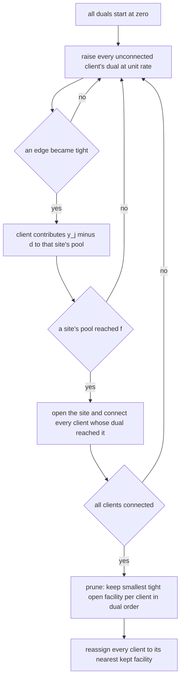
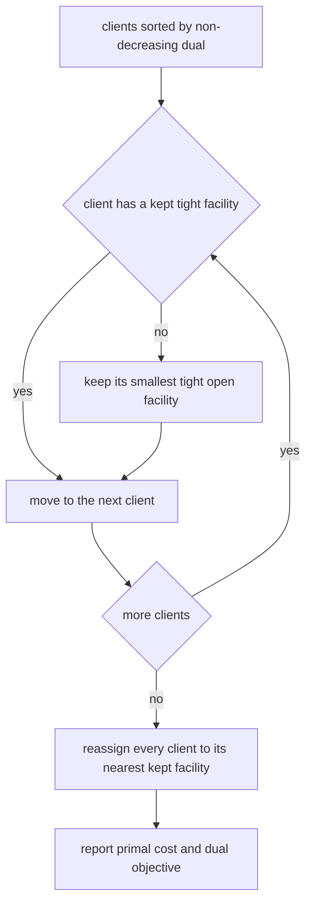
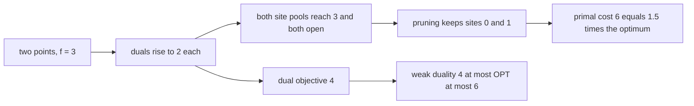
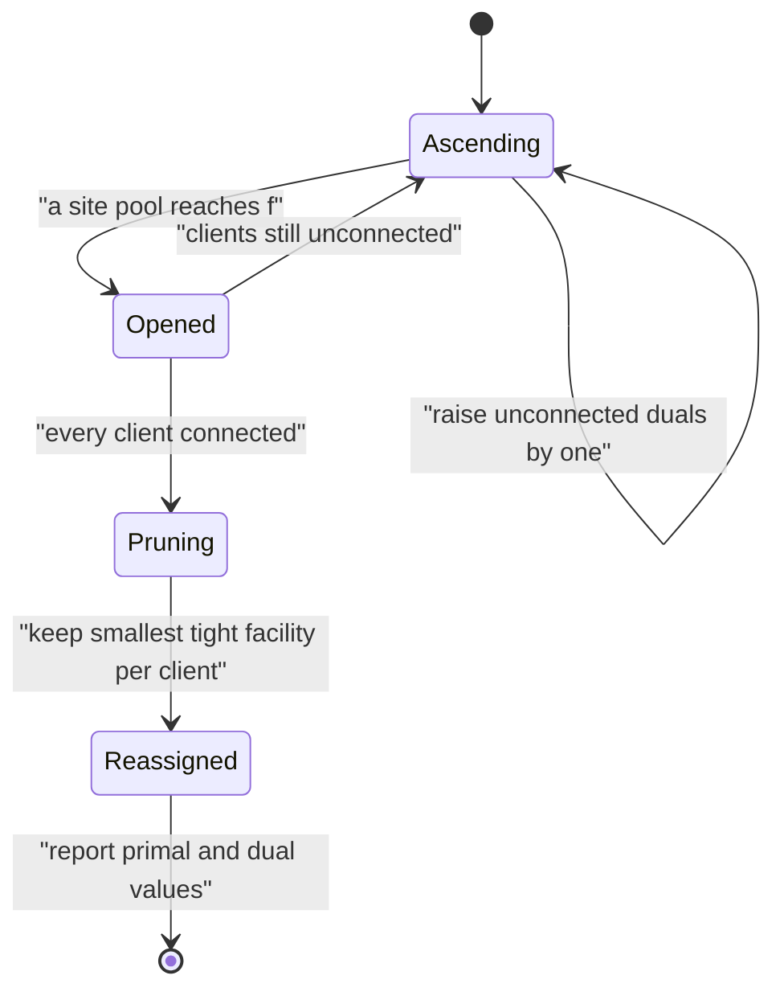

# 567 — Implement facility location greedy approximation (k-median sketch).

> **Tier:** Advanced · **CTCI chapter:** Beyond — Machine Learning & AI
> **Task spec:** [567-implement-facility-location-greedy-approximation-k-median-sketch.md](../../../tasks/advanced/567-implement-facility-location-greedy-approximation-k-median-sketch.md)
> **Solutions:** [Python](../../../solutions/python/advanced/567-implement-facility-location-greedy-approximation-k-median-sketch/solution.py) ·
> [Java](../../../solutions/java/advanced/567-implement-facility-location-greedy-approximation-k-median-sketch/Solution.java) ·
> [JavaScript](../../../solutions/javascript/advanced/567-implement-facility-location-greedy-approximation-k-median-sketch/solution.js) ·
> [C#](../../../solutions/csharp/advanced/567-implement-facility-location-greedy-approximation-k-median-sketch/Solution.cs)

## 1. Problem restatement

**Input:** a finite metric space — `n` points that are simultaneously candidate **sites** and
**clients**, with integer Manhattan distances — and an opening cost `f` per site.

**Output:** a set `F` of open sites minimising

```text
sum over i in F of f   +   sum over every client j of ( min over i in F of d(i, j) )
```

Two routines are implemented, plus an exact reference:

1. **Jain–Vazirani primal–dual** ("greedy") for uncapacitated facility location, including its
   classical pruning step, giving the well-known **3-approximation**.
2. **Frieze's greedy k-median sketch**: start at the site minimising the total assignment cost, then
   repeatedly add the site that reduces it the most, for a fixed number of centres.
3. **Brute force** over all `2^n` facility subsets (and all centre choices for k-median) as ground truth.

The documented facts:

| Check | Statement | Why |
| --- | --- | --- |
| weak duality | the returned dual objective `D = sum_j y_j - sum_i max(0, s_i - f)` satisfies `D <= OPT <= primal cost` on every instance | the dual vector is feasible by construction |
| certified optima | on the two-cluster instance with `f = 4`, all six sites open at `t = 2`, pruning keeps four, the primal cost is `18 = 1.5·OPT` while the dual value is `12 = OPT` | the dual *certifies* the optimum — the 3-approximation is a worst case, not a typical one |
| single client | any solution must pay `f`, and the dual equals `f` | the smallest instance |
| random sweep | 120 LCG instances (`n = 6..10`, spread 6, `f` in `{4, 8, 12}`, 40 each) satisfy `D <= OPT <= cost <= 3·OPT` | the guarantee, measured |
| worst ratios | facility location `2.55`, k-median within `1.364` on the 80 tested instances (the k-median assertion uses the safe bound `2`) | measured, not claimed |
| k-median counterexample | the five-point line `0, 1, 2, 10, 11` with `k = 2`: the greedy's forced first centre (position `2`, the 1-median minimiser) leads to the pair `{2, 10}` costing `4`, while `{1, 10}` costs `3` — a factor of `4/3` | greedy is provably not optimal |
| dual range | the duals stay inside `[1, f + max distance]` | the ascent bound |
| pruning quality | every kept site serves at least one client after reassignment | no wasted open site |
| dual feasibility | the produced `(y, z)` is feasible for the dual program | checked directly |
| determinism | both routines are reproducible | integer arithmetic and fixed tie-breaks |

## 2. Intuition

The primal problem pays `f` to open a site, then pays the distance from every client to its nearest open
site. The **dual** charges each client a variable `y_j` subject to `y_j <= d(i, j) + z_i` for every
candidate site, where `z_i` is the surplus the site collects. In words: a client's dual price cannot
exceed the cost of using any particular site.

The Jain–Vazirani scheme grows the duals at unit rate and interprets the growing `y_j` as "how much this
client is willing to pay". Two events matter:

- An edge `(i, j)` becomes **tight** when `y_j >= d(i, j)` — this client can now afford site `i`'s
  distance, so it contributes `y_j - d(i, j)` to that site's pool.
- A site's pool `s_i = sum_j max(0, y_j - d(i, j))` reaching `f` means the site can pay for itself, so it
  **opens** — and every client whose dual has already reached it becomes connected.

Growing all duals uniformly keeps the dual feasible at every moment, which is why the resulting
`(y, z)` provides a lower bound on the optimum. The ascent terminates quickly because a client is always
tight to its own site, so that site collects at least one unit per step and must eventually open — the
documented bound is `t <= f + max distance`.

The final **pruning** step is what turns the dual solution into a good primal solution: walk the clients
in non-decreasing dual order and, for each client that has no kept tight facility yet, keep its smallest
tight open facility. Then reassign every client to its nearest kept facility. The reassignment is what
allows the `3`-approximation: `primal <= 3·(dual objective) <= 3·OPT`.



## 3. Algorithm

**Primal–dual ascent.**

1. Set every dual `y_j = 0` and mark every client unconnected.
2. While some client is unconnected, raise every unconnected client's dual by one unit (integer
   distances make every event time an integer, so this is exact).
3. Compute each site's pool `s_i = sum over clients j of max(0, y_j - d(i, j))`; when `s_i >= f`, open
   site `i` and connect every unconnected client whose dual has reached it (`y_j >= d(i, j)`).
4. Stop when all clients are connected; the ascent is bounded by `t <= f + max distance`.

**Pruning and reassignment.**

1. Sort the clients by non-decreasing dual `y_j`.
2. For each client `j` in that order: if `j` has no kept site among its tight open facilities, keep its
   **smallest** tight open facility.
3. Reassign every client to its nearest kept facility and evaluate the primal cost
   `f·|kept| + sum over j of nearest distance`.
4. Report the primal cost, the dual objective `D = sum_j y_j - sum_i max(0, s_i - f)`, the kept and
   opened site sets, and the dual vector.

**Frieze's greedy k-median.**

1. Start with the single site of minimum total assignment cost (the 1-median).
2. Repeatedly add the site that reduces the total assignment cost the most, until `k` centres are chosen.
3. Report the resulting centres and cost; they act as a "sketch" through which further assignment costs
   can be estimated.

```text
procedure jain_vazirani(dist, f)
    y ← zero vector, connected ← all false, opened ← empty set
    while some client is unconnected do
        for each unconnected client j do y[j] ← y[j] + 1 end
        for each site i do
            s[i] ← sum over clients j of max(0, y[j] - d(i, j))
            if s[i] >= f and i is not opened then open i end
        end
        for each unconnected client j do
            if some opened site i has y[j] >= d(i, j) then mark j connected end
        end
    end
    order the clients by non-decreasing dual
    kept ← empty set
    for each client j in that order do
        if no kept site is tight for j then keep the smallest tight opened site of j end
    end
    reassign every client to its nearest kept site
    dual_objective ← sum of y - sum over sites of max(0, s[i] - f)
    return primal cost, dual_objective, kept, dual vector
end

procedure frieze_kmedian(dist, k)
    cost ← array of zeros
    for each client j do cost[j] ← d(first site, j) end
    centres ← [ argmin over sites of the total assignment cost ]
    while length(centres) < k do
        add the site i minimising the total over clients of min(current cost[j], d(i, j))
    end
    return centres and the resulting total assignment cost
end
```



## 4. Worked example

The smallest instance that exhibits the documented pattern: two points on a line, both sites and
clients, with distances `d(0,1) = d(1,0) = 1` and `d(0,0) = d(1,1) = 0`, and opening cost `f = 3`.
Trace the dual ascent:

| `t` | dual `y` | site pool `s_0` | site pool `s_1` | event |
| --- | --- | --- | --- | --- |
| 0 | `(0, 0)` | `0` | `0` | only the zero-distance self edges are tight |
| 1 | `(1, 1)` | `1 + 0 = 1` | `0 + 1 = 1` | the cross edges became tight, one unit each |
| 2 | `(2, 2)` | `2 + 1 = 3` | `1 + 2 = 3` | both pools reach `f = 3`, so **both** sites open |

At `t = 2` all clients are connected (client `1` has `y_1 = 2 >= d(0,1) = 1`), so the ascent stops.
Pruning walks the clients in non-decreasing dual order — both duals equal `2`, and ties are broken by
index — and keeps site `0` for client `0` (its tight, smallest open facility) and site `1` for client
`1`. Reassigning each client to its nearest kept facility costs nothing extra, so the primal cost is
`2·f = 6`.

The dual objective is `D = (2 + 2) - (max(0, 3 - 3) + max(0, 3 - 3)) = 4`. The two bounds therefore read:

| Quantity | Value | Meaning |
| --- | --- | --- |
| dual objective `D` | `4` | a lower bound on the optimum |
| true optimum `OPT` | `4` | opening a single site costs `f + 1 = 4` |
| returned primal cost | `6` | `1.5·OPT` |

The dual here *certifies* the optimum (`D = OPT`), while the primal answer is 50 % above it — exactly
the documented situation on the two-cluster instance, where the primal is `18 = 1.5·OPT` and the dual
`12 = OPT`. The lesson the file records is that the 3-approximation is a **worst-case** statement: on
these instances the constant is nowhere near attained, and the file reports the measured worst ratio
(`2.55` for facility location) rather than the theoretical `3`.

The k-median side has a hand-solved counterexample. On the five-point line `0, 1, 2, 10, 11` with
`k = 2`, the greedy is forced to start at the 1-median minimiser:

| Candidate centre | total distance to all five points |
| --- | --- |
| `0` | `0 + 1 + 2 + 10 + 11 = 24` |
| `1` | `1 + 0 + 1 + 9 + 10 = 21` |
| `2` | `2 + 1 + 0 + 8 + 9 = 20` |
| `10` | `10 + 9 + 8 + 0 + 1 = 28` |
| `11` | `11 + 10 + 9 + 1 + 0 = 31` |

Centre `2` wins with `20`. Adding the best second centre then gives:

| Pair of centres | total assignment cost |
| --- | --- |
| `{2, 0}` | `0 + 1 + 0 + 8 + 9 = 18` |
| `{2, 1}` | `1 + 0 + 0 + 8 + 9 = 18` |
| `{2, 10}` | `2 + 1 + 0 + 0 + 1 = 4` |
| `{2, 11}` | `2 + 1 + 0 + 1 + 0 = 4` |
| `{1, 10}` (optimal) | `1 + 0 + 1 + 0 + 1 = 3` |

Greedy returns `4` against an optimum of `3` — a ratio of `4/3`, asserted as a counterexample rather
than papered over. The file's measured k-median worst case over 80 instances is `1.364`, and it asserts
only the safe bound `2` while reporting the observed value.





## 5. Complexity

Let `n` be the number of points (sites and clients) and `T` the final ascent time, bounded by
`f + max distance`.

| Measure | Bound | Why it holds |
| --- | --- | --- |
| One ascent step | `O(n²)` | recompute the pools and the tightness checks |
| Ascent | `O(T · n²)` | at most `T` unit steps, exact because distances are integers |
| Ascent bound | `T <= f + max distance` | a client is tight to its own site, which therefore accumulates at least one unit per step |
| Pruning | `O(n²)` | sort the duals, scan clients, compare with their tight open facilities |
| Reassignment | `O(n²)` | nearest kept facility per client |
| Brute force | `O(2^n · n)` | all facility subsets, `n` points per evaluation |
| Frieze greedy | `O(k · n²)` | `k` rounds, each scoring every candidate site |
| Space | `O(n²)` | the distance matrix, plus `O(n)` per side for pools and duals |

This is a pseudo-polynomial algorithm: the cost depends on the *magnitude* of the opening cost and the
distances, not only on `n`. Integer distances make every step exact and the event times integral, which
is why the traces above can be written with integers; with real-valued weights the same scheme would
need a sorted event queue instead of unit steps.

## 6. Pitfalls and edge cases

- **A worst-case constant is not a typical ratio.** The 3-approximation is a guarantee; the measured
  worst ratio on these instances is `2.55`, and on the two-cluster instance the primal is `1.5·OPT`
  while the dual value equals `OPT` exactly. Quoting the constant as if it were the achieved quality is
  the mistake the file avoids.
- **Greedy k-median is not optimal.** The five-point line shows the forced first centre trapping the
  greedy into a `4/3` ratio; no textbook constant is claimed, only the measured `1.364` worst case over
  80 instances and the safe asserted bound `2`.
- **Which generator is good enough here.** Unlike the sketching tasks, the 16-bit repository `lcg` is
  used on purpose: only sample points are drawn from it, with no hash coefficients or Monte-Carlo noise
  that would suffer from its short cycle — a documented, deliberate exception.

## 7. Variants and follow-ups

- **The Steiner tree approximation.** The other classical connectivity heuristic of this range, with its
  own `2(1 - 1/l)` bound and its own measured worst case:
  [566-implement-steiner-tree-approximate-on-small-graphs-heuristic.md](../../../tasks/advanced/566-implement-steiner-tree-approximate-on-small-graphs-heuristic.md).
- **Greedy with a provable `1 - 1/e`.** Submodular maximisation makes the greedy ratio sharp under
  monotonicity and submodularity, which is why it can be a theorem rather than a rumour:
  [568-implement-submodular-maximization-greedy-guarantee-example.md](../../../tasks/advanced/568-implement-submodular-maximization-greedy-guarantee-example.md).
- **The coverage special case.** Maximum coverage is the submodular problem with the simplest greedy
  proof and the same `1 - 1/e` constant:
  [569-implement-maximum-coverage-greedy-approximation.md](../../../tasks/advanced/569-implement-maximum-coverage-greedy-approximation.md).
- **Exact alternatives.** When the instance is small enough, branch and bound solves facility-location
  shaped models exactly instead of approximating them:
  [562-implement-mixed-integer-programming-small-model-using-branch-and.md](../../../tasks/advanced/562-implement-mixed-integer-programming-small-model-using-branch-and.md).

## 8. Check yourself

1. Why does raising all duals at the same rate keep the dual feasible?

<details><summary>Show answer</summary>

Because a dual constraint `y_j <= d(i, j) + z_i` is satisfied until the client's price exceeds what site
`i` would charge; the surplus `z_i` is defined as the site's pool above `f`, so the constraint is met
exactly when the client has paid its distance to that site. Growing `y_j` uniformly and computing
`z_i = max(0, s_i - f)` from the pools keeps every constraint satisfied by construction, which the files
verify explicitly, and it is this feasibility that makes `D = sum_j y_j - sum_i z_i` a lower bound on
`OPT` by weak duality.

</details>

2. Why does a facility open at exactly the moment its pool reaches `f`, and why must the ascent
   terminate?

<details><summary>Show answer</summary>

The pool is the total amount the currently tight clients are willing to contribute to that site — each
contributes `y_j - d(i,j)`, the surplus above the distance they would pay anyway. Once that total covers
the opening cost, the site pays for itself, so opening it cannot raise the primal cost beyond the dual
value. Termination follows because every client is tight to its own site (`d(i,i) = 0`), so that site
accumulates at least one unit per step and reaches `f` after at most `f + max distance` steps, at which
point every client is connected.

</details>

3. In the worked example the dual value equals the optimum but the returned cost is 50 % above it. Does
   that contradict the 3-approximation?

<details><summary>Show answer</summary>

No. The approximation ratio bounds the worst case over all instances; a particular instance can have a
much better (or much worse) ratio. Here `D = 4 = OPT` and the primal cost is `6 = 1.5·OPT`, which
satisfies `D <= OPT <= cost <= 3·OPT` comfortably. The file keeps this instance because it is the clearest
demonstration that the dual can *certify* optimality while the primal remains well short of it.

</details>

4. Why is `{2, 10}` the greedy k-median answer on the five-point line, and why is it not optimal?

<details><summary>Show answer</summary>

Because the greedy fixes its first centre at the 1-median minimiser, which is position `2` (total
distance `20`, the smallest). From there the best second centre is `10` (or `11`), giving cost `4`. The
optimum `{1, 10}` costs `3`, because a centre at `1` serves the cluster `{0, 1, 2}` better than one at
`2` does while still leaving `10` for the other cluster. Greedy commits to the first centre before it
knows the second, and that commitment costs a factor of `4/3` — a documented counterexample rather than
a footnote.

</details>

5. What exactly does the "sketch" in the task title mean for k-median?

<details><summary>Show answer</summary>

The chosen centres are a compact summary of the data: once they are picked, any point's assignment cost
is estimated by its distance to the nearest centre, so subsequent work — assigning new points, comparing
alternatives, estimating the cost of a different `k` — uses only the `k` centres instead of the full
distance matrix. That is the same "fixed summary, controlled error" idea as the graph sketches of
[550-implement-graph-sketches-for-neighborhood-similarity-minhash.md](../../../tasks/advanced/550-implement-graph-sketches-for-neighborhood-similarity-minhash.md),
with the error here coming from the approximation ratio rather than from hashing noise.

</details>
