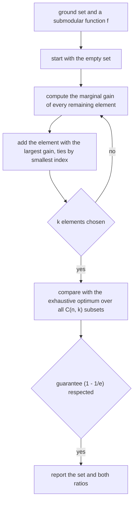
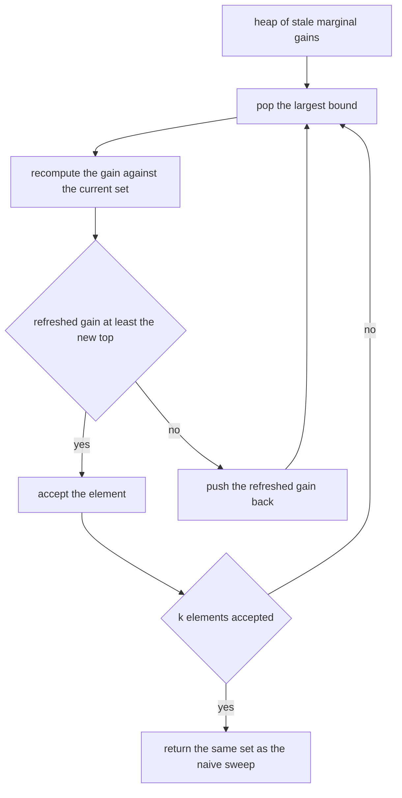
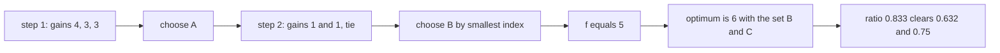
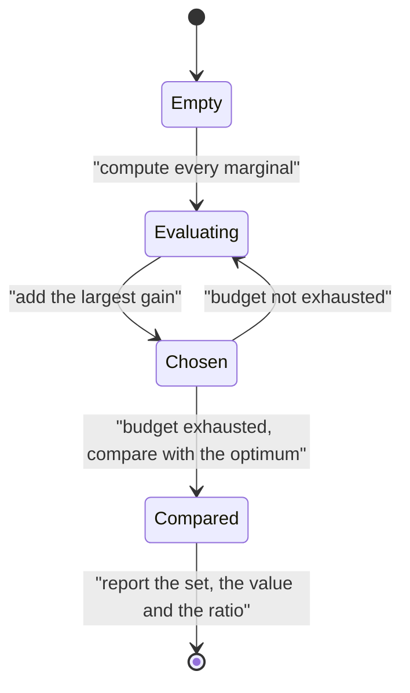

# 568 — Implement submodular maximization greedy guarantee example.

> **Tier:** Advanced · **CTCI chapter:** Beyond — Machine Learning & AI
> **Task spec:** [568-implement-submodular-maximization-greedy-guarantee-example.md](../../../tasks/advanced/568-implement-submodular-maximization-greedy-guarantee-example.md)
> **Solutions:** [Python](../../../solutions/python/advanced/568-implement-submodular-maximization-greedy-guarantee-example/solution.py) ·
> [Java](../../../solutions/java/advanced/568-implement-submodular-maximization-greedy-guarantee-example/Solution.java) ·
> [JavaScript](../../../solutions/javascript/advanced/568-implement-submodular-maximization-greedy-guarantee-example/solution.js) ·
> [C#](../../../solutions/csharp/advanced/568-implement-submodular-maximization-greedy-guarantee-example/Solution.cs)

## 1. Problem restatement

**Input:** a monotone submodular set function `f` on subsets of a ground set of `n` elements, given as a
black box, and a cardinality budget `k`.

**Output:** a set `S` with `|S| <= k` maximising `f(S)`, produced by the greedy algorithm that
repeatedly adds the element with the largest **marginal gain** `f(S + e) - f(S)` — together with the
verification that the guarantee `f(S_greedy) >= (1 - 1/e)·f(S_opt)` actually holds on the instance.

Several genuinely different objectives are used, so the harness is tested against more than one shape:

| Objective | Definition | Property |
| --- | --- | --- |
| coverage | `f(A) = |union of the chosen sets|` (computed twice: as a 30-bit mask and with plain sets) | monotone submodular |
| facility location | `f(A) = sum over clients of max over i in A of w[c][i]` | monotone submodular |
| concave over modular | `f(A) = g(sum of a_i over i in A)`, `g` the prefix sums of a non-increasing gain list | monotone submodular by diminishing returns |
| weighted coverage | `f(S) = sum of the weights of the covered elements` | monotone submodular |
| graph influence | `f(S) = total weight of the edges incident to S` | monotone submodular, not a coverage function |
| cut of a weighted graph | `f(A) = weight crossing (A, V \ A)` | submodular but **not** monotone |

Submodularity is not assumed: it is checked constructively through the equivalent **diminishing returns**
characterisation — for every `A` contained in `B` and every `x` outside `B`,
`f(A + x) - f(A) >= f(B + x) - f(B)` — exhaustively for `n = 8`, together with monotonicity
`f(A) <= f(B)` for `A` contained in `B`. The file reports 52 488 such triples across the four
objectives on `n = 8`.

The documented checks:

| Check | Statement | Why |
| --- | --- | --- |
| submodularity | diminishing returns and monotonicity hold exhaustively on `n = 8` for the monotone objectives, and diminishing returns hold for the non-monotone cut function | the hypothesis of the theorem is verified, not assumed |
| guarantee | `greedy >= (1 - 1/e)·OPT` and the sharper `greedy >= (1 - (1-1/k)^k)·OPT` on 100+ brute-force combinations (`n` up to 14, `k` up to 5) | the theorem, measured |
| worst ratio | the worst observed `greedy/OPT` over those combinations is `0.917` | the constant is a worst-case guarantee, not a typical value |
| exact cases | greedy hits the optimum on identical sets, a single set covering everything, disjoint sets, a concave objective whose gains flatten immediately, and `k = 0` | hand-checkable spots |
| lazy greedy | the heap-driven variant agrees with the naive sweep **set for set**, including tie-breaking | the acceleration is not an approximation |
| monotonicity in `k` | the greedy value is non-decreasing in `k`, every reported value equals `f` of the reported set, and `k = n` reaches the maximum | consistency |
| double greedy | the randomised Buchbinder–Feldman–Naor–Schwartz algorithm for the unconstrained case scores `0.80·OPT` on the max-cut instance (`0.5·OPT` floor promised) and `0.98·OPT` on a coverage instance, with every individual value inside `[0, OPT]` | an expectation claim checked empirically |
| determinism | a fixed seed reproduces the run | reproducible randomised algorithm |

## 2. Intuition

Submodularity is the discrete version of diminishing returns: adding an element to a *small* set helps at
least as much as adding it to a *larger* one. Coverage is the canonical example — a new set covers its
elements minus whatever the chosen sets already covered, so the more you have chosen, the less a new set
adds.

The greedy algorithm is the natural response: at each step, take whatever currently adds the most. What
makes this interesting is that greedy is not optimal (the classic counterexample is a large set that
blocks two better ones) yet it carries a **provable** guarantee under monotonicity plus submodularity:

```text
f(greedy) >= (1 - 1/e) · f(optimum)      and, sharper for a cardinality budget k,
f(greedy) >= (1 - (1 - 1/k)^k) · f(optimum)
```

The intuition for the proof is a counting argument: at each greedy step the marginal gain is at least the
remaining gap divided by `k`, so after `k` steps at most a factor `(1 - 1/k)^k <= 1/e` of the optimum is
left uncovered. That is why the same one-line algorithm has a ratio guarantee instead of a hope.



Two implementation ideas accompany the algorithm. The **lazy greedy** (cost-effective lazy forward)
exploits the fact that marginals only shrink: keep a max-heap of *stale upper bounds* and recompute an
entry only when it is popped, re-pushing it if the refreshed gain is still below the next stored bound.
That gives the same answer with far fewer function evaluations. And for the **unconstrained** case (no
cardinality budget), the randomised **double greedy** of Buchbinder–Feldman–Naor–Schwartz achieves
`OPT/2` in expectation by processing the elements in one pass and accepting each with a probability
derived from its two marginal gains.

## 3. Algorithm

**Naive greedy.**

1. Start with `S` empty.
2. Repeat `k` times: evaluate `f(S + e) - f(S)` for every remaining `e`, add the largest (ties to the
   smallest index).
3. Return `S` and `f(S)`; count the marginal-gain evaluations.

**Lazy greedy.**

1. Initialise a max-heap with each element's gain against the empty set.
2. Pop the top entry; recompute its marginal against the *current* `S`.
3. If the recomputed gain is still at least the next stored bound, take it; otherwise re-push the
   refreshed value and pop again.
4. Repeat until `k` elements are chosen. The result must be identical to the naive sweep.

**Double greedy (unconstrained).**

1. Keep two chains, `X` and `Y`, both starting empty.
2. For each element `x` in order, compute `a = f(X + x) - f(X)` and `b = f(Y + x) - f(Y)`, then add `x`
   to `X` with probability `a/(a + b)` and to `Y` with probability `b/(a + b)`.
3. Return the better of `X` and `Y`; the expected value is at least `OPT/2`.

```text
procedure greedy(objective, ground, k)
    chosen ← empty set
    evaluations ← 0
    while size of chosen < k do
        best ← none, best_gain ← minus infinity
        for each element e not in chosen, in increasing index order do
            gain ← objective(chosen plus e) - objective(chosen)
            evaluations ← evaluations + 1
            if gain > best_gain then best ← e, best_gain ← gain end
        end
        if best is none then break end
        add best to chosen
    end
    return chosen, objective(chosen), evaluations
end

procedure lazy_greedy(objective, ground, k)
    heap ← max-heap over elements, keyed by the gain against the empty set
    chosen ← empty set
    while size of chosen < k and heap is not empty do
        (gain, e) ← pop the largest entry
        refreshed ← objective(chosen plus e) - objective(chosen)
        if refreshed is at least the current top key of the heap then
            add e to chosen
        else
            push (refreshed, e) back
        end
    end
    return chosen, objective(chosen)
end
```

The lazy variant is exact because submodularity guarantees that a recomputed marginal can only be smaller
than the stale bound it replaced: once a refreshed value still dominates the heap's top, no other element
can beat it.



## 4. Worked example

Take a coverage instance with universe `{1, ..., 6}`, three candidate sets
`A = {1, 2, 3, 4}`, `B = {1, 2, 5}`, `C = {3, 4, 6}`, and budget `k = 2`.

| Step | Chosen set | Marginal gain of `A` | of `B` | of `C` | Decision |
| --- | --- | --- | --- | --- | --- |
| 1 | `{}` | `4` | `3` | `3` | add `A` (largest) |
| 2 | `{A}` | — | `1` (only element `5` is new) | `1` (only `6` is new) | tie, smallest index wins: add `B` |

Greedy returns `f({A, B}) = 5`, while the optimum is `f({B, C}) = 6` — all six elements. So the ratio is
`5/6 ≈ 0.833`, which clears both bounds:

| Bound | Value for `k = 2` | Observed |
| --- | --- | --- |
| `1 - 1/e` | `≈ 0.632` | `0.833` |
| `1 - (1 - 1/k)^k` | `1 - 0.25 = 0.75` | `0.833` |

The instance also shows the diminishing-returns property that the theorem needs, on the same numbers:

| `A` | `B` | `x` | marginal of `x` into `A` | marginal of `x` into `B` |
| --- | --- | --- | --- | --- |
| `{}` | `{A}` | `C` | `3` | `6 - 4 = 2` |
| `{}` | `{A}` | `B` | `3` | `5 - 4 = 1` |
| `{B}` | `{A, B}` | `C` | `3` | `1` |

Every marginal shrinks as the chosen set grows, which is exactly the inequality
`f(A + x) - f(A) >= f(B + x) - f(B)` for `A` contained in `B`. The file checks that inequality
exhaustively — all `(A, B, x)` triples with `A` contained in `B` and `x` outside `B` — for the coverage,
facility-location, concave-gain and cut objectives on `n = 8`.

The two auxiliary results are worth the same treatment:

| Result | Instance | Value | Promise |
| --- | --- | --- | --- |
| greedy, worst observed across 100+ brute-force combinations | `n` up to 14, `k` up to 5 | ratio `0.917` | `>= 0.632` |
| double greedy on a max-cut instance, mean of 120 fixed-seed runs | unconstrained | `0.80·OPT` | `>= 0.5·OPT` in expectation |
| double greedy on a coverage instance, same protocol | unconstrained | `0.98·OPT` | `>= 0.5·OPT` in expectation |





## 5. Complexity

Let `n` be the ground-set size and `k` the budget.

| Method | Function evaluations | Time | Note |
| --- | --- | --- | --- |
| Naive greedy | `O(n·k)` | `O(n·k·` cost of `f` `)` | re-evaluates every remaining element at every step |
| Lazy greedy | typically far fewer, same worst case | heap operations plus refreshes | identical output, fewer evaluations |
| Brute-force optimum | `C(n, k)` | `O(C(n, k)·` cost of `f` `)` | the reference, only on small instances |
| Submodularity check | `O(n·3^n)` triples | each triple is four function evaluations | `52 488` reported triples across four objectives at `n = 8` |
| Double greedy | `O(n)` | one pass, two marginal evaluations per element | randomised, `OPT/2` in expectation |
| Space | `O(n)` for the chosen set and the heap | plus the objective's own representation | |

The gap between greedy and the exact optimum is where the guarantee lives: greedy is
`O(n·k)` evaluations versus `C(n, k)` for brute force, and the ratio `(1 - 1/e)` is the price of that
speed-up. The lazy variant does not change the answer or the worst case; it changes the constant by
skipping evaluations that cannot win, which is why the files count evaluations for both.

## 6. Pitfalls and edge cases

- **The guarantee needs both hypotheses.** Monotonicity and submodularity are both required for
  `(1 - 1/e)`; the cut function is submodular but not monotone, and for it the greedy guarantee does not
  apply at all — which is why the file treats it separately, as the test bed for the double greedy.
- **Greedy is not optimal.** The worked example's `{A, B}` loses to `{B, C}`; a large first pick can
  block two better ones. The guarantee bounds how much is lost, not whether anything is lost.
- **The constant is a worst case.** The observed worst ratio over more than a hundred combinations is
  `0.917`, far above `0.632`; the files report the measurement rather than presenting `1 - 1/e` as the
  typical quality.
- **The sharper bound depends on `k`.** `1 - (1 - 1/k)^k` rises to `1 - 1/e` as `k` grows and is `1` for
  `k = 1`, so both bounds should be checked and the sharper one is the honest per-instance statement.
- **Tie-breaking must be deterministic.** Symmetric instances (identical sets, disjoint sets) produce ties
  constantly; breaking them by smallest index keeps the naive and lazy implementations comparable, which
  is what the set-for-set agreement assertion requires.
- **Lazy greedy's correctness argument.** It relies on marginals only shrinking; if the objective is not
  submodular, a stale bound can be *smaller* than a refreshed one and the heap-based variant can return a
  different (worse) set. The file asserts agreement precisely because that is the property at stake.
- **Randomised algorithms need many independent draws.** The double greedy makes one random decision per
  element per chain, so the repository's 16-bit LCG is not used here: its short cycle would correlate the
  decisions of the two chains, and `splitmix64` is used instead.
- **`k = 0` selects nothing.** The value is `f(empty)`, which is `0` for all the objectives here; an
  implementation that always takes at least one element is wrong.
- **Empty and full budgets.** `k = n` must reach the maximum value (every element selected), and the
  greedy value must be non-decreasing in `k` — both are asserted rather than assumed.
- **Expected value versus a single run.** `OPT/2` is a statement about the expectation; a single run can
  be better (`0.98·OPT` on coverage) and every individual value must still lie inside `[0, OPT]`. The
  files check both the mean over 120 fixed-seed runs and the per-run range.
- **Which generator for what.** Small sample data uses the 16-bit `lcg` (adequate for drawing a few
  deterministic points), while the double greedy's many independent uniform draws use `splitmix64` — a
  documented split that matters for reproducibility and for the expectation being measured honestly.

## 7. Variants and follow-ups

- **The coverage special case.** Maximum coverage is this problem with the simplest objective and the
  same `1 - 1/e` constant, together with the classic "greedy is not optimal" instance:
  [569-implement-maximum-coverage-greedy-approximation.md](../../../tasks/advanced/569-implement-maximum-coverage-greedy-approximation.md).
- **The other greedy ratio.** Facility location's primal–dual scheme has a factor-`3` guarantee and can
  *certify* optimality through its dual, which the coverage greedy cannot:
  [567-implement-facility-location-greedy-approximation-k-median-sketch.md](../../../tasks/advanced/567-implement-facility-location-greedy-approximation-k-median-sketch.md).
- **A different kind of guarantee.** Steiner tree's heuristics come with `2(1 - 1/l)` rather than
  `1 - 1/e`, showing that the ratio and its proof technique depend on the structure:
  [566-implement-steiner-tree-approximate-on-small-graphs-heuristic.md](../../../tasks/advanced/566-implement-steiner-tree-approximate-on-small-graphs-heuristic.md).
- **Estimating the objective.** When `f` is itself expensive, a sketch stands in for it — the same
  "summary plus controlled error" idea as
  [550-implement-graph-sketches-for-neighborhood-similarity-minhash.md](../../../tasks/advanced/550-implement-graph-sketches-for-neighborhood-similarity-minhash.md).

## 8. Check yourself

1. What exactly is submodularity, and why does coverage satisfy it?

<details><summary>Show answer</summary>

Submodularity is diminishing returns: for `A` contained in `B` and `x` outside `B`,
`f(A + x) - f(A) >= f(B + x) - f(B)`. For coverage, the gain of a new set is the number of its elements
not already covered. Adding elements to `B` can only reduce the uncovered part of the new set, so the
gain from a larger starting set is never larger — diminishing returns hold by construction. The files
verify the inequality exhaustively rather than relying on the argument.

</details>

2. Where does the `(1 - 1/e)` constant come from?

<details><summary>Show answer</summary>

From a counting argument over the `k` greedy steps. Let `OPT` be the optimum value and `S_i` the greedy
set after `i` steps. Because the optimum's elements are available as candidates, the best marginal at
each step is at least `(OPT - f(S_i))/k`; therefore the remaining gap shrinks by a factor of at most
`(1 - 1/k)` per step, leaving `(1 - 1/k)^k >= 1/e` of the gap closed after `k` steps. Hence
`f(S_k) >= (1 - (1 - 1/k)^k)·OPT >= (1 - 1/e)·OPT`. The per-`k` form `1 - (1 - 1/k)^k` is strictly
sharper for finite `k`.

</details>

3. In the worked example, greedy returns `5` against an optimum of `6`. Does that violate the
   guarantee?

<details><summary>Show answer</summary>

No. Both bounds are lower bounds on the ratio: `1 - 1/e ≈ 0.632` and `1 - (1 - 1/k)^k = 0.75` for
`k = 2`, while the observed ratio is `5/6 ≈ 0.833`. Greedy is allowed to miss the optimum; the guarantee
only promises that it cannot miss it badly. The worst observed ratio across the file's 100+ brute-force
combinations is `0.917`, comfortably inside both bounds.

</details>

4. Why does lazy greedy return exactly the same set as the naive sweep?

<details><summary>Show answer</summary>

Because submodularity guarantees that a marginal gain can only *shrink* as the chosen set grows, so the
stored value for an element is always an upper bound on its true gain. When an element is popped and its
refreshed gain is still at least the heap's new top, that value dominates every other element's upper
bound, which bounds their true gains as well — so the element is indeed the argmax and the choice matches
the naive sweep. If the refreshed value drops below the top, it is re-pushed and the comparison repeats.
The files assert the agreement set for set, including tie-breaking.

</details>

5. Why is the cut function treated separately, and what does the double greedy do about it?

<details><summary>Show answer</summary>

The cut `f(A) = weight crossing (A, V \ A)` is submodular but *not* monotone: adding a vertex can decrease
the cut when the new vertex's incident edges are mostly inside `A`. The `(1 - 1/e)` guarantee requires
monotonicity, so it does not apply, and the file uses the cut as the test bed for the unconstrained
problem instead. There the randomised double greedy of Buchbinder–Feldman–Naor–Schwartz gives `OPT/2` in
expectation, which the file checks over 120 fixed-seed runs (mean `0.80·OPT` on the max-cut instance, with
every individual value inside `[0, OPT]`).

</details>
