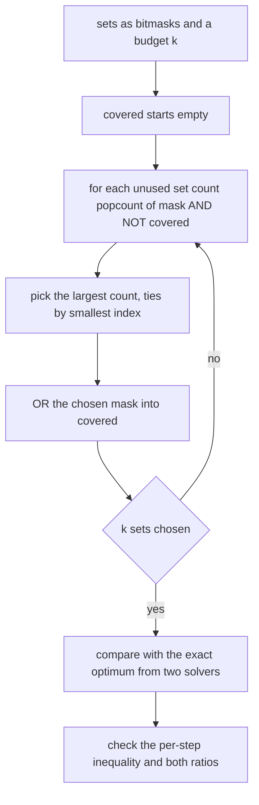
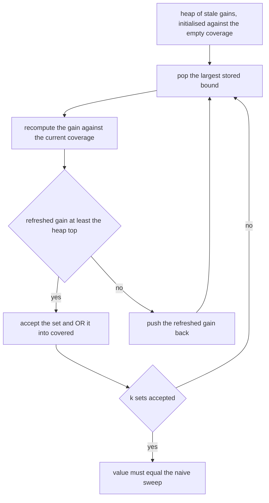
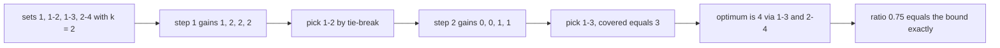
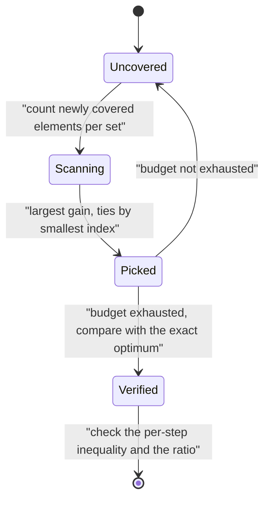

# 569 — Implement maximum coverage greedy approximation.

> **Tier:** Advanced · **CTCI chapter:** Beyond — Machine Learning & AI
> **Task spec:** [569-implement-maximum-coverage-greedy-approximation.md](../../../tasks/advanced/569-implement-maximum-coverage-greedy-approximation.md)
> **Solutions:** [Python](../../../solutions/python/advanced/569-implement-maximum-coverage-greedy-approximation/solution.py) ·
> [Java](../../../solutions/java/advanced/569-implement-maximum-coverage-greedy-approximation/Solution.java) ·
> [JavaScript](../../../solutions/javascript/advanced/569-implement-maximum-coverage-greedy-approximation/solution.js) ·
> [C#](../../../solutions/csharp/advanced/569-implement-maximum-coverage-greedy-approximation/Solution.cs)

## 1. Problem restatement

**Input:** `n` sets over a universe of `m` elements (each element may carry a weight), and a budget `k`.

**Output:** a choice of `k` sets whose union has maximum size (or maximum total weight), produced by the
classical greedy that repeatedly picks the set covering the most **still-uncovered** elements.

Everything is a bitmask, so a union is one `OR` and the count of newly covered elements is
`popcount(mask & ~covered)` — a handful of word operations. Ties go to the smallest set index, which is
what makes every run reproducible and lets the tests compare two implementations exactly.

The documented checks:

| Check | Statement | Why |
| --- | --- | --- |
| hand instances | a six-element universe where three sets cover everything with gains `3, 2, 1`; a pairwise disjoint family where greedy is exactly optimal; a nested chain where the first pick is already optimal; identical sets where copies gain nothing; `k = 0` and `k = n`; a single set covering the universe | checkable by hand |
| two exact solvers | exhaustive enumeration of all `C(n, k)` selections **and** a DP over the `2^n` subsets of sets agree on every random instance | different search spaces, same optimum |
| the guarantee | `greedy >= (1 - (1-1/k)^k)·OPT`, hence `>= (1 - 1/e)·OPT`, and `greedy <= OPT` | the theorem, measured |
| the per-step inequality | the greedy gain at step `i` is at least `(OPT - covered_{i-1}) / k`, asserted on **every** instance | the inequality that proves the guarantee, checked directly |
| random sweep | 30 LCG instances (`n` up to 16 sets, universes of 12..42 elements, `k` in `{1, 2, 3, 5}`); worst observed ratio `6/7 ≈ 0.857` | measured, not smoothed |
| complete enumeration | all `15^4 = 50625` four-set systems over a four-element universe at `k = 2` and `k = 3` | exhaustive |
| bound attained | at `k = 2` the bound is **attained exactly**: on `{{1}}, {{1,2}}, {{1,3}}, {{2,4}}` greedy costs `3` against an optimum of `4`, i.e. exactly `1 - (1 - 1/2)^2 = 0.75` of the optimum | the constant is not slack |
| bound not attained at `k = 3` | on those same systems greedy is optimal at `k = 3` | that budget does not exhibit the bound at all |
| laziness | the accelerated heap variant never changes the value | upper bounds stay valid |
| monotonicity | greedy is non-decreasing in `k`, and at `k = n` equals the union of all sets | consistency |
| determinism | repeated runs are identical | fixed tie-breaking |

## 2. Intuition

Maximum coverage is the concrete face of submodular maximisation: the objective is monotone and
submodular, so greedy carries the `(1 - 1/e)` guarantee. The mechanism is worth seeing on the numbers
rather than quoting the constant, and the *per-step* inequality is the honest way to do that:

```text
greedy gain at step i  >=  (OPT - covered_{i-1}) / k
```

Why? The `k` sets of the optimal solution cover `OPT` elements in total, so between them they cover
`OPT - covered_{i-1}` elements that greedy has not covered yet. Those elements are distributed over `k`
sets, so at least one of them must cover at least `(OPT - covered_{i-1})/k` still-uncovered elements —
and greedy takes the best one available, so its gain is at least that. Unrolling the inequality gives
`(1 - (1 - 1/k)^k)` of the optimum, and since `(1 - 1/k)^k <= 1/e`, the familiar `1 - 1/e` follows.

The files assert this inequality on every instance, which is a stronger statement than the ratio alone:
it checks the *reason* the ratio holds, at each step, on instances where the ratio itself may be far
from tight.



Two implementation details matter. The **lazy** variant keeps a heap of stale gains; because coverage is
monotone submodular, a stored gain is a valid upper bound, so a fresh evaluation is only needed while
some stored bound still beats the best value found so far — and laziness must never change the answer.
The **exact optimum** comes from two independent solvers: enumerating all `C(n, k)` selections, and a DP
over the `2^n` subsets of sets (`covering[mask] = covering[mask without its low bit] OR the new set`).
The two search different spaces, which makes their agreement meaningful.

## 3. Algorithm

1. Represent every set as a bitmask and start with `covered = 0`.
2. Repeat `k` times:
   1. For every unused set, compute the gain `popcount(mask & ~covered)`.
   2. Choose the set with the largest gain, breaking ties by the smallest index.
   3. Add it to the selection and `OR` its mask into `covered`.
3. Return the chosen indices, the covered count and the sequence of gains (used for the per-step check).
4. Cross-check with the lazy variant, which must return the same value, and with the two exact solvers.

**Lazy variant.** Push every set's gain against the empty set onto a max-heap. Pop the largest stored
bound, recompute that set's gain against the *current* covered mask, and accept it only if the refreshed
value still dominates the heap's new top; otherwise re-push the refreshed value and repeat.

**Exact optimum, two ways.** Enumerate all `C(n, k)` selections and take the best; or DP over subsets of
sets, where `covering[mask]` is the union of the sets in `mask`, built by `covering[mask] =
covering[mask without its low bit] OR the low set`, then take the best over masks with at most `k` bits.

```text
procedure greedy_cover(masks, k)
    chosen ← empty list
    covered ← 0
    gains ← empty list
    for step ← 1 to k do
        best ← none, best_gain ← minus one
        for i ← 0 to length(masks) - 1 do
            if i is in chosen then continue end
            gain ← popcount(masks[i] AND NOT covered)
            if gain > best_gain then best ← i, best_gain ← gain end
        end
        if best is none then break end
        append best to chosen, append best_gain to gains
        covered ← covered OR masks[best]
    end
    return chosen, popcount(covered), gains
end

procedure exact_optimum(masks, k)
    best ← 0
    for each combination of k indices do
        union ← OR of the selected masks
        best ← maximum of best and popcount(union)
    end
    return best
end
```



## 4. Worked example

The complete enumeration of four-set systems over a four-element universe gives the cleanest instance,
the one where the bound is *attained*. Take the sets `{{1}}, {{1,2}}, {{1,3}}, {{2,4}}` with `k = 2`:

| Step | Covered so far | Gains of the four sets | Choice | Covered after |
| --- | --- | --- | --- | --- |
| 1 | `{}` | `1, 2, 2, 2` | `{1,2}` (index `1`, tie with `{1,3}` and `{2,4}` broken by index) | `{1, 2}` |
| 2 | `{1,2}` | `0, 0, 1, 1` | `{1,3}` (index `2`, tie with `{2,4}`) | `{1, 2, 3}` |

Greedy covers `3` elements; the optimum is `4`, achieved by `{1,3}` together with `{2,4}`. The ratio is
`3/4 = 0.75`, which is exactly `1 - (1 - 1/2)^2` — the bound is not merely respected, it is **attained**.

The per-step inequality shows why, and it is tight at both steps:

| Step | `OPT` | `covered` before | Remaining `OPT - covered` | Bound `(OPT - covered)/k` | Greedy gain |
| --- | --- | --- | --- | --- | --- |
| 1 | `4` | `0` | `4` | `2` | `2` |
| 2 | `4` | `2` | `2` | `1` | `1` |

Both steps sit on the bound, so the final value is exactly `0.75·OPT`. That is the honest reading of the
constant: `(1 - (1 - 1/k)^k)` is the *worst case*, and here the worst case happens. The file also records
the other side of the same enumeration: at `k = 3`, greedy is optimal on every one of the `50625` systems,
so that budget exhibits no loss at all.

The hand-checked families round out the picture:

| Family | Behaviour | Why |
| --- | --- | --- |
| three sets over six elements with gains `3, 2, 1` | greedy picks them in that order and covers everything | the gains are exactly the new elements |
| pairwise disjoint sets | greedy is **exactly** optimal | it grabs the `k` largest sets, and no overlap can waste coverage |
| nested chain | the first pick is already optimal | the largest set contains the others, and extra sets add nothing |
| identical sets | the extra copies gain nothing | the second copy's gain is `0` |
| `k = 0` | covers nothing | the loop body never runs |
| `k = n` | covers the union of all sets | every set is chosen |
| one set covering the universe | optimum equals the universe size | nothing left to cover |





## 5. Complexity

Let `n` be the number of sets, `m` the universe size, `k` the budget and `s` the total number of element
occurrences across all sets.

| Method | Time | Space | Note |
| --- | --- | --- | --- |
| Naive greedy | `O(k · n · ceil(m / w))` word operations | `O(m / w)` for the coverage mask | one `AND`-`popcount` per set per round |
| Naive greedy, flag array | `O(k · s)` | `O(m)` | the JavaScript variant rescanning each set |
| Lazy greedy | same worst case, far fewer evaluations typically | plus the heap | identical value, asserted |
| Exact optimum, enumeration | `O(C(n, k) · ceil(m / w))` | `O(m / w)` | the direct reference |
| Exact optimum, subset DP | `O(2^n)` unions | `O(2^n)` | a different search space |
| Per-step check | `O(k)` | `O(k)` | cheap and asserted on every instance |
| Complete four-set enumeration (test) | `O(15^4 ·` per-system cost`)` = `50625` systems | — | exhaustive at two budgets |

The trade is exactly `C(n, k)` versus `k·n` with a `(1 - 1/e)` factor of loss — the same shape as the
general submodular case, but with a bitmask implementation that makes each evaluation a couple of word
operations. The worst observed ratio on the random sweep (`0.857`) shows how much of that factor is
actually paid in practice.

## 6. Pitfalls and edge cases

- **Counting newly covered, not total size.** The gain is `popcount(mask & ~covered)`, not
  `popcount(mask)`: using the total size systematically prefers large sets and destroys the guarantee.
- **Tie-breaking.** Ties are frequent on symmetric instances and they decide which set is picked, so a
  deterministic rule (smallest index) is needed for two implementations to be comparable and for the
  complete enumeration to be reproducible.
- **`k` larger than the number of sets.** The loop must stop when no set is left rather than crashing or
  repeating a set; conversely `k = n` must return the union of everything.
- **Weights.** The weighted variant maximises the total covered weight, and the bitset trick still works
  only if the weights are folded in at the counting step; a weighted instance with a large universe needs
  a different representation (the Java file caps the universe at 64 for the word-mask trick).
- **Laziness is only valid because coverage is submodular.** A stale gain is an upper bound precisely
  because marginals shrink; applied to a non-submodular objective the heap variant can return the wrong
  set, which is why the files assert the two agree on every instance.
- **Exact solvers must not share code.** The point of having both `C(n, k)` enumeration and the `2^n`
  subset DP is that they search different spaces; reusing the same pruning in both would weaken the check.
- **The constant is a worst case.** At `k = 2` the bound is attained exactly; at `k = 3` greedy is optimal
  on all `50625` four-set systems; the random worst case is `0.857`. Reporting "about `1 - 1/e`" would
  hide all three facts.
- **The per-step inequality is the real content.** The final ratio can be checked only where the exact
  optimum is available; the inequality can be checked everywhere, which is why the files assert it on
  every instance rather than only on small ones.
- **Disjoint families flatter greedy.** When sets do not overlap, greedy is exactly optimal; a test suite
  made only of such families would suggest the bound is unnecessary, which is why the overlapping
  instance above is included and studied exhaustively.
- **Determinism.** The sample instances come from the repository's 16-bit `lcg`, which is adequate here
  because only small deterministic data is drawn from it — a deliberate, documented exception to the
  "always use a full-period generator" rule.

## 7. Variants and follow-ups

- **The general theorem.** Maximum coverage is the concrete instance of monotone submodular maximisation
  under a cardinality constraint, whose details (and the sharper `1 - (1 - 1/k)^k` form) are
  [568-implement-submodular-maximization-greedy-guarantee-example.md](../../../tasks/advanced/568-implement-submodular-maximization-greedy-guarantee-example.md).
- **The other `1 - 1/e`-flavoured structure.** Facility location has a primal–dual greedy with a factor-`3`
  guarantee, and can certify optimality from below, which coverage cannot:
  [567-implement-facility-location-greedy-approximation-k-median-sketch.md](../../../tasks/advanced/567-implement-facility-location-greedy-approximation-k-median-sketch.md).
- **Set-cover-flavoured connectivity.** Steiner tree asks for connectivity rather than coverage and comes
  with its own ratio and its own counterexamples:
  [566-implement-steiner-tree-approximate-on-small-graphs-heuristic.md](../../../tasks/advanced/566-implement-steiner-tree-approximate-on-small-graphs-heuristic.md).
- **Exact covering by search.** When the instance is small enough to want the true optimum rather than the
  approximation, branch and bound is the exact route:
  [562-implement-mixed-integer-programming-small-model-using-branch-and.md](../../../tasks/advanced/562-implement-mixed-integer-programming-small-model-using-branch-and.md).

## 8. Check yourself

1. Why is the greedy gain at step `i` at least `(OPT - covered_{i-1}) / k`?

<details><summary>Show answer</summary>

The `k` sets of an optimal solution cover `OPT` elements altogether, so the elements they cover that
greedy has not covered yet number exactly `OPT - covered_{i-1}`. Those elements are distributed among the
`k` optimal sets, so by averaging at least one of them covers at least `1/k` of them — and greedy, being
allowed to pick any set, can do at least as well as that particular one. Hence the gain is at least
`(OPT - covered_{i-1})/k`.

</details>

2. In the worked example the greedy ratio is exactly `0.75`, the bound for `k = 2`. What does that show?

<details><summary>Show answer</summary>

That the bound is attained, so it is not merely a loose upper limit on the loss. Both greedy steps sit
exactly on the per-step inequality (`2 = 4/2` and `1 = 2/2`), so nothing is wasted in the argument and the
final ratio equals `1 - (1 - 1/2)^2 = 0.75`. The file reports this as a measured fact, and it also records
that at `k = 3` greedy is optimal on every one of the `50625` four-set systems, so that budget gives no
loss at all.

</details>

3. Why does the guarantee need monotonicity in addition to submodularity?

<details><summary>Show answer</summary>

Because the proof compares greedy's coverage with the optimum's and relies on "adding elements never
hurts", so that the optimal set remains a valid target as greedy's coverage grows and the remaining gap
`OPT - covered_{i-1}` is meaningful. Without monotonicity the gap can go the wrong way (the cut function
is the standard counterexample), and greedy may lose a constant factor larger than `1 - 1/e` — or no
guarantee of this shape at all. That is why the files keep the non-monotone cut function in the *submodular*
task and out of this one.

</details>

4. Why is a bitmask representation natural here, and where does it stop being natural?

<details><summary>Show answer</summary>

Because a union is an `OR` and the count of newly covered elements is a `popcount` of an `AND` with the
complement of the coverage mask — two word operations regardless of the number of sets. It stops being
natural when the universe exceeds a machine word (the Java file caps the universe at 64; the JavaScript
variant keeps a `Uint8Array` of covered flags precisely so that its 1024-element family still works), and
with weighted elements, where the gain is no longer a popcount.

</details>

5. What does the lazy variant buy, and why can it make no mistake?

<details><summary>Show answer</summary>

It skips function evaluations: a stored gain is an upper bound on the current gain (marginals only shrink),
so while the heap's top stored bound is still at least the best refreshed value seen, no other element can
beat it and no further evaluation is needed. It cannot make a mistake because the recomputation happens
before a set is accepted: the chosen element always has a *fresh* gain that dominates every remaining
stored bound, hence every true gain. The files assert the value is identical to the naive sweep on every
instance.

</details>
