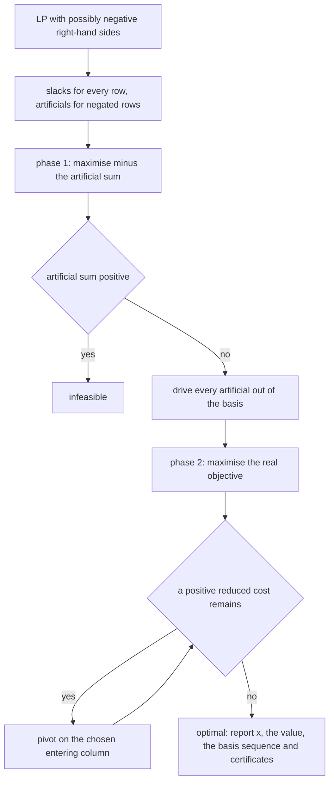
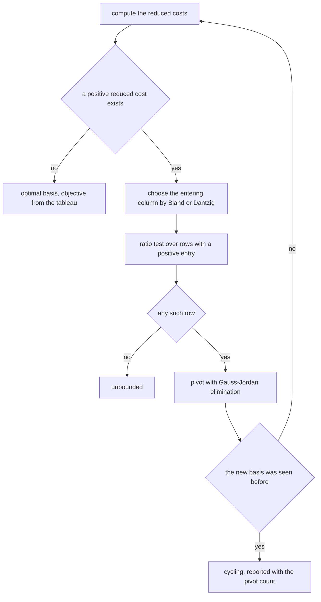
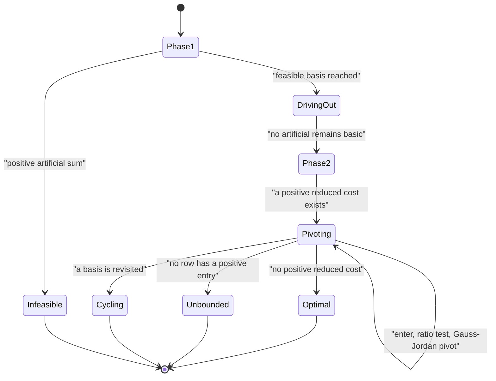

# 570 — Implement linear programming simplex pivot demonstration.

> **Tier:** Advanced · **CTCI chapter:** Beyond — Numerical & Scientific Computing
> **Task spec:** [570-implement-linear-programming-simplex-pivot-demonstration.md](../../../tasks/advanced/570-implement-linear-programming-simplex-pivot-demonstration.md)
> **Solutions:** [Python](../../../solutions/python/advanced/570-implement-linear-programming-simplex-pivot-demonstration/solution.py) ·
> [Java](../../../solutions/java/advanced/570-implement-linear-programming-simplex-pivot-demonstration/Solution.java) ·
> [JavaScript](../../../solutions/javascript/advanced/570-implement-linear-programming-simplex-pivot-demonstration/solution.js) ·
> [C#](../../../solutions/csharp/advanced/570-implement-linear-programming-simplex-pivot-demonstration/Solution.cs)

## 1. Problem restatement

**Input:** a linear program in the form `maximise c^T x subject to A x <= b`, `x >= 0`, with no sign
restriction on `b`.

**Output:** the optimal solution, its value, the sequence of bases and pivot counts, and a status:
`optimal`, `infeasible`, `unbounded` or `cycling`. The solver is a complete **two-phase primal simplex**,
and it demonstrates the pivoting rules rather than merely using one:

- **Phase 1** handles negative right-hand sides: a row with `b_i < 0` is negated (which makes its slack
  coefficient `-1`) and gets an **artificial variable**, and phase 1 maximises minus the sum of the
  artificials until no positive reduced cost remains. A positive residual sum means infeasible.
- **Driving out the artificials** happens between the phases: each artificial is pivoted out of the basis
  on any usable entry of its row; a row without one is redundant, is zeroed and ignored. Skipping this
  step lets a phase-2 pivot push a basic artificial above zero and silently violate the negated
  constraint.
- **Phase 2** maximises the real objective, and optimality is the complete absence of positive reduced
  costs.

Two pivot rules are implemented side by side:

| Rule | Entering column | Ratio ties | Termination |
| --- | --- | --- | --- |
| **Bland's** | smallest-index column with positive reduced cost | smallest basic index | provably terminates, because a basis is never revisited |
| **Dantzig's** | most positive reduced cost | smallest basic index (or first found) | no such guarantee — it can cycle |

The documented facts:

| Check | Statement | Why |
| --- | --- | --- |
| exact arithmetic | all arithmetic uses exact rationals, so pivoting, ratio tests and cycle detection never depend on a floating-point tolerance | the file keeps the whole sequence of bases |
| Beale's cycling example | Dantzig's rule returns to the basis it started from after **exactly six pivots** and is reported as `cycling`; Bland's rule on the same input reaches `x1 = 1/25`, `x3 = 1` with optimum `1/20`, also in six pivots | the classic demonstration, asserted with the pivot count and the repeated basis |
| strong duality | solving the dual LP with the same machinery gives `-dual minimum = primal maximum`, and the complementary-slackness products vanish | two independent optimality statements |
| vertex enumeration | for hand instances and 60 random integer instances, the simplex optimum, the best vertex (all `n`-subsets of the `m + n` constraints, solved exactly) and the dual value agree | three routes to one number |
| reduced-cost certificate | every reduced cost at the optimal basis is non-positive | the optimality certificate |
| shadow prices | the reduced costs of the slack columns are the shadow-price vector `c_B B^-1` | the dual solution comes out of the tableau |
| infeasible and unbounded inputs | detected and reported; infeasibility additionally cross-checked by the vertex enumeration finding no vertex | statuses, not exceptions |
| Bland never cycles | on any tested input, and never returns a sub-optimal basis | the termination guarantee, observed |
| determinism | repeated runs are identical | exact arithmetic and fixed tie-breaks |

## 2. Intuition

The simplex method walks from one vertex of the feasible polyhedron to an adjacent one, each step
improving the objective. Two facts make the walk finite and useful:

- A vertex is a **basis**: choose which variables are allowed to be non-zero (at most as many as there are
  constraints) and solve for the rest. Slack variables turn every inequality into an equality, and the
  slack basis is a natural starting vertex when `b >= 0`.
- Improvement means entering a **non-basic variable with a positive reduced cost** — the reduced cost is
  precisely the rate at which the objective changes when that variable is increased. The **ratio test**
  decides how far it can be increased before some basic variable hits zero, which determines the leaving
  variable.

Optimality is therefore a local certificate: if no non-basic variable has a positive reduced cost, no
direction improves and the current vertex is optimal. The reduced costs of the *slack* columns are the
shadow prices `c_B B^-1`, so the same tableau produces a dual solution as a by-product.

The demonstration is about what happens when the walk goes wrong. **Cycling** — revisiting a basis
forever — is possible with degenerate vertices and an unwisely chosen entering variable. Beale's example
shows Dantzig's rule (take the most positive reduced cost) returning to its starting basis after six
pivots, while Bland's rule (smallest index) reaches the optimum in the same number of pivots. That is why
the files implement both, keep the whole basis sequence, and assert the cycle rather than hiding it.



## 3. Algorithm

1. **Set up the tableau.** Add one slack per row; for a row with `b_i < 0`, negate the row (its slack
   coefficient becomes `-1`) and add an artificial variable.
2. **Phase 1.** Maximise minus the sum of the artificials with the same pivot machinery. If the optimal
   phase-1 value is positive, report `infeasible`.
3. **Drive out the artificials.** For each artificial still basic at zero, pivot on any usable entry of
   its row; if there is none, the row is redundant: zero it and ignore it.
4. **Phase 2.** Maximise the real objective: compute the reduced costs
   `r_j = c_j - c_B B^-1 A_j`, pick the entering column by the chosen rule, run the ratio test on the rows
   with a positive entry in that column, and pivot with Gauss–Jordan elimination.
5. **Stop** when no positive reduced cost remains (optimal), when no row has a positive entry in the
   entering column (unbounded), or when a previously seen basis reappears (cycling, reported as such).
6. **Emit** the primal solution, the objective value, the pivot count, the reduced costs and the basis
   sequence.

```text
procedure simplex(cost, matrix, rhs, rule)
    build the tableau with slacks and artificials
    phase_one_value ← run_pivots(maximising minus the artificial sum)
    if phase_one_value > 0 then return INFEASIBLE end
    drive every basic artificial out of the basis, dropping redundant rows
    seen ← empty set of bases
    loop
        reduced ← reduced costs of every column
        entering ← the column chosen by the rule among those with positive reduced cost
        if entering is none then
            return OPTIMAL with the current solution and value
        end
        leaving ← the smallest ratio row among those with a positive entry in the entering column
        if leaving is none then return UNBOUNDED end
        pivot on (leaving, entering)
        if the new basis is in seen then return CYCLING end
        add the new basis to seen
    end
end

procedure pivot(tableau, row, column)
    divide the leaving row by its entry in the pivot column
    for every other row do
        subtract the row's entry in the pivot column times the normalised row
    end
end
```



## 4. Worked example

Maximise `3x1 + 2x2` subject to `x1 + x2 <= 4`, `x1 + 3x2 <= 6`, `x1, x2 >= 0`. Slacks `s1`, `s2` give
the starting basis, and Bland's rule is used, so the entering column is the smallest index with a
positive reduced cost.

| Step | Basis | Basic solution | Objective | Reduced costs | Entering | Ratios | Leaving |
| --- | --- | --- | --- | --- | --- | --- | --- |
| start | `s1, s2` | `(0, 0)` | `0` | `x1: 3`, `x2: 2`, `s1: 0`, `s2: 0` | `x1` (index `0`) | `4/1 = 4`, `6/1 = 6` | `s1` (smallest ratio) |
| after the pivot | `x1, s2` | `(4, 0)` | `12` | `x2: -1`, `s1: -3`, `s2: 0` | none | — | — |

The second row of the table is the whole optimality certificate: every reduced cost is at most zero, so
no non-basic variable can improve the objective and the vertex `(4, 0)` with value `12` is optimal.
Checking by hand against the vertices of the feasible region confirms it: `(0,0) -> 0`, `(4,0) -> 12`,
`(0,2) -> 4`, and the intersection `(3, 1) -> 11`. The optimum is uniquely `(4, 0)`.

The reduced costs of the slack columns in that final tableau are the **shadow prices**: they say how much
the objective would change if the corresponding right-hand side increased by one — here `-3` for the first
constraint, which is the marginal value of the binding resource.

The cycling demonstration runs on Beale's classic example, and the file asserts both behaviours with exact
pivot counts:

| Rule | Behaviour on Beale's example | Pivots |
| --- | --- | --- |
| Dantzig's (most positive reduced cost) | returns to the starting basis | `6`, then reported as `cycling` |
| Bland's (smallest index) | reaches `x1 = 1/25`, `x3 = 1`, optimum `1/20` | `6` |

| Instance | Expected | Guarantee used |
| --- | --- | --- |
| box-shaped model | optimum at a corner, found in one pivot | ratio test |
| triangle model | optimum at a vertex, dual agrees | strong duality |
| a model with negative right-hand sides | needs phase 1 to reach a feasible basis | phase 1 |
| an infeasible model | reported `infeasible`, and no vertex exists | phase-1 residual sum |
| an unbounded model | reported `unbounded` | empty ratio test |




## 5. Complexity

Let `m` be the number of constraints, `n` the number of structural variables, and `P` the number of pivots
actually performed.

| Measure | Bound | Why it holds |
| --- | --- | --- |
| One pivot | `O(m · (m + n))` rational operations | Gauss–Jordan elimination over the tableau |
| Reduced-cost computation | `O(m · n)` per iteration | the `c_B B^-1 A_j` products |
| Pivots with Bland's rule | finite, bounded by the number of bases `C(n + m, m)` | no basis is revisited |
| Pivots with Dantzig's rule | not bounded by that argument — cycling is possible | Beale's example, reported |
| Pivot cap in the implementation | documented `400` | a defensive bound for pathological inputs |
| Vertex enumeration reference | `O(C(m + n, n) · n³)` exactly | all `n`-subsets of constraints, each solved by elimination |
| Dual solve | same as the primal | the same machinery on the transposed data |
| Space | `O(m · (m + n))` rationals | the tableau, plus the basis sequence |

Simplex is not polynomial in the worst case (and the files demonstrate the cycling failure directly), but
it is fast in practice — which is exactly why the counterexample is valuable. The exact rational
arithmetic removes the other classic failure mode, where a floating-point solver oscillates between
near-degenerate bases because two ratios differ by `1e-15`.

## 6. Pitfalls and edge cases

- **Cycling.** Degenerate vertices allow pivots that keep the objective unchanged, and an unlucky entering
  rule can loop forever. Bland's rule prevents it because it never revisits a basis; the file asserts both
  the cycle under Dantzig's rule (six pivots back to the start on Beale's example) and the correct optimum
  under Bland's.
- **Basic artificials at zero.** Leaving an artificial in the basis at zero lets a phase-2 pivot push it
  positive, silently violating the negated constraint it encodes. Driving them out (and dropping a row that
  offers no usable entry, since it is redundant) is a required step, not tidying up.
- **Ratio-test degeneracy.** Ties in the minimum ratio mean the new basis has a zero-valued basic
  variable; breaking ties by the smallest basic index keeps Bland's rule's termination argument intact.
- **Unboundedness.** No positive entry in the entering column means the variable can grow forever; the
  ratio test has no candidate and the status must be `unbounded`, not "optimal with a huge value".
- **Infeasibility.** A positive phase-1 residual sum proves it; the files additionally confirm that the
  vertex enumeration finds no vertex at all, which is an independent statement of the same fact.
- **Exact versus floating point.** Deciding "is this reduced cost positive?" in floating point with an
  epsilon is how solvers lose optimality certificates; the file uses rationals so every decision is exact
  and the certificate (all reduced costs non-positive) is meaningful.
- **Slack columns are not junk.** Their reduced costs are the shadow prices; discarding them throws away
  the dual solution that the strong-duality check needs.
- **Sign conventions.** Rows with negative right-hand sides must be negated, which is *why* an artificial
  is needed at all; forgetting the negation produces a tableau whose "feasible basis" is not feasible.
- **Which optimum is reported.** Non-unique optima (an optimal edge) and degenerate optima (an optimal
  vertex with a zero-valued basic variable) are both possible; the file asserts the value and feasibility,
  and only asserts exact vertex coordinates on hand instances where they are unique.
- **Instance generation.** The random instances are drawn until 60 feasible *bounded* ones are found, with
  a bias towards non-negative right-hand sides while every third instance still has negative ones — a
  deliberate mix so that both phases are exercised.

## 7. Variants and follow-ups

- **Solution methods that use relaxations.** The branch-and-bound solver calls an LP relaxation at every
  node, so this tableau machinery is the engine underneath it:
  [562-implement-mixed-integer-programming-small-model-using-branch-and.md](../../../tasks/advanced/562-implement-mixed-integer-programming-small-model-using-branch-and.md).
- **Duality as an algorithmic tool.** Facility location's primal–dual scheme grows a dual solution until a
  primal answer is forced, using the same weak-duality inequality the strong-duality check verifies here:
  [567-implement-facility-location-greedy-approximation-k-median-sketch.md](../../../tasks/advanced/567-implement-facility-location-greedy-approximation-k-median-sketch.md).
- **Semirings as a generalisation.** The `(min, +)` closure of task 557 is the shortest-path analogue of
  solving a linear system, and weak duality there is the same statement as here:
  [557-implement-algebraic-path-finding-with-min-plus-matrix-multiply-t.md](../../../tasks/advanced/557-implement-algebraic-path-finding-with-min-plus-matrix-multiply-t.md).
- **Exact arithmetic as a testing tool.** Solving small systems exactly — rationals here, rationals in
  the vertex enumeration, `BigInt` in the JavaScript solver — is the same discipline that makes the
  arithmetic checks of [562-implement-mixed-integer-programming-small-model-using-branch-and.md](../../../tasks/advanced/562-implement-mixed-integer-programming-small-model-using-branch-and.md)
  comparable for equality.

## 8. Check yourself

1. Why does a positive reduced cost identify an improving direction?

<details><summary>Show answer</summary>

The reduced cost `r_j = c_j - c_B B^-1 A_j` is the rate of change of the objective when the non-basic
variable `x_j` is increased from zero, holding the basis equations satisfied. If `r_j > 0`, increasing
`x_j` (and adjusting the basic variables to keep feasibility) raises the objective, so the current basis is
not optimal. Conversely, if every `r_j <= 0`, no feasible direction increases the objective from a vertex,
and since the LP optimum is attained at a vertex, the current one is optimal.

</details>

2. What goes wrong if an artificial variable is left in the basis when phase 2 starts?

<details><summary>Show answer</summary>

An artificial encodes a constraint that must remain satisfied — for a negated row, a surplus variable plus
an artificial at zero represents the original inequality. If it stays basic at zero, a later pivot can
increase it above zero as a side effect, which means the constraint it represents is violated while the
tableau still reports a "feasible" solution. Driving every artificial out of the basis (and dropping rows
that cannot do so, which are redundant) removes that possibility, which is why the step is mandatory.

</details>

3. In the worked example, why is `(4, 0)` optimal rather than the interior intersection `(3, 1)`?

<details><summary>Show answer</summary>

Because both are feasible, and the objective at `(4, 0)` is `12` while at `(3, 1)` it is `11`. The simplex
never visits `(3, 1)`: it starts at `(0,0)`, moves to `(4,0)` along the improving direction of `x1`, and
then finds every reduced cost non-positive, so no further improvement exists. Linear programming optima are
attained at vertices, and the nonzero reduced costs at a non-optimal vertex always point to an adjacent
better one.

</details>

4. What does the cycling demonstration prove?

<details><summary>Show answer</summary>

That the simplex method's termination depends on the pivoting rule, not on the algorithm's idea: with
Dantzig's rule (most positive reduced cost), Beale's example returns to the basis it started from after
exactly six pivots and never reaches the optimum, while Bland's rule (smallest eligible index, smallest
basic index on ratio ties) reaches `x1 = 1/25`, `x3 = 1` with optimum `1/20` in six pivots. Bland's rule
terminates because it provably never revisits a basis, which is why it is the safe default and why the file
asserts both behaviours — including the pivot counts — rather than only testing the rule that works.

</details>

5. Why does the reduced cost of a slack column turn out to be a shadow price?

<details><summary>Show answer</summary>

The reduced costs of the optimal tableau are `c_B B^-1` restricted to the columns, and for a slack column
of constraint `i` the corresponding component is the rate at which the optimal objective value changes when
the right-hand side `b_i` increases by one — which is the definition of that constraint's shadow price. The
files use those values as the dual solution, verifying the primal–dual relationship
`-dual minimum = primal maximum` and that the complementary-slackness products vanish.

</details>
