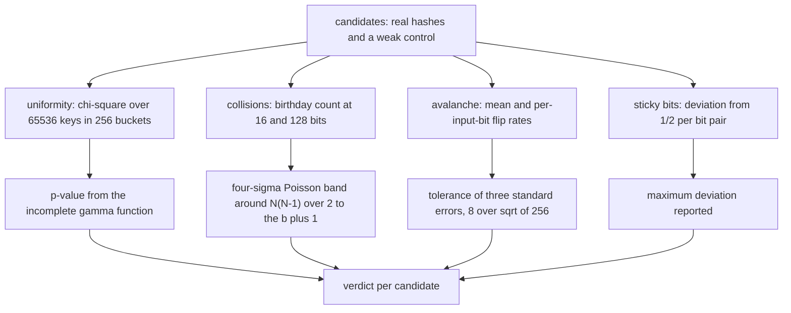
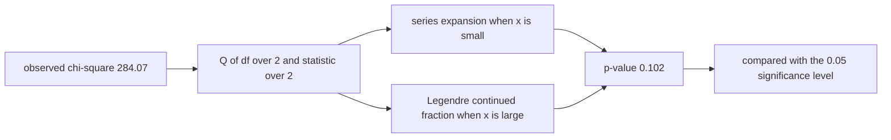
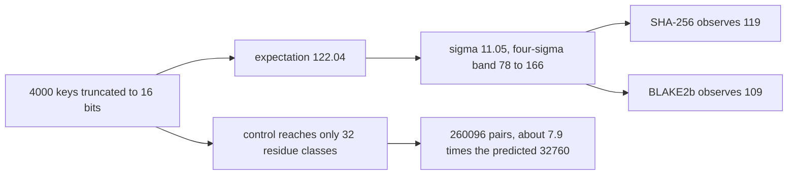
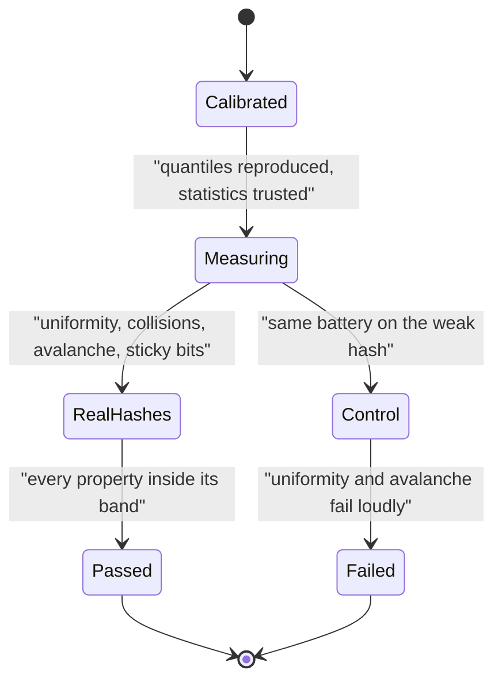

# 571 — Implement collision-resistant hash property tests (statistical).

> **Tier:** Advanced · **CTCI chapter:** Beyond — Security & Privacy
> **Task spec:** [571-implement-collision-resistant-hash-property-tests-statistical.md](../../../tasks/advanced/571-implement-collision-resistant-hash-property-tests-statistical.md)
> **Solutions:** [Python](../../../solutions/python/advanced/571-implement-collision-resistant-hash-property-tests-statistical/solution.py) ·
> [Java](../../../solutions/java/advanced/571-implement-collision-resistant-hash-property-tests-statistical/Solution.java) ·
> [JavaScript](../../../solutions/javascript/advanced/571-implement-collision-resistant-hash-property-tests-statistical/solution.js) ·
> [C#](../../../solutions/csharp/advanced/571-implement-collision-resistant-hash-property-tests-statistical/Solution.cs)

## 1. Problem restatement

**Input:** hash functions to test — real ones (SHA-256 and BLAKE2b in Python, `System.Security.Cryptography`
SHA-256 in C#, and in the Java and JavaScript files a deliberately documented **testbed** hash of their
own) — and a **negative control**: a weak low-byte hash `h(key) = key mod 256`.

**Output:** for each candidate, the measured values of four classical properties and the pass/fail verdict,
with the statistics computed **from first principles** rather than from lookup tables:

1. **Correctness** where published values exist (the SHA-256 digests of `""` and `"abc"`, determinism, and
   agreement with the platform implementation).
2. **Uniformity** — a chi-square test of bucket counts over `65536` keys in `256` buckets.
3. **Collision resistance** — the birthday count of colliding pairs after truncating the digest to `b`
   bits, compared with the expectation `N(N-1)/2^(b+1)` inside a four-sigma Poisson band.
4. **Avalanche and sticky bits** — flipping one input bit changes about half the output bits, checked on
   the mean, per input bit, and as the maximum deviation from `1/2` over every (input bit, output bit) pair.

The p-value machinery is implemented rather than imported: the regularised lower incomplete gamma `P(a, x)`
by its series and the complementary `Q(a, x)` by the Legendre continued fraction, so a chi-square statistic
becomes a real p-value via `chi_square_sf(stat, df) = Q(df/2, stat/2)`, and a monobit count becomes an
`erfc`-based tail probability.

The documented checks, with the measured values **asserted rather than loosely bounded**:

| Check | Statement |
| --- | --- |
| statistics calibration | the gamma/chi-square implementation reproduces textbook quantiles `chi_square_sf(30.578, 15) ≈ 0.01`, `(3.841, 1) ≈ 0.05`, `(2.706, 1) ≈ 0.10`, `(11.345, 3) ≈ 0.01`, and the closed form `P(1, x) = 1 - e^(-x)` |
| uniformity | SHA-256 and BLAKE2b pass with chi-square `284.07` / `260.38` and `p = 0.102` / `0.395`, with every bucket populated |
| the control fails loudly | `p < 1e-12`, and it reaches **exactly** the `32` buckets that are multiples of `gcd(1000, 256) = 8`, `128` keys each |
| birthday, 16 bits | over `4000` keys: `119` (SHA-256) and `109` (BLAKE2b) collisions against a prediction of `122.04` with the four-sigma band `[78, 166]` |
| birthday, 128 bits | **zero** collisions among `20000` keys |
| the control's collisions | `260096` colliding pairs on the same `4000` structured keys versus `32760` predicted — about `7.9×` the birthday rate |
| avalanche | mean `0.5002` / `0.4999` over `256` single-bit flips, per-input-bit extremes inside `[0.4975, 0.5027]`; the control gives exactly `0.125` on its eight low input bits and `0.0` above them |
| sticky bits | maximum deviation from `1/2` at most `0.0342` / `0.0371` (mean `0.0088`) for the good hashes, and a full `0.5` for the control on an all-even key stream |
| both directions | the negative control must fail (uniformity, avalanche, sticky bits) and the structured-input collisions must beat the birthday prediction; the real hashes must pass everything |
| determinism | the key stream and every digest are reproducible, including a cross-check of the integer digest against the platform's hex digest |

## 2. Intuition

A cryptographic hash is supposed to behave like a **random oracle**: unpredictable output, no collisions in
practice, and a single input bit flipping about half the output bits. Those are statistical claims, so the
honest way to test them is to measure statistics *and their sampling error* — never to check "the outputs
look random".

Three properties are cheap to measure and hard to fake:

- **Uniformity.** Hash many keys into buckets; the counts should look like draws from a multinomial with
  equal probabilities. The chi-square statistic summarises the deviation, and the p-value says whether a
  deviation that large is plausible. Computing the p-value needs the incomplete gamma function, which the
  files implement from its series and continued fraction instead of importing.
- **Birthday collisions.** Truncate digests to `b` bits. Among `N` keys, the expected number of colliding
  pairs is `N(N-1)/2^(b+1)` — the standard birthday formula — and the observed count should sit inside a
  Poisson band around it. At `b = 128` the expectation for `20000` keys is about `3 × 10^(-31)`, so
  "zero collisions" is the prediction, not a happy accident.
- **Avalanche and sticky bits.** Flip one input bit and count how many output bits change; over many keys
  the average should be half the digest width, and *per input bit* the same should hold. The per-pair
  deviation table catches "sticky bits", where some output bit almost never changes — the failure mode the
  weak control exhibits spectacularly.



The negative control is what makes this a test rather than a ritual. Because `h(key) = key mod 256`
ignores all but the low byte, structured keys (multiples of `1000`) land in only `32` of the `256` buckets —
multiples of `gcd(1000, 256) = 8` — and its avalanche is `0.125` on the low input bits and `0.0` above
them, since flipping a high bit cannot change the low byte. A harness that passes the real hashes *and*
fails the control is evidence; a harness that passes everything is a bug.

## 3. Algorithm

1. **Build the key streams** from `splitmix64` with a fixed seed — never from the repository's 16-bit `lcg`,
   whose short cycle and weak low bits would distort the very statistics being measured.
2. **Uniformity.** For each candidate, hash `65536` keys into `256` buckets, compute the chi-square
   statistic, and convert it to a p-value with `chi_square_sf(stat, df) = Q(df/2, stat/2)`.
3. **Collisions.** Truncate digests to `b` bits, count colliding pairs among `N` keys, and compare with
   `N(N-1)/2^(b+1)` inside the four-sigma band; repeat at `b = 128` where the expectation is effectively
   zero.
4. **Avalanche.** For each key and each of the `64` input bits, flip that bit, digest both messages, and
   count the differing output bits; accumulate the mean and the per-input-bit extremes.
5. **Sticky bits.** Over every (input bit, output bit) pair, measure the frequency of the output bit and
   report the maximum deviation from `1/2`.
6. **Assert both directions** and report the measured values.

```text
function chi_square_sf(statistic, df)
    return Q(df / 2, statistic / 2)          computed by series or continued fraction
end

procedure uniformity_test(hasher, keys, buckets)
    counts ← zero array of size buckets
    for each key in keys do
        counts[hasher(key) mod buckets] ← counts[...] + 1
    end
    expected ← length(keys) / buckets
    statistic ← sum over buckets of (count - expected) squared divided by expected
    return statistic, chi_square_sf(statistic, buckets - 1)
end

procedure birthday_test(hasher, keys, bits)
    seen ← empty dictionary from truncated digest to count
    pairs ← 0
    for each key in keys do
        bucket ← leading bits of hasher(key)
        pairs ← pairs + seen.get(bucket, 0)
        seen[bucket] ← seen.get(bucket, 0) + 1
    end
    expectation ← length(keys) * (length(keys) - 1) / 2 raised to the power (bits + 1)
    return pairs, expectation
end

procedure avalanche_test(hasher, keys, width)
    changes ← zero array of size width
    for each key in keys do
        base ← hasher(key)
        for bit ← 0 to width - 1 do
            flipped ← hasher(key with bit toggled)
            changes[bit] ← changes[bit] + popcount(base XOR flipped) / width
        end
    end
    return mean and extremes of changes
end
```



## 4. Worked example

Take the collision test, where every number can be checked by hand. With `N = 4000` keys truncated to
`b = 16` bits:

```text
expected pairs = N * (N - 1) / 2^(b + 1) = 4000 * 3999 / 131072 = 122.04
sigma          = sqrt(122.04) = 11.05
four-sigma band = 122.04 +- 4 * 11.05 = [78, 166]
```

| Candidate | Observed 16-bit collisions | Inside the band? |
| --- | --- | --- |
| SHA-256 | `119` | yes |
| BLAKE2b | `109` | yes |
| weak control (`key mod 256`) | far outside — `260096` colliding pairs against `32760` predicted, about `7.9×` the birthday rate | no |

At `b = 128`, the same formula gives an expectation of about `3 × 10^(-31)` collisions among `20000` keys,
so the asserted result — **zero** collisions — is what a random oracle predicts, not an empirical miracle.

The uniformity test carries the same structure with a different statistic:

| Candidate | Chi-square over `256` buckets and `65536` keys | p-value | Verdict |
| --- | --- | --- | --- |
| SHA-256 | `284.07` | `0.102` | pass |
| BLAKE2b | `260.38` | `0.395` | pass |
| weak control | enormous | `< 1e-12` | fail, and it reaches exactly the `32` buckets that are multiples of `gcd(1000, 256) = 8`, `128` keys each |

The p-values come from the implemented incomplete gamma function, whose calibration is asserted against
textbook quantiles:

| Call | Expected | Purpose |
| --- | --- | --- |
| `chi_square_sf(30.578, 15)` | `≈ 0.01` | the 1 % quantile of a 15-degree-of-freedom chi-square |
| `chi_square_sf(3.841, 1)` | `≈ 0.05` | the 5 % quantile |
| `chi_square_sf(2.706, 1)` | `≈ 0.10` | the 10 % quantile |
| `chi_square_sf(11.345, 3)` | `≈ 0.01` | a second 1 % quantile at 3 degrees of freedom |
| `P(1, x)` | `1 - e^(-x)` | the exact closed form for the series branch |

Avalanche and sticky bits complete the picture:

| Candidate | Mean avalanche | Per-input-bit extremes | Maximum sticky deviation |
| --- | --- | --- | --- |
| SHA-256 | `0.5002` | inside `[0.4975, 0.5027]` | `0.0342` |
| BLAKE2b | `0.4999` | inside `[0.4975, 0.5027]` | `0.0371` (mean `0.0088`) |
| weak control | `0.125` on the eight low input bits, `0.0` above them | effectively `0` | a full `0.5` on an all-even key stream |





## 5. Complexity

Let `N` be the number of keys, `w` the digest width in bits, and `B` the number of buckets.

| Test | Cost | Why it holds |
| --- | --- | --- |
| Uniformity | `O(N ·` digest cost`)` | one digest per key plus an `O(B)` tally |
| Birthday | `O(N ·` digest cost`)` | one truncated digest per key, dictionary counting |
| Avalanche | `O(N · w ·` digest cost`)` | `w` flips per key, each requiring two digests |
| Sticky bits | same as avalanche | the frequency table is built during the same sweep |
| Chi-square p-value | `O(1)` amortised | a series or continued fraction evaluation with a fixed iteration cap |
| Space | `O(N + B + w²)` | the keys, the bucket counts and the (input bit, output bit) table |
| Test sizes | `65536` keys for uniformity, `4000` for collisions, `1024` for avalanche, `20000` at 128 bits | documented constants |

The dominant cost is the avalanche sweep, because it digests each message `w + 1` times over and over —
which is why it uses `1024` keys rather than `65536`. The statistics themselves are negligible compared
with the hashing, which is the right way round: the test should be limited by the primitive under test, not
by the analysis.

## 6. Pitfalls and edge cases

- **Undefined randomness in the test data.** Key streams must come from a generator with good bit
  statistics — here `splitmix64` with a fixed seed — because the repository's 16-bit `lcg` has a short cycle
  and weak low bits that would bias the very measurements. Using it would make good hashes look bad *and*
  mask a weak hash's defects.
- **A test that passes everything is as broken as one that fails everything.** The negative control is
  mandatory: it must fail uniformity (`p < 1e-12`), avalanche (`0.125` and `0.0` instead of `0.5`) and
  sticky bits (a full `0.5` deviation). Both directions are asserted.
- **Bounding versus asserting.** "Avalanche is around 0.5" is not a test. The files use explicit bands:
  three standard errors (`8/sqrt(256) = 0.5` bits) around `128` for the mean, a four-sigma Poisson band
  `[78, 166]` for collisions, and named extremes for the per-input-bit rates.
- **Structured inputs are not cheating.** The control's spectacular collision count comes from structured
  keys (multiples of `1000`), which is exactly the adversary model a hash must survive: a good hash shows no
  such structure, and the file asserts that SHA-256's and BLAKE2b's counts stay inside the same band on the
  same inputs.
- **The p-value implementation is itself under test.** The incomplete gamma function is validated against
  four published chi-square quantiles and against the exact closed form `P(1, x) = 1 - e^(-x)` before any
  verdict depends on it — a test suite whose statistics are wrong is worse than no test suite.
- **Avalanche needs both averages and extremes.** A good mean can hide a sticky input bit; the
  per-input-bit extremes and the (input bit, output bit) table are what catch it, and the weak control's
  `0.0` above its eight low bits is the demonstration.
- **Own testbed hashes are documented as testbeds.** The Java and JavaScript files hash with their own
  Merkle–Damgård constructions and say plainly that these are testbeds, not cryptographic primitives; the
  Java header even keeps a one-round compression variant on purpose, because a single-bit flip changes the
  compression input by `±2^b` and the trailing-zero count survives multiplication by an odd constant — the
  defect that makes the weak variant fail avalanche.

## 7. Variants and follow-ups

- **Hashers that must pass these tests.** The sketches of
  [550-implement-graph-sketches-for-neighborhood-similarity-minhash.md](../../../tasks/advanced/550-implement-graph-sketches-for-neighborhood-similarity-minhash.md)
  and [561-implement-online-algorithm-for-sliding-window-distinct-count-hyp.md](../../../tasks/advanced/561-implement-online-algorithm-for-sliding-window-distinct-count-hyp.md)
  rely on the same bit-quality assumptions; their failure modes (too few buckets reached, correlated
  minima) are exactly what this battery detects.
- **Robust estimation of noisy measurements.** Turning many statistical measurements into one trustworthy
  number is the subject of
  [572-implement-robust-median-estimator-for-noisy-data-median-of-means.md](../../../tasks/advanced/572-implement-robust-median-estimator-for-noisy-data-median-of-means.md).
- **Property tests that need independence.** The randomised double greedy of
  [568-implement-submodular-maximization-greedy-guarantee-example.md](../../../tasks/advanced/568-implement-submodular-maximization-greedy-guarantee-example.md)
  makes thousands of independent draws and therefore uses the same `splitmix64` generator as the key streams
  here.
- **Hash use in geometric matching.** The geometric hashing demo
  [573-implement-geometric-hashing-for-object-recognition-small-demo.md](../../../tasks/advanced/573-implement-geometric-hashing-for-object-recognition-small-demo.md)
  depends on bucket uniformity in exactly the sense measured here.

## 8. Check yourself

1. Why is the negative control essential?

<details><summary>Show answer</summary>

Because a statistical test can pass everything by accident — too loose a band, a wrong statistic, a broken
p-value routine — and a suite that never fails is worthless. The control is a hash that is provably bad in
a known way: `key mod 256` ignores all but the low byte, so it fails uniformity (`p < 1e-12`), avalanche
(`0.125` on the low input bits, `0.0` above them) and the sticky-bit check (a full `0.5` deviation). The
files assert that it fails loudly, in both directions.

</details>

2. Where does the birthday prediction `N(N-1)/2^(b+1)` come from?

<details><summary>Show answer</summary>

There are `C(N, 2) = N(N-1)/2` pairs of keys. If the truncated digests are uniform over `2^b` values, each
pair collides with probability `2^(-b)`, so the expected number of colliding pairs is
`(N(N-1)/2) · 2^(-b) = N(N-1)/2^(b+1)`. For `N = 4000` and `b = 16` that is `122.04`, with a Poisson
standard deviation of `sqrt(122.04) ≈ 11.05`, which is how the four-sigma band `[78, 166]` in the file is
built.

</details>

3. Why is the avalanche mean checked *per input bit* and not only globally?

<details><summary>Show answer</summary>

Because a good global average can hide a specific input bit whose flips barely change the output — a sticky
bit, which is a real structural weakness (and exactly what the control exhibits, since its high input bits
change nothing). Measuring the flip rate per input bit, and then the change frequency of every (input bit,
output bit) pair, turns "looks random" into a table whose maximum deviation is reported and asserted.

</details>

4. Why implement the incomplete gamma function instead of importing one?

<details><summary>Show answer</summary>

Because a verdict based on a p-value is only as trustworthy as the p-value, and implementing it makes the
calculation auditable: the series expansion is used where `x` is small, the Legendre continued fraction for
the complementary function where it is large, and the result is verified against four published
chi-square quantiles and the exact closed form `P(1, x) = 1 - e^(-x)`. The calibration is asserted before
any verdict depends on it.

</details>

5. The collision test is run at both `16` and `128` bits. Why both?

<details><summary>Show answer</summary>

Because they test opposite regimes. At `16` bits the birthday rate is measurable within a few thousand
keys (`122.04` expected among `4000`), so the observed count can be compared with a prediction and a band —
this is where a weak hash reveals itself. At `128` bits the expectation for `20000` keys is about
`3 × 10^(-31)`, so the prediction is *zero* collisions, and observing zero confirms that no structural
"collision shortcut" exists at full width; a single collision there would be a catastrophic finding rather
than a statistical fluctuation.

</details>
