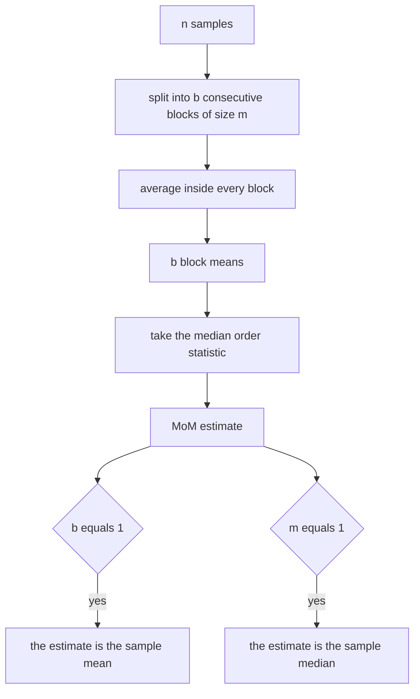
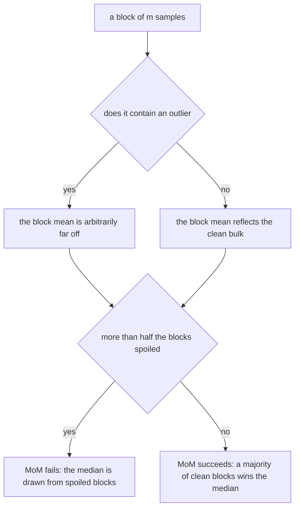
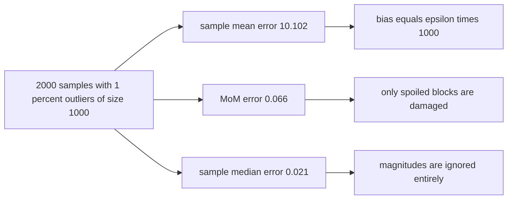
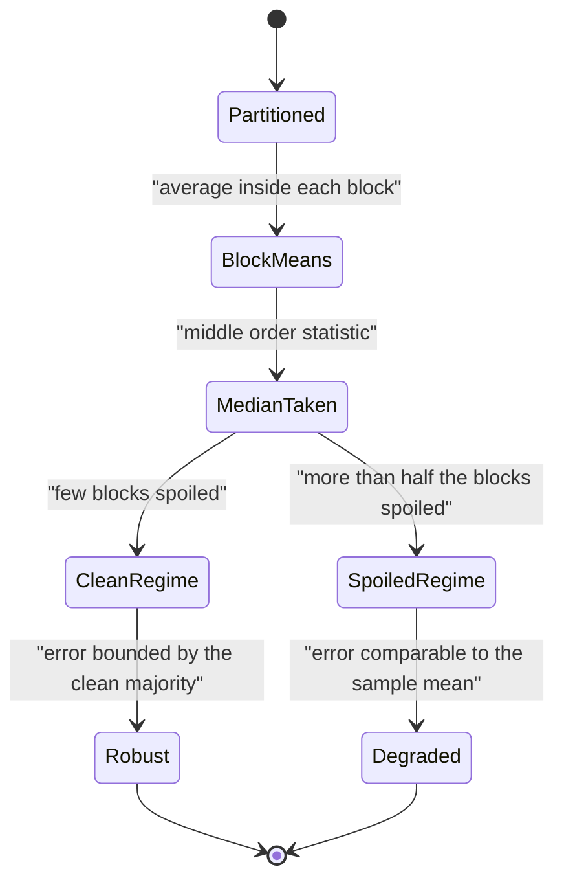

# 572 — Implement robust median estimator for noisy data (median-of-means).

> **Tier:** Advanced · **CTCI chapter:** Beyond — Numerical & Scientific Computing
> **Task spec:** [572-implement-robust-median-estimator-for-noisy-data-median-of-means.md](../../../tasks/advanced/572-implement-robust-median-estimator-for-noisy-data-median-of-means.md)
> **Solutions:** [Python](../../../solutions/python/advanced/572-implement-robust-median-estimator-for-noisy-data-median-of-means/solution.py) ·
> [Java](../../../solutions/java/advanced/572-implement-robust-median-estimator-for-noisy-data-median-of-means/Solution.java) ·
> [JavaScript](../../../solutions/javascript/advanced/572-implement-robust-median-estimator-for-noisy-data-median-of-means/solution.js) ·
> [C#](../../../solutions/csharp/advanced/572-implement-robust-median-estimator-for-noisy-data-median-of-means/Solution.cs)

## 1. Problem restatement

**Input:** `n` scalar samples and a number of blocks `b`.

**Output:** the **median-of-means** (MoM) estimate of the location: split the samples into `b` consecutive
blocks of `m = n / b` values, average inside each block, and take the median of the `b` block means —
concretely the lower middle order statistic, 0-based rank `(b - 1)/2`, so the estimator is a deterministic
order statistic with no interpolation. (The JavaScript file uses the average of the two central values for
even `b`, a documented convention; the Python file applies the same convention to sample medians of even
length.)

The estimator is implemented together with the two it is meant to replace — the **sample mean** and the
**sample median** — so the comparison is measured instead of asserted. The documented findings, all
asserted:

| Finding | Numbers | Meaning |
| --- | --- | --- |
| identities | `MoM` with `b = 1` **is** the sample mean; `MoM` with `m = 1` **is** the sample median | the family interpolates between them |
| generator sanity | 60 000 standard normals: mean within `0.01` of `0`, variance within `0.02` of `1`, median near `0` | the sample source is trustworthy |
| clean data | over 120 trials of `n = 1000`, MoM's standard deviation is `1.265×` the mean's | robustness is not free: the classical asymptotic ratio is `sqrt(pi/2) = 1.2533` |
| sparse contamination | `n = 2000`, `epsilon = 0.01`, `b = 100`, 80 trials: mean off by `10.102`, MoM by `0.066`, sample median by `0.021` | a factor `154` in MoM's favour |
| breakdown mechanism | a block is spoiled when it contains at least one outlier — probability `1 - (1 - epsilon)^m` — and MoM fails exactly when more than half the blocks are spoiled | the exact condition, checked against a binomial closed form |
| breakdown rates | six `(b, m, epsilon)` settings with 300–1000 trials each give failure rates `(0.171, 0.255, 0.492, 0.004, 0.000, 0.990)`, matching `P[Binomial(b, 1-(1-epsilon)^m) > b/2]` inside four Monte-Carlo standard deviations, and ordered so a test that always returns `0` cannot pass | the prediction, verified |
| honest counterexample | with `epsilon = 0.1` and blocks of `20` (`n = 2000`, 40 trials) each block holds an outlier with probability `0.878`, and MoM's error is `99.9` against the mean's `98.8` — the same order | MoM is **not** robust when almost every block is spoiled |
| heavy tails | on Cauchy samples the sample mean's error stays at `5.98` over 80 trials while MoM stays at `0.150` | an estimator that converges versus one that does not |
| consistency, clean | block size fixed at `20`, `n` growing `100 -> 1000 -> 10000`: errors `0.082 -> 0.025 -> 0.008`, factors `3.30` and `3.00` per decade against the `sqrt(10)` prediction | the estimator converges |
| consistency, contaminated | constant `epsilon = 0.01`: errors `0.137 -> 0.080 -> 0.068`, only `15 %` better over the last decade | the median is biased by an amount that does not vanish with `n` at fixed block size |

## 2. Intuition

The sample mean is the most efficient location estimator when the noise is well behaved — and the most
fragile when it is not: a single sample of magnitude `1000` moves the mean by `1000/n`, and with a
contamination probability `epsilon` the bias is about `epsilon · 1000`, which no amount of shrinking fixes.
The sample median is the opposite: it ignores magnitudes entirely and tolerates almost half the sample being
arbitrary, at the cost of throwing away the magnitudes it ignores.

Median-of-means is the interpolation that keeps both halves of the bargain. Averaging inside a block means
only the blocks that *contain* an outlier are damaged, so the median of block means can afford up to half of
the blocks to be spoiled. The two ingredients are therefore:

- **Averaging** keeps the accuracy of the mean on clean data (variance `1/m` per block).
- **The median across blocks** caps how much damage a few extreme blocks can do, because a majority of
  unspoiled block means still determines the answer.

The price is explicit: on clean data MoM has the same variance order but a constant `sqrt(pi/2) ≈ 1.2533`
larger than the mean's, which the file measures (`1.265×`) rather than hides. Robustness is paid for with
efficiency, and the estimator's whole design is choosing `b` to make the robustness real without wasting
too much.



## 3. Algorithm

1. Partition the samples into `b` consecutive blocks of size `m = n / b` (rejecting configurations with too
   many blocks for the number of samples).
2. Compute each block's mean.
3. Sort the `b` block means and select the middle one: rank `(b - 1)/2` for the lower-median convention, or
   the average of the two central values when `b` is even.
4. Return that value; also report the sample mean and sample median for comparison.
5. Validate the mechanism against the closed form: a block is spoiled when it holds at least one outlier
   (probability `1 - (1 - epsilon)^m`), and MoM fails exactly when strictly more than `b/2` blocks are
   spoiled, i.e. with probability `P[Binomial(b, 1 - (1 - epsilon)^m) > b/2]`.

```text
procedure median_of_means(samples, b)
    n ← length(samples)
    m ← n divided by b
    if m is zero then reject the configuration end
    means ← empty list
    for block ← 0 to b - 1 do
        sum ← 0
        for index ← block * m to (block + 1) * m - 1 do
            sum ← sum + samples[index]
        end
        append sum / m to means
    end
    sort means
    return the middle entry, or the average of the two middle entries when b is even
end

function breakdown_probability(b, m, epsilon)
    spoiled ← 1 - (1 - epsilon) raised to the power m
    return the probability that a Binomial(b, spoiled) variable exceeds b / 2
end
```



## 4. Worked example

The sparse-contamination comparison is the designed experiment: `n = 2000` samples, `epsilon = 0.01`
contamination with an outlier of `+1000`, `b = 100` blocks, 80 trials.

| Estimator | Typical error | Why |
| --- | --- | --- |
| sample mean | `10.102` | the outlier bias is `epsilon · 1000 = 10`, and the sample mean collects it in full |
| median-of-means | `0.066` | only blocks containing an outlier are damaged, and 99 of the 100 blocks are usually clean |
| sample median | `0.021` | it ignores magnitudes entirely, so the same outliers barely matter |

The mean's number is the interesting one because it is *derivable*: the contamination model adds
`+1000` independently with probability `epsilon = 0.01` to every sample, so the mean carries a bias of
`0.01 · 1000 = 10` — and the measured `10.102` matches. That is not a coincidence but the mechanism, and it
is why the file compares the three estimators on the same data rather than declaring one the winner.

The breakdown prediction is the second half of the story, and it is an exact formula rather than a trend:

| `epsilon` | block size `m` | probability a block contains an outlier, `1 - (1 - epsilon)^m` |
| --- | --- | --- |
| `0.01` | `20` | `1 - 0.99^20 = 0.182` |
| `0.1` | `20` | `1 - 0.9^20 = 0.878` |
| `0.5` | `1` | `0.5`, which reduces MoM to the sample median |

MoM then fails when more than half the `b` blocks are spoiled. With `b = 100` and a spoil probability of
`0.878` the binomial mean is `87.8`, so failure is almost certain — and the file records a failure rate of
`0.990` in that regime. The six measured rates `(0.171, 0.255, 0.492, 0.004, 0.000, 0.990)` all sit within
four Monte-Carlo standard deviations of `P[Binomial(b, 1 - (1 - epsilon)^m) > b/2]`, and they are asserted to
be *ordered* as well, so a degenerate test that always returns `0` cannot pass.

That same regime is the honest counterexample: with `epsilon = 0.1` and blocks of `20` the blocks are
spoiled with probability `0.878`, MoM's error is `99.9` and the mean's is `98.8` — MoM loses its advantage
exactly when its majority vote stops being a majority of clean blocks.

| Regime | Estimator | Behaviour | Reason |
| --- | --- | --- | --- |
| clean Gaussian, `n = 1000` | mean | reference | maximum efficiency |
| clean Gaussian, `n = 1000` | MoM | `1.265×` the mean's standard deviation | the `sqrt(pi/2) = 1.2533` price of the median step |
| Cauchy samples | mean | error `5.98` | no finite mean exists, so the mean does not converge |
| Cauchy samples | MoM | error `0.150` | a median of block means still converges |
| fixed block size `20`, `n` growing | MoM, clean | `0.082 -> 0.025 -> 0.008` | factors `3.30` and `3.00` against the `sqrt(10)` prediction |
| fixed block size `20`, constant `epsilon` | MoM, contaminated | `0.137 -> 0.080 -> 0.068` | a `15 %` gain over the last decade: the bias does not vanish at fixed block size |





## 5. Complexity

Let `n` be the number of samples and `b` the number of blocks.

| Measure | Bound | Why it holds |
| --- | --- | --- |
| Block means | `O(n)` | one pass, one addition per sample |
| Median of the block means | `O(b log b)` | sorting `b` values |
| Total | `O(n + b log b)` | dominated by the single pass |
| Space | `O(n + b)` | the samples plus `b` block means |
| Breakdown point | `1/2` | a majority of blocks must be clean |
| Efficiency on clean data | `~ pi/2` times the mean's variance asymptotically | the median step pays `sqrt(pi/2) ≈ 1.2533` in standard deviation |
| Predicted failure rate | `P[Binomial(b, 1 - (1 - epsilon)^m) > b/2]` | exact, given the contamination model |
| Statistical cost of the measurements | 80–1000 trials per setting | documented per section so each conclusion keeps a margin |

The estimator's own cost is negligible; the interesting cost is statistical — how many trials are needed
before a claimed ratio or failure rate is meaningful. The files choose replicate counts per section (120 for
efficiency, 80 for the contamination and Cauchy comparisons, 300–1000 for the breakdown settings, 40 for the
spoiled regime) so that every assertion has a comfortable margin.

## 6. Pitfalls and edge cases

- **Robustness is not free.** On clean Gaussian data MoM's standard deviation is `1.265×` the mean's, close
  to the asymptotic `sqrt(pi/2) = 1.2533`. A file that only showed the contaminated comparison would
  misrepresent the estimator.
- **Forty-nine percent is the honest limit.** With `epsilon = 0.1` and blocks of `20`, almost 88 % of blocks
  are spoiled and MoM's error (`99.9`) matches the mean's (`98.8`). The breakdown guarantee is "up to half
  the sample", and the files assert the failure outside that range rather than pretending the estimator is
  unconditionally robust.
- **Block size versus contamination rate.** The spoil probability is `1 - (1 - epsilon)^m`, which grows with
  `m`: bigger blocks average more clean samples but are more likely to contain an outlier. Choosing `b`
  trades the two.
- **The bias plateau with `n`.** At a fixed block size and constant `epsilon`, MoM's error stops improving
  (`0.137 -> 0.080 -> 0.068`): the median of a mixture of clean and spoiled block means has a bias that does
  not vanish with `n`. Growing `n` must mean growing the *number* of blocks, not their size.
- **Median conventions.** For even `b` the median is either the lower middle order statistic or the average
  of the two central values; both appear in the files, and `b = 1` (the sample mean) and `m = 1` (the sample
  median) are the identities that pin the family down. `b` larger than `n` must be rejected rather than
  producing empty blocks.
- **Cauchy samples.** A distribution with no finite mean makes the sample mean non-convergent (`5.98` error)
  while MoM converges (`0.150`). Testing only Gaussian data would never reveal this, which is why the file
  includes the heavy-tailed case.
- **Sample source quality.** Tens of thousands of independent draws are needed, so the repository's 16-bit
  `lcg` (short cycle, weak low bits) is not usable here; the files use `splitmix64` with a fixed seed and
  transform it with Box–Muller — or, in the C# file, with the Irwin–Hall(12) device whose variance is exactly
  `1`.
- **Determinism.** Every measurement must be reproducible, so the generator is seeded and the estimators are
  deterministic order statistics; repeated runs are asserted identical.
- **Monte-Carlo error is part of the claim.** The failure rates match the binomial prediction *within four
  Monte-Carlo standard deviations*, and the docstring records how many replicates each rate came from —
  a claim of agreement without the trial count would be unfalsifiable.

## 7. Variants and follow-ups

- **Robust fitting for geometric models.** RANSAC takes the same "let a majority decide, ignore the outliers"
  stance but samples entire models instead of block means:
  [574-implement-ransac-robust-model-fitting-algorithm.md](../../../tasks/advanced/574-implement-ransac-robust-model-fitting-algorithm.md).
- **Statistical tests need trustworthy generators.** The property tests of
  [571-implement-collision-resistant-hash-property-tests-statistical.md](../../../tasks/advanced/571-implement-collision-resistant-hash-property-tests-statistical.md)
  share the `splitmix64` discipline and the habit of asserting measured values with their sampling error.
- **Estimating when the data does not fit in memory.** Sketches like
  [561-implement-online-algorithm-for-sliding-window-distinct-count-hyp.md](../../../tasks/advanced/561-implement-online-algorithm-for-sliding-window-distinct-count-hyp.md)
  trade memory for error in the same quantifiable way.
- **Model fitting with noise and outliers.** The geometric fitting tasks
  [573-implement-geometric-hashing-for-object-recognition-small-demo.md](../../../tasks/advanced/573-implement-geometric-hashing-for-object-recognition-small-demo.md)
  and [574-implement-ransac-robust-model-fitting-algorithm.md](../../../tasks/advanced/574-implement-ransac-robust-model-fitting-algorithm.md)
  both need the robustness that MoM supplies in one dimension.

## 8. Check yourself

1. Why does a block mean survive an outlier better than the sample mean does?

<details><summary>Show answer</summary>

Because only the block that *contains* the outlier is damaged: the outlier contributes `1000/m` to that one
block mean instead of `1000/n` to the overall mean, and — crucially — the other blocks are untouched. For
`n = 2000` and `b = 100` blocks of `20`, the outlier moves one block mean by `50` while leaving the median
across mostly-clean blocks unaffected. The sample mean, by contrast, spreads the outlier's influence over
every sample in the average, which is why its bias is `epsilon · 1000 = 10` in the measured instance.

</details>

2. Where does the breakdown condition `P[Binomial(b, 1 - (1 - epsilon)^m) > b/2]` come from?

<details><summary>Show answer</summary>

A block is spoiled exactly when at least one of its `m` samples is an outlier: independently, that happens
with probability `1 - (1 - epsilon)^m`. The number of spoiled blocks among `b` is therefore a binomial
variable, and MoM (a median across block means) fails precisely when strictly more than half the blocks are
spoiled, because then the median is drawn from the spoiled side. The files check the measured failure rates
against this exact expression within four Monte-Carlo standard deviations, and they assert that the rates
are ordered so a degenerate "always zero" test cannot pass.

</details>

3. On clean data MoM is *less* accurate than the mean. Why use it at all?

<details><summary>Show answer</summary>

Because the comparison changes as soon as the data is not clean. MoM's variance on clean data is about
`pi/2` times the mean's (the file measures `1.265×`), a constant-factor loss, while its robustness is
qualitative: it tolerates up to half the sample being arbitrarily corrupted, and on Cauchy samples — where
the mean does not converge at all (error `5.98`) — it stays at `0.150`. The estimator trades a bounded
efficiency loss for a bounded worst-case error.

</details>

4. Why does the contaminated error stop improving as `n` grows?

<details><summary>Show answer</summary>

Because the block *size* is held fixed at `20` while the number of blocks grows: the fraction of spoiled
blocks stays near `1 - (1 - epsilon)^20 = 0.182` independent of `n`, so the mixture of clean and spoiled
block means that the median searches over does not improve. The measured errors `0.137 -> 0.080 -> 0.068`
show exactly that (a `15 %` gain over the last decade, versus factors of about `3` on clean data). Improving
the contaminated regime requires making the *blocks* smaller as `n` grows, not just collecting more data.

</details>

5. Why does the file include Cauchy samples?

<details><summary>Show answer</summary>

Because they separate "noisy" from "heavy-tailed". The Cauchy distribution has no finite mean, so the law of
large numbers does not apply to the sample mean and its error stays at `5.98` no matter how many samples are
taken, while MoM — a median of block means — still converges (`0.150`). Testing only Gaussian data would
make both estimators look adequate; the heavy-tailed case is where the robustness claim becomes
qualitative.

</details>
