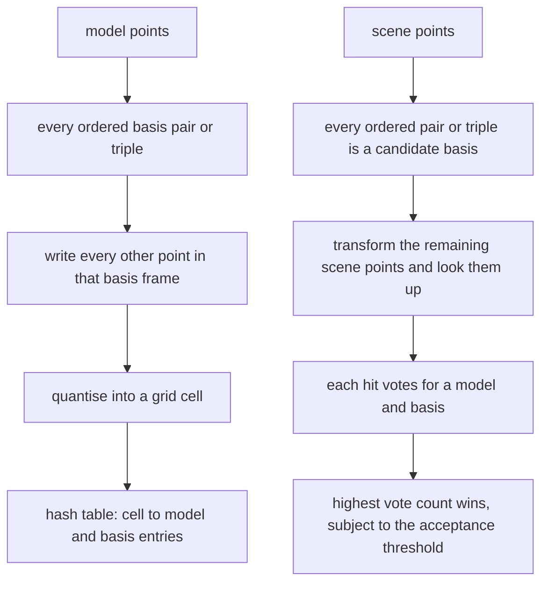
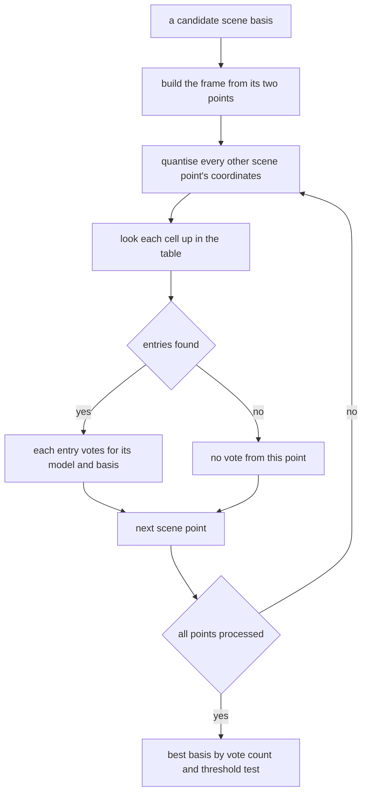
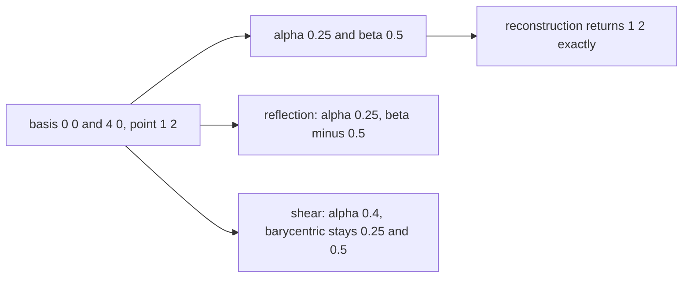
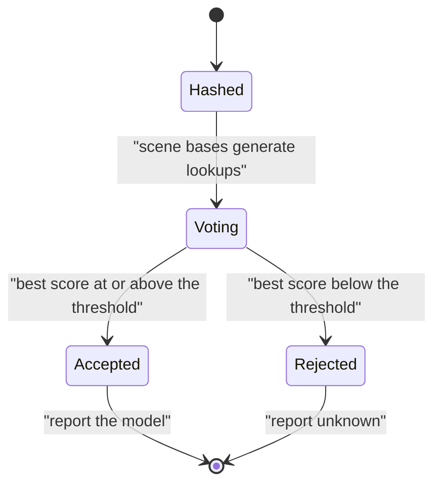

# 573 — Implement geometric hashing for object recognition small demo.

> **Tier:** Advanced · **CTCI chapter:** Beyond — Graphics, Geometry & Robotics
> **Task spec:** [573-implement-geometric-hashing-for-object-recognition-small-demo.md](../../../tasks/advanced/573-implement-geometric-hashing-for-object-recognition-small-demo.md)
> **Solutions:** [Python](../../../solutions/python/advanced/573-implement-geometric-hashing-for-object-recognition-small-demo/solution.py) ·
> [Java](../../../solutions/java/advanced/573-implement-geometric-hashing-for-object-recognition-small-demo/Solution.java) ·
> [JavaScript](../../../solutions/javascript/advanced/573-implement-geometric-hashing-for-object-recognition-small-demo/solution.js) ·
> [C#](../../../solutions/csharp/advanced/573-implement-geometric-hashing-for-object-recognition-small-demo/Solution.cs)

## 1. Problem restatement

**Input:** a set of small planar point models (three models of eight points each in the tests) and a scene
of points, which may be a transformed copy of a model with noise and clutter.

**Output:** the model the scene matches, decided by **voting** — plus a rejection verdict when the best
score is below an acceptance threshold, so an unknown object is not forced into a known class.

Geometric hashing (Lamdan–Wolfson) in both standard basis shapes:

| Scheme | Basis | Coordinates of a third point `r` |
| --- | --- | --- |
| two-point | ordered pair `(p, q)` | `r = p + alpha·(q - p) + beta·perp(q - p)` with `perp(dx, dy) = (-dy, dx)` |
| three-point | ordered triple `(p1, p2, p3)` | `r = p1 + a·(p2 - p1) + b·(p3 - p1)` (affine / barycentric) |

Equivalently, in dot-product form used by the Java and JavaScript files,
`u = (r - p)·(q - p) / |q - p|²` and `v = cross(q - p, r - p) / |q - p|²`.

Coordinates are quantised into a uniform grid cell, the hash table is keyed by the cell and stores
`(model, basis)` entries, and because the basis points are never indexed as data points — their coordinates
are pinned at `(0, 0)` and `(1, 0)`, or `(0, 0)`, `(1, 0)` and `(0, 1)` — exactly `n - 2 = 6` (respectively
`n - 3 = 5`) genuine matches vote for the correct basis. Every additional vote is an accidental cell
collision.

The documented checks:

| Check | Statement | Why |
| --- | --- | --- |
| hand-computed coordinates | the basis points themselves, `beta = 0` for collinear points, the `|q - p|` scaling, and both reconstructions to `1e-12` on a random triangle | closed-form spot checks |
| invariance | `1e-9` agreement under rotation + uniform scaling + translation (two-point), and under those plus reflection and an anisotropic map (barycentric) | the invariance claims are different and both are asserted |
| handedness law | under a reflection the two-point scheme keeps `alpha` and **negates** `beta` exactly | the reflection is a similarity, but reverses orientation |
| documented counterexamples | the two-point coordinates move by `0.0352` under the test shear (seven orders of magnitude above the `1e-9` tolerance) and by more than `1e-6` under an anisotropic map, while the barycentric ones stay put | shear and anisotropy are not similarities |
| recognition, rigid | all three models under two rigid transforms with the two-point scheme: `7, 8, 7` votes (the `6 = n - 2` genuine matches plus accidental collisions) with a positive margin over the runner-up; and `10, 8, 12` votes under four transforms including reflection and an anisotropic map with the barycentric scheme | the schemes are not equally strong |
| rejection | a sheared, an anisotropic and a reflected scene score `3, 2, 3` (and `2, 2, 2`) with the two-point scheme, below the threshold `4`; the barycentric scheme recognises all of them | the guarantee boundary, measured |
| honest note | at those low scores the two-point scheme even *names the wrong model* on one anisotropic scene | exactly what accidental collisions look like |
| noise | recognition at noise levels `0.02, 0.05, 0.10, 0.15` with at least five votes, and the recorded edge behaviour at `0.20` (all three still named, but model A's score drops to `3`, below the threshold) | the noise limit |
| clutter | two far-away clutter points are outvoted (`7` votes for the right model) | voting tolerates spurious points |
| unseen model | rejected by both schemes with `2` accidental votes below the threshold, with and without noise | no forced classification |
| quantisation sweep | the unseen model's accidental score climbs as the cell grows: `1, 2, 5, 10, 26` for cells `0.01` to `0.2`, while the fine grid loses a `0.2`-noise scene and the coarse grid misidentifies a **clean** scene | both failure modes |
| table consistency | `1008` two-point and `5040` three-point entries; every stored cell is recomputable from its basis; the basis cells are populated but the basis points are never stored as data | the indexing rule is checked |
| determinism | the table, the recognition and the noisy scene generator are reproducible | fixed-seed `splitmix64` |

## 2. Intuition

Recognising a point pattern under an unknown rigid motion sounds like it needs a search over all
transformations. Geometric hashing removes the search by making the *description* invariant: describe every
point relative to a basis formed by two (or three) of the model's own points. Because the coordinates are
dimensionless ratios inside the basis frame, they do not change when the whole object is rotated, scaled or
translated — so two matching points land on the same hash cell without any transformation being recovered.

Recognition then becomes a voting problem:

1. Preprocess: for every ordered basis pair of every model, index every other point's coordinates.
2. For the scene: try every ordered pair of scene points as a candidate basis, compute the coordinates of
   the remaining scene points, and look them up in the table.
3. Every hit votes for the `(model, basis)` pair that produced that table entry; the pair with the most
   votes wins, subject to a minimum acceptance threshold.

The arithmetic is small enough to check by hand and is exactly the invariance argument: `alpha` and `beta`
are built from dot products and a cross product divided by `|q - p|²`, so a uniform scaling of the model
cancels out, a rotation preserves dot products and cross products, and a translation cancels in the
differences.

The interesting part is where the invariance *stops*, and the file makes that the centrepiece. The two-point
`perp` construction is invariant under **orientation-preserving similarities** only: a reflection is a
similarity but flips the sign of `beta` (which the scheme deliberately distinguishes, i.e. it cares about
chirality), and a shear or anisotropic map moves the coordinates by orders of magnitude more than the `1e-9`
tolerance. The three-point barycentric coordinates survive *every* invertible affine map. Keeping both
schemes is what turns "affine invariant" from a slogan into an assertion with numbers attached.



## 3. Algorithm

**Preprocessing.**

1. For each model and each ordered basis pair `(i, j)` (or triple `(i, j, k)`) with distinct points:
   build the frame — `e1 = (p_j - p_i) / |p_j - p_i|` and `e2` perpendicular to it, or the affine frame of
   the triangle.
2. For every *other* point `r` of the model, compute the coordinates: `(u, v) = (dot(r - p_i, e1),
   dot(r - p_i, e2))`, or the barycentric pair `(a, b)`.
3. Quantise: `cell = (floor(u / delta), floor(v / delta))`.
4. Insert `(model, i, j)` into the table under `cell`. Basis points are never inserted as data.

**Recognition.**

1. For every ordered pair (or triple) of scene points, build the same frame.
2. Transform the remaining scene points and quantise their coordinates.
3. Look up each cell; every matching entry casts a vote for its `(model, basis)`.
4. Take the `(model, basis)` with the most votes; accept only if the score is at least the threshold.

```text
procedure preprocess(models, delta)
    table ← empty dictionary from cell to list of (model, basis)
    for each model in models do
        for each ordered basis (i, j) of distinct points of model do
            frame ← normalised direction of p_j - p_i and its perpendicular
            for each point index k different from i and j do
                u ← dot(p_k - p_i, e1)
                v ← dot(p_k - p_i, e2)
                cell ← (floor(u / delta), floor(v / delta))
                append (model, i, j) to table[cell]
            end
        end
    end
    return table
end

procedure recognise(table, scene, threshold)
    votes ← empty dictionary from (model, basis) to count
    for each ordered pair (a, b) of distinct scene points do
        build the frame for (a, b)
        for each remaining scene point c do
            cell ← quantised coordinates of c in that frame
            for each entry in table[cell] do
                votes[entry] ← votes[entry] + 1
            end
        end
    end
    pick the (model, basis) with the largest vote count
    return the model if its count is at least threshold, otherwise report unknown
end
```



## 4. Worked example

Take the two-point basis `p = (0, 0)`, `q = (4, 0)` and the point `r = (1, 2)`. Then `q - p = (4, 0)` and
`|q - p|² = 16`, so

```text
alpha = (r - p) . (q - p) / |q - p|^2 = (1, 2) . (4, 0) / 16 = 4 / 16 = 0.25
beta  = cross(q - p, r - p) / |q - p|^2 = (4*2 - 0*1) / 16 = 8 / 16 = 0.5
```

and the reconstruction `p + alpha·(q - p) + beta·perp(q - p) = (0,0) + 0.25·(4,0) + 0.5·(0,4) = (1, 2)`
returns the point exactly — the identity the file asserts to `1e-12`.

| Case | `alpha` | `beta` | Note |
| --- | --- | --- | --- |
| `r = (1, 2)` with basis length `4` | `0.25` | `0.5` | the reference computation |
| `r = (2, 0)` (collinear with the basis) | `0.5` | `0` | `beta` vanishes on the basis line |
| `r = (1, 2)` with basis length `8` (`q = (8, 0)`) | `0.125` | `0.25` | both coordinates scale as `1 / |q - p|` |
| `r = (1, -2)` (reflected across the basis line) | `0.25` | `-0.5` | reflection keeps `alpha`, negates `beta` |

The last row is the handedness law: a reflection *is* a similarity, yet the scheme distinguishes it, which is
why a reflected scene scores only accidental votes in the two-point scheme.

Now apply a shear `(x, y) -> (x + 0.3·y, y)` to the whole configuration. The basis becomes `p' = (0,0)`,
`q' = (4, 0)` (both on the axis) and the point becomes `r' = (1.6, 2)`:

| Scheme | Coordinates of `r'` | Changed? |
| --- | --- | --- |
| two-point (`perp` frame) | `alpha = 0.4`, `beta = 0.5` | yes — `alpha` moved from `0.25` to `0.4` |
| three-point (barycentric, with `p3 = (0, 4)` sheared to `(1.2, 4)`) | `a = 0.25`, `b = 0.5` | no — exactly the same |

Solving `a·(4, 0) + b·(1.2, 4) = (1.6, 2)` gives `b = 2/4 = 0.5` and `4a + 0.6 = 1.6`, hence `a = 0.25` — the
barycentric coordinates are unchanged because they are affine, while the `perp` pair moves by `0.15` here
and by the file's measured `0.0352` under its own shear, both far above the `1e-9` tolerance used for the
transformations that are actually similarities.

The voting side is then arithmetic about how many points can vote:

| Quantity | Two-point scheme | Three-point scheme |
| --- | --- | --- |
| points per model | `8` | `8` |
| ordered bases per model | `8 · 7 = 56` | `8 · 7 · 6 = 336` |
| data points per basis | `8 - 2 = 6` | `8 - 3 = 5` |
| table entries (three models) | `3 · 56 · 6 = 1008` | `3 · 336 · 5 = 5040` |
| genuine votes for the correct basis | `6` | `5` |
| observed noiseless scores | `7, 8, 7` | `10, 8, 12` |

The scores exceed the genuine-match count because accidental cell collisions add votes, which is why the
acceptance threshold (`4` in the files) exists and why the quantisation sweep matters.

| Cell size | Unseen model's accidental score | Failure mode |
| --- | --- | --- |
| `0.01` | `1` | too fine: a noisy scene is lost to the grid (`2` votes at noise `0.2`) |
| `0.02` | `2` | the working point: the true model scores `7` |
| `0.1` | `10` | climbing |
| `0.2` | `26` | too coarse: collisions misidentify even a clean scene |





## 5. Complexity

Let `M` be the number of models, `n` the points per model, `s` the scene size and `E` the table entries.

| Phase | Cost | Note |
| --- | --- | --- |
| Preprocessing, two-point | `O(M · n³)` | `n(n-1)` ordered bases times `n - 2` data points |
| Preprocessing, three-point | `O(M · n⁴)` | `n(n-1)(n-2)` ordered triples times `n - 3` data points |
| Table storage | `O(E)` entries | `1008` two-point and `5040` three-point entries in the tests |
| Recognition, two-point | `O(s³)` coordinate computations plus the lookups | every ordered scene pair times the remaining points |
| Recognition, three-point | `O(s⁴)` | the same with triples |
| Voting | `O(E · s³)` worst case | each lookup may return several entries |
| Space | `O(E)` | the hash table plus the models |

Both phases are polynomial in the wrong exponent — `s³` or `s⁴` — which is why geometric hashing is a *small
demo* here: the alternative to the combinatorial basis enumeration is a feature-detection front end that
proposes a few plausible bases instead of trying all of them. The table size grows as `M · n³` (or `M · n⁴`),
so the scheme trades preprocessing space for transformation-free retrieval.

## 6. Pitfalls and edge cases

- **Quantisation is a two-sided trade.** Too fine and the true matches miss their cells (a `0.01` cell loses
  a `0.2`-noise scene with only `2` votes); too coarse and unrelated points collide (a `0.2` cell gives an
  unseen model `26` accidental votes and misidentifies a clean scene). The files sweep the cell size and
  report the accidental-score ladder `1, 2, 5, 10, 26`.
- **Accidental votes can name the wrong model.** On one anisotropic scene the two-point scheme not only
  scores low (`2`) but reports the *wrong* model. The acceptance threshold converts that into a rejection,
  which is the behaviour the file asserts.
- **A threshold is mandatory.** Without one, every scene matches some model; with a threshold (`4` in the
  tests), an unseen model is rejected with `2` accidental votes, with and without noise.
- **Noise versus deformation.** Rotations, uniform scalings and translations are handled exactly (the
  differences cancel analytically); *noise* is handled statistically, and the files record where it stops
  working (`0.20` noise leaves all three models correctly named but model A's score drops to `3`, below the
  threshold).
- **Determinism.** Models, scenes and noise come from a fixed-seed `splitmix64` stream, so the table,
  the votes and the noisy scenes are bit-identical across runs; the file asserts all three.

## 7. Variants and follow-ups

- **Robust fitting for the same geometry.** RANSAC estimates a transformation from minimal samples and
  counts inliers, which is the complementary way to handle noise and outliers in point matching:
  [574-implement-ransac-robust-model-fitting-algorithm.md](../../../tasks/advanced/574-implement-ransac-robust-model-fitting-algorithm.md).
- **Multi-view geometry.** The eight-point algorithm's sampling of correspondences faces the same
  noisy-observation problem in a projective setting:
  [575-implement-epipolar-geometry-eight-point-algorithm-outline.md](../../../tasks/advanced/575-implement-epipolar-geometry-eight-point-algorithm-outline.md).
- **Robust statistics behind the threshold.** Choosing an acceptance threshold and understanding its error
  behaviour is a robustness question of the kind studied in
  [572-implement-robust-median-estimator-for-noisy-data-median-of-means.md](../../../tasks/advanced/572-implement-robust-median-estimator-for-noisy-data-median-of-means.md).
- **Hashing as the retrieval mechanism.** The bucket-uniformity assumptions that make the lookups cheap are
  exactly what
  [571-implement-collision-resistant-hash-property-tests-statistical.md](../../../tasks/advanced/571-implement-collision-resistant-hash-property-tests-statistical.md)
  measures.

## 8. Check yourself

1. Why do the two-point coordinates survive rotation, uniform scaling and translation?

<details><summary>Show answer</summary>

Because they are normalised ratios inside the basis frame. `alpha = (r - p)·(q - p)/|q - p|²` and
`beta = cross(q - p, r - p)/|q - p|²` are built from dot products, one cross product and the squared basis
length. A translation cancels in every difference, a rotation preserves dot products and cross products, and
a uniform scaling multiplies both the numerator and `|q - p|²` by the same factor, so it cancels. The worked
example shows the scaling part explicitly: doubling the basis length halves both coordinates.

</details>

2. Under the shear in the worked example, `alpha` moves from `0.25` to `0.4`. What does that do to
   recognition?

<details><summary>Show answer</summary>

It breaks the invariance the two-point scheme relies on. The sheared point lands in a different table cell
(unless the cell is coarse enough to swallow a `0.15` shift, which would then let unrelated points collide
too), so the true basis accumulates few votes — the file measures `3, 2, 3` and `2, 2, 2` votes for sheared,
anisotropic and reflected scenes, below the threshold `4`. The barycentric coordinates are affine, so they
are unchanged (`0.25, 0.5` in the example) and the three-point scheme recognises all of those scenes.

</details>

3. Why is the number of genuine votes exactly `n - 2` (or `n - 3`)?

<details><summary>Show answer</summary>

Because the basis points have fixed coordinates by construction: in the two-point scheme the first basis
point is always `(0, 0)` and the second always `(1, 0)`, so they are not indexed as data points. Of the `n`
points in the model, the two basis points are excluded and the remaining `n - 2` each contribute one correct
vote; the three-point scheme excludes three points, leaving `n - 3`. For the test models with `n = 8` that
is `6` and `5`, and the observed scores exceed them (`7, 8, 7` and `10, 8, 12`) purely through accidental
cell collisions.

</details>

4. Why does the table contain exactly `1008` two-point entries for three eight-point models?

<details><summary>Show answer</summary>

Each ordered basis pair is two distinct points, giving `8 · 7 = 56` bases per model; each basis indexes the
`8 - 2 = 6` non-basis points, so `56 · 6 = 336` entries per model, and `3 · 336 = 1008` for three models.
The three-point count follows the same arithmetic with triples: `8 · 7 · 6 = 336` bases, `8 - 3 = 5` data
points each, `336 · 5 = 1680` per model, `5040` in total.

</details>

5. What is the single most important parameter, and how is its effect measured?

<details><summary>Show answer</summary>

The quantisation cell size `delta`, because it decides whether true matches land in the same cell (too fine
loses them to noise) or whether unrelated points collide (too coarse inflates accidental votes). The file
measures both directions with a sweep: the unseen model's accidental score climbs `1, 2, 5, 10, 26` as the
cell grows from `0.01` to `0.2`, while the fine grid rejects a `0.2`-noise scene and the coarse grid
misidentifies an entirely clean one. A cell of `0.02` is the working compromise in the tests, with an
accidental score of `2` against a true score of `7`.

</details>
