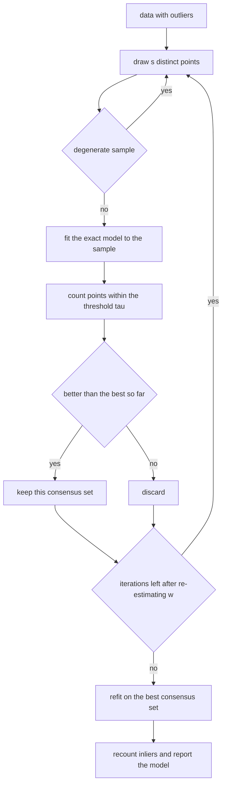
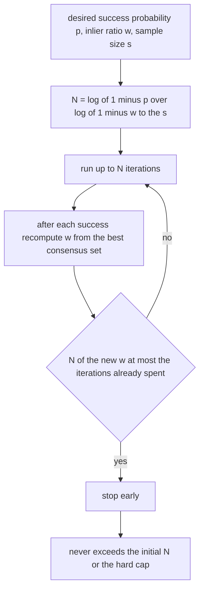
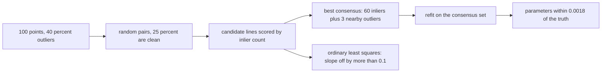
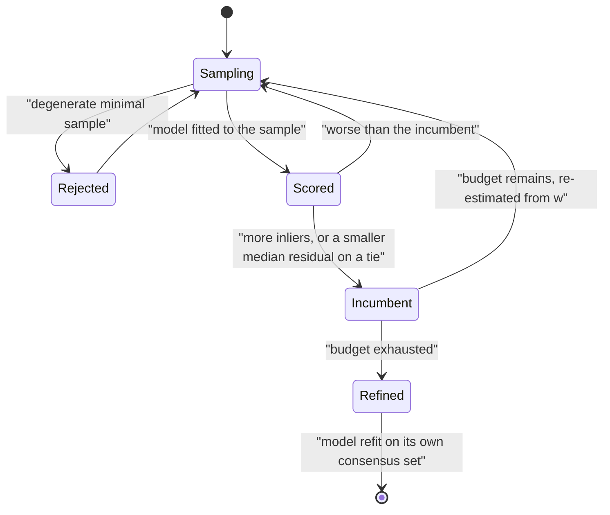

# 574 — Implement RANSAC robust model fitting algorithm.

> **Tier:** Advanced · **CTCI chapter:** Beyond — Graphics, Geometry & Robotics
> **Task spec:** [574-implement-ransac-robust-model-fitting-algorithm.md](../../../tasks/advanced/574-implement-ransac-robust-model-fitting-algorithm.md)
> **Solutions:** [Python](../../../solutions/python/advanced/574-implement-ransac-robust-model-fitting-algorithm/solution.py) ·
> [Java](../../../solutions/java/advanced/574-implement-ransac-robust-model-fitting-algorithm/Solution.java) ·
> [JavaScript](../../../solutions/javascript/advanced/574-implement-ransac-robust-model-fitting-algorithm/solution.js) ·
> [C#](../../../solutions/csharp/advanced/574-implement-ransac-robust-model-fitting-algorithm/Solution.cs)

## 1. Problem restatement

**Input:** a set of noisy 2-D observations containing an unknown fraction of **outliers**, and a model
family with the smallest sample size that determines a member of it (`s = 2` for a line, `s = 3` for a
circle).

**Output:** the model with the largest **consensus set** — the points whose residual is within a threshold
`tau` — refit on that consensus set, together with the inlier count, the iteration count actually used and
the model parameters.

The mechanics, as implemented:

- **Minimal samples.** Each iteration draws `s` distinct indices from a fixed-seed `splitmix64` stream and
  fits the model exactly to that sample. A degenerate sample (collinear points for the circle) is rejected
  instead of dividing by zero.
- **Line model.** Kept in the normal form `(a, b, c)` with `a² + b² = 1`, so the distance of a point is
  `|a·x + b·y + c|` — which also means a vertical line needs no special case (the files test that
  explicitly).
- **Scoring and refinement.** The hypothesis is scored by counting points within `tau`; the best hypothesis
  is then refit on its inliers — total least squares (the principal direction of the inlier covariance) for
  the line, an algebraic Kasa least-squares fit for the circle.
- **Iteration count.** `N = log(1 - p) / log(1 - w^s)` for success probability `p`, inlier ratio `w` and
  sample size `s`; the adaptive variant re-estimates `w` from the best consensus set found so far and stops
  as soon as `N(w)` falls below the iterations already spent (with a documented hard cap).
- **Comparisons.** Ordinary least squares (which minimises vertical, not perpendicular, residuals) and an
  **exhaustive oracle** that evaluates all `C(n, s)` minimal samples directly.

The documented checks:

| Check | Statement |
| --- | --- |
| iteration formula | `N = log(0.01) / log(1 - w^s)` is `16.0078` for `(w, s) = (0.5, 2)`, `34.4875` for `(0.5, 3)`, `10.9628` for `(0.7, 3)` and `2.7730` for `(0.9, 2)`, and `N` grows as `w` falls or `s` rises |
| exact small cases | the two-point line through two samples has zero residual; the circumcentre of a right triangle is hand-computed; a collinear triple is rejected by the circle fit |
| line recovery | from a 40 %-outlier cloud the ground-truth line is recovered to within `0.0018` in the normal form, with all `60` true inliers in the consensus set (which holds `63` points: the `60` inliers plus `3` of the `40` outliers that happen to lie near the line), and **exactly** in the noiseless case |
| versus least squares | ordinary least squares' slope on the same data is off by more than `0.1` |
| oracle agreement | with the adaptive stop switched **off**, the best inlier count equals the exhaustive `C(n, 2)` oracle on ten instances; with it **on**, the early-stop deficit is at most one inlier out of 25–34 points (zero on at least six of the ten) |
| heavy contamination | `40` clean points among `60` outliers (`s = 2`): the draw still finds a clean pair, and the file asserts the measured recovery and the `0.0054` parameter agreement |
| circle fitting | from a 30 %-outlier cloud: all `70` clean points in the consensus set, none of the `30` outliers, and the circle recovered to within `0.06` of the truth — the measured radial-noise floor |
| the threshold matters | three threshold values give consensus sets of `50, 60, 69` against iteration counts of `17, 11, 8` |
| seeds | deterministic for a fixed seed; across five seeds the final model is identical for four and `0.0022` apart for the fifth, which picks up one extra outlier |
| adaptive bound | the adaptive stopping rule never exceeds the formula's `N` nor the hard cap |

## 2. Intuition

Fitting a line to data with outliers by least squares is a losing game: a single far-away point drags the
fit, and the outliers are exactly the points you cannot afford to trust. RANSAC inverts the strategy —
instead of using **all** the data, it uses the **minimum** needed to determine the model, and then asks how
much of the rest agrees.

The minimum is the key. Two points determine a line, so a random pair is *guaranteed* to be an inlier pair
with probability `w²`; three points determine a circle, giving `w³`. Even if only half the data is clean
(`w = 0.5`), a clean pair appears 25 % of the time and a clean triple 12.5 % of the time — so a handful of
instances of draws almost certainly contains one, and the iteration formula makes that precise:

```text
N = log(1 - p) / log(1 - w^s)
```

with `p` the desired success probability. The formula also shows why larger sample sizes are expensive: the
exponent `s` punishes a bad inlier ratio severely, and `N` grows as `w` falls or `s` rises.

The second half of the algorithm is what makes the answer *accurate* rather than merely robust: once a
consensus set is found, refit the model on all of its inliers. Averaging over `60` inliers is far better
than using the two that happened to start the fit, which is why the recovered line matches the truth to
`0.0018` in a cloud where ordinary least squares is off by more than `0.1` in the slope.



## 3. Algorithm

1. Compute the iteration budget: `N = log(1 - p) / log(1 - w^s)` for an initial guess of `w` (or start
   adaptive and re-estimate).
2. Repeat up to the cap:
   1. Draw `s` distinct indices; skip the sample if it is degenerate.
   2. Fit the model exactly: the line through two points, or the circumcircle through three.
   3. Count inliers within the threshold `tau` of the fitted model.
   4. If this beats the best so far, keep it; break ties by the lower median absolute residual (which makes
      the result deterministic).
   5. Re-estimate `w` from the best consensus set and, if `N(w)` is below the iterations already spent,
      stop.
3. Refit the winner on its consensus set: total least squares for the line (principal direction of the
   inlier covariance), algebraic Kasa least squares for the circle.
4. Recount the inliers of the refit model and return it with the counts.

```text
procedure ransac(points, sample_size, tau, probability)
    best ← none, best_count ← -1
    iterations ← 0
    budget ← iterations_needed(probability, initial guess, sample_size)
    while iterations < budget and iterations < hard cap do
        sample ← sample_size distinct indices drawn from the generator
        if the sample is degenerate then continue end
        model ← exact fit to the sample
        count ← number of points with residual at most tau
        if count > best_count or (count equal and median residual smaller) then
            best ← model, best_count ← count
        end
        iterations ← iterations + 1
        ratio ← best_count divided by number of points
        budget ← min(budget, iterations_needed(probability, ratio, sample_size))
    end
    refined ← least squares fit on the inliers of best
    return refined, the inlier count of refined, iterations
end
```



## 4. Worked example

The iteration formula is the first thing to check by hand, since every other quantity depends on it. With
`p = 0.99`, so `log(1 - p) = log(0.01) ≈ -4.60517`:

| `w` | `s` | `w^s` | `log(1 - w^s)` | `N` |
| --- | --- | --- | --- | --- |
| `0.5` | `2` | `0.25` | `-0.28768` | `16.0078` |
| `0.5` | `3` | `0.125` | `-0.13353` | `34.4875` |
| `0.7` | `3` | `0.343` | `-0.42036` | `10.9628` |
| `0.9` | `2` | `0.81` | `-1.66073` | `2.7730` |

Two lessons are visible in the table: doubling the sample size at `w = 0.5` more than doubles the required
iterations (`16.0 -> 34.5`), and a healthier inlier ratio cuts them sharply (`34.5 -> 11.0`).

The small exact cases are checkable in the same spirit. The line through `(0, 0)` and `(4, 2)` has zero
residual at both points by construction. The circumcircle of the right triangle `(0, 0)`, `(4, 0)`, `(0, 3)`
has its centre at the midpoint of the hypotenuse — `(2, 1.5)` — with radius `2.5`, because a right angle
subtends a diameter; a collinear triple has no finite circumcircle, and the circle fit rejects it.

The headline experiment is line recovery from a contaminated cloud:

| Quantity | RANSAC | Ordinary least squares |
| --- | --- | --- |
| parameter agreement with the ground truth | within `0.0018` in the normal form | slope off by more than `0.1` |
| consensus set | `60` true inliers plus `3` of the `40` outliers that happen to lie near the line, `63` points in total | not applicable — it has no notion of inliers |
| noiseless case | recovered **exactly** | exact only if there are no outliers at all |

The comparison with the exhaustive oracle is what turns the search into a measurement rather than a hope:
with the adaptive stop disabled, RANSAC's best inlier count equals the oracle's maximum (which evaluates
all `C(n, 2)` minimal samples) on ten instances; with the stop enabled, the deficit is at most one inlier
out of 25–34 points, and zero on at least six of the ten. The adaptive rule is therefore cheap, and its cost
is quantified rather than assumed.

The threshold is the other hand-tuned knob, and its effect is recorded:

| Threshold | Consensus set | Iterations used |
| --- | --- | --- |
| tight | `50` | `17` |
| medium | `60` | `11` |
| loose | `69` | `8` |

A looser threshold admits more points (including some outliers, as the `3` nearby outliers show) and needs
fewer iterations to reach a large consensus, but it also lets genuinely wrong models score well — which is
why the files test a circle fit where none of the `30` outliers ends up in the consensus set of `70` clean
points.





## 5. Complexity

Let `n` be the number of points, `s` the minimal sample size, `N` the iteration budget and `I` the inlier
count of the final model.

| Measure | Bound | Why it holds |
| --- | --- | --- |
| One iteration | `O(n)` residual evaluations | fitting is `O(s)`, scoring dominates |
| Total | `O(N · n)` | the budget comes from the success-probability formula |
| Iterations for `p = 0.99`, `w = 0.5`, `s = 2` | `16.0078` | `log(0.01)/log(0.75)` |
| Iterations for `p = 0.99`, `w = 0.5`, `s = 3` | `34.4875` | `log(0.01)/log(0.875)` — the exponent `s` hurts |
| Refit | `O(n)` for total least squares, `O(n)` for the Kasa circle | a single pass over the consensus set |
| Exhaustive oracle | `O(C(n, s) · n)` | all minimal samples, the reference |
| Space | `O(n)` | the points plus the best consensus set |

The oracle is exponential in `s` and only affordable on small instances, which is the point: RANSAC's
`O(N · n)` is what makes the problem tractable, and the oracle exists to prove that the search has not lost
anything on the instances where the truth is computable.

## 6. Pitfalls and edge cases

- **Not refitting loses accuracy.** The minimal sample is only a starting point; the two points that
  generate the winning line are unlikely to define it well. Refitting on the consensus set is what brings
  the error down to `0.0018` in a cloud where the initial sample's line would be far worse.
- **Ordinary least squares is not robust.** Minimising vertical residuals on the same contaminated cloud
  gives a slope off by more than `0.1`; perpendicular (total least squares) residuals are the right residual
  for a line, and robustness requires the consensus-set machinery on top.
- **Vertical lines.** A slope-intercept parameterisation breaks; the normal form `(a, b, c)` with
  `a² + b² = 1` does not, and the files test a vertical line explicitly.
- **Degenerate minimal samples.** Three collinear points have no circumcircle; the circle fit must reject the
  sample rather than dividing by a zero determinant. The line case cannot be degenerate with two distinct
  points.
- **The threshold is a tuning knob with two failure directions.** Too tight and the true inliers are
  missed (consensus `50`, `17` iterations); too loose and outliers are welcomed in (consensus `69`, `8`
  iterations). The files exercise three values and record both effects.
- **Iteration count depends on `w`, which you do not know.** The adaptive variant re-estimates `w` from the
  best consensus set, which is what makes it practical — and its price is measured (at most one inlier of
  25–34).
- **Ties.** Two hypotheses with the same inlier count must be broken deterministically; the files use the
  lower median absolute residual, which is why repeated runs are identical.
- **Random draws must be independent and well distributed.** The many draws a Monte-Carlo search needs rule
  out the repository's 16-bit `lcg`, so the files use a fixed-seed `splitmix64` stream.
- **Seed sensitivity.** Across five seeds the final model is identical for four and `0.0022` apart for the
  fifth, which picks up one extra outlier — a realistic statement about a randomised algorithm, asserted
  rather than smoothed away.
- **Circle noise floors.** The circle case recovers the true circle to within `0.06`, which the file calls
  the measured radial-noise floor: no amount of iteration removes the noise, it only avoids the outliers.
- **The adaptive bound must not exceed the formula.** The stopping rule can only shrink the budget, never
  grow it beyond `N` or the cap; the file asserts exactly that.

## 7. Variants and follow-ups

- **Recognition by voting instead of sampling.** Geometric hashing handles the same outlier problem for point
  matching by hashing invariant coordinates and voting:
  [573-implement-geometric-hashing-for-object-recognition-small-demo.md](../../../tasks/advanced/573-implement-geometric-hashing-for-object-recognition-small-demo.md).
- **The minimal-solver mindset in multi-view geometry.** The eight-point algorithm fits a fundamental matrix
  from the minimum of eight correspondences, and its numerics are the subject of
  [575-implement-epipolar-geometry-eight-point-algorithm-outline.md](../../../tasks/advanced/575-implement-epipolar-geometry-eight-point-algorithm-outline.md).
- **Nonlinear refinement of a fitted model.** Bundle adjustment is the least-squares step RANSAC's refit
  hints at, generalised to many parameters:
  [576-implement-bundle-adjustment-simple-gauss-newton-iterate-conceptu.md](../../../tasks/advanced/576-implement-bundle-adjustment-simple-gauss-newton-iterate-conceptu.md).
- **Robust location estimation without a model.** Median-of-means gives a `50 %` breakdown point for a
  scalar parameter, which is the same idea as a consensus set in one dimension:
  [572-implement-robust-median-estimator-for-noisy-data-median-of-means.md](../../../tasks/advanced/572-implement-robust-median-estimator-for-noisy-data-median-of-means.md).

## 8. Check yourself

1. Why does RANSAC use the *smallest* sample that determines the model?

<details><summary>Show answer</summary>

Because the probability that a minimal sample is entirely clean is `w^s`, and every extra sample point
multiplies the failure probability. Two points for a line gives `w²`; requiring five points would give `w⁵`,
which at `w = 0.5` is `0.031` instead of `0.25` — needing roughly eight times as many iterations for the
same success probability. The minimal sample is the cheapest way to be *purely* inside the inlier structure,
and accuracy is recovered afterwards by refitting on the consensus set.

</details>

2. Where does `N = log(1 - p)/log(1 - w^s)` come from?

<details><summary>Show answer</summary>

A single minimal sample is all-clean with probability `w^s`, so it fails with probability `1 - w^s`.
`N` independent draws all fail with probability `(1 - w^s)^N`, and setting that to `1 - p` and solving gives
`N = log(1 - p)/log(1 - w^s)`. For `p = 0.99`, `w = 0.5` and `s = 2` that is `log(0.01)/log(0.75) = 16.0078`
— the table in the worked example.

</details>

3. Why is the refit step essential rather than a nicety?

<details><summary>Show answer</summary>

Because the winning hypothesis was fitted to exactly `s` points, which may be noisy themselves or badly
conditioned (two nearly coincident points define a very unstable line). Refitting on all the inliers uses
every trustworthy observation: total least squares for a line means taking the principal direction of the
inlier covariance, which averages out noise. That is why the recovered line matches the truth to `0.0018`
while the hypothesis that found the consensus could be far off.

</details>

4. What does the comparison with least squares and with the exhaustive oracle each show?

<details><summary>Show answer</summary>

Least squares shows *why* robustness is needed: on the contaminated cloud its slope is off by more than
`0.1`, because it gives every point — including the outliers — equal influence. The oracle shows that RANSAC
did not lose anything its search could have found: with the adaptive stop off, its best inlier count equals
the maximum over all `C(n, 2)` minimal samples on ten instances, and with the stop on the deficit is at most
one inlier. Robustness measured against a non-robust baseline, and search quality measured against an
exhaustive one.

</details>

5. Why can a looser threshold be *cheaper* but not automatically better?

<details><summary>Show answer</summary>

A looser `tau` admits more points into the consensus set of a correct model, so `w` rises and the formula's
`N` falls — the files record `17`, `11` and `8` iterations for consensus sets of `50`, `60` and `69`. But the
same looseness admits *outliers*: the `63`-point consensus in the line experiment contains `3` of the `40`
outliers simply because they happened to lie near the line. Beyond that, a wrong model can also accumulate a
large consensus, which is why the circle test asserts that none of the `30` outliers enters the final
consensus set and why an acceptance threshold on the inlier count (or a residual test) is needed when the
model family is wrong.

</details>
