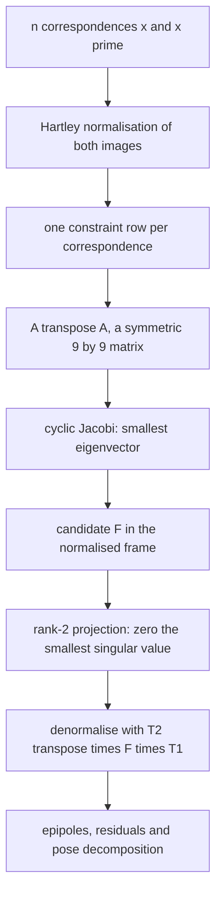
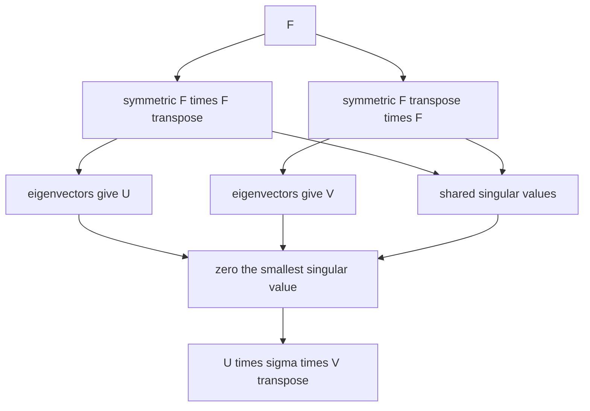
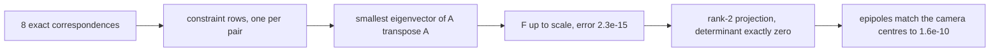
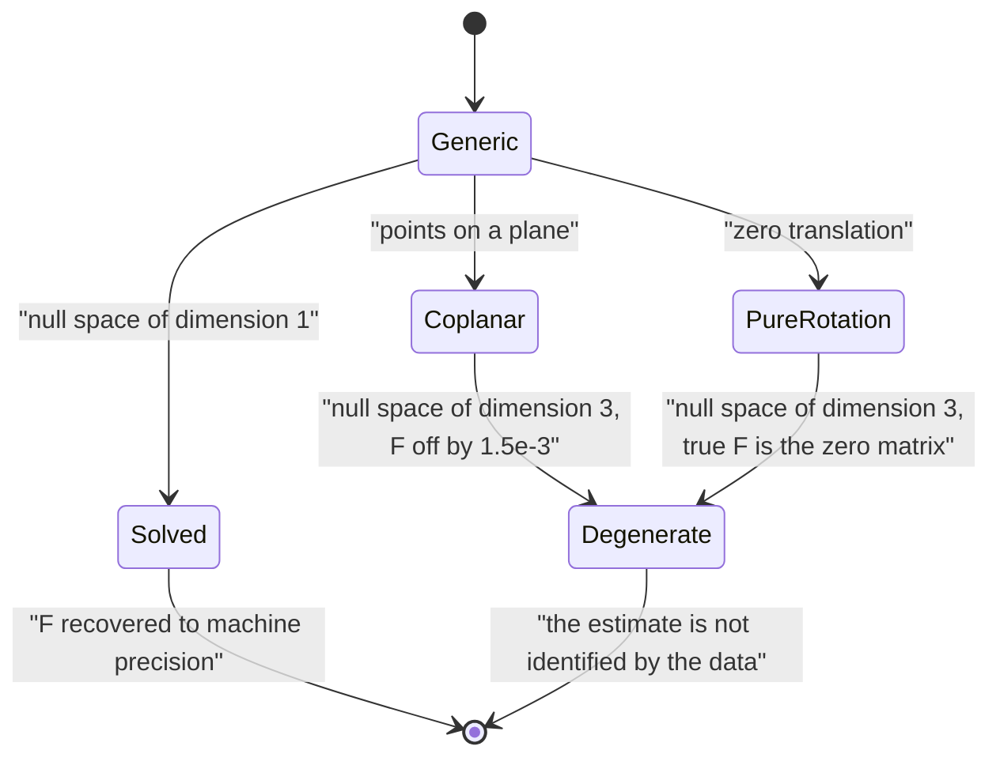

# 575 — Implement epipolar geometry eight-point algorithm outline.

> **Tier:** Advanced · **CTCI chapter:** Beyond — Graphics, Geometry & Robotics
> **Task spec:** [575-implement-epipolar-geometry-eight-point-algorithm-outline.md](../../../tasks/advanced/575-implement-epipolar-geometry-eight-point-algorithm-outline.md)
> **Solutions:** [Python](../../../solutions/python/advanced/575-implement-epipolar-geometry-eight-point-algorithm-outline/solution.py) ·
> [Java](../../../solutions/java/advanced/575-implement-epipolar-geometry-eight-point-algorithm-outline/Solution.java) ·
> [JavaScript](../../../solutions/javascript/advanced/575-implement-epipolar-geometry-eight-point-algorithm-outline/solution.js) ·
> [C#](../../../solutions/csharp/advanced/575-implement-epipolar-geometry-eight-point-algorithm-outline/Solution.cs)

## 1. Problem restatement

**Input:** `n >= 8` point correspondences `x <-> x'` between two calibrated views of a rigid scene.

**Output:** the **fundamental matrix** `F` (in the essential-matrix form for normalised camera
coordinates), satisfying the epipolar constraint `x'^T F x = 0` for every correspondence, plus the
reconstruction evidence: the epipoles, the epipolar residuals and the rank of the solution.

The spec says "outline", but every file implements the algorithm in full: the constraint matrix, the
eigen-decomposition, Hartley normalisation, the rank-2 projection and the pose decomposition.

1. **Constraint rows.** Each correspondence contributes one equation, so `A` gets the row
   `[x'x, x'y, x', y'x, y'y, y', x, y, 1]` and the vectorised `F` is the null vector of `A`.
2. **Null vector.** Taken from the eigen-decomposition of the symmetric `9 x 9` matrix `A^T A` — the
   eigenvector for the smallest eigenvalue — computed by **cyclic Jacobi rotations** written from scratch.
3. **Rank-2 projection.** The SVD is assembled from the two symmetric `3 x 3` eigen-decompositions of
   `F F^T` and `F^T F` (whose nonzero singular values coincide) and the smallest singular value is set to
   zero, which is the Frobenius-closest rank-2 matrix.
4. **Hartley isotropic normalisation.** Each image is translated to its centroid and scaled so the mean
   distance to the centroid is `sqrt(2)`; the solution is computed from the normalised points and
   denormalised as `F = T2^T · F_hat · T1`. Both the normalised and the unnormalised variants exist in the
   files so the difference can be **measured** rather than asserted from folklore.

The documented checks:

| Check | Measured value | Meaning |
| --- | --- | --- |
| eigensolver validation | `A v = lambda v`, orthonormal eigenvectors, `A = V diag(lambda) V^T` | the Jacobi core is verified before anything depends on it |
| exact recovery | with the eight exact correspondences of a calibrated 1200-pixel rig the normalised algorithm recovers the true `F` up to scale to `2.3e-15` | the regression-free case |
| rank of the raw solution | pre-projection singular values `0.7588, 0.6513, 3.34e-9` | the estimate is already numerically rank two |
| epipolar residuals | `|x'^T F x| <= 6e-14` | the constraint is satisfied |
| epipoles | agree with the projections of the camera centres to `1.6e-10`, and `F·e = 0` | the geometry, not just the algebra |
| over-determined noiseless systems | `12` and `40` correspondences reproduce the same error (`<= 1e-12`) | extra clean data does not hurt |
| SVD validation | the projection's determinant is zero and `||F - F_proj|| <= sigma3` | the projection is validated on its own terms |
| noise sweep | `0.5` px and `2` px noise on `8`, `12`, `30` correspondences: ratios of plain to normalised error `1.13, 1.36, 0.97, 7.13, 1.15, 1.08` | normalisation loses a little in one setting and wins by `7.1x` in another |
| honest assertion | the files assert only that both stay within `1e-4` and the ratio inside `[0.9, 10]` | not the textbook disaster story |
| rank-2 projection effect | on the noisy instance the maximum residual goes `1.27e-3 -> 1.55e-3` and the mean `4.70e-4 -> 4.75e-4` | the projection is **not** a residual reducer; the change is bounded |
| degeneracy, generic | `1`-dimensional null space | the intended case |
| degeneracy, coplanar | `3`-dimensional null space, and the recovered `F` is `1.5e-3` from the truth — nine orders of magnitude worse than the generic exact case | the classic planar degeneracy |
| degeneracy, pure rotation | `3`-dimensional null space as well | `t = 0` makes the true `F` the zero matrix |
| determinism | repeated runs are identical | fixed-seed `splitmix64` and deterministic algebra |

## 2. Intuition

Two views of a rigid scene are related by the epipolar constraint: for every correspondence,
`x'^T F x = 0`. That is one scalar equation per correspondence, **linear** in the nine entries of `F` — so
eight correspondences give eight homogeneous equations, and the ninth degree of freedom is the arbitrary
scale of `F`. The whole algorithm is therefore: assemble a matrix, find its one-dimensional null space.

Three practical details turn the textbook observation into something that works:

- **Least squares instead of an exact solve.** With more than eight correspondences (or any noise) `A` has
  no exact null vector, so the right answer is the unit vector minimising `||A f||`, which is the
  eigenvector of `A^T A` with the smallest eigenvalue. That is a symmetric eigen-problem, solvable by
  Jacobi rotations without any external linear algebra library.
- **Rank-2 projection.** A fundamental matrix must have rank two (its epipole is its null vector). The raw
  eigenvector estimate is full rank in general, so it is projected onto the rank-2 matrices by zeroing the
  smallest singular value — which is the closest such matrix in the Frobenius norm. The file measures
  whether that actually helps (it does not, on its instances) rather than assuming it.
- **Hartley normalisation.** Raw pixel coordinates are large and badly conditioned, so each image is
  translated to its centroid and scaled to mean distance `sqrt(2)`; solving on the normalised data and
  denormalising with `F = T2^T F_hat T1` conditions the problem. The file keeps both variants, because
  the improvement depends on the instance far more than the folklore suggests.



## 3. Algorithm

1. **Normalise** (when enabled): translate each image's points to their centroid, scale so the mean distance
   to the centroid is `sqrt(2)`, and record the two `3 x 3` transforms `T1`, `T2`.
2. **Assemble** the constraint matrix: one row `[x'x, x'y, x', y'x, y'y, y', x, y, 1]` per correspondence.
3. **Solve** for the null vector: form `A^T A`, diagonalise it with cyclic Jacobi rotations, and take the
   eigenvector of the smallest eigenvalue as `vec(F)`.
4. **Project to rank 2**: compute the eigen-decomposition of `F F^T` and `F^T F`, assemble the SVD from
   them, set the smallest singular value to zero, and recompose.
5. **Denormalise**: `F = T2^T · F_hat · T1`.
6. **Read off the geometry**: the epipoles from the null vectors of `F` and `F^T`, the epipolar residuals
   `|x'^T F x|`, the singular values and the null-space dimension of `A`.

```text
procedure eight_point(correspondences, normalise)
    if normalise then
        T1 ← centroid and scale transform of the first image
        T2 ← centroid and scale transform of the second image
        apply them to the correspondences
    end
    A ← one row [x'x, x'y, x', y'x, y'y, y', x, y, 1] per correspondence
    values, vectors ← jacobi_eigh(A transposed times A)
    f ← the eigenvector of the smallest eigenvalue
    F ← 3 by 3 matrix from f
    F ← project_rank_two(F)
    if normalise then F ← T2 transposed times F times T1 end
    return F, singular values, epipoles, residuals
end

procedure project_rank_two(F)
    values1, vectors1 ← jacobi_eigh(F times F transposed)
    values2, vectors2 ← jacobi_eigh(F transposed times F)
    U ← the eigenvectors of F F transposed, V ← the eigenvectors of F transposed F
    sigma ← sorted singular values, largest first
    set the smallest sigma to zero
    return U times diagonal of sigma times V transposed
end
```

The SVD-from-two-eigen-decompositions step is not a curiosity: for a `3 x 3` matrix, `F F^T` and `F^T F`
are symmetric, their eigenvectors give the left and right singular vectors, and their common eigenvalues are
the squared singular values. Using that identity keeps the whole pipeline inside one eigensolver — which is
also why the eigensolver is validated first (`A v = lambda v`, orthonormal eigenvectors, reconstruction).



## 4. Worked example

The constraint row is small enough to write by hand. For a correspondence `x = (x, y)`, `x' = (x', y')` the
row is `[x'x, x'y, x', y'x, y'y, y', x, y, 1]`:

| Correspondence | Row of `A` |
| --- | --- |
| `x = (0, 0)`, `x' = (0, 0)` | `[0, 0, 0, 0, 0, 0, 0, 0, 1]` |
| `x = (1, 2)`, `x' = (3, 4)` | `[3, 6, 3, 4, 8, 4, 1, 2, 1]` |

For `F` with entries `f11 ... f33` the constraint `x'^T F x = 0` expands to exactly the dot product of that
row with `vec(F)`, so eight correspondences give eight homogeneous equations in nine unknowns — one degree
of freedom, the scale of `F`.

The exact recovery measurements on the calibrated 1200-pixel rig:

| Quantity | Value | Interpretation |
| --- | --- | --- |
| error of the recovered `F` against the truth, up to scale | `2.3e-15` | machine precision: the noiseless case is solved exactly |
| pre-projection singular values of the estimate | `0.7588, 0.6513, 3.34e-9` | the raw eigenvector is already numerically rank two |
| `|x'^T F x|` over the eight correspondences | at most `6e-14` | the constraint holds |
| epipole agreement with the camera-centre projections | `1.6e-10` | the geometry, not only the algebra |
| `12` and `40` noiseless correspondences | error `<= 1e-12` | extra clean data does not degrade the fit |

The interesting part is where the folklore fails. The noise sweep records the ratio of the unnormalised
error to the normalised error:

| Setting | Ratio (plain / normalised) |
| --- | --- |
| `8` correspondences, `0.5` px | `1.13` |
| `12` correspondences, `0.5` px | `1.36` |
| `30` correspondences, `0.5` px | `0.97` — normalisation **loses** slightly |
| `8` correspondences, `2` px | `7.13` — normalisation wins big |
| `12` correspondences, `2` px | `1.15` |
| `30` correspondences, `2` px | `1.08` |

So normalisation is not a universal rescue; it matters most when the system is barely determined and the
noise is large (`7.13x`), and it can cost a little when there is plenty of data (`0.97`). The file asserts
what it measured: both errors within `1e-4` and the ratio inside `[0.9, 10]`.

The rank-2 projection is the other measured surprise:

| Quantity | Before projection | After projection |
| --- | --- | --- |
| maximum epipolar residual (noisy instance) | `1.27e-3` | `1.55e-3` |
| mean epipolar residual | `4.70e-4` | `4.75e-4` |
| determinant | `3.34e-9` (numerically rank two already) | exactly `0` |
| distance to the projected matrix | — | bounded by `sigma3` |

The projection enforces the *structural* constraint (a true `F` is rank two) but does not reduce residuals —
it is the Frobenius-closest rank-2 matrix, which can only move away from the least-squares optimum. The file
asserts a bounded change, with the classic bound `||F - F_proj|| <= sigma3` verified separately.





## 5. Complexity

Let `n` be the number of correspondences.

| Measure | Cost | Why it holds |
| --- | --- | --- |
| Normalisation | `O(n)` | one centroid and scale per image |
| Constraint matrix | `O(n)` rows of nine entries | one row per correspondence |
| `A^T A` | `O(9² · n)` | a `9 x 9` Gram matrix over `n` rows |
| Jacobi on `9 x 9` | `O(s · 9³)` per sweep, `s` sweeps | `s` is the sweep count until the off-diagonal norm is below tolerance |
| Rank-2 projection | `O(3³)` | two `3 x 3` eigen-decompositions and a recomposition |
| Denormalisation | `O(1)` | two `3 x 3` products |
| Total | `O(n + s · 9³)` | *linear* in the number of correspondences |
| Space | `O(n + 1)` | the rows (or the Gram matrix) plus the `9 x 9` working matrix |

The algorithm is linear in the number of correspondences and constant in the matrix size — hence the name
"eight-point": the linear system is exactly determined by eight correspondences, and everything beyond that
is averaging. The expensive part is the eigensolver's constant, which is why the file uses Jacobi with a
documented sweep cap and validates it before use.

## 6. Pitfalls and edge cases

- **Rank deficiency.** A fundamental matrix has rank two by construction (its null vector is the epipole), so
  a full-rank estimate is inconsistent with the geometry. The projection zeroes the smallest singular value
  and the file validates both its determinant and the bound `||F - F_proj|| <= sigma3`.
- **The projection is not an accuracy improvement.** On the noisy instance it *increases* the maximum
  epipolar residual from `1.27e-3` to `1.55e-3`. It enforces structure, not fit; asserting that it reduces
  residuals would be wrong, and the file asserts a bounded change instead.
- **Planar scenes.** When all points lie on a plane the null space becomes three-dimensional, the estimate is
  no longer identified by the data, and the recovered `F` is `1.5e-3` from the truth — nine orders of
  magnitude worse than the generic exact case. Homography-based methods exist precisely for this case.
- **Pure rotation.** With zero translation the true `F` is the zero matrix and the epipolar constraint is
  degenerate; the file measures the three-dimensional null space rather than pretending the instance is
  well posed.
- **Normalisation is not magic.** The measured ratios (`0.97` to `7.13`) show that it helps mainly when the
  system is barely determined and the noise is large. It also changes the problem's conditioning rather than
  the data's information content, so an over-determined clean system gains nothing.
- **Pixel scale and conditioning.** Raw pixel coordinates differ by orders of magnitude between the two
  images' axes; without normalisation the Gram matrix `A^T A` is poorly conditioned, which is exactly the
  motivation for Hartley's isotropic scaling to a mean distance of `sqrt(2)`.
- **Degenerate correspondences.** Duplicate points, or any configuration leaving `A` rank-deficient beyond
  the expected one dimension, invalidates the eigenvector. The files measure the null-space dimension
  explicitly so this is a diagnostic rather than a silent failure.
- **Eight is the minimum, not the target.** With exactly eight noiseless correspondences the solution is
  exact; with noisy data more correspondences average the noise, which the over-determined checks
  (`12` and `40`) confirm.
- **The pose decomposition.** Reading the camera pose from `F` is a further step with a four-fold ambiguity;
  the C# file implements the classical decompositions, and the checks that matter here are the epipolar ones
  and the epipole agreement.
- **Eigensolver trust.** Jacobi rotations are validated first (`A v = lambda v`, orthonormal eigenvectors,
  reconstruction), because a wrong eigenvector makes every subsequent measurement meaningless.

## 7. Variants and follow-ups

- **Robust correspondence selection.** The eight-point algorithm needs clean correspondences; RANSAC supplies
  them by sampling minimal sets and counting inliers against the epipolar residual:
  [574-implement-ransac-robust-model-fitting-algorithm.md](../../../tasks/advanced/574-implement-ransac-robust-model-fitting-algorithm.md).
- **Nonlinear refinement.** The linear estimate is usually refined by minimising the epipolar residuals
  directly, which is the same Gauss–Newton style least-squares step as
  [576-implement-bundle-adjustment-simple-gauss-newton-iterate-conceptu.md](../../../tasks/advanced/576-implement-bundle-adjustment-simple-gauss-newton-iterate-conceptu.md).
- **Invariant descriptors for the correspondences themselves.** Geometric hashing produces point matches
  under similarity transforms without recovering epipolar geometry:
  [573-implement-geometric-hashing-for-object-recognition-small-demo.md](../../../tasks/advanced/573-implement-geometric-hashing-for-object-recognition-small-demo.md).
- **Numerical conditioning as a topic.** The normalisation measurement here is the practical face of the
  conditioning questions that also decide how the rational solvers of
  [562-implement-mixed-integer-programming-small-model-using-branch-and.md](../../../tasks/advanced/562-implement-mixed-integer-programming-small-model-using-branch-and.md)
  behave.

## 8. Check yourself

1. Why does one correspondence give one linear equation for `F`?

<details><summary>Show answer</summary>

Because `x'^T F x = 0` expands into a sum of nine products of `F`'s entries with the monomials
`x'x, x'y, x', y'x, y'y, y', x, y, 1` — one product per entry, and every monomial is known from the
correspondence. So the equation is linear in `vec(F)` with those nine monomials as coefficients, which is why
the worked example's row `[3, 6, 3, 4, 8, 4, 1, 2, 1]` can be written down directly.

</details>

2. Why is the null vector of `A` obtained from the smallest eigenvector of `A^T A`?

<details><summary>Show answer</summary>

All solutions of `A f = 0` are null vectors of `A`, and the squared norm of a null-space vector is
`||A f||² = f^T A^T A f`, so minimising the residual means finding the unit vector minimising
`f^T A^T A f` — the eigenvector of `A^T A` with the smallest eigenvalue. With eight exact correspondences that
residual is zero; with noise it is the least-squares answer. `A^T A` is symmetric, so Jacobi rotations solve
it without any external linear algebra.

</details>

3. The rank-2 projection makes the residual *worse* on the noisy instance. Why do it anyway?

<details><summary>Show answer</summary>

Because a fundamental matrix is mathematically required to have rank two: its null vector is the epipole, and
a full-rank estimate cannot correspond to any pair of cameras. The projection enforces the structure, and the
Frobenius-closest rank-2 matrix is the minimum-distortion way to do it — but it is a constraint, not a
refinement of the fit, so residuals can grow slightly (`1.27e-3 -> 1.55e-3` on that instance). The file
asserts the bounded change and verifies the classic bound `||F - F_proj|| <= sigma3`.

</details>

4. When does Hartley normalisation actually help?

<details><summary>Show answer</summary>

When the linear system is barely determined and the noise is large. The measured ratios of unnormalised to
normalised error are `1.13, 1.36, 0.97, 7.13, 1.15, 1.08`: the `7.13` appears at eight correspondences with
`2` px noise (the worst conditioning and the least data), while at thirty correspondences with `0.5` px the
ratio is `0.97` — normalisation slightly *costs*. So the honest statement is "normalisation conditions the
system", not "normalisation always improves the fit", and the file asserts only that both variants stay
within `1e-4` and the ratio inside `[0.9, 10]`.

</details>

5. What do the two degeneracies have in common?

<details><summary>Show answer</summary>

Both make the null space of `A` more than one-dimensional, which means the data do not identify a unique
fundamental matrix. Coplanar points give a three-dimensional null space (a homography absorbs the
correspondences, and the recovered `F` is `1.5e-3` from the truth — nine orders of magnitude worse than the
generic exact case), and a pure rotation gives one too, because with `t = 0` the true `F` is the zero matrix
and the epipolar constraint degenerates. The file measures the null-space dimension in each case, which
turns "this instance is degenerate" into a diagnostic number.

</details>
