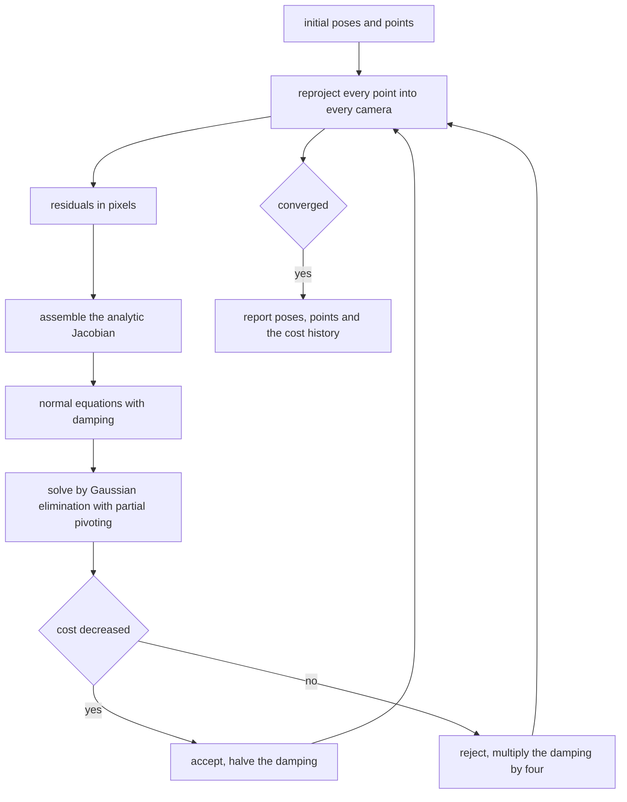
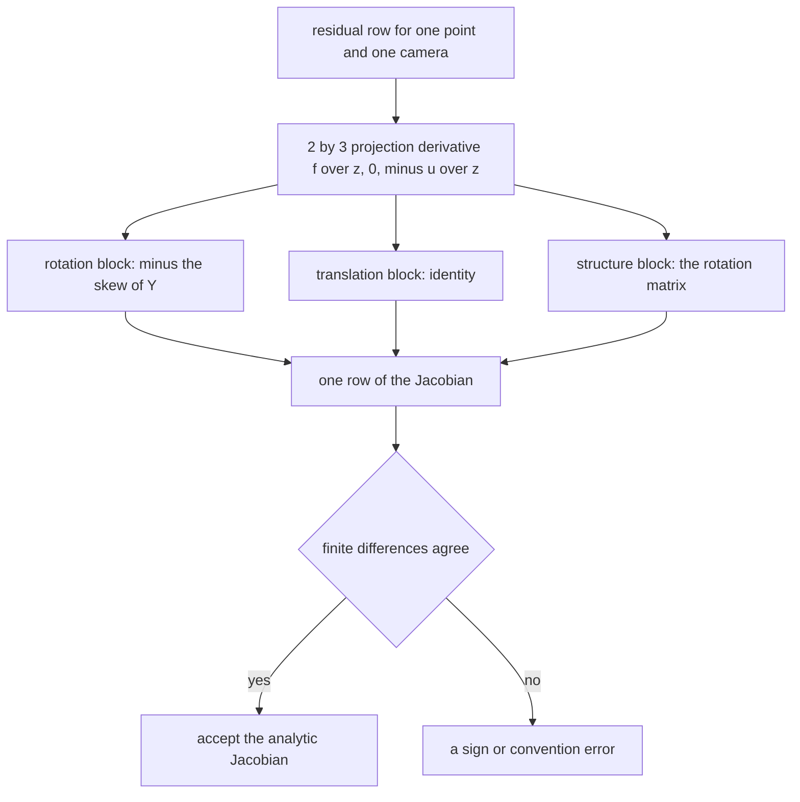
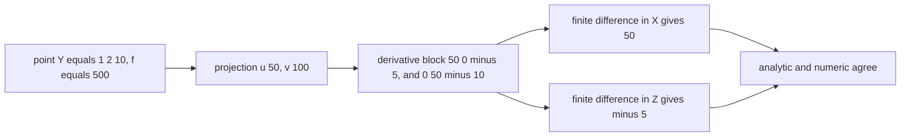
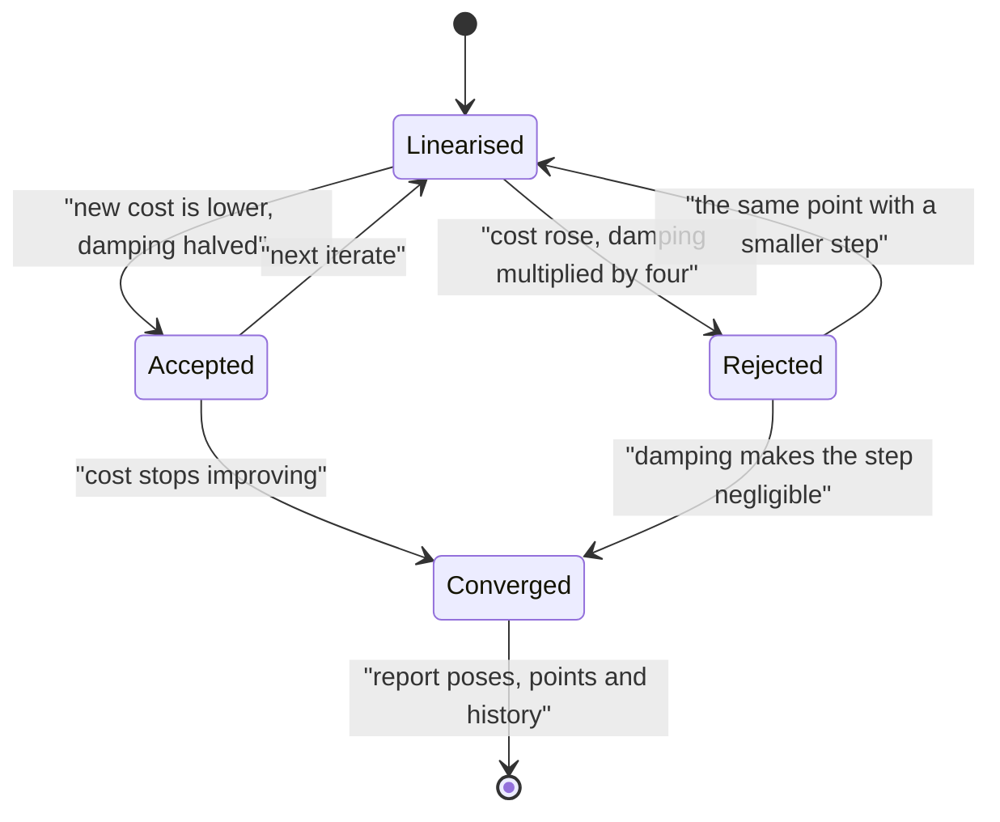

# 576 — Implement bundle adjustment simple Gauss-Newton iterate (conceptual).

> **Tier:** Advanced · **CTCI chapter:** Beyond — Graphics, Geometry & Robotics
> **Task spec:** [576-implement-bundle-adjustment-simple-gauss-newton-iterate-conceptu.md](../../../tasks/advanced/576-implement-bundle-adjustment-simple-gauss-newton-iterate-conceptu.md)
> **Solutions:** [Python](../../../solutions/python/advanced/576-implement-bundle-adjustment-simple-gauss-newton-iterate-conceptu/solution.py) ·
> [Java](../../../solutions/java/advanced/576-implement-bundle-adjustment-simple-gauss-newton-iterate-conceptu/Solution.java) ·
> [JavaScript](../../../solutions/javascript/advanced/576-implement-bundle-adjustment-simple-gauss-newton-iterate-conceptu/solution.js) ·
> [C#](../../../solutions/csharp/advanced/576-implement-bundle-adjustment-simple-gauss-newton-iterate-conceptu/Solution.cs)

## 1. Problem restatement

**Input:** a set of pinhole cameras with fixed intrinsics, a set of 3-D points, and observed image
positions for every (camera, point) pair.

**Output:** the camera poses and 3-D coordinates minimising the sum of squared **reprojection** residuals,
computed by Gauss–Newton (or Levenberg–Marquardt) on the normal equations — with the analytic Jacobian,
the gauge freedom and the damping behaviour all measured rather than assumed.

The concrete instances:

| Setting | Python | JavaScript |
| --- | --- | --- |
| cameras | `3` pinholes at `900`-pixel focal length | `4` with `K = [[800, 0, 320], [0, 800, 240], [0, 0, 1]]` |
| points | `7`, spread over `2` to `6` units of depth, baseline `1.3` | `12` |
| free unknowns | `33` (the first camera's `6` pose parameters are anchored) | `51` |
| residuals | `42` | — |
| parameterisation | Rodrigues rotation vector carrying the increment, plus translation | Rodrigues vectors |
| update | `R <- exp([delta]_x) · R` (left-multiplied) | the same convention |

The residual is the projection difference `pi(K(R X + t)) - observation` in pixels, and the Jacobian is
assembled analytically from the `2 x 3` block

```text
dpi/dY = [[f, 0, cx - u], [0, f, cy - v]] / z      with Y = R X + t
```

giving the rotation block `-dpi/dY · [Y]_x`, the translation block `dpi/dY` and the structure block
`dpi/dY · R`. The left-multiplied rotation increment is exactly what the `-[R X]_x` block encodes. The step
solves `(J^T J + lambda·diag(J^T J)) · delta = -J^T r` by dense Gaussian elimination with partial pivoting;
`lambda = 0` makes the same loop a plain Gauss–Newton iterate, accepted steps halve the damping and rejected
ones multiply it by four.

The documented checks:

| Check | Measured value | Meaning |
| --- | --- | --- |
| Jacobian | analytic blocks agree with central finite differences over all `33` free parameters (`42` residual rows) to `1e-6`, worst entry reported, and an anchored camera's rows are exactly zero | the derivative is verified before it is trusted |
| normal equations | the solved step satisfies the damped equations to `1e-9` | the linear solve is validated |
| noiseless convergence | from a `0.05`-perturbed start the cost falls below `1e-18`; both free poses and all seven points are recovered to `1e-6`; the anchored camera is untouched; `J^T r = 0` to `1e-9` | the optimum, and the first-order condition |
| cost history | non-increasing at every accepted step, with the accepted and rejected counts recorded | monotone descent is asserted, not hoped |
| noise | under `0.5` px noise the cost stops at the noise floor while the pose error still improves | the right stopping behaviour |
| gauge, unanchored | with every camera free the cost still reaches `1e-18` **while** the poses drift from the truth by a global rigid motion | the gauge freedom, demonstrated |
| gauge, scale | the anchored fit comes out `1.019x` too large | the seventh gauge direction (overall scale) is unobservable from pixels |
| damping, `0.3` perturbation | Levenberg–Marquardt reaches `6.0e-26` after `19` accepted steps, while plain Gauss–Newton accepts one step, overshoots, and stalls at `1.56e5` | the difference is the damping |
| honest limit | from a `1.2` perturbation **both** fail (LM stalls at `1.3e4`) | convergence is local |
| determinism | the whole optimisation and the sample generator are reproducible | fixed-seed `splitmix64` |

## 2. Intuition

Bundle adjustment is least squares over a parameter vector that mixes rotation, translation and structure.
The mechanics are the standard ones — linearise the residuals, solve for a step, repeat — but three details
decide whether it works:

- **What the derivatives are.** Each residual is a projection, so the chain rule runs
  point in world coordinates → camera coordinates → image coordinates. Written out, the derivative of the
  projection with respect to camera coordinates is a `2 x 3` block whose entries are `f / z`, `0`, `-u / z`
  and `0`, `f / z`, `-v / z` — geometry that can be checked with a finite difference in one line.
- **How rotations are parameterised.** A rotation is a `3 x 3` matrix but the increment must be three
  numbers, so the update left-multiplies a small rotation: `R <- exp([delta]_x) · R`. That convention is what
  makes the rotation block `-[R X]_x`, and getting the convention and the block inconsistent is the classic
  way to make the Jacobian subtly wrong (which is why the file compares it against finite differences on
  every parameter).
- **What the problem does not determine.** The reprojection error is invariant under a global rigid motion
  of the whole scene, and — with the anchored camera at the origin — also under a global scale. That is the
  **gauge freedom**, and it is why an unconstrained fit can drive the residual to `1e-18` while the poses are
  nowhere near the truth. The files demonstrate this instead of hiding it.



## 3. Algorithm

1. **Parameterise.** Six parameters per camera (a Rodrigues rotation vector for the left-multiplied
   increment plus a translation) and three per point; anchor one camera to fix six of the seven gauge
   degrees of freedom.
2. **Residuals.** For every (camera, point) pair compute `pi(K(R X + t)) - observation`, stacked into a
   residual vector.
3. **Jacobian.** For each residual row, multiply the analytic `2 x 3` projection block by the rotation block
   `-[Y]_x`, the translation block (the identity in camera coordinates) and the structure block `R`.
4. **Normal equations.** Form `J^T J` and `J^T r`, add the damping `lambda·diag(J^T J)`, and solve by dense
   Gaussian elimination with partial pivoting.
5. **Update.** Apply the increments with the left-multiplied rotation `R <- exp([delta]_x) · R` and add the
   translation and structure increments; recompute the cost.
6. **Accept or reject.** An accepted step halves the damping, a rejected one multiplies it by four; repeat
   until the cost stops improving.

```text
procedure bundle_adjustment(cameras, points, observations, lambda)
    repeat
        residuals ← empty, jacobian ← empty
        for each camera and each point do
            Y ← rotation of the camera applied to the point plus its translation
            projection ← pi(K Y)
            append the difference from the observation to residuals
            append the analytic blocks (rotation, translation, structure) to jacobian
        end
        JtJ ← jacobian transposed times jacobian
        Jtr ← jacobian transposed times residuals
        solve (JtJ + lambda times diagonal of JtJ) delta = minus Jtr
        apply delta: rotations left-multiplied by exp of the skew of the increment
        if the new cost is lower then
            accept the step and halve lambda
        else
            undo the step and multiply lambda by four
        end
    until the cost stops improving
    return poses, points, cost history
end
```



## 4. Worked example

The projection derivative is small enough to verify by hand. Take a camera with focal length `f = 500` and
principal point at the origin, and a point in camera coordinates `Y = (1, 2, 10)`:

```text
projection:  u = f X / Z = 500 * 1 / 10 = 50        v = f Y / Z = 500 * 2 / 10 = 100
derivative:  dprojection/dY = [[f, 0, cx - u], [0, f, cy - v]] / z
                            = [[500, 0, -50], [0, 500, -100]] / 10
                            = [[50, 0, -5], [0, 50, -10]]
```

Check the entries with a finite difference: moving `X` by `0.001` changes `u` by `500 · 0.001 / 10 = 0.05`,
so the derivative is `50`, matching the first entry; moving `Z` by `0.001` changes `u` to
`500 · 1 / 10.001 = 49.995`, i.e. by `-0.005`, a derivative of `-5`, matching the third entry — which is
exactly `-u / z`. That is the same check the file performs for all `33` free parameters at once, by central
differences on `42` residual rows, agreeing to `1e-6` and reporting the worst entry.

The dimensions of the Python instance add up in the same elementary way:

| Quantity | Count | Derivation |
| --- | --- | --- |
| camera pose parameters | `18` | `3` cameras times `6` |
| point parameters | `21` | `7` points times `3` |
| free unknowns | `33` | `39 - 6` after anchoring the first camera |
| reprojection residuals | `42` | `3` cameras times `7` points times `2` components |
| gauge degrees of freedom | `7` | `3` rotation, `3` translation, `1` scale — of which anchoring fixes six |

The last row is why the outcomes below need care:

| Experiment | Cost | Pose/point accuracy | Note |
| --- | --- | --- | --- |
| noiseless, `0.05`-perturbed start | below `1e-18` | both free poses and all seven points to `1e-6`, anchored camera untouched, `J^T r = 0` to `1e-9` | the intended optimum |
| `0.5` px noise | stalls at the noise floor | pose error still improves | correct stopping behaviour |
| unanchored, noiseless | below `1e-18` | drifts from the truth by a global rigid motion | the gauge freedom: a small cost does not imply correct poses |
| anchored, noiseless | below `1e-18` | recovered after the measured `1.019x` scale drift is aligned | the seventh gauge direction is unobservable from pixels |

The damping comparison is the practical lesson:

| Perturbation | Levenberg–Marquardt | Plain Gauss–Newton |
| --- | --- | --- |
| `0.05` | converges (`< 1e-18`) | converges (`< 1e-18`) |
| `0.3` | `6.0e-26` after `19` accepted steps | accepts one step, overshoots, stalls at `1.56e5` |
| `1.2` | stalls at `1.3e4` | fails |

Both methods succeed from a good start, so the damping is not needed for easy instances — the difference
appears at `0.3`, where the raw step is too large and only the damped step survives, and then disappears
again at `1.2`, where both fail: Gauss–Newton-type methods are **local**, and the file asserts the limit as
well as the success.





## 5. Complexity

Let `C` be the number of cameras, `P` the number of points, `N = C·P` the number of residual pairs and
`u = 6C + 3P` the number of free unknowns.

| Measure | Cost | Why it holds |
| --- | --- | --- |
| Residuals | `O(N)` | one projection per pair |
| Jacobian | `O(N · 2 · (6 + 3))` | two rows per pair, each with a pose and a structure block |
| Normal equations | `O(N · 9²)` in the dense formulation | each row touches at most `6 + 3` columns |
| Dense solve | `O(u³)` | Gaussian elimination with partial pivoting |
| One iteration | `O(N + u³)` | the solve dominates for large `u` |
| Iterations | data-dependent; `19` accepted steps in the `0.3` experiment | damping makes the search local but reliable |
| Space | `O(N + u²)` | the Jacobian and the normal matrix |

The cubic solve is what makes real bundle adjustment expensive and why production systems exploit the
sparsity of `J^T J` (structure and poses decouple over small blocks). The files solve densely because the
instances are tiny — 33 or 51 unknowns — which keeps the focus on the derivatives, the gauge freedom and the
damping behaviour, the three things that actually decide whether a bundle adjustment converges.

## 6. Pitfalls and edge cases

- **A wrong Jacobian looks like slow convergence.** An inconsistent derivative still *decreases* the cost
  sometimes, which is why the file compares the analytic Jacobian against central finite differences over
  every free parameter and reports the worst entry. Finite differences are too expensive for real use and
  indispensable as a test.
- **Rotation parameterisation and its derivative must match.** With the left-multiplied convention
  `R <- exp([delta]_x) R` the rotation block is `-[R X]_x`; mixing conventions (for instance using the
  right-multiplied block with the left-multiplied update) yields a Jacobian that is wrong in a way that only
  shows up as stalled convergence.
- **Gauge freedom.** A small residual does not imply correct poses: with every camera free the cost reaches
  `1e-18` while the solution drifts by a global rigid motion. Anchoring one camera fixes six of the seven
  gauge directions, and the seventh — the overall scale — is only unobservable because the anchored camera
  sits at the origin; the file measures the resulting `1.019x` size error and aligns it before comparing.
- **Absolute damping is useless here.** The normal matrix mixes focal-length-scaled pose entries with unit
  translations, so a fixed `lambda` is far too large for one group and far too small for the other; the
  damping is therefore relative to each parameter's own curvature (`lambda·diag(J^T J)`), which is what
  makes it scale-free.
- **Noise changes the stopping point, not the method.** Under `0.5` px of noise the cost bottoms out at the
  noise floor while the pose error continues to improve; stopping at the first flat step would be premature,
  which is why the loop is driven by improvement in cost rather than a fixed iteration count.
- **Convergence is local.** Both methods fail from a `1.2` perturbation. Good initialisation (from, say, a
  RANSAC-driven relative pose) is as important as the iteration itself, and the file asserts the failure
  rather than only reporting the successes.
- **Determinism.** Sample data come from a fixed-seed `splitmix64` stream, so the reported costs, step counts
  and accuracies are reproducible; the file asserts determinism of both the optimisation and the generator.

## 7. Variants and follow-ups

- **Initialisation from correspondences.** Bundle adjustment starts from an estimate; the eight-point
  algorithm supplies the relative pose and the epipolar geometry:
  [575-implement-epipolar-geometry-eight-point-algorithm-outline.md](../../../tasks/advanced/575-implement-epipolar-geometry-eight-point-algorithm-outline.md).
- **Robustness to wrong correspondences.** Outliers have to be removed before least squares is meaningful,
  which is what RANSAC does:
  [574-implement-ransac-robust-model-fitting-algorithm.md](../../../tasks/advanced/574-implement-ransac-robust-model-fitting-algorithm.md).
- **Invariant matching instead of iterative refinement.** Geometric hashing matches whole point patterns
  without any optimisation, which is the alternative when the transformation is close to a similarity:
  [573-implement-geometric-hashing-for-object-recognition-small-demo.md](../../../tasks/advanced/573-implement-geometric-hashing-for-object-recognition-small-demo.md).
- **Least squares with structure.** The normal equations here are the same `J^T J` framework used by the
  numeric solvers in
  [572-implement-robust-median-estimator-for-noisy-data-median-of-means.md](../../../tasks/advanced/572-implement-robust-median-estimator-for-noisy-data-median-of-means.md)'s
  statistical companions and by
  [570-implement-linear-programming-simplex-pivot-demonstration.md](../../../tasks/advanced/570-implement-linear-programming-simplex-pivot-demonstration.md)'s
  exact linear algebra.

## 8. Check yourself

1. Where does the reprojection Jacobian come from, and how do you check it in one line?

<details><summary>Show answer</summary>

From the chain rule: a residual depends on the point's camera coordinates `Y = R X + t`, and the projection
`(u, v) = (f X/Z, f Y/Z)` has the `2 x 3` derivative `[[f, 0, -u], [0, f, -v]] / z` (in the general
principal-point form `[[f, 0, cx - u], [0, f, cy - v]] / z`). Multiplying by the derivative of `Y` in each
parameter group gives the rotation, translation and structure blocks. It is checkable by nudging one
parameter: in the worked example, moving `X` by `0.001` changes `u` by `0.05`, matching the analytic entry
`50`.

</details>

2. Why is the anchored camera necessary?

<details><summary>Show answer</summary>

Because the reprojection error is invariant under a global rigid motion (and, with the anchor at the origin,
under a global scale). Without an anchor there are seven directions in parameter space along which the cost
does not change, so the normal matrix is singular and the optimiser may find any point along them: the
unanchored run reaches a cost of `1e-18` while the poses drift by a whole rigid motion. Anchoring one camera
removes six of those directions; the remaining scale is handled by aligning the two solutions before
comparing them.

</details>

3. Why is the damping proportional to `diag(J^T J)` rather than a fixed constant?

<details><summary>Show answer</summary>

Because the parameters have wildly different scales: rotation and translation entries of `J^T J` are
comparable to unit quantities while the structure and pose entries carry focal-length factors of hundreds of
pixels. A fixed `lambda` would over-damp the small-curvature directions and under-damp the large ones, so
either the step is useless or the trust region is violated. Scaling by each parameter's own curvature makes
the damping comparable across groups, which is the Marquardt variant the files implement.

</details>

4. Why does the noisy run stop improving the cost while the pose error keeps improving?

<details><summary>Show answer</summary>

Because once the model is fitted to within the noise, further reductions in cost come from fitting the noise
itself rather than the geometry — the residual has reached its floor. The pose error can still improve
slightly since it is a different quantity from the cost. This is precisely why the loop should stop when the
cost stops decreasing, and why a file that stopped at a fixed iteration count would either waste iterations
or terminate early.

</details>

5. Gauss–Newton and Levenberg–Marquardt behave identically from a `0.05` perturbation but differently from
   `0.3`, and both fail from `1.2`. What does that say about the methods?

<details><summary>Show answer</summary>

That they are local iterative methods and the damping is a safety net rather than a cure. From a good start
the linearisation is accurate, the raw Gauss–Newton step is fine, and damping is unnecessary. At `0.3` the
raw step overshoots badly — plain Gauss–Newton accepts one step and then stalls at `1.56e5` — while the
damped step stays inside the region where the linearisation holds and converges to `6.0e-26` in `19`
accepted steps. At `1.2` neither works, because the initial linearisation is too far from the truth for any
step size to recover. Hence the practical rule: get a good initial estimate (from correspondences and, if
needed, RANSAC) before running the iterates.

</details>
