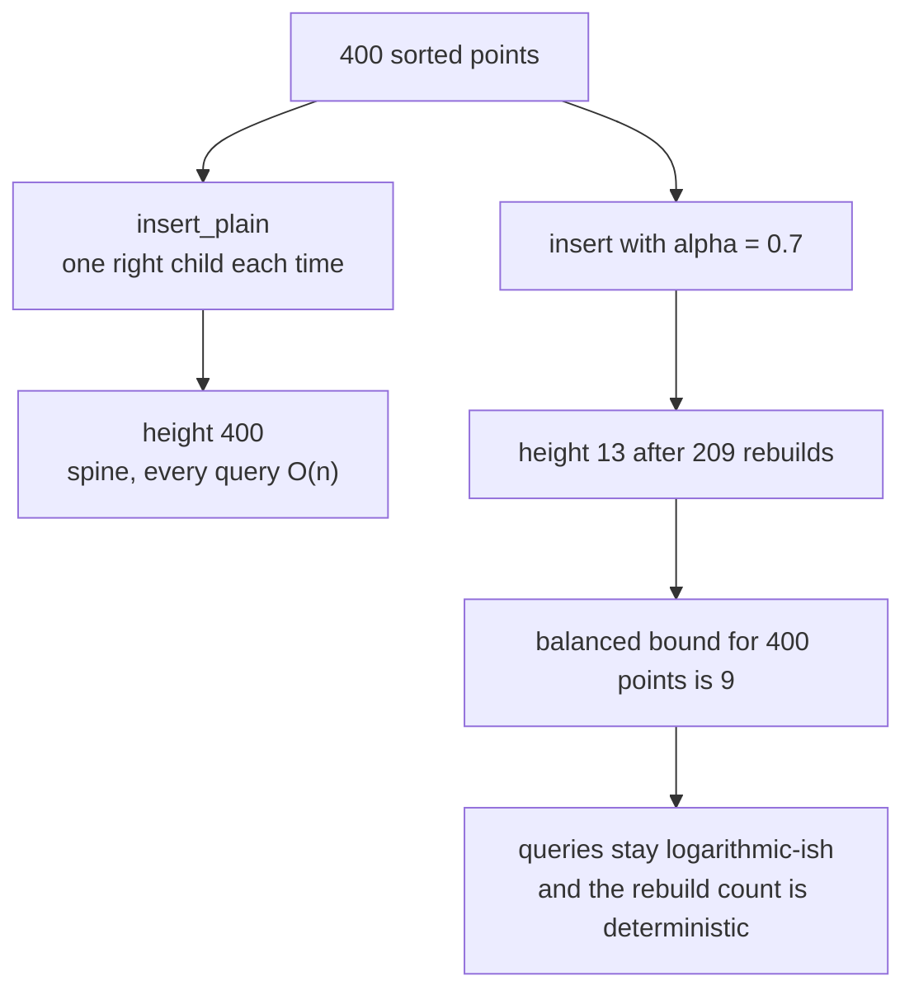
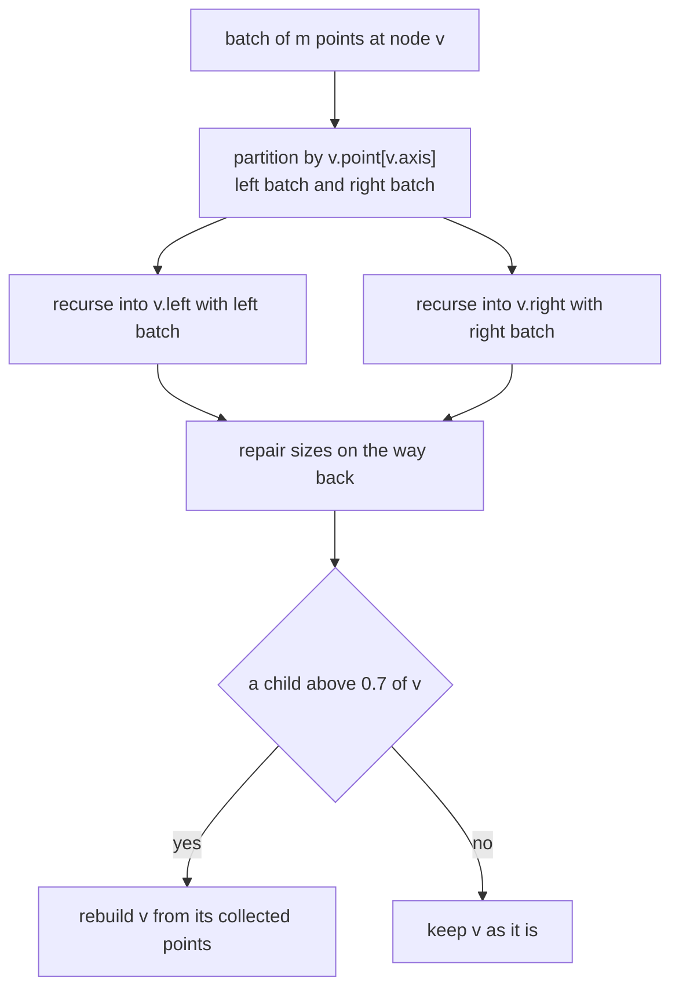
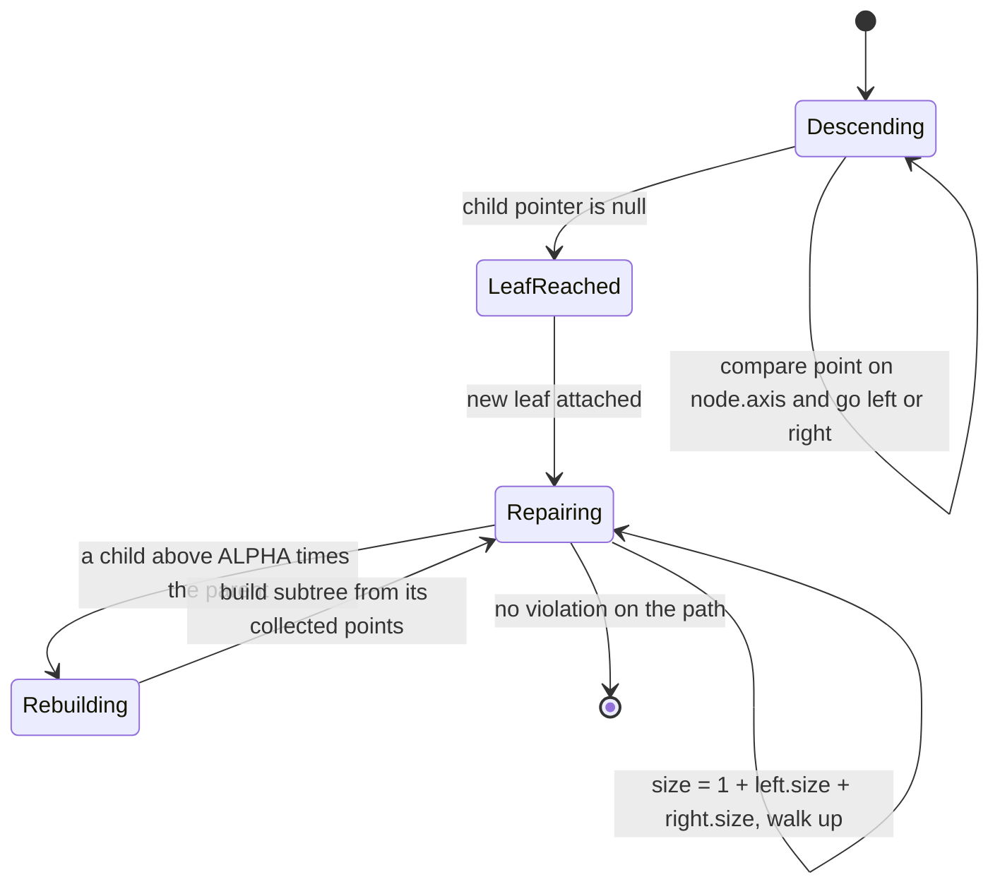
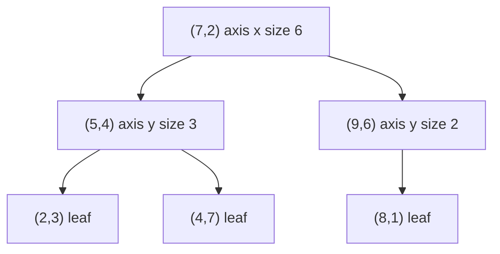

# 577 — Implement k-d tree with bulk insertion & balancing heuristics.

> **Tier:** Advanced · **CTCI chapter:** Beyond — Advanced Data Structures & Algorithms
> **Task spec:** [577-implement-k-d-tree-with-bulk-insertion-balancing-heuristics.md](../../../tasks/advanced/577-implement-k-d-tree-with-bulk-insertion-balancing-heuristics.md)
> **Solutions:** [Python](../../../solutions/python/advanced/577-implement-k-d-tree-with-bulk-insertion-balancing-heuristics/solution.py) ·
> [Java](../../../solutions/java/advanced/577-implement-k-d-tree-with-bulk-insertion-balancing-heuristics/Solution.java) ·
> [JavaScript](../../../solutions/javascript/advanced/577-implement-k-d-tree-with-bulk-insertion-balancing-heuristics/solution.js) ·
> [C#](../../../solutions/csharp/advanced/577-implement-k-d-tree-with-bulk-insertion-balancing-heuristics/Solution.cs)

## 1. Problem restatement

**Input:** a set of points on an integer grid (the demo uses `spread = 1000`, `dimensions = 2`), plus
the operations a spatial index has to support: build, single insertion, batch loading, and the three
queries.

**Output:** a k-d tree — a binary tree whose every node stores a point, the **split axis** it was
chosen on, its two children and the number of points in its subtree. Four solution files describe the
same structure and the same invariants:

| Piece | Meaning in the code |
| --- | --- |
| `Node(axis, point, left, right, size)` | `axis` = split dimension, `point` = stored tuple, `size` = subtree size maintained on every mutation |
| `build(points)` | recursive median split at the **widest-spread** axis |
| `insert(node, point)` | descend by the node axis, then walk back up and rebuild any subtree caught by the heuristic |
| `insert_plain(node, point)` | the same descent **without** the heuristic, kept to measure what the heuristic buys |
| `bulk_insert(node, batch)` | merge-based bulk load of a whole batch |
| `range_search(node, lower, upper)` | every stored point inside the closed box `[lower, upper]` |
| `nearest` / `k_nearest` | squared-distance nearest neighbours |

The spec file states only the one-line task, so the contract is fixed by the assertions the four
solutions ship with:

| Call | Result | Why |
| --- | --- | --- |
| `build` of 300 random points | `size == 300`, `tree_height == 9` | `balanced_bound(300) = ceil(log2 301) = 9` |
| height after 120 further `insert` calls | `<= 9 + 4 = 13` | the heuristic bounds the degradation |
| `insert(build(points), (7, 7)).size` | `301` | the stored sizes are repaired on the path |
| `range_search(root, (0, 0), (-1, -1))` | `[]` | an empty box |
| `range_search(root, (0, 0), (1000, 1000))` | all 300 points | the whole-universe box |
| `nearest(None, (0, 0))` / `k_nearest(None, (0, 0), 3)` | `None` / `[]` | the empty tree answers instead of crashing |
| 400 points inserted in sorted order with `insert_plain` | height `400` | a degenerate spine |
| the same 400 via `insert` with the heuristic | height `13`, exactly `209` rebuilds | `ALPHA = 0.7`, asserted, not assumed |

The partition invariant the files verify recursively is weaker than the textbook one: **left children
are `<=` the split coordinate on the node axis and right children are `>=`**, and nothing constrains
the other coordinates, because no bounding boxes are stored.

## 2. Intuition

The naive k-d tree is a binary search tree over alternating coordinates. Insert points `(0,0)`,
`(1,1)`, `(2,2)`, ... in sorted order and each new point compares greater on the node axis, so it
becomes a right child every single time: the tree is a chain of depth `n`. The solution file measures
exactly that — `assert plain_height == 400` on the sorted 400-point stream — and the median build is
not enough, because it only balances the **initial** population.

The classic fix is the scapegoat idea: keep a rebuild criterion that is checked while unwinding the
insertion path, and when a subtree violates it, throw that subtree away and rebuild it from scratch
with the same median rule. Here the criterion is the header's documented heuristic

```
subtree_size(child) > ALPHA * node.size        with ALPHA = 0.7
```

so a node may not let one child grow past 70 % of its own subtree. Unwinding from the new leaf
upward, the first violator is rebuilt; the rebuilt subtree is perfectly balanced by construction and
has at least a constant fraction of its ancestor's points, which is what keeps the height bounded
instead of linear.



The second insight is about **batches**. Inserting `m` points one at a time costs `m` descents plus
whatever rebuilds they trigger. But if the whole batch is known up front there is no need to descend
for each point separately: partition the batch at each visited node's split value, recurse into both
children with their own halves, and let the alpha test clean up. The batch is sorted into sides once
per level, giving the `O(m log m + updates)` total the header quotes, and points never have to be
compared against each other more than once per level.



## 3. Algorithm

The build is the recursive median split of the widest-spread axis.

1. For each axis, compute `max - min` over the candidate points; pick the axis with the largest
   spread, breaking ties toward the smaller axis index.
2. Sort the candidates by `(coordinate on that axis, whole point)` so the order is total.
3. Take the middle element as the node and recurse on the two halves.
4. Each recursion level stores the axis it split on; the subtree size is composed on the way back.

```text
function build(points, dimensions)
    if points is empty then
        return null
    end
    axis ← widest spread axis of points          # ties go to the smaller index
    ordered ← sort points by (point[axis], point)
    middle ← length(ordered) / 2
    return Node(axis,
                ordered[middle],
                build(ordered[0 .. middle - 1], dimensions),
                build(ordered[middle + 1 ..], dimensions))
end
```

Insertion descends, then repairs:

```text
procedure insert(node, point)
    if node is null then
        return Node(0, point, null, null)
    end
    if point[node.axis] <= node.point[node.axis] then
        node.left ← insert(node.left, point)      # ties go left
    else
        node.right ← insert(node.right, point)
    end
    node.size ← 1 + subtree_size(node.left) + subtree_size(node.right)
    if subtree_size(node.left) > ALPHA * node.size or
       subtree_size(node.right) > ALPHA * node.size then
        keep node.size in the rebuild log
        return build(collect_points(node), length(point))    # drops the old subtree
    end
    return node
end
```

Bulk loading reuses the same test but never descends per point:

```text
procedure bulk_insert(node, batch)
    if batch is empty then
        return node
    end
    if node is null then
        return build(batch)
    end
    left_batch ← points of batch with point[node.axis] <= node.point[node.axis]
    right_batch ← points of batch with point[node.axis] > node.point[node.axis]
    node.left ← bulk_insert(node.left, left_batch)
    node.right ← bulk_insert(node.right, right_batch)
    node.size ← 1 + subtree_size(node.left) + subtree_size(node.right)
    if a child exceeds ALPHA * node.size then
        keep node.size in the rebuild log
        return build(collect_points(node))
    end
    return node
end
```

The three queries share one shape — walk the tree with an explicit stack (or recursion), and prune a
whole subtree only when the node's **split coordinate** proves the subtree cannot contribute:

```text
procedure range_search(node, lower, upper)
    found ← empty list
    stack ← [node] if node is not null
    while stack is not empty do
        current ← pop(stack)
        if lower[axis] <= current.point[axis] <= upper[axis] for every axis then
            append current.point to found
        end
        if current.left is not null and lower[current.axis] <= current.point[current.axis] then
            push current.left
        end
        if current.right is not null and upper[current.axis] >= current.point[current.axis] then
            push current.right
        end
    end
    return found
end
```

`nearest` keeps the best candidate as the pair `(squared_distance, point)`, which makes ties break
deterministically by the point itself, visits the side that contains the target first, and only
enters the far side when `difference * difference <= best_distance`.

`k_nearest` is the same walk with a growing list of pairs that is re-sorted at each return, so the
"worst kept distance" that gates the far side is the `k`-th entry once `k` candidates are in hand.



## 4. Worked example

Take six points and build the tree the way `build` does:
`(2,3) (5,4) (9,6) (4,7) (8,1) (7,2)`. The x spread is `9 - 2 = 7`, the y spread is `7 - 1 = 6`, so
the root splits on **x**, ties broken by the `(x, y)` order.

| Call | Candidates | Widest axis | Sorted order | Middle | Node |
| --- | --- | --- | --- | --- | --- |
| `build(all)` | 6 points | x, spread 7 | `(2,3) (4,7) (5,4) (7,2) (8,1) (9,6)` | index 3 → `(7,2)` | root `(7,2)`, axis x |
| left half | `(2,3) (4,7) (5,4)` | y, spread 4 | `(2,3) (5,4) (4,7)` | index 1 → `(5,4)` | `(5,4)`, axis y |
| right half | `(8,1) (9,6)` | y, spread 5 | `(8,1) (9,6)` | index 1 → `(9,6)` | `(9,6)`, axis y |

The resulting tree has `size = 6` and height `3`, which is exactly `balanced_bound(6) = ceil(log2 7) = 3`.



Now run `range_search(root, (3, 2), (8, 7))`, the closed box that contains `(5,4)`, `(7,2)` and
`(4,7)`:

| Step | Popped | Inside box? | Push left? | Push right? | `found` |
| --- | --- | --- | --- | --- | --- |
| 1 | `(7,2)` axis x | yes, `3<=7<=8` and `2<=2<=7` | `lower[0]=3 <= 7` → yes | `upper[0]=8 >= 7` → yes | `(7,2)` |
| 2 | `(9,6)` axis y | no, `9 > 8` | `lower[1]=2 <= 6` → yes | `upper[1]=7 >= 6` but no right child | `(7,2)` |
| 3 | `(8,1)` axis y | no, `1 < 2` | no left child | no right child | `(7,2)` |
| 4 | `(5,4)` axis y | yes | `2 <= 4` → push `(2,3)` | `7 >= 4` → push `(4,7)` | `(7,2) (5,4)` |
| 5 | `(4,7)` axis y | yes | no left child | no right child | `(7,2) (5,4) (4,7)` |
| 6 | `(2,3)` axis y | no, `2 < 3` | no left child | no right child | unchanged |

Six pops for three answers; brute force would inspect all six points too, but the pruning pays off as
the tree grows — the visit of `(8,1)` happened only because the box's lower y bound is `2`.

For the nearest neighbour, query `(6,3)`. Squared distances: `(7,2) → 2`, `(5,4) → 2`, `(2,3) → 16`,
`(4,7) → 20`, `(8,1) → 8`, `(9,6) → 18`. The tree walk reaches `(2,(5,4))`, not `(2,(7,2))`, because
the tie is broken by the point: `(2,(5,4)) < (2,(7,2))`.


## 5. Complexity

Let `n` be the number of stored points, `m` the size of a bulk batch, and `k` the number of points a
query returns.

| Measure | Bound | Why it holds |
| --- | --- | --- |
| Build | O(n log² n) worst case | a node of size `s` sorts its candidates in `O(s log s)`; the levels sum to `O(n log n)` each, over `log n` levels |
| Build, median quality | height `ceil(log2(n + 1))` | asserted for the 300-point build (`9`); the middle element makes the halves differ by at most one |
| Insert, descent | O(log n) plus visits | compares only the node axis, one level per step |
| Insert, rebuild | O(s log s) for a subtree of size `s` | `collect_points` is `O(s)`, `build` is `O(s log s)` |
| Insert, amortized | the measured contrast | 400 sorted points: `insert_plain` gives height `400`, the heuristic gives height `13` with `209` rebuilds; the files assert `heuristic_height * 10 <= plain_height` |
| Bulk insert | O(m log m + updates) | each batch element is compared once per visited level; empty sides become freshly built balanced subtrees instead of `m` descents |
| Range search | worst case O(n + k) | no bounding boxes are stored, so a subtree can be pruned only on the split coordinate; the 40 random box queries are compared against brute force rather than assumed fast |
| Nearest / k-nearest | worst case O(n), typical much less | the far side is entered only when `difference² <= best distance`; the 60 comparison points match brute force distances exactly |
| Space | O(n) | one node per point; the rebuild log is the only extra store and is `O(rebuilds)` |


## 6. Pitfalls and edge cases

- **Ties go left.** `point[axis] <= node.point[axis]` descends left, so the right subtree obeys `>=`
  rather than `>`; a strict `>` in the descent would let duplicates drift to both sides and break the
  invariant check the files run (`right subtree obeys the split`).
- **Rebuild returns a new node.** `build(...)` produces a fresh subtree, so the caller must assign the
  result — `node.left = insert(node.left, point)` — or the rebuilt subtree is silently dropped.
- **Sizes are repaired before the alpha test.** The test divides by `node.size`, which must already
  include the new point; testing first would compare against a stale size.

## 7. Variants and follow-ups

- **Add bounding boxes.** Storing each subtree's box turns `range_search` into the textbook
  `O(sqrt(n) + k)` pruning walk; the solution files deliberately omit the box to keep the split-only
  invariant check honest.
- **Relax the heuristic.** `ALPHA` is a knob: smaller values rebuild more often and keep the height
  closer to the bound `9`, larger values rebuild rarely and let the height drift toward the chain of
  `400`.

## 8. Check yourself

1. Why does `insert_plain` produce a `400`-deep tree on sorted input, and what does the heuristic do
   instead?

<details><summary>Show answer</summary>

Every new point compares greater than the current node on that node's axis, so the descent always
turns right and the tree grows one level per insertion: height `400`. With the heuristic, unwinding
the path finds a node whose child exceeds `0.7 * size`, and that subtree is rebuilt by the median
rule; the file measures height `13` and `209` rebuilds, versus the balanced bound `9`.

</details>

2. The tree stores no bounding boxes. Which node coordinates can `range_search` use to prune, and
   which can it not?

<details><summary>Show answer</summary>

Only the split coordinate of the current node: the left child may be skipped when
`lower[node.axis] > node.point[node.axis]`, the right child when
`upper[node.axis] < node.point[node.axis]`. Because children are unconstrained on the other axes,
a subtree that is far away in the box's other dimensions still has to be examined, so the worst case
is `O(n)` and the demo verifies the answers against brute force.

3. Why is the descent test `<=` for the left side instead of `<`, and what invariant does the
   invariant checker therefore assert?

<details><summary>Show answer</summary>

So that duplicate coordinates have a single deterministic home: exact ties on the split axis always
go left. The checker walks the left subtree asserting `value <= node.point[node.axis]` and the right
subtree asserting `value >= node.point[node.axis]`, with the comment that points equal to the split
coordinate may sit on either side.

</details>

4. What does the bulk load save compared with `m` single insertions?

<details><summary>Show answer</summary>

It partitions the batch by each visited node's split value instead of descending once per point, so
each batch element is compared once per level: `O(m log m + updates)`. Empty sides become freshly
built balanced subtrees, which is why the file can compare a 200+150 bulk load against a tree rebuilt
from scratch on the same 350 points and assert equal query answers, equal sizes, and a height within
`2` of the rebuild.

</details>

5. When exactly does a rebuild fire, and why can it not fire on a subtree of one point?

<details><summary>Show answer</summary>

When, after the sizes are repaired, `subtree_size(left) > 0.7 * size` or
`subtree_size(right) > 0.7 * size`. A single-point subtree has `size = 1`, one child of size `0` and
one of size `0`, so neither test can hold — the file asserts `all(size >= 2 for size in log)` on the
400-point sorted stream.

</details>