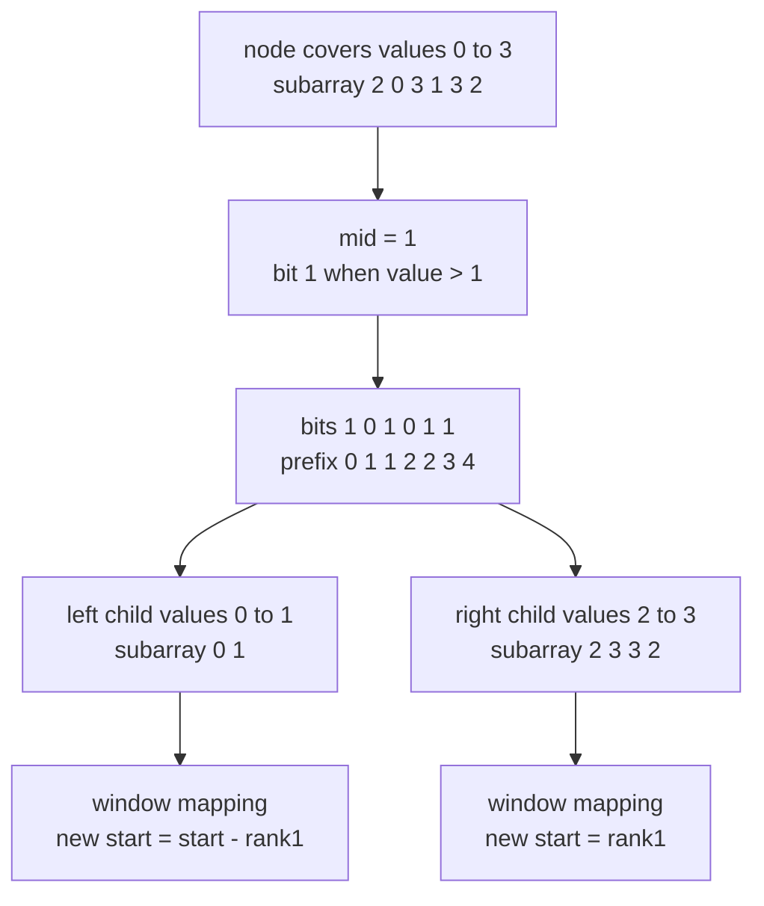
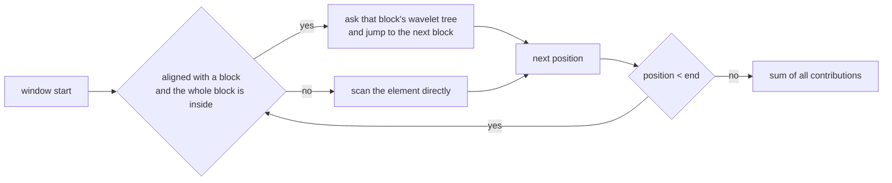
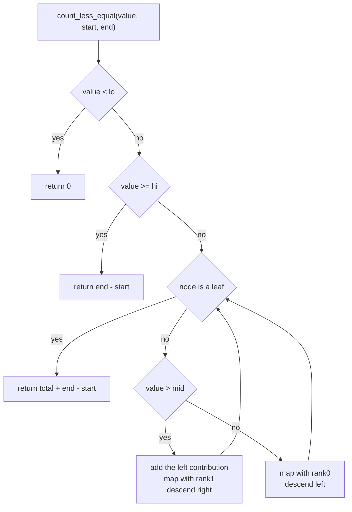
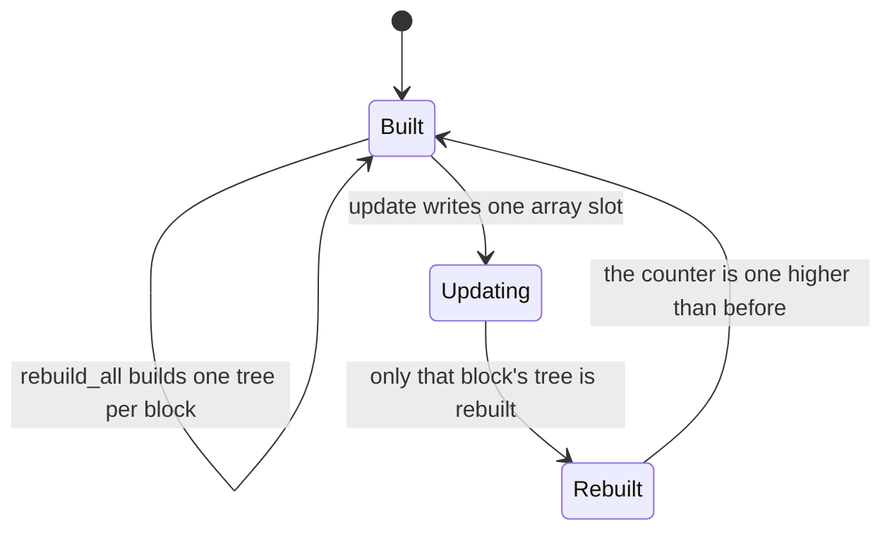

# 578 — Implement dynamic orthogonal range counting with wavelet tree (conceptual).

> **Tier:** Advanced · **CTCI chapter:** Beyond — Advanced Data Structures & Algorithms
> **Task spec:** [578-implement-dynamic-orthogonal-range-counting-with-wavelet-tree-co.md](../../../tasks/advanced/578-implement-dynamic-orthogonal-range-counting-with-wavelet-tree-co.md)
> **Solutions:** [Python](../../../solutions/python/advanced/578-implement-dynamic-orthogonal-range-counting-with-wavelet-tree-co/solution.py) ·
> [Java](../../../solutions/java/advanced/578-implement-dynamic-orthogonal-range-counting-with-wavelet-tree-co/Solution.java) ·
> [JavaScript](../../../solutions/javascript/advanced/578-implement-dynamic-orthogonal-range-counting-with-wavelet-tree-co/solution.js) ·
> [C#](../../../solutions/csharp/advanced/578-implement-dynamic-orthogonal-range-counting-with-wavelet-tree-co/Solution.cs)

## 1. Problem restatement

**Input:** an array of integers `symbols`, and two kinds of request.

* **query** `[start, end)` (index range) with `[low, high]` (value range): how many positions `i` with
  `start <= i < end` carry a value in `[low, high]`?
* **point update** `update(index, value)`: overwrite one element.

**Output:** the counts, plus the instrumentation the task asks for — the number of block trees that
were rebuilt.

The spec is one line plus "(conceptual)", and the solution files are explicit about where the
concept ends. The **static** part is a real wavelet tree: every node covers a value range `[lo, hi]`,
stores one bit per symbol of its subarray (`1` when the symbol is above the node's midpoint) with the
prefix counts of those bits, and splits its subarray into the two children. The **dynamic** part is a
documented simplification.

> A genuine dynamic wavelet tree (pointer-machine or Fenwick-of-trees) is out of scope here. The file
> keeps the array in fixed blocks of `32` elements, gives **every block its own wavelet tree**,
> rebuilds exactly one block's tree per point update, and answers a range count as whole-block counts
> plus a linear scan of the two partial blocks. An update costs `O(B log sigma)`, a query
> `O((n/B) log sigma + B)`.

| Call | Result | Why |
| --- | --- | --- |
| `count_range(5, 9, 4, 8)` | `3` | three of the four values at indices 4..7 lie in `[5, 9]` (the file names `5`, `9` and `6`) |
| `count_range(2, 3, 0, 4)` | `1` | of `3, 1, 4, 1` only the leading `3` lies in `[2, 3]` |
| `count_range(7, 7, 0, 8)` | `0` | `a = b = 7` is a legal window that happens to miss |
| `count_range(0, 10, 3, 3)` | `0` | an empty index range |
| `count_range(-5, 200, 0, 500)` | `500` | the window covers everything |
| `count_range(200, 300, 0, 500)` | `0` | the window misses everything |
| `count_range(50, 50, 0, 500)` | `data.count(50)` | a single value is just a frequency count |
| `count_less_equal(-1, 0, 500)` / `(1000, 0, 500)` | `0` / `500` | the clamp cases |
| `rebuilds` after building 500 symbols | `ceil(500 / 32) = 16` | one tree per block, asserted |
| `rebuilds` after `u` updates and `r` written-back positions | `16 + u + r` | the counter is instrumented on every path |

The identity the file insists on is

```
count_range(low, high, start, end) == count_less_equal(high, start, end)
                                   - count_less_equal(low - 1, start, end)
```

which is checked directly, on top of 200 random index/value windows compared against brute force.

## 2. Intuition

Counting values in a window of indices and a window of values is a two-dimensional question, and a
plain prefix-count table answers it in `O(sigma)` per query (one counter per value) while a plain
wavelet tree answers it in `O(log sigma)` but is **static**: the bit vectors and their prefix counts
are laid out once and an update would invalidate every prefix count to its right.

The first insight is the wavelet descent. A node splits its value range at the midpoint and puts the
low symbols in the left child, the high symbols in the right child, storing a bit per symbol plus the
prefix count of `1`-bits. That single stored bit vector answers two questions at once: how many
symbols in the window went right (`rank1`), and how many went left (window length minus `rank1`).
Mapping the window through those two counts gives the corresponding window in the child — so a query
about "how many values `<= x`" walks down the tree, one level per bit of the value range, and adds a
whole left subtree's contribution whenever the descent turns right.



The second insight is how to get updates back. Rebuilding everything per update is `O(n log sigma)`;
storing nothing and scanning is `O(n)` per query. The file takes the middle road: cut the array into
fixed blocks of `32`, build one wavelet tree per block, and on an update rebuild **only that block's
tree**. A query then decomposes its index range into complete blocks — answered by the block trees in
`O((n/B) log sigma)` — plus at most two partial blocks that are scanned linearly in `O(B)`. Choosing
`B = 32` balances the two terms.



Because the counter never inserts or deletes, only overwrites positions that already exist, `B` stays
fixed and no block ever changes its boundaries — a true dynamic wavelet tree would have to support
insertion in the middle of the value domain, which is exactly the part the header declares out of
scope.

## 3. Algorithm

**Static wavelet tree.** Every node is built from the list of symbols it covers.

1. If `lo == hi` the node is a leaf: every symbol equals `lo`, and the prefix table is all zeros.
2. Otherwise set `mid = (lo + hi) / 2` and walk the symbols once, appending to `prefix` the running
   count of symbols strictly greater than `mid`.
3. Recurse on the low symbols (`<= mid`) and the high symbols (`> mid`) as the two children.

**Prefix count `<= value` on an index window.** Start at the root with `[start, end)` and
`total = 0`. The loop is the whole algorithm: at each step decide whether the value goes left (then map
the window through `rank0`) or right (then add the left child's contribution for that window, map the
window through `rank1`, and descend right). At the leaf, the window length is the answer.

```text
function count_less_equal(value, start, end)
    if root is null or end <= start or value < lo then
        return 0
    end
    if value >= hi then
        return end - start
    end
    node ← root
    total ← 0
    while node.lo != node.hi do
        if value > node.mid then
            total ← total + (end - node.prefix[end]) - (start - node.prefix[start])
            start ← node.prefix[start]
            end ← node.prefix[end]
            node ← node.right
        else
            start ← start - node.prefix[start]
            end ← end - node.prefix[end]
            node ← node.left
        end
    end
    return total + (end - start)
end
```

Those two constant-time window maps are the heart of the structure: `rank1(i) = prefix[i]` and
`rank0(i) = i - prefix[i]`. A value window is then answered by two prefix counts, which is what makes
`count_range` an `O(log sigma)` operation instead of a scan.



**Dynamic layer.** `DynamicRangeCounter` keeps `data` (the plain array), one `WaveletTree` per block
and the rebuild counter.

1. `rebuild_all()` slices `data` into `ceil(n / B)` blocks and builds a tree for each one, counting
   one rebuild per block (`16` for `n = 500`, `B = 32`).
2. `update(index, value)` writes the array and replaces **only** the tree of `index / B`, counting
   one rebuild.
3. `count(low, high, start, end)` walks the window: while a whole aligned block fits inside the
   window it asks that block's tree in `O(log sigma)` and jumps to the next block; otherwise it
   compares the single element and advances by one.

```text
procedure count(low, high, start, end)
    if low > high or end <= start then
        return 0
    end
    total ← 0
    position ← start
    while position < end do
        block_index ← position / block
        block_start ← block_index * block
        block_end ← min(block_start + block, length(data))
        if position == block_start and block_end <= end then
            total ← total + trees[block_index].count_range(low, high, 0, block_end - block_start)
            position ← block_end
        else
            if low <= data[position] <= high then
                total ← total + 1
            end
            position ← position + 1
        end
    end
    return total
end
```



## 4. Worked example

Build the static tree on `symbols = [2, 0, 3, 1, 3, 2]`, so `lo = 0`, `hi = 3`. The root's midpoint is
`mid = 1`, and a symbol contributes a `1` bit when it is strictly greater than `1`:

| Node | Value range | Subarray | Bits (`1` when `> mid`) | Prefix counts |
| --- | --- | --- | --- | --- |
| root | `[0, 3]`, `mid = 1` | `2 0 3 1 3 2` | `1 0 1 0 1 1` | `0 1 1 2 2 3 4` |
| left | `[0, 1]`, `mid = 0` | `0 1` | `0 1` | `0 0 1` |
| right | `[2, 3]`, `mid = 2` | `2 3 3 2` | `0 1 1 0` | `0 0 1 2 2` |
| left-left | `[0, 0]` leaf | `0` | — | `0 0` |
| right-left | `[2, 2]` leaf | `2 2` | — | `0 0 0` |

Now ask `count_less_equal(2, 1, 6)`: how many of `symbols[1:6] = 0 3 1 3 2` are `<= 2`? (Answer:
`0, 1, 2` → `3`.) The trace, following the code line by line:

| Step | Node (`lo, hi, mid`) | Window `[start, end)` | Condition | Action | `total` |
| --- | --- | --- | --- | --- | --- |
| 1 | root `0, 3, 1` | `[1, 6)` | `value = 2 > mid = 1` | add `(6 - 4) - (1 - 1) = 2`; then `start = prefix[1] = 1`, `end = prefix[6] = 4`; go right | `2` |
| 2 | right `2, 3, 2` | `[1, 4)` | `value = 2 > mid = 2` is false | `start = 1 - 0 = 1`, `end = 4 - 2 = 2`; go left | `2` |
| 3 | leaf `2, 2` | `[1, 2)` | `lo == hi` | return `2 + (2 - 1)` | `3` |

Step 1 is the interesting one: the two symbols of the window that fell into the left child (`0` and
`1`, both `<= 2`) are counted there in one subtraction, and the window is then re-expressed in the
right child's coordinates (`1, 4`).

The second call needed by a range query is `count_less_equal(1, 1, 6)` = `2` (`0` and `1` are `<= 1`):

| Step | Node | Window | Condition | Action | `total` |
| --- | --- | --- | --- | --- | --- |
| 1 | root `0, 3, 1` | `[1, 6)` | `value = 1 > mid = 1` false | `start = 1 - 1 = 0`, `end = 6 - 4 = 2`; go left | `0` |
| 2 | left `0, 1, 0` | `[0, 2)` | `value = 1 > mid = 0` | add `(2 - 1) - (0 - 0) = 1`; `start = prefix[0] = 0`, `end = prefix[2] = 1`; go right | `1` |
| 3 | leaf `1, 1` | `[0, 1)` | `lo == hi` | return `1 + (1 - 0)` | `2` |

So `count_range(2, 4, 1, 6) = count_less_equal(4, 1, 6) - count_less_equal(1, 1, 6) = 5 - 2 = 3`,
because `value = 4 >= hi = 3` short-circuits the first call to `end - start = 5`. Checking by hand:
`symbols[1:6] = 0 3 1 3 2` contains `3, 3, 2` in `[2, 4]` — also `3`. The count matches.


## 5. Complexity

Let `n` be the array length, `sigma` the value range size, `B` the block size (`32` in the demo), and
`q` the number of update calls.

| Measure | Bound | Why it holds |
| --- | --- | --- |
| Static build | O(n log sigma) | each level stores one bit per symbol, and the recursion has `log sigma` levels |
| `count_less_equal` | O(log sigma) | one constant-time window map per level, no scan |
| `count_range` | O(log sigma) | two prefix counts, as the identity asserts |
| Static `count_range` over `n` elements | O(log sigma) | a single tree covers the whole array |
| Dynamic query | O((n/B) log sigma + B) | `n/B` whole blocks through their trees plus at most two partial scans |
| Dynamic update | O(B log sigma) | one block tree is rebuilt from `B` symbols |
| Stored bits | one bit per symbol per level | the prefix tables add the same order, so `O(n log sigma)` integers per block tree |
| Instrumented cost | `rebuilds = ceil(n/B) + updates (+ write-backs)` | asserted, including `ceil(500/32) = 16` |


## 6. Pitfalls and edge cases

- **Half-open index range, closed value range.** The asymmetry is what forces the `low - 1` in the
  identity, and it is why `a = b` is a legal single-value window.
- **Clamping before descending.** `value < lo` returns `0` and `value >= hi` returns the window length, so
  `count_less_equal(-1, 0, 500) = 0` and `count_less_equal(1000, 0, 500) = 500`; an empty or reversed
  index range and `low > high` all return `0`.
- **Duplicates go left.** Symbols equal to the midpoint satisfy `<= mid`, so equal values always land in
  the same child and the descent never has to handle an empty value range.
- **Leaf tables are all zeros.** A leaf stores `size + 1` zeros and the descent loop exits before using
  them (`while node.lo != node.hi`); the answer there is the window length.

## 7. Variants and follow-ups

- **Static-only version.** Dropping the block layer and using one tree for the whole array gives
  `O(log sigma)` queries and no updates — that is the plain [579-implement-wavelet-tree-for-strings-rank-select.md](../../../tasks/advanced/579-implement-wavelet-tree-for-strings-rank-select.md)
  structure, which adds `access`, `select` and per-symbol counts on top of the same bit vectors.
- **Range *k*-th order statistic.** If the question is "which value is the `k`-th smallest in the
  window" instead of "how many values are in this window", the descent direction changes and a
  persistent segment tree answers it — see
  [429-implement-range-kth-order-statistic-using-persistent-segtree.md](../../../tasks/advanced/429-implement-range-kth-order-statistic-using-persistent-segtree.md).
- **Alternating the two update strategies.** A persistent tree
  ([421-implement-persistent-segment-tree-versioned.md](../../../tasks/advanced/421-implement-persistent-segment-tree-versioned.md))
  keeps history instead of rebuilding in place, which is the right choice when queries must see old
  versions.

## 8. Check yourself

1. Why is `count_less_equal` allowed to return as soon as `value >= hi`?

<details><summary>Show answer</summary>

Because the tree's value range is `[lo, hi]`; if the threshold reaches `hi` then every symbol in the
window satisfies `<= value`, so the answer is exactly the window length `end - start`. The symmetric
guard `value < lo` returns `0`. Those two clamps are also what make out-of-range windows cheap and
correct: `count_range(-5, 200, 0, 500) == 500`.

</details>

2. What exactly does the prefix table of a node store, and how do the two window maps use it?

<details><summary>Show answer</summary>

`prefix[i]` is the number of symbols among the first `i` of the node's subarray that are strictly
greater than `node.mid`. That makes `rank1(i) = prefix[i]` and `rank0(i) = i - prefix[i]`. Descending
right maps the window through `rank1`; descending left maps it through `rank0`. When the descent
turns right, the symbols that went left are exactly the ones `<= value`, and they are counted at once
by `(end - prefix[end]) - (start - prefix[start])`.

</details>

3. The dynamic layer rebuilds a whole block tree per update. Why is that still better than rebuilding
   the single global tree?

<details><summary>Show answer</summary>

An update rebuilds `B = 32` symbols' worth of bit vectors, `O(B log sigma)`, instead of `O(n log
sigma)` for the whole array; queries pay `O((n/B) log sigma + B)` because they consult `n/B` block
trees and scan at most two partial blocks. `B = 32` keeps both terms small, and the rebuild counter
is asserted to equal `ceil(500/32) = 16` plus one per update.

</details>

4. Why can the counter support `update` but not `insert` or `delete`?

<details><summary>Show answer</summary>

Because the block boundaries depend only on the array length. An update overwrites an existing slot, so
every block keeps its position and size, and rebuilding one tree restores a consistent structure.
Inserting in the middle would shift every following element across block boundaries and invalidate
every block tree after that point — the part a real dynamic wavelet tree solves with a different
representation, which the solution header declares out of scope.

</details>

5. Why does `count_range` use `count_less_equal(low - 1)` instead of `count_less_equal(low)`?

<details><summary>Show answer</summary>

Because the value window is closed while the subtraction counts two "at most" quantities:
`count(v <= high) - count(v < low)` is the count of `low <= v <= high`. Since the symbols are
integers, `v < low` is `v <= low - 1`, and the file asserts this identity directly against
`count_range`.

</details>